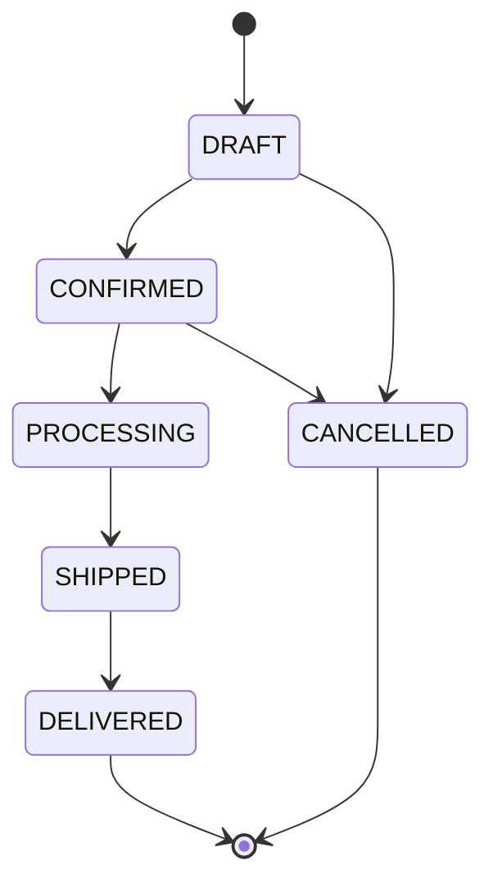

# Contract, schema và negative test

API là hợp đồng giữa provider và các consumer như web app, mobile app, service nội bộ, đối tác hoặc webhook receiver. Hợp đồng mô tả endpoint, method, request/response, error, authentication, giới hạn và semantics nghiệp vụ mà client có thể dựa vào. Nếu hợp đồng không rõ hoặc không được kiểm thử, hai phía có thể hiểu khác nhau: client gửi field mà server không hỗ trợ, server thay đổi kiểu dữ liệu, endpoint vô tình trả thêm thông tin nhạy cảm hoặc một request thiếu quyền vẫn tạo side effect.

**Contract testing** xác minh provider và consumer tuân thủ hợp đồng đã thống nhất. **Schema testing** xác minh cấu trúc và kiểu dữ liệu của request/response. **Negative testing** xác minh API từ chối đúng các request không hợp lệ, không được xác thực, không đủ quyền hoặc vi phạm giới hạn. Trong API security, negative test đặc biệt quan trọng: một test thành công chứng minh một luồng được phép hoạt động; test từ chối chứng minh các luồng ngoài quyền không thể thực hiện hành động hoặc đọc dữ liệu.

Với `SECURITY_API_SECURITY`, contract phải bao gồm xác thực, phân quyền chức năng và object, tenant boundary, field-level access, validation, error semantics, resource limits và side effects. Kiểm thử cần theo endpoint, object dữ liệu và luồng nghiệp vụ, thay vì chỉ xác nhận server trả `200 OK`.

## 1. Contract API gồm những gì?

Một API contract không chỉ là danh sách URL. Nó mô tả những gì client được gửi, những gì server có thể trả về và các điều kiện cần đáp ứng.

| Thành phần | Nội dung cần định nghĩa | Ví dụ |
|---|---|---|
| Route và method | Path, HTTP method, path/query parameter | `PATCH /v1/orders/{orderId}` |
| Request schema | Field, type, required, format, giới hạn | `status`, `note`, `If-Match` |
| Response schema | Field được trả, nullability, format | `id`, `status`, `updatedAt` |
| Error contract | Status, public code, error body | `403 ACCESS_DENIED`, `409 STATE_CONFLICT` |
| Authentication | Credential và token profile | Bearer JWT, API key, mTLS |
| Authorization | Scope, role, object và tenant policy | `orders:update` trên order thuộc tenant |
| Field access | Field nào được đọc/ghi theo actor | `total` read-only, `internalNote` admin-only |
| Business semantics | State transition, idempotency, side effect | Không hủy order đã shipped |
| Resource limits | Body size, page size, quota, timeout | `pageSize <= 100` |
| Versioning | API/schema version và compatibility | `/v1`, `/v2`, `schemaVersion` |
| Operational behavior | Retry, pagination, caching, async status | `Retry-After`, cursor, operation ID |

Contract cần mô tả cả hành vi bảo mật. Ví dụ, hai request có cùng schema nhưng một request từ user thuộc tenant A và một request từ tenant B có thể nhận kết quả khác nhau vì object authorization. Điều đó không thể được thể hiện đầy đủ bằng JSON Schema; cần contract behavior và security tests bổ sung.

### 1.1. Contract là ranh giới giữa các thành phần

Consumer có thể là frontend, mobile app, partner integration hoặc service khác. Provider có thể thay đổi implementation, database hay framework, nhưng phải giữ contract đã cam kết hoặc quản lý breaking change qua version/deprecation. Ngược lại, consumer không nên phụ thuộc vào field nội bộ, thứ tự JSON key, stack trace hoặc hành vi không được tài liệu hóa.

Contract rõ ràng giúp:

- Phát hiện request/response không tương thích trước khi release.
- Xác định endpoint nào yêu cầu credential và permission nào.
- Ngăn việc vô tình thêm field nhạy cảm vào response.
- Làm rõ `null`, missing field, default và enum behavior.
- Giữ error status/code ổn định cho client.
- Tạo test tự động cho positive và negative scenarios.
- Phát hiện thay đổi có thể phá consumer hoặc mở rộng quyền ngoài dự kiến.

## 2. OpenAPI và schema là nguồn hợp đồng có thể kiểm tra

OpenAPI mô tả HTTP API: path, operation, parameter, request body, response, security scheme và schema. JSON Schema mô tả cấu trúc dữ liệu JSON, bao gồm type, required, format, range, pattern và object properties. Có thể dùng OpenAPI làm contract chính, sau đó tái sử dụng schema cho validation, code generation, documentation và test.

Ví dụ rút gọn OpenAPI 3.x:

```yaml
openapi: 3.1.0
info:
  title: Orders API
  version: 1.0.0
paths:
  /v1/orders/{orderId}:
    patch:
      operationId: updateOrder
      security:
        - bearerAuth: []
      parameters:
        - name: orderId
          in: path
          required: true
          schema:
            type: string
            minLength: 1
            maxLength: 64
        - name: If-Match
          in: header
          required: true
          schema:
            type: string
      requestBody:
        required: true
        content:
          application/json:
            schema:
              $ref: '#/components/schemas/UpdateOrderRequest'
      responses:
        '200':
          description: Order updated
          content:
            application/json:
              schema:
                $ref: '#/components/schemas/OrderResponse'
        '401':
          $ref: '#/components/responses/Unauthorized'
        '403':
          $ref: '#/components/responses/Forbidden'
        '404':
          $ref: '#/components/responses/NotFound'
        '409':
          $ref: '#/components/responses/Conflict'
components:
  securitySchemes:
    bearerAuth:
      type: http
      scheme: bearer
      bearerFormat: JWT
  schemas:
    UpdateOrderRequest:
      type: object
      additionalProperties: false
      required: [status]
      properties:
        status:
          type: string
          enum: [CONFIRMED, CANCELLED]
        note:
          type: [string, 'null']
          maxLength: 500
    OrderResponse:
      type: object
      required: [id, status, version]
      properties:
        id:
          type: string
        status:
          type: string
        version:
          type: integer
```

Đây là ví dụ minh họa, cần bổ sung đầy đủ schema, error response, scope, content negotiation và security policy của hệ thống thực tế. OpenAPI security scheme mô tả cách cung cấp credential, nhưng không tự mô tả đầy đủ object-level authorization hoặc tenant ownership. Những điều kiện này phải được thể hiện bằng mô tả operation, extension/policy metadata nếu tổ chức có quy ước, và test thực thi.

### 2.1. Schema cần xác định rõ required, optional và nullable

Ba trạng thái sau khác nhau:

- **Required:** field bắt buộc phải xuất hiện.
- **Optional:** field có thể không xuất hiện.
- **Nullable:** field có thể xuất hiện với giá trị `null`.

Trong JSON Schema/OpenAPI 3.1, nullable có thể biểu diễn bằng union type, ví dụ `type: [string, 'null']`. Với OpenAPI 3.0, cách khai báo thường dùng `nullable: true`. Cần chọn đúng phiên bản và cú pháp; không trộn semantics giữa các phiên bản.

Với PATCH, contract phải nói rõ field bị bỏ qua có nghĩa là giữ nguyên, còn `null` có nghĩa là xóa hay không hợp lệ. Nếu không định nghĩa, client và server dễ xử lý khác nhau, dẫn đến mất dữ liệu hoặc vô tình xóa field.

### 2.2. Giới hạn schema là một phần của bảo vệ tài nguyên

Định nghĩa `minLength`, `maxLength`, `minimum`, `maximum`, `maxItems`, `maxProperties`, pattern và giới hạn nested depth khi phù hợp. Với pagination, giới hạn `pageSize`; với batch, giới hạn số item; với upload, giới hạn kích thước file; với GraphQL, giới hạn depth/complexity. Schema validation không thay thế timeout hoặc runtime resource limit, nhưng chặn được nhiều input quá lớn ngay tại biên API.

### 2.3. Unknown fields và mass assignment

Nếu DTO chấp nhận mọi field tùy ý rồi bind trực tiếp vào entity, client có thể gửi các field nội bộ như `tenantId`, `ownerId`, `role`, `isAdmin`, `approvedAt` hoặc `balance`. Nên dùng request DTO allowlist chỉ chứa field client được phép cập nhật. Có thể từ chối unknown fields (`additionalProperties: false`) nếu contract yêu cầu strict schema; nếu cho phép mở rộng, vẫn phải bỏ qua hoặc từ chối field nhạy cảm một cách có chủ đích.

Không dựa vào việc client ẩn field hoặc không đưa field vào form. Negative test phải gửi trực tiếp các field bị cấm và xác minh chúng không thay đổi dữ liệu.

## 3. Contract test ở phía provider và consumer

Có hai góc nhìn bổ sung nhau:

- **Provider contract test:** xác minh API server thực tế tuân thủ contract đã công bố.
- **Consumer-driven contract test:** consumer mô tả request/response mà nó phụ thuộc; provider chạy verification để bảo đảm thay đổi không phá các consumer đã đăng ký.

Một quy trình có thể gồm:

1. Consumer định nghĩa interaction cần thiết, không mô tả toàn bộ implementation.
2. Contract được version hóa và lưu trong repository hoặc contract broker.
3. Provider chạy verification với implementation/build candidate.
4. CI kiểm tra provider có đáp ứng các interaction của consumer đang được hỗ trợ không.
5. Release pipeline kiểm tra compatibility với version đang triển khai và version dự kiến.

Contract test giúp phát hiện mismatch trước production, nhưng không thay integration test hoặc security test. Một contract có thể xác nhận `GET /orders/123` trả `200` cho một fixture mà không kiểm tra user tenant khác có đọc được order đó không. Cần bổ sung test theo principal, tenant và object.

### 3.1. Consumer contract nên tập trung vào hành vi được sử dụng

Không nên ghi lại mọi field của response nếu consumer không dùng chúng; contract quá chi tiết khiến provider khó thay đổi implementation. Ngược lại, những field/semantics mà consumer thực sự phụ thuộc cần được kiểm tra. Ví dụ:

- Mobile app dùng `order.id`, `order.status` và `ETag`.
- Billing service phụ thuộc vào `paymentId`, `amount` và idempotency semantics.
- Webhook consumer phụ thuộc event ID, timestamp và signature header.
- Admin portal cần error code `ACCESS_DENIED` để hiển thị luồng yêu cầu quyền.

Contract phải ghi rõ behavior security-critical dù consumer không thể kiểm tra nó bằng schema đơn thuần. Có thể lưu các security expectation riêng trong test suite của provider.

### 3.2. Provider verification phải dùng implementation thật ở mức phù hợp

Mock mọi dependency trong provider contract test có thể làm test xanh dù controller, filter chain hoặc serialization thực tế sai. Dùng test slice hoặc application context đủ để chạy routing, security filter, validation, exception mapping và serialization. Dependency bên ngoài có thể được thay bằng stub có kiểm soát, nhưng authentication/authorization logic đang được kiểm thử phải là logic thật.

### 3.3. Contract compatibility khi thay đổi schema

| Thay đổi | Khả năng tương thích | Điều cần test |
|---|---|---|
| Thêm response field optional | Thường additive nhưng strict client có thể lỗi | Consumer parser và unknown field behavior |
| Xóa response field | Breaking với consumer đang dùng field | Contract references và usage telemetry |
| Thêm request field optional | Thường additive nếu default an toàn | Server cũ/mới và default semantics |
| Thêm request field required | Breaking | Consumer migration và validation error |
| Đổi type hoặc format | Thường breaking | Generated SDK, parser và boundary values |
| Thêm enum value | Có thể phá strict enum client | Unknown enum handling |
| Xóa enum value | Breaking | Consumer switch/logic |
| Thay đổi null/default semantics | Có thể đổi hành vi mà schema vẫn hợp lệ | Missing/null/empty tests |
| Thêm scope bắt buộc | Breaking về security contract | Token claims và authorization tests |
| Bỏ field nhạy cảm | Có thể cần breaking change vì security | Data exposure regression và migration |

Không kết luận compatibility chỉ từ schema diff. Cần xem cả authentication, permission, status code, retry behavior, rate limit và side effect.

## 4. Positive test và negative test

Positive test xác minh request hợp lệ, đúng quyền và đúng trạng thái được xử lý. Negative test xác minh request vi phạm một hoặc nhiều điều kiện bị từ chối an toàn.

| Loại test | Câu hỏi | Ví dụ |
|---|---|---|
| Positive | Caller hợp lệ có thực hiện được action được cấp không? | User A cập nhật order A trong tenant A |
| Authentication negative | Request không có credential hoặc credential sai có bị từ chối không? | Missing, expired, invalid signature, wrong audience |
| Function authorization negative | User thiếu permission có bị từ chối không? | `orders:read` gọi refund |
| Object authorization negative | User có quyền chức năng nhưng object không thuộc phạm vi có bị chặn không? | Tenant A đọc order tenant B |
| Field authorization negative | Client có ghi/đọc field ngoài quyền không? | Gửi `ownerId`, `role`, `internalNote` |
| Validation negative | Input sai schema hoặc vượt giới hạn có bị từ chối không? | Enum lạ, string quá dài, page size quá lớn |
| Business negative | State transition không hợp lệ có bị chặn không? | Hủy order đã shipped |
| Abuse negative | Request tốn kém hoặc lặp có bị giới hạn không? | Batch quá lớn, quota exhausted |
| Protocol negative | Content type/header/method sai có bị từ chối đúng không? | `text/plain` khi chỉ nhận JSON |

Một bộ test chỉ có positive path dễ bỏ sót BOLA/IDOR, mass assignment, privilege escalation, replay hoặc resource exhaustion. Với mỗi operation nhạy cảm, hãy xác định ít nhất một trường hợp hợp lệ và các trường hợp từ chối đại diện cho trust boundary của nó.

## 5. Ma trận negative test cho authentication

Kiểm thử authentication không chỉ là “không có token thì 401”. Cần xác minh token/credential được kiểm tra theo đúng profile.

| Tình huống | Kết quả mong đợi |
|---|---|
| Không có credential | `401` hoặc challenge theo contract; không side effect |
| Bearer token sai định dạng | Từ chối; không fallback sang identity khác |
| Chữ ký JWT sai | Từ chối |
| `alg=none` hoặc algorithm ngoài allowlist | Từ chối |
| Issuer không tin cậy | Từ chối |
| Audience không dành cho API này | Từ chối |
| Token hết hạn | Từ chối theo clock-skew policy |
| Token chưa có hiệu lực | Từ chối |
| Key ID không tồn tại hoặc key đã revoke | Từ chối hoặc xử lý theo key rotation policy |
| Opaque token introspection timeout | Không mặc định token hợp lệ |
| API key bị disable/rotate | Credential cũ bị từ chối sau thời điểm hiệu lực |
| mTLS certificate sai SAN/expired/revoked | Handshake hoặc application authentication bị từ chối |
| Token hợp lệ nhưng loại principal không được phép | Từ chối theo endpoint contract |

Test cần xác minh cả response và side effect. Ví dụ, token sai không chỉ trả `401`; nó cũng không được tạo job, ghi outbox event, cập nhật dữ liệu hoặc gọi downstream provider.

## 6. Ma trận negative test cho function và object authorization

Authorization cần được kiểm thử ở cả chức năng và object. User có permission `orders:read` vẫn không được đọc mọi order trong hệ thống.

### 6.1. Function-level authorization

- Anonymous gọi endpoint cần login.
- User thường gọi endpoint admin.
- Service account gọi action ngoài audience/scope.
- Read-only role gọi create/update/delete.
- User có `orders:read` gọi `orders:refund`.
- Role đã bị thu hồi nhưng token/cache cũ vẫn còn hiệu lực.

Kết quả mong đợi là deny theo contract (`403` hoặc response masking phù hợp), không có side effect và có audit event theo policy.

### 6.2. Object-level authorization

Chuẩn bị ít nhất hai tenant và nhiều actor:

```text
Tenant A: user A1, user A2, order A-100
Tenant B: user B1, order B-200
Platform: operator P1 với quyền hỗ trợ có giới hạn
```

Test các trường hợp:

- User A1 đọc/sửa order A-100 theo permission được cấp: allow.
- User A1 thay ID thành B-200: deny hoặc `404` theo policy.
- User A1 gửi `tenantId=B` trong body/query/header: server không đổi tenant scope theo giá trị đó.
- User A1 gọi bulk/export endpoint với danh sách có cả A-100 và B-200: không trả hoặc xử lý object ngoài tenant.
- User A1 truy cập nested resource của B-200 như `/orders/B-200/attachments`: deny.
- User A1 dùng endpoint search/filter để tìm object tenant B: không lộ kết quả.
- Operator P1 chỉ truy cập dữ liệu theo support grant, ticket, time window và audit policy.

Không chỉ test `GET /{id}`. Cần kiểm tra list, search, export, batch, nested resource, download URL, GraphQL resolver và background job. Một endpoint có thể che object ở detail route nhưng để lộ qua aggregate count hoặc export.

### 6.3. Property-level authorization

Chuẩn bị role khác nhau và kiểm tra field:

- User thường không thể cập nhật `ownerId`, `tenantId`, `role`, `isAdmin`, `approvedAt` hoặc `balance`.
- User không nhận `internalRiskScore`, secret reference hoặc private metadata trong response.
- Field chỉ đọc không thể bị thay đổi bằng PATCH/PUT.
- Field nhạy cảm chỉ được trả cho role/permission phù hợp.
- Field không được phép bị bỏ qua một cách âm thầm nếu contract yêu cầu reject.

Assert cả response JSON lẫn trạng thái database để phát hiện trường hợp API bỏ field trong response nhưng vẫn lưu field do client gửi.

## 7. Negative test cho schema và validation

Schema test cần kiểm tra cả kiểu dữ liệu, format, boundary và cấu trúc lồng nhau.

| Nhóm | Input thử | Kết quả mong đợi |
|---|---|---|
| Required | Thiếu field bắt buộc | `400/422` theo contract |
| Type | String thay cho integer/object | Từ chối, không ép kiểu nguy hiểm |
| Nullability | `null` ở field non-nullable | Từ chối |
| Length | Chuỗi vượt `maxLength` | Từ chối trước xử lý đắt |
| Numeric boundary | Giá trị âm/quá lớn | Từ chối theo range |
| Enum | Giá trị không nằm trong enum | Từ chối hoặc xử lý unknown theo contract |
| Format | UUID/date/email/URI sai định dạng | Từ chối hoặc normalize rõ ràng |
| Unknown field | Gửi `isAdmin`, `tenantId`, field nội bộ | Reject hoặc bỏ qua theo contract, tuyệt đối không bind trái quyền |
| Nested object | Object lồng quá sâu hoặc quá nhiều property | Giới hạn độ sâu/số lượng |
| Array/batch | Quá nhiều phần tử hoặc duplicate item | Từ chối/giới hạn theo contract |
| Content type | `text/plain`, XML hoặc media type không hỗ trợ | `415 Unsupported Media Type` |
| Body size | Payload vượt giới hạn | `413 Content Too Large` |
| Encoding | Invalid UTF-8 hoặc malformed JSON | Từ chối an toàn |

### 7.1. Boundary-value testing

Với mỗi giới hạn, test các điểm:

- Giá trị ngay dưới giới hạn.
- Giá trị đúng bằng giới hạn.
- Giá trị ngay trên giới hạn.
- Giá trị rỗng, `null`, âm, zero hoặc rất lớn tùy kiểu dữ liệu.

Ví dụ `pageSize` tối đa 100: test 99, 100, 101, 0, -1, chuỗi `"100"` và giá trị rất lớn. Không chỉ test một giá trị vượt ngưỡng.

### 7.2. Parser differential

Các thành phần như gateway, framework, JSON parser và downstream service có thể hiểu request khác nhau. Test duplicate JSON key, content-length mismatch, conflicting transfer encoding, encoded path separator, Unicode normalization và header lặp nếu stack có thể gặp. Mục tiêu là phát hiện trường hợp gateway kiểm tra một giá trị nhưng application xử lý giá trị khác.

Chỉ chạy các test protocol bất thường trong môi trường test được kiểm soát, với giới hạn tài nguyên và theo đúng khả năng của proxy/framework đang dùng.

## 8. Negative test cho business rule và state transition

Một request có schema hợp lệ và caller có permission vẫn có thể không hợp lệ theo trạng thái nghiệp vụ. API cần kiểm tra transition ở server và test cả các trạng thái biên.

Ví dụ vòng đời order:



Các negative test có thể gồm:

- Hủy order đã `SHIPPED` hoặc `DELIVERED` nếu contract không cho phép.
- Xác nhận order đã `CANCELLED`.
- Refund payment chưa capture hoặc đã refund toàn bộ.
- Sửa invoice đã phát hành nếu quy trình yêu cầu credit note.
- Gửi cùng command hai lần với operation ID khác nhau để xác minh business invariant vẫn ngăn duplicate nếu nghiệp vụ chỉ cho một lần.
- Cập nhật dựa trên version/ETag cũ để kiểm tra optimistic concurrency (`409` hoặc `412`).
- Thực hiện action sau khi object bị khóa, tenant bị suspend hoặc consent bị thu hồi.

Negative test cần xác minh database không đổi, outbox không phát event sai, downstream không được gọi và audit ghi đúng decision. Status code một mình không đủ chứng minh request đã bị chặn hoàn toàn.

## 9. Negative test cho resource consumption và API abuse

API có thể bị lạm dụng dù request hợp lệ về schema. Kiểm thử cần xác minh giới hạn về số lượng, độ phức tạp và chi phí được thực thi.

| Bề mặt | Negative test | Kết quả mong đợi |
|---|---|---|
| Pagination | `pageSize` vượt maximum hoặc cursor giả | Bị từ chối/giới hạn; không query vô hạn |
| Batch | Số item vượt limit | Từ chối trước khi xử lý một phần không rõ trạng thái |
| Search | Filter, sort hoặc join quá phức tạp | Complexity/timeout limit được áp dụng |
| GraphQL | Query depth/alias/complexity quá lớn | Bị chặn trước resolver tốn kém |
| Upload | File quá lớn hoặc MIME không hỗ trợ | `413/415`; không lưu file dở dang |
| Export | Quá nhiều job đồng thời cùng tenant | Concurrency/quota được áp dụng |
| Rate limit | Request vượt per-key/per-tenant budget | `429` theo contract, `Retry-After` phù hợp |
| Retry | Client retry liên tục sau timeout/429 | Backoff, idempotency và retry budget ngăn storm |
| Async queue | Enqueue vượt queue budget | Từ chối hoặc trả trạng thái backpressure rõ |
| SSRF | URL trỏ private/link-local hoặc redirect nội bộ | Fetch không mở kết nối đến đích cấm |

Test resource abuse không nên tạo tải không kiểm soát trên production. Dùng môi trường test, giới hạn số request, synthetic data và canary để đo giới hạn mà không làm ảnh hưởng hệ thống thật.

## 10. Contract cho error response

Error response là một phần của contract và cần được kiểm tra như response thành công. Mỗi lỗi nên có status, public code, format và semantics ổn định.

Ví dụ Problem Details rút gọn:

```json
{
  "type": "https://api.example.com/problems/validation-failed",
  "title": "Request validation failed",
  "status": 422,
  "detail": "One or more fields are invalid.",
  "code": "VALIDATION_FAILED",
  "traceId": "01J...",
  "errors": [
    {
      "field": "pageSize",
      "code": "OUT_OF_RANGE"
    }
  ]
}
```

Không trả rejected value, token, SQL, stack trace, filesystem path, internal class name hoặc raw upstream body. Field path trong lỗi phải là tên public trong contract, không nhất thiết là property nội bộ của entity.

### 10.1. Test mapping lỗi

- Authentication failure ánh xạ đúng `401` và challenge cần thiết.
- Authorization deny ánh xạ đúng `403` hoặc `404` theo information-hiding policy.
- Validation failure ánh xạ đúng `400/422` theo contract.
- State conflict ánh xạ `409` hoặc `412` phù hợp.
- Rate/quota limit ánh xạ `429` và `Retry-After` nếu có.
- Payload quá lớn ánh xạ `413`.
- Media type không hỗ trợ ánh xạ `415`.
- Dependency/security decision unavailable không bị giả dạng thành allow hoặc validation success.

Test nên xác minh error body đúng schema và không chứa dữ liệu nhạy cảm. Nếu server trả nhiều error code, client phải xử lý unknown code theo contract thay vì crash hoặc tự chuyển sang đường ít bảo vệ.

### 10.2. Information hiding và enumeration

Nếu API dùng `404` để che object ngoài tenant, test object không tồn tại và object tồn tại nhưng ngoài quyền phải có public behavior tương đương theo policy. Không để message, response size hoặc header tiết lộ object existence. Chi tiết nội bộ vẫn có thể được ghi vào audit/log có kiểm soát.

## 11. Test side effect: đừng chỉ assert status code

Một negative test mạnh cần chứng minh request bị từ chối trước khi gây tác động. Ví dụ, gửi request refund từ user thiếu quyền và assert:

- Response là deny theo contract.
- Payment state không thay đổi.
- Không tạo refund record.
- Không ghi outbox event yêu cầu refund.
- Không gọi payment provider giả lập.
- Không gửi email hoặc notification.
- Audit ghi actor, tenant, action và reason phù hợp.

Với async API, cần kiểm tra cả queue/outbox và worker sau đó. Một request có thể trả `403` ở gateway nhưng vẫn đã enqueue job trước khi authorization chạy; test side effect sẽ phát hiện lỗi thứ tự này.

Với timeout, kết quả có thể không rõ: server đã commit nhưng response bị mất. Test cần dùng operation ID/idempotency key để xác minh retry không lặp side effect và operation status phản ánh kết quả thực tế.

## 12. Test data và tenant isolation

Test security cần fixture phản ánh trust boundary thật. Chỉ tạo một user và một tenant sẽ khó phát hiện lỗi cross-tenant.

Một fixture hữu ích:

| Principal | Tenant | Role/permission | Object |
|---|---|---|---|
| `user-a1` | Tenant A | Reader | Order A-1 |
| `user-a2` | Tenant A | Editor | Order A-2 |
| `user-b1` | Tenant B | Reader | Order B-1 |
| `admin-a` | Tenant A | Tenant admin | Orders A |
| `service-x` | Scoped service | `orders:read` | Chỉ resource được grant |
| `operator-p` | Platform | Support grant giới hạn | Object theo ticket/time window |

Test matrix cần bao gồm same-tenant allowed, same-tenant insufficient permission, cross-tenant deny, object missing, revoked permission, expired delegation và support access ngoài grant. Dùng ID khó đoán không thay authorization; test cả UUID và sequential ID nếu API hỗ trợ.

Không dùng production PII hoặc secret trong fixture. Tạo dữ liệu tổng hợp, token test ngắn hạn và credential riêng cho CI. Dọn data sau test để tránh fixture tồn tại ngoài phạm vi.

## 13. Contract testing với Spring Boot

Một cách tổ chức là kiểm tra endpoint qua `MockMvc` hoặc `WebTestClient` với security filter chain, validation và exception mapping thực tế. Ví dụ dưới đây minh họa kiểm tra một request không có authentication:

```java
@SpringBootTest
@AutoConfigureMockMvc
class OrderContractSecurityTest {

    @Autowired
    MockMvc mvc;

    @Test
    void updateOrderRequiresAuthentication() throws Exception {
        mvc.perform(patch("/v1/orders/{id}", "order-a-1")
                .contentType(MediaType.APPLICATION_JSON)
                .content("""
                    {"status":"CONFIRMED"}
                    """))
            .andExpect(status().isUnauthorized());

        // Also assert that no order update/outbox event was created.
    }
}
```

Test object authorization với principal đã xác thực nhưng thuộc tenant khác:

```java
@Test
@WithMockUser(username = "user-a1", authorities = "orders:read")
void cannotReadOrderFromAnotherTenant() throws Exception {
    mvc.perform(get("/v1/orders/{id}", "order-b-1"))
        .andExpect(status().isNotFound()); // if the API masks cross-tenant objects
}
```

Ví dụ `@WithMockUser` chỉ minh họa principal/authority trong test; nó không chứng minh JWT signature, issuer, audience hoặc claim mapping hoạt động. Các test token thật cần tạo JWT ký bằng test key và đi qua resource server filter. Tương tự, status `404` phụ thuộc information-hiding policy của API; nếu contract dùng `403`, test theo contract đã công bố.

### 13.1. Test schema/contract ở CI

CI có thể chạy:

1. OpenAPI lint để phát hiện operation thiếu response/security metadata.
2. Schema validation cho request/response fixture.
3. Provider contract verification.
4. Consumer-driven contract verification cho client được hỗ trợ.
5. Negative security tests qua filter chain và service layer.
6. Compatibility diff giữa contract hiện tại và bản release trước.

Không chỉ kiểm tra file OpenAPI có parse được. Cần kiểm tra contract khớp với implementation và các endpoint nhạy cảm không bị khai báo `security: []` hoặc thiếu error response do copy-paste.

## 14. Fuzzing và property-based testing

Example-based tests kiểm tra các input đã chọn. Fuzzing và property-based testing tạo nhiều input hoặc chuỗi thao tác để tìm trường hợp biên mà người viết test chưa nghĩ tới.

Có thể fuzz:

- JSON parser, nested object, duplicate key và Unicode.
- Path/query parameter, percent encoding và identifier format.
- String length, number range, array size và enum.
- Header lặp, header quá dài và content negotiation.
- Filter/sort expression và query complexity.
- State transition sequence và request concurrency.
- JWT claim combinations trong test verifier.
- Idempotency key, replay event và version ordering.

Property-based test nên kiểm tra invariant thay vì chỉ kiểm tra một response cụ thể. Ví dụ:

- Không request nào từ tenant A đọc hoặc sửa object tenant B.
- Không field server-managed nào thay đổi từ request DTO của user thường.
- Version của aggregate không giảm sau bất kỳ chuỗi event hợp lệ nào.
- Cùng operation ID không tạo nhiều side effect.
- Request vượt maximum body/page/batch không kích hoạt xử lý đắt.
- Caller không có permission không tạo record, event hoặc downstream call.

Fuzz test cần có time limit, memory limit và seed để tái hiện lỗi. Khi phát hiện failure, lưu minimized input làm regression fixture. Không chạy fuzzing không giới hạn trên production.

## 15. Kiểm thử compatibility và version lifecycle

Contract thay đổi theo thời gian. Mỗi release cần biết thay đổi nào additive, breaking hoặc security-mandated.

### 15.1. Kiểm tra breaking change

So sánh OpenAPI/schema hiện tại với phiên bản đã phát hành. Phát hiện:

- Xóa/đổi route hoặc method.
- Xóa field response hoặc đổi type/format.
- Thêm required request field.
- Thay enum/default/null semantics.
- Đổi error status/code hoặc response media type.
- Thay security scheme, issuer/audience, scope hoặc permission.
- Giảm limit hoặc đổi pagination/retry semantics.

Schema diff tool không biết toàn bộ behavior, nên cần review thủ công và consumer contract verification. Một thay đổi có thể được đánh dấu breaking về mặt kỹ thuật nhưng cần thực hiện ngay vì lỗ hổng; khi đó phải có migration/incident plan thay vì giữ lại security flaw.

### 15.2. Test song song version cũ và mới

Trong thời gian deprecation, test cả v1 và v2:

- Client v1 vẫn nhận contract cũ trong phạm vi đã công bố.
- Client v2 nhận schema/semantics mới.
- Cả hai version đều áp dụng authentication, object authorization, tenant isolation và data protection hiện hành.
- Không có route fallback khiến v2 deny nhưng v1 allow cùng action trái policy.
- Field nhạy cảm đã bị loại bỏ không xuất hiện lại trong version cũ.
- Sunset endpoint bị từ chối rõ ràng sau ngày ngừng hỗ trợ.

Không được giữ một security bypass trong version cũ chỉ vì client chưa migrate. Khi cần thu hồi khẩn cấp, test phải xác minh credential/endpoint cũ bị vô hiệu hóa theo thời điểm chính sách.

### 15.3. Consumer inventory

Lưu consumer ID, owner, version, môi trường và contract đang dùng. Telemetry có thể cho biết client nào đang gọi endpoint, nhưng không log token hoặc API key secret để nhận diện. Với integration chạy theo lịch dài, cần test và xác nhận theo chu kỳ thực tế, không kết luận đã hết sử dụng chỉ từ vài ngày không có traffic.

## 16. Test pyramid cho API contract và security

Không phải mọi trường hợp đều cần end-to-end test. Dùng nhiều lớp kiểm thử với mục tiêu rõ ràng:

```text
             /\
            /  \       End-to-end / deployed smoke
           /----\      Gateway, TLS, identity, routing, real flow
          /      \
         /--------\    Integration / provider contract
        /          \   Filter chain, DB, queue, serialization
       /------------\
      /              \  Unit / schema / policy tests
     /________________\ DTO, validator, decision rules, invariants
```

| Lớp | Mục tiêu | Ví dụ |
|---|---|---|
| Unit | Quy tắc nhỏ, nhanh và nhiều trường hợp | Validator, permission mapping, state transition |
| Schema/contract | Request/response khớp contract | OpenAPI schema, error body, consumer interaction |
| Integration | Các thành phần phối hợp đúng | Spring Security filter, repository tenant scope, transaction/outbox |
| End-to-end | Hành vi qua gateway và deployment | TLS, auth, CORS, rate limit, route và downstream |
| Deployed smoke | Xác minh cấu hình sau release | Anonymous denied, cross-tenant denied, health và error contract |

Unit test không chứng minh security filter được gắn đúng. Integration test không luôn phát hiện proxy/gateway rewrite sai. End-to-end test quá nhiều sẽ chậm và khó chẩn đoán. Chọn lớp phù hợp với failure mode.

## 17. Những anti-pattern trong contract và security testing

| Anti-pattern | Vì sao không đủ | Cách cải thiện |
|---|---|---|
| Chỉ test `200 OK` | Không kiểm tra quyền và negative path | Có matrix allow/deny theo actor/object |
| Chỉ test qua UI | Client validation có thể bị bỏ qua | Gọi API trực tiếp trong test |
| Mock authorization luôn trả allow | Không test policy thật | Dùng real policy engine hoặc test slice phù hợp |
| Dùng một tenant duy nhất | Không phát hiện cross-tenant access | Fixture nhiều tenant và object |
| Assert status nhưng không kiểm tra DB | Request có thể trả lỗi sau khi đã tạo side effect | Assert DB, outbox, queue và provider stub |
| Dùng production token/PII | Rò rỉ credential/dữ liệu | Test identity và synthetic data riêng |
| Chỉ validate OpenAPI file | Spec có thể lệch implementation | Provider verification và runtime tests |
| Chỉ test controller | Bỏ qua gateway, filter chain hoặc worker | Test entry point và end-to-end quan trọng |
| Bỏ qua version cũ | Legacy route có thể trở thành bypass | Security regression trên mọi version hỗ trợ |
| Test không deterministic | Flaky khiến team bỏ qua failure | Clock/test data/network stub có kiểm soát |
| Negative test chỉ kiểm tra response body | Có thể bỏ sót event/downstream call | Assert không side effect |
| Fuzz không giới hạn | Có thể làm CI/test environment quá tải | Time/memory budget và seed reproducible |

### 17.1. Tránh mock security boundary cần kiểm thử

Nếu mục tiêu là kiểm tra JWT validation, không mock `JwtDecoder` để luôn trả principal hợp lệ. Nếu mục tiêu là object authorization, không mock repository để luôn trả object thuộc tenant hiện tại. Có thể mock external identity provider hoặc partner API, nhưng trust decision của service đang được kiểm thử cần chạy thật ở mức phù hợp.

### 17.2. Test đồng hồ, key rotation và cache

Token expiry, signature key rotation, permission revocation và idempotency retention phụ thuộc thời gian. Dùng controllable clock/test key/test cache để kiểm tra chính xác thời điểm trước, trong và sau cửa sổ hiệu lực. Tránh sleep dài khiến test chậm và flaky.

## 18. Pipeline CI/CD và release gate

Contract và negative tests nên chạy ở nhiều giai đoạn:

1. **Pull request:** lint OpenAPI, schema validation, unit tests và security negative tests trọng yếu.
2. **Build candidate:** provider contract verification, consumer-driven contracts, integration tests và schema compatibility diff.
3. **Pre-release:** test qua gateway/staging, token profile, tenant isolation, rate limit, error response và async side effects.
4. **Canary:** smoke test với identity test được cấp riêng, quan sát error rate, deny rate và side effect.
5. **Post-deploy:** xác minh endpoint mới, security filter, config, version routing và audit.
6. **Scheduled regression:** chạy lại các security scenarios có rủi ro cao và kiểm tra drift giữa contract với runtime.

Release gate nên chặn khi:

- Endpoint nhạy cảm không khai báo authentication hoặc có policy default-allow ngoài chủ đích.
- Consumer contract bị phá mà chưa có version/migration plan.
- Cross-tenant/object authorization test thất bại.
- Sensitive field xuất hiện trong response không được phép.
- Negative test tạo side effect dù response bị từ chối.
- Error response lộ token, secret, SQL hoặc stack trace.
- Rate/resource limit quan trọng bị bỏ qua.
- Security regression xuất hiện ở version cũ còn được hỗ trợ.

Không nên biến mọi schema diff thành release blocker tuyệt đối. Phân loại severity, consumer impact và security impact; ngoại lệ cần owner, lý do, thời hạn và approval theo quy trình.

## 19. Báo cáo kết quả test có thể hành động

Một test failure nên nêu:

- Contract/operation ID và API version.
- Principal, role, tenant và object fixture (không chứa secret).
- Request shape đã redact.
- Expected status/error code và actual result.
- Side effect đã quan sát: database row, outbox event, queue message, downstream call.
- Correlation/trace ID của lần test.
- Build/commit/schema version.

Không đưa bearer token, API key, password hoặc PII thật vào test report. Nếu failure có thể tiết lộ dữ liệu giữa tenant, đánh dấu theo mức độ bảo mật và giới hạn quyền truy cập artifact CI.

## 20. Checklist review contract, schema và negative test

- [ ] Mỗi endpoint có contract route/method, request/response, error và version.
- [ ] Authentication scheme và token requirements được mô tả rõ.
- [ ] Function, object, tenant và field authorization có test riêng.
- [ ] Schema xác định required/optional/null, type, format, enum và boundary.
- [ ] Unknown field và mass assignment được kiểm soát.
- [ ] Body, batch, pagination, query complexity và file size có giới hạn.
- [ ] Error response ổn định, không lộ implementation detail hoặc tạo enumeration oracle.
- [ ] Consumer/provider contract verification chạy trong CI.
- [ ] Negative tests bao phủ anonymous, invalid token, wrong scope, cross-tenant và field access.
- [ ] Business state transition, concurrency và idempotency được kiểm thử.
- [ ] Test xác minh không side effect khi request bị deny hoặc validation fail.
- [ ] REST, GraphQL, batch, webhook, async consumer và admin entry point có security coverage phù hợp.
- [ ] SSRF, retry, quota và resource abuse được kiểm tra theo endpoint liên quan.
- [ ] Schema/version compatibility được kiểm tra với consumer còn hỗ trợ.
- [ ] Test dùng synthetic data, test credentials và không log secret.
- [ ] Có unit, contract, integration, end-to-end và deployed smoke tests phù hợp.
- [ ] Fuzz/property tests có giới hạn, seed và regression fixture.
- [ ] CI release gate chặn security regression và có quy trình exception được audit.

Contract mô tả điều provider cam kết; schema kiểm tra cấu trúc dữ liệu; negative test chứng minh các request ngoài điều kiện được phép bị từ chối. Khi ba lớp này được kết hợp với test authentication, authorization trên object/field, business invariant và side effect, API có thể thay đổi theo vòng đời mà vẫn giữ được tính tương thích và ranh giới bảo mật. Chất lượng của một bộ test không nằm ở số lượng response `200`, mà ở bằng chứng rằng luồng hợp lệ hoạt động và luồng không hợp lệ không thể đọc dữ liệu hoặc làm thay đổi trạng thái trái phép.
