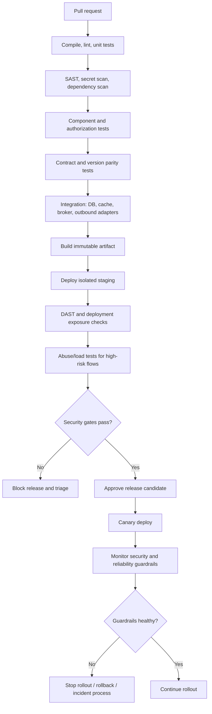

# Security regression trước release

Trong chương **API lifecycle testing** của module `SECURITY_API_SECURITY`, security regression testing kiểm tra rằng các kiểm soát bảo mật vẫn hoạt động sau mỗi thay đổi code, dependency, cấu hình, schema hoặc hạ tầng. Một bản release có thể làm test chức năng vẫn xanh nhưng vô tình mở lại BOLA/IDOR, bỏ sót tenant predicate, expose admin endpoint, nới giới hạn request hoặc khiến HTTP client bỏ qua SSRF policy.

Security regression cần chạy xuyên vòng đời API: từ thiết kế contract, implementation, integration, build, deploy staging đến canary/production verification. Mục tiêu là biến security invariant thành test có thể lặp lại, có dữ liệu kiểm chứng và có tiêu chí chặn release rõ ràng. Một test chỉ xác nhận endpoint trả `200` hoặc `403` là chưa đủ; cần xác minh dữ liệu không bị lộ, trạng thái không bị thay đổi và side effect không xảy ra khi request bị từ chối.

## 1. Vì sao cần security regression trước mỗi release?

Lỗ hổng API thường xuất hiện khi một thay đổi hợp lệ làm thay đổi đường đi của request:

- Controller mới gọi repository trực tiếp và bỏ qua authorization service.
- DTO mới bind thêm field `role`, `tenantId` hoặc `ownerId`, tạo mass assignment.
- Route version cũ không nằm trong security matcher mới.
- Gateway thêm wildcard route khiến management endpoint bị public.
- Dependency HTTP client thay đổi redirect hoặc DNS behavior, làm yếu SSRF protection.
- Retry logic mới gọi provider hai lần khi kết quả lần đầu không rõ.
- Response mapper trả thêm field nội bộ.
- Logging/debug middleware ghi lại token hoặc request body.
- Thay đổi cache key khiến dữ liệu tenant A được trả cho tenant B.
- Cấu hình production overlay vô tình bật debug hoặc expose toàn bộ Actuator.

Các lỗi này có thể không làm test nghiệp vụ thất bại. Security regression suite phải kiểm tra hành vi bảo mật như một phần của contract API, không chỉ kiểm tra happy path.

### 1.1. Phân biệt test chức năng và security regression

| Test chức năng thông thường | Security regression cần bổ sung |
|---|---|
| User đăng nhập thành công | Token sai issuer/audience/expiry bị từ chối |
| User đọc được order của mình | User A không đọc được order của tenant B |
| Admin cập nhật role thành công | User thường không thể grant role dù biết endpoint |
| Request tạo order hợp lệ | Field server-managed bị từ chối hoặc không thể mass assign |
| URL preview trả ảnh | URL private, loopback, redirect nội bộ và DNS rebinding bị chặn |
| Bulk request hoàn tất | Payload vượt size/count/quota bị từ chối trước side effect |
| API trả lỗi khi provider timeout | Retry không tạo payment/email/SMS trùng |
| V2 hoạt động | V1 và alias cũ vẫn giữ cùng security invariant |
| Endpoint health trả kết quả | Admin/diagnostic endpoint không bị public ngoài ý muốn |

### 1.2. Security regression là kiểm tra invariant

Một invariant là quy tắc phải luôn đúng bất kể implementation thay đổi. Ví dụ:

1. Anonymous không gọi được operation yêu cầu xác thực.
2. Principal chỉ thao tác trên object thuộc phạm vi được phép.
3. Tenant context đến từ danh tính đã xác minh, không từ request body.
4. Field nhạy cảm chỉ xuất hiện khi policy cho phép.
5. Input vượt giới hạn bị từ chối trước khi tiêu thụ tài nguyên lớn hoặc tạo side effect.
6. Outbound URL chỉ kết nối tới destination đã được kiểm tra và pin vào kết nối.
7. Retry hoặc duplicate delivery không lặp side effect nghiệp vụ.
8. Error response, log và trace không làm lộ secret hoặc dữ liệu nội bộ.
9. Mọi API version còn hoạt động đều tuân thủ cùng invariant.
10. Cấu hình triển khai không mở rộng exposure ngoài thiết kế.

Các invariant nên được ghi trong threat model, API contract hoặc security acceptance criteria và liên kết với test ID cụ thể.

## 2. Bắt đầu từ inventory endpoint và threat model

Không thể kiểm thử đầy đủ những route mà nhóm không biết đang tồn tại. Trước khi viết test, lập inventory API theo operation, version, principal và dữ liệu.

### 2.1. Inventory cho mỗi operation

| Thuộc tính | Câu hỏi cần trả lời |
|---|---|
| Operation ID | Tên operation ổn định là gì? |
| Method/path | Method, route template và version nào? |
| Consumer | Browser, mobile, partner, service hay worker? |
| Authentication | Session, JWT, API key, mTLS hay workload identity? |
| Function permission | Scope/role/action nào cần thiết? |
| Object scope | Owner, tenant, project hoặc relationship nào được kiểm tra? |
| Property scope | Field nào được đọc/ghi theo principal? |
| Input budget | Body, string, number, array, depth và timeout tối đa? |
| Side effects | Database, queue, email, SMS, payment hoặc outbound HTTP? |
| Sensitive data | PII, financial data, secret hoặc internal metadata? |
| Abuse controls | Rate limit, quota, concurrency và cost budget? |
| Audit/monitoring | Event nào phải được ghi và cảnh báo? |

Inventory cần lấy từ router/controller, OpenAPI, gateway/Ingress, GraphQL/RPC, webhook, background job và telemetry. Không chỉ tìm path có chữ `/admin`; endpoint export, debug, callback hoặc Actuator cũng có thể nhạy cảm.

### 2.2. Xác định trust boundary và attacker capability

Với từng operation, ghi rõ attacker có thể:

- Gửi request không có credential hoặc dùng token hợp lệ với quyền thấp.
- Thay ID trong path, query, body hoặc nested object.
- Gửi field ngoài schema, payload lớn, giá trị biên hoặc request lặp nhanh.
- Điều khiển URL, hostname, redirect hoặc dữ liệu được consumer xử lý.
- Gọi version cũ, alias, route nội bộ hoặc endpoint bất đồng bộ.
- Tạo duplicate message, replay callback hoặc khai thác retry.
- Quan sát response, status code, timing, error và metadata log được trả ra.

Không cần giả định attacker có quyền quản trị hạ tầng nếu threat model không yêu cầu. Hãy kiểm thử theo quyền và đường truy cập thực tế, gồm cả workload nội bộ bị compromise khi phù hợp.

### 2.3. Ưu tiên theo rủi ro

Ưu tiên test cho operation có dữ liệu nhạy cảm, quyền cao, nhiều tenant, side effect tốn tiền, outbound network, upload/download, bulk operation hoặc được public rộng. Có thể đánh giá theo tác động, khả năng khai thác, exposure và độ phức tạp; không chỉ dựa vào số lượng endpoint.

Mỗi release cần xác định tập test bắt buộc cho mọi operation và tập test tăng cường cho operation rủi ro cao. Không dùng mức ưu tiên để bỏ qua một invariant cơ bản như authentication hoặc tenant isolation.

## 3. Xây dựng test matrix theo principal, action và resource

Security test hiệu quả thường là negative test: thử những gì caller không được phép làm. Với mỗi operation, tạo ma trận principal × action × object × field.

### 3.1. Ma trận authentication

| Credential/context | Kết quả mong đợi |
|---|---|
| Không có credential | Từ chối operation cần xác thực |
| Token sai chữ ký hoặc không tin cậy issuer | Từ chối |
| Token sai audience | Từ chối |
| Token hết hạn hoặc chưa có hiệu lực | Từ chối |
| Algorithm hoặc key không được phép | Từ chối |
| Token thiếu scope/claim bắt buộc | Từ chối theo policy |
| Session hết hạn hoặc bị revoke | Từ chối |
| Workload identity không nằm trong trust policy | Từ chối |
| Credential hợp lệ, đúng audience và scope | Chỉ đi tiếp tới authorization tương ứng |

Test JWT cần bao phủ key rotation và cache JWKS khi ứng dụng dùng remote key set. Không viết test chỉ decode payload mà bỏ qua signature verification. Với opaque token, test introspection failure, timeout và trạng thái inactive. Với API key, kiểm tra rotation, revocation, scope và không log key.

### 3.2. Ma trận function authorization

Ví dụ với order API:

| Principal | Read order | Update order | Refund | Grant role |
|---|---:|---:|---:|---:|
| Anonymous | Deny | Deny | Deny | Deny |
| Customer | Own order | Own order theo rule | Deny hoặc flow riêng | Deny |
| Support read-only | Scope được giao | Deny | Deny | Deny |
| Support operator | Scope được giao | Action được cấp | Theo approval | Deny |
| Finance operator | Theo scope | Không mặc định | Theo permission | Deny |
| Identity administrator | Theo policy | Theo policy | Deny | Chỉ role được quản lý |

Ma trận phải phản ánh role/scope thật của hệ thống. Không mặc định một role tên `admin` được phép làm mọi thứ. Test cả quyền thiếu, quyền vừa đủ và quyền quá rộng bị từ chối ở operation không liên quan.

### 3.3. Object-level authorization và BOLA/IDOR

Chuẩn bị tối thiểu hai tenant và nhiều principal:

- User A thuộc tenant A sở hữu object A1.
- User B thuộc tenant B sở hữu object B1.
- Support principal có scope giới hạn theo tenant hoặc region.
- Một object không có owner hoặc đã bị archive nếu nghiệp vụ có trường hợp đó.

Kiểm tra GET, PATCH, DELETE, export, nested resource, search, bulk và download. Thay ID hợp lệ của A1 thành B1 phải bị từ chối dù ID không đoán được. UUID khó đoán không thay object authorization.

Với update/delete, xác minh database state không thay đổi khi bị từ chối. Với read, xác minh response không chứa dữ liệu protected; có thể dùng `404` thay `403` nếu policy che giấu sự tồn tại object, nhưng test phải kiểm tra invariant dữ liệu chứ không đóng đinh một status code không cần thiết.

### 3.4. Tenant isolation

Test tenant boundary trên mọi đường dữ liệu:

- Truy vấn theo ID, list/search, filter và pagination.
- Nested relationship như order item, attachment, invoice.
- Bulk ID list và batch update/delete.
- Export, report, signed URL và download.
- Cache key, search index và read replica.
- Queue, worker, scheduled job và webhook.

Thử gửi `tenantId` của tenant khác trong path, query, body, header hoặc message payload. Server phải lấy tenant từ security context/producer grant đã xác minh và kiểm tra resource relationship. Test không chỉ assert query trả rỗng mà cần xác minh không có side effect hoặc metadata leak.

### 3.5. Property-level authorization và mass assignment

Tạo request chứa cả field được phép và field server-managed:

```json
{
  "displayName": "New name",
  "tenantId": "tenant-b",
  "ownerId": "user-b",
  "role": "ADMIN",
  "isVerified": true
}
```

Xác minh API từ chối hoặc bỏ qua field ngoài allowlist theo contract, và database không thay đổi các field đó. Với response, kiểm tra `internalNote`, credential metadata, risk flag hoặc dữ liệu tenant khác không xuất hiện với principal thiếu quyền. Dùng DTO/projection theo policy, không serialize persistence entity.

## 4. Kiểm thử validation và resource consumption

Validation regression cần test dưới biên, đúng biên và vượt biên. Các giới hạn phải được áp dụng ở parser/gateway trước khi ứng dụng cấp phát object graph lớn.

### 4.1. String và Unicode

Với mỗi string quan trọng, test:

- Null, absent, empty và whitespace-only theo semantics.
- `minLength - 1`, `minLength`, `maxLength`, `maxLength + 1`.
- Unicode dựng sẵn, combining mark, emoji và ký tự điều khiển.
- Pattern hợp lệ, pattern sai và input stress cho regex.
- UTF-8 byte limit nếu database/storage giới hạn theo byte.

Đảm bảo semantics độ dài giữa JSON Schema, Java, database và frontend được tài liệu hóa. Không dùng test chỉ với ASCII nếu API hỗ trợ Unicode.

### 4.2. Number và numeric boundary

Test min/max, âm/zero, decimal scale, precision, exponent lớn, numeric token quá dài và phép tính có nguy cơ overflow. Với tiền, kiểm tra rounding mode, currency unit và kiểu decimal/integer phù hợp. Không để API âm thầm clamp hoặc làm tròn giá trị vượt contract.

### 4.3. Array, object và nested structure

Test `minItems`, `maxItems`, duplicate, phần tử null, phần tử sai schema, `maxProperties`, unknown property, nesting depth và tổng node count. Kiểm tra body bytes, compressed/decompressed size, multipart part count và upload limit.

Một array nằm dưới maxItems vẫn có thể tạo nhiều truy vấn hoặc provider call; cần kiểm tra cost/quota của bulk operation. Không chỉ test parser mà bỏ qua fan-out trong service.

### 4.4. Body size và parser limits

Kiểm tra request đúng body limit và vượt một byte; chunked request không có `Content-Length`; JSON nesting sâu; numeric token dài; gzip có compressed size nhỏ nhưng decompressed size lớn; Content-Type sai; multipart có quá nhiều part.

Kết quả mong đợi là từ chối sớm với contract rõ (thường `413` cho body quá lớn), không crash, không tiêu thụ memory bất thường và không tạo side effect. Gateway và application limit cần tương thích để không có đường nội bộ bỏ qua gateway.

### 4.5. Rate limit, quota và concurrency

Test:

- Request trong giới hạn được xử lý bình thường.
- Request vượt rate limit bị từ chối hoặc trì hoãn theo policy.
- Quota theo tenant/actor không thể dùng chéo giữa tenant.
- Concurrent request không vượt hard budget hoặc tạo oversubscription.
- Retry không được cấp bucket mới chỉ vì đổi API version/alias.
- Costly endpoint có limit theo cost unit, không chỉ request count.

Kiểm thử concurrency phải dùng clock/test harness hoặc load test ổn định, tránh assertion phụ thuộc timing mong manh. Xác minh counter/reservation có tính nguyên tử và được release/settle đúng theo outcome.

## 5. Kiểm thử SSRF và outbound integration

Mọi chức năng server truy cập URL do caller hoặc tenant cấu hình cần security regression riêng: preview, import, webhook validation, document fetch, image proxy và callback test.

### 5.1. Destination policy

Kiểm tra scheme, port, hostname canonicalization, IP literal và dải địa chỉ. Bao gồm loopback, private, link-local, IPv6 loopback/unique-local/link-local, IPv4-mapped IPv6 và dải nội bộ của môi trường. Không chỉ kiểm tra RFC1918 IPv4.

### 5.2. DNS rebinding và nhiều địa chỉ

Dùng resolver test có thể điều khiển để mô phỏng:

- Lần resolve đầu public, lần sau private.
- Nhiều A/AAAA record có một địa chỉ bị chặn.
- CNAME kết thúc ở private address.
- Chỉ có AAAA record.
- Resolver timeout, NXDOMAIN hoặc SERVFAIL.

Xác minh transport kết nối đúng IP đã kiểm tra và không resolve lại hostname ngoài policy. Nếu không thể pin IP ở HTTP client, test phải đi qua egress proxy đã thực thi destination policy.

### 5.3. Redirect và response limit

Public URL redirect tới private IP, hostname khác, port không được phép hoặc scheme yếu hơn phải bị chặn. Nếu hỗ trợ redirect, mỗi hop phải resolve/validate/pin lại; kiểm tra số hop, loop và tổng deadline. Response body, decompressed size và thời gian đọc cần có giới hạn.

### 5.4. Test không được gọi mạng production

SSRF regression test nên dùng fake resolver, fake transport, local test server hoặc egress sandbox cô lập. Không gửi test request tới metadata endpoint, internal production host hoặc hệ thống bên ngoài không nằm trong phạm vi. Mục tiêu là chứng minh policy quyết định đúng bằng fixture kiểm soát được.

## 6. Kiểm thử authentication, session và browser controls

### 6.1. Token và session lifecycle

Test token hợp lệ, hết hạn, sai issuer/audience, key rotation, revoke và claim thiếu. Với session, test logout, timeout, session fixation defense, cookie `Secure`/`HttpOnly`/`SameSite` và CSRF behavior. Kiểm tra refresh token rotation/reuse detection nếu hệ thống có áp dụng.

Không dùng token production trong test. Tạo signing key/test issuer riêng hoặc dùng mock introspection server. Test cần xác minh server thực sự verify chữ ký/audience, không chỉ decode JWT.

### 6.2. CORS không thay authorization

Test allowed origin, disallowed origin, `Origin: null`, absent origin, credentialed request và preflight. Gửi cùng request bằng non-browser client với Origin giả để chứng minh Origin không cấp quyền. API vẫn phải xác thực và kiểm tra permission độc lập.

### 6.3. CSRF

Với cookie/session, thử request mutation từ origin khác, token CSRF thiếu/sai, content type đơn giản và trường hợp preflight. Xác minh request bị chặn không thay đổi database hoặc gọi downstream. Không kết luận CSRF an toàn chỉ vì browser không đọc được response.

### 6.4. Security headers và TLS

Kiểm tra HTTPS redirect/HSTS theo deployment policy, cookie flags, content type, cache policy cho dữ liệu riêng và các header bảo vệ phù hợp với loại client. TLS certificate/hostname verification cần được kiểm tra ở ingress và service-to-service boundary. Không hardcode kết quả phụ thuộc môi trường vào unit test; dùng deployment smoke test cho cấu hình thực tế.

## 7. Kiểm thử API error, logging và secret handling

Error path thường bị bỏ sót vì test tập trung vào response thành công. Security regression cần tạo lỗi có chủ đích và kiểm tra cả response lẫn log.

### 7.1. Error response không tiết lộ nội bộ

Với validation error, `401/403`, `404`, `429`, timeout và unhandled exception, xác minh response không có stack trace, SQL, class name, internal hostname, filesystem path, secret hoặc raw payload. Error code và request ID phải ổn định, không chứa dữ liệu nhạy cảm.

### 7.2. Log redaction

Dùng canary value giả lập cho Authorization, Cookie, password, OTP, email, phone và signed URL. Sau request, kiểm tra test appender, gateway fixture, trace exporter và message metadata để xác minh canary không bị ghi. Không dùng credential thật làm fixture.

Kiểm tra CR/LF trong external request ID, raw URL/query, exception message và field động. Log phải structured, bounded và không bị log injection.

### 7.3. Secret management

Test rằng secret không nằm trong source/config artifact, image layer, response, log hoặc trace. Kiểm tra app khởi động fail closed khi secret bắt buộc thiếu/sai; rotation không làm lộ giá trị cũ; quyền truy cập secret store chỉ cấp cho workload cần thiết. Secret scanning trong CI bổ sung cho runtime tests nhưng không thay thế việc xử lý credential đã lộ.

### 7.4. Correlation ID

Xác minh request ID được tạo tại trust boundary, opaque và có giới hạn format. Client không thể ghi đè canonical ID bằng header tùy ý. ID không được dùng làm authorization key hoặc metric label có cardinality cao. MDC phải được dọn sau request và context async phải được truyền có kiểm soát.

## 8. Kiểm thử async message, webhook và idempotency

API có thể trả `202 Accepted` rồi thực hiện side effect sau đó. Security regression phải theo dõi đến worker, không dừng ở HTTP response.

### 8.1. Message authenticity và authorization

Test producer không có broker ACL, chữ ký sai, schema không hỗ trợ, tenant mismatch và actor không có quyền. Consumer phải lấy producer identity từ kết nối/broker context đã xác minh, không tin `producerName`, `tenantId` hoặc role trong payload.

### 8.2. Duplicate, replay và retry

Gửi cùng message ID nhiều lần, replay webhook, giả timestamp hoặc dùng idempotency key trùng với payload khác. Xác minh side effect chỉ xảy ra theo semantics đã định nghĩa; key bị tái sử dụng với payload khác phải bị từ chối hoặc xử lý theo contract.

### 8.3. Poison message và DLQ

Test permanent/transient/ambiguous failure, max attempts, backoff/jitter, DLQ publish failure và redrive. Không ack message nguồn trước khi retry/DLQ đã được lưu bền vững. Redrive cần permission, expiry check, audit và rate limit; operator không được sửa tenant/actor để vượt policy.

### 8.4. Webhook signature và replay protection

Test chữ ký đúng/sai, timestamp ngoài cửa sổ, body bị sửa, secret rotation và duplicate delivery. Tính chữ ký trên raw body theo contract của provider; không parse rồi serialize lại trước khi verify nếu điều đó thay đổi bytes. Lưu replay/deduplication key có retention phù hợp.

## 9. API version và backward compatibility testing

Mỗi version còn active là một entry point. Security fix mới phải được kiểm tra trên mọi version, alias và route rewrite.

### 9.1. Security parity matrix

| Invariant | V1 | V2 | Legacy alias |
|---|---|---|---|
| Authentication bắt buộc | Test | Test | Test |
| Object authorization | Test | Test | Test |
| Tenant isolation | Test | Test | Test |
| Property filtering | Test | Test | Test |
| Body/array/depth limits | Test | Test | Test |
| Rate limit/quota | Test | Test | Test |
| SSRF destination policy | Test | Test | Test |
| Audit event | Test | Test | Test |

Không nhất thiết mọi version có cùng schema hoặc status code, nhưng không version nào được trả dữ liệu hoặc tạo side effect mà policy hiện hành cấm. Version negotiation không được fallback sang route yếu hơn.

### 9.2. Contract test và schema compatibility

Kiểm tra OpenAPI/schema đúng với runtime: required/optional, nullability, enum, format, max length, array count và unknown property. Kiểm tra response không thêm field nhạy cảm ngoài contract. Contract test cần bao phủ error response và security headers, không chỉ response `2xx`.

### 9.3. Deprecation và sunset

Test deprecation metadata, migration link, ngày sunset và response khi version đã retired. Không để sunset route fallback âm thầm sang version mới hoặc cũ. Security patch không được trì hoãn chỉ vì version đang deprecated.

## 10. Kiểm thử cấu hình và deployment artifact

Một phần lớn lỗi exposure đến từ hạ tầng. Unit test controller không thể phát hiện Ingress public hoặc management port bị mở.

### 10.1. Gateway, reverse proxy và management endpoint

Kiểm tra route allowlist, rewrite, method, forwarded header, body limit, timeout và rate limit. Xác minh `/admin`, `/ops`, `/actuator`, `/debug` và endpoint nội bộ không xuất hiện trên public listener ngoài thiết kế.

Kiểm tra Actuator chỉ expose endpoint cần thiết; security filter chain bao phủ management route; health response không lộ dependency detail hoặc secret. Test từ public network trong staging được phép, không chỉ gọi localhost.

### 10.2. Kubernetes và cloud

Static policy check và runtime verification cho:

- Service `LoadBalancer`/`NodePort` không được duyệt.
- Ingress/Gateway route trỏ nhầm admin service.
- Management port được publish ra host hoặc mọi interface.
- NetworkPolicy thiếu hoặc selector không match workload.
- Service account có quyền rộng hơn cần thiết.
- Debug profile, permissive CORS hoặc Actuator wildcard trong production overlay.
- Secret được đặt sai loại resource hoặc xuất hiện trong manifest/log.

Static scan manifest không chứng minh live cluster đang đúng. Sau deploy, kiểm tra resource đã render, security group, listener và route thực tế.

### 10.3. Dependency và build artifact

Chạy SCA/dependency vulnerability scan, secret scan, SAST và license/policy check theo pipeline. Với dependency có CVE, đánh giá reachability và runtime exposure; không bỏ qua critical finding chỉ vì test chức năng xanh. Kiểm tra image base, package, build provenance và artifact digest theo quy trình release.

Các scanner có false positive/false negative. Kết quả cần triage, owner, SLA và exception có thời hạn; không dùng một điểm số scanner làm bằng chứng duy nhất rằng API an toàn.

## 11. Tổ chức test suite theo tầng

Không có một loại test nào đủ cho mọi lớp. Một pipeline cân bằng thường dùng nhiều tầng với chi phí và độ tin cậy khác nhau.

| Tầng | Phạm vi | Ví dụ | Chạy khi nào |
|---|---|---|---|
| Unit | Policy/validator/mapper | Role matrix, CIDR policy, field filter | Mỗi commit |
| Component | Controller + service + persistence adapter | Tenant scope, transaction, no side effect | Mỗi pull request |
| Integration | Broker, database, cache, HTTP client | Duplicate, retry, SSRF transport, outbox | PR hoặc nightly tùy chi phí |
| Contract | OpenAPI/schema/consumer contract | Field limits, error schema, version compatibility | Mỗi thay đổi API |
| DAST | Ứng dụng đang chạy | Auth bypass, misconfiguration, injection class | Staging/release candidate |
| Fuzz/property-based | Parser, schema, state machine | Boundary, malformed input, unexpected sequence | PR chọn lọc và nightly |
| Load/abuse | Rate, quota, concurrency, payload cost | Retry storm, queue saturation | Trước release lớn và định kỳ |
| Deployment/config | Gateway, Ingress, cloud, Actuator | Public exposure, policy drift | Mỗi deploy staging/production |
| Canary/production verification | Hành vi thực tế sau deploy | 401/403, SSRF deny, error rate, quota | Sau deploy theo guardrail |

Unit test nhanh và deterministic; integration/DAST kiểm tra đường đi thực; load test cần môi trường cô lập và ngân sách rõ. Không chạy test gây tải hoặc gửi payload phá hoại trên production.

## 12. Ví dụ Java/Spring: kiểm tra object authorization và side effect

Ví dụ dùng Spring Boot Test, MockMvc và Spring Security Test. Các kiểu principal, JWT converter, fixture và repository là thành phần theo ứng dụng; cần điều chỉnh theo security configuration thực tế.

```java
@SpringBootTest
@AutoConfigureMockMvc
class OrderSecurityRegressionTest {
    @Autowired MockMvc mockMvc;
    @Autowired OrderRepository orders;
    @Autowired TestOrderFixtures fixtures;

    @Test
    void userCannotReadOrderFromAnotherTenant() throws Exception {
        UUID tenantA = UUID.randomUUID();
        UUID tenantB = UUID.randomUUID();
        Order orderB = fixtures.createOrder(tenantB);

        mockMvc.perform(get("/v1/orders/{id}", orderB.getId())
                .with(jwt()
                    .jwt(token -> token.claim("tenant_id", tenantA.toString()))
                    .authorities(new SimpleGrantedAuthority("SCOPE_orders:read"))))
            .andExpect(status().isNotFound());
    }

    @Test
    void userCannotMassAssignPrivilegedFields() throws Exception {
        UUID tenantA = UUID.randomUUID();
        UserProfile profile = fixtures.createProfile(tenantA, "CUSTOMER");

        mockMvc.perform(patch("/v1/profile")
                .with(jwt()
                    .jwt(token -> token.claim("tenant_id", tenantA.toString()))
                    .authorities(new SimpleGrantedAuthority("SCOPE_profile:write")))
                .contentType(MediaType.APPLICATION_JSON)
                .content("""
                    {
                      "displayName": "Updated",
                      "role": "ADMIN",
                      "tenantId": "tenant-b",
                      "isVerified": true
                    }
                    """))
            .andExpect(status().is4xxClientError());

        UserProfile persisted = fixtures.reloadProfile(profile.getId());
        assertThat(persisted.getRole()).isEqualTo("CUSTOMER");
        assertThat(persisted.isVerified()).isFalse();
        assertThat(persisted.getTenantId()).isEqualTo(tenantA);
    }
}
```

Các test này minh họa hai invariant: tenant boundary và field allowlist. Test đầu giả định policy che giấu object ngoài tenant bằng `404`; nếu contract dùng `403`, hãy assert status đó nhưng vẫn xác minh không có dữ liệu bị trả. Test thứ hai giả định contract từ chối field không được khai báo; nếu contract bỏ qua field lạ, điều quan trọng là các field privileged trong database không thay đổi. `jwt()` tạo authentication test context, không kiểm tra chữ ký JWT thật; cần thêm integration test với test issuer/JWKS để xác minh signature, issuer, audience và key rotation.

### 12.1. Kiểm tra request bị từ chối không tạo side effect

Với mutation, chỉ assert `4xx` chưa đủ. Có thể kiểm tra:

```java
long before = orders.count();

mockMvc.perform(post("/v1/orders")
        .with(anonymous())
        .contentType(MediaType.APPLICATION_JSON)
        .content(validOrderJson()))
    .andExpect(status().isUnauthorized());

assertThat(orders.count()).isEqualTo(before);
verifyNoInteractions(paymentProvider, messagePublisher);
```

Đây là ví dụ cấu trúc; inject mock hoặc spy cho downstream boundary theo test slice. Nếu application ghi security audit event khi từ chối, test phải cho phép event audit đó nhưng xác minh không có business event/payment/export side effect.

## 13. CI security gate trước release

Security regression chỉ có giá trị khi được chạy tự động và kết quả có thể truy vết tới artifact được phát hành.

### 13.1. Pipeline tham khảo



### 13.2. Điều kiện chặn release

Các lỗi sau thường cần block release cho đến khi sửa hoặc có exception được phê duyệt đúng thẩm quyền:

- Anonymous hoặc principal thiếu quyền truy cập được dữ liệu/action protected.
- Cross-tenant read/write hoặc field-level data exposure.
- SSRF tới private/link-local/metadata destination hoặc redirect bypass.
- Secret/credential xuất hiện trong response, log, trace hoặc artifact.
- Admin/diagnostic endpoint public ngoài thiết kế.
- Request vượt hard limit vẫn tạo side effect hoặc làm cạn tài nguyên.
- Retry/duplicate gây payment, email, SMS hoặc command trùng.
- API version cũ bỏ qua control mới.
- Security filter/gateway/network policy không được áp dụng trên deployment artifact.

Lỗi test flaky, scanner false positive hoặc môi trường thiếu dependency cần được phân loại và xử lý; không tự động chuyển mọi failure thành pass. Exception phải có owner, lý do, phạm vi, compensating control, thời hạn và kế hoạch khắc phục.

### 13.3. Gắn test evidence với artifact

Lưu cùng release candidate:

- Commit SHA và artifact/image digest.
- Test suite/version và kết quả pass/fail.
- Security scan report và triage/exception.
- API contract/schema version.
- Deployment manifest/config digest.
- DAST/staging exposure result.
- Người phê duyệt và thời điểm release.

Nếu artifact thay đổi sau khi test, evidence cũ không còn chứng minh artifact mới. Build một lần, promote cùng artifact qua môi trường và xác minh cấu hình môi trường riêng biệt.

## 14. Staging, canary và production verification

Staging cần giống production ở những yếu tố ảnh hưởng security: gateway, authentication provider, TLS termination, network policy, secret injection, service mesh, database permission và broker ACL. Dùng dữ liệu synthetic hoặc đã mask; không sao chép production data tùy tiện.

### 14.1. Staging smoke tests

Sau deploy, chạy test từ các vantage point khác nhau:

- Public network: chỉ route public-by-design truy cập được.
- Internal network không được phép: admin/management endpoint bị chặn.
- Authenticated user: chỉ operation/resource được cấp.
- Service identity: chỉ API audience/scope được cấp.
- Worker/broker: producer ACL và consumer authorization đúng.

Kiểm tra live route/port và effective configuration, không chỉ đọc manifest trong repository.

### 14.2. Canary guardrails

Trong canary, theo dõi error rate, 401/403, tenant denial, validation failure, SSRF rejection, rate limit, queue lag, DLQ, provider cost và log redaction signal. So sánh với baseline và phân biệt thay đổi hành vi hợp lệ với regression.

Không log raw token hoặc payload để quan sát canary. Dùng structured event, aggregate metric và request ID opaque.

### 14.3. Stop rollout và rollback

Đặt ngưỡng dừng rollout trước khi deploy. Nếu phát hiện cross-tenant access, secret leak, SSRF bypass hoặc admin exposure, dừng rollout và xử lý theo incident process; không chỉ rollback nếu bản cũ cũng có lỗ hổng tương tự. Rollback cần được đánh giá security như một release khác và không khôi phục một control đã biết bị lỗi mà không có quyết định rủi ro rõ ràng.

## 15. Quản lý test data và môi trường

Security test có thể tự tạo dữ liệu nhạy cảm hoặc side effect nếu dùng nhầm môi trường. Quản lý fixture như một phần của test design.

- Dùng tenant/user giả lập và ID rõ ràng cho test.
- Không dùng production token, password, private key hoặc API key.
- Dùng fake payment/email/SMS provider hoặc sandbox có quota.
- Dùng DNS resolver và HTTP server test cô lập cho SSRF test.
- Reset database/queue/cache giữa test để tránh dữ liệu cũ ảnh hưởng kết quả.
- Cô lập test chạy song song theo tenant/schema/namespace.
- Không chạy fuzz hoặc load test phá hoại trên production.
- Dọn dữ liệu và credential test sau khi pipeline kết thúc.
- Bảo vệ log/test report vì chúng có thể chứa payload fixture và thông tin môi trường.

Test cần deterministic: cố định clock khi kiểm tra expiry/rate limit, dùng fake scheduler cho retry, kiểm soát randomness khi test policy và tránh phụ thuộc dịch vụ Internet công cộng. Với security test dựa trên concurrency, dùng synchronization barrier và assertion về invariant thay vì sleep tùy tiện.

## 16. Lỗi thiết kế thường gặp

| Lỗi | Hệ quả | Cách khắc phục |
|---|---|---|
| Chỉ test happy path | Không phát hiện quyền vượt mức | Negative test theo principal/action/object |
| Chỉ assert status code | Có thể vẫn lộ dữ liệu hoặc tạo side effect | Assert response, database, event và provider call |
| Chỉ test service method | Bỏ qua filter chain, gateway và route | Test HTTP stack và deployment route thực tế |
| Chỉ test V2 | V1/alias trở thành bypass | Security parity test mọi version active |
| Dùng mock cho mọi dependency | Không phát hiện sai behavior broker/HTTP client thật | Integration test ở boundary rủi ro cao |
| Chỉ chạy DAST | Không bao phủ logic tenant/permission | Kết hợp unit, component, contract và integration |
| Chỉ chạy SAST/SCA | Scanner không chứng minh runtime policy | Security regression test và staging checks |
| Dùng production credential/data | Rò dữ liệu và side effect thật | Synthetic fixture và sandbox |
| Test flaky bị bỏ qua | Regression có thể lọt release | Sửa nguyên nhân, không biến flaky thành pass |
| Không kiểm tra log/trace | Secret leak qua observability | Canary redaction test xuyên pipeline |
| Không kiểm tra deployment config | Admin port/route có thể bị public | IaC policy và live exposure test |
| Không gắn evidence với artifact | Test pass cho build khác với build phát hành | Immutable artifact digest và release evidence |

## 17. Checklist security regression trước release

- [ ] Inventory bao phủ REST, GraphQL/RPC, webhook, async, admin và mọi version active.
- [ ] Threat model và security invariant được cập nhật cho thay đổi release.
- [ ] Authentication test bao gồm missing, invalid, expired, wrong audience và revoked credential.
- [ ] Function authorization được kiểm tra theo principal và operation.
- [ ] Object/tenant authorization có negative test với resource tenant khác.
- [ ] Property authorization và mass assignment được kiểm tra.
- [ ] Request bị từ chối không tạo business side effect.
- [ ] String/number/array/object/depth/body/parser limits có boundary tests.
- [ ] Rate limit, quota, concurrency và cost budget được kiểm tra.
- [ ] SSRF test bao gồm IP ranges, A/AAAA, CNAME, DNS rebinding và redirect.
- [ ] CORS, CSRF, cookie/session và service identity được test theo client type.
- [ ] Error response, log, trace và correlation ID không làm lộ secret/PII.
- [ ] Async message, webhook replay, duplicate delivery, retry và DLQ được test.
- [ ] Security parity được kiểm tra trên mọi version/alias còn hoạt động.
- [ ] Gateway, Actuator, Ingress, management port và network policy được kiểm tra.
- [ ] SAST, secret scan, SCA và DAST đã được triage theo policy.
- [ ] Test chạy trong môi trường cô lập với dữ liệu/credential giả lập.
- [ ] Staging smoke test xác minh effective runtime configuration từ nhiều network vantage point.
- [ ] Release evidence gắn với đúng commit và artifact digest.
- [ ] Canary có guardrail, stop condition và rollback/incident plan.
- [ ] Exception có owner, scope, compensating control và expiry; không có finding nghiêm trọng chưa xử lý.

## Kết luận

Security regression trước release cần kiểm tra invariant trên toàn bộ đường đi của API: authentication, authorization, dữ liệu, validation, resource limit, outbound request, async processing, version và deployment configuration. Hãy kết hợp negative tests, integration/contract tests, DAST, cấu hình hạ tầng và canary guardrails; luôn xác minh cả response lẫn side effect. Khi test evidence được gắn với artifact bất biến và release gate có tiêu chí rõ, thay đổi API có thể được phát hành mà không vô tình mở lại lỗ hổng đã khắc phục.
