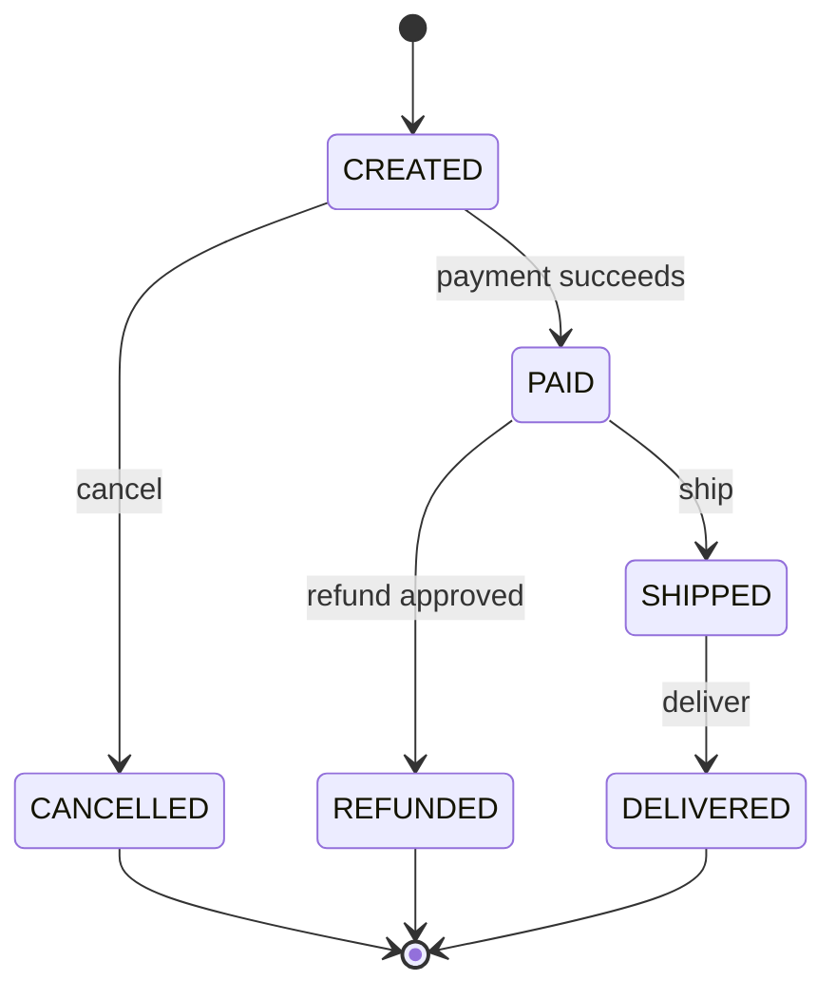

# Fuzzing và property-based test cho payload

API nhận payload từ nhiều nguồn: browser, mobile app, đối tác, service nội bộ, webhook và message broker. Một payload có thể đúng với ví dụ trong tài liệu nhưng vẫn chứa tổ hợp giá trị bất thường khiến parser lỗi, validator bỏ sót, authorization bị bypass hoặc hệ thống tiêu thụ quá nhiều CPU, bộ nhớ và kết nối. Kiểm thử bằng một vài request mẫu thường không bao phủ được không gian đầu vào rất lớn này.

Fuzzing và property-based testing giúp kiểm tra API với nhiều đầu vào được sinh tự động. Fuzzing tìm các trường hợp bất thường làm chương trình crash, treo, vượt giới hạn hoặc xử lý sai. Property-based testing diễn đạt những thuộc tính luôn phải đúng, sau đó sinh nhiều dữ liệu để tìm phản ví dụ. Hai kỹ thuật bổ sung cho nhau: fuzzing khám phá đầu vào gây lỗi; property-based test kiểm tra các invariant bảo mật và nghiệp vụ trên một miền đầu vào rộng.

Trong API security, mục tiêu không chỉ là “server không crash”. Một test tốt phải xác minh rằng request sai không tạo side effect, tenant không bị trộn, quyền không tăng ngoài ý muốn, secret không bị lộ và tài nguyên luôn nằm trong giới hạn đã thiết kế.

## 1. Fuzzing và property-based testing khác nhau thế nào?

| Kỹ thuật | Cách hoạt động | Câu hỏi chính | Ví dụ |
|---|---|---|---|
| Example-based test | Dùng một số input và output được viết trước | Trường hợp cụ thể này có hoạt động đúng không? | `quantity=2` tạo đơn thành công |
| Boundary test | Tập trung min/max và giá trị sát biên | Điều gì xảy ra ngay tại hoặc ngoài giới hạn? | `size=100`, `size=101`, `size=0` |
| Property-based test | Sinh nhiều input và kiểm tra invariant tổng quát | Thuộc tính này có đúng với mọi input thuộc miền đã định nghĩa không? | Mọi quantity hợp lệ đều không tạo tổng tiền âm |
| Mutation-based fuzzing | Thay đổi input hợp lệ bằng byte/field/structure mutation | Parser và handler phản ứng thế nào với dữ liệu bị biến dạng? | Cắt JSON, đổi type, duplicate key |
| Grammar/structure-aware fuzzing | Sinh input theo grammar hoặc schema rồi biến đổi có chủ đích | Các cấu trúc sâu hoặc tổ hợp field nào làm lộ lỗi? | JSON lồng nhau, enum lạ, array lớn |
| Coverage-guided fuzzing | Dùng code coverage để ưu tiên input đi tới nhánh mới | Có đường xử lý nào chưa được khám phá? | Fuzzer tối ưu corpus để đi sâu vào parser/validator |
| Stateful/sequence fuzzing | Sinh chuỗi request hoặc chuyển trạng thái | Có tổ hợp thao tác nào phá invariant theo thời gian? | Tạo key, revoke, rồi replay request cũ |

Fuzzing có thể hoàn toàn ngẫu nhiên, dựa trên mutation hoặc dùng cấu trúc của input để khám phá sâu hơn. Property-based testing thường có generator và property rõ ràng, đồng thời có khả năng shrink input để rút gọn phản ví dụ. Một test suite trưởng thành thường kết hợp example-based tests, boundary tests, property-based tests và fuzzing chuyên biệt.

## 2. Xác định phạm vi payload cần kiểm thử

Trước khi sinh input, lập danh sách các ranh giới nhận dữ liệu của API. Không chỉ fuzz request body JSON; nhiều lỗi nằm ở path, query, header, multipart, token envelope hoặc response từ upstream.

| Bề mặt đầu vào | Ví dụ | Nhóm rủi ro cần kiểm tra |
|---|---|---|
| Path variable | UUID, order ID, tenant ID | Sai format, encoded separator, traversal, identifier enumeration |
| Query parameter | `page`, `size`, `sort`, `filter` | Duplicate parameter, overflow, range, parser differential, injection |
| HTTP header | `Authorization`, `Content-Type`, `Idempotency-Key` | Duplicate header, quá dài, encoding lạ, header spoofing |
| JSON body | Object, array, nested fields | Sai type, unknown field, duplicate key, depth/size, mass assignment |
| Form/multipart | File, filename, metadata | Boundary lỗi, filename traversal, file size, decompression |
| Token/credential envelope | JWT, API key, signed request | Segment malformed, algorithm confusion, claim boundary, signature parser |
| Webhook/event | Event ID, producer, tenant, signature | Replay, schema drift, provenance mismatch, duplicate delivery |
| Upstream response | JSON, XML, redirect, error body | Schema mismatch, oversized response, unexpected content type |
| Protocol metadata | Method, version, content negotiation | Method override, version conflict, request smuggling differential |

Ưu tiên endpoint có side effect hoặc dữ liệu nhạy cảm: thanh toán, hoàn tiền, cấp quyền, quản lý API key, upload, export, webhook, tìm kiếm đa tenant và endpoint gọi dependency bên ngoài.

## 3. Xác định invariant trước khi fuzz

Property-based testing chỉ hữu ích khi property diễn đạt được điều hệ thống bắt buộc phải bảo đảm. Tránh property quá yếu như “response status nằm trong khoảng 200–599” hoặc “request không ném exception”. Hãy định nghĩa invariant có ý nghĩa bảo mật.

Ví dụ các invariant:

| Miền | Invariant cần giữ |
|---|---|
| Parser | Input malformed hoặc ngoài giới hạn không làm process crash hay tiêu thụ tài nguyên không giới hạn |
| Validation | Giá trị ngoài schema/range không đi vào business operation |
| Authorization | Caller thiếu permission không tạo side effect, bất kể payload có field role/owner/tenant nào |
| Tenant isolation | Request của tenant A không đọc hoặc ghi dữ liệu tenant B |
| Mass assignment | Field hệ thống không được client gửi để thay đổi nếu DTO không cho phép |
| Idempotency | Retry cùng key và cùng request không tạo side effect lặp ngoài hợp đồng |
| Output filtering | Response không chứa secret hoặc field ngoài allowlist |
| Resource limits | Body, array, nesting, page size và query cost không vượt ngưỡng cấu hình |
| Error handling | Lỗi input không tiết lộ stack trace, SQL, credential hoặc internal host |
| State transition | Chỉ chuyển trạng thái hợp lệ; input không thể nhảy qua bước nghiệp vụ |

Một property cần mô tả cả điều kiện đầu vào và kết quả quan sát được. Ví dụ: “Với mọi payload có `tenantId` khác tenant trong principal, request bị từ chối và database không thay đổi.” Property này mạnh hơn chỉ kiểm tra response là `403` vì nó xác minh cả side effect.

### 3.1. Tách invariant bảo mật khỏi chi tiết implementation

Viết property theo hành vi API hoặc trạng thái hệ thống, không gắn cứng với một hàm nội bộ. Nếu đổi framework hoặc refactor service, invariant vẫn giữ nguyên.

Ví dụ:

- Không phải: `validateOrderDto()` luôn trả `false` cho chuỗi `"-1"`.
- Nên: mọi request tạo đơn có quantity nhỏ hơn 1 đều không tạo order hoặc inventory reservation.

Property thứ hai kiểm tra kết quả ở ranh giới nghiệp vụ và bắt được lỗi nếu một đường code khác bỏ qua DTO validator.

## 4. Sinh payload có cấu trúc

Random bytes thuần có thể hữu ích cho parser cấp thấp, nhưng thường bị từ chối quá sớm ở lớp syntax. Để khám phá validator, authorization và business logic, nên sinh input theo cấu trúc gần với schema rồi biến đổi từng phần.

Với JSON request, generator có thể tạo:

- Object đúng schema với giá trị hợp lệ.
- Object thiếu từng field bắt buộc.
- Field có type khác dự kiến: string thay integer, array thay object, `null` thay string.
- Enum không biết, chuỗi rỗng, chuỗi chỉ có whitespace hoặc case khác.
- Number sát min/max, âm, rất lớn, decimal khi chỉ cho integer.
- Array rỗng, một phần tử, nhiều phần tử và vượt giới hạn.
- Nested object ở độ sâu sát giới hạn và vượt giới hạn.
- Unknown property, field hệ thống và tên field gần giống.
- Duplicate JSON key nếu parser/hợp đồng có thể nhận input đó.
- Unicode, combining character, null byte và control character.
- String chứa percent encoding, dấu phân cách hoặc ký tự đặc biệt.

### 4.1. Kết hợp valid seed và mutation

Một chiến lược hiệu quả là bắt đầu từ request hợp lệ, sau đó thay đổi một hoặc vài thuộc tính:

1. Tạo payload hợp lệ tối thiểu.
2. Thay một field bằng giá trị sát biên.
3. Xóa hoặc thêm field.
4. Đổi kiểu dữ liệu.
5. Nhân bản field hoặc phần tử.
6. Thay thứ tự field, encoding hoặc whitespace.
7. Kết hợp nhiều biến đổi để kiểm tra tương tác giữa các validator.

Giữ một corpus nhỏ các request hợp lệ có ý nghĩa nghiệp vụ. Fuzzer có thể dùng chúng làm seed để đi sâu hơn thay vì chỉ sinh dữ liệu không thể qua parser.

## 5. Fuzzing parser và normalization

Parser là ranh giới đầu tiên xử lý bytes do caller kiểm soát. Một parser có thể nhận input malformed, nested quá sâu hoặc nhiều cấu trúc khiến CPU/memory tăng mạnh. Ngoài crash, cần kiểm tra các tầng parse cùng một request có hiểu giống nhau không.

Các nhóm test quan trọng:

- JSON bị cắt ở mọi vị trí, dấu ngoặc hoặc dấu phẩy không cân bằng.
- UTF-8 không hợp lệ, BOM, surrogate hoặc ký tự Unicode bất thường.
- Duplicate object key và key gần giống sau normalization.
- Number quá lớn, exponent cực đoan, overflow và precision loss.
- Nested array/object sâu.
- String hoặc array có kích thước lớn.
- Content-Type sai hoặc có nhiều giá trị.
- Content-Encoding và decompression bomb.
- Multipart boundary malformed, nhiều part hoặc filename dài.
- XML entity/DTD nếu endpoint nhận XML.

### 5.1. Phát hiện parser differential

Một payload có thể được gateway, WAF, framework và business parser diễn giải khác nhau. Ví dụ:

- Gateway lấy query parameter đầu tiên, backend lấy giá trị cuối.
- Validator đọc JSON key đầu tiên, object mapper ghi đè bằng key cuối.
- Proxy decode `%2F` một lần, backend decode thêm lần nữa.
- Một tầng coi header trùng lặp là list, tầng khác nối chuỗi.
- Gateway kiểm tra `Content-Length`, backend xử lý chunked body theo cách khác.

Fuzzing cần gửi cùng payload qua đường triển khai thực tế và so sánh route, method, body field hoặc quyết định validation ở các tầng. Nếu cách diễn giải không thống nhất, nên từ chối input nhập nhằng hoặc chuẩn hóa tại một ranh giới duy nhất.

### 5.2. Giới hạn tài nguyên khi fuzz parser

Fuzzing chính parser cũng có thể làm test runner hết RAM hoặc treo. Đặt timeout cho từng input, giới hạn kích thước corpus, nesting depth và số vòng lặp. Khi tìm thấy crash/hang, lưu seed và tái hiện trong process cô lập. Không dùng payload khổng lồ hoặc test DoS trên production.

## 6. Property-based test với Java và jqwik

jqwik là một thư viện property-based testing tích hợp với JUnit Platform. Generator (`Arbitrary`) tạo input; `@Property` chạy property nhiều lần; `@ForAll` nhận giá trị được sinh; `@Provide` cung cấp generator có tên. Khi tìm thấy phản ví dụ, jqwik có thể shrink input để rút gọn trường hợp thất bại.

Ví dụ kiểm tra range quantity:

```java
class OrderQuantityProperties {

    @Property(tries = 500)
    void acceptedQuantityIsAlwaysWithinBusinessRange(
            @ForAll @IntRange(min = 1, max = 100) int quantity) {

        CreateOrderRequest request = validRequestWithQuantity(quantity);

        ValidationResult result = validator.validate(request);

        Assertions.assertThat(result.isValid()).isTrue();
    }

    @Property(tries = 500)
    void quantityOutsideRangeIsRejected(
            @ForAll("invalidQuantities") int quantity) {

        CreateOrderRequest request = validRequestWithQuantity(quantity);

        ValidationResult result = validator.validate(request);

        Assertions.assertThat(result.isValid()).isFalse();
    }

    @Provide
    Arbitrary<Integer> invalidQuantities() {
        return Arbitraries.integers()
                .between(Integer.MIN_VALUE, 0)
                .or(Arbitraries.integers().between(101, Integer.MAX_VALUE));
    }
}
```

Ví dụ minh họa API của jqwik; cần dùng đúng version thư viện và assertion library của project. Property không nên chỉ kiểm tra validator độc lập nếu mục tiêu là bảo đảm endpoint không tạo side effect. Hãy bổ sung integration property cho service/controller khi có thể.

### 6.1. Sinh JSON field với nhiều kiểu

Có thể tạo generator cho các biến thể của một field:

```java
@Provide
Arbitrary<Object> quantityInputs() {
    Arbitrary<Object> integers = Arbitraries.integers().map(v -> (Object) v);
    Arbitrary<Object> strings = Arbitraries.strings()
            .ofMaxLength(200)
            .map(v -> (Object) v)
            .injectNull(0.1);
    Arbitrary<Object> booleans = Arbitraries.of(true, false)
            .map(v -> (Object) v);

    return Arbitraries.oneOf(integers, strings, booleans);
}
```

Generator này giúp thử type confusion trong binding layer. Khi kiểm thử JSON thật, serialize giá trị vào request body và gửi qua HTTP stack; không chỉ gọi setter DTO vì cách đó bỏ qua parser.

### 6.2. Sinh ID và tenant context

Property cho multi-tenant API nên sinh cặp actor/resource với quan hệ khác nhau:

```java
@Property(tries = 300)
void actorCannotReadOrderFromAnotherTenant(
        @ForAll("tenantPairs") TenantPair pair) {

    Order order = fixtures.orderOwnedBy(pair.resourceTenant());
    AuthenticatedActor actor = fixtures.actorIn(pair.actorTenant());

    ApiResult result = api.getOrder(actor, order.id());

    if (!pair.actorTenant().equals(pair.resourceTenant())) {
        Assertions.assertThat(result.status()).isEqualTo(404);
        Assertions.assertThat(orderRepository.existsById(order.id())).isTrue();
        Assertions.assertThat(auditLog.recordsFor(order.id()))
                .doesNotContainSensitiveResourceDetailsFor(pair.actorTenant());
    }
}
```

Đây là pseudocode gần với test integration; fixture và assertion cần phù hợp policy thực tế. Nếu API dùng `403` thay vì `404`, property cần kiểm tra đúng status đã công bố. Quan trọng là xác minh response không tiết lộ dữ liệu và không có side effect.

## 7. Property cho authorization và mass assignment

Payload có thể chứa field hợp lệ về JSON nhưng không được phép do caller gửi. Một số lỗi chỉ xuất hiện khi field hệ thống được thêm vào cùng với một request hợp lệ.

Các property hữu ích:

- Với mọi caller không có permission `roles:assign`, thêm `role=ADMIN` vào body không thể thay đổi role.
- Với mọi tenant A, thay `tenantId` trong body thành tenant B không làm resource chuyển tenant.
- Với mọi request update, field không nằm trong allowlist không thay đổi entity.
- Với mọi resource ngoài phạm vi caller, thay đổi path ID không làm lộ hoặc sửa resource.
- Với mọi token thiếu scope, payload không thể tự thêm claim hoặc header để nâng quyền.
- Khi authorization từ chối, database state, event outbox và downstream calls không thay đổi.

Ví dụ property cho mass assignment:

```java
@Property(tries = 200)
void clientCannotPromoteOwnRole(
        @ForAll("ordinaryUsers") UserFixture fixture,
        @ForAll("unexpectedRoleValues") String requestedRole) {

    String body = """
        {"displayName":"Updated","role":"%s"}
        """.formatted(jsonEscape(requestedRole));

    api.patchProfile(fixture.userToken(), fixture.userId(), body);

    User reloaded = userRepository.findById(fixture.userId()).orElseThrow();
    Assertions.assertThat(reloaded.role()).isEqualTo(fixture.originalRole());
}
```

Nếu endpoint được thiết kế để admin đổi role, hãy viết property riêng: chỉ actor có permission và thỏa điều kiện workflow mới thay đổi được role. Property không nên cấm một chức năng hợp lệ; nó phải diễn đạt chính sách chính xác.

## 8. Property cho output filtering và secret handling

Fuzzing request có thể kích hoạt error path hoặc response variant chứa field nhạy cảm. Cần xác minh mọi response path đều tuân thủ output contract.

Các property:

- Không response nào của endpoint metadata chứa `passwordHash`, `apiKey`, `refreshToken`, `privateKey` hoặc `clientSecret`.
- Unknown field trong request không được phản chiếu nguyên vẹn vào error response.
- Exception message từ dependency không xuất hiện trong response production.
- Masked value không đủ để dùng như credential.
- Secret mới chỉ xuất hiện trong flow phát hành được thiết kế riêng; endpoint đọc lại chỉ trả metadata.
- Response của tenant A không chứa record hoặc field của tenant B.

Nên kiểm tra JSON tree theo danh sách field cấm thay vì chỉ tìm một chuỗi cụ thể trong body. Đồng thời kiểm tra header, log và trace bằng secret fixture giả. Property phải chạy trên nhiều nhánh: success, validation error, authorization error, dependency failure và fallback.

## 9. Property cho idempotency và state transition

API có side effect cần kiểm tra chuỗi request chứ không chỉ từng payload riêng lẻ. Một payload hợp lệ được gửi nhiều lần có thể tạo duplicate payment, gửi email lặp hoặc chuyển trạng thái sai.

Ví dụ invariant:

- Cùng idempotency key và cùng fingerprint không tạo thêm side effect sau lần đầu.
- Cùng key nhưng payload khác bị từ chối theo hợp đồng.
- Retry sau timeout không tạo payment thứ hai nếu operation ban đầu đã commit.
- Revoke credential là thao tác idempotent theo semantics đã công bố.
- Một order không thể chuyển từ `CANCELLED` trở lại `SHIPPED` nếu state machine không cho phép.
- Event duplicate không tạo thêm outbox effect hoặc downstream command.

Property-based stateful test có thể sinh chuỗi thao tác:



Sau mỗi command được sinh, so sánh state thực tế với model state machine. Các transition không hợp lệ phải bị từ chối và không phát event side effect. Đây là cách phát hiện lỗi thứ tự thao tác hoặc race condition mà test một request đơn lẻ khó bao phủ.

## 10. Fuzzing boundary và resource exhaustion

Input validation cần giới hạn không chỉ giá trị mà cả chi phí xử lý. Fuzzer nên tạo giá trị sát biên và cấu trúc lớn trong giới hạn test environment.

| Thành phần | Giá trị cần sinh | Property cần kiểm tra |
|---|---|---|
| Body size | 0, max-1, max, max+1 | Vượt ngưỡng bị từ chối trước khi parse toàn bộ |
| String length | Min-1, min, max, max+1 | Không truncate âm thầm hoặc vượt buffer |
| Array length | 0, 1, max, max+1 | Số phần tử bị giới hạn |
| JSON depth | Ngưỡng-1, ngưỡng, ngưỡng+1, rất sâu | Parser không stack overflow hoặc treo |
| Numeric field | Min/max, overflow, exponent, decimal | Không wrap, mất precision hoặc bypass range |
| Pagination | page âm/lớn, size 0/max/max+1 | Không tạo truy vấn vô hạn hoặc offset overflow |
| Regex input | Chuỗi dài và pattern gần worst-case | Không gây ReDoS vượt budget |
| Compression | Tỷ lệ nén rất cao | Giới hạn cả compressed và decompressed size |
| Batch operation | 0, max, max+1 resource | Không vượt quota hoặc concurrency budget |
| URL/redirect | Scheme, port, hostname và redirect chain lạ | SSRF/egress policy vẫn được áp dụng |

Không chạy test tải lớn như một fuzz case thông thường trên môi trường dùng chung. Dùng timeout, memory cap, CPU quota và dataset giới hạn; tách performance/load test khỏi correctness fuzzing.

## 11. Fuzzing endpoint có trạng thái và workflow

Một số lỗ hổng chỉ xuất hiện qua thứ tự request:

- Tạo API key, xem metadata, revoke rồi thử dùng lại key.
- Tạo payment, timeout, retry cùng idempotency key.
- Tạo resource ở tenant A rồi đổi tenant context trước khi worker consume.
- Request reset password nhiều lần và sử dụng token cũ.
- Gửi webhook hợp lệ, replay event và gửi cùng event ID với payload khác.
- Bắt đầu approval workflow, đổi resource/action rồi dùng approval cũ.
- Upload file, thay metadata, rồi yêu cầu worker xử lý file.

Sequence fuzzer sinh các command từ một grammar có trạng thái. Sau mỗi bước, kiểm tra invariant như permission, tenant ownership, state transition, event count và audit record. Reset database hoặc tạo namespace riêng giữa các run để test có thể tái hiện.

### 11.1. Giữ oracle kiểm thử đáng tin cậy

Oracle là cách test xác định kết quả đúng/sai. Với workflow phức tạp, chỉ kiểm tra status code là chưa đủ. Nên quan sát:

- Trạng thái database trước và sau.
- Số message được publish/consume.
- Số lần downstream được gọi.
- Audit event và actor/resource scope.
- Cache, idempotency record và lock.
- Response body/header và error code.

Nếu test chỉ nhìn `400` nhưng request đã tạo payment trước khi lỗi xảy ra, test phải thất bại.

## 12. Fuzzing có coverage và corpus management

Coverage-guided fuzzer dùng phản hồi coverage để giữ lại input khám phá được nhánh mới. Đối với parser native hoặc thư viện hiệu năng cao, có thể dùng libFuzzer, AFL++ hoặc Jazzer tùy ngôn ngữ và runtime. Với Java/JVM, Jazzer hỗ trợ coverage-guided fuzzing cho code Java và có thể tích hợp với build/test pipeline.

Corpus nên có:

- Seed hợp lệ tối thiểu và đại diện cho từng endpoint.
- Payload gần biên schema/range.
- Regression input từ bug đã phát hiện.
- Input làm đi qua nhánh authorization, fallback và error handling.
- Message/webhook có signature fixture hợp lệ trong môi trường test.
- Các encoding/path/query case đặc biệt.

Quản lý corpus:

- Loại bỏ payload trùng lặp nhưng giữ seed có giá trị coverage.
- Không đưa credential hoặc dữ liệu production vào corpus.
- Gắn metadata về endpoint, schema version và bug liên quan.
- Giới hạn kích thước và số lượng corpus.
- Lưu seed gây lỗi làm regression test cố định.
- Theo dõi coverage trend, crash, timeout và unique failure.

Fuzzer không thể chứng minh không tồn tại lỗ hổng. Coverage cao cũng không đồng nghĩa mọi policy đúng; cần kết hợp invariant, review và test nghiệp vụ.

## 13. Ví dụ fuzzing Java với Jazzer

Jazzer cung cấp entry point nhận byte array; test harness chuyển bytes thành input cho parser hoặc validator. Ví dụ đơn giản:

```java
public final class JsonPayloadFuzzTest {

    public static void fuzzerTestOneInput(FuzzedDataProvider data) {
        byte[] input = data.consumeRemainingAsBytes();

        if (input.length > 64 * 1024) {
            return;
        }

        try {
            JsonNode node = objectMapper.readTree(input);
            if (node != null) {
                validator.validate(node);
            }
        } catch (IOException expectedInvalidInput) {
            // Malformed JSON is an expected outcome.
        }
    }
}
```

Harness cần phân biệt exception được dự kiến cho input không hợp lệ với bug bất ngờ. Không catch `Throwable` rồi bỏ qua mọi lỗi, vì điều đó sẽ che crash, assertion failure hoặc resource problem. Nếu parser có thể ném runtime exception cho malformed input, hãy chỉ bắt các exception đã xác định là input rejection; lỗi khác phải làm fuzz case thất bại.

Để kiểm tra property ở mức API, có thể tạo harness gọi validator/service với fixture đã cô lập. Với HTTP stack đầy đủ, dùng integration test hoặc chạy fuzzer ở lớp parser/adapter rồi có property tests ở controller/service boundary.

## 14. Shrinking và tái hiện phản ví dụ

Khi property thất bại, input ban đầu có thể rất lớn. Shrinking rút gọn input nhưng vẫn giữ lỗi, giúp tìm nguyên nhân và tạo regression test dễ đọc.

Ví dụ fuzzer phát hiện payload với 300 field gây mass assignment. Sau shrinking, phản ví dụ có thể chỉ còn:

```json
{
  "displayName": "A",
  "tenantId": "tenant-B"
}
```

Payload tối giản cho thấy nguyên nhân là DTO bind trực tiếp tenant field. Một ví dụ nhỏ giúp reviewer hiểu invariant bị phá vỡ và viết regression test cụ thể.

Khi lưu phản ví dụ:

- Ghi seed/input đã được sanitize, không chứa secret thật.
- Ghi seed, fuzzer version, schema version và cấu hình test.
- Ghi endpoint hoặc parser entry point.
- Ghi trạng thái trước/sau nếu có side effect.
- Chuyển bug thành regression test ổn định.
- Không phụ thuộc vào thứ tự ngẫu nhiên để test có thể chạy lại.

## 15. Determinism, seed và môi trường chạy

Random test phải tái hiện được. Lưu seed hoặc cấu hình random khi failure xảy ra; tránh phụ thuộc thời gian hiện tại, thứ tự thread, dữ liệu dùng chung hoặc network bên ngoài không ổn định.

Một test environment phù hợp nên:

- Dùng database/schema riêng hoặc transaction rollback khi khả thi.
- Dùng mock/stub dependency có hành vi kiểm soát được cho correctness fuzzing.
- Dùng secret giả và identity fixture riêng.
- Tắt gửi email, thanh toán thật và side effect bên ngoài.
- Giới hạn CPU, memory, wall-clock time và số request.
- Reset queue, cache, idempotency store và state machine giữa run.
- Ghi rõ seed, build commit, runtime và config khi test thất bại.

Fuzzing parser có thể chạy thường xuyên trong CI với budget nhỏ; campaign dài hơn có thể chạy riêng trên runner cô lập. Không gửi hàng triệu request ngẫu nhiên vào production API hoặc dependency thật.

## 16. Tích hợp vào vòng đời phát triển API

Không cần chờ trước release mới fuzz. Có thể chia kiểm thử theo tầng:

| Giai đoạn | Kiểm thử phù hợp | Mục tiêu |
|---|---|---|
| Pull request | Property tests nhanh, boundary tests, regression corpus | Phát hiện lỗi lặp lại sớm |
| CI build | Parser fuzz smoke test, schema/property suite | Kiểm tra nhiều seed trong budget cố định |
| Nightly | Coverage-guided fuzzing và sequence fuzzing | Khám phá nhánh và tổ hợp sâu hơn |
| Pre-release | API integration fuzzing qua gateway/backend | Phát hiện parser differential và policy drift |
| Sau incident/bug | Regression test với minimized reproducer | Ngăn lỗi tái xuất hiện |
| Định kỳ | Review corpus, invariant, coverage và resource budget | Bảo đảm kiểm thử theo kịp API/schema mới |

Khi thêm endpoint hoặc field, cần bổ sung generator, property và corpus seed tương ứng. Không chỉ fuzz endpoint mới; thay đổi DTO chung, authentication filter, gateway normalization hoặc shared parser có thể ảnh hưởng nhiều API.

## 17. Đánh giá kết quả và triage failure

Không phải mọi exception trong fuzzing đều là security vulnerability. Phân loại kết quả:

| Kết quả | Cách xử lý |
|---|---|
| Input bị từ chối theo contract | Expected rejection; xác nhận không side effect |
| Parser crash hoặc process abort | Bug nghiêm trọng; tái hiện và xác định phạm vi |
| Timeout/hang hoặc memory growth | Điều tra DoS/ReDoS/resource exhaustion |
| Authorization bypass hoặc cross-tenant access | Security defect; chặn release theo severity |
| Validation bypass nhưng business layer chấp nhận | Sửa ranh giới validation và thêm regression property |
| Response/log lộ secret hoặc internal detail | Sửa output/log filtering và thêm assertion cấm |
| Flaky test do môi trường | Cải thiện isolation/determinism; không bỏ qua failure bảo mật |
| False positive do harness | Sửa oracle hoặc generator, lưu lý do triage |

Mỗi finding cần có input tái hiện, expected behavior, actual behavior, side effect quan sát được, severity và regression test. Không đóng finding chỉ vì fuzzer không tái hiện lại ở lần chạy tiếp theo; seed gốc phải được giữ để điều tra.

## 18. Checklist thiết kế fuzzing và property-based test

- [ ] Đã liệt kê bề mặt đầu vào: path, query, header, body, multipart, token, webhook và upstream response.
- [ ] Đã xác định invariant bảo mật và nghiệp vụ trước khi sinh input.
- [ ] Có generator cho input hợp lệ, sát biên và malformed.
- [ ] Có mutation cho type confusion, duplicate key/parameter, encoding và unknown field.
- [ ] Parser được kiểm tra với size, depth, timeout và decompression limit.
- [ ] Gateway, proxy và backend được kiểm tra parser/normalization differential.
- [ ] Property xác minh function/object/property authorization và tenant isolation.
- [ ] Test mass assignment, secret leakage, error disclosure và output filtering.
- [ ] Test idempotency, replay, duplicate delivery và state transition theo sequence.
- [ ] Test xác minh database, outbox, cache và downstream side effect, không chỉ status code.
- [ ] Có coverage-guided fuzzing hoặc corpus mutation phù hợp với stack.
- [ ] Failure được shrink, lưu seed và chuyển thành regression test.
- [ ] Test chạy trong môi trường cô lập với giới hạn CPU/RAM/time và dependency giả.
- [ ] Random seed và cấu hình được lưu để tái hiện.
- [ ] CI có smoke budget; nightly/pre-release có campaign sâu hơn.
- [ ] Log/telemetry của test không chứa credential hoặc dữ liệu production.

## 19. Nguyên tắc thiết kế

Fuzzing mở rộng không gian input được thử; property-based testing kiểm tra invariant trên nhiều giá trị và tổ hợp. Hãy bắt đầu từ schema và các ranh giới của API, sinh cả payload hợp lệ lẫn malformed, kiểm tra parser/normalization, rồi xác minh các thuộc tính bảo mật như authorization, tenant isolation, idempotency, output filtering và resource limits.

Đừng đánh giá test chỉ bằng số request hoặc code coverage. Một test có giá trị phải phát hiện được khi request sai vẫn tạo side effect, khi caller vượt tenant, khi field hệ thống bị mass assignment hoặc khi input làm hệ thống vượt ngân sách tài nguyên. Lưu seed, shrink phản ví dụ và biến mỗi finding thành regression test. **Mục tiêu là chứng minh các invariant bảo mật vẫn đúng trên một không gian payload rộng, kể cả khi input bất thường hoặc được kết hợp theo cách người viết test không nghĩ tới.**
