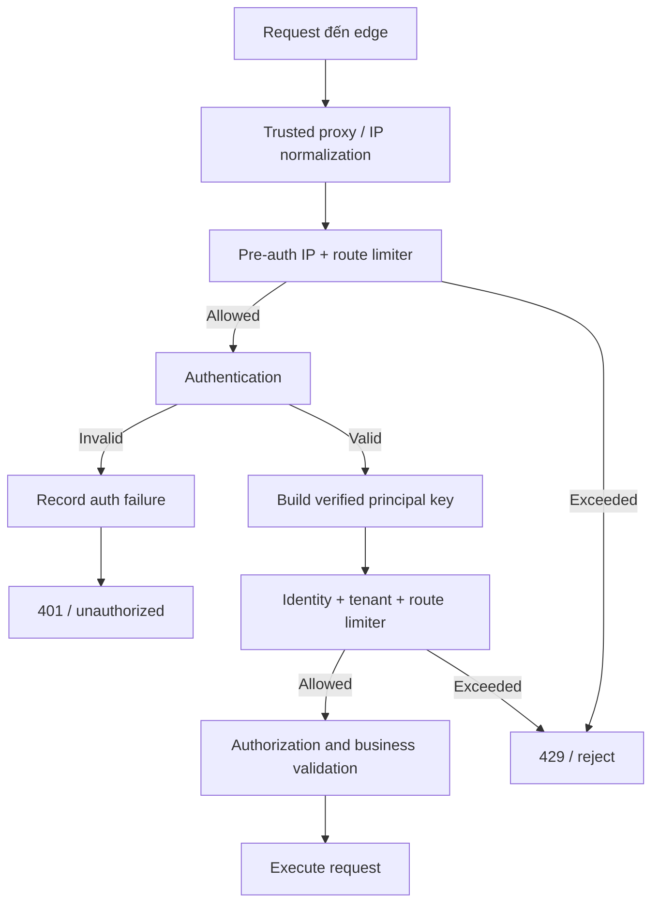

# Test rate limiting theo IP và identity

Trong chương **API security assessment** của module `SECURITY_API_SECURITY`, rate limiting cần được kiểm tra theo cả địa chỉ IP và danh tính đã xác thực. Giới hạn theo IP giúp giảm lưu lượng bất thường từ một nguồn mạng; giới hạn theo identity giúp bảo vệ công bằng giữa người dùng, API client, service account và tenant. Chỉ dùng một chiều có thể tạo lỗ hổng hoặc chặn nhầm người dùng hợp lệ.

Rate limiting là kiểm soát số lượng hoặc chi phí request trong một khoảng thời gian. Nó giúp hạn chế brute force, credential stuffing, scraping, enumeration, lạm dụng API tốn tài nguyên và sự cố do client retry quá mức. Tuy nhiên, rate limit không thay thế authentication, authorization, input validation, quota nghiệp vụ hay biện pháp chống DDoS ở edge/network.

Một bài kiểm thử tốt phải chứng minh rằng giới hạn được áp dụng đúng principal, đúng route và đúng cửa sổ thời gian; hoạt động nhất quán trên nhiều instance; không thể bypass bằng header giả hoặc thay IP; và không làm người dùng chung NAT bị chặn quá mức.

## Vì sao cần kết hợp IP và identity?

Mỗi chiều giới hạn bảo vệ một loại tài nguyên khác nhau:

| Chiều giới hạn | Mục đích | Điểm yếu nếu dùng riêng |
|---|---|---|
| IP | Giới hạn nguồn mạng, bảo vệ endpoint public và request chưa xác thực | Nhiều người dùng có thể dùng chung NAT/proxy; attacker có thể phân tán qua nhiều IP |
| Identity | Giới hạn user, API client, service account hoặc tenant đã xác thực | Một attacker có thể tạo nhiều identity; request chưa xác thực chưa có identity tin cậy |
| Tenant/account | Bảo vệ ngân sách dùng chung và ngăn một thành viên chiếm hết quota | Tenant có thể chứa nhiều ứng dụng/route với mức rủi ro khác nhau |
| Route/operation | Bảo vệ endpoint nhạy cảm hoặc chi phí cao | Không giới hạn tổng lưu lượng của một principal trên toàn API |
| Global/service | Bảo vệ capacity của hệ thống | Không đảm bảo fairness giữa các client |

Ví dụ, một endpoint đăng nhập có thể áp dụng giới hạn theo IP trước khi biết người dùng là ai, sau đó áp dụng giới hạn theo account identifier đã chuẩn hóa để giảm brute force nhắm vào một tài khoản. Một API tạo báo cáo có thể giới hạn theo user, tenant và route vì một user không nên tạo hàng trăm báo cáo nặng chỉ bằng cách đổi IP.

Khi kết hợp nhiều chiều, request phải thỏa mãn tất cả policy bắt buộc. Ví dụ request có thể còn token trong bucket IP nhưng đã hết token của identity; khi đó request vẫn bị từ chối. Cần định nghĩa thứ tự và cách tiêu thụ token để một policy bị từ chối không vô tình làm cạn ngân sách của policy khác.

## Xác định key giới hạn đáng tin cậy

Chất lượng rate limiter phụ thuộc vào key dùng để nhóm request. Nếu key có thể bị caller điều khiển, attacker sẽ tạo vô số bucket mới để né giới hạn hoặc làm tăng cardinality của kho lưu counter.

### 1. Lấy IP từ network boundary đáng tin

Địa chỉ peer mà server nhận được là điểm bắt đầu. Nếu API đi qua CDN, WAF, load balancer hoặc reverse proxy, ứng dụng chỉ được tin các forwarding header do proxy đã đăng ký ghi lại.

Các header thường gặp gồm `Forwarded`, `X-Forwarded-For` và header riêng của nhà cung cấp edge. Không lấy giá trị đầu tiên trong `X-Forwarded-For` một cách mù quáng. Header này có thể chứa nhiều địa chỉ và phần đầu có thể do client tự gửi nếu edge không xóa/ghi đè header đầu vào.

Quy trình an toàn:

1. Chỉ chấp nhận kết nối qua danh sách proxy/load balancer đã cấu hình, hoặc kiểm tra peer address thuộc CIDR tin cậy.
2. Cấu hình edge xóa forwarding header do client gửi và tạo header mới, hoặc append theo một quy ước được tài liệu hóa.
3. Parse chuỗi proxy chain theo đúng số hop và trust boundary; duyệt từ proxy gần server ngược về client để xác định địa chỉ đầu tiên không thuộc dải proxy tin cậy.
4. Chuẩn hóa IPv4, IPv6 và IPv4-mapped IPv6 trước khi tạo key.
5. Nếu header thiếu, sai cú pháp hoặc đến từ peer không tin cậy, dùng peer address hoặc từ chối theo chính sách; không tin giá trị tùy ý.

Ví dụ rủi ro:

```http
X-Forwarded-For: 198.51.100.10
```

Nếu ứng dụng nhận trực tiếp request từ Internet và tin header này, attacker có thể thay IP ở mỗi request để tạo bucket mới. Rate limiter theo IP khi đó gần như mất tác dụng.

Không nên tự viết parser proxy chain nếu framework hoặc gateway đã có cơ chế trusted-proxy chuẩn. Cấu hình trusted proxy quá rộng cũng nguy hiểm: nếu tin mọi nguồn, caller có thể giả mạo địa chỉ gốc. Hãy kiểm tra lại cả network ACL lẫn cấu hình framework.

### 2. Chuẩn hóa IP và chọn phạm vi subnet

Một địa chỉ client có thể được biểu diễn khác nhau. Cần chuẩn hóa để tránh một nguồn tạo nhiều key tương đương:

- Chuẩn hóa IPv4 theo dạng nhị phân hoặc dạng canonical.
- Chuẩn hóa IPv6; xác định rõ có gom theo prefix hay dùng từng địa chỉ.
- Xử lý IPv4-mapped IPv6 nhất quán.
- Không dùng reverse DNS làm identity của client.
- Không tự động gom mọi địa chỉ cùng ISP hoặc ASN thành một bucket nếu chưa đánh giá ảnh hưởng.

Với IPv6, attacker có thể thay interface identifier trong một prefix được cấp. Một số hệ thống chọn giới hạn theo prefix, ví dụ `/64`, để giảm khả năng xoay địa chỉ; nhưng điều này có thể gom nhiều thiết bị hoặc người dùng hợp lệ. Phải đo traffic thực tế, threat model và đặc điểm mạng trước khi chọn prefix.

### 3. Lấy identity từ credential đã xác minh

Identity key phải được tạo sau khi authentication thành công. Có thể dùng:

- User: `issuer + subject` hoặc internal principal ID ổn định.
- OAuth client credentials: `issuer + client_id` hoặc service principal ID.
- API key: key ID đã đăng ký, không dùng secret của API key.
- Workload identity/mTLS: workload principal hoặc certificate identity đã được xác minh.
- Tenant: tenant ID lấy từ quan hệ đã xác minh trong principal/context, không lấy trực tiếp từ header/body.

Không dùng raw JWT, access token, cookie, password hoặc API key secret làm key rate limit. Token có thể đổi theo lần refresh, có giá trị nhạy cảm và có thể bị lộ qua key store. Nếu cần tách identity theo issuer hoặc environment, đưa namespace đó vào key để tránh va chạm.

Ví dụ key logic:

```text
ip:{environment}:{routeGroup}:{normalizedIp}
identity:{issuer}:{principalId}:{routeGroup}
tenant:{tenantId}:{routeGroup}
```

Nếu lưu key trong Redis hoặc telemetry, có thể dùng HMAC của định danh với secret riêng cho mục đích pseudonymization. Không dùng hash không khóa cho ID có thể đoán dễ dàng nếu log/key store có thể bị truy cập ngoài phạm vi.

### 4. Request chưa xác thực

Trước authentication, hệ thống chưa có identity đáng tin cậy. Các endpoint public hoặc login cần có giới hạn theo IP, route và có thể thêm tín hiệu rủi ro khác đã được kiểm chứng. Sau authentication, áp dụng thêm giới hạn theo identity.

Không dùng username do caller gửi làm identity key trực tiếp mà không chuẩn hóa. Với login, có thể tạo bucket theo account identifier đã canonicalize và HMAC để tránh lưu username/email thô; cần giới hạn chiều dài và chuẩn hóa Unicode/case theo quy tắc danh tính của ứng dụng. Nếu không, attacker có thể tạo nhiều biến thể để né giới hạn hoặc làm tăng số key.

## Thiết kế policy theo route và luồng nghiệp vụ

Một policy không nên chỉ ghi “100 request/phút cho toàn API”. Hãy xác định endpoint nào cần bảo vệ và request nào tiêu tốn tài nguyên nhiều hơn.

| Nhóm endpoint | Chiều giới hạn gợi ý | Mục tiêu |
|---|---|---|
| Login, password reset, OTP | IP + account reference + device/risk signal phù hợp | Chống brute force và credential stuffing |
| Public search/catalog | IP + route + global capacity | Hạn chế scraping và tải quá mức |
| API đọc theo user | Identity + tenant + IP risk | Fairness và ngăn một principal chiếm tài nguyên |
| API ghi/giao dịch | Identity + tenant + route + idempotency | Bảo vệ nghiệp vụ và tránh retry lặp |
| Export/report/search nặng | Identity + tenant + cost budget + concurrency | Bảo vệ CPU, DB, worker và storage |
| Webhook inbound | Provider identity sau xác minh chữ ký + endpoint/global | Giới hạn delivery lặp hoặc burst từ đối tác |
| Service-to-service | Workload identity + service/route + global | Ngăn lỗi hoặc service bị xâm nhập làm cạn capacity |

Policy nên có owner, scope, giới hạn, burst, thời gian cửa sổ, cost weight, ngoại lệ và ngày hết hạn. Cấu hình cần được version hóa, review và triển khai có kiểm soát.

## Thuật toán rate limiting

Không có thuật toán tối ưu cho mọi trường hợp. Lựa chọn phụ thuộc vào yêu cầu burst, độ chính xác, dung lượng state và phân phối traffic.

### 1. Fixed window counter

Chia thời gian thành các cửa sổ cố định, ví dụ mỗi phút. Counter tăng theo request; khi đạt limit thì từ chối đến khi cửa sổ mới bắt đầu.

Ưu điểm là đơn giản, ít state. Nhược điểm là burst ở ranh giới cửa sổ: client có thể gửi gần hết quota ở cuối phút và tiếp tục gửi gần hết quota ngay đầu phút sau. Tổng số request trong một khoảng ngắn có thể gần gấp đôi giới hạn dự kiến.

### 2. Sliding window log

Lưu timestamp của từng request trong cửa sổ trượt. Khi có request mới, loại bỏ timestamp cũ, đếm số request còn lại rồi quyết định.

Ưu điểm là chính xác theo cửa sổ. Nhược điểm là tốn bộ nhớ và thao tác nhiều khi traffic lớn; attacker tạo nhiều key cũng làm state tăng nhanh.

### 3. Sliding window counter

Kết hợp counter của cửa sổ hiện tại và cửa sổ trước, dùng tỷ lệ thời gian để ước lượng số request trong cửa sổ trượt. Cách này giảm state so với sliding log và giảm burst boundary, đổi lại có sai số xấp xỉ.

### 4. Token bucket

Token bucket cho phép burst có giới hạn và duy trì tốc độ trung bình. Bucket có dung lượng tối đa `B`, tốc độ nạp `r` token/giây và mỗi request tiêu thụ `c` token.

Khi có request:

1. Tính thời gian từ lần cập nhật gần nhất.
2. Nạp lại token theo `elapsed × r`, không vượt quá `B`.
3. Nếu số token còn lại đủ `c`, trừ token và cho phép request.
4. Nếu không đủ, từ chối và tính thời gian chờ để có đủ token.

Ví dụ `B = 20`, `r = 2 token/giây`, `c = 1` cho phép burst tối đa 20 request và duy trì trung bình 2 request/giây khi bucket cạn rồi được nạp lại.

Token bucket phù hợp với nhiều API vì kiểm soát được burst và tốc độ trung bình. Khi request có chi phí khác nhau, đặt cost theo route/operation thay vì coi mọi request đều bằng một token.

### 5. Leaky bucket và concurrency limit

Leaky bucket làm mượt tốc độ xử lý bằng cách đưa request vào hàng đợi hoặc phát ra ở tốc độ cố định. Nó hữu ích khi cần điều hòa tải nhưng phải đặt giới hạn queue và thời gian chờ; nếu không, hàng đợi trở thành nơi tích lũy request vô hạn.

Rate limit không kiểm soát đầy đủ số tác vụ đang chạy đồng thời. Một endpoint report có thể chỉ nhận 5 request/giây nhưng mỗi request chạy 2 phút và chiếm nhiều connection. Hãy kết hợp concurrency limit, timeout, queue bound và quota cho tác vụ dài.

## Kết hợp nhiều bucket mà không tạo race condition

Một request có thể cần qua nhiều bucket: IP, identity, tenant, route và global. Nếu kiểm tra rồi cập nhật từng bucket bằng nhiều thao tác độc lập, request đồng thời có thể vượt giới hạn hoặc làm tiêu token không nhất quán.

Ví dụ lỗi:

```text
if ipCounter < ipLimit:
    increment(ipCounter)
    if identityCounter < identityLimit:
        increment(identityCounter)
        allow()
```

Hai request đồng thời có thể cùng đọc counter trước khi tăng và cả hai đều được phép. Một request cũng có thể tiêu token IP nhưng bị chặn ở identity, gây kết quả khó dự đoán.

Với Redis, có thể dùng Lua script hoặc primitive atomic phù hợp để đọc và cập nhật tất cả bucket trong một thao tác logic. Nếu dùng nhiều shard/cluster key, cần xác minh các key có thể được xử lý atomic theo topology đang dùng; không giả định mọi key ở mọi slot đều nằm trong cùng transaction.

Một quy tắc tốt là **kiểm tra tất cả giới hạn trước, chỉ trừ token khi mọi giới hạn đều cho phép**. Nếu policy yêu cầu tiêu thụ một bucket ngay cả khi bucket khác từ chối (ví dụ IP abuse counter), hãy định nghĩa rõ và test riêng. Đảm bảo thao tác retry của limiter không tạo double charge.

### Phân tán trên nhiều instance

Counter trong bộ nhớ của từng application instance không đủ cho hệ thống có nhiều replica. Nếu mỗi pod cho 100 request/phút, 10 pod có thể cho tổng cộng khoảng 1.000 request/phút cho cùng identity.

Các lựa chọn thường gặp:

- Shared Redis/cache với thao tác atomic và TTL cho key.
- API gateway hoặc edge rate limiting tập trung.
- Distributed quota service cho giới hạn liên tenant hoặc ngân sách toàn hệ thống.
- Local token bucket kết hợp global budget khi cần giảm độ trễ, nhưng phải tính sai số và khả năng vượt giới hạn.

Đồng hồ và thời điểm refill cần nhất quán. Với token bucket phân tán, dùng thời gian từ store hoặc cơ chế server-side atomic; không dựa vào clock của từng pod nếu độ lệch có thể làm nạp token quá mức.

## Xử lý IP và identity theo từng giai đoạn

Một luồng thường gặp:



Thứ tự có thể thay đổi theo gateway và kiến trúc, nhưng phải bảo đảm:

- Pre-auth limiter không phụ thuộc identity chưa được xác minh.
- Post-auth limiter dùng principal đã xác thực, không dùng claim/header chưa kiểm tra.
- Authentication failure không làm lộ thông tin account hoặc credential trong key/log.
- Authorization vẫn được thực hiện độc lập sau rate limiting.
- Request bị rate limit không được thực hiện side effect nghiệp vụ.

Authentication failure thông thường vẫn trả kết quả xác thực theo hợp đồng, thường là `401`; không biến mọi credential sai thành `429`. `429` được dùng khi một policy rate limit thực sự bị vượt. Với endpoint login, có thể áp dụng bucket theo IP và account reference đã chuẩn hóa để hạn chế thử mật khẩu; response vẫn cần tránh tiết lộ account có tồn tại hay không.

Tránh khóa tài khoản vô thời hạn chỉ vì vượt số lần đăng nhập sai: attacker có thể cố ý làm người dùng hợp lệ mất quyền truy cập. Ưu tiên throttle có thời hạn, tăng dần độ trễ, xác thực bổ sung hoặc quy trình khôi phục phù hợp. Giới hạn theo IP cũng cần tính đến NAT và mạng dùng chung.

## Phản hồi khi vượt giới hạn

Khi client gửi quá nhiều request trong một khoảng thời gian, API thường trả `429 Too Many Requests`. Response nên nhất quán và giúp client biết khi nào có thể thử lại.

Ví dụ:

```http
HTTP/1.1 429 Too Many Requests
Content-Type: application/problem+json
Retry-After: 12
Cache-Control: no-store

{
  "type": "https://api.example.com/problems/rate-limit-exceeded",
  "title": "Too many requests",
  "status": 429,
  "code": "RATE_LIMIT_EXCEEDED",
  "detail": "Request limit exceeded. Retry after the indicated delay."
}
```

`Retry-After` có thể biểu diễn số giây chờ hoặc HTTP date. Nếu công bố RateLimit fields theo RFC 9333, các giá trị limit/remaining/reset phải phản ánh đúng policy áp dụng và không tiết lộ thông tin nội bộ ngoài chủ đích. Không trả raw Redis key, identity key, cấu trúc shard hoặc rule bí mật.

Một số nguyên tắc:

- Không trả `200` với body báo lỗi rate limit.
- Không trả `429` sau khi đã thực hiện side effect; limiter phải chạy trước phần xử lý cần bảo vệ.
- Nếu request vượt global capacity do service overload, `503 Service Unavailable` có thể phù hợp hơn `429` dành cho client-specific rate limit.
- Client nên tôn trọng `Retry-After`, dùng exponential backoff và jitter, tránh retry đồng loạt.
- Với thao tác ghi, dùng idempotency key để retry sau timeout không tạo giao dịch trùng.

## Rate limiting, quota và chống DDoS

Các cơ chế này có liên quan nhưng mục tiêu khác nhau:

| Cơ chế | Kiểm soát |
|---|---|
| Rate limit | Tốc độ request trong cửa sổ ngắn hoặc trung bình |
| Quota | Tổng lượng sử dụng theo ngày/tháng/gói dịch vụ hoặc hợp đồng |
| Concurrency limit | Số request/job đang chạy đồng thời |
| Payload/resource limit | Kích thước body, số item, page size, CPU hoặc chi phí xử lý |
| DDoS protection | Lưu lượng tấn công ở network/edge/WAF và khả năng hấp thụ hệ thống |

Rate limiter trong application không thể tự bảo vệ link mạng hoặc TLS termination khỏi volumetric DDoS. Cần edge/CDN/WAF, network protection, connection limit và autoscaling phù hợp. Ngược lại, edge chỉ biết IP và request pattern, không thay thế identity/tenant policy trong ứng dụng.

Với API có chi phí khác nhau, dùng weighted cost. Ví dụ `GET /health` có cost 1, tìm kiếm có cost 3, export báo cáo có cost 20. Hãy xác định cost theo đo đạc và giới hạn ngân sách, tránh để một route đắt chiếm hết CPU/DB dù số request thấp.

## Kiểm thử rate limiting theo IP và identity

Test phải xác nhận đúng giới hạn ở từng chiều và kiểm tra các cách bypass thường gặp. Dùng môi trường test/staging, dữ liệu giả và ngưỡng đủ thấp để chạy nhanh nhưng vẫn phản ánh semantics production.

### 1. Kiểm tra giới hạn theo IP

- Gửi request từ một IP đến ngưỡng: request trong quota được chấp nhận.
- Gửi request vượt ngưỡng: request tiếp theo nhận `429` và `Retry-After` hợp lý.
- Chờ qua cửa sổ/refill: request được phép trở lại theo thuật toán.
- Gửi request cùng IP qua nhiều application instance: tổng quota vẫn đúng theo policy.
- Gửi nhiều header `X-Forwarded-For` giả khi kết nối từ nguồn không tin cậy: limiter không đổi key theo giá trị attacker cung cấp.
- Gửi qua trusted proxy: IP được xác định theo chain đã cấu hình.
- Kiểm tra IPv4, IPv6, IPv4-mapped IPv6 và prefix policy.

### 2. Kiểm tra giới hạn theo identity

- Một identity gửi tới ngưỡng: request được chấp nhận.
- Identity đó vượt ngưỡng: bị `429` dù đổi IP hoặc thiết bị.
- Cùng một identity qua nhiều pod/region: giới hạn tuân theo phạm vi consistency đã công bố.
- Hai identity khác nhau từ cùng IP: không bị gộp vào cùng identity bucket.
- Nhiều user thuộc cùng tenant: tenant quota được áp dụng riêng nếu policy yêu cầu.
- Token refresh hoặc thay token nhưng cùng principal: không tạo bucket mới nếu policy giới hạn theo principal.
- Token của issuer khác hoặc client khác: không va chạm nếu namespace policy cần phân biệt.
- API key rotation: key ID và principal mapping hoạt động theo quy tắc đã định.

### 3. Kiểm tra kết hợp IP và identity

| Kịch bản | Kết quả mong đợi |
|---|---|
| IP còn quota, identity còn quota | Cho phép |
| IP vượt quota, identity còn quota | Từ chối theo IP policy |
| IP còn quota, identity vượt quota | Từ chối theo identity policy |
| Cả IP và identity vượt quota | Từ chối; reason nội bộ xác định policy ưu tiên |
| Cùng NAT, nhiều identity hợp lệ | Identity bucket độc lập; IP policy không chặn nhầm quá sớm |
| Một identity xoay nhiều IP | Identity limit vẫn chặn được |
| Một IP tạo nhiều identity | IP/pre-auth/global limit vẫn có tác dụng |
| Một tenant có nhiều identity | Tenant aggregate limit áp dụng nếu được cấu hình |
| Request chưa xác thực | Chỉ dùng key pre-auth đáng tin, ví dụ IP/route |
| Forwarded header giả | Không bypass hoặc tạo key tùy ý |

### 4. Kiểm tra thuật toán và concurrency

- Kiểm tra burst tại ranh giới fixed window để xác định có chấp nhận burst gần gấp đôi hay không.
- Với token bucket, xác nhận burst không vượt dung lượng và tốc độ refill đúng.
- Gửi nhiều request đồng thời quanh ngưỡng; số request được phép không vượt quá sai số đã định nghĩa.
- Kiểm tra nhiều bucket được cập nhật atomic; request bị từ chối ở một chiều không làm tiêu bucket khác ngoài chính sách.
- Kiểm tra key TTL được dọn và không tạo state vô hạn.
- Tạo nhiều identity/IP giả lập để đánh giá chống cardinality abuse.
- Kiểm tra failover/restart của Redis hoặc rate limit service; không đột ngột mở giới hạn không kiểm soát.

### 5. Kiểm tra tác động tới nghiệp vụ

- Request bị `429` không tạo record, gửi message, charge tiền hoặc gọi dependency.
- Request ghi được retry với idempotency key không tạo side effect trùng.
- Client xử lý `Retry-After` và backoff, không tạo retry storm.
- Long-running request bị kiểm soát bằng concurrency limit/timeout riêng.
- Endpoint health/readiness và callback quan trọng có policy riêng để không bị limiter người dùng làm gián đoạn ngoài dự kiến.
- Login/password reset không tiết lộ account tồn tại qua response hoặc thời gian xử lý; account-level throttle không tạo khóa vĩnh viễn dễ bị lợi dụng để DoS.

## Ví dụ test tự động với Java

Một integration test có thể gửi nhiều request với cùng identity và xác nhận status code sau ngưỡng. Ví dụ dưới đây giả định test application đã cấu hình limit nhỏ và endpoint `/api/profile` yêu cầu principal đã xác thực:

```java
@Test
void limitsRequestsByVerifiedIdentity() throws Exception {
    String token = tokenForSubject("user-123");

    for (int i = 0; i < 5; i++) {
        mockMvc.perform(get("/api/profile")
                .header("Authorization", "Bearer " + token))
            .andExpect(status().isOk());
    }

    mockMvc.perform(get("/api/profile")
            .header("Authorization", "Bearer " + token))
        .andExpect(status().isTooManyRequests())
        .andExpect(header().exists("Retry-After"));
}
```

Test minh họa giả định policy test cho phép 5 request trong cửa sổ đang dùng. Trong dự án thực tế, phải reset limiter state giữa test, dùng clock có thể điều khiển hoặc chờ theo cơ chế deterministic. Không phụ thuộc `sleep` dài nếu có thể tiêm clock hoặc dùng test fixture cho rate limiter.

Một test IP cần mô phỏng đúng trusted proxy setup. Không chỉ set `X-Forwarded-For` tùy ý trong MockMvc rồi kết luận an toàn; phải kiểm tra cả trường hợp peer không tin cậy và request thực đi qua ingress/proxy test.

## Xử lý khi rate limiter gặp lỗi

Rate limiter phụ thuộc store hoặc service bên ngoài có thể gặp timeout, network partition, hết connection hoặc dữ liệu state bị mất. Cần xác định fail-open hay fail-closed theo rủi ro endpoint.

| Endpoint/luồng | Chính sách lỗi gợi ý |
|---|---|
| Login, password reset, OTP | Ưu tiên giới hạn an toàn; nếu store lỗi, dùng fallback bounded tại edge và cảnh báo, không bỏ mọi giới hạn |
| Public read nhẹ | Có thể dùng local fallback ngắn hạn với capacity thấp nếu đã đánh giá rủi ro |
| Thanh toán, chuyển tiền, thay đổi quyền | Không cho phép mất kiểm soát; fail closed hoặc dùng quota/reservation bền vững đã thiết kế |
| Health/readiness | Tránh phụ thuộc limiter nghiệp vụ để probe hạ tầng không bị khóa |
| Internal service-to-service | Dùng policy riêng theo workload identity và bảo vệ global capacity |

Không áp dụng một cờ fail-open toàn hệ thống. Fallback local trên từng pod có thể làm tổng quota tăng theo số replica; nếu dùng phải tính giới hạn tổng, thời gian fallback và mức sai số. Khi store phục hồi, không cộng dồn state sai cách làm người dùng bị khóa kéo dài.

## Giám sát và cảnh báo

Theo dõi các metric có cardinality kiểm soát:

- Request allowed/rejected theo route template, policy ID và dimension type (`ip`, `identity`, `tenant`).
- Tỷ lệ `429` và top route có tỷ lệ vượt giới hạn cao.
- Số lần limiter store timeout/error và latency của thao tác check/consume.
- Mức sử dụng token bucket, quota còn lại và concurrency đang chạy.
- Số key mới tạo mỗi phút để phát hiện cardinality abuse.
- Tỷ lệ request có IP không xác định hoặc forwarding chain không hợp lệ.
- Tỷ lệ retry sau `429`, request không tôn trọng `Retry-After` và retry storm.
- Chênh lệch giữa số request ở edge, gateway và application.

Không đưa raw IP, user ID, API key hoặc token vào metric label vì cardinality và privacy. Có thể ghi pseudonymous reference trong security log có kiểm soát để điều tra, còn metric nên tổng hợp theo route, policy, dimension và status.

Alert cần phân biệt traffic tăng hợp lệ, cấu hình limit quá thấp, credential abuse và tấn công phân tán. Ví dụ, nhiều `429` từ một IP có thể là client lỗi; nhiều IP khác nhau cùng đánh một identity có thể là credential abuse; nhiều identity từ một IP có thể là NAT hoặc automation. Cần kết hợp context trước khi khóa tài khoản hay chặn subnet.

## Những sai lầm thường gặp

- Chỉ giới hạn IP, khiến attacker xoay proxy để né quota.
- Chỉ giới hạn identity, để request chưa xác thực hoặc identity giả tạo tiêu thụ tài nguyên.
- Tin `X-Forwarded-For` từ mọi nguồn và cho phép giả mạo IP.
- Dùng raw token làm identity key hoặc log key.
- Dùng counter local trên từng pod nhưng công bố limit toàn hệ thống.
- Kiểm tra và tăng counter không atomic, để request đồng thời vượt ngưỡng.
- Không tính NAT/shared IP và chặn nhầm nhiều người dùng hợp lệ.
- Không chuẩn hóa IPv6 hoặc không đánh giá prefix rotation.
- Áp dụng một ngưỡng giống nhau cho health, login, search và export.
- Coi rate limit là thay thế cho quota, concurrency limit hoặc DDoS protection.
- Trả `429` sau khi side effect đã xảy ra.
- Không giới hạn số key, khiến attacker tạo state/cost vô hạn.
- Fail-open toàn hệ thống khi Redis hoặc gateway limiter lỗi.
- Không kiểm tra retry behavior và idempotency của client.

## Checklist đánh giá

- [ ] IP được lấy từ peer/trusted proxy chain đã cấu hình; forwarding header giả không bypass được limiter.
- [ ] IPv4, IPv6 và prefix policy được chuẩn hóa, kiểm thử.
- [ ] Identity được lấy từ principal đã xác thực; không dùng raw token hoặc caller-supplied ID.
- [ ] Có giới hạn pre-auth theo IP/route và post-auth theo identity khi phù hợp.
- [ ] Có tenant, route, global hoặc weighted-cost policy cho endpoint nhạy cảm/tốn tài nguyên.
- [ ] Thuật toán phù hợp burst, fairness, độ chính xác và chi phí state.
- [ ] Nhiều bucket được check/consume atomic hoặc có sai số được định nghĩa.
- [ ] Limiter hoạt động nhất quán qua nhiều instance/region theo phạm vi đã công bố.
- [ ] Key TTL, cardinality và memory usage được giới hạn.
- [ ] `429`, `Retry-After` và RateLimit fields phản ánh đúng policy; response không lộ nội bộ.
- [ ] Client retry có backoff/jitter; thao tác ghi có idempotency.
- [ ] Có concurrency, payload/resource limit và DDoS protection ở lớp phù hợp.
- [ ] Fail-open/closed được quyết định riêng theo rủi ro endpoint.
- [ ] Có test cho NAT, IP rotation, identity rotation, proxy spoofing, multi-pod và race condition.
- [ ] Metric/alert không dùng raw identity/IP làm label có cardinality cao.

Kiểm thử rate limiting theo IP và identity cần chứng minh được cả khả năng chặn lạm dụng lẫn khả năng giữ fairness cho client hợp lệ. Hãy lấy IP từ trust boundary đã xác định, lấy identity từ credential đã xác minh, kết hợp policy theo route/tenant và kiểm tra atomic trên toàn hệ thống. Khi response, retry, fallback và telemetry cũng được kiểm tra, rate limiter mới trở thành một lớp bảo vệ có thể vận hành và đánh giá được.
