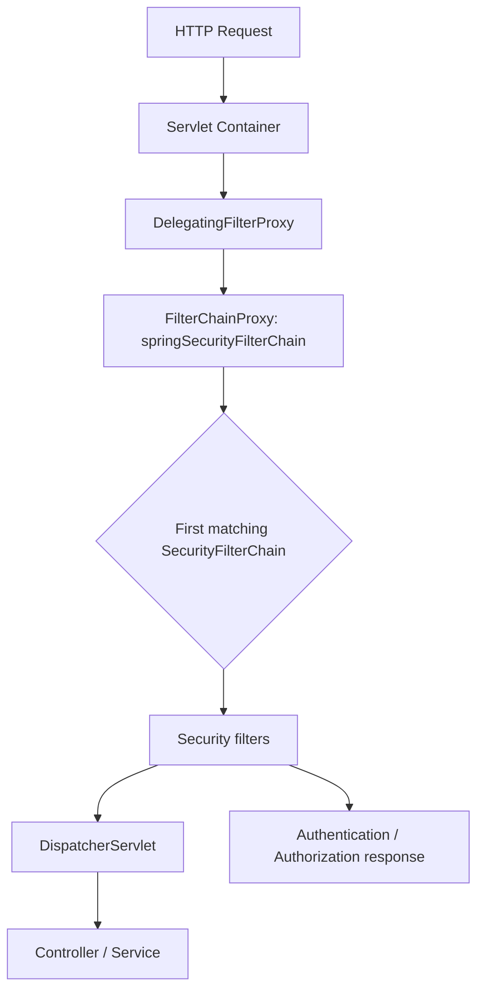
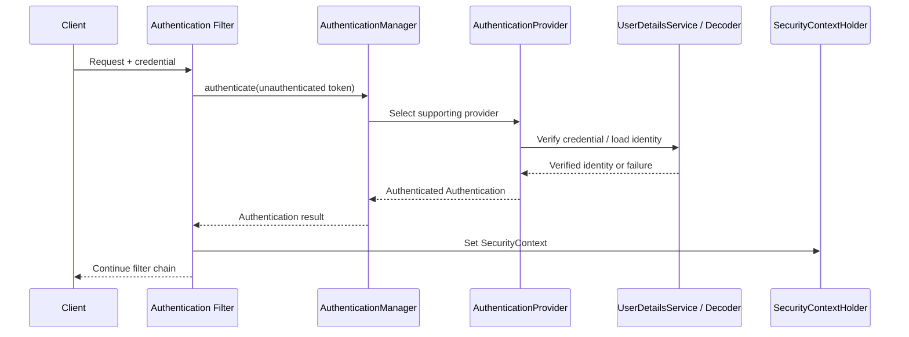
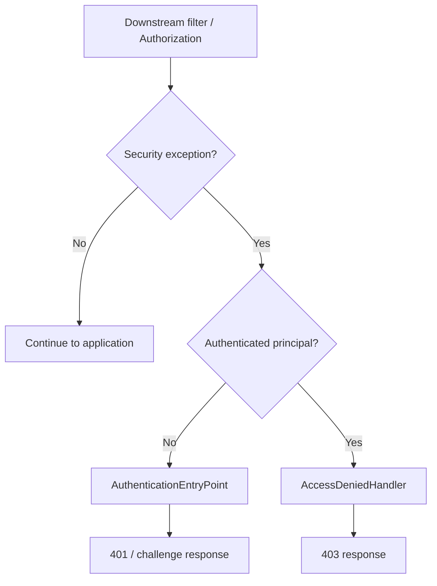

# Spring Security filter chain cho authentication

## 1. Vì sao cần hiểu filter chain?

Trong ứng dụng Java Servlet, Spring Security bảo vệ request bằng một chuỗi servlet filter. Mỗi filter đảm nhận một bước như nạp security context, xử lý CORS/CSRF, xác thực credential, quản lý session, chuyển lỗi authentication/authorization hoặc kiểm tra quyền truy cập.

Nếu chỉ nhìn controller và annotation `@PreAuthorize`, ta có thể bỏ qua nơi request thực sự được xác thực. Một controller có thể không bao giờ được gọi vì request đã bị từ chối ở gateway, servlet filter hoặc authentication filter. Ngược lại, một route có thể vô tình không đi qua đúng security chain nếu cấu hình matcher sai.

Các lỗi phổ biến:

- Có nhiều `SecurityFilterChain` nhưng thứ tự hoặc matcher không đúng.
- API route không khớp chain nào và rơi ra ngoài các rule dự kiến.
- Dùng `requestMatchers` để nghĩ rằng đã chọn chain, trong khi việc chọn chain thuộc `securityMatcher`.
- Thêm custom filter sai vị trí nên authentication exception không được xử lý đúng.
- Đăng ký cùng một filter ở cả Servlet container và Spring Security, khiến filter chạy hai lần.
- Tự tạo `Authentication` rồi đánh dấu authenticated mà không xác minh credential.
- Đặt `SecurityContext` trong ThreadLocal nhưng không hiểu cơ chế lưu/clear hoặc async propagation.
- Tắt CSRF cho toàn bộ ứng dụng dù vẫn có endpoint dùng session cookie.
- Dùng `permitAll()` và nghĩ rằng mọi filter trước authorization sẽ bị bỏ qua.
- Nhầm `oauth2Login()` với `oauth2ResourceServer().jwt()`.

Trong phạm vi **SECURITY_API_SECURITY**, Spring Security filter chain là điểm nối giữa authentication, authorization, endpoint và business flow. Mục tiêu là biết request đi qua chain nào, credential được xác minh ở đâu, principal được lưu như thế nào và lỗi được chuyển thành response ra sao.

Sau bài học này, người học có thể:

1. Giải thích `DelegatingFilterProxy`, `FilterChainProxy` và `SecurityFilterChain`.
2. Chọn đúng chain bằng `securityMatcher` và sắp xếp nhiều chain.
3. Hiểu luồng `AuthenticationManager`, `AuthenticationProvider` và `SecurityContext`.
4. Cấu hình session-based login và stateless bearer-token API.
5. Đặt custom authentication filter đúng vị trí và xử lý lỗi đúng cách.
6. Phân biệt authentication với authorization, CSRF và CORS.
7. Kiểm thử chain matching, authentication và authorization bằng Spring Security Test.

## 2. Kiến trúc tổng quan của filter chain

Trong ứng dụng Spring MVC/Spring Boot chạy trên Servlet stack, request đi qua servlet container trước khi tới DispatcherServlet. Spring Security tích hợp vào pipeline này bằng một servlet filter proxy.

Luồng tổng quát:



### 2.1. DelegatingFilterProxy

`DelegatingFilterProxy` là servlet filter bridge. Servlet container gọi proxy, proxy tìm Spring bean tương ứng (thông thường tên `springSecurityFilterChain`) rồi delegate request cho bean đó.

Lợi ích là filter chain được cấu hình và quản lý trong Spring ApplicationContext, trong khi vẫn tham gia đúng Servlet filter lifecycle.

Trong Spring Boot, phần đăng ký hạ tầng này thường được auto-configure. Ứng dụng thông thường chỉ cần khai báo `SecurityFilterChain` bean, không tự tạo `DelegatingFilterProxy` lần nữa.

### 2.2. FilterChainProxy

`FilterChainProxy` là entry point chính của Spring Security trong Servlet stack. Nó chứa danh sách các `SecurityFilterChain`, chọn chain phù hợp với request và gọi các filter trong chain đó.

Nó cũng thực hiện các xử lý hạ tầng như tích hợp `HttpFirewall` và dọn `SecurityContextHolder` khi request kết thúc. Không nên gọi trực tiếp `FilterChainProxy` từ controller hoặc tự xây dựng một pipeline security song song.

### 2.3. SecurityFilterChain

Một `SecurityFilterChain` gồm:

- Request matcher xác định request nào thuộc chain.
- Danh sách security filter đã được cấu hình cho chain.
- Các cấu hình authentication, authorization, session, CSRF, CORS, headers và exception handling.

Mỗi request được chọn vào chain đầu tiên khớp. Các chain sau không tiếp tục chạy cho cùng request. Vì vậy thứ tự chain là một phần của security policy.

### 2.4. Không có chain khớp thì sao?

Nếu không `SecurityFilterChain` nào match, Spring Security không áp dụng các filter trong những chain đã khai báo cho request đó. Đây là lý do nên có một chain fallback cho phần còn lại của ứng dụng, trừ khi có chủ đích rõ ràng cho các route ngoài phạm vi.

Không giả định rằng mọi request đều tự động đi vào chain “gần giống nhất”. Matcher phải khớp theo cấu hình thực tế.

## 3. Phân biệt securityMatcher và requestMatchers

Đây là hai loại matcher thường bị nhầm.

- `securityMatcher(...)` chọn toàn bộ `SecurityFilterChain` nào sẽ xử lý request.
- `requestMatchers(...)` bên trong `authorizeHttpRequests` xác định quyền của request sau khi chain đã được chọn.

Ví dụ:

```java
@Bean
@Order(1)
SecurityFilterChain apiSecurity(HttpSecurity http) throws Exception {
    http
        .securityMatcher("/api/**")
        .authorizeHttpRequests(auth -> auth
            .requestMatchers(HttpMethod.GET, "/api/public/**").permitAll()
            .requestMatchers("/api/admin/**").hasRole("ADMIN")
            .anyRequest().authenticated()
        );

    return http.build();
}
```

Ở đây `/api/**` quyết định request thuộc API chain. Các `requestMatchers` quyết định rule authorization bên trong chain đó.

Nếu bỏ `securityMatcher`, chain có thể trở thành chain áp dụng cho mọi request tùy cấu hình, làm chain khác không còn được chọn như mong đợi.

### 3.1. Thứ tự chain: first match wins

Spring Security kiểm tra các chain theo thứ tự. Chain có `@Order(1)` được xét trước chain có `@Order(2)`. Khi một chain match, Spring Security sử dụng chain đó.

Đặt matcher cụ thể trước matcher rộng:

1. API machine-to-machine.
2. Admin hoặc management routes.
3. Browser application.
4. Fallback cho phần còn lại.

Không đặt chain catch-all ở đầu nếu còn các chain chuyên biệt phía sau.

### 3.2. permitAll() không bỏ qua filter chain

`permitAll()` chỉ cho phép authorization decision đối với request tương ứng. Các filter khác trong chain vẫn có thể chạy.

Ví dụ public endpoint vẫn có thể bị CORS, security headers, request validation hoặc một custom authentication filter xử lý. Nếu custom filter từ chối mọi request thiếu API key, `permitAll()` ở authorization layer không tự làm filter đó bỏ qua endpoint.

Nếu filter chỉ áp dụng cho một nhóm route, dùng chain matcher hoặc điều kiện filter rõ ràng.

### 3.3. web.ignoring() khác permitAll()

`web.ignoring()` loại request khỏi Spring Security filter chain. Khi đó các filter như security headers, security context và các lớp bảo vệ khác không chạy.

Với static resource công khai, cân nhắc `permitAll()` để vẫn giữ các lớp bảo vệ chung. Chỉ dùng `web.ignoring()` khi hiểu rõ hệ quả và thực sự muốn bỏ toàn bộ Spring Security cho resource đó.

## 4. Ví dụ cấu hình nhiều SecurityFilterChain

Một ứng dụng có thể có API dùng bearer token, browser UI dùng session và endpoint health được kiểm soát riêng. Tách chain giúp mỗi nhóm có authentication và session policy phù hợp.

Ví dụ Spring Security 6 / Spring Boot 3:

```java
@Configuration
@EnableWebSecurity
public class SecurityConfiguration {

    @Bean
    @Order(1)
    SecurityFilterChain apiChain(HttpSecurity http) throws Exception {
        http
            .securityMatcher("/api/**")
            .sessionManagement(session -> session
                .sessionCreationPolicy(SessionCreationPolicy.STATELESS)
            )
            .csrf(AbstractHttpConfigurer::disable)
            .authorizeHttpRequests(auth -> auth
                .requestMatchers("/api/public/**").permitAll()
                .requestMatchers(HttpMethod.GET, "/api/orders/**")
                    .hasAuthority("SCOPE_orders.read")
                .requestMatchers(HttpMethod.POST, "/api/orders/**")
                    .hasAuthority("SCOPE_orders.write")
                .anyRequest().authenticated()
            )
            .oauth2ResourceServer(oauth2 -> oauth2
                .jwt(Customizer.withDefaults())
            );

        return http.build();
    }

    @Bean
    @Order(2)
    SecurityFilterChain webChain(HttpSecurity http) throws Exception {
        http
            .authorizeHttpRequests(auth -> auth
                .requestMatchers("/assets/**", "/login").permitAll()
                .requestMatchers("/admin/**").hasRole("ADMIN")
                .anyRequest().authenticated()
            )
            .formLogin(Customizer.withDefaults());

        return http.build();
    }
}
```

Ví dụ này minh họa hai nhóm trust boundary. API chain nhận bearer token và không dựa vào HTTP session để lưu authentication; web chain dùng form login và session behavior mặc định phù hợp với browser application.

### 4.1. Chain fallback

Nếu ứng dụng có route ngoài `/api/**`, web chain ở ví dụ trên là fallback vì không có `securityMatcher` giới hạn. Khi thêm chain mới, cần kiểm tra chain đó không vô tình chiếm request của chain khác.

Nếu mọi chain đều có matcher hẹp, hãy thêm một chain cuối xử lý phần còn lại hoặc xác nhận rõ các request không match được bảo vệ ở lớp nào.

### 4.2. Tách actuator/management

Management endpoint có thể cần port, network hoặc authentication policy riêng. Không chỉ dựa vào path `/actuator/**` nếu endpoint được expose qua management port khác hoặc gateway route khác. Xác minh cả network exposure, chain selection và role.

### 4.3. Đừng tạo chain chỉ để chia nhỏ file cấu hình

Mỗi chain là một security boundary có behavior riêng. Tách chain khi authentication mechanism, session policy, CSRF/CORS hoặc trust level khác nhau. Quá nhiều chain với matcher chồng lấn sẽ khó review và dễ tạo route lọt policy.

## 5. Filter chain xử lý request theo những bước nào?

Danh sách filter cụ thể phụ thuộc cấu hình và phiên bản Spring Security. Không nên coi một danh sách filter cố định là thứ tự bất biến cho mọi ứng dụng. Tuy nhiên, có thể hiểu pipeline theo các giai đoạn:

1. Chuẩn hóa và kiểm tra request ở lớp hạ tầng.
2. Nạp hoặc tạo `SecurityContext`.
3. Áp dụng security headers, CORS và CSRF theo policy.
4. Xử lý logout hoặc authentication mechanism.
5. Tạo principal từ credential nếu hợp lệ.
6. Quản lý anonymous authentication và session.
7. Chuyển exception authentication/authorization thành HTTP response.
8. Đánh giá authorization cho request.
9. Tiếp tục tới servlet/application nếu được phép.

Một số filter thường gặp:

| Filter | Vai trò khái quát |
|---|---|
| `SecurityContextHolderFilter` | Nạp context vào `SecurityContextHolder` và quản lý lifecycle |
| `HeaderWriterFilter` | Ghi security response headers |
| `CorsFilter` | Xử lý CORS theo cấu hình |
| `CsrfFilter` | Kiểm tra CSRF token cho request cần bảo vệ |
| `LogoutFilter` | Xử lý logout |
| `UsernamePasswordAuthenticationFilter` | Xử lý form username/password |
| `BearerTokenAuthenticationFilter` | Xử lý bearer token |
| `BasicAuthenticationFilter` | Xử lý HTTP Basic |
| `AnonymousAuthenticationFilter` | Cung cấp anonymous Authentication khi phù hợp |
| `ExceptionTranslationFilter` | Chuyển authentication/access-denied exception thành response |
| `AuthorizationFilter` | Thực hiện request authorization |

Bảng trên mô tả vai trò, không phải cam kết rằng mọi filter đều có trong mọi chain hoặc luôn xuất hiện theo đúng thứ tự bảng.

### 5.1. Vì sao thứ tự quan trọng?

Authentication phải xảy ra trước authorization cần principal. CORS preflight cần được xử lý trước khi authentication middleware yêu cầu credential nghiệp vụ. `ExceptionTranslationFilter` cần đứng ở vị trí có thể bắt exception từ các filter downstream như authorization.

Khi thêm custom filter, cần biết nó chạy trước hay sau filter nào và exception phát sinh ở vị trí đó có được xử lý hay không.

## 6. Luồng authentication với AuthenticationManager

Authentication trong Spring Security được thiết kế theo cơ chế provider. Filter thu thập credential, tạo một đối tượng `Authentication` chưa được xác thực và giao cho `AuthenticationManager`.

Luồng tổng quát:



### 6.1. Authentication object

`Authentication` thường mang:

- Principal: danh tính đã xác minh hoặc thông tin caller.
- Credentials: credential dùng để xác thực; nên được xóa/che sau khi xác minh.
- Authorities: quyền hoặc scope đã được gán.
- Details: metadata request nếu cần.

Một authentication request ban đầu thường có `isAuthenticated() == false`. Chỉ `AuthenticationManager`/provider đáng tin cậy mới nên tạo kết quả đã xác thực.

Không tự gọi `setAuthenticated(true)` trên object do client kiểm soát. Làm vậy sẽ biến dữ liệu chưa xác minh thành identity được tin cậy.

### 6.2. AuthenticationManager

`AuthenticationManager` là abstraction có method `authenticate(Authentication)`. Filter không cần biết credential được kiểm tra bằng database, LDAP, JWT decoder, certificate hay service nào; nó chỉ gửi authentication request và nhận kết quả.

### 6.3. ProviderManager và AuthenticationProvider

`ProviderManager` là implementation phổ biến. Nó duyệt các `AuthenticationProvider` và hỏi provider nào `supports()` loại token đang có. Provider phù hợp sẽ xác minh credential.

Có thể cấu hình nhiều provider cho nhiều cơ chế. Cần kiểm tra thứ tự, parent manager và failure semantics để một provider không vô tình chấp nhận token type mà nó không quản lý.

### 6.4. AuthenticationProvider

Một provider chịu trách nhiệm cho một loại authentication cụ thể. Ví dụ:

- `DaoAuthenticationProvider`: username/password dựa trên `UserDetailsService` và `PasswordEncoder`.
- `JwtAuthenticationProvider`: xác minh JWT thông qua `JwtDecoder`.
- Provider tùy chỉnh: API key, certificate mapping hoặc một identity mechanism riêng.

Tách provider giúp filter không chứa logic truy vấn database, so sánh secret hoặc tự gán authority.

## 7. Username/password và DaoAuthenticationProvider

Với form login, Spring Security thường dùng `UsernamePasswordAuthenticationFilter` để đọc username/password và gửi `UsernamePasswordAuthenticationToken` chưa xác thực tới `AuthenticationManager`.

`DaoAuthenticationProvider` phối hợp với `UserDetailsService` để tải thông tin user và `PasswordEncoder` để kiểm tra password hash.

Ví dụ:

```java
@Bean
UserDetailsService userDetailsService(UserRepository users) {
    return username -> users.findByUsername(username)
        .map(user -> User.withUsername(user.getUsername())
            .password(user.getPasswordHash())
            .authorities(user.getAuthorities().toArray(String[]::new))
            .disabled(!user.isEnabled())
            .build())
        .orElseThrow(() -> new UsernameNotFoundException("User not found"));
}

@Bean
PasswordEncoder passwordEncoder() {
    return PasswordEncoderFactories.createDelegatingPasswordEncoder();
}
```

Trong production:

- Database chỉ lưu password hash được tạo bởi password hashing algorithm phù hợp.
- Không log password hoặc authentication request object.
- Dùng thông báo lỗi bên ngoài không tiết lộ account có tồn tại hay không.
- Áp dụng rate limit, lockout/risk controls và monitoring cho login.
- Authority được tải từ nguồn tin cậy, không lấy từ request parameter.

### 7.1. Không tự xây password comparison

Không dùng `String.equals()` với password plaintext lưu trong database. `PasswordEncoder` quản lý thuật toán hash, salt và nâng cấp hash khi cần.

### 7.2. Authentication success chưa có nghĩa được phép truy cập mọi object

Sau khi xác thực, user vẫn cần authorization theo action, tenant, object và property. `ROLE_USER` không chứng minh user được đọc mọi order có ID mà client gửi.

## 8. Bearer token và OAuth2 Resource Server

Với API nhận access token trong `Authorization: Bearer ...`, nên dùng Spring Security OAuth2 Resource Server thay vì tự viết JWT parser/filter.

Ví dụ:

```java
@Bean
@Order(1)
SecurityFilterChain apiChain(HttpSecurity http) throws Exception {
    http
        .securityMatcher("/api/**")
        .sessionManagement(session -> session
            .sessionCreationPolicy(SessionCreationPolicy.STATELESS)
        )
        .csrf(AbstractHttpConfigurer::disable)
        .authorizeHttpRequests(auth -> auth
            .requestMatchers("/api/public/**").permitAll()
            .requestMatchers(HttpMethod.GET, "/api/orders/**")
                .hasAuthority("SCOPE_orders.read")
            .anyRequest().authenticated()
        )
        .oauth2ResourceServer(oauth2 -> oauth2
            .jwt(Customizer.withDefaults())
        );

    return http.build();
}
```

Spring Security cài `BearerTokenAuthenticationFilter` để đọc bearer token, tạo authentication request và chuyển tới authentication manager/provider tương ứng.

### 8.1. JWT validation phải kiểm tra gì?

Chữ ký hợp lệ chưa đủ. Resource server cần kiểm tra ít nhất:

- Chữ ký theo trusted key/algorithm.
- Issuer (`iss`) đúng.
- Expiration (`exp`) và not-before (`nbf`) phù hợp.
- Audience (`aud`) chứa API/resource server dự kiến.
- Token type và profile phù hợp với access token.
- Scope/authority được ánh xạ đúng.
- Clock skew nằm trong giới hạn có chủ đích.

Không chấp nhận JWT chỉ vì decode được payload. Decode không phải verify chữ ký.

### 8.2. Issuer và audience

Cấu hình issuer giúp xác định identity provider tin cậy. Với API có yêu cầu audience cụ thể, cần thêm validator audience phù hợp; không giả định mọi JWT do issuer phát hành đều dành cho API này.

Nếu nhiều issuer/tenant, cân nhắc `AuthenticationManagerResolver` hoặc cấu hình rõ theo request context đã được xác minh. Không chọn issuer tùy ý chỉ từ header không tin cậy.

### 8.3. Scope và authority mapping

OAuth scope như `orders.read` thường được ánh xạ thành authority `SCOPE_orders.read`. Role như `ROLE_ADMIN` là một convention khác. Viết authorization rule theo đúng authority thực tế mà converter tạo ra.

Không nhầm claim `roles`, `groups` hoặc `scope` giữa các IdP. Hãy kiểm thử mapping bằng token fixture đại diện.

### 8.4. Không tự viết JWT filter khi Resource Server đã đáp ứng

Tự parse JWT bằng thư viện JSON hoặc chỉ kiểm tra claim mà không verify chữ ký dễ tạo bypass. Dùng `JwtDecoder`, validators và converter của Spring Security. Chỉ custom khi có yêu cầu cụ thể và vẫn giữ toàn bộ validation cần thiết.

## 9. OAuth2 Login khác OAuth2 Resource Server

Hai chức năng phục vụ hai vai trò khác nhau:

| Chức năng | Mục đích | Flow thường gặp |
|---|---|---|
| `oauth2Login()` | Ứng dụng web đăng nhập user qua authorization server/identity provider | Authorization Code và redirect browser |
| `oauth2ResourceServer()` | API nhận và xác minh access token | Bearer token gửi trong request |

Một web application có thể dùng `oauth2Login()` để tạo session cho browser. Một API độc lập có thể dùng resource server để xác minh bearer token. Nếu cùng ứng dụng có cả hai, tách chain theo route và session policy để tránh trộn behavior.

Không dùng ID token như access token cho API trừ khi protocol và audience được thiết kế rõ ràng. ID token mô tả authentication event cho client; access token cấp quyền truy cập resource.

## 10. HTTP Basic và các cơ chế khác

HTTP Basic có thể phù hợp cho một số tích hợp đơn giản hoặc môi trường được kiểm soát, nhưng credential được gửi trong mỗi request và phải được bảo vệ bằng TLS. Không dùng Basic qua HTTP không mã hóa.

Một số cơ chế khác:

- X.509/mTLS: certificate xác định workload/client; cần mapping subject/SAN/fingerprint sang principal và kiểm tra trust/revocation.
- Pre-authenticated identity: chỉ tin header identity nếu gateway đáng tin đã strip header từ client và inject lại qua kết nối được bảo vệ.
- API key: phù hợp nhận diện client/tích hợp và quota; không tự động tương đương user authentication hoặc fine-grained authorization.
- Session cookie: phù hợp browser app; cần CSRF protection và session lifecycle đúng.

Mỗi cơ chế phải xác định rõ credential source, verifier, principal mapping, expiry, revoke và audit.

## 11. SecurityContextHolder và SecurityContext

Sau khi authentication thành công, Spring Security lưu kết quả trong `SecurityContext`, thường được truy cập qua `SecurityContextHolder`.

Ví dụ đọc principal:

```java
Authentication authentication =
    SecurityContextHolder.getContext().getAuthentication();

if (authentication != null && authentication.isAuthenticated()) {
    Object principal = authentication.getPrincipal();
}
```

Trong ứng dụng Servlet thông thường, `SecurityContextHolder` mặc định dùng ThreadLocal strategy. Điều này giúp code ở cùng request thread truy cập principal mà không truyền qua mọi method parameter.

### 11.1. Không giữ SecurityContext trong field singleton

Controller/service thường là singleton. Không lưu `Authentication` hoặc user hiện tại vào field của bean vì request đồng thời có thể ghi đè danh tính của nhau.

Đọc context trong phạm vi request hoặc truyền principal rõ ràng tới service khi phù hợp.

### 11.2. Context phải được clear

Spring Security quản lý lifecycle và dọn context khi request hoàn tất. Custom code không nên để context rò sang request khác. Khi tự quản lý thread hoặc tạo async task, cần dùng cơ chế context propagation phù hợp và tránh giữ context lâu hơn cần thiết.

### 11.3. Async và thread pool

ThreadLocal không tự động truyền an toàn qua mọi thread pool. Với async execution, dùng cơ chế hỗ trợ như `DelegatingSecurityContextRunnable`, `DelegatingSecurityContextExecutor` hoặc thiết kế truyền principal/authorization context rõ ràng.

Không copy SecurityContext vào thread pool dùng chung mà không hiểu vòng đời và nguy cơ rò identity giữa task.

### 11.4. Servlet stack và reactive stack khác nhau

Bài này tập trung Servlet/Spring MVC. Spring WebFlux dùng `SecurityWebFilterChain` và Reactor Context, không dùng cùng Servlet `FilterChainProxy` pipeline. Không áp dụng trực tiếp ví dụ `OncePerRequestFilter` vào WebFlux.

## 12. SecurityContextRepository và session persistence

`SecurityContextHolder` giữ context trong quá trình xử lý request hiện tại. `SecurityContextRepository` quyết định context được nạp/lưu giữa các request như thế nào.

Một số lựa chọn:

- `HttpSessionSecurityContextRepository`: lưu context qua HTTP session.
- `RequestAttributeSecurityContextRepository`: giữ context trong request attributes cho các dispatch phù hợp.
- `NullSecurityContextRepository`: không lưu context lâu dài.
- Repository tùy chỉnh: chỉ dùng khi có yêu cầu rõ và được review.

### 12.1. Stateful session

Browser form login thường cần session để giữ authentication qua nhiều request. Khi login thành công, context được lưu theo cơ chế session repository và browser gửi session cookie ở request sau.

Cần quản lý session fixation protection, cookie flags, expiry, logout, concurrent session policy và CSRF.

### 12.2. Spring Security 6 và explicit save

Trong Spring Security hiện đại, `SecurityContextHolderFilter` dùng cơ chế explicit save theo mặc định trong các cấu hình chuẩn. Khi custom authentication flow cần context tồn tại ở request tiếp theo, phải hiểu `SecurityContextRepository` và lưu context đúng cách; chỉ gọi `SecurityContextHolder.setContext(...)` có thể chỉ có hiệu lực trong request hiện tại.

Không sao chép code lưu context từ phiên bản Spring Security cũ mà không kiểm tra behavior của phiên bản đang dùng.

### 12.3. Stateless API

Với bearer-token API, mỗi request mang credential và resource server xác minh lại token. Cấu hình thường dùng `SessionCreationPolicy.STATELESS` để Spring Security không dùng HTTP session làm nơi lưu security context.

Stateless không có nghĩa toàn ứng dụng không thể tạo session. Một component khác vẫn có thể gọi `request.getSession()`; cần kiểm tra toàn bộ ứng dụng nếu yêu cầu không session.

## 13. SessionCreationPolicy: chọn đúng semantics

| Policy | Ý nghĩa khái quát |
|---|---|
| `ALWAYS` | Luôn tạo session |
| `IF_REQUIRED` | Tạo session khi cần |
| `NEVER` | Không tự tạo session nhưng có thể dùng session có sẵn |
| `STATELESS` | Không dùng session để lấy/lưu SecurityContext |

Với browser session login, `IF_REQUIRED` thường là lựa chọn tự nhiên. Với API bearer token stateless, dùng `STATELESS` nếu không có session authentication.

Không chọn `STATELESS` chỉ để giảm một vài request state nếu endpoint thực tế xác thực bằng cookie session. Làm vậy có thể phá authentication flow hoặc khiến CSRF assumptions không còn đúng.

## 14. Custom API key authentication filter

API key không phải lúc nào cũng phù hợp với OAuth2 Resource Server. Nếu cần một cơ chế API key riêng, hãy tách việc trích xuất key khỏi việc xác minh key.

Kiến trúc nên có:

1. Filter chỉ đọc header theo contract, ví dụ `X-API-Key`.
2. Tạo authentication request chưa xác thực.
3. Gọi `AuthenticationManager`.
4. `AuthenticationProvider` tìm key record và xác minh secret/hash, trạng thái, expiry và scope.
5. Provider trả principal/client đã xác thực cùng authorities phù hợp.
6. Filter đặt context và tiếp tục chain.
7. Lỗi credential được chuyển qua `AuthenticationEntryPoint` phù hợp.

Không lưu raw API key trong database hoặc log. Thường chỉ lưu key identifier cùng hash/secret verifier; cần rotation, revoke, expiry, owner, scope và quota.

### 14.1. Vị trí filter

Custom authentication filter phải chạy trước `AuthorizationFilter`, nhưng vị trí cụ thể phụ thuộc các filter hiện có và exception handling. Nếu filter chạy trước `ExceptionTranslationFilter`, exception phát sinh bên trong filter đó không được filter nằm phía sau bắt lại. Khi đó filter phải tự xử lý lỗi bằng `AuthenticationEntryPoint`/failure handler hoặc được đặt ở vị trí phù hợp.

Không thêm filter theo thói quen “trước UsernamePasswordAuthenticationFilter” mà không kiểm tra pipeline thực tế của chain.

### 14.2. Ví dụ cấu hình filter

Ví dụ dưới đây chỉ minh họa vị trí đăng ký. `ApiKeyAuthenticationFilter` phải được triển khai để gọi `AuthenticationManager`, xử lý lỗi và không tự đánh dấu credential là hợp lệ:

```java
@Bean
@Order(1)
SecurityFilterChain apiKeyChain(
        HttpSecurity http,
        ApiKeyAuthenticationFilter apiKeyFilter
) throws Exception {
    http
        .securityMatcher("/partner-api/**")
        .sessionManagement(session -> session
            .sessionCreationPolicy(SessionCreationPolicy.STATELESS)
        )
        .csrf(AbstractHttpConfigurer::disable)
        .authorizeHttpRequests(auth -> auth
            .anyRequest().authenticated()
        )
        .addFilterBefore(
            apiKeyFilter,
            UsernamePasswordAuthenticationFilter.class
        );

    return http.build();
}
```

Nếu filter cần được thêm vào Spring Security chain và đồng thời là Spring bean, hãy tránh để Spring Boot đăng ký nó thêm một lần như servlet container filter. Có thể dùng `FilterRegistrationBean` với `setEnabled(false)` cho servlet registration khi cần; xác minh filter chỉ chạy trong chain mong muốn.

### 14.3. Không tự viết AuthenticationProvider sơ sài

Provider phải kiểm tra key ID, secret verifier, enabled/revoked, expiry, client ownership, allowed audience/route và scope. Không chỉ kiểm tra “header có giá trị” rồi tạo principal.

Nếu key sai hoặc hết hạn, trả authentication failure thống nhất; không tiết lộ key ID có tồn tại hay không trong public response.

### 14.4. API key không phải authorization object-level

API key xác định client/integration. Sau đó vẫn cần xác định client được phép thao tác tenant, object và action nào. Không cho một key tích hợp quyền đọc mọi dữ liệu chỉ vì nó đã authenticate thành công.

## 15. ExceptionTranslationFilter: từ exception thành HTTP response

`ExceptionTranslationFilter` nối exception security ở các filter downstream với HTTP response. Nó thường xử lý:

- `AuthenticationException`: chuyển tới `AuthenticationEntryPoint`.
- `AccessDeniedException`: nếu caller chưa được xác thực phù hợp, bắt đầu authentication; nếu caller đã authenticated, gọi `AccessDeniedHandler`.

Luồng khái quát:



### 15.1. AuthenticationEntryPoint

`AuthenticationEntryPoint` bắt đầu hoặc yêu cầu authentication. Với bearer token, Spring Security có entry point phù hợp để trả challenge `WWW-Authenticate`. Với browser form login, entry point có thể redirect tới login page.

Không dùng redirect login page cho API JSON nếu client mong đợi 401 JSON.

### 15.2. AccessDeniedHandler

`AccessDeniedHandler` xử lý principal đã authenticated nhưng thiếu quyền. Có thể trả JSON error contract ổn định, request ID và thông tin an toàn cho client.

Không trả role nội bộ, policy expression, object owner hoặc dữ liệu của tenant khác trong response 403.

### 15.3. Filter exception không phải lúc nào cũng được dịch

`ExceptionTranslationFilter` chỉ bắt exception phát sinh ở downstream của nó. Một custom filter nằm trước nó mà ném `AuthenticationException` có thể thoát ra ngoài cơ chế này.

Đây là một lý do phải hiểu filter order trước khi thêm custom filter. Xem log và trace để biết filter nào thực sự tạo response.

## 16. Authorization diễn ra sau authentication

Authentication trả lời “caller là ai?”. Authorization trả lời “caller có được phép thực hiện action này trên resource này không?”.

Trong request authorization:

```java
http.authorizeHttpRequests(auth -> auth
    .requestMatchers("/api/public/**").permitAll()
    .requestMatchers(HttpMethod.GET, "/api/orders/**")
        .hasAuthority("SCOPE_orders.read")
    .requestMatchers(HttpMethod.POST, "/api/orders/**")
        .hasAuthority("SCOPE_orders.write")
    .anyRequest().authenticated()
);
```

Các rule trên mới kiểm tra quyền ở mức route/method. Với object-level authorization, service vẫn phải kiểm tra owner, tenant, relationship và state của resource.

### 16.1. Method security

Có thể dùng `@EnableMethodSecurity` và annotation như `@PreAuthorize` để bảo vệ method/service. Ví dụ:

```java
@PreAuthorize("@orderAuthorization.canRead(authentication, #orderId)")
public Order getOrder(UUID orderId) {
    return orderRepository.findById(orderId)
        .orElseThrow(OrderNotFoundException::new);
}
```

Method security bổ sung lớp kiểm soát ở business/service layer. Nó không thay thế kiểm tra route, và cần tránh đưa object lookup trước authorization theo cách làm lộ dữ liệu hoặc tạo side effect.

### 16.2. Không dùng role thay object permission

`hasRole("USER")` không chứng minh caller sở hữu object. Mọi thao tác đọc, sửa, xóa, export hoặc chia sẻ object cần kiểm tra đúng object và tenant scope.

## 17. CSRF và CORS trong filter chain

CSRF và CORS giải quyết hai vấn đề khác nhau.

### 17.1. CSRF

CSRF bảo vệ endpoint dùng credential browser tự gửi kèm, thường là session cookie. Với browser session application, giữ CSRF protection cho các method thay đổi state và cung cấp token cho client theo thiết kế.

Chỉ cân nhắc tắt CSRF cho chain API khi authentication không dựa vào ambient browser credential (ví dụ bearer token gửi rõ trong Authorization header) và threat model xác nhận điều đó. Nếu bearer token được đặt trong cookie, vẫn cần đánh giá CSRF.

### 17.2. CORS

CORS quyết định browser có cho JavaScript ở origin khác đọc response hay không. CORS preflight thường không có session credential như request nghiệp vụ; vì vậy CORS cần được xử lý trước bước authentication yêu cầu credential.

Có thể cấu hình bằng `http.cors(Customizer.withDefaults())` cùng `CorsConfigurationSource`. Allowlist origin, method, header và credentials phải cụ thể.

### 17.3. Không dùng CORS thay authorization

CORS không chặn mọi request cross-site và không bảo vệ server khỏi curl, mobile app hoặc backend client. Mọi endpoint vẫn cần authentication, authorization, validation và CSRF protection phù hợp.

## 18. Đặt custom filter đúng vị trí

Spring Security cung cấp các method như:

- `addFilterBefore(filter, KnownFilter.class)`
- `addFilterAfter(filter, KnownFilter.class)`
- `addFilterAt(filter, KnownFilter.class)`

Chọn anchor filter dựa trên chức năng cần thực hiện.

Ví dụ:

| Mục đích | Vị trí cần cân nhắc |
|---|---|
| Correlation/request context | Trước các filter cần đọc metadata, không thay identity |
| API key authentication | Trước authorization; xử lý failure/entry point rõ |
| Custom authorization | Dùng AuthorizationManager/method security nếu phù hợp; nếu filter, đặt đúng sau context và trước controller |
| Audit decision | Sau khi có principal/decision; tránh log secret |
| Response header | Dùng Spring Security header configuration nếu có sẵn |

### 18.1. Không dùng filter cho mọi business rule

Filter phù hợp với cross-cutting HTTP concern. Business authorization theo order, invoice hoặc tenant thường nên ở service/policy layer để có domain context và dễ test.

### 18.2. OncePerRequestFilter

`OncePerRequestFilter` giúp filter tránh xử lý lặp trong một số dispatch của cùng request theo semantics của nó. Nó không phải cam kết “một lần tuyệt đối” cho mọi async/error dispatch hoặc mọi cách forward/include.

Nếu ứng dụng dùng async servlet hoặc error dispatch, kiểm tra `shouldNotFilterAsyncDispatch`, `shouldNotFilterErrorDispatch` và behavior của container.

### 18.3. Tránh đăng ký filter hai lần

Một Filter bean có thể được Spring Boot tự đăng ký với Servlet container. Nếu đồng thời thêm nó vào Spring Security chain, request có thể đi qua filter hai lần ở hai vị trí khác nhau.

Khi filter chỉ thuộc Spring Security, tắt servlet auto-registration phù hợp và kiểm thử số lần filter thực thi. Không dựa vào log “có vẻ chỉ chạy một lần”.

## 19. HttpFirewall và request path

`FilterChainProxy` sử dụng `HttpFirewall` để kiểm tra/chuẩn hóa request trước khi matcher và filter xử lý. Mục tiêu là giảm ambiguity giữa các thành phần khi diễn giải path, separator, encoded character và request target.

Không tắt firewall hoặc nới lỏng rule chỉ để một URL bất thường hoạt động mà chưa hiểu rủi ro. Nếu gateway, servlet container và Spring Security normalize path khác nhau, attacker có thể tìm cách khiến lớp routing và lớp authorization hiểu request khác nhau.

Kiểm tra các trường hợp:

- Encoded slash hoặc backslash.
- Duplicate slash.
- Path parameter hoặc semicolon.
- Dot segment và path traversal encoding.
- HTTP method bất thường.
- Header mâu thuẫn hoặc request malformed.

Dùng canonical route mapping và test qua toàn bộ proxy/container/security chain.

## 20. Authentication failure, logout và credential lifecycle

Authentication không chỉ là kiểm tra credential một lần. Hệ thống phải xử lý expiry, revoke, rotation, logout và compromise.

### 20.1. Token hết hạn hoặc bị revoke

JWT tự chứa thường được xác minh bằng chữ ký và claim; token có thể tiếp tục hợp lệ đến expiry nếu resource server không kiểm tra trạng thái revoke. Với yêu cầu revoke nhanh, cân nhắc token TTL ngắn, introspection, denylist hoặc thiết kế key/session revocation phù hợp.

### 20.2. Logout

Với session login, logout cần invalidate session và xóa security context/cookie theo cấu hình. Với bearer token stateless, logout ở client chỉ xóa token khỏi client; token đã phát hành có thể còn hợp lệ cho đến expiry hoặc revocation mechanism có hiệu lực.

Không tuyên bố logout stateless đã revoke token nếu server không có cơ chế revoke.

### 20.3. Credential rotation

Khi rotate API key hoặc signing key:

- Có thời gian overlap có kiểm soát nếu cần.
- Xác minh consumer đã chuyển sang key mới.
- Thu hồi key cũ theo deadline.
- Theo dõi request dùng key cũ.
- Không log secret trong quá trình migration.

## 21. Kiểm thử filter chain với Spring Security Test

Security configuration cần test bằng request đi qua Spring Security filter chain, không chỉ gọi trực tiếp controller.

### 21.1. Kiểm tra authentication bắt buộc

Ví dụ MockMvc:

```java
@SpringBootTest
@AutoConfigureMockMvc
class ApiSecurityTests {

    @Autowired
    MockMvc mockMvc;

    @Test
    void requestWithoutAuthenticationIsRejected() throws Exception {
        mockMvc.perform(get("/api/orders"))
            .andExpect(status().isUnauthorized());
    }
}
```

Status cụ thể phụ thuộc entry point và API contract. Điều quan trọng là test chứng minh request không có credential không được vào business handler.

### 21.2. Kiểm tra authorization với JWT test principal

```java
@Test
void readScopeCanReadOrders() throws Exception {
    mockMvc.perform(get("/api/orders")
            .with(jwt().authorities(
                new SimpleGrantedAuthority("SCOPE_orders.read")
            )))
        .andExpect(status().isOk());
}

@Test
void missingWriteScopeIsForbidden() throws Exception {
    mockMvc.perform(post("/api/orders")
            .with(jwt().authorities(
                new SimpleGrantedAuthority("SCOPE_orders.read")
            )))
        .andExpect(status().isForbidden());
}
```

`jwt()` tạo authentication giả cho test authorization. Nó không kiểm tra chữ ký JWT thật, issuer, audience hoặc JWKS. Dùng test này để xác minh rule authorization; dùng test riêng cho decoder/validator hoặc integration test với issuer/JWKS test.

### 21.3. @WithMockUser có giới hạn

`@WithMockUser` tạo security context giả với user/authority được chỉ định. Nó hữu ích cho method security hoặc authorization test, nhưng bỏ qua việc filter trích xuất và xác minh credential thật.

Không dùng một test `@WithMockUser` để kết luận login/password filter hoặc bearer-token filter hoạt động.

### 21.4. Kiểm tra chain selection

Có thể kiểm tra behavior khác nhau giữa `/api/**`, `/admin/**` và web routes:

- API yêu cầu bearer token và không tạo session.
- Web route dùng session/form login.
- Public route chỉ `permitAll` đúng phạm vi.
- Unknown route vẫn được fallback chain bảo vệ.
- Request path biến thể không bypass chain.

Dùng request thật qua MockMvc và, khi cần, integration test qua embedded server/proxy.

### 21.5. Kiểm tra CSRF và CORS

Với session-based form flow, test POST/PUT/DELETE thiếu CSRF token bị từ chối và có token hợp lệ được xử lý. Test preflight `OPTIONS` từ origin hợp lệ và không hợp lệ; xác nhận response header đúng và preflight không bị authentication middleware chặn.

## 22. Quan sát và debug filter chain

Khi request bị từ chối, cần biết filter nào đưa ra quyết định. Có thể bật log Spring Security ở môi trường phát triển/test:

```yaml
logging:
  level:
    org.springframework.security: TRACE
```

Không bật TRACE rộng trong production nếu chưa đánh giá khối lượng và dữ liệu nhạy cảm. Log có thể chứa request details hoặc thông tin không nên lưu lâu.

Nên quan sát:

- Chain được chọn.
- Authentication mechanism/filter.
- Principal type và client reference đã pseudonymize.
- Authentication success/failure reason.
- Authorization decision và policy.
- HTTP status và response origin.
- Request ID/trace ID.
- Session creation hoặc session reuse khi cần.

Không log password, bearer token, API key, cookie hoặc private key. Tránh ghi raw JWT để “debug nhanh”.

### 22.1. Debug chain matcher

Khi request đi nhầm chain, kiểm tra:

1. URL/method thực tế sau proxy rewrite.
2. `securityMatcher` của từng chain.
3. `@Order` và chain nào match đầu tiên.
4. Context path/servlet path.
5. Request dispatcher type.
6. Path normalization và firewall behavior.

### 22.2. Debug 401 và 403

- 401: xem credential extraction, token validation, issuer/audience, entry point.
- 403: xem principal, authorities, matcher, authorization manager, CSRF và access denied handler.
- Redirect bất ngờ: xem form login entry point hoặc request cache.
- Filter chạy hai lần: kiểm tra servlet registration và security-chain registration.

## 23. Những lỗi thiết kế thường gặp

1. **Không hiểu first-match-wins.** Chain rộng ở đầu che mất chain chuyên biệt.
2. **Nhầm `securityMatcher` với `requestMatchers`.** Chọn sai chain hoặc áp sai authorization.
3. **Không có fallback chain.** Một số route không được Spring Security xử lý.
4. **Dùng `web.ignoring()` quá rộng.** Bỏ qua toàn bộ security filters.
5. **Cho rằng `permitAll()` bỏ qua authentication filter.** Custom filter vẫn có thể chặn request.
6. **Tự tạo Authentication đã trusted.** Không xác minh credential nhưng vẫn cấp principal.
7. **Tự parse JWT.** Bỏ sót signature, issuer, audience hoặc expiry validation.
8. **Nhầm OAuth2 Login với Resource Server.** Dùng sai flow và loại token.
9. **Tắt CSRF toàn cục.** Endpoint session cookie có thể bị CSRF.
10. **Dùng CORS thay authorization.** Client ngoài browser vẫn gọi được API.
11. **Custom filter nằm trước ExceptionTranslationFilter rồi ném exception.** Authentication failure không được dịch đúng.
12. **Đăng ký filter hai lần.** Filter chạy ở Servlet container và Spring Security chain.
13. **Dùng ThreadLocal context sai trong async.** Principal bị mất hoặc rò giữa task.
14. **Chỉ set SecurityContextHolder nhưng mong session tự lưu.** Context không được persist theo cấu hình explicit-save.
15. **Dùng `STATELESS` trong ứng dụng dựa vào session cookie.** Authentication behavior bị phá vỡ.
16. **Chỉ test bằng `@WithMockUser`.** Không kiểm tra filter authentication thật.
17. **Không test route sau proxy rewrite.** Chain matcher nhìn path khác dự kiến.
18. **Log raw token hoặc password.** Telemetry trở thành nguồn rò credential.
19. **Đưa object-level authorization vào role chung.** User có role nhưng vẫn truy cập object tenant khác.
20. **Không kiểm tra logout/revoke semantics.** Client xóa token nhưng token vẫn còn hiệu lực.

## 24. Checklist thiết kế Spring Security filter chain

Trước khi phát hành security configuration, hãy xác nhận:

- [ ] Ứng dụng đang dùng đúng Servlet stack hay WebFlux stack.
- [ ] Hiểu vai trò của DelegatingFilterProxy và FilterChainProxy.
- [ ] Mỗi SecurityFilterChain có matcher và purpose rõ.
- [ ] Chain cụ thể được đặt trước chain rộng; first-match-wins đã được kiểm thử.
- [ ] Có fallback chain hoặc có chủ đích rõ cho request không match.
- [ ] Phân biệt securityMatcher với requestMatchers.
- [ ] Public endpoint dùng permitAll khi vẫn cần security filters chung.
- [ ] Authentication filter gọi AuthenticationManager/Provider phù hợp.
- [ ] Authentication chưa xác minh không được đánh dấu authenticated.
- [ ] JWT kiểm tra signature, issuer, audience, expiry, token type và authority mapping.
- [ ] OAuth2 Login và Resource Server được cấu hình đúng vai trò.
- [ ] SessionCreationPolicy phù hợp với cookie/session hay bearer-token API.
- [ ] SecurityContextRepository và explicit save được hiểu rõ.
- [ ] Async/thread pool không làm rò SecurityContext.
- [ ] Custom filter có vị trí rõ và exception handling phù hợp.
- [ ] Filter không bị đăng ký đồng thời ở Servlet container và Security chain.
- [ ] CSRF chỉ được tắt ở chain có threat model phù hợp.
- [ ] CORS preflight được xử lý trước authentication khi cần.
- [ ] AuthenticationEntryPoint và AccessDeniedHandler trả đúng API contract.
- [ ] Object/tenant authorization vẫn được kiểm tra ở service/policy layer.
- [ ] HttpFirewall không bị nới lỏng tùy tiện.
- [ ] Có test authentication, authorization, chain selection, CSRF, CORS và fallback.
- [ ] Test dùng mock principal đúng mục tiêu và có integration test cho credential thật.
- [ ] Logging/metrics không chứa secret và có request correlation.
- [ ] Logout, expiry, revoke và credential rotation có semantics rõ.

## 25. Kết luận

Spring Security filter chain là pipeline thực thi security policy cho request Servlet. `DelegatingFilterProxy` chuyển request vào `FilterChainProxy`; proxy chọn `SecurityFilterChain` đầu tiên khớp; các filter trong chain nạp context, xác thực credential, áp dụng CSRF/CORS, chuyển exception và kiểm tra authorization trước khi request tới controller.

Thiết kế an toàn bắt đầu bằng chain matcher rõ ràng, thứ tự không chồng lấn ngoài ý muốn và fallback được kiểm soát. Authentication nên đi qua `AuthenticationManager` và `AuthenticationProvider`; principal đã xác minh được đặt trong `SecurityContext`; session persistence hoặc stateless behavior phải phù hợp với cách client gửi credential.

Custom filter chỉ nên được thêm khi cần, ở vị trí đã hiểu rõ và với error handling phù hợp. Dùng Resource Server cho bearer JWT, giữ CSRF cho session-based browser flow, không dùng CORS thay authorization và kiểm thử request qua filter chain thật. Khi nắm được pipeline này, đội phát triển có thể xác định chính xác request bị chặn ở đâu, vì sao principal được tin cậy và policy nào cho phép hoặc từ chối thao tác.

