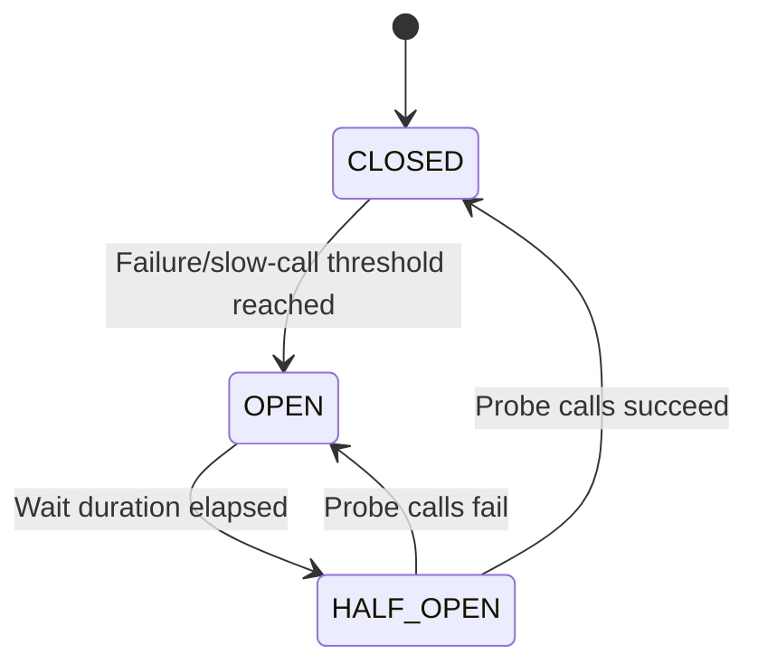
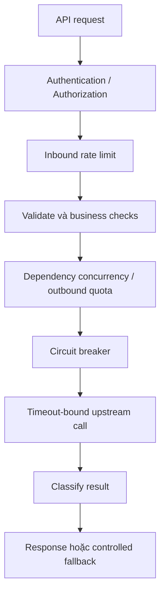

# Rate limiter, circuit breaker và timeout

API cần bảo vệ cả hai phía của request: caller không được tiêu thụ tài nguyên vượt mức đã cấp, và một dependency chậm hoặc lỗi không được kéo sập toàn bộ service. Rate limiter kiểm soát tốc độ request hoặc operation; circuit breaker ngăn tiếp tục gọi một dependency đang gặp sự cố; timeout giới hạn thời gian chờ một operation. Ba cơ chế giải quyết các vấn đề khác nhau và cần phối hợp với authentication, authorization, quota, retry và observability.

Trong Spring API, có thể triển khai rate limiting ở API gateway hoặc service bằng bucket/token algorithm, Redis hoặc Resilience4j. Circuit breaker và timeout thường đặt quanh lời gọi dependency như payment provider, database proxy, identity provider hoặc service nội bộ. Cấu hình đúng giúp API trả lỗi có kiểm soát, giữ tài nguyên cho request khác và tránh retry storm.

## 1. Phân biệt ba cơ chế

| Cơ chế | Bảo vệ điều gì? | Tác động khi ngưỡng bị chạm | Ví dụ |
|---|---|---|---|
| Rate limiter | Lưu lượng theo caller, tenant, route hoặc dependency | Từ chối request mới hoặc trì hoãn trong thời gian giới hạn | 100 request/phút cho một API client |
| Circuit breaker | Dependency đang có tỷ lệ lỗi hoặc phản hồi chậm cao | Tạm ngừng gọi dependency và chuyển sang trạng thái thử lại có kiểm soát | Payment provider timeout liên tục |
| Timeout | Thời gian một operation được phép chờ | Hủy hoặc ngừng chờ kết quả sau deadline | Kết nối upstream tối đa 500 ms, tổng call tối đa 2 giây |

Rate limiter không phát hiện dependency lỗi. Circuit breaker không giới hạn số request mà một user có thể gửi vào API. Timeout không ngăn một caller gửi hàng nghìn request đồng thời. Một hệ thống thường cần cả ba.

### 1.1. Rate limit inbound và outbound

Rate limit inbound bảo vệ API khỏi caller gửi quá nhiều request. Rate limit outbound bảo vệ quota của dependency hoặc nhà cung cấp bên ngoài. Hai lớp có thể cùng tồn tại:

- Inbound: mỗi user, client hoặc tenant được gọi `GET /orders` tối đa một số lần trong một cửa sổ.
- Outbound: toàn bộ service chỉ gọi payment provider theo quota của hợp đồng.
- Concurrency limit: giới hạn số operation đang chạy đồng thời, tránh cạn thread/connection pool.

Không dùng một bucket duy nhất cho cả ba mục đích. Quota theo caller và quota của provider có phạm vi, key và cách phản hồi khác nhau.

## 2. Rate limiting trong API

Rate limiting đặt giới hạn số request hoặc operation trong một khoảng thời gian. Mục tiêu có thể là chống brute force, bảo vệ endpoint tốn tài nguyên, chia sẻ công bằng giữa tenant hoặc tuân thủ quota của upstream.

Các endpoint nên có policy riêng theo chi phí và rủi ro:

| Nhóm endpoint | Dimension nên cân nhắc | Lý do |
|---|---|---|
| Login, OTP, password reset | Account reference, IP, device/client | Chống credential stuffing và abuse OTP |
| API đọc thông thường | Principal, API client, tenant | Chia sẻ công bằng và tránh scraping |
| Search/report/export | Principal, tenant, route, concurrency | Query có chi phí CPU/DB lớn |
| Payment/refund | Client, tenant, operation và business quota | Bảo vệ tài chính và giới hạn downstream |
| Webhook ingestion | Producer identity, tenant, event type | Chống flood và giới hạn hàng đợi |
| Admin/security operation | Principal, action, target | Giảm rủi ro thử sai hoặc lạm dụng quyền cao |

Rate limit là lớp bảo vệ tài nguyên. Caller vẫn phải qua authentication và authorization trước khi thực hiện nghiệp vụ. Không coi việc một request còn quota là bằng chứng caller được phép truy cập resource.

## 3. Chọn thuật toán rate limit

| Thuật toán | Cách hoạt động | Ưu điểm | Hạn chế |
|---|---|---|---|
| Fixed window counter | Đếm request trong từng cửa sổ cố định | Đơn giản, ít trạng thái | Có thể burst ở ranh giới hai cửa sổ liên tiếp |
| Sliding log | Lưu timestamp từng request trong cửa sổ trượt | Chính xác theo cửa sổ | Tốn bộ nhớ và thao tác lưu trữ |
| Sliding window counter | Kết hợp counter cửa sổ hiện tại và trước đó | Xấp xỉ mượt hơn fixed window | Cần tính trọng số và xử lý đồng thời đúng |
| Token bucket | Token được nạp đều; mỗi request tiêu thụ token | Cho phép burst có giới hạn, dễ mô hình hóa quota | Cần lưu trạng thái bucket và cập nhật atomic |
| Leaky bucket | Request được xử lý theo tốc độ đều hoặc hàng đợi giới hạn | Làm phẳng burst | Có thể tăng latency; cần giới hạn queue |

Token bucket thường phù hợp với API cần cho phép burst ngắn nhưng giới hạn tốc độ trung bình. Ví dụ bucket có capacity 60 token và refill 1 token/giây cho phép tối đa 60 request burst, sau đó trung bình khoảng 60 request/phút.

### 3.1. Fixed window có thể tạo burst ở ranh giới

Giả sử giới hạn 100 request mỗi phút. Caller gửi 100 request vào 12:00:59 và thêm 100 request vào 12:01:00. Cả hai nhóm có thể được chấp nhận dù chỉ cách nhau một giây. Nếu endpoint tốn tài nguyên, đây có thể là burst quá lớn.

Sliding window hoặc token bucket giảm vấn đề này. Chọn thuật toán theo mục tiêu thực tế, không chỉ theo độ đơn giản của cấu hình.

### 3.2. Cập nhật bucket phải atomic

Nếu nhiều request cùng đọc counter, cùng thấy còn quota rồi cùng tăng, tổng số request có thể vượt giới hạn. Trong môi trường nhiều thread hoặc nhiều instance, thao tác kiểm tra và tiêu thụ token cần atomic.

Với Redis, có thể dùng Lua script hoặc primitive atomic phù hợp để đọc, refill và cập nhật bucket trong một thao tác. Không triển khai bằng chuỗi lệnh `GET`, tính toán ở Java rồi `SET` riêng nếu nhiều instance cùng dùng key.

## 4. Chọn rate-limit key an toàn

Rate limiter chỉ công bằng và khó bị bypass khi key phản ánh đúng principal hoặc phạm vi quota. Một policy có thể kết hợp nhiều dimension:

```text
rl:{environment}:{route}:{principal-ref}
rl:{environment}:{route}:{tenant-ref}
rl:{environment}:{provider}:{operation}
```

Các nguyên tắc:

- Ưu tiên user/client identity đã xác thực cho quota theo caller.
- Dùng tenant context đã xác minh, không dùng `tenantId` tùy ý từ body.
- Chỉ tin `X-Forwarded-For` từ trusted proxy; không lấy IP đầu tiên do client tự gửi.
- Với API key, dùng reference/hash có khóa riêng thay vì lưu raw key trong Redis key hoặc log.
- Tránh chỉ rate limit theo IP vì NAT có thể gom nhiều user và attacker có thể phân tán IP.
- Dùng route template thay vì raw URL có ID để tránh tạo vô số bucket.
- Kết hợp limit theo principal và limit toàn hệ thống cho endpoint có chi phí cao.

Nếu caller chưa xác thực, có thể dùng IP hoặc fingerprint ở edge để giảm abuse trước authentication. Sau khi xác thực, áp dụng quota theo principal/client/tenant. Không dùng header identity do client tự khai báo làm key.

### 4.1. Tránh key collision và cardinality không giới hạn

Namespace key cần chứa môi trường, service, route class và dimension phù hợp. Không nối trực tiếp raw input không giới hạn vào key. Chuẩn hóa và giới hạn độ dài; dùng HMAC hoặc hash có khóa cho định danh cần pseudonymize.

Không tạo bucket riêng cho từng path chứa resource ID nếu policy thực tế là theo route. Điều đó khiến attacker tạo vô số key và làm tăng bộ nhớ Redis.

## 5. Phản hồi khi vượt rate limit

HTTP `429 Too Many Requests` phù hợp khi caller vượt giới hạn. Có thể trả `Retry-After` để client biết khi nào nên thử lại:

```http
HTTP/1.1 429 Too Many Requests
Content-Type: application/problem+json
Retry-After: 18
Cache-Control: no-store

{
  "type": "https://api.example.test/problems/rate-limit-exceeded",
  "title": "Too many requests",
  "status": 429,
  "code": "RATE_LIMIT_EXCEEDED",
  "retryAfterSeconds": 18
}
```

Không trả quota key nội bộ, API key, user ID của người khác hoặc chi tiết policy nhạy cảm. `Retry-After` nên phản ánh thời gian có thể thử lại theo thuật toán; client cần áp dụng backoff và jitter thay vì retry liên tục.

Rate limit từ dependency có thể cần response khác. Nếu service của bạn bị từ chối bởi quota của upstream, caller không nhất thiết đã vượt quota riêng của họ; thường đó là dependency/service availability issue và có thể trả `503` theo API contract.

## 6. Rate limiter với Resilience4j trong Spring Boot

Resilience4j cung cấp RateLimiter cho giới hạn trong JVM. Spring Boot integration hỗ trợ annotation và configuration. Thêm starter tương thích với phiên bản Spring Boot đang dùng, thường là `resilience4j-spring-boot3` cho Spring Boot 3, cùng Actuator/Micrometer nếu cần metrics.

Ví dụ cấu hình:

```yaml
resilience4j:
  ratelimiter:
    instances:
      catalogRead:
        limitForPeriod: 20
        limitRefreshPeriod: 1s
        timeoutDuration: 0
        registerHealthIndicator: true
```

Ý nghĩa:

- `limitForPeriod`: số permission/request được cấp trong một chu kỳ.
- `limitRefreshPeriod`: chu kỳ làm mới quota.
- `timeoutDuration`: thời gian chờ permission; `0` nghĩa là từ chối ngay nếu không có permission.
- `registerHealthIndicator`: đăng ký health indicator nếu ứng dụng có cấu hình Actuator tương ứng.

Ví dụ service:

```java
@Service
public class CatalogService {

    @RateLimiter(name = "catalogRead", fallbackMethod = "rateLimited")
    public ProductView getProduct(String productId) {
        return catalogRepository.findViewById(productId)
                .orElseThrow(ProductNotFoundException::new);
    }

    private ProductView rateLimited(
            String productId,
            RequestNotPermitted exception) {
        throw new ApiRateLimitException("Catalog read limit exceeded");
    }
}
```

`RequestNotPermitted` là exception của Resilience4j RateLimiter. Controller advice có thể ánh xạ `ApiRateLimitException` sang `429` và `Retry-After`. Không trả stack trace hoặc chi tiết limiter cho caller.

### 6.1. Giới hạn của rate limiter local

RateLimiter trong JVM thường có trạng thái riêng ở mỗi instance. Nếu chạy 5 pod và mỗi pod cho phép 20 request/giây, tổng quota có thể gần 100 request/giây nếu load balancer phân phối đều. Đây không phải quota toàn hệ thống.

Sử dụng local limiter khi cần bảo vệ từng instance hoặc làm lớp bảo vệ nhanh. Dùng gateway, Redis hoặc rate-limit service phân tán khi quota phải được chia sẻ giữa nhiều instance. Có thể kết hợp:

- Edge limit theo IP và kết nối.
- Gateway/distributed limit theo API client hoặc tenant.
- Local limiter để bảo vệ CPU/thread pool của từng instance.
- Dependency limiter theo quota nhà cung cấp.

Không giả định annotation `@RateLimiter` tự tạo quota phân tán. Cần hiểu nơi lưu trạng thái và cách scale của implementation đang dùng.

### 6.2. Phạm vi của annotation và Spring proxy

Một instance `catalogRead` trong Resilience4j áp dụng quota chung cho các lời gọi đi qua instance đó trong một JVM. Annotation không tự tạo bucket riêng theo user, API key hoặc tenant. Nếu cần quota per-principal/per-tenant, phải lấy identity đã xác minh ở gateway/filter/service boundary và dùng limiter có key theo dimension đó, thường là gateway hoặc Redis-backed implementation có thao tác atomic.

Ngoài ra, annotation Spring dựa trên proxy/AOP. Một method trong cùng bean tự gọi method có `@RateLimiter`, `@CircuitBreaker` hoặc `@TimeLimiter` có thể bỏ qua proxy nên aspect không chạy. Đặt operation được bảo vệ trong bean riêng hoặc gọi qua Spring proxy theo pattern được framework hỗ trợ; viết integration test để xác nhận annotation thực sự được áp dụng.

## 7. Circuit breaker và các trạng thái

Circuit breaker theo dõi kết quả gọi dependency và tạm dừng lời gọi khi failure rate hoặc slow-call rate vượt ngưỡng. Resilience4j có ba trạng thái chính:



- **CLOSED:** request được gọi tới dependency; breaker ghi nhận success, failure và slow call.
- **OPEN:** request bị từ chối nhanh bằng `CallNotPermittedException`; không tạo thêm tải lên dependency.
- **HALF_OPEN:** chỉ cho phép số lượng probe giới hạn để kiểm tra dependency đã phục hồi chưa.

Circuit breaker không tự sửa dependency và không hủy request đang chạy. Timeout vẫn cần thiết để một call đang treo kết thúc trong thời gian có giới hạn.

### 7.1. Cấu hình CircuitBreaker với Resilience4j

```yaml
resilience4j:
  circuitbreaker:
    instances:
      paymentProvider:
        slidingWindowType: TIME_BASED
        slidingWindowSize: 10
        minimumNumberOfCalls: 20
        failureRateThreshold: 50
        slowCallRateThreshold: 50
        slowCallDurationThreshold: 2s
        waitDurationInOpenState: 15s
        permittedNumberOfCallsInHalfOpenState: 5
        automaticTransitionFromOpenToHalfOpenEnabled: true
```

Các giá trị trên chỉ là ví dụ ban đầu, không phải ngưỡng phù hợp cho mọi dịch vụ. Cần đo latency, lưu lượng và SLO thực tế trước khi chọn cửa sổ, số call tối thiểu và threshold.

Các tham số quan trọng:

- `slidingWindowType`: cửa sổ theo số call hoặc thời gian.
- `slidingWindowSize`: số call hoặc số giây trong cửa sổ.
- `minimumNumberOfCalls`: số call tối thiểu trước khi đánh giá failure rate.
- `failureRateThreshold`: tỷ lệ lỗi để mở circuit.
- `slowCallRateThreshold` và `slowCallDurationThreshold`: ngưỡng tỷ lệ call chậm.
- `waitDurationInOpenState`: thời gian giữ OPEN trước khi cho probe.
- `permittedNumberOfCallsInHalfOpenState`: số probe được phép.

Nếu `minimumNumberOfCalls` quá thấp, một vài lỗi đầu tiên có thể mở circuit quá sớm. Nếu quá cao, breaker phản ứng chậm khi traffic thấp. Hãy chọn theo lưu lượng và hậu quả khi dependency lỗi.

### 7.2. Chọn exception được tính là failure

Không phải mọi lỗi đều phản ánh dependency không khỏe. Ví dụ:

- `400` do caller gửi sai payload thường không nên tính là dependency failure.
- `401` hoặc `403` từ upstream có thể là lỗi credential/configuration; cần theo dõi riêng và quyết định có tính vào breaker hay không.
- `429` từ upstream thường biểu thị quota bị chạm; có thể cần limiter/backoff riêng.
- `5xx`, connection error và timeout thường là failure phù hợp.
- Business rejection có thể là kết quả hợp lệ, không phải lỗi availability.

Resilience4j cho phép cấu hình exception được ignore hoặc record. Hãy xác định rõ classification; nếu mọi exception đều được tính là failure, dữ liệu đầu vào sai có thể làm breaker mở và chặn request hợp lệ.

## 8. Circuit breaker trong Spring service

Ví dụ dùng annotation:

```java
@Service
public class PaymentGateway {

    private final PaymentClient client;

    public PaymentGateway(PaymentClient client) {
        this.client = client;
    }

    @CircuitBreaker(name = "paymentProvider", fallbackMethod = "paymentFallback")
    public PaymentResult authorize(AuthorizePayment command) {
        return client.authorize(command);
    }

    private PaymentResult paymentFallback(
            AuthorizePayment command,
            Throwable cause) {
        if (cause instanceof CallNotPermittedException) {
            throw new PaymentDependencyUnavailableException("Payment provider circuit is open");
        }
        throw new PaymentDependencyUnavailableException("Payment provider is unavailable");
    }
}
```

Fallback ở ví dụ không giả lập thanh toán thành công. Với payment, trả “thành công” khi upstream chưa xác nhận có thể tạo sai lệch tài chính. Hãy trả lỗi tạm thời, đưa operation vào trạng thái pending có kiểm soát hoặc dùng reconciliation/idempotency phù hợp.

Fallback method của Resilience4j cần tương thích tham số phương thức gốc và exception ở cuối. Trong ứng dụng thực tế, nên phân loại exception cụ thể và không che mất nguyên nhân cần alert. Không bắt `Throwable` rồi trả dữ liệu mặc định cho mọi lỗi mà không phân tích.

## 9. Timeout theo từng lớp

Timeout giới hạn thời gian chờ, nhưng một HTTP call có nhiều giai đoạn:

1. Lấy connection từ pool.
2. DNS lookup.
3. TCP connect.
4. TLS handshake.
5. Gửi request.
6. Chờ response header và body.
7. Parse response và xử lý trong service.

Một timeout tổng không thay thế các timeout theo giai đoạn. Nếu chỉ đặt read timeout nhưng connection pool bị cạn, request vẫn có thể chờ lâu trước khi gửi.

### 9.1. Thiết kế timeout budget

Timeout cần nằm trong ngân sách latency của toàn request. Ví dụ minh họa:

| Lớp | Budget |
|---|---:|
| Kết nối tới upstream | 500 ms |
| Chờ response upstream | 1.5 s |
| Tổng operation dependency | 2.0 s |
| Xử lý API và serialize | 2.5 s |
| Gateway timeout | 3.0 s |
| Client timeout | 3.5 s |

Các con số chỉ để minh họa thứ tự budget. Tổng thời gian thực tế cần tính cả queueing, authentication, database, retry và response serialization. Timeout của dependency nên ngắn hơn deadline tổng của API để service còn thời gian trả response có kiểm soát.

Không đặt timeout ở mọi tầng bằng cùng một con số. Nếu gateway ngắt kết nối trước backend, backend có thể tiếp tục xử lý và tạo side effect dù caller đã nhận timeout. Cần truyền deadline/cancellation nếu framework hỗ trợ và thiết kế operation có idempotency.

### 9.2. Phân biệt timeout và cancellation

Timeout có thể chỉ ngừng chờ ở caller; nó không đảm bảo công việc ở thread hoặc upstream đã dừng. Một blocking JDBC call hoặc thư viện bỏ qua interrupt có thể tiếp tục chạy sau khi request đã timeout.

Kiểm tra cancellation propagation, connection release và cleanup. Với operation ghi dữ liệu, timeout ở client không chứng minh transaction đã rollback; kết quả có thể chưa rõ. Dùng idempotency key, operation status hoặc reconciliation để client truy vấn kết quả an toàn.

## 10. Timeout với WebClient/Reactor Netty

Với WebClient, có thể cấu hình connect timeout và response timeout ở Reactor Netty, đồng thời dùng Reactor `timeout()` để giới hạn tổng thời gian của publisher.

```java
@Configuration
public class HttpClientConfiguration {

    @Bean
    WebClient paymentWebClient() {
        HttpClient httpClient = HttpClient.create()
                .option(ChannelOption.CONNECT_TIMEOUT_MILLIS, 500)
                .responseTimeout(Duration.ofMillis(1500));

        return WebClient.builder()
                .baseUrl("https://payments.example.test")
                .clientConnector(new ReactorClientHttpConnector(httpClient))
                .build();
    }
}
```

Giới hạn tổng operation:

```java
public Mono<PaymentResponse> authorize(PaymentRequest request) {
    return paymentWebClient.post()
            .uri("/v1/authorizations")
            .bodyValue(request)
            .retrieve()
            .bodyToMono(PaymentResponse.class)
            .timeout(Duration.ofSeconds(2));
}
```

`responseTimeout` của Reactor Netty và Reactor `timeout()` có semantics khác nhau: một cái giới hạn khoảng chờ network response/read theo client, cái còn lại giới hạn publisher tổng thể. Kiểm tra tài liệu đúng version Reactor Netty đang dùng và test cancellation trên transport thực tế.

Không hardcode URL tùy ý từ request payload vào WebClient. Base URL, TLS trust và egress destination phải được cấu hình/allowlist để tránh SSRF. Timeout không phải biện pháp chống SSRF; nó chỉ giới hạn thời gian chờ.

## 11. TimeLimiter cho asynchronous operation

Resilience4j TimeLimiter phù hợp với `Future`/`CompletionStage` khi cần giới hạn thời gian chờ kết quả bất đồng bộ. Với Reactor `Mono`/`Flux`, có thể dùng operator `timeout()` hoặc integration reactive tương ứng; không áp dụng annotation một cách máy móc cho mọi kiểu trả về.

Ví dụ `CompletableFuture`:

```java
@Service
public class RiskCheckService {

    @TimeLimiter(name = "riskCheck", fallbackMethod = "riskCheckTimeout")
    public CompletableFuture<RiskResult> checkAsync(RiskRequest request) {
        return CompletableFuture.supplyAsync(
                () -> riskClient.check(request), riskExecutor);
    }

    private CompletableFuture<RiskResult> riskCheckTimeout(
            RiskRequest request,
            TimeoutException exception) {
        return CompletableFuture.failedFuture(
                new RiskDependencyTimeoutException("Risk check timed out", exception));
    }
}
```

`cancelRunningFuture` có thể yêu cầu hủy Future khi timeout, nhưng khả năng dừng công việc phụ thuộc executor và tác vụ có hỗ trợ interruption hay không. Không giả định timeout tự động dừng mọi I/O hoặc transaction.

## 12. Phối hợp RateLimiter, CircuitBreaker, Timeout và Retry

Một luồng outbound có thể áp dụng các cơ chế theo thứ tự phù hợp:



Thứ tự decorator của Resilience4j có thể ảnh hưởng hành vi. Ví dụ retry bên trong circuit breaker có thể khiến breaker nhìn một operation tổng thể; circuit breaker bên trong retry có thể ghi nhận từng attempt. Chọn thứ tự theo cách muốn đo failure và không dựa vào thứ tự annotation ngầm nếu chưa kiểm tra cấu hình aspect.

### 12.1. Retry chỉ khi operation an toàn

Retry có thể giúp vượt qua lỗi tạm thời nhưng cũng nhân tải lên dependency. Chỉ retry các lỗi transient đã xác định, giới hạn số attempt, dùng exponential backoff và jitter, đồng thời có retry budget.

Với request ghi dữ liệu hoặc thanh toán:

- Chỉ retry nếu operation idempotent hoặc có idempotency key được kiểm tra server-side.
- Timeout có thể xảy ra sau khi upstream đã commit; không gửi lại như thể lần đầu chắc chắn thất bại.
- Không retry lỗi validation, authentication hoặc authorization.
- Không retry liên tục khi circuit breaker đang OPEN.
- Tôn trọng `Retry-After` của upstream nếu hợp đồng yêu cầu.

Không đặt retry vô hạn. Một request inbound có thể nhân thành nhiều outbound calls, làm dependency quá tải hơn.

### 12.2. Bulkhead và concurrency limit

Rate limiter giới hạn tốc độ, nhưng 10 request/giây có thể vẫn gây cạn tài nguyên nếu mỗi request giữ connection 30 giây. Bulkhead/concurrency limit giới hạn số operation đồng thời hoặc tách thread pool/connection pool theo dependency.

Kết hợp:

- Rate limit để giới hạn tốc độ đến.
- Bulkhead để giới hạn số call đang chạy.
- Timeout để giải phóng operation chậm.
- Circuit breaker để ngừng gọi dependency đang không khỏe.

Các cơ chế cần có budget thống nhất để không tạo queue dài hoặc giữ thread quá lâu.

## 13. Fallback an toàn

Fallback chỉ phù hợp khi có hành vi degraded được nghiệp vụ chấp nhận. Ví dụ:

| Use case | Fallback có thể phù hợp | Điều cần tránh |
|---|---|---|
| Catalog read | Cache dữ liệu gần nhất và đánh dấu stale | Trả dữ liệu không đúng tenant hoặc đã hết hạn nghiêm trọng |
| Feature/config read | Bản config đã xác thực và versioned | Dùng default mở quyền hoặc tắt security check |
| Payment authorization | Trả pending/unknown và reconciliation | Giả lập thành công khi chưa có xác nhận |
| Permission/identity lookup | Fail closed hoặc từ chối tạm thời | Cho phép request vì auth service timeout |
| Audit/security event | Durable buffer hoặc chặn thao tác theo policy | Âm thầm bỏ audit bắt buộc |
| Search/report | Trả degraded response có giới hạn hoặc `503` | Trả kết quả một phần nhưng giả vờ đầy đủ |

Fallback không được bỏ qua authentication, authorization, tenant isolation, validation hoặc audit. Nếu dependency quyết định quyền truy cập và không thể xác minh, mặc định phải fail closed trừ khi có policy fallback được đánh giá rõ.

## 14. Ánh xạ lỗi ra HTTP response

| Nguyên nhân | HTTP response gợi ý | Ghi chú |
|---|---|---|
| Caller vượt inbound rate limit | `429 Too Many Requests` | Có thể kèm `Retry-After` |
| Dependency timeout | `504 Gateway Timeout` hoặc `503` theo contract | Không tiết lộ host/stack trace |
| Circuit breaker OPEN | `503 Service Unavailable` | Có thể trả retry guidance thận trọng |
| Outbound quota của provider bị chạm | `503` hoặc mã lỗi nghiệp vụ đã định nghĩa | Không quy lỗi cho caller nếu quota là của service |
| Bulkhead/concurrency limit | `503` hoặc `429` theo lớp giới hạn | Phân biệt caller quota với capacity của service |
| Validation thất bại | `400 Bad Request` hoặc `422` theo contract | Không tính như dependency failure |
| Authentication/authorization thất bại | `401`/`403` | Không fallback để cho qua |

Không trả exception class, URL upstream, internal IP, credential hoặc chi tiết circuit state nhạy cảm cho client. Dùng error code ổn định và correlation ID để đội vận hành tra log.

## 15. Cấu hình Resilience4j tổng hợp

Ví dụ cấu hình nhiều instance:

```yaml
resilience4j:
  ratelimiter:
    instances:
      catalogRead:
        limitForPeriod: 20
        limitRefreshPeriod: 1s
        timeoutDuration: 0

  circuitbreaker:
    instances:
      paymentProvider:
        slidingWindowType: TIME_BASED
        slidingWindowSize: 10
        minimumNumberOfCalls: 20
        failureRateThreshold: 50
        slowCallRateThreshold: 50
        slowCallDurationThreshold: 2s
        waitDurationInOpenState: 15s
        permittedNumberOfCallsInHalfOpenState: 5

  timelimiter:
    instances:
      riskCheck:
        timeoutDuration: 2s
        cancelRunningFuture: true
```

Đặt tên instance theo dependency hoặc use case để dashboard và log dễ phân biệt. Không dùng chung một circuit breaker cho các dependency có hành vi và SLO khác nhau. Không đặt ngưỡng theo cảm tính; theo dõi latency distribution, error rate, throughput và capacity trước khi điều chỉnh.

## 16. Observability: metric, log và trace

Resilience pattern chỉ hữu ích nếu biết nó đang hoạt động như thế nào.

### 16.1. Metric nên theo dõi

- Rate limiter: số request được allow/deny, available permissions, wait time.
- Circuit breaker: state, failure rate, slow call rate, buffered calls, not-permitted calls.
- Timeout: timeout count, duration, cancellation result.
- Dependency: latency p50/p95/p99, error rate, connection pool usage.
- Retry: attempts, exhausted retries, retry delay và operation cuối cùng.
- Bulkhead: concurrent calls, available permits và rejected calls.

Micrometer/Actuator có thể export metric Resilience4j nếu dependency và registry được cấu hình đúng. Bảo vệ endpoint Actuator; không public health detail, environment hoặc metric nhạy cảm cho mọi caller.

### 16.2. Structured log

Một event rate limit có thể ghi:

```json
{
  "event": "api.rate_limit.denied",
  "route": "/api/reports/export",
  "policy": "export-per-tenant",
  "principal_ref": "usr_hmac_92ab",
  "tenant_ref": "tnt_hmac_14ef",
  "status": 429,
  "retry_after_seconds": 30,
  "request_id": "req_91b7"
}
```

Dependency event:

```json
{
  "event": "dependency.circuit_open",
  "dependency": "payment-provider",
  "failure_rate_percent": 62,
  "slow_call_rate_percent": 55,
  "state": "OPEN",
  "request_id": "req_5a01"
}
```

Không log access token, API key, raw rate-limit key hoặc payload nhạy cảm. Dùng route template và reference đã pseudonymize; tránh metric label có user ID/resource ID gây cardinality không giới hạn.

### 16.3. Alert hữu ích

- Tỷ lệ `429` tăng đột biến ở login, OTP, payment hoặc export.
- Circuit breaker mở liên tục hoặc không phục hồi.
- Slow-call rate tăng dù failure rate thấp.
- Timeout tăng cùng connection pool saturation.
- Retry attempts tăng trong khi upstream error tăng.
- Rate-limit store không khả dụng và policy chuyển sang fail-open.
- Half-open probe thất bại liên tục.

Alert nên dựa trên cửa sổ thời gian và SLO, tránh cảnh báo chỉ từ một lần mở circuit ngắn.

## 17. Kiểm thử rate limiter, circuit breaker và timeout

Test cần bao phủ hành vi ở ngưỡng, trạng thái chuyển tiếp và side effect. Dùng clock/fake scheduler hoặc cấu hình thời gian ngắn trong test thay vì `sleep` kéo dài không ổn định.

| Tình huống | Kết quả cần xác minh |
|---|---|
| Request trong quota | Được xử lý bình thường |
| Request vượt quota | `429`, không chạy business side effect |
| Hết cửa sổ/refill token | Permission được cấp lại theo thuật toán |
| Nhiều request đồng thời | Không vượt quota do race condition |
| Nhiều application instance | Quota phân tán đúng nếu policy yêu cầu toàn hệ thống |
| Redis/rate-limit store lỗi | Hành vi fail-open/closed đúng policy và có alert |
| Caller giả tenant header | Không tạo bucket hoặc quota theo tenant tùy ý |
| Dependency trả success ổn định | Circuit giữ CLOSED |
| Failure rate vượt ngưỡng | Circuit chuyển OPEN |
| Circuit OPEN | Call bị từ chối nhanh, không gọi upstream |
| Hết thời gian OPEN | Chuyển HALF_OPEN theo cấu hình |
| Half-open probe thành công | Circuit trở lại CLOSED |
| Half-open probe thất bại | Circuit trở lại OPEN |
| Một số lỗi 4xx nghiệp vụ | Không làm breaker mở nếu được phân loại là ignored |
| Upstream connect timeout | Request kết thúc trong budget và giải phóng tài nguyên |
| Upstream response timeout | Có error mapping và trace phù hợp |
| Tổng publisher timeout | Cancellation được kiểm tra; không giả định side effect đã rollback |
| Retry sau timeout | Không tạo duplicate side effect; idempotency được kiểm tra |
| Fallback của payment/authentication | Không giả lập thành công hoặc fail-open authorization |
| Actuator/metrics | Không lộ endpoint quản trị hoặc dữ liệu nhạy cảm |

Nên có integration test với Redis thật hoặc Testcontainers khi kiểm tra quota phân tán, WebClient/MockWebServer cho timeout, và test concurrency cho race condition. Unit test cho một annotation không chứng minh policy hoạt động đúng qua gateway, nhiều pod và dependency thật.

## 18. Checklist triển khai

- [ ] Rate limit được định nghĩa theo route, method, principal/client/tenant và chi phí nghiệp vụ.
- [ ] Rate-limit key lấy từ identity/tenant đã xác minh; không tin header tùy ý.
- [ ] Thuật toán phù hợp với burst, quota và yêu cầu phân tán.
- [ ] Counter/bucket được cập nhật atomic khi chạy nhiều thread/instance.
- [ ] Phân biệt inbound quota, outbound provider quota và concurrency limit.
- [ ] `429` và `Retry-After` được trả theo hợp đồng; client có backoff/jitter.
- [ ] Hiểu rõ local Resilience4j limiter không phải distributed quota.
- [ ] Circuit breaker chỉ tính các failure phù hợp; 4xx nghiệp vụ được phân loại rõ.
- [ ] Có threshold, minimum calls, slow-call policy và HALF_OPEN probe phù hợp traffic.
- [ ] Mọi dependency call có connect/read/overall timeout phù hợp.
- [ ] Timeout budget của dependency nằm trong deadline tổng của API.
- [ ] Cancellation và kết quả không xác định sau timeout được xử lý an toàn.
- [ ] Retry có giới hạn, chỉ cho lỗi transient và có idempotency cho write operation.
- [ ] Fallback không bỏ qua authorization, validation, tenant isolation hoặc audit.
- [ ] Payment/authentication không bị giả lập thành công khi dependency lỗi.
- [ ] Có bulkhead/concurrency limit cho dependency dễ cạn tài nguyên.
- [ ] Metric/log/trace theo dõi state, latency, failure, retry và rate-limit decision.
- [ ] Actuator và dashboard được bảo vệ; không log secret hoặc key thô.
- [ ] Có test concurrency, multi-instance, Redis outage, breaker transition, timeout và duplicate side effect.

## 19. Nguyên tắc thiết kế

Rate limiter kiểm soát tốc độ và quota; circuit breaker ngừng gọi dependency đang lỗi hoặc chậm; timeout giới hạn thời gian chờ. Hãy đặt rate limit theo caller/tenant và chi phí route, circuit breaker quanh dependency, timeout theo từng giai đoạn và ngân sách tổng. Dùng distributed limiter khi quota phải nhất quán giữa nhiều instance; local limiter vẫn hữu ích để bảo vệ từng process.

Phối hợp với concurrency limit, retry có giới hạn và idempotency. Fallback phải phản ánh trạng thái thực tế, đặc biệt với payment, identity và authorization. Theo dõi trạng thái qua metric/log/trace, kiểm thử cả concurrency và dependency outage, rồi điều chỉnh threshold theo dữ liệu production. **Một API bền vững không chỉ từ chối request quá mức; nó còn phải ngừng chờ và ngừng gây thêm tải khi dependency không còn đáp ứng.**
