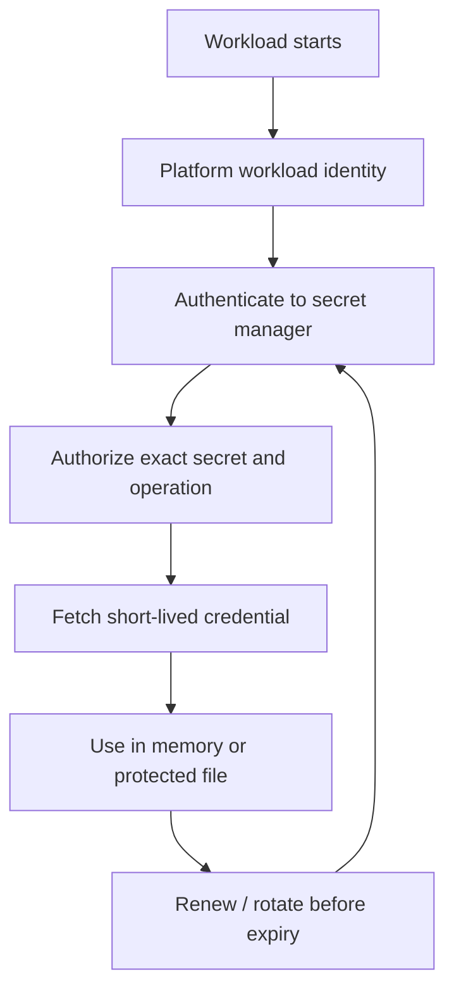

# Secret injection không ghi vào log

Trong chương **Deployment và runtime** của module `SECURITY_API_SECURITY`, secret phải được đưa vào ứng dụng tại thời điểm chạy mà không xuất hiện trong log, trace, metric, output của pipeline hay công cụ chẩn đoán. Secret có thể là database password, API key, signing key, private key, access token, webhook secret hoặc credential dùng giữa các service. Chỉ cần một lần ghi nhầm vào log tập trung, console CI/CD hay support bundle, secret có thể bị sao chép và lưu lâu hơn nhiều so với vòng đời của tiến trình.

**Secret injection** là cách cung cấp giá trị bí mật cho workload khi triển khai hoặc khi chạy, thường thông qua workload identity, secret manager, environment variable, file mount, CSI driver hoặc sidecar. Injection giải quyết việc phân phối secret; nó không tự bảo đảm secret được giữ kín sau khi ứng dụng nhận được. Ứng dụng, thư viện, shell script, agent, runtime diagnostics và hệ thống quan sát đều có thể vô tình làm lộ giá trị.

Nguyên tắc cần giữ xuyên suốt là: **chỉ đọc secret tại thành phần cần sử dụng, chỉ giữ trong phạm vi và thời gian cần thiết, và không đưa giá trị secret vào bất kỳ kênh log/telemetry nào.** Không dựa vào một bộ lọc che chuỗi ở cuối pipeline để thay thế việc kiểm soát từ nguồn.

## Secret có thể bị lộ ở đâu?

Secret thường không xuất hiện trong log nghiệp vụ có chủ đích, nhưng có thể lọt vào các kênh phụ:

| Điểm phát sinh | Ví dụ rủi ro |
|---|---|
| Build và CI/CD | `echo $DB_PASSWORD`, shell tracing `set -x`, command line chứa secret, debug output của task |
| Container image | Secret nằm trong `Dockerfile ARG/ENV`, layer, build cache hoặc file cấu hình được copy vào image |
| Deployment manifest | Secret literal trong Helm values, manifest, ConfigMap, annotation hoặc output của template rendering |
| Startup | Ứng dụng in toàn bộ environment, config object, datasource URL hoặc security properties |
| Application logging | Ghi request header, exception, object `toString()`, cấu hình hoặc payload chứa credential |
| HTTP/database client | Wire logging, debug mode hoặc lỗi kết nối chứa Authorization header/connection string |
| Shell và entrypoint | `set -x`, `env`, `printenv`, `curl -v`, tham số command line hoặc script echo biến |
| Health/diagnostics | Endpoint environment/configuration, heap dump, thread dump, support bundle hoặc crash report |
| Observability | Trace attribute, baggage, span event, metric label hoặc log enrichment chứa secret |
| Sidecar/agent | Secret bị in trong log khi fetch, refresh, mount, template hoặc báo lỗi |
| Broker và event | Secret được copy vào message, dead-letter queue, retry payload hoặc audit event |

Một secret đã được che trong giao diện CI vẫn có thể tồn tại trong artifact, raw job log, command arguments, cache hoặc log của subprocess. Masking là lớp giảm thiểu hữu ích, nhưng không phải ranh giới bảo vệ đáng tin cậy duy nhất.

## Thiết kế đường đi của secret

Trước khi chọn cách injection, hãy xác định secret nào được workload nào sử dụng, mục đích, quyền cần thiết, thời gian tồn tại và cách thu hồi. Không phân phối một credential dùng chung cho cả môi trường nếu từng service chỉ cần một phần quyền.

### 1. Ưu tiên workload identity và credential ngắn hạn

Nếu nền tảng hỗ trợ, ưu tiên workload identity, managed identity hoặc cơ chế xác thực workload để ứng dụng lấy credential ngắn hạn từ secret manager. Cách này giảm việc lưu secret dài hạn trong manifest và cho phép cấp quyền theo service/environment.

Ví dụ luồng:



Workload identity vẫn cần được giới hạn theo namespace, service account, audience, environment và resource. Không cấp quyền đọc mọi secret trong project chỉ vì workload cần một database password.

### 2. Ưu tiên file mount read-only khi ứng dụng hỗ trợ

File mount thường giúp tránh đưa secret vào command line và giảm một số rủi ro của environment variable. Có thể mount file trong thư mục chỉ ứng dụng đọc được, với quyền filesystem tối thiểu và chế độ read-only.

Ví dụ Kubernetes dùng Secret volume:

```yaml
apiVersion: v1
kind: Pod
metadata:
  name: billing-api
spec:
  serviceAccountName: billing-api
  containers:
    - name: app
      image: registry.example.com/billing-api:1.0.0
      volumeMounts:
        - name: db-credential
          mountPath: /run/secrets/database
          readOnly: true
  volumes:
    - name: db-credential
      secret:
        secretName: billing-api-database
        defaultMode: 0400
        items:
          - key: username
            path: username
          - key: password
            path: password
```

Manifest trên chỉ tham chiếu Secret object, không chứa giá trị credential. Trong Kubernetes, Secret volume được kubelet cung cấp qua vùng lưu trữ trong bộ nhớ; cần xác minh hành vi của nền tảng và node runtime đang dùng. Kubernetes Secret mặc định được mã hóa base64 khi biểu diễn API, điều đó không tương đương mã hóa bảo mật. Cần cấu hình encryption at rest cho datastore control plane, RBAC least privilege, bảo vệ node và giới hạn quyền đọc Secret.

Kiểm tra UID/GID thực tế của container và quyền thư mục cha. `0400` chỉ phù hợp nếu process chạy đúng owner; nếu dùng group access, cấu hình quyền tối thiểu cần thiết và xác minh không container khác nào có thể đọc mount. Tránh mount secret vào toàn bộ container hoặc shared volume dùng chung nhiều workload.

### 3. Environment variable chỉ là lựa chọn có điều kiện

Một số nền tảng và thư viện chỉ hỗ trợ cấu hình qua environment variable. Khi phải dùng, hãy inject đúng key cần thiết từ secret reference, không dump environment và không truyền biến qua nhiều subprocess không cần thiết.

Ví dụ Kubernetes tham chiếu một key cụ thể:

```yaml
env:
  - name: DB_PASSWORD
    valueFrom:
      secretKeyRef:
        name: billing-api-database
        key: password
```

Environment variable có thể bị lộ qua process inspection, `/proc`, crash dump, diagnostic bundle, child process hoặc log khi script bật tracing. Mức độ truy cập phụ thuộc OS, user, container runtime và quyền trên node; không giả định rằng chỉ process chính mới có thể đọc. Nếu dùng environment variable, giảm quyền truy cập process, tắt core dump khi không cần, giới hạn quyền exec/debug vào container và tránh chạy ứng dụng cùng user với tiến trình không tin cậy.

Không đặt secret trong command arguments như `--password=...`; command line thường dễ bị quan sát qua process list và diagnostic tooling. Không ghi secret vào annotation, label, pod name, URL, JVM system property hiển thị trong diagnostics hoặc shell history.

### 4. Cân nhắc CSI driver, agent và sidecar

Secrets Store CSI Driver hoặc agent có thể lấy secret trực tiếp từ secret manager và mount vào workload. Cách này giảm việc ghi giá trị vào manifest, nhưng tạo thêm một thành phần có quyền truy cập secret.

- Chỉ cho provider/agent đọc đúng secret cần thiết.
- Giới hạn service account và node/plugin permissions.
- Không bật debug log chứa response từ secret manager hoặc file content.
- Kiểm tra log khi mount, refresh, rotation và khi provider lỗi.
- Quy định secret được cache ở đâu, trong bao lâu và cách xóa khi pod kết thúc.
- Nếu sidecar ghi file vào shared volume, chỉ chia sẻ với container thực sự cần đọc.

Init container copy secret vào image layer hoặc volume lâu dài có thể làm tăng số bản sao và kéo dài vòng đời dữ liệu. Nếu cần chuyển đổi định dạng, thực hiện trong vùng nhớ hoặc volume tạm thời được bảo vệ; không copy vào writable image layer hay thư mục dùng chung rộng hơn nhu cầu.

## Không đưa secret vào build artifact hoặc deployment output

Secret runtime không được đóng gói vào image hoặc artifact. Tránh các cách sau:

```dockerfile
# Không an toàn: giá trị có thể tồn tại trong image metadata/layer.
ARG DB_PASSWORD
ENV DB_PASSWORD=$DB_PASSWORD
```

Không truyền secret bằng build argument thông thường, vì build history, metadata, cache hoặc log builder có thể lưu lại giá trị. Với secret cần cho bước build, dùng cơ chế BuildKit secret mount hoặc secret store tương đương, chỉ cấp cho đúng build step và không copy giá trị vào artifact cuối.

Các nguồn cần kiểm tra:

- Dockerfile, build args, image config, image history và layer.
- Helm values, Kustomize overlay, rendered manifest và GitOps diff.
- CI variables, command output, artifact, cache và test report.
- Terraform state, plan output và state backup.
- Container registry, SBOM/build provenance và support bundle.

Không dùng ConfigMap, label hoặc annotation cho secret. Không commit secret literal vào repository rồi dựa vào việc xóa commit mới; lịch sử Git, fork, cache và clone có thể vẫn chứa giá trị. Nếu secret đã bị lộ, thu hồi/rotate trước rồi mới xử lý bản sao lịch sử theo quy trình.

## Đọc secret trong ứng dụng mà không ghi log

Ứng dụng chỉ nên đọc secret ở thành phần cần dùng, sau khi runtime đã cấp đúng quyền. Không serialize configuration object hoặc in giá trị để xác nhận injection thành công.

Ví dụ Java đọc credential từ file mount:

```java
import java.io.IOException;
import java.nio.charset.StandardCharsets;
import java.nio.file.Files;
import java.nio.file.Path;

final class RuntimeSecrets {
    private RuntimeSecrets() {}

    static String readRequired(Path path) {
        try {
            String value = Files.readString(path, StandardCharsets.UTF_8).strip();
            if (value.isEmpty()) {
                throw new IllegalStateException("Required credential is empty");
            }
            return value;
        } catch (IOException ex) {
            // Không log path chứa secret hoặc exception message từ provider.
            throw new IllegalStateException("Required runtime credential is unavailable");
        }
    }
}
```

Ứng dụng có thể ghi một event không nhạy cảm như `credential_load=success`, `secret_ref=billing-db-password`, `version=v42` hoặc `credential_load=failed`, nếu các metadata đó được duyệt. Không ghi nội dung file, giá trị, độ dài, prefix/suffix hoặc hash không cần thiết. Tên secret và version cũng có thể tiết lộ topology; chỉ ghi khi có mục đích vận hành rõ ràng.

Với Spring Boot, có thể dùng cấu hình dạng config tree trỏ tới thư mục mount, ví dụ `spring.config.import=optional:configtree:/run/secrets/`. Property binding giúp ứng dụng nhận giá trị từ file, nhưng cần kiểm tra kỹ actuator, startup diagnostics và logging để tránh in toàn bộ configuration properties. Không expose `/actuator/env`, `/actuator/configprops` hoặc endpoint tương tự ra mạng không tin cậy; tắt hoặc bảo vệ chúng theo yêu cầu vận hành.

### Tránh ghi secret qua object và exception

Các pattern dễ làm lộ secret:

```java
// Không an toàn: in cả cấu hình có thể chứa password.
log.info("Database config: {}", dataSourceProperties);

// Không an toàn: URL có thể chứa user/password.
log.debug("Connecting to {}", jdbcUrl);

// Không an toàn: request headers có thể có Authorization/Cookie.
log.debug("Outbound request: {}", request);
```

Thay bằng metadata đã allowlist:

```java
log.info("Database connection initialized: component={}, status={}",
        "billing-db", "ready");
```

Nếu kết nối thất bại, ghi mã lỗi đã chuẩn hóa, dependency name và correlation ID. Không log toàn bộ exception chain nếu driver/provider có thể nhúng connection string hoặc credential vào message. Stack trace có thể được giữ trong kênh diagnostics hạn chế nếu đã xác minh không chứa secret; không mặc định rằng stack trace luôn an toàn.

## Các điểm cần kiểm soát trong logging và telemetry

### 1. Application log và startup log

- Không gọi `System.getenv()`, `printenv`, `env` hoặc dump toàn bộ `Environment` để debug.
- Không log object cấu hình, datasource URL, client builder hoặc security context có chứa credential.
- Không ghi giá trị secret khi refresh, rotation hoặc kết nối thất bại.
- Không đưa secret vào exception message, validation error hoặc startup banner.
- Dùng allowlist trường log; không serialize request/response đầy đủ theo mặc định.

### 2. Shell, entrypoint và CI/CD

Tránh shell tracing khi có secret trong scope:

```bash
# Không an toàn trong script xử lý secret:
set -x
echo "$DB_PASSWORD"
curl -v -H "Authorization: Bearer $ACCESS_TOKEN" https://api.example.com
```

`set -x` có thể in lệnh sau khi shell đã expand biến. `curl -v`, `--trace` hoặc debug mode của CLI có thể in header và nội dung nhạy cảm. Tắt tracing cho đoạn xử lý secret; truyền credential bằng file/standard input hoặc secret option được công cụ hỗ trợ; tránh command line chứa giá trị trực tiếp.

Trong pipeline, chỉ cấp secret cho job/step cần dùng, dùng masked/protected variable như một lớp bổ sung, hạn chế quyền đọc raw logs và artifacts, tắt debug output, và không upload file tạm chứa secret. Xóa file tạm khi hoàn tất; với dữ liệu nhạy cảm cao, dùng workspace/volume tạm được bảo vệ thay vì thư mục dùng chung.

### 3. HTTP client, database driver và SDK

Wire logging của HTTP client, JDBC driver hoặc cloud SDK có thể ghi header, query, connection string và request metadata. Tắt body/header logging ở production; nếu cần debug, dùng allowlist field và dữ liệu giả trong môi trường test. Không bật debug toàn cục trong lúc xử lý secret thật.

Không đưa credential vào URL query parameter. Query string có thể xuất hiện trong access log, proxy log, browser history, trace và analytics. Dùng header hoặc cơ chế credential provider theo giao thức, đồng thời bảo đảm middleware không ghi header đó.

### 4. Trace, metric và baggage

OpenTelemetry và hệ thống quan sát có thể tự thu thập header, URL, exception hoặc attribute. Không đưa secret vào span attribute, baggage, metric label, event name hoặc resource attribute. Baggage có thể được truyền xuyên nhiều service và ra khỏi trust boundary; chỉ đưa metadata không nhạy cảm đã được duyệt.

Metric label cần cardinality thấp và không chứa token, key, password, email hay raw user ID. Với trace, dùng route template và error code chuẩn hóa; tắt capture request/response body hoặc header nhạy cảm. Kiểm tra auto-instrumentation và collector processor vì ứng dụng không trực tiếp gọi logger vẫn có thể bị thu thập dữ liệu.

### 5. Health, diagnostics và support bundle

Health endpoint chỉ nên trả trạng thái tối thiểu như `UP`, `DOWN` hoặc mã dependency. Không trả secret, connection string, environment variable hay chi tiết cấu hình. Heap dump, core dump, thread dump, JFR, debug archive và support bundle có thể chứa dữ liệu trong memory; hạn chế quyền tạo/tải xuống, mã hóa nơi lưu và đặt retention ngắn.

Nếu cần thu thập dump để điều tra, coi file đó là dữ liệu nhạy cảm: lưu trong kho riêng, giới hạn người truy cập, audit thao tác download và xóa theo thời hạn. Không tự động đính kèm dump vào ticket hoặc gửi qua email/chat không được phê duyệt.

## Rotation và refresh mà không làm lộ giá trị

Secret nên có vòng đời và quy trình rotate. Injection cần hỗ trợ cập nhật mà không buộc phải log giá trị để so sánh.

- Ưu tiên credential ngắn hạn hoặc dynamic credential nếu hệ thống hỗ trợ.
- Có thể ghi secret reference, version ID, thời điểm refresh và kết quả; không ghi secret cũ/mới.
- Khi rotate, hỗ trợ giai đoạn overlap có thời hạn nếu dependency cần cả credential cũ và mới.
- Đảm bảo ứng dụng reload an toàn; không ghi config snapshot trong quá trình reload.
- Thu hồi credential cũ đúng hạn và xác minh không còn workload dùng nó.
- Nếu refresh thất bại, ghi mã lỗi, provider và correlation ID; không fallback sang secret hard-code hoặc in giá trị để debug.

Không so sánh secret bằng cách log hash để xem đã đổi chưa. Dùng version metadata từ secret manager hoặc trạng thái rotation. Nếu ứng dụng cần xác minh giá trị đã được nạp, dùng kết quả xác thực từ dependency hoặc health check không tiết lộ credential.

## Phân quyền và cô lập secret ở runtime

Secret injection an toàn còn phụ thuộc vào ai có thể đọc workload hoặc volume:

- Mỗi service có service account/identity riêng; không dùng chung identity quyền rộng cho nhiều ứng dụng.
- Chỉ cấp quyền đọc đúng secret, đúng operation và đúng environment.
- Tách production và non-production; không dùng secret production cho test/debug.
- Giới hạn `exec`, debug, ephemeral container, node access và quyền đọc process memory.
- Mount secret chỉ vào container cần dùng; dùng read-only và filesystem permission tối thiểu.
- Không chia sẻ secret qua shared volume hoặc sidecar log nếu không có nhu cầu rõ ràng.
- Bảo vệ secret manager audit log; log việc ai đọc secret nhưng không ghi giá trị được đọc.
- Xóa cache/file tạm và revoke credential khi workload bị xóa hoặc có dấu hiệu compromise.

Với Kubernetes, RBAC quyền `get/list/watch` Secret cần được giới hạn chặt. Pod có thể truy cập Secret mà service account hoặc deployment được phép đọc; quyền node/control plane cũng cần được bảo vệ. Không coi namespace isolation là đủ nếu người dùng có quyền tạo pod trong namespace và mount mọi Secret ở đó.

## Xử lý khi secret vô tình xuất hiện trong log

Nếu phát hiện secret đã bị ghi ra log, hãy coi nó là credential có khả năng bị lộ:

1. Xác định loại secret, phạm vi quyền, thời gian lộ và các hệ thống/log sink đã nhận bản ghi.
2. Thu hồi hoặc rotate credential theo mức độ rủi ro; không chờ xóa log xong mới vô hiệu hóa secret.
3. Hạn chế truy cập log/artifact liên quan, dừng việc export hoặc replicate thêm nếu có thể.
4. Xác định nguồn phát sinh: app logger, shell tracing, SDK wire log, CI output, trace collector hay support bundle.
5. Loại bỏ bản ghi khỏi nơi có thể xóa theo quy trình, đồng thời xử lý retention/backup và bản sao đã export theo chính sách.
6. Sửa nguồn logging/injection, thêm test ngăn tái diễn và xác minh secret mới không xuất hiện trong output.
7. Lưu incident metadata cần thiết mà không sao chép lại giá trị secret vào báo cáo.

Xóa một dòng log không làm credential đã lộ trở nên an toàn. Nếu secret có thể đã được người khác đọc, rotate/revoke là bước khắc phục quan trọng nhất.

## Kiểm thử secret injection và log redaction

Nên dùng secret giả có giá trị sentinel duy nhất trong môi trường test, ví dụ `TEST_SECRET_SENTINEL_7f3a...`, tuyệt đối không dùng credential production. Sau khi deploy test workload, quét các kênh output để bảo đảm sentinel không xuất hiện.

| Kênh kiểm tra | Cách kích hoạt | Kết quả mong đợi |
|---|---|---|
| Container stdout/stderr | Khởi động app, tạo kết nối thành công và thất bại | Không có secret literal |
| Startup/config log | Bật mức log vận hành bình thường | Chỉ có trạng thái và metadata allowlist |
| Shell/entrypoint | Chạy script inject/refresh | Không có expanded command hoặc giá trị biến |
| CI/CD job log | Chạy build/deploy test | Sentinel không xuất hiện trong output |
| Image/config/history | Inspect artifact và image layers | Không có secret trong image hoặc build metadata |
| Orchestrator event | Kiểm tra event/describe output | Không lộ giá trị secret; chỉ metadata cần thiết |
| Sidecar/CSI/agent log | Mount, refresh và mô phỏng provider error | Không ghi payload/secret manager response chứa secret |
| HTTP/database client | Tạo request và kết nối lỗi | Header, URL và connection string được che hoặc không ghi |
| Trace/span/baggage | Gửi request có credential | Không có secret trong attributes hoặc events |
| Metric labels | Tạo request với identity giả | Không có secret/PII hoặc cardinality bất thường |
| Health/actuator/diagnostics | Truy cập bằng principal được phép và không được phép | Không expose secret/configuration; quyền được kiểm tra |
| Dump/support bundle | Tạo dump trong môi trường test | File được bảo vệ; không upload vào kho không tin cậy |

Các test bổ sung:

- Secret manager không khả dụng: ứng dụng fail theo policy, log mã lỗi không nhạy cảm và không dùng credential hard-code.
- Secret hết hạn/rotate: ứng dụng nạp version mới mà không log giá trị cũ hoặc mới.
- File permission sai: ứng dụng báo lỗi chung và không in nội dung file.
- Một container khác trong pod không cần secret: không đọc được mount hoặc process environment ngoài quyền được cấp.
- Logging provider bật debug: test phát hiện header/body nhạy cảm trước khi cấu hình đó được cho phép ở production.
- Exception từ JDBC/HTTP SDK chứa connection detail: pipeline log vẫn không lưu credential.

Kiểm tra cả log thô trước masking, log sau collector, trace backend, artifact và backup test. Nếu chỉ tìm sentinel trong giao diện dashboard, có thể bỏ sót raw log hoặc dữ liệu ở collector buffer.

## Giám sát vận hành

Theo dõi các chỉ số và sự kiện không chứa giá trị bí mật:

- Tỷ lệ secret fetch/refresh thành công và thất bại theo provider/service.
- Secret version đang được sử dụng và thời điểm rotation gần nhất.
- Workload identity nào đọc secret reference nào, theo audit log của secret manager.
- Số lần truy cập secret bất thường hoặc từ workload/environment ngoài phạm vi.
- Số lần phát hiện pattern secret trong log/trace/artifact scan.
- Số log event bị redaction và số trường bị loại bỏ, không lưu lại giá trị gốc.
- Tình trạng collector, pipeline, secret mount và thời gian propagation khi rotate.

Không đưa secret vào metric label hoặc alert description. Alert nên chỉ ra service, secret reference/version đã được phép hiển thị, provider, thời điểm và mã lỗi. Hạn chế quyền xem alert vì metadata cũng có thể tiết lộ kiến trúc hoặc tên tài nguyên.

## Những sai lầm thường gặp

- Nghĩ rằng secret được mount an toàn thì ứng dụng không thể log nó.
- Dùng `set -x`, `echo`, `printenv`, `env` hoặc debug CLI trong đoạn xử lý secret.
- Đưa secret vào Docker `ARG`/`ENV`, image layer, command line hoặc URL query.
- Log toàn bộ configuration, environment, datasource properties hoặc request headers.
- Bật HTTP/JDBC wire logging trong production mà không lọc credential.
- Dùng actuator/diagnostic endpoint công khai để xem config runtime.
- Cho nhiều service dùng chung một service account có quyền đọc mọi secret.
- Dùng ConfigMap hoặc repository để lưu secret literal.
- Chỉ dựa vào CI masking hoặc regex redaction ở log sink.
- Ghi secret vào trace baggage, metric label hoặc support bundle.
- Copy secret vào shared volume hoặc file tạm không có lifecycle.
- Xóa log nhưng không rotate credential đã bị lộ.

## Checklist triển khai

- [ ] Mỗi secret có owner, mục đích, service, environment, scope và rotation policy.
- [ ] Ưu tiên workload identity và credential ngắn hạn; quyền đọc secret theo least privilege.
- [ ] Secret được inject qua file mount/secret provider hoặc env reference có kiểm soát; không đặt literal trong manifest.
- [ ] File mount read-only, UID/GID và permission chỉ cho process cần dùng.
- [ ] Environment variable không bị dump; command line và process diagnostics không chứa secret.
- [ ] Secret không nằm trong image, build arg, artifact, ConfigMap, Helm output hoặc Terraform output không bảo vệ.
- [ ] Startup, application, HTTP client, JDBC, shell và sidecar log dùng allowlist, không log secret.
- [ ] Trace, baggage, metric, health, actuator, dump và support bundle được kiểm soát.
- [ ] Secret rotation/refresh không log giá trị và có quy trình revoke credential cũ.
- [ ] Secret manager audit log ghi metadata truy cập nhưng không ghi giá trị.
- [ ] Có test sentinel trên stdout/stderr, CI log, orchestrator event, trace, metric và artifact.
- [ ] Có quy trình incident để rotate/revoke trước, sau đó xử lý log và bản sao đã lộ.

Secret injection chỉ an toàn khi cả đường phân phối và mọi điểm sử dụng đều được kiểm soát. Hãy cấp credential đúng workload, giới hạn quyền và thời gian, tránh truyền qua command line hoặc artifact, không ghi giá trị vào log/telemetry, và kiểm thử bằng sentinel trên toàn bộ pipeline. Khi secret vô tình bị lộ, thu hồi hoặc rotate credential trước rồi mới xử lý các bản sao log còn tồn tại.
