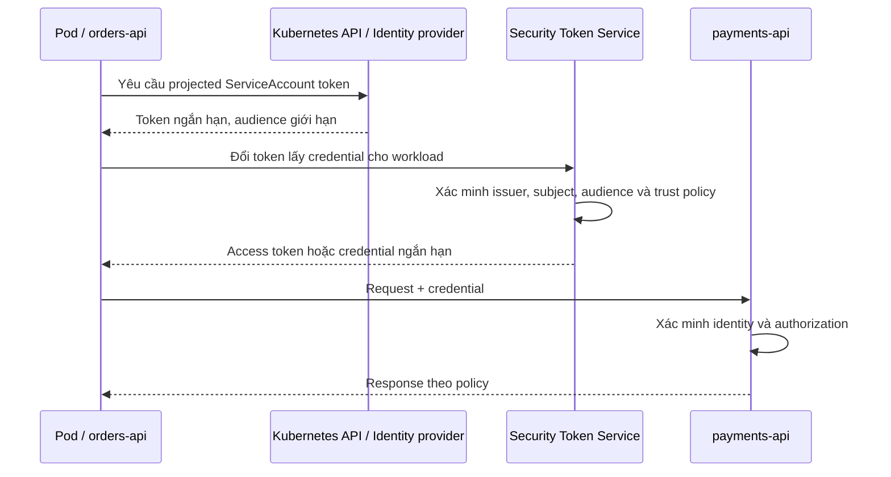
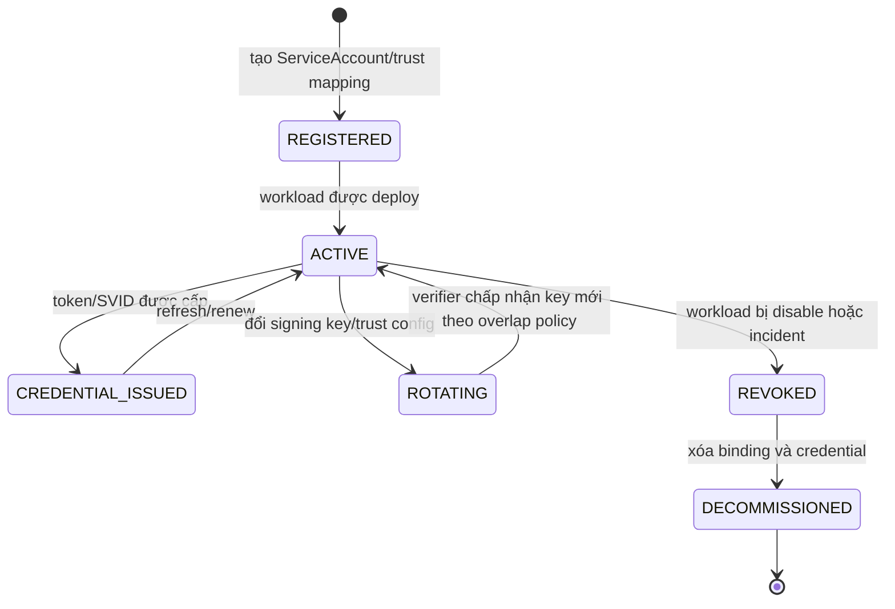

# Container, pod và workload identity

API thường chạy trong container và được điều phối bởi Kubernetes hoặc một nền tảng tương tự. Mỗi workload cần một danh tính để gọi service khác, đọc secret, truy cập database, ghi object storage hoặc tương tác với control plane. Nếu mọi pod dùng chung một credential tĩnh hoặc quyền của node, việc xâm nhập một container có thể mở rộng thành truy cập nhiều hệ thống.

**Workload identity** là cơ chế cấp và xác minh danh tính cho workload không phải con người, chẳng hạn một service, pod, job hoặc process. Danh tính này cho phép hệ thống xác định workload nào đang kết nối và cấp credential ngắn hạn theo đúng phạm vi. Trong Kubernetes, danh tính thường bắt đầu từ ServiceAccount gắn với Pod; nền tảng có thể liên kết danh tính đó với cloud IAM, OIDC federation hoặc chứng thư mTLS.

Container và pod tạo ranh giới triển khai, nhưng bản thân chúng không tự bảo đảm quyền truy cập. Container thường chia sẻ kernel của node; các container trong cùng Pod chia sẻ network namespace và có thể chia sẻ volume. Workload identity giúp xác định caller, còn authorization ở API vẫn phải kiểm tra audience, scope, tenant, object và hành động nghiệp vụ. Không nên xem việc request đến từ cùng cluster hoặc cùng namespace là bằng chứng đủ để tin cậy.

## 1. Phân biệt container, pod và workload identity

Ba khái niệm này liên quan nhưng giải quyết các vấn đề khác nhau:

| Thành phần | Vai trò | Ranh giới và giới hạn bảo mật |
| --- | --- | --- |
| Container | Đóng gói process, runtime, thư viện và filesystem cần thiết | Dùng kernel của host; mức cô lập phụ thuộc runtime, namespace, cgroup, seccomp, capability và cấu hình host. |
| Pod | Đơn vị scheduling nhỏ nhất trong Kubernetes, chứa một hoặc nhiều container | Container trong Pod chia sẻ network namespace/IP/localhost và có thể chia sẻ volume; ServiceAccount được gắn ở cấp Pod. |
| Workload identity | Danh tính xác minh được của service/job/pod khi truy cập tài nguyên | Xác định workload nào đang gọi; không tự quyết định workload được phép đọc object hoặc thực hiện hành động nào. |

Ví dụ một Pod `orders-api` có container ứng dụng và sidecar proxy. Hai container có thể giao tiếp qua `localhost`; nếu cùng mount token volume thì cả hai có thể sử dụng cùng credential. Vì vậy, cần quyết định container nào thực sự cần token và giới hạn volume mount tương ứng.

### 1.1. Container không phải máy ảo

Container thường là các process được cô lập bằng Linux namespaces và resource controls như cgroups. Nhiều container trên cùng node dùng chung kernel. Nếu container chạy privileged, mount đường dẫn host nhạy cảm hoặc có Linux capabilities quá rộng, attacker có thể tìm cách tác động đến node hoặc workload khác.

Không nên xem image/container là một ranh giới bảo mật tuyệt đối. Cần:

- Chạy process bằng non-root user.
- Dùng filesystem read-only khi ứng dụng cho phép.
- Bỏ Linux capabilities không cần thiết.
- Tắt privilege escalation và privileged mode.
- Dùng seccomp profile và AppArmor/SELinux theo nền tảng.
- Hạn chế hostPath, hostPID, hostNetwork và hostIPC.
- Giới hạn CPU, memory, ephemeral storage và số process.
- Dùng image tối thiểu, được vá và lấy từ registry tin cậy.

### 1.2. Pod là đơn vị chia sẻ network và ServiceAccount

Container trong cùng Pod chia sẻ IP và port namespace; ứng dụng có thể gọi sidecar qua `localhost`. Các container cũng có thể chia sẻ volume nếu Pod spec mount volume cho chúng. ServiceAccount được khai báo ở Pod spec, vì vậy identity mặc định có phạm vi Pod chứ không tự tách riêng cho từng container.

Nếu sidecar không cần gọi Kubernetes API hoặc cloud service, đừng mount credential vào sidecar. Với token projection tường minh, chỉ thêm `volumeMount` vào container cần sử dụng. Tuy nhiên, mọi container cùng Pod vẫn nằm trong cùng network namespace; cần xem xét rủi ro khi một container bị compromise.

### 1.3. Workload identity khác user identity

User identity trả lời “người dùng nào đang thực hiện hành động?”. Workload identity trả lời “service/process nào đang gửi request?”. Một request có thể mang cả hai:

- Workload identity: `orders-api` được xác minh qua mTLS hoặc token federation.
- User identity: người dùng cuối được xác minh qua access token hoặc session.
- Authorization context: service kiểm tra user có quyền thao tác trên order cụ thể hay không.

Không dùng workload identity để thay thế user authorization. Việc `orders-api` được phép gọi `payments-api` không có nghĩa mọi user thông qua `orders-api` đều được hoàn tiền.

## 2. Vì sao API cần workload identity?

Service-to-service authentication thường được triển khai bằng API key hoặc credential tĩnh đặt trong environment variable, Kubernetes Secret hoặc file cấu hình. Cách này dễ bắt đầu nhưng tạo ra một số rủi ro:

- Credential có thể bị copy sang image, log, manifest, backup hoặc máy developer.
- Nhiều workload dùng chung một key nên khó quy trách nhiệm và thu hồi riêng lẻ.
- Key có thời hạn dài, ít được rotate và có thể tiếp tục hoạt động sau khi pod bị xóa.
- Credential của node hoặc cloud instance có thể bị mọi pod trên node truy cập nếu metadata service không được giới hạn.
- Khi một container bị compromise, attacker có thể lấy credential rồi sử dụng từ môi trường khác.

Workload identity cho phép nền tảng xác minh workload từ ngữ cảnh triển khai và cấp token/chứng thư có thời hạn ngắn. Khi Pod được thay thế hoặc workload bị thu hồi, hệ thống có thể ngừng cấp credential mới hoặc từ chối identity đó theo policy.

### 2.1. Mô hình xác thực không dùng credential tĩnh



Luồng cụ thể phụ thuộc nền tảng. Một số cloud SDK tự đổi projected token lấy credential; một số hệ thống dùng mTLS certificate do workload identity provider cấp. Điểm chung là workload chứng minh danh tính bằng một bằng chứng có thể xác minh, thay vì mang theo một secret tĩnh dùng lâu dài.

## 3. Kubernetes ServiceAccount

ServiceAccount là danh tính cho process chạy trong Pod khi tương tác với Kubernetes API hoặc khi được dùng làm subject để federation sang hệ thống khác. Mỗi namespace có thể có nhiều ServiceAccount. Pod khai báo `serviceAccountName` trong `spec`.

Ví dụ tạo ServiceAccount riêng cho service:

```yaml
apiVersion: v1
kind: ServiceAccount
metadata:
  name: orders-api
  namespace: production
automountServiceAccountToken: false
```

Sau đó gắn vào Pod:

```yaml
apiVersion: apps/v1
kind: Deployment
metadata:
  name: orders-api
  namespace: production
spec:
  replicas: 3
  selector:
    matchLabels:
      app: orders-api
  template:
    metadata:
      labels:
        app: orders-api
    spec:
      serviceAccountName: orders-api
      automountServiceAccountToken: false
      containers:
        - name: app
          image: registry.example.com/orders-api:1.8.2
```

`automountServiceAccountToken: false` tắt việc tự động mount token mặc định vào Pod. Đây là lựa chọn phù hợp nếu ứng dụng không cần gọi Kubernetes API và không dùng cơ chế federation cần token. Nếu workload cần token cho cloud federation hoặc service khác, hãy khai báo projected token có audience phù hợp và mount có chủ đích.

Không nên để mọi Deployment dùng ServiceAccount `default`. Tạo identity riêng cho từng workload hoặc nhóm workload có cùng quyền và cùng owner để giảm phạm vi ảnh hưởng khi một service bị xâm nhập.

### 3.1. ServiceAccount token hiện đại

Kubernetes hiện đại dùng bound ServiceAccount token được cấp qua TokenRequest API và thường mount dưới dạng projected volume. Token có thời hạn, audience và có thể được ràng buộc với Pod. Kubelet quản lý việc làm mới projected token trong vòng đời Pod.

Một số điểm cần nhớ:

- Token được cấp cho Kubernetes API thường có audience dành cho API server.
- Token dành cho cloud STS hoặc service nội bộ cần audience đúng với relying party đó.
- Token hết hạn phải được refresh; ứng dụng/SDK cần đọc lại token file hoặc dùng thư viện hỗ trợ rotation.
- Không copy token ra file lâu dài hoặc đưa vào image.
- Không ghi token vào log, trace, crash dump hoặc support bundle.
- Token không phải bằng chứng rằng workload được phép mọi hành động; quyền Kubernetes API được kiểm soát riêng bằng RBAC.

Không giả định mọi cluster đã tắt legacy long-lived token Secret hoặc có cùng cấu hình. Kiểm tra Kubernetes version, admission policy và cách cluster cấp token. Tránh tạo thủ công token Secret không thời hạn trừ khi có lý do tương thích được đánh giá và quản lý.

### 3.2. Projected token với audience cụ thể

Nếu service cần token cho một API tin cậy cụ thể, có thể tạo projected ServiceAccount token:

```yaml
apiVersion: v1
kind: Pod
metadata:
  name: orders-api
  namespace: production
spec:
  serviceAccountName: orders-api
  automountServiceAccountToken: false
  containers:
    - name: app
      image: registry.example.com/orders-api:1.8.2
      volumeMounts:
        - name: workload-token
          mountPath: /var/run/secrets/workload
          readOnly: true
  volumes:
    - name: workload-token
      projected:
        sources:
          - serviceAccountToken:
              path: identity-token
              expirationSeconds: 3600
              audience: "https://payments.internal"
```

Trong ví dụ, `https://payments.internal` là audience minh họa. Giá trị thực tế phải khớp chính xác audience mà API/STS chấp nhận; không chọn một chuỗi tùy ý rồi kỳ vọng mọi provider đều xác minh. Nếu cần nhiều audience, thiết kế token projection riêng cho từng relying party thay vì phát một token có audience quá rộng.

Chỉ container có `volumeMount` mới nhìn thấy token qua filesystem mount này. Không mount vào sidecar hoặc init container nếu chúng không cần. Token vẫn có thể bị đọc bởi process khác trong cùng container theo quyền filesystem/process; chạy non-root và hạn chế process là cần thiết.

## 4. Kubernetes RBAC: quyền của ServiceAccount

ServiceAccount xác định identity; Role và RoleBinding xác định identity đó được làm gì với Kubernetes API. Hai phần này phải được thiết kế riêng.

- `Role` định nghĩa quyền trong một namespace.
- `ClusterRole` định nghĩa quyền ở phạm vi cluster hoặc một nhóm resource có thể được bind trong namespace.
- `RoleBinding` gán Role/ClusterRole cho subject trong một namespace.
- `ClusterRoleBinding` gán quyền ở phạm vi cluster; cần review nghiêm ngặt.

Nếu `orders-api` không cần đọc Kubernetes resource, không tạo RoleBinding cho nó. Nếu cần đọc một ConfigMap cụ thể, cấp quyền hẹp nhất có thể. Ví dụ minh họa:

```yaml
apiVersion: rbac.authorization.k8s.io/v1
kind: Role
metadata:
  name: orders-api-config-reader
  namespace: production
rules:
  - apiGroups: [""]
    resources: ["configmaps"]
    resourceNames: ["orders-api-config"]
    verbs: ["get"]
---
apiVersion: rbac.authorization.k8s.io/v1
kind: RoleBinding
metadata:
  name: orders-api-config-reader
  namespace: production
subjects:
  - kind: ServiceAccount
    name: orders-api
    namespace: production
roleRef:
  apiGroup: rbac.authorization.k8s.io
  kind: Role
  name: orders-api-config-reader
```

Không cấp `*` cho apiGroups/resources/verbs. Tránh quyền tạo Pod, tạo RoleBinding, đọc Secret toàn namespace hoặc `impersonate` nếu workload không có use case đặc biệt. Quyền `list`/`watch` có thể làm lộ nhiều object hơn `get` theo tên; chỉ cấp khi ứng dụng thực sự cần.

### 4.1. Namespace không phải ranh giới đủ mạnh

Namespace giúp tổ chức resource và áp dụng policy, nhưng không tự cô lập kernel, network hoặc quyền node. ClusterRoleBinding, network policy thiếu, privileged Pod hoặc quyền đọc Secret rộng có thể phá vỡ giả định cách ly namespace. Với workload có mức tin cậy khác nhau, cân nhắc node pool, cluster hoặc sandbox boundary riêng.

### 4.2. Kiểm thử RBAC

Kiểm tra quyền từ góc nhìn ServiceAccount:

```bash
kubectl auth can-i get configmaps \
  --as=system:serviceaccount:production:orders-api \
  --namespace=production

kubectl auth can-i list secrets \
  --as=system:serviceaccount:production:orders-api \
  --namespace=production
```

Kết quả đầu tiên chỉ nên là `yes` nếu RoleBinding ở ví dụ được áp dụng; câu thứ hai phải là `no`. `kubectl auth can-i` kiểm tra authorization theo RBAC/authorizer hiện tại, không kiểm tra mọi đường truy cập cloud IAM hoặc quyền ở application API.

## 5. Liên kết ServiceAccount với cloud workload identity

Ứng dụng thường cần gọi cloud API như object storage, KMS, message broker hoặc database. Không nên nhúng access key dài hạn vào Kubernetes Secret nếu cloud hỗ trợ workload identity federation.

Mô hình chung:

1. Cluster phát hành OIDC token cho ServiceAccount với issuer và audience đã cấu hình.
2. Workload gửi token tới Security Token Service hoặc identity provider của cloud.
3. Provider kiểm tra chữ ký, issuer, audience, subject và trust policy.
4. Provider ánh xạ subject sang IAM principal/role được chỉ định.
5. Workload nhận credential ngắn hạn có quyền giới hạn.
6. SDK tự refresh credential trước khi hết hạn theo cơ chế provider.

Trust policy cần ràng buộc đủ chặt, ví dụ:

- Cluster/OIDC issuer chính xác, không chấp nhận issuer bất kỳ.
- Namespace chính xác.
- ServiceAccount name chính xác.
- Audience được phép.
- Environment hoặc workload claim bổ sung nếu provider hỗ trợ và có giá trị bảo mật.
- IAM role chỉ có quyền trên resource cần thiết.

Không chỉ kiểm tra tên ServiceAccount mà bỏ qua issuer/cluster. Hai cluster khác nhau có thể có ServiceAccount cùng tên; identity phải được phân biệt bởi issuer và subject đầy đủ.

### 5.1. Ví dụ mapping theo nền tảng

| Nền tảng | Cơ chế thường dùng | Điều cần khóa chặt |
| --- | --- | --- |
| Amazon EKS | IAM Roles for Service Accounts (IRSA) hoặc EKS Pod Identity | OIDC provider/cluster, namespace, ServiceAccount, trust relationship và IAM policy. |
| Google Kubernetes Engine | Workload Identity Federation for GKE | Cluster/project, namespace, Kubernetes ServiceAccount và quyền IAM được ánh xạ. |
| Azure Kubernetes Service | Microsoft Entra Workload ID | OIDC issuer, subject `system:serviceaccount:<namespace>:<serviceaccount>`, audience và federated credential. |
| Kubernetes tự quản | OIDC federation tới STS hoặc identity broker | OIDC issuer, JWKS, audience, subject và lifecycle của signing key. |

Tên annotation, cấu hình trust và SDK phụ thuộc phiên bản nền tảng. Dùng tài liệu provider cho cluster đang triển khai; không sao chép policy trust từ môi trường khác mà chưa xác minh issuer và subject.

### 5.2. Không dùng node role như identity chung cho mọi Pod

Nếu mọi Pod có thể lấy credential từ instance metadata service của node, một container bị compromise có thể dùng quyền của node hoặc workload khác. Cần:

- Dùng workload identity federation hoặc pod identity có ràng buộc ServiceAccount.
- Giới hạn node instance role ở quyền cần cho node agent/kubelet.
- Chặn hoặc giới hạn truy cập metadata endpoint từ Pod không cần.
- Nếu provider yêu cầu metadata service, dùng cơ chế bảo vệ và policy theo hướng dẫn provider.
- Không coi IMDSv2 hoặc network isolation đơn lẻ là thay thế cho workload identity.
- Kiểm thử từ một Pod không được cấp quyền để bảo đảm nó không lấy được node credential.

## 6. OIDC token: issuer, subject và audience

Projected ServiceAccount token thường là JWT được ký bởi issuer của Kubernetes. Resource server hoặc STS cần xác minh:

- `iss` (issuer): nguồn phát hành đúng với cluster/trust configuration.
- `sub` (subject): ServiceAccount đúng, thường có dạng `system:serviceaccount:<namespace>:<name>`.
- `aud` (audience): token được phát cho chính API/STS đang xác minh.
- `exp` và `nbf`: token còn trong thời gian hiệu lực.
- Chữ ký: kiểm tra bằng public key/JWKS đáng tin cậy và thuật toán được cho phép.
- Claim binding bổ sung: ví dụ Pod UID hoặc bound object nếu relying party cần kiểm tra.

Không chỉ decode JWT rồi tin claim. Decode không xác minh chữ ký. Không chấp nhận `alg=none`, thuật toán ngoài allowlist, issuer tùy ý hoặc token có audience rộng hơn cần thiết. JWKS cần được cache/refresh theo policy để hỗ trợ key rotation mà không chấp nhận key không tin cậy.

### 6.1. Audience ngăn token dùng sai nơi

Token dành cho Kubernetes API không nên được chấp nhận tự động bởi payment service hoặc cloud STS. Mỗi relying party phải kiểm tra audience của chính nó. Nếu một token có nhiều audience, mọi nơi chấp nhận token cần được xem xét vì phạm vi sử dụng rộng hơn.

Không dùng `sub` làm authorization đầy đủ. Subject chỉ cho biết workload identity; API vẫn phải áp dụng policy như `orders-api` chỉ được gọi `payments-api` với scope `payments:charge` trong giới hạn nghiệp vụ đã cấp.

### 6.2. Token refresh và cache

Projected token được kubelet làm mới trước khi hết hạn theo cấu hình/phiên bản. Ứng dụng không nên đọc token một lần lúc startup rồi giữ trong memory vô thời hạn. Dùng SDK/provider hỗ trợ refresh hoặc đọc lại token file khi cần; xử lý trường hợp file được thay thế nguyên tử.

Không cache token lâu hơn `exp`, không log token khi refresh lỗi và không retry vô hạn khi STS không sẵn sàng. Đặt timeout/backoff và cảnh báo khi credential refresh thất bại.

## 7. SPIFFE/SPIRE và mTLS cho service-to-service

Trong môi trường nhiều service hoặc nhiều cluster, SPIFFE cung cấp định dạng identity thống nhất. Một workload có thể nhận SPIFFE ID như:

```text
spiffe://prod.example/ns/production/sa/orders-api
```

SPIRE là một implementation cung cấp workload attestation và cấp SVID (SPIFFE Verifiable Identity Document). X.509-SVID có thể dùng trong mTLS; JWT-SVID có thể dùng cho một số giao thức token. Workload cần chứng minh identity với server qua certificate chain hoặc token được trust domain chấp nhận.

### 7.1. Xác minh mTLS identity

Với mTLS, cả client và server xác thực certificate của nhau. Server cần kiểm tra:

- Certificate chain dẫn tới trust bundle được tin cậy.
- Certificate còn hạn và chưa bị thu hồi theo cơ chế của hệ thống.
- SAN URI/SPIFFE ID khớp trust domain và workload identity được phép.
- Trust domain và selector không chấp nhận wildcard quá rộng.
- Quyền gắn với identity được ánh xạ sang policy service/action cụ thể.

Chỉ bật TLS hai chiều không đủ nếu mọi certificate trong cùng trust domain đều được phép gọi mọi API. Cần authorization dựa trên SPIFFE ID hoặc thuộc tính identity cụ thể.

### 7.2. Proxy/service mesh

Service mesh có thể tự cấp certificate và thực hiện mTLS giữa sidecar. Điều này giảm việc mỗi ứng dụng tự quản lý private key, nhưng cần kiểm tra:

- Sidecar proxy được cấu hình đúng và certificate rotation hoạt động.
- Ingress/egress gateway xác thực identity xuyên qua ranh giới mesh.
- AuthorizationPolicy giới hạn source principal, destination và operation.
- Không tin header identity do client tự gửi; gateway phải xóa header giả và chỉ tạo header sau khi xác minh peer.
- Traffic bypass sidecar hoặc port không được quản lý vẫn bị chặn bằng network/pod policy.

Service mesh mTLS xác thực workload ở transport layer. API vẫn phải kiểm tra user token, scope, object-level và property-level authorization khi nghiệp vụ yêu cầu.

## 8. Tách identity của build, deploy và runtime

CI/CD pipeline và ứng dụng chạy production là hai workload khác nhau, có nhiệm vụ và quyền khác nhau.

| Identity | Nhiệm vụ | Quyền nên có |
| --- | --- | --- |
| Build job | Build, test, scan và ký artifact | Đọc dependency, ghi artifact vào registry; không truy cập dữ liệu production. |
| Deploy job | Cập nhật Deployment/Helm release | Chỉ thay đổi resource được giao trong namespace/environment cụ thể. |
| Runtime ServiceAccount | Chạy API và gọi dependency | Chỉ quyền runtime như đọc config cần thiết, gọi service hoặc truy cập object prefix cần thiết. |
| Human operator | Debug, phê duyệt và xử lý incident | Quyền cá nhân, MFA, thời hạn và audit; không dùng chung service credential. |

Không dùng một cloud service account có quyền deploy cluster và đọc production data cho cả CI lẫn runtime. Nếu build runner bị compromise, quyền deploy/runtime rộng có thể làm tăng phạm vi tấn công. Ưu tiên OIDC federation từ CI provider với trust policy giới hạn repository, branch/environment và workflow identity.

## 9. Hardening container và Pod

Workload identity chỉ có giá trị khi token/private key khó bị lấy cắp. Hardening runtime giúp giảm khả năng attacker đọc credential hoặc thoát khỏi container.

### 9.1. Docker image và process

Ví dụ Dockerfile tối giản:

```dockerfile
FROM eclipse-temurin:21-jre
WORKDIR /app
COPY --chown=10001:10001 app.jar /app/app.jar
USER 10001:10001
ENTRYPOINT ["java", "-jar", "/app/app.jar"]
```

Trong production, nên pin base image theo digest, dùng image đã scan, cập nhật bản vá và có SBOM/provenance theo quy trình supply chain. Không copy `.env`, private key, kubeconfig hoặc credential vào image layer. `USER` trong Dockerfile là một lớp; Kubernetes securityContext có thể ghi đè hoặc cấu hình thêm, nên kiểm tra runtime identity thực tế.

### 9.2. Pod securityContext

Ví dụ Deployment với một số hardening phổ biến:

```yaml
apiVersion: apps/v1
kind: Deployment
metadata:
  name: orders-api
  namespace: production
spec:
  replicas: 3
  selector:
    matchLabels:
      app: orders-api
  template:
    metadata:
      labels:
        app: orders-api
    spec:
      serviceAccountName: orders-api
      automountServiceAccountToken: false
      securityContext:
        runAsNonRoot: true
        runAsUser: 10001
        runAsGroup: 10001
        seccompProfile:
          type: RuntimeDefault
      containers:
        - name: app
          image: registry.example.com/orders-api:1.8.2
          securityContext:
            allowPrivilegeEscalation: false
            readOnlyRootFilesystem: true
            capabilities:
              drop: ["ALL"]
          resources:
            requests:
              cpu: 100m
              memory: 256Mi
            limits:
              cpu: 1
              memory: 512Mi
```

Ví dụ cần điều chỉnh theo ứng dụng và cluster policy. Nếu app cần ghi file, mount `emptyDir` vào đúng thư mục cần ghi thay vì mở toàn bộ root filesystem. Giới hạn ephemeral storage nếu cluster hỗ trợ. Không thêm `privileged: true`, `hostPath`, `hostNetwork` hoặc Linux capability rộng để “sửa nhanh” lỗi permission.

### 9.3. Pod Security Standards và admission policy

Áp dụng Pod Security Admission ở mức `restricted` nếu workload tương thích; nếu chưa, lập ngoại lệ có owner, lý do và thời hạn. Có thể dùng policy engine như Kyverno hoặc Gatekeeper để chặn:

- Container chạy root hoặc privileged ngoài policy.
- `allowPrivilegeEscalation: true`.
- Không drop capabilities.
- Không dùng seccomp profile được yêu cầu.
- Host namespace hoặc hostPath không được phê duyệt.
- Image không đến từ registry tin cậy hoặc không pin theo policy.
- ServiceAccount mặc định hoặc mount token ngoài nhu cầu.

Admission policy kiểm tra cấu hình lúc tạo resource; runtime monitoring vẫn cần phát hiện drift và hành vi bất thường sau deploy.

## 10. Network policy và identity

NetworkPolicy giới hạn luồng network giữa Pod và namespace dựa trên selector/IP/port tùy CNI. Nó giảm bề mặt truy cập nhưng không tự chứng minh caller là service nào. Một Pod trong cùng selector vẫn có thể là workload khác nếu label/policy thiết kế quá rộng.

Nên kết hợp:

- Default-deny ingress/egress cho namespace hoặc workload nhạy cảm.
- Chỉ cho phép egress tới DNS, identity provider, dependency và endpoint cần thiết.
- Chỉ cho phép ingress từ gateway/service có nhiệm vụ rõ ràng.
- mTLS/workload identity để xác minh service caller.
- Application authorization để kiểm tra action, scope, tenant và object.
- Egress control để giảm SSRF và truy cập metadata/internal admin endpoint.

Không dựa vào source IP hoặc namespace làm identity duy nhất. Pod IP có thể thay đổi; nhiều Pod dùng chung node/NAT; network topology không phản ánh đầy đủ danh tính workload.

## 11. Secret và credential trong container

Không bake secret vào image hoặc commit manifest chứa giá trị thật. Ưu tiên workload identity để lấy credential ngắn hạn từ cloud/secret manager. Khi cần secret tĩnh:

- Lưu trong secret manager hoặc Kubernetes Secret được mã hóa at rest và giới hạn RBAC.
- Chỉ mount vào container cần sử dụng, dưới dạng read-only file nếu phù hợp.
- Không truyền secret qua command-line argument hoặc environment nếu có nguy cơ lộ qua process inspection, debug dump hoặc manifest.
- Không log secret, token, private key hoặc connection string có password.
- Rotate theo version/lease và hỗ trợ reload mà không cần ghi credential vào image.
- Tách secret theo workload/environment và không chia sẻ giữa namespace không cùng trust.

Kubernetes Secret mặc định được lưu trong etcd; encryption at rest, RBAC, backup và quyền truy cập etcd cần được cấu hình. Base64 trong YAML chỉ là encoding, không phải encryption. Workload identity có thể giảm nhu cầu lưu cloud access key dài hạn, nhưng không loại bỏ mọi secret của ứng dụng.

## 12. Authorization tại API sau khi xác minh workload

Sau khi xác minh workload identity, API cần map identity sang quyền tối thiểu:

| Workload identity | Hành động có thể được cấp | Hành động không nên mặc định có |
| --- | --- | --- |
| `orders-api` | Gọi payment authorization với scope hẹp và order reference hợp lệ | Refund bất kỳ payment, đọc mọi customer hoặc truy cập admin API. |
| `report-worker` | Đọc dữ liệu đã được export trong tenant được phân công | Đọc toàn bộ database hoặc thay đổi user role. |
| `image-processor` | Đọc file staging và ghi thumbnail vào prefix riêng | Đọc secret production hoặc truy cập metadata service. |
| `notification-worker` | Gửi notification qua provider với template/recipient policy | Truy cập payment credential hoặc thay đổi trạng thái order. |

Policy có thể dùng OAuth scope, audience, service identity, mTLS principal và application-level permission. Với mỗi request, kiểm tra:

1. Credential được ký bởi issuer/trust domain hợp lệ.
2. Subject là workload được phép.
3. Audience đúng API nhận request.
4. Token/certificate còn hiệu lực.
5. Workload có quyền gọi function/action.
6. Tenant và object nằm trong phạm vi được cấp.
7. Business rule và state transition hợp lệ.

Nếu gateway chuyển identity qua header như `X-Authenticated-Service`, phải bảo đảm gateway đã xác minh mTLS/token, xóa header cùng tên do client gửi và kết nối gateway-to-backend được bảo vệ. Backend không được tin header đó khi có đường truy cập bypass gateway.

## 13. Lifecycle của workload identity

Identity cần được quản lý từ lúc tạo workload đến khi xóa hoặc thu hồi:



Các điểm cần kiểm soát:

- Owner của ServiceAccount và workload phải rõ ràng.
- Trust policy không tự mở rộng khi đổi namespace, cluster hoặc tên service.
- Token/chứng thư có thời hạn ngắn và được refresh an toàn.
- Signing key/JWKS và CA/trust bundle có quy trình rotation.
- Khi workload bị xóa, thu hồi binding/quyền và ngăn cấp credential mới.
- Khi incident xảy ra, disable identity hoặc trust mapping, rotate credential liên quan và kiểm tra token/certificate còn hiệu lực.
- Xóa role binding, federated credential, IAM policy và secret không còn dùng khi decommission.

JWT offline thường không thể bị thu hồi tức thời ở mọi verifier nếu verifier chỉ kiểm tra chữ ký và `exp`. Vì vậy, TTL ngắn, audience hẹp, denylist/introspection hoặc kiểm tra trạng thái bound object có thể cần thiết tùy mức rủi ro. Không tuyên bố token đã vô hiệu ngay khi xóa Pod nếu relying party vẫn chấp nhận token cũ đến khi hết hạn.

## 14. Threat model và tình huống tấn công

| Tình huống | Rủi ro | Kiểm soát |
| --- | --- | --- |
| Container bị RCE | Attacker đọc token/secret của process | Non-root, read-only FS, token mount tối thiểu, sandbox, credential TTL ngắn và egress control. |
| Sidecar bị compromise | Sidecar sử dụng credential chung của Pod | Không mount token nếu không cần; giới hạn socket/port và policy. |
| ServiceAccount có quyền rộng | Attacker đọc Secret hoặc tạo Pod/RoleBinding | Least-privilege RBAC, review RoleBinding, policy admission và kiểm thử `can-i`. |
| Pod truy cập node metadata | Lấy node/cloud credential dùng chung | Workload identity federation, metadata egress restriction và node role tối thiểu. |
| Token dùng sai audience | Token bị replay tới API khác | Ràng buộc audience chính xác ở từng relying party. |
| Trust policy wildcard | Workload ngoài namespace/cluster được cấp role | Ràng buộc issuer, subject, namespace, ServiceAccount và audience. |
| Token bị log | Credential bị lộ qua SIEM/APM | Redaction, allowlist logging, secret scanning và incident rotation. |
| Pod label giả mạo | Network/policy chọn nhầm workload | Không dùng label do workload tự điều khiển làm identity duy nhất; kết hợp admission và cryptographic identity. |
| Header identity giả | Backend tin header do caller gửi | Gateway strip header đầu vào, xác minh peer và bảo vệ gateway-to-backend. |
| Node compromise | Nhiều Pod trên node có thể bị ảnh hưởng | Node hardening, workload separation, patching và cluster boundary phù hợp. |

## 15. Kiểm thử container, pod và workload identity

Kiểm thử phải xác minh cả identity được cấp và quyền thực tế. Chỉ kiểm tra Pod có `serviceAccountName` không chứng minh token được audience đúng hoặc IAM policy đã giới hạn.

| Kịch bản | Kết quả mong đợi |
| --- | --- |
| Pod chạy đúng ServiceAccount | Token subject/identity khớp workload đã đăng ký. |
| Pod dùng ServiceAccount `default` | Admission/policy từ chối hoặc cảnh báo nếu không được phép. |
| Workload không cần Kubernetes API | Không tự động mount ServiceAccount token. |
| Token audience sai | API/STS từ chối token. |
| Token issuer sai | Không xác minh được trust chain; request bị từ chối. |
| Token hết hạn hoặc chưa có hiệu lực | Bị từ chối; SDK refresh theo policy. |
| Token chữ ký sai/JWKS không tin cậy | Bị từ chối. |
| ServiceAccount namespace khác | Federation trust policy từ chối. |
| ServiceAccount name khác | Không nhận IAM role/credential của workload khác. |
| RBAC đọc Secret | `no` nếu workload không được cấp quyền. |
| RBAC tạo Pod/RoleBinding | `no` trừ khi có use case đã phê duyệt. |
| Pod không được phép gọi cloud API | STS/IAM từ chối; không fallback sang node credential. |
| Pod bị xóa/revoke | Không cấp credential mới; credential cũ hết hiệu lực theo TTL/revocation design. |
| Sidecar không cần token | Token volume không được mount vào sidecar. |
| Container chạy root/privileged | Admission policy từ chối theo baseline. |
| Filesystem root read-only | App chỉ ghi vào volume được cho phép. |
| Network egress tới metadata/admin endpoint | Bị chặn nếu workload không có nhu cầu. |
| mTLS certificate sai SPIFFE ID | Peer bị từ chối hoặc không được authorization. |
| Header identity giả từ client | Gateway/backend không tin header do caller tự gửi. |
| Runtime identity gọi sai action | API từ chối theo function/object/business authorization. |

### 15.1. Kiểm thử trong pipeline

CI/CD có thể kiểm tra manifest và policy trước deploy:

- ServiceAccount được khai báo riêng và owner có trong catalog/deployment metadata.
- Pod không dùng `default` ngoài ngoại lệ.
- `automountServiceAccountToken` được đặt theo nhu cầu.
- SecurityContext đáp ứng non-root, no privilege escalation, drop capabilities và seccomp.
- Không có privileged/hostPath/host namespace ngoài policy.
- Image digest, registry và signature đáp ứng supply-chain policy.
- Role/RoleBinding không có wildcard hoặc quyền nguy hiểm ngoài allowlist.
- Federation trust chỉ nhận issuer/subject/audience được chỉ định.

Sau deploy, chạy integration test từ Pod thật để xác minh token exchange, audience, IAM access và denied action. Unit test policy không chứng minh cấu hình cluster/cloud đã được áp dụng.

## 16. Logging, audit và monitoring

Workload identity tạo ra các sự kiện cần theo dõi:

- Token request, token exchange và credential refresh thành công/thất bại.
- JWT issuer/audience/subject mismatch.
- RBAC `Forbidden` và thay đổi Role/RoleBinding.
- Federated credential hoặc IAM policy thay đổi.
- mTLS handshake failure, certificate sắp hết hạn hoặc SPIFFE ID không hợp lệ.
- Pod chạy bằng ServiceAccount không được dự kiến.
- Truy cập metadata endpoint, egress bất thường và credential provider fallback.
- Container restart, image digest thay đổi và admission policy violation.

Audit có thể ghi workload reference, namespace, ServiceAccount, issuer, audience, action, decision, reason code và timestamp. Không ghi raw JWT, access token, private key, certificate private material hoặc toàn bộ Authorization header. Metric label nên có tập giá trị hữu hạn; không dùng Pod UID, token ID hoặc request ID làm label nếu gây cardinality cao.

Kubernetes audit log và cloud audit log nên được liên kết bằng correlation/operation reference để điều tra việc cấp token, thay đổi RBAC và truy cập tài nguyên. Hạn chế người có quyền đọc log vì metadata về workload và IAM có thể tiết lộ cấu trúc hệ thống.

## 17. Checklist triển khai

- [ ] Mỗi workload có ServiceAccount/identity riêng theo owner và phạm vi quyền.
- [ ] Pod khai báo `serviceAccountName`; không dùng `default` tùy tiện.
- [ ] Tắt automount token nếu không cần; nếu cần, dùng projected token với audience và thời hạn rõ.
- [ ] Chỉ mount token vào container thực sự cần và để read-only.
- [ ] Không lưu cloud access key dài hạn trong image, source hoặc manifest.
- [ ] Cloud federation trust ràng buộc issuer, subject, namespace, ServiceAccount và audience.
- [ ] RBAC chỉ cấp verbs/resources cần thiết; không dùng wildcard hoặc quyền cluster rộng.
- [ ] Build, deploy, runtime và human operator dùng identity riêng.
- [ ] Token/chứng thư có TTL, refresh, rotation và quy trình revoke/decommission.
- [ ] Resource server xác minh issuer, signature, audience, expiry và subject.
- [ ] mTLS/SPIFFE xác minh trust domain và identity; authorization vẫn giới hạn action.
- [ ] Container chạy non-root, drop capabilities, no privilege escalation và seccomp.
- [ ] Pod không privileged, không hostPath/host namespace ngoài ngoại lệ.
- [ ] Root filesystem read-only và volume ghi được giới hạn.
- [ ] NetworkPolicy/egress control giới hạn dependency và metadata endpoint.
- [ ] Không tin source IP, namespace, Pod label hoặc identity header đơn lẻ.
- [ ] API tiếp tục kiểm tra scope, tenant, object, property và business rule.
- [ ] Audit token exchange/RBAC/identity failure nhưng không log credential.
- [ ] CI và runtime tests xác minh cả quyền được cấp lẫn quyền bị từ chối.

Container và Pod cung cấp cách đóng gói, scheduling và cô lập workload; workload identity cung cấp danh tính có thể xác minh cho các kết nối service-to-service. Khi ServiceAccount riêng, projected token có audience hẹp, cloud federation hoặc mTLS, RBAC tối thiểu và container hardening được triển khai cùng nhau, hệ thống giảm phụ thuộc vào credential tĩnh và giới hạn phạm vi ảnh hưởng khi một workload bị compromise. Identity chỉ xác định caller; API vẫn phải thực hiện authorization ở mức chức năng, object, property và nghiệp vụ trước khi truy cập dữ liệu.
