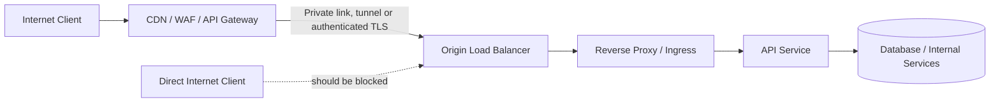

# Kiểm tra origin không bị expose ngoài ý muốn

## 1. Origin server là gì và vì sao cần bảo vệ?

Trong kiến trúc API đặt sau CDN, WAF hoặc API gateway, **origin server** là hệ thống gốc nhận request từ lớp edge và xử lý ứng dụng: load balancer, reverse proxy hoặc backend API. Client thông thường chỉ nên truy cập qua hostname công khai và edge đã được thiết kế để áp dụng TLS policy, WAF, authentication gateway, rate limit, bot protection, routing và logging.

Nếu origin có thể được truy cập trực tiếp từ Internet, caller có thể bỏ qua một phần hoặc toàn bộ các kiểm soát ở edge. Ví dụ, WAF chặn một request độc hại ở CDN nhưng attacker tìm được IP origin và gửi cùng request trực tiếp đến load balancer. Nếu origin chỉ tin rằng “request đến từ mạng Internet là hợp lệ”, các policy ở CDN không còn là ranh giới bảo vệ thực sự.

Mục tiêu không nhất thiết là làm cho địa chỉ IP origin trở thành bí mật tuyệt đối. DNS lịch sử, certificate transparency, cấu hình sai hoặc dữ liệu vận hành có thể làm lộ địa chỉ. Mục tiêu là bảo đảm rằng **biết địa chỉ origin cũng không cho phép bypass edge**: network policy chỉ nhận traffic từ đường kết nối được phép, origin xác minh caller ở lớp kết nối/ứng dụng và backend vẫn thực thi authentication, authorization như bình thường.

Trong bài này, “origin” là origin server/upstream API trong kiến trúc deployment/runtime. Nó khác với HTTP request header `Origin` của trình duyệt được dùng trong CORS. CORS kiểm soát browser có được đọc response cross-origin hay không; nó không ngăn một client kết nối trực tiếp tới IP origin.

## 2. Threat model: điều gì xảy ra khi origin bị expose?

Khi origin có đường truy cập trực tiếp, các rủi ro thường gặp gồm:

- **Bypass WAF:** request không đi qua rule phát hiện injection, exploit pattern, bot hoặc payload bất thường.
- **Bypass rate limit/bot control:** attacker gửi traffic thẳng tới origin, làm cạn connection, thread, CPU hoặc downstream budget.
- **Bypass gateway authentication/routing:** route vốn chỉ được expose sau gateway có thể bị gọi trực tiếp nếu backend không tự xác minh identity.
- **Lộ endpoint nội bộ:** health, debug, actuator, admin hoặc route cũ có thể được expose trên listener origin.
- **Host/SNI confusion:** origin chấp nhận hostname tùy ý, dẫn tới route nhầm virtual host hoặc phục vụ ứng dụng không intended.
- **Header spoofing:** origin tin `X-Forwarded-For`, `X-Forwarded-Proto`, `X-Authenticated-User` hoặc tenant header do caller tự gửi.
- **Direct-to-origin denial of service:** edge không còn là điểm hấp thụ traffic duy nhất; origin nhận tải trực tiếp.
- **Sai lệch logging và audit:** request bypass edge có thể không có request ID, client identity hoặc security telemetry theo chuẩn.

Assessment cần xác định các ingress path thực tế: IPv4, IPv6, public/private load balancer, DNS name phụ, port thay thế, Kubernetes ingress, cloud service endpoint và đường quản trị. Một hostname đã proxy qua CDN không chứng minh mọi địa chỉ của origin đều được bảo vệ.

## 3. Vẽ đường đi request và trust boundary

Trước khi kiểm tra, mô tả đường đi hợp lệ của request:



Với từng hop, ghi rõ:

| Hop | Caller được phép | Kiểm soát cần có |
|---|---|---|
| Client → edge | Client Internet hoặc consumer được công bố. | HTTPS, edge policy, authentication theo API contract, rate limit. |
| Edge → origin | Chỉ edge/CDN/gateway được phê duyệt. | Private connectivity hoặc source ACL kết hợp mTLS/origin authentication. |
| Origin LB → ingress | Load balancer/ingress trong trust boundary. | Security group/network policy, TLS/mTLS nếu phù hợp, listener tối thiểu. |
| Ingress → service | Workload được định danh. | Workload identity, mTLS/service authorization, route policy. |
| Service → data/dependency | Service có nhu cầu nghiệp vụ. | Least privilege, private network, secret management và authorization. |

Không coi một hop đã xác thực là bằng chứng mọi hop sau đó an toàn. Backend vẫn phải xác thực token/delegation hoặc workload identity theo kiến trúc và kiểm tra quyền trên object/tenant. Edge là một lớp kiểm soát, không phải lý do để bỏ authorization ở service.

## 4. Kiểm kê mọi điểm ingress của origin

Lập inventory trước khi kết luận origin không bị expose. Kiểm tra những tài nguyên thuộc phạm vi được phép:

- Public IPv4 và IPv6 của load balancer, VM, reverse proxy hoặc Kubernetes ingress.
- DNS A/AAAA/CNAME của hostname chính và hostname phụ đã biết.
- DNS record cũ, record staging, test, legacy hoặc hostname của nhà cung cấp được tổ chức quản lý.
- Listener/port public: HTTPS, HTTP redirect, alternate TLS port và management port.
- Origin hostname riêng được CDN/gateway cấu hình.
- Public cloud load balancer, public IP, NAT mapping, firewall/security group và network ACL.
- Kubernetes `Service` kiểu `LoadBalancer`/`NodePort`, ingress controller và service được expose qua gateway khác.
- Admin console, actuator, metrics, health/debug endpoint và diagnostic port.
- IPv6 listener hoặc network path chưa được áp dụng cùng policy IPv4.

Chỉ kiểm tra asset thuộc tổ chức và đã nằm trong scope assessment. Không quét dải IP của CDN/cloud provider hoặc địa chỉ bên thứ ba chỉ vì chúng xuất hiện trong DNS/history. Khi không chắc quyền sở hữu, xác nhận với owner hạ tầng trước khi gửi traffic kiểm thử.

## 5. DNS và dấu vết làm lộ origin

Một số nguồn có thể làm lộ địa chỉ origin:

- DNS A/AAAA record trỏ trực tiếp tới origin thay vì edge.
- Subdomain cũ hoặc hostname staging không còn dùng nhưng vẫn trỏ tới cùng load balancer.
- DNS-only record cho mail, FTP, status page hoặc service khác dùng chung IP với API origin.
- Certificate transparency log chứa hostname phụ hoặc tên origin.
- Public documentation, source map, error page, repository, ticket hoặc cấu hình mẫu vô tình chứa IP/hostname.
- Response header, redirect, error message hoặc email alert tiết lộ hostname nội bộ.
- Dữ liệu DNS lịch sử hoặc record passive DNS được công bố bởi dịch vụ bên ngoài.

DNS enumeration trong phạm vi được phép giúp phát hiện asset bị quên, nhưng việc tìm thấy origin IP không tự động chứng minh có lỗ hổng. Cần xác minh bằng kiểm tra kết nối và policy: địa chỉ đó có nhận request từ nguồn Internet tùy ý hay chỉ nhận edge traffic được phép?

Không dùng “ẩn IP” làm biện pháp bảo vệ duy nhất. Nếu origin IP đã lộ, firewall/security group và origin authentication vẫn phải ngăn direct access. Ngược lại, nếu origin chỉ được bảo vệ bằng obscurity, một record DNS phụ hoặc lỗi cấu hình có thể làm mất toàn bộ lớp bảo vệ.

## 6. Network restriction: chỉ nhận traffic từ edge

Biện pháp mạnh là đặt origin trên private network và chỉ cho edge kết nối qua private link, VPN/tunnel, peering hoặc kết nối riêng được kiểm soát. Nếu phải dùng public origin, giới hạn inbound source ở firewall/security group/network ACL theo dải IP chính thức của CDN/gateway.

Ví dụ policy logic:

```text
Inbound to origin HTTPS listener:
  ALLOW source = approved CDN/gateway egress ranges
  ALLOW source = explicitly approved health-check ranges (if required)
  DENY  source = all other Internet addresses

Management listeners:
  ALLOW source = admin VPN / bastion / private management network
  DENY  source = public Internet
```

Khi dùng IP range của CDN/provider:

- Lấy danh sách từ tài liệu/channels chính thức của provider, không copy từ blog hoặc IP list cũ.
- Tự động cập nhật security group/firewall khi provider thay đổi ranges; theo dõi lỗi cập nhật.
- Giới hạn đúng port và protocol; không mở toàn bộ subnet nếu chỉ cần HTTPS.
- Kiểm tra IPv4 và IPv6 riêng; không để IPv6 public mở trong khi IPv4 đã allowlist.
- Xác minh health check source thực sự cần thiết và giới hạn riêng.
- Không cho phép toàn bộ cloud provider CIDR nếu chỉ cần edge egress ranges.

IP allowlist là một lớp network control, không thay thế mTLS hoặc authentication ở origin. Nếu provider hỗ trợ private origin connectivity, ưu tiên phương án đó khi phù hợp với kiến trúc và yêu cầu vận hành.

## 7. Xác thực kết nối edge-to-origin

Kết hợp network restriction với bằng chứng caller ở lớp TLS hoặc ứng dụng. Các lựa chọn gồm:

### Mutual TLS (mTLS)

Origin yêu cầu client certificate từ CDN/gateway hoặc reverse proxy được phê duyệt. Origin kiểm tra certificate chain, trust anchor, validity, Extended Key Usage và danh tính/SAN theo policy. Chỉ certificate từ client được tin cậy mới được kết nối tới listener.

- Quản lý CA/trust store riêng cho origin authentication.
- Có rotation và overlap có giới hạn khi đổi certificate.
- Thu hồi certificate khi integration bị disable hoặc key compromise.
- Không chỉ kiểm tra certificate có chain hợp lệ; cần ánh xạ identity đúng edge/gateway.
- Kiểm thử cả trường hợp thiếu certificate, certificate không đúng CA, hết hạn và certificate của workload khác.

### Origin authentication header hoặc signed request

Một số nền tảng cung cấp secret header, signed request hoặc cơ chế origin pull authentication. Nếu dùng shared secret header:

- Edge phải xóa header cùng tên do client gửi rồi mới chèn giá trị do edge quản lý.
- Origin so sánh secret an toàn và không ghi giá trị vào log.
- Secret được lưu trong secret manager, có rotation, scope và quy trình revoke.
- Header chỉ là lớp bổ sung; request vẫn cần đi qua network path được phép.
- Không dùng một secret tĩnh duy nhất không có kế hoạch rotation cho mọi môi trường.

Nếu provider hỗ trợ chữ ký request theo timestamp/nonce, xác minh signature và replay window theo contract. Đảm bảo body canonicalization và key rotation đúng chuẩn provider.

Không dùng `User-Agent`, `Referer`, hostname hoặc một header do Internet client có thể tự đặt làm bằng chứng origin request đến từ CDN.

## 8. TLS, SNI và Host validation ở origin

Origin cần xác minh đúng hostname và kết nối TLS theo cấu hình dự kiến:

- Chỉ bật listener HTTPS cần thiết; nếu giữ HTTP để redirect, giới hạn đường truy cập và tránh để direct origin HTTP phục vụ API nhạy cảm.
- Dùng certificate đúng hostname origin/upstream và tự động gia hạn có giám sát.
- Edge phải xác minh certificate của origin; không tắt certificate validation để “sửa” lỗi TLS.
- Cấu hình SNI và upstream Host rõ ràng; không nhận mọi Host header rồi định tuyến theo giá trị không kiểm soát.
- Từ chối Host không nằm trong allowlist hoặc không map tới virtual host hợp lệ.
- Tránh fallback virtual host trả ứng dụng admin/default site khi Host lạ.
- Giữ TLS version/cipher policy theo baseline của tổ chức và provider.

Host validation ngăn request trực tiếp hoặc request qua proxy bị định tuyến sang virtual host không intended. Tuy nhiên, Host header đúng không chứng minh caller là edge; attacker có thể tự gửi Host đúng. Cần kết hợp network restriction và origin authentication.

## 9. Không tin forwarded headers từ caller tùy ý

Các header như `X-Forwarded-For`, `X-Forwarded-Proto`, `X-Forwarded-Host`, `Forwarded`, `X-Authenticated-User`, `X-Client-ID` và `X-Tenant-ID` có thể ảnh hưởng tới logging, redirect, rate limit hoặc authorization nếu backend tin chúng.

Edge/origin proxy cần:

1. Xóa hoặc ghi đè header forwarding/identity cùng tên do Internet client gửi.
2. Chỉ thêm giá trị đã được xác minh từ connection context.
3. Xác định chính xác proxy hop nào được tin cậy và chỉ parse chain từ các hop đó.
4. Backend chỉ chấp nhận identity header từ proxy/workload đã xác thực qua private network hoặc mTLS.
5. Không dùng `X-Tenant-ID` do client tự chọn làm tenant authorization context.
6. Không dùng `X-Forwarded-For` tùy ý làm căn cứ duy nhất cho rate limit hoặc security decision.

Nếu attacker gọi trực tiếp origin và tự gửi `X-Forwarded-For: 127.0.0.1` hoặc `X-Authenticated-User: admin`, origin không được coi những giá trị đó là đáng tin. Hãy kiểm thử request spoof header qua cả edge và direct-origin path.

## 10. Tách listener public, private và management

Không nên dùng một listener/interface cho mọi loại traffic. Tách rõ:

- Public edge-facing origin listener: chỉ nhận edge/gateway traffic.
- Internal service listener: chỉ nhận workload hoặc network nội bộ được phê duyệt.
- Management listener: chỉ qua VPN/bastion/private management network và identity đặc quyền.
- Health/metrics listener: chỉ cho orchestrator/monitoring system cần thiết.

Actuator, metrics, heap dump, debug console, admin endpoint, JMX và database port không nên public chỉ vì API origin cần nhận HTTPS. Với Spring Boot Actuator, expose tối thiểu endpoint cần thiết và bảo vệ cả network lẫn Spring Security. Health check công khai chỉ nên tiết lộ trạng thái tổng quát, không trả dependency detail, environment, build metadata hoặc secret.

Trong Kubernetes, rà soát `Service` type, ingress class, annotations, `hostNetwork`, `NodePort`, `LoadBalancer`, network policy và service mesh gateway. Một service không có public ingress vẫn có thể được expose qua load balancer khác hoặc node port mở ở cloud firewall.

## 11. Cấu hình ví dụ trên cloud firewall

Ví dụ policy logic cho security group của origin:

```text
Security Group: api-origin

Inbound:
  TCP 443 from approved-edge-egress-cidrs
  TCP 8443 from private-monitoring-cidr (only if required)
  no other inbound rules

Outbound:
  only required application dependencies and approved telemetry
```

Tên nhóm CIDR ở trên là placeholder, không phải dải IP thực. Trong cloud thực tế, dùng managed prefix list hoặc automation đồng bộ ranges chính thức của provider nếu có. Kiểm tra cả security group gắn vào load balancer, network ACL, host firewall và firewall ở subnet; một lớp mở rộng có thể làm vô hiệu lớp còn lại.

Nếu origin dùng public load balancer, kiểm tra rằng không có listener phụ hoặc load balancer cũ trỏ tới cùng target group. Nếu dùng private load balancer, xác minh DNS, routing và peering không vô tình mở đường từ network không tin cậy.

## 12. Cấu hình ví dụ cho Nginx origin

Ví dụ minh họa một origin chỉ chấp nhận source IP thuộc edge ranges đã được tổ chức đồng bộ, cùng Host hợp lệ. Dải IP dưới đây là địa chỉ documentation, không dùng trực tiếp trong production:

```nginx
server {
    listen 443 ssl;
    server_name api-origin.example.internal;

    ssl_certificate     /etc/nginx/tls/origin.crt;
    ssl_certificate_key /etc/nginx/tls/origin.key;

    # Placeholder documentation range only.
    allow 192.0.2.0/24;
    deny all;

    if ($host != "api-origin.example.internal") {
        return 421;
    }

    location / {
        proxy_set_header Host api.internal.service;
        proxy_set_header X-Forwarded-Proto https;
        proxy_set_header X-Request-ID $request_id;
        proxy_pass http://api_backend;
    }
}
```

Đây là cấu hình khái niệm. Production cần dùng danh sách edge CIDR chính thức, xử lý IPv6, cấu hình TLS đầy đủ và xác minh behavior của `$host`/`server_name` theo phiên bản Nginx. Nginx `allow/deny` kiểm tra địa chỉ peer mà Nginx nhìn thấy; nếu có một proxy khác phía trước, phải xác định đúng source address và trusted proxy configuration. Không bật real-IP rewrite từ header bất kỳ trước khi kiểm tra nguồn proxy.

Nếu provider hỗ trợ mTLS, cấu hình `ssl_verify_client`/trusted CA theo đúng mô hình client certificate và kiểm thử certificate rotation. Không copy nguyên ví dụ vào production mà chưa điều chỉnh listener, upstream, certificate và network ranges.

## 13. Cấu hình ví dụ cho Kubernetes

Một số nguyên tắc khi triển khai trên Kubernetes:

```yaml
apiVersion: v1
kind: Service
metadata:
  name: api-origin
spec:
  type: ClusterIP
  selector:
    app: api-origin
  ports:
    - name: https
      port: 443
      targetPort: 8443
```

`ClusterIP` chỉ tạo service nội bộ trong cluster; nó không tự đảm bảo toàn bộ đường truy cập bên ngoài bị chặn. Kiểm tra ingress controller, gateway, node port, cloud load balancer, host network và network policy. Ví dụ network policy cần được điều chỉnh theo CNI hỗ trợ và label thực tế:

```yaml
apiVersion: networking.k8s.io/v1
kind: NetworkPolicy
metadata:
  name: allow-edge-ingress-only
spec:
  podSelector:
    matchLabels:
      app: api-origin
  policyTypes:
    - Ingress
  ingress:
    - from:
        - namespaceSelector:
            matchLabels:
              name: edge-system
          podSelector:
            matchLabels:
              app: approved-ingress
      ports:
        - protocol: TCP
          port: 8443
```

NetworkPolicy chỉ có hiệu lực nếu CNI cluster enforce nó và selector phản ánh đúng workload. Nếu CDN nằm ngoài cluster, thường ingress controller hoặc private load balancer là điểm nhận edge traffic; không thể allowlist CDN bằng pod selector. Cần đặt network ACL ở cloud boundary và xác thực mTLS giữa các hop theo kiến trúc.

## 14. Kiểm tra IPv4, IPv6 và port phụ

Một cấu hình firewall có thể khóa IPv4 nhưng vẫn để IPv6 public. Kiểm tra cả hai protocol family trên:

- Public IP/interface của origin load balancer và VM.
- DNS A và AAAA record.
- Security group/firewall inbound rules.
- Listener HTTP/HTTPS và alternate port.
- Kubernetes node/public service exposure.
- Management, metrics và health port.

Không giả định port 443 là đường duy nhất. Kiểm tra inventory listener được phê duyệt và xác minh không có service cũ ở port khác. Tránh scan dải lớn hoặc port range không có scope; dùng cloud inventory, load balancer config và firewall rule review trước, sau đó kiểm tra kết nối có mục tiêu tới tài sản thuộc tổ chức.

## 15. Quy trình kiểm thử direct-origin có kiểm soát

Kiểm thử cần trả lời câu hỏi: từ một nguồn Internet không nằm trong edge allowlist, có thể thiết lập kết nối và nhận response từ origin không? Chỉ thực hiện với IP/hostname do tổ chức sở hữu và trong thời gian được phê duyệt.

1. Xác nhận origin IP/hostname từ inventory hoặc owner hạ tầng.
2. Ghi lại edge hostname, origin listener, port, protocol và expected network policy.
3. Từ một test host ngoài edge network, thử kết nối trực tiếp tới origin theo đúng hostname/SNI.
4. Thử IPv4 và IPv6 nếu cả hai được cấu hình.
5. Thử Host hợp lệ và Host không hợp lệ để xác minh virtual host behavior.
6. Thử request không có client certificate/origin credential và request với credential test không hợp lệ.
7. Xác minh request trực tiếp bị chặn ở network/TLS/origin-auth layer trước khi vào application.
8. Qua edge, xác minh request hợp lệ vẫn hoạt động và request bị WAF/rate limit chặn không thể bypass bằng direct path.
9. Kiểm tra log/metric để phân biệt edge traffic và direct-origin deny.
10. Lưu evidence đã redacted và phối hợp owner nếu cần thay đổi firewall/listener.

Ví dụ dùng `curl --resolve` để kết nối tới IP đã được xác nhận trong scope nhưng vẫn giữ hostname trong URL, do đó giữ Host header và TLS SNI theo hostname:

```bash
curl -v --resolve api.example.com:443:203.0.113.10 \
  https://api.example.com/health
```

`203.0.113.10` thuộc dải documentation và chỉ là placeholder. Thay bằng IP origin đã được cấp trong assessment. Nếu network policy đúng, test host ngoài edge thường không thiết lập được kết nối hoặc bị từ chối trước application. Đừng dùng `-k` để bỏ qua lỗi certificate trong bài test TLS thông thường; nếu cần chẩn đoán certificate, ghi nhận riêng vì `-k` che giấu lỗi xác minh.

Không thử gửi payload khai thác, brute force hoặc tải lớn để “chứng minh” bypass. Chỉ cần một request vô hại có correlation ID và log chứng minh direct connection được chấp nhận ngoài policy là đủ xác nhận exposure.

## 16. Kiểm tra edge control không bị bypass

Một mục tiêu quan trọng là chứng minh kiểm soát ở edge thực sự là bắt buộc:

| Kiểm soát edge | Cách xác minh an toàn |
|---|---|
| WAF rule | Dùng test signature/payload vô hại được WAF vendor cung cấp hoặc test endpoint trong staging; xác nhận direct origin bị network/auth chặn. |
| Rate limit | Gửi request test trong giới hạn được duyệt qua edge; xác nhận origin không nhận traffic trực tiếp từ nguồn ngoài allowlist. Không tạo flood. |
| Authentication gateway | Gọi route bằng token test hợp lệ/thiếu/sai; kiểm tra direct origin không thể bỏ qua identity enforcement. |
| Bot policy | Dùng test client/synthetic signal theo tài liệu provider; không giả lập bot flood. |
| Geo/IP policy | Dùng test region/egress được tổ chức kiểm soát hoặc policy simulation. |
| Request normalization | So sánh Host, path và header sau edge; origin chỉ tin dạng canonical từ proxy được xác thực. |
| Logging/correlation | Xác minh request ID, client IP và edge metadata không thể giả mạo từ direct caller. |

Nếu origin tự triển khai một policy trùng với edge, đó là defense-in-depth tốt khi có chủ đích. Nhưng không được giả định rule ở edge tự động áp dụng cho direct-origin request.

## 17. Kiểm tra header và identity spoofing

Thử trong staging các header thường được proxy thêm:

```http
GET /api/me HTTP/1.1
Host: api.example.com
X-Forwarded-For: 127.0.0.1
X-Forwarded-Proto: https
X-Authenticated-User: admin
X-Tenant-ID: tenant-victim
```

Expected behavior:

- Caller trực tiếp không thể tự tạo authenticated principal bằng header.
- Origin không coi `127.0.0.1` là client IP nếu giá trị chỉ đến từ header không tin cậy.
- Tenant context được lấy từ identity/policy đã xác minh.
- Header do edge quản lý được strip/overwrite và chỉ chấp nhận từ trusted hop.
- Request bị từ chối không tạo side effect.

Kiểm tra cả request đi qua edge: nếu client gửi header giả, edge phải xóa/ghi đè trước khi forward. Sau đó backend chỉ tin header từ edge connection đã xác thực. Không log raw Authorization/cookie hoặc secret header trong evidence.

## 18. Kiểm tra health, admin và debug endpoints

Origin có thể chặn API route chính nhưng vô tình expose endpoint quản trị trên cùng IP hoặc port khác. Inventory và kiểm tra policy cho:

- Spring Boot Actuator: `/actuator`, `/actuator/env`, `/actuator/configprops`, `/actuator/heapdump`, `/actuator/loggers`, `/actuator/mappings`.
- Metrics/Prometheus endpoint và profiling/debug port.
- Admin UI, Swagger/OpenAPI docs, API explorer và internal diagnostics.
- Container management, JMX, SSH, database, message broker và orchestration API.
- Health/readiness/liveness endpoint có trả dependency detail hoặc environment metadata không.

Các path trên chỉ là ví dụ để review cấu hình, không phải danh sách để quét mù trên hệ thống bên ngoài. Chỉ endpoint cần thiết mới được expose; management interface nên nằm trên private management network, có authentication mạnh và audit. Health endpoint công khai nếu thực sự cần nên trả trạng thái tối thiểu, không lộ hostname, version chi tiết, credentials hoặc dependency topology.

## 19. Logging và giám sát direct-origin attempts

Origin cần phân biệt traffic từ edge được tin cậy với request trực tiếp hoặc request có identity/header bất thường. Có thể ghi:

- Source IP/socket peer và trusted proxy identity.
- TLS client certificate identity hoặc origin-auth result.
- Listener/port, Host/SNI và route template.
- Edge request ID/correlation ID đã được xác minh.
- Network/origin policy decision: allow/deny và policy version.
- Authentication/authorization outcome ở application.
- Request size, rate-limit decision và response status ở mức cần thiết.

Không log secret header, bearer token, cookie, private key hoặc full request body. Tạo alert khi có nguồn không thuộc edge ranges chạm origin, mTLS failure tăng, Host lạ, management port bị truy cập hoặc request không có trusted edge metadata.

Đối chiếu log ở edge, firewall/load balancer và application để biết request bị chặn ở đâu. Nếu application log có request từ nguồn không được phép, có thể network ACL đang gắn sai, proxy chain bị hiểu sai hoặc listener phụ đang mở.

## 20. Những anti-pattern thường gặp

| Anti-pattern | Rủi ro | Cách khắc phục |
|---|---|---|
| Chỉ giấu origin IP | DNS/history hoặc cấu hình khác có thể làm lộ địa chỉ; direct access vẫn mở. | Network restriction và origin authentication. |
| Chỉ dùng IP allowlist nhưng không cập nhật provider ranges | Edge đổi IP làm outage hoặc phải mở rộng rule quá mức. | Đồng bộ ranges chính thức, alert và review tự động. |
| Chỉ bảo vệ IPv4 | IPv6 vẫn có thể truy cập trực tiếp. | Áp policy và kiểm thử cả IPv4/IPv6. |
| Tin mọi `X-Forwarded-For` | Caller giả IP để né policy hoặc làm sai log. | Chỉ tin proxy hop đã xác thực. |
| Tin `X-Authenticated-User` do request gửi | Giả mạo principal hoặc tenant. | Strip/overwrite header và xác thực origin connection. |
| Public management port cùng origin | Lộ actuator, metrics, debug hoặc admin interface. | Tách management network/listener và least privilege. |
| Host header tùy ý | Virtual host confusion, redirect hoặc routing sai. | Host/SNI allowlist và default deny. |
| Tắt TLS verification giữa edge và origin | Cho phép MITM hoặc kết nối nhầm upstream. | Certificate đúng, trust store và rotation. |
| Chỉ dựa vào WAF | Direct origin bypass được WAF. | Edge-only ingress cộng origin auth; service vẫn authorize. |
| Dùng secret header tĩnh làm lớp duy nhất | Secret có thể lộ trong config/log hoặc bị replay. | mTLS/network controls, secret rotation và redaction. |
| Chặn origin nhưng để load balancer cũ mở | Đường ingress phụ vẫn bypass edge. | Inventory listener/LB/DNS và kiểm thử toàn bộ path. |
| Không audit direct-origin deny | Không phát hiện scan hoặc rule bị drift. | Log policy decision và alert theo baseline. |

## 21. Kiểm thử và bằng chứng cần thu thập

Một assessment hoàn chỉnh cần có test matrix và evidence có thể tái hiện:

| Ca kiểm thử | Thao tác | Kết quả mong đợi |
|---|---|---|
| Public origin IPv4 | Kết nối từ test host ngoài edge tới IP origin. | Bị network policy từ chối trước application. |
| Public origin IPv6 | Lặp lại với AAAA/listener IPv6. | Cùng policy với IPv4; không có đường bypass. |
| Direct origin bằng hostname | Resolve origin hostname và gọi trực tiếp. | Bị chặn hoặc yêu cầu origin authentication hợp lệ. |
| Origin mTLS | Không certificate, certificate sai CA, hết hạn và certificate đúng. | Chỉ identity được duyệt mới kết nối. |
| Origin auth header | Thiếu/sai secret và header giả do client gửi. | Bị từ chối; edge ghi đè header client. |
| Host/SNI | Host lạ, SNI không khớp và default host. | Không định tuyến tới ứng dụng ngoài ý muốn. |
| Forwarded header spoof | Gửi IP/user/tenant giả qua edge và direct path. | Giá trị không tin cậy bị strip/overwrite/ignore. |
| Alternate listener | Kiểm tra port/LB/hostname phụ thuộc inventory. | Không có public ingress ngoài thiết kế. |
| Management endpoint | Kiểm tra actuator/metrics/admin từ public network. | Bị chặn hoặc yêu cầu private access và authentication. |
| Edge WAF/rate limit | Dùng test request an toàn qua edge. | Edge policy hoạt động; direct origin không bypass được. |
| Health check | Request từ health checker hợp lệ và nguồn khác. | Chỉ source/path cần thiết được phép; response tối thiểu. |
| Logging | Tạo direct-origin deny có correlation ID. | Firewall/origin log ghi đúng source, decision và listener; không lộ secret. |
| Firewall range rotation | Mô phỏng provider range update trong staging. | Automation cập nhật đúng và không mở CIDR quá rộng. |

Evidence nên gồm asset/hostname/IP đã được owner xác nhận, thời gian, source test host, protocol/port, request đã redacted, kết quả connect/TLS/HTTP, firewall/security group rule, origin-auth decision và correlation ID. Không lưu private key, secret header hoặc token. Không công bố origin IP trong ticket có phạm vi người đọc rộng nếu không cần; dùng asset ID hoặc phần IP đã che theo policy.

## 22. Xử lý khi phát hiện origin bị expose

Khi direct-origin request được chấp nhận ngoài policy:

1. Xác định listener, hostname/IP, protocol, port và route bị ảnh hưởng.
2. Kiểm tra request có thể bypass WAF, authentication gateway, rate limit hoặc logging nào.
3. Phối hợp owner hạ tầng áp dụng firewall/security group hoặc private connectivity đúng; không thay đổi CIDR rộng khi chưa hiểu health check và edge ranges.
4. Bật origin authentication/mTLS nếu kiến trúc hỗ trợ và có kế hoạch rotation.
5. Đóng listener/hostname phụ, management port hoặc load balancer cũ không còn cần thiết.
6. Kiểm tra log để xác định direct-origin access đã xảy ra trước đó, trong phạm vi retention có sẵn.
7. Rotate secret/certificate nếu credential origin có thể bị lộ; thu hồi các credential không còn tin cậy.
8. Retest từ nguồn ngoài edge và qua edge; xác minh request hợp lệ vẫn hoạt động.
9. Ghi change/audit record, owner, policy version và thời điểm hoàn tất.

Không chỉ đổi DNS để che origin. DNS change có thể không ảnh hưởng caller đã biết IP, record cache hoặc hostname cũ. Biện pháp khắc phục phải nằm ở network/origin listener và xác thực kết nối.

## 23. Checklist vận hành

- [ ] Có sơ đồ đường đi request và trust boundary từ client tới origin/service?
- [ ] Inventory gồm IPv4, IPv6, DNS, load balancer, listener, port và hostname phụ?
- [ ] Origin nằm trên private network hoặc chỉ nhận inbound từ edge ranges được phê duyệt?
- [ ] Provider IP ranges được lấy từ nguồn chính thức và tự động cập nhật có giám sát?
- [ ] Có mTLS/origin authentication ngoài network ACL khi phù hợp?
- [ ] Edge xóa/ghi đè origin-auth và forwarded headers do client gửi?
- [ ] Origin kiểm tra Host/SNI và từ chối virtual host không hợp lệ?
- [ ] TLS edge-to-origin xác minh certificate; không tắt verification?
- [ ] Management, actuator, metrics, debug và health listener được tách và giới hạn?
- [ ] Kubernetes/cloud firewall không có LB, NodePort, IPv6 hoặc listener cũ bị bỏ quên?
- [ ] Backend vẫn xác thực principal/workload và authorization theo object/tenant?
- [ ] Có test direct-origin từ nguồn ngoài edge cho cả IPv4/IPv6 và port cần thiết?
- [ ] Có test header spoofing, Host/SNI, mTLS failure và alternate ingress?
- [ ] Có log/alert cho direct-origin attempt, origin-auth failure và policy drift?
- [ ] Có quy trình xử lý exposure, credential rotation và retest sau thay đổi?

Origin server chỉ nên nhận traffic từ đường kết nối đã được thiết kế và xác thực. Việc ẩn hostname/IP giúp giảm khả năng bị phát hiện nhưng không phải ranh giới bảo mật. Hãy kết hợp private connectivity hoặc network allowlist, mTLS/origin authentication, Host/SNI validation, forwarded-header hygiene, tách management plane và kiểm thử direct-origin có kiểm soát. Cuối cùng, service vẫn phải thực thi authentication và authorization theo endpoint, object và tenant để một lỗi ở edge không trở thành quyền truy cập dữ liệu ngoài ý muốn.
