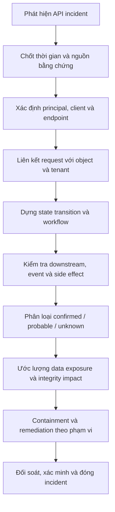

# Đánh giá object, tenant và workflow bị ảnh hưởng

Trong chương **Incident response API** của module `SECURITY_API_SECURITY`, khi phát hiện một API bị truy cập trái phép, phạm vi ảnh hưởng phải được đánh giá theo ba lớp: **object** (đối tượng dữ liệu cụ thể), **tenant** (ranh giới khách hàng/tổ chức) và **workflow** (chuỗi bước nghiệp vụ cùng side effect phát sinh). Chỉ đếm số request lỗi hoặc số endpoint bị khai thác không đủ để biết dữ liệu nào đã bị đọc, tài nguyên nào đã bị thay đổi và giao dịch nào cần được đối soát.

Một incident có thể bắt đầu từ lỗi object-level authorization ở `GET /invoices/{invoiceId}` nhưng lan sang nhiều tenant nếu ID có thể đoán được. Một lỗi ở `POST /transfers` có thể tạo giao dịch, phát message, gọi payment provider và cập nhật ledger; rollback một bản ghi API không nhất thiết đảo ngược toàn bộ workflow. Vì vậy, điều tra phải dựng lại đường đi từ principal và request tới object, tenant, trạng thái trước/sau và các hệ thống downstream.

Mục tiêu của bước assessment là tạo ra một danh sách ảnh hưởng có căn cứ: object nào có bằng chứng bị truy cập hoặc thay đổi, tenant nào liên quan, workflow nào đã đi qua những bước nào, dữ liệu nào có thể bị lộ và hành động khắc phục nào an toàn. Phải phân biệt rõ **confirmed impact**, **probable impact** và **unknown**; không biến thiếu log thành kết luận rằng không có ảnh hưởng.

## Ba lớp phạm vi ảnh hưởng

### 1. Object: dữ liệu cụ thể bị truy cập hoặc thay đổi

Object là tài nguyên mà API thao tác, ví dụ invoice, account, document, profile, transfer, order, API key hoặc permission assignment. Với mỗi object cần xác định:

- Object ID nội bộ và loại tài nguyên.
- Tenant/owner hợp lệ tại thời điểm incident.
- Hành động được thực hiện: read, list, create, update, delete, export, approve, refund hoặc share.
- Trạng thái trước và sau thao tác.
- Trường dữ liệu có thể đã được đọc hoặc sửa; phân loại độ nhạy cảm.
- Principal/client thực hiện và quyết định authorization liên quan.
- Request/event/transaction ID để nối với audit trail và downstream.

Một lần `GET` thành công có thể là bằng chứng dữ liệu đã được trả về, nhưng access log chỉ có status `200` chưa chứng minh response body chứa trường nào. Ngược lại, log ghi `403` thường chứng minh request bị từ chối ở một lớp, nhưng cần xác nhận không có side effect xảy ra trước khi từ chối. Ghi nhận mức độ chắc chắn cho từng kết luận.

### 2. Tenant: ranh giới dữ liệu và quyền sở hữu

Tenant thường đại diện khách hàng, tổ chức, workspace hoặc môi trường dữ liệu tách biệt. Assessment cần xác định cả tenant của principal và tenant sở hữu object tại thời điểm request. Không chỉ nhìn tenant hiện tại vì object có thể đã được chuyển quyền sở hữu, hợp nhất hoặc xóa sau incident.

Các câu hỏi quan trọng:

- Principal thuộc tenant nào theo identity provider và dữ liệu nội bộ?
- Request có tenant claim/header nào, và giá trị đó có được server xác minh hay chỉ do client gửi?
- Object thuộc tenant nào tại thời điểm xảy ra thao tác?
- Có truy cập chéo tenant hay chỉ truy cập trong cùng tenant nhưng vượt quyền owner/role?
- Có service account hoặc support/admin principal với quyền rộng tham gia không?
- Một tenant bị ảnh hưởng trực tiếp hay có dữ liệu của tenant khác xuất hiện trong response/export/cache?

Tenant ID trong JWT hoặc request header không tự chứng minh quyền trên object. Cần đối chiếu quan hệ principal–tenant–object ở thời điểm incident, cùng policy version được áp dụng.

### 3. Workflow: chuỗi nghiệp vụ và side effect

Workflow là các bước liên kết qua nhiều endpoint, event, queue, worker hoặc dịch vụ bên ngoài. Ví dụ luồng hoàn tiền có thể gồm kiểm tra quyền, tạo refund request, ghi ledger, gửi lệnh tới payment provider, nhận webhook và cập nhật trạng thái đơn hàng.

Với mỗi workflow, cần dựng lại:

- Điểm bắt đầu và principal khởi tạo.
- Các endpoint và action đã được gọi.
- State transition hợp lệ và state transition thực tế.
- Event/message đã phát ra, consumer nào đã xử lý và retry/DLQ liên quan.
- Side effect bên ngoài như thanh toán, gửi thông báo, cấp quyền hoặc export file.
- Idempotency key, transaction ID và correlation ID.
- Những bước có thể đảo ngược, cần bù trừ hoặc không thể đảo ngược.

Một object có thể chưa đổi trạng thái trong database nhưng workflow đã gửi email, tạo webhook hoặc gọi provider. Assessment chỉ hoàn tất khi đã kiểm tra cả side effect ngoài hệ thống chính.

## Phân biệt mức độ bằng chứng

Đừng gộp mọi đối tượng nằm trong truy vấn tìm kiếm thành “bị xâm phạm”. Dùng mức độ kết luận thống nhất:

| Mức | Ý nghĩa | Ví dụ bằng chứng |
|---|---|---|
| Confirmed affected | Có bằng chứng trực tiếp request trái phép đã thành công hoặc dữ liệu/side effect đã xảy ra | Audit event allow + response/DB change; provider xác nhận refund; export object được tạo |
| Probable affected | Dữ liệu cho thấy khả năng cao bị tác động nhưng thiếu một mắt xích xác nhận | Request thành công tới route nhạy cảm, log body bị thiếu, có liên quan principal/object |
| Exposed but not confirmed accessed | Object nằm trong phạm vi có thể truy cập nhưng chưa có bằng chứng caller đã lấy dữ liệu | BOLA cho phép đọc ID trong tenant khác, nhưng không có access record đủ tin cậy |
| Attempted/blocked | Có hành vi thử nhưng lớp kiểm soát đã chặn trước khi dữ liệu hoặc side effect bị tác động | Authorization deny được ghi đầy đủ và không có side effect |
| Unknown | Telemetry, retention hoặc quan hệ dữ liệu không đủ để kết luận | Log gap, trace sampling, ID không ánh xạ được hoặc hệ thống downstream không có audit |

Phân biệt `exposed` với `accessed` rất quan trọng khi thông báo khách hàng và đánh giá nghĩa vụ xử lý dữ liệu. Nếu không thể xác minh do log thiếu, ghi rõ giới hạn và giữ trạng thái unknown; không diễn giải thành “không có truy cập”.

## Quy trình assessment theo từng bước



### Bước 1: Chốt cửa sổ thời gian và giữ bằng chứng

Xác định thời điểm phát hiện, thời điểm khai thác sớm nhất có thể và thời điểm containment. Không chỉ lấy thời gian từ alert: cần xem lần đầu code/config/policy lỗi được triển khai, lần đầu request bất thường xuất hiện và thời điểm credential có thể bị lộ.

Ghi rõ timezone và chuẩn hóa timestamp về UTC. Kiểm tra clock skew giữa gateway, application, database, message broker và provider. Nếu đồng hồ lệch, tạo khoảng sai số thay vì giả định thứ tự sự kiện chính xác tuyệt đối.

Trước khi thay đổi hệ thống, bảo toàn log, audit event, trace, database audit, deployment manifest, policy version, gateway config, identity event và provider report liên quan. Xuất bằng chứng theo quy trình được phê duyệt, giữ metadata về nguồn, thời điểm thu thập, người thực hiện và checksum nếu cần chứng minh tính toàn vẹn.

Không sao chép raw token, password hoặc payload nhạy cảm vào ticket/chat. Nếu bằng chứng có PII hoặc secret, lưu trong kho incident hạn chế quyền; trong tài liệu điều phối chỉ dùng reference và mã đã che. Việc bảo toàn bằng chứng không được làm chậm containment khi hành vi khai thác vẫn đang tiếp diễn.

### Bước 2: Xác định principal, client và điểm vào

Thu thập các định danh có thể liên kết request:

- User/service principal ID, issuer, client ID, workload identity hoặc API key ID.
- Authentication method, thời điểm xác thực, token/key version và trạng thái revoke.
- Source IP được xác định từ trusted proxy chain, không tin header forwarding do client tự gửi.
- Request ID, trace ID, session reference và correlation ID.
- Gateway route, HTTP method, route template, API version và service nhận request.
- Policy/authentication configuration version tại thời điểm xảy ra sự kiện.

Không dùng IP làm danh tính duy nhất. Một IP có thể đại diện nhiều user sau NAT; attacker có thể thay IP qua proxy; service account có thể gọi từ nhiều node. Cần kết hợp principal, credential ID, network context và hành vi.

Nếu credential có khả năng bị lộ, xác định mọi service/tenant sử dụng credential đó, quyền được cấp, thời gian hiệu lực và các lần refresh/rotation. Một API key dùng chung cho nhiều integration khiến blast radius lớn hơn một credential riêng theo client.

### Bước 3: Liên kết request với object và tenant

Tạo tập dữ liệu điều tra theo các chiều:

1. Principal/client bị nghi ngờ.
2. Route và action có lỗi hoặc policy bị bypass.
3. Cửa sổ thời gian liên quan.
4. Object ID, resource type và tenant context.
5. Decision event, response status và kết quả truy vấn/database.

Ưu tiên route template thay vì URL đầy đủ để nhóm request, nhưng giữ resource reference đã được bảo vệ trong kho bằng chứng nếu cần xác định object cụ thể. Đối chiếu ID từ request với object owner/tenant tại thời điểm incident, không dựa vào tenant header chưa xác minh.

Một bảng impact ledger có thể dùng cấu trúc:

| Trường | Nội dung |
|---|---|
| `incidentId` | Mã incident |
| `principalRef` | User/client/service đã được xác minh hoặc đang điều tra |
| `tenantRef` | Tenant sở hữu hoặc tenant context liên quan |
| `resourceType` / `resourceRef` | Object bị đọc/thay đổi hoặc có thể bị truy cập |
| `action` | Read/update/delete/export/approve/refund... |
| `firstSeen` / `lastSeen` | Khoảng thời gian quan sát được |
| `evidenceRefs` | Request, decision, DB audit, event hoặc provider reference |
| `impactLevel` | Confirmed/probable/exposed/blocked/unknown |
| `dataClass` | Phân loại dữ liệu liên quan |
| `workflowRef` | Giao dịch hoặc workflow bị ảnh hưởng |
| `remediationState` | Chưa xử lý/đã cô lập/đã đối soát/đã khôi phục |

Impact ledger phải lưu ở nơi có access control và audit. Không dùng spreadsheet chia sẻ rộng chứa raw customer ID, PII hoặc payload.

### Bước 4: Xác định object có thể bị truy cập và object đã bị truy cập

Với lỗi BOLA/IDOR, phạm vi có thể rộng hơn các ID xuất hiện trong log. Cần xác định cách attacker có thể tạo hoặc khám phá ID:

- ID tuần tự, UUID, slug, search filter, export endpoint hay bulk operation.
- Endpoint list/search có trả object reference của nhiều tenant không?
- Nested resource có kiểm tra quyền độc lập không, ví dụ `/accounts/{id}/documents/{docId}`?
- Batch API có kiểm tra authorization cho từng phần tử hay chỉ kiểm tra request-level?
- GraphQL resolver, download URL, attachment hoặc cache có bypass policy ở route chính không?
- Có endpoint phụ như preview, count, autocomplete, webhook status hoặc report export tiết lộ cùng object không?

Phân biệt các tập:

- **Observed objects:** object có request/event cụ thể trong bằng chứng.
- **Potentially accessible objects:** object nằm trong miền mà lỗi policy có thể cho phép truy cập.
- **Confirmed read objects:** object có bằng chứng response/data đã được trả về hoặc truy xuất trái phép.
- **Modified objects:** object có bằng chứng state/field đã thay đổi.

Không mặc định toàn bộ object có ID trong khoảng số là bị đọc. Ngược lại, nếu endpoint bulk/list trả nhiều bản ghi trong một response, một request có thể làm lộ hàng nghìn object dù log chỉ có một dòng. Cần xác định semantics của endpoint và số bản ghi trả về.

### Bước 5: Dựng lại state transition và workflow

Với mỗi thao tác ghi, so sánh state trước/sau từ nguồn dữ liệu có thẩm quyền: database audit, event sourcing log, ledger, outbox, message broker, provider API hoặc business audit event.

Kiểm tra:

- Object được tạo, cập nhật, xóa, chuyển owner hoặc đổi tenant không?
- Có thay đổi role, permission, API key, membership hoặc account setting không?
- Có chuyển trạng thái vượt qua state machine hợp lệ không, ví dụ `PENDING` sang `SETTLED` mà thiếu bước xác nhận?
- Có side effect như thanh toán, refund, phát hành hóa đơn, gửi email, tạo file hoặc gọi webhook không?
- Retry có tạo bản ghi hoặc side effect trùng không?
- Event đã vào queue, retry queue hoặc DLQ chưa; consumer nào đã xử lý?
- Có tác vụ async chạy sau thời điểm containment nhưng dùng command đã được enqueue trước đó không?

Không chỉ nhìn trạng thái cuối. Một workflow có thể đã đi qua bước nhạy cảm rồi mới rollback. Cần lịch sử chuyển trạng thái, thời điểm commit, event sequence và xác nhận từ hệ thống downstream.

### Bước 6: Đánh giá data exposure và integrity impact

Đánh giá riêng tính bí mật, toàn vẹn và khả dụng:

| Nhóm tác động | Câu hỏi điều tra |
|---|---|
| Confidentiality | Dữ liệu nào đã được trả về, export, tải xuống hoặc gửi tới client không được phép? |
| Integrity | Object, owner, permission, balance, status hoặc workflow nào bị thay đổi? |
| Availability | Object bị xóa/khóa, quota bị tiêu thụ, queue bị làm đầy hoặc API bị gián đoạn không? |
| Credential | Token/key/session nào bị sử dụng trái phép hoặc có thể đã bị lộ? |
| Downstream | Search index, cache, data lake, email, webhook hoặc provider có bản sao/side effect nào? |

Phân loại dữ liệu theo nội dung thực tế: public, internal, confidential, personal data, financial/regulated hoặc secret. Đánh giá số chủ thể, số tenant, loại trường và khoảng thời gian bị ảnh hưởng. Không chỉ dùng số object để xác định mức độ nghiêm trọng; một object chứa khóa ký hoặc thông tin thanh toán có thể có tác động lớn hơn nhiều bản ghi ít nhạy cảm.

### Bước 7: Xác định ranh giới tenant và blast radius

Lập ma trận tenant × principal × action × resource type. Mục đích là xác định tenant nào là nguồn, tenant nào là đích và có truy cập ngang (cross-tenant) hay không.

Ví dụ ma trận:

| Principal | Tenant của principal | Tenant của object | Action | Kết luận sơ bộ |
|---|---|---|---|---|
| User A | Tenant A | Tenant A | `invoice:read` | Cùng tenant; vẫn kiểm tra owner/role |
| User A | Tenant A | Tenant B | `invoice:read` | Cross-tenant; xác minh response và policy |
| Service X | System scope | Tenant B | `invoice:export` | Kiểm tra workload permission và mục đích job |
| Admin/support | Support scope | Tenant C | `account:update` | Kiểm tra approval, break-glass và audit trail |

Không kết luận một service account truy cập nhiều tenant là bất thường nếu nó được thiết kế làm worker đa tenant. Cần so sánh với workload identity, scope, job assignment và policy đã được phê duyệt. Ngược lại, một service account có quyền rộng không chứng minh mọi truy cập của nó đều hợp lệ.

Tìm các đường lan truyền:

- Tenant ID bị lấy từ request body/header thay vì principal context.
- Cache key thiếu tenant hoặc principal scope.
- Search index dùng chung nhưng filter tenant bị bỏ sót.
- Export/report chạy bằng service identity có quyền rộng.
- Object được chia sẻ qua link/public URL hoặc signed URL có thời hạn quá dài.
- Event/queue không mang tenant context đáng tin cậy hoặc consumer không xác minh nó.

### Bước 8: Xác định giới hạn của telemetry

Trước khi kết luận không có truy cập, xác minh log có đủ độ bao phủ:

- Access log có bật trên mọi gateway/region/replica không?
- Authorization decision event có ghi cả ALLOW và DENY cho action nhạy cảm không?
- Log có sampling, drop, buffer overflow hoặc retention hết hạn không?
- Có request đi thẳng vào backend bỏ qua gateway không?
- Database audit, object storage access log và provider audit có được bật không?
- Trace ID có được truyền xuyên service và có bị thay đổi không?
- Đồng hồ giữa các hệ thống có lệch không?
- Có khoảng thời gian deployment/incident mà collector bị gián đoạn không?

Ghi rõ khoảng trống telemetry trong báo cáo. Nếu một endpoint không ghi response size hoặc object reference, có thể không xác định được số bản ghi đã trả về. Nếu không có audit ở downstream, không thể chỉ dựa vào log API để khẳng định provider chưa thực hiện giao dịch.

## Containment dựa trên phạm vi ảnh hưởng

Assessment và containment thường diễn ra song song. Nếu khai thác vẫn đang tiếp diễn, áp dụng biện pháp ngăn chặn ngay theo runbook; đồng thời tiếp tục mở rộng impact ledger. Chọn biện pháp hẹp nhất đủ dừng hành vi, tránh vô tình làm gián đoạn toàn bộ tenant hoặc xóa bằng chứng.

Các lựa chọn có thể gồm:

- Thu hồi/rotate credential, API key, session hoặc signing key bị nghi ngờ.
- Tắt route, method hoặc feature cụ thể bằng gateway policy/feature flag.
- Siết object-level/tenant authorization tại service sở hữu dữ liệu.
- Tạm dừng export, bulk operation, refund hoặc workflow có side effect.
- Chặn principal/client cụ thể hoặc thu hẹp scope; chỉ chặn IP/subnet khi bằng chứng cho thấy phù hợp.
- Tạm dừng consumer/worker liên quan nếu command độc hại vẫn đang nằm trong queue; bảo toàn message và metadata trước khi xử lý.
- Vô hiệu hóa signed URL hoặc link chia sẻ còn hiệu lực.
- Tăng giám sát cho object/tenant/route có rủi ro cao.

Không xóa object, queue hoặc log để “dọn sạch” incident trước khi bảo toàn bằng chứng và đánh giá side effect. Không tự động reset trạng thái hàng loạt nếu chưa biết state machine và tác động tài chính/pháp lý.

## Ví dụ: BOLA làm lộ invoice giữa hai tenant

Giả sử endpoint:

```http
GET /api/invoices/{invoiceId}
Authorization: Bearer <token>
```

Ứng dụng xác thực JWT đúng nhưng truy vấn invoice chỉ theo `invoiceId`, không ràng buộc tenant/owner. Attacker thuộc Tenant A có thể đoán hoặc thu thập ID của invoice thuộc Tenant B.

### Cách điều tra

1. Xác định thời điểm phiên bản code thiếu điều kiện tenant được triển khai và thời điểm bản sửa có hiệu lực.
2. Tìm các request tới route template theo principal/client, IP đã xác minh từ proxy chain, thời gian và request ID.
3. Đối chiếu invoice ID trong log hoặc query audit với owner/tenant tại thời điểm truy cập.
4. So sánh principal tenant với object tenant; đánh dấu cross-tenant request.
5. Xác minh response thực tế: status, response size, field set, download/export event hoặc evidence ở gateway/trace.
6. Phân loại từng invoice: confirmed read, probable read, attempted/blocked hoặc unknown.
7. Tìm các endpoint liên quan như invoice list, PDF download, attachment, export và search.
8. Kiểm tra cache key, CDN, signed URL và bản sao trong search index.
9. Xác định tenant bị ảnh hưởng và dữ liệu nhạy cảm trong invoice.

Ví dụ query điều tra dưới đây là pseudocode, không phải SQL dùng trực tiếp:

```sql
SELECT
    request_id,
    principal_ref,
    principal_tenant_ref,
    resource_ref,
    resource_tenant_at_event,
    decision,
    occurred_at
FROM security_access_events
WHERE route_template = 'GET /api/invoices/{invoiceId}'
  AND occurred_at BETWEEN :incident_start AND :containment_time
  AND principal_tenant_ref <> resource_tenant_at_event;
```

Query cần chạy trên kho bằng chứng đã được phân quyền, với timestamp, schema và tenant mapping đúng thời điểm. Nếu event log không có `resource_tenant_at_event`, phải join với audit/history table hoặc nguồn dữ liệu lịch sử đáng tin cậy; không dùng tenant hiện tại một cách mù quáng.

### Containment và phục hồi

- Sửa authorization tại service sở hữu invoice: kiểm tra principal, action và tenant/owner ở mỗi request.
- Tạm tắt route download/export nếu không thể xác minh quyền an toàn ngay.
- Thu hồi credential của principal bị chiếm quyền nếu có bằng chứng compromise; không khóa toàn Tenant A chỉ vì một user của tenant đó gây ra incident.
- Kiểm tra dữ liệu invoice có bị tải xuống hoặc gửi ra ngoài; xác minh CDN/cache/signed URL.
- Nếu chỉ có read exposure, không sửa nội dung invoice để “khắc phục”; xử lý thông báo và biện pháp dữ liệu theo đánh giá privacy/legal.
- Nếu có object bị sửa, khôi phục từ audit history hoặc quy trình nghiệp vụ có phê duyệt; đối soát các side effect downstream.
- Chạy regression test với principal Tenant A truy cập invoice Tenant B và các trường hợp owner/admin/support hợp lệ.

## Đánh giá workflow có side effect tài chính hoặc quyền hạn

Với workflow như chuyển tiền, refund, cấp role, reset credential hoặc thay đổi tenant membership, cần kiểm tra toàn bộ chuỗi sự kiện.

| Thành phần | Bằng chứng cần đối chiếu |
|---|---|
| API request | Principal, action, object, idempotency key, request/trace ID |
| Authorization | Decision, policy version, scope, tenant/owner context |
| Database | Transaction commit, before/after state, actor, audit sequence |
| Outbox/message broker | Event ID, topic, partition/offset, publish/consume time, retry/DLQ |
| Worker | Workload identity, command validation, processing state, retry count |
| External provider | Provider transaction/reference, status, amount, destination, webhook callback |
| Notification/export | Email/SMS recipient, generated file, download/share event |

Nếu cần đảo ngược giao dịch, dùng quy trình bù trừ nghiệp vụ (compensating action) đã được phê duyệt. Không xóa event hoặc sửa ledger trực tiếp để làm cho trạng thái hiển thị “đúng”. Với thanh toán, đối chiếu provider settlement và ledger; với quyền hạn, xác định mọi token/session đã được cấp trước khi role bị thu hồi.

## Báo cáo kết quả assessment

Một báo cáo incident nên có các phần:

1. **Summary:** loại lỗi API, thời điểm, trạng thái containment và mức độ chắc chắn.
2. **Root cause:** endpoint, policy/code/config bị lỗi và điều kiện khai thác.
3. **Principal/client:** user, API client, service account hoặc credential liên quan.
4. **Object impact:** loại object, số lượng, hành động và trạng thái confirmed/probable/unknown.
5. **Tenant impact:** tenant nguồn/đích, cross-tenant exposure và số tenant liên quan.
6. **Workflow impact:** state transition, event, worker, provider và side effect.
7. **Data impact:** loại trường dữ liệu, mức độ nhạy cảm, confidentiality/integrity/availability.
8. **Evidence and gaps:** nguồn log, retention, sampling, timestamp skew và giới hạn kết luận.
9. **Containment/recovery:** hành động đã thực hiện, object đã đối soát, credential đã rotate và bước còn lại.
10. **Follow-up:** code/policy fix, regression test, monitoring, owner và deadline.

Chỉ đưa dữ liệu tối thiểu vào báo cáo phân phối rộng. Danh sách object/tenant cụ thể hoặc bằng chứng có PII nên nằm trong phụ lục hạn chế quyền.

## Kiểm thử khả năng đánh giá impact

Không chỉ kiểm thử code fix; cần kiểm tra liệu hệ thống có tạo đủ bằng chứng để incident responder xác định object, tenant và workflow hay không.

| Tình huống diễn tập | Bằng chứng mong đợi |
|---|---|
| User Tenant A đọc object Tenant B | Authorization deny/allow decision, principal tenant, object tenant và request ID |
| User cùng tenant nhưng không phải owner | Owner/relationship context và reason code |
| Bulk export trả nhiều object | Export job ID, danh sách/count object, tenant scope và download audit |
| Update object thành công | Before/after state hoặc audit diff có giới hạn dữ liệu |
| Workflow phát event async | Event ID, producer/consumer identity, offset/status và retry history |
| Refund qua provider | Internal transaction ID và provider reference/status |
| Credential service account bị revoke | Thời điểm revoke, request cuối cùng và mọi workload sử dụng credential |
| Gateway bị bypass | Backend access log và network evidence nhận diện đường vào trực tiếp |
| Log sampling/collector outage | Báo cáo thể hiện telemetry gap, không kết luận no impact |
| Cache trả object sai tenant | Cache key, tenant context, hit/miss và object reference |
| Restore dữ liệu sau incident | Audit history, deletion/permission state và side effect đã đối soát |

Thực hiện diễn tập bằng tenant, principal và object giả trong môi trường kiểm thử. Không thử truy cập chéo tenant trên dữ liệu production nếu chưa có phạm vi và phê duyệt phù hợp.

## Những sai lầm thường gặp

- Chỉ đếm request `401/403` mà không xác định request `200` nào đã đọc hoặc thay đổi object.
- Xem tenant ID trong request header/body là nguồn sự thật.
- Dùng tenant ownership hiện tại để kết luận quyền tại thời điểm incident.
- Cho rằng một request tương ứng một object; bỏ sót bulk/list/export response.
- Chỉ kiểm tra database mà quên queue, worker, provider, email, cache và signed URL.
- Coi event `ALLOW` là bằng chứng side effect đã commit thành công.
- Coi không có log là không có truy cập dù collector sampling hoặc retention đã hết.
- Gộp mọi object có thể truy cập vào danh sách object đã bị đọc.
- Chặn cả tenant hoặc subnet rộng mà không có bằng chứng về phạm vi.
- Rollback dữ liệu trực tiếp mà không kiểm tra state machine, ledger và downstream effects.
- Xóa log/message trước khi bảo toàn bằng chứng.
- Gửi impact ledger chứa PII/object ID ra kênh chia sẻ rộng.

## Checklist đánh giá

- [ ] Đã chốt incident window, timezone UTC, clock skew và thời điểm containment.
- [ ] Đã bảo toàn access log, authn/authz decision, database audit, trace, broker và provider evidence.
- [ ] Đã xác định principal, client, credential, issuer, source IP theo trusted proxy và endpoint/version.
- [ ] Đã liên kết request với object và tenant tại đúng thời điểm sự kiện.
- [ ] Đã phân biệt observed, potentially accessible, confirmed read và modified objects.
- [ ] Đã kiểm tra object-level authorization, owner relationship, nested resource, list/bulk/export và cache.
- [ ] Đã dựng state transition, event, retry, worker và downstream side effect của workflow.
- [ ] Đã đánh giá confidentiality, integrity, availability, credential và data classification.
- [ ] Đã lập tenant impact matrix và xác định cross-tenant exposure.
- [ ] Đã đánh dấu confirmed/probable/exposed/blocked/unknown cùng bằng chứng cho từng kết luận.
- [ ] Đã ghi nhận telemetry gap và giới hạn của kết luận.
- [ ] Containment theo phạm vi hẹp, không phá hủy bằng chứng hoặc gây side effect mới.
- [ ] Đã đối soát giao dịch, quyền, export, provider và notification trước khi đóng incident.
- [ ] Có regression test và báo cáo follow-up với owner/deadline.

Đánh giá incident API chỉ đáng tin khi nối được danh tính người gọi với object, tenant và toàn bộ workflow có liên quan. Hãy lập impact ledger có bằng chứng, phân biệt dữ liệu có thể bị truy cập với dữ liệu đã được xác nhận truy cập, kiểm tra side effect ở downstream và ghi rõ khoảng trống telemetry. Cách tiếp cận này giúp containment đúng phạm vi, phục hồi an toàn và đưa ra kết luận có thể kiểm chứng.
