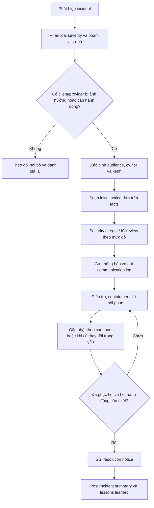

# Thông báo client và phối hợp provider

Khi API gặp sự cố bảo mật hoặc gián đoạn dịch vụ, đội kỹ thuật cần xử lý nguyên nhân và đồng thời giúp các bên bị ảnh hưởng đưa ra quyết định đúng. Client tích hợp API có thể cần dừng retry, rotate credential, chuyển endpoint, kiểm tra giao dịch hoặc thông báo cho người dùng cuối. Provider bên ngoài có thể cần xác minh sự cố ở hạ tầng của họ, thu hồi certificate, điều tra request hoặc khôi phục một dependency.

**Thông báo client và phối hợp provider** là quy trình truyền đạt thông tin sự cố có kiểm soát tới API consumer, khách hàng, nhà cung cấp và các nhóm nội bộ. Mục tiêu là thông tin kịp thời, chính xác, nhất quán và đủ để người nhận hành động, đồng thời không làm lộ dữ liệu cá nhân, credential, bằng chứng điều tra hoặc chi tiết có thể giúp attacker khai thác tiếp.

Thông báo không phải hoạt động truyền thông tách rời incident response. Nội dung và thời điểm thông báo cần dựa trên phạm vi ảnh hưởng đã xác minh, mức độ chắc chắn của thông tin, nghĩa vụ hợp đồng/pháp lý và trạng thái containment. Khi chưa đủ dữ kiện, cần nói rõ điều gì đã biết, điều gì đang điều tra và thời điểm cập nhật tiếp theo; không suy đoán nguyên nhân hoặc khẳng định “không có dữ liệu bị ảnh hưởng” khi chưa có bằng chứng.

## 1. Vì sao cần quy trình thông báo riêng cho API?

API thường kết nối nhiều hệ thống và consumer. Một incident tại một thành phần có thể ảnh hưởng đến nhiều bên theo các cách khác nhau:

- API provider gặp outage khiến client không tạo được đơn hàng hoặc không xác nhận thanh toán.
- Credential hoặc signing key bị lộ khiến client cần rotate key, thu hồi token hoặc tạm dừng integration.
- API phát hiện lỗ hổng authorization khiến một số consumer cần ngừng gọi endpoint, kiểm tra dữ liệu đã truy cập hoặc áp dụng workaround.
- Identity provider, cloud provider, payment processor hoặc webhook provider gặp sự cố làm request thất bại hoặc xử lý trùng.
- Thay đổi khẩn cấp như chặn một API version, thu hồi certificate hoặc giảm quota làm client phải điều chỉnh ngay.
- Sự cố dữ liệu có thể kích hoạt nghĩa vụ thông báo theo hợp đồng, chính sách nội bộ hoặc quy định áp dụng.

Nếu chỉ cập nhật status page, các consumer quan trọng có thể không nhận được hướng dẫn cụ thể. Nếu gửi email đại trà với quá nhiều chi tiết kỹ thuật, người nhận có thể hiểu sai hoặc vô tình chuyển tiếp dữ liệu nhạy cảm. Cần xác định đúng người nhận, đúng kênh và đúng mức chi tiết.

### 1.1. Phân biệt các nhóm người nhận

| Người nhận | Họ cần biết điều gì? | Hành động có thể cần thực hiện |
| --- | --- | --- |
| API client/developer | Endpoint, version, region, error behavior, workaround và retry guidance | Dừng retry, đổi endpoint, giảm concurrency, rotate credential hoặc kiểm tra giao dịch. |
| Khách hàng/business owner | Dịch vụ và quy trình nghiệp vụ nào bị ảnh hưởng, thời gian và tác động dự kiến | Điều chỉnh vận hành, thông báo người dùng, chuyển sang quy trình dự phòng. |
| Provider/dependency owner | Thời gian, request reference, region, error pattern và yêu cầu hỗ trợ | Điều tra, xác nhận phạm vi, khôi phục hoặc thu hồi credential/certificate. |
| Internal support/operations | Tình trạng, câu trả lời đã được phê duyệt và escalation path | Trả lời ticket nhất quán, chuyển case đúng nhóm. |
| Security/privacy/legal | Bằng chứng, loại dữ liệu, phạm vi, nghĩa vụ và quyết định containment | Điều tra, đánh giá notification obligation và phê duyệt thông báo. |
| Executive/incident commander | Mức độ, tác động, rủi ro, quyết định và nguồn lực cần thiết | Ưu tiên xử lý, phê duyệt quyết định liên chức năng. |

Không gửi cùng một nội dung cho tất cả các nhóm. Client kỹ thuật cần error code và hành động cụ thể; lãnh đạo cần tác động và quyết định; provider cần bằng chứng có thể tra cứu; khách hàng cuối cần ngôn ngữ rõ ràng, tránh jargon.

## 2. Khi nào cần thông báo?

Không phải mọi alert hoặc request lỗi đều cần thông báo khách hàng. Tuy nhiên, cần có tiêu chí để không trì hoãn khi incident đã ảnh hưởng đến consumer hoặc yêu cầu họ hành động.

Các trigger thường gặp:

- API không đáp ứng SLO hoặc có outage kéo dài ảnh hưởng đến chức năng quan trọng.
- Một endpoint, API version, region hoặc integration bị vô hiệu hóa khẩn cấp.
- Credential, API key, signing key, certificate hoặc token có nguy cơ bị lộ/thu hồi.
- Có dấu hiệu truy cập trái phép, rò rỉ dữ liệu hoặc xử lý sai tenant/object.
- Webhook bị trễ, mất, gửi trùng hoặc không thể xác minh chữ ký.
- Provider xác nhận sự cố ở dependency ảnh hưởng tới API.
- Client cần thay đổi cấu hình, retry behavior, certificate chain hoặc API version.
- Có nghĩa vụ thông báo theo hợp đồng, DPA, SLA hoặc quy định pháp luật.

### 2.1. Ma trận mức độ và kênh thông báo

Mức độ phải theo incident severity policy của tổ chức. Bảng dưới đây là ví dụ để thiết kế quy trình, không thay thế phân loại chính thức:

| Mức độ | Tình huống ví dụ | Người nhận/kênh gợi ý |
| --- | --- | --- |
| SEV-1 / Critical | Rò rỉ dữ liệu có phạm vi lớn, credential diện rộng bị compromise, API cốt lõi ngừng hoạt động | Incident commander, security/privacy/legal, lãnh đạo, provider trọng yếu và client bị ảnh hưởng qua kênh khẩn cấp đã xác minh. |
| SEV-2 / High | Một nhóm tenant/region/endpoint bị ảnh hưởng đáng kể hoặc cần hành động từ client | Client bị ảnh hưởng, support, provider liên quan; status page và thông báo trực tiếp. |
| SEV-3 / Moderate | Degradation có workaround, retry tăng hoặc một integration bị lỗi giới hạn | Client/partner liên quan qua portal/email/ticket; cập nhật khi có thay đổi. |
| SEV-4 / Low | Sự cố nhỏ, không có tác động đáng kể và không cần client hành động | Nội bộ hoặc release note nếu phù hợp; không nhất thiết phát thông báo incident đại trà. |

Không dùng severity chỉ dựa trên số lượng 5xx. Một lỗi authorization có thể trả 403 nhưng làm lộ dữ liệu nhạy cảm trước đó; một incident ảnh hưởng một tenant nhỏ vẫn có thể có mức độ cao nếu dữ liệu đặc biệt nhạy cảm hoặc nghĩa vụ thông báo nghiêm ngặt.

### 2.2. Phân biệt “đã xác nhận”, “đang điều tra” và “không bị ảnh hưởng”

Thông báo cần đánh dấu mức độ chắc chắn:

- **Đã xác nhận:** có bằng chứng từ telemetry, log, audit hoặc provider.
- **Đang điều tra:** có tín hiệu đáng tin nhưng phạm vi/ảnh hưởng chưa kết luận.
- **Chưa xác định:** thiếu dữ liệu hoặc provider chưa phản hồi; không suy diễn thành “không ảnh hưởng”.
- **Không bị ảnh hưởng:** chỉ dùng khi đã kiểm tra phạm vi cụ thể và có bằng chứng hỗ trợ.

Tránh các câu như “mọi dữ liệu đều an toàn” hoặc “không có thông tin nào bị truy cập” trước khi investigation hoàn tất. Có thể nói “hiện chưa có bằng chứng cho thấy dữ liệu X bị truy cập trái phép; việc xác minh vẫn đang tiếp tục”.

## 3. Thiết lập vai trò và quyền phê duyệt

Incident communication cần một đầu mối chịu trách nhiệm để tránh nhiều nhóm gửi thông tin mâu thuẫn. Mô hình vai trò có thể gồm:

| Vai trò | Trách nhiệm |
| --- | --- |
| Incident Commander (IC) | Điều phối incident, severity, ưu tiên và quyết định nhịp cập nhật. |
| Technical Lead | Xác nhận trạng thái kỹ thuật, phạm vi endpoint, workaround và tiến độ khắc phục. |
| Security Lead | Đánh giá compromise, containment, bằng chứng và chi tiết không được công bố. |
| Customer/Partner Communications Lead | Soạn thông báo, quản lý danh sách người nhận, status page và câu hỏi từ client. |
| Provider Liaison | Mở case, trao đổi kỹ thuật, theo dõi escalation và xác minh thông tin từ provider. |
| Legal/Privacy | Đánh giá nghĩa vụ thông báo, nội dung pháp lý, DPA và yêu cầu của cơ quan có thẩm quyền. |
| Support Lead | Chuẩn hóa câu trả lời, phân loại ticket và chuyển case vượt thẩm quyền. |

Ở tổ chức nhỏ, một người có thể kiêm nhiều vai trò, nhưng vẫn cần chỉ định rõ ai có quyền phê duyệt thông báo. Technical Lead cung cấp facts; Communications Lead chuyển facts thành thông điệp; IC phê duyệt thông tin vận hành; Security/Legal/Privacy tham gia khi có sự cố bảo mật hoặc dữ liệu.

Không chờ postmortem hoàn tất mới thông báo khi client cần hành động khẩn cấp. Có thể phát initial notice với thông tin đã xác nhận, sau đó cập nhật theo chu kỳ.

## 4. Quy trình thông báo theo vòng đời incident



### 4.1. Bước 1: Xác định phạm vi ảnh hưởng

Trước khi gửi thông báo, tập hợp các thông tin tối thiểu:

- Incident ID và thời điểm phát hiện/khởi đầu ước tính.
- Service, endpoint, API version, region và environment bị ảnh hưởng.
- Loại tác động: availability, integrity, confidentiality, authentication, authorization hoặc delivery.
- Client/tenant/partner bị ảnh hưởng nếu đã xác định.
- Khoảng thời gian, request pattern và trạng thái hiện tại.
- Hành động containment đã thực hiện và hành động client cần làm.
- Mức độ chắc chắn và câu hỏi đang mở.

Không cần chờ mọi chi tiết mới được thông báo. Với outage đang diễn ra, có thể gửi thông tin phạm vi sơ bộ rồi bổ sung. Với nghi vấn data breach, Security/Privacy/Legal cần xác định quy trình và thời hạn áp dụng; không tự trì hoãn hoặc tự kết luận thay họ.

### 4.2. Bước 2: Xác định audience chính xác

Tạo danh sách theo dependency/client inventory:

- Consumer đã gọi endpoint/version/region bị ảnh hưởng trong khoảng thời gian liên quan.
- Partner sở hữu integration hoặc webhook endpoint.
- Provider có dependency nằm trong incident path.
- Contact kỹ thuật và business contact đã được xác minh.
- Internal support/on-call và người có quyền quyết định.

Không gửi thông báo về một tenant cho tenant khác. Không dùng danh sách email cũ chưa xác minh cho thông tin nhạy cảm. Nếu không thể xác định chính xác từng consumer, dùng status page công khai với thông tin tối thiểu và tiếp tục xác minh danh sách direct notification.

### 4.3. Bước 3: Soạn initial notice

Initial notice nên trả lời sáu câu hỏi:

1. Điều gì đang xảy ra?
2. Dịch vụ/endpoint/region nào bị ảnh hưởng?
3. Tác động đã xác nhận là gì và điều gì còn chưa rõ?
4. Client cần làm gì ngay bây giờ?
5. Workaround hoặc phương án dự phòng nào có thể dùng?
6. Khi nào và ở đâu sẽ có cập nhật tiếp theo?

Viết ngắn, trực tiếp và dùng timestamp có múi giờ rõ ràng, tốt nhất là UTC kèm giờ địa phương khi cần. Không dùng từ “đã khắc phục” nếu mới chỉ giảm lỗi hoặc đang triển khai mitigation.

### 4.4. Bước 4: Review và phê duyệt

Review cần tập trung vào tính chính xác và rủi ro tiết lộ:

- Technical Lead xác minh endpoint, status code, thời gian, workaround và retry guidance.
- Security xác minh thông tin về exploit, credential, attacker và evidence có thể công bố.
- Legal/Privacy xác định nội dung/thời hạn thông báo bắt buộc nếu có dữ liệu cá nhân hoặc nghĩa vụ hợp đồng.
- IC phê duyệt severity, audience, cadence và thông điệp vận hành.

Không cần tạo quy trình phê duyệt dài cho mọi outage nhỏ; định nghĩa trước ma trận ai có thể phê duyệt theo severity để không chậm thông báo khẩn cấp.

### 4.5. Bước 5: Gửi và ghi nhận

Gửi qua kênh phù hợp và ghi lại:

- Phiên bản thông báo, người phê duyệt và thời điểm gửi.
- Audience/segment, kênh, số lượng người nhận và delivery result.
- Incident ID, status page entry hoặc provider ticket reference.
- Client đã xác nhận nhận hay chưa nếu cần acknowledgement.
- Câu hỏi, yêu cầu hỗ trợ và owner xử lý tiếp.

Không lưu secret hoặc payload nhạy cảm trong communication log. Ghi reference tới evidence store có phân quyền nếu cần tra cứu.

## 5. Nội dung một thông báo client tốt

Thông báo cho API consumer cần actionable. Client không nhất thiết cần biết chi tiết kiến trúc nội bộ hoặc exploit; họ cần biết request nào có thể thất bại, có nên retry, giao dịch có thể đã được xử lý hay không và cần đổi cấu hình gì.

### 5.1. Trường thông tin nên có

| Trường | Nội dung |
| --- | --- |
| Incident reference | ID để liên kết ticket và cập nhật. |
| Status | Investigating, Identified, Mitigating, Monitoring hoặc Resolved theo taxonomy thống nhất. |
| Start/update time | Thời điểm bắt đầu ước tính và thời điểm cập nhật, có timezone. |
| Affected service | API product, endpoint group, version, region hoặc tenant segment. |
| Impact | Error/latency/delivery behavior và quy trình nghiệp vụ bị ảnh hưởng. |
| Client action | Dừng retry, dùng backoff, rotate credential, đổi endpoint, kiểm tra reconciliation hoặc không hành động. |
| Workaround | Phương án đã được xác nhận và điều kiện áp dụng. |
| Next update | Mốc cập nhật tiếp theo hoặc trigger sẽ cập nhật sớm hơn. |
| Support path | Portal/ticket/contact đã xác minh và thông tin cần cung cấp. |

### 5.2. Retry guidance phải cụ thể

Thông báo “hãy retry” có thể làm incident nặng hơn nếu client retry đồng loạt hoặc endpoint có side effect. Cần nêu:

- Chỉ retry lỗi transient nào, ví dụ `429`, `502`, `503`, `504` theo contract.
- Tôn trọng `Retry-After` nếu response có header này.
- Dùng exponential backoff với jitter và giới hạn attempt.
- Không retry `400`, `401`, `403` hoặc lỗi validation vô hạn; xử lý credential/payload/policy theo hướng dẫn.
- Với request tạo giao dịch, dùng idempotency key và kiểm tra trạng thái trước khi gửi lại nếu response bị timeout.
- Tạm giảm concurrency hoặc tạm dừng batch nếu provider đang quá tải.

Nếu không chắc request đã commit hay chưa, không khuyên client gửi lại thao tác non-idempotent. Hướng dẫn tra trạng thái bằng transaction reference hoặc gọi reconciliation endpoint đã được thiết kế cho mục đích đó.

### 5.3. Credential hoặc certificate incident

Khi client cần rotate credential, thông báo phải nêu rõ:

- Loại credential/key/certificate và integration bị ảnh hưởng, không gửi lại giá trị secret.
- Credential cũ đã bị thu hồi hay chỉ được khuyến nghị rotate.
- Thời điểm bắt đầu từ chối credential cũ.
- Cách lấy credential mới qua portal/secret manager đã xác minh.
- Có giai đoạn overlap hay không và thời hạn kết thúc.
- Cách xác minh integration đã dùng key mới.
- Hành động cần thực hiện nếu client không thể rotate trong thời hạn.

Không gửi API key mới trong email thường hoặc ticket không bảo vệ. Cấp credential qua kênh có xác thực và phân quyền; thông báo chỉ chứa reference hoặc hướng dẫn lấy secret.

## 6. Nội dung thông báo provider

Provider cần thông tin đủ để tra cứu request và phối hợp điều tra. Ticket thiếu timestamp, region hoặc request ID thường dẫn đến nhiều vòng hỏi lại; ticket chứa raw token, customer payload hoặc private key lại tạo thêm một sự cố rò rỉ.

### 6.1. Bộ dữ liệu kỹ thuật tối thiểu

- Provider account/project/subscription reference đã được phép chia sẻ.
- Environment và region.
- API product, endpoint/operation và API version.
- Khoảng thời gian bắt đầu/kết thúc, UTC.
- HTTP status, provider error code và tỷ lệ lỗi/latency.
- Request ID, correlation ID, trace ID hoặc provider transaction reference.
- Credential/key ID hoặc certificate serial/fingerprint không chứa private material.
- Thay đổi gần nhất: deploy, config, key rotation, DNS, network hoặc quota.
- Tác động nghiệp vụ và số lượng giao dịch bị ảnh hưởng theo thống kê đã giảm thiểu dữ liệu.
- Các bước đã thử, kết quả và câu hỏi provider cần trả lời.

Không gửi Authorization header, API key, refresh token, private key, full signed URL, raw payment data hoặc dữ liệu cá nhân nếu không thực sự cần và chưa có kênh chia sẻ được phê duyệt. Nếu provider yêu cầu evidence nhạy cảm, dùng secure support portal, mã hóa và quyền truy cập giới hạn; ghi rõ retention/deletion request nếu quy trình cho phép.

### 6.2. Câu hỏi cần provider xác nhận

1. Provider đã xác nhận incident ở service/region/version nào chưa?
2. Khoảng thời gian ảnh hưởng đã biết là gì?
3. Request/transaction nào đã được commit dù client nhận timeout hoặc 5xx?
4. Có duplicate, delayed webhook hoặc event bị mất không?
5. Credential/certificate/key nào cần rotate hoặc revoke?
6. Có workaround, endpoint dự phòng hoặc quota tạm thời không?
7. Retry behavior và rate limit hiện tại là gì?
8. Khi nào có next update và ai là incident owner phía provider?
9. Provider có cần evidence bổ sung qua kênh an toàn nào?

Yêu cầu provider xác nhận bằng văn bản các điểm có tác động đến tính toàn vẹn giao dịch, phạm vi dữ liệu hoặc việc thu hồi credential. Không suy diễn “provider đã khắc phục” chỉ vì status page đổi sang operational; cần xác minh integration của mình hoạt động trở lại.

## 7. Chọn kênh thông báo và bảo vệ kênh

Kênh phải phù hợp mức độ khẩn cấp, độ nhạy và khả năng xác minh người nhận.

| Kênh | Phù hợp | Kiểm soát |
| --- | --- | --- |
| Public status page | Tình trạng service chung, nhiều client bị ảnh hưởng | Chỉ công bố thông tin đã được duyệt; không đưa tenant, user hoặc evidence riêng. |
| Authenticated developer portal | Hướng dẫn kỹ thuật cho consumer đã đăng ký | Phân quyền theo organization/tenant; audit truy cập và lịch sử thông báo. |
| Email tới verified contacts | Thông báo chủ động tới client/provider | Danh sách contact đã xác minh, hạn chế recipient, không gửi secret/PII không cần thiết. |
| Secure support ticket | Trao đổi evidence và thông tin theo case | MFA/SSO, role-based access, file attachment scan, retention và audit. |
| Provider incident bridge | Phối hợp real-time trong incident nghiêm trọng | Xác minh participant, ghi decision/action log và hạn chế chia sẻ màn hình chứa secret. |
| Phone/SMS/on-call channel | Kích hoạt người có trách nhiệm trong tình huống khẩn | Dùng contact đã xác minh; không truyền credential hoặc payload nhạy cảm. |

Không dùng một link status page hoặc email display name làm bằng chứng người gửi đáng tin. Với thông báo yêu cầu rotate key, đổi endpoint hoặc chuyển tiền, client cần xác minh qua developer portal/kênh đã đăng ký trước. Đây cũng là cách giảm nguy cơ attacker giả mạo thông báo incident để phishing.

### 7.1. Chống giả mạo thông báo

Attacker có thể lợi dụng incident để gửi email giả yêu cầu client “cập nhật API key”, “đăng nhập portal mới” hoặc “chuyển endpoint”. Để giảm rủi ro:

- Dùng domain và sender đã công bố trong tài liệu integration.
- Không yêu cầu client gửi secret qua email hoặc chat.
- Đưa hành động nhạy cảm vào portal đã xác thực; email chỉ dẫn tới domain đã biết.
- Ký hoặc xác thực webhook/status notification nếu hệ thống hỗ trợ.
- Nêu cách xác minh thông báo qua kênh độc lập.
- Support không yêu cầu password, OTP hoặc private key.

## 8. Nhịp cập nhật và quản lý kỳ vọng

Một thông báo đầu tiên không kết thúc trách nhiệm liên lạc. Khi incident kéo dài, client cần biết tình hình còn thay đổi hay không và khi nào có thông tin mới.

Cadence phụ thuộc severity và impact. Ví dụ:

| Mức độ | Nhịp cập nhật tham khảo |
| --- | --- |
| SEV-1 | Cập nhật mỗi 30–60 phút hoặc ngay khi có thay đổi trọng yếu. |
| SEV-2 | Cập nhật mỗi 1–2 giờ trong giai đoạn ảnh hưởng lớn. |
| SEV-3 | Cập nhật theo mốc đã thông báo, ví dụ mỗi 4 giờ hoặc khi workaround thay đổi. |
| SEV-4 | Cập nhật khi có kết luận hoặc khi client cần hành động. |

Đây là ví dụ để xây dựng policy; cần đồng bộ với SLA, on-call coverage và năng lực thực tế. Nếu chưa có tiến triển, vẫn gửi update đúng cadence: “đang tiếp tục điều tra, chưa có thay đổi về phạm vi, cập nhật tiếp theo lúc…”. Không im lặng vì chưa có root cause.

### 8.1. Status lifecycle thống nhất

Có thể dùng các trạng thái:

- `Investigating`: đang xác minh nguyên nhân và phạm vi.
- `Identified`: đã xác định nguyên nhân hoặc thành phần ảnh hưởng ở mức đủ tin cậy.
- `Mitigating`: đang áp dụng biện pháp giảm tác động.
- `Monitoring`: đã áp dụng mitigation/restore và đang theo dõi tính ổn định.
- `Resolved`: dịch vụ đã phục hồi theo tiêu chí đã định nghĩa.
- `Post-incident review`: đang tổng hợp báo cáo sau sự cố; không có nghĩa incident vẫn đang ảnh hưởng.

Không chuyển sang `Resolved` chỉ vì deploy xong. Cần xác minh error rate/latency, giao dịch, webhook backlog, credential validity và các consumer bị ảnh hưởng đã hoạt động bình thường.

### 8.2. Khi thông tin thay đổi

Nếu phạm vi tăng, nguyên nhân thay đổi hoặc hướng dẫn trước đó không còn đúng, phát correction rõ ràng. Ghi phiên bản/thời điểm, nêu phần thông tin đã thay đổi và hành động client cần điều chỉnh. Không sửa lặng lẽ thông báo cũ nếu client có thể đã lưu hoặc thực hiện theo hướng dẫn trước.

## 9. Phối hợp provider khi dependency gặp sự cố

Provider có thể là cloud, identity provider, payment processor, DNS, CDN, API partner, webhook sender hoặc certificate authority. Mỗi loại có quy trình support và evidence khác nhau.

Quy trình phối hợp:

1. Xác định dependency và đường đi request: service, region, endpoint, credential type và network path.
2. Kiểm tra lỗi ở phía mình: DNS, TLS, token, quota, timeout, retry, deploy và connection pool.
3. Mở case qua support plan/incident channel đã xác minh, đính kèm evidence tối thiểu.
4. Yêu cầu provider xác nhận incident ID, owner, phạm vi và next update.
5. Thống nhất workaround, retry behavior, transaction reconciliation và trách nhiệm thông báo client.
6. Ghi quyết định, người phụ trách và thời hạn từng hành động.
7. Xác minh phục hồi từ cả provider telemetry và request thực tế của mình.
8. Đóng case sau khi backlog, giao dịch và dữ liệu được đối soát.

### 9.1. Khi provider không phản hồi

Nếu provider không phản hồi trong thời gian cần thiết:

- Escalate qua support tier, incident hotline hoặc account contact đã đăng ký.
- Dùng fallback đã được kiểm thử, không tự chuyển traffic sang endpoint chưa xác minh.
- Giảm retry/concurrency để tránh làm nặng sự cố.
- Tạm dừng thao tác không thể xác định trạng thái commit nếu có nguy cơ duplicate.
- Thông báo client theo facts hiện có, ghi rõ dependency provider đang được điều tra.
- Lưu timeline liên hệ và quyết định để đối soát SLA/contract sau incident.

Không gửi credential hoặc dữ liệu nhạy cảm tới contact cá nhân không xác minh chỉ vì incident khẩn cấp.

### 9.2. Shared responsibility

Trong tích hợp provider, trách nhiệm thường được chia theo lớp:

| Lớp | Provider thường chịu trách nhiệm | API consumer thường chịu trách nhiệm |
| --- | --- | --- |
| Infrastructure/service availability | Hạ tầng và service do provider vận hành | Retry policy, timeout, fallback và xử lý lỗi ở client. |
| Credential/identity | Cấp, xác minh hoặc rotate credential theo contract | Bảo vệ secret, giới hạn scope, rotate khi bị lộ và không log. |
| Transaction integrity | Trạng thái xử lý phía provider và reference giao dịch | Idempotency, reconciliation và tránh duplicate side effect. |
| Webhook delivery | Gửi event, retry theo contract và signature metadata | Verify signature, deduplicate, xử lý out-of-order và theo dõi backlog. |
| Data protection | Bảo vệ dữ liệu trong hệ thống provider theo thỏa thuận | Chỉ gửi dữ liệu cần thiết, phân quyền và quản lý retention phía mình. |

Hợp đồng/SLA/DPA cụ thể mới quyết định trách nhiệm pháp lý. Bảng này chỉ là khung vận hành để hai bên làm rõ ai xử lý từng hành động.

## 10. Sự cố dữ liệu và nghĩa vụ thông báo

Incident có thể liên quan dữ liệu cá nhân, dữ liệu thanh toán hoặc thông tin bảo mật. Việc thông báo có thể chịu ràng buộc bởi pháp luật, hợp đồng, DPA, ngành nghề hoặc vị trí của chủ thể dữ liệu. Thời hạn và người nhận không giống nhau giữa các khu vực pháp lý.

Khi nghi ngờ data breach:

- Kích hoạt Security, Privacy và Legal ngay theo incident policy.
- Bảo toàn evidence và timeline; không xóa log hoặc dữ liệu điều tra tùy tiện.
- Xác định loại dữ liệu, chủ thể, tenant, vùng địa lý, khoảng thời gian và mức độ truy cập.
- Phân biệt dữ liệu bị xem, bị tải xuống, bị sửa, bị xóa hoặc chỉ có nguy cơ truy cập.
- Xác định controller/processor và vai trò của từng provider theo DPA.
- Đánh giá nghĩa vụ thông báo tới cơ quan quản lý, khách hàng, đối tác hoặc chủ thể dữ liệu.
- Dùng mẫu nội dung đã được Legal/Privacy phê duyệt; cập nhật khi có facts mới.

Không tự đặt một thời hạn pháp lý chung cho mọi incident. Legal/Privacy cần xác định quy định và hợp đồng áp dụng dựa trên loại dữ liệu, nơi xử lý và vai trò tổ chức. Thông báo vận hành về outage có thể được gửi trước khi có kết luận pháp lý về data breach; hai luồng cần phối hợp nhưng không nhập nhằng.

## 11. Mẫu thông báo client

Mẫu dưới đây dành cho initial notice khi API có degradation. Thay placeholder bằng dữ kiện đã xác minh và bỏ nội dung không liên quan.

```text
Tiêu đề: [SEV-2] API Orders gặp lỗi tăng cao tại ap-southeast-1

Incident: INC-2026-0142
Trạng thái: Investigating
Thời điểm cập nhật: 2026-11-18 14:30 UTC

Chúng tôi đang điều tra tỷ lệ lỗi tăng cao trên API Orders tại
ap-southeast-1, ảnh hưởng tới một phần request tạo và cập nhật đơn hàng.

Ảnh hưởng đã xác nhận:
- Một số request có thể nhận HTTP 503 hoặc timeout.
- Hiện chưa xác định được trạng thái commit của mọi request timeout.
- Các API đọc đơn hàng hiện chưa ghi nhận cùng mức ảnh hưởng.

Bạn cần làm gì:
- Với request nhận 503, retry theo exponential backoff và jitter.
- Với request tạo đơn đã timeout, kiểm tra trạng thái bằng idempotency key
  hoặc transaction reference trước khi gửi lại.
- Không tạo idempotency key mới chỉ để retry cùng một thao tác.

Chúng tôi đang phối hợp với provider liên quan và tiếp tục xác minh phạm vi.
Workaround hoặc thay đổi tiếp theo sẽ được cập nhật tại developer portal.

Cập nhật tiếp theo: trước 15:00 UTC hoặc sớm hơn nếu có thay đổi trọng yếu.
Tham chiếu: INC-2026-0142
```

Không dùng nguyên mẫu nếu chưa biết request commit semantics hoặc retry contract. Nội dung phải được Technical Lead xác nhận và Communications Lead phê duyệt trước khi gửi.

## 12. Mẫu ticket phối hợp provider

```text
Subject: Incident investigation - elevated 503/timeouts for Orders API

Our incident reference: INC-2026-0142
Provider account/project: [verified account reference]
Environment/region: Production / ap-southeast-1
Affected API/operation: [provider product and operation]
Observed window: 2026-11-18 13:50-14:25 UTC

Observed behavior:
- HTTP 503 increased from [baseline] to [observed rate].
- Client-side timeout p95 changed from [x] to [y].
- Affected request references: [redacted request IDs / provider transaction refs]
- First observed at: [timestamp UTC]

Checks performed:
- DNS and TLS handshake: [result]
- Credential/key ID and expiry: [result; no secret attached]
- Quota/rate limit headers: [result]
- Recent deployment/config changes: [result]

Please confirm:
1. Whether there is an active incident for this service/region.
2. The affected time window and transaction commit behavior.
3. Recommended retry/fallback behavior and current quota.
4. Next update time and incident owner.

Secure evidence location: [approved support portal reference]
Our technical contact: [verified contact]
```

Chỉ gửi request IDs hoặc transaction references đã được phép chia sẻ. Không đính kèm Authorization header, API key, signed URL đầy đủ, raw payload hoặc dữ liệu khách hàng không cần thiết.

## 13. Ghi communication log và quản lý quyết định

Communication log là timeline của những gì đã được nói, cho ai và dựa trên bằng chứng nào. Nó giúp tránh mâu thuẫn giữa status page, email, support ticket và provider bridge.

Một record có thể gồm:

| Trường | Ý nghĩa |
| --- | --- |
| `incident_id` | ID incident nội bộ. |
| `message_id` / `version` | Định danh và phiên bản thông báo. |
| `audience_segment` | Client, partner, provider, internal hoặc regulator segment. |
| `channel` | Status page, portal, email, support ticket hoặc bridge. |
| `approved_by` | Người/role phê duyệt. |
| `sent_at` | Thời điểm gửi UTC. |
| `delivery_status` | Sent, delivered, bounced, acknowledged hoặc failed. |
| `facts_version` | Snapshot facts/timeline được dùng khi soạn thông báo. |
| `next_update_at` | Mốc cập nhật dự kiến. |
| `owner` | Người theo dõi phản hồi và câu hỏi. |

Ghi cả correction và thông báo rút lại. Không chỉnh sửa lịch sử để che việc thông tin trước đó sai; tạo message mới liên kết message cũ và nêu rõ thay đổi. Quyền đọc communication log cần giới hạn vì nó có thể chứa thông tin về khách hàng, sự cố và provider.

## 14. Resolution notice và post-incident communication

Khi incident được giải quyết, thông báo cần xác nhận trạng thái và các hành động còn lại:

- Thời điểm service được xác nhận phục hồi.
- Endpoint/version/region đã được kiểm tra.
- Có backlog, webhook hoặc transaction cần xử lý tiếp không.
- Client có cần retry/reconcile/rotate credential/đổi cấu hình nữa không.
- Workaround nào có thể dừng và thời điểm dừng.
- Có follow-up report hoặc post-incident review hay không.
- Kênh hỗ trợ nếu client vẫn quan sát thấy lỗi.

Không gọi incident là resolved nếu chỉ một dashboard xanh nhưng transaction chưa đối soát, webhook backlog chưa xử lý hoặc credential cũ chưa được thu hồi theo kế hoạch.

### 14.1. Post-incident summary

Post-incident summary nên được phát hành sau khi có đủ facts và qua review. Nội dung thường gồm:

1. Tóm tắt sự cố và dịch vụ bị ảnh hưởng.
2. Timeline đã xác minh.
3. Tác động tới client/transaction/data.
4. Nguyên nhân gốc ở mức có thể công bố.
5. Mitigation và remediation đã thực hiện.
6. Việc cần client/provider làm tiếp, nếu có.
7. Các cải tiến phòng ngừa và mốc hoàn thành dự kiến.

Không công bố exploit detail, IP/identity của attacker, secret, lỗ hổng chưa được vá hoặc dữ liệu cá nhân. Có thể cung cấp bản kỹ thuật sâu hơn cho partner bị ảnh hưởng qua kênh xác thực và theo nguyên tắc need-to-know.

## 15. Đo lường chất lượng thông báo

Quy trình thông báo cũng cần được kiểm tra và cải thiện. Một số chỉ số:

- Thời gian từ incident declaration đến initial notice.
- Tỷ lệ consumer bị ảnh hưởng đã được xác định và thông báo.
- Tỷ lệ email/ticket delivery thành công và acknowledgement.
- Thời gian provider phản hồi và thời gian escalation.
- Số lần correction do thông tin sai hoặc mâu thuẫn.
- Tỷ lệ client thực hiện action cần thiết trước deadline.
- Số ticket lặp lại do thông báo thiếu rõ ràng.
- Thời gian từ technical recovery đến transaction/data reconciliation hoàn tất.

Không tối ưu “gửi thật nhanh” bằng cách gửi thông tin chưa kiểm chứng. Cân bằng tốc độ với độ chính xác; đo cả thời gian thông báo và tỷ lệ correction/clarification.

## 16. Kiểm thử quy trình thông báo và phối hợp provider

Thực hiện tabletop exercise hoặc game day với các tình huống khác nhau:

| Tình huống | Kiểm tra | Kết quả mong đợi |
| --- | --- | --- |
| API outage SEV-1 | Ai declare incident, ai phê duyệt, client nào được thông báo? | Initial notice đúng cadence, status page nhất quán và owner rõ. |
| Một tenant bị ảnh hưởng | Audience selection và data isolation | Chỉ contact đã xác minh của tenant bị ảnh hưởng nhận thông tin riêng. |
| Credential compromise | Rotation/revocation instructions | Client lấy key mới qua portal an toàn; thông báo không chứa secret. |
| Authorization bug | Phạm vi dữ liệu và câu chữ uncertainty | Security/Privacy/Legal tham gia; không khẳng định sai về data exposure. |
| Provider outage | Ticket evidence và escalation | Provider nhận request IDs/timestamps cần thiết, không có raw credential. |
| Provider không phản hồi | Escalation/fallback | Có contact dự phòng, quyết định fallback và client update đúng hạn. |
| Webhook delay/duplicate | Retry và reconciliation guidance | Client không xử lý duplicate; event backlog được đối soát. |
| Giao dịch timeout, trạng thái chưa rõ | Idempotency và transaction lookup | Không hướng dẫn tạo giao dịch mới; có bước kiểm tra trạng thái. |
| Phishing giả mạo incident | Kênh xác minh | Client biết xác minh qua portal/domain đã công bố, không gửi secret. |
| Phạm vi incident mở rộng | Correction và re-notification | Gửi thông báo sửa đổi có version/time, audience mới và hành động cập nhật. |
| Data breach | Regulatory/contract notification | Legal/Privacy xác định recipient/deadline và phê duyệt nội dung. |
| Resolution | Tiêu chí đóng incident | Service, transaction, backlog, credential và client action được xác minh. |

### 16.1. Kiểm tra nội dung thông báo

Với mỗi template, review các câu hỏi:

- Có nêu rõ điều gì đã xác nhận và điều gì chưa biết không?
- Có endpoint/version/region và thời gian chính xác không?
- Client có thể xác định mình có bị ảnh hưởng không?
- Hành động có thể thực hiện ngay và có điều kiện dừng rõ không?
- Retry guidance có thể tạo duplicate hoặc làm quá tải không?
- Có secret, token, PII, exploit detail hoặc internal topology không cần thiết không?
- Link và contact có phải domain/kênh đã xác minh không?
- Có owner và next update time không?

## 17. Những sai lầm thường gặp

- **Chỉ cập nhật status page:** consumer quan trọng có thể không biết cần rotate key hoặc đối soát giao dịch.
- **Gửi cùng một thông báo cho mọi client:** có thể tiết lộ phạm vi tenant hoặc gây hiểu nhầm.
- **Đợi biết root cause mới gửi:** làm chậm hành động bảo vệ; initial notice có thể dựa trên facts sơ bộ.
- **Khẳng định quá mức:** “không có dữ liệu bị ảnh hưởng” khi investigation chưa hoàn tất làm mất niềm tin và có thể sai nghĩa vụ.
- **Nói “retry tất cả”:** có thể tạo duplicate giao dịch hoặc khuếch đại outage.
- **Gửi secret qua email/ticket:** tạo thêm đường rò credential; dùng portal/secret manager đã xác thực.
- **Gửi provider raw log:** có thể làm lộ token, PII hoặc dữ liệu khách hàng khác.
- **Không ghi next update:** client không biết khi nào có thông tin mới và tạo nhiều ticket lặp.
- **Không có owner communication:** support, engineering và status page đưa ra thông tin mâu thuẫn.
- **Đóng incident khi API vừa xanh:** transaction, webhook backlog hoặc credential rotation vẫn có thể chưa hoàn tất.
- **Không ghi correction:** client tiếp tục dùng hướng dẫn cũ đã sai.
- **Tin email hiển thị là chính thức:** attacker có thể giả mạo sender để phishing trong lúc khẩn cấp.

## 18. Checklist thông báo client và phối hợp provider

- [ ] Có trigger thông báo dựa trên severity, impact, security event và client action.
- [ ] Phân biệt client kỹ thuật, business contact, provider, support, Security/Privacy/Legal và lãnh đạo.
- [ ] Có incident commander, technical owner, communications owner và provider liaison.
- [ ] Initial notice nêu facts, phạm vi, tác động, hành động, workaround và next update.
- [ ] Timestamp có timezone; uncertainty được diễn đạt rõ.
- [ ] Retry guidance nêu status có thể retry, backoff, jitter, `Retry-After` và idempotency.
- [ ] Credential/certificate rotation hướng client tới kênh cấp secret an toàn.
- [ ] Provider ticket có request reference, time window, region, status và câu hỏi cụ thể.
- [ ] Evidence được redact; không gửi raw token, key, private material, full signed URL hoặc payload không cần thiết.
- [ ] Kênh gửi đã xác minh; portal/ticket có authentication, authorization và audit.
- [ ] Có cadence, owner, acknowledgement và correction/versioning.
- [ ] Legal/Privacy xác định nghĩa vụ khi có dữ liệu cá nhân hoặc yêu cầu hợp đồng.
- [ ] Resolution chỉ sau khi service, transaction, backlog và client action được xác minh.
- [ ] Post-incident summary có timeline, impact, remediation và follow-up owner.
- [ ] Tabletop/game day kiểm tra outage, credential leak, data incident, provider outage và phishing.

Thông báo client và phối hợp provider là một phần của khả năng phục hồi API. Khi người nhận được phân loại đúng, thông tin dựa trên bằng chứng, hành động kỹ thuật được diễn đạt rõ và kênh trao đổi được bảo vệ, client có thể giảm tác động trong lúc đội kỹ thuật điều tra và khôi phục. Ghi nhận đầy đủ các lần gửi, quyết định, correction và xác nhận phục hồi giúp tổ chức giữ thông tin nhất quán, đáp ứng trách nhiệm với đối tác và cải thiện cách xử lý incident ở lần tiếp theo.
