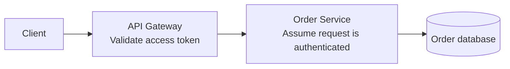

# Chỉ xác thực ở gateway rồi bỏ qua service

API Gateway thường là điểm vào chung của hệ thống. Gateway có thể xác minh access token, kiểm tra issuer/audience/expiry, áp dụng rate limit, lọc request và định tuyến tới backend. Những kiểm soát này rất hữu ích, nhưng sẽ trở thành anti-pattern nếu service phía sau mặc định rằng request đã an toàn chỉ vì nó đi qua gateway.

Service là nơi xử lý dữ liệu và nghiệp vụ. Nó phải biết ai đang gọi, caller đang hành động thay ai, tenant nào được chọn, permission nào cần có và object cụ thể có nằm trong phạm vi truy cập hay không. Nếu service bỏ qua các kiểm tra này, một đường gọi trực tiếp, gateway cấu hình sai, service nội bộ bị xâm nhập hoặc một entry point khác có thể vượt qua lớp bảo vệ ở biên.

Nguyên tắc đúng là **gateway xác thực và lọc request ở biên; service xác minh trust boundary của chính nó và thực thi authorization tại nơi có ngữ cảnh nghiệp vụ**. Tùy kiến trúc, service có thể xác minh access token gốc, một internal token có audience riêng hoặc identity assertion được bảo vệ bằng mTLS/chữ ký. Nhưng service không được tin header định danh thuần văn bản hoặc mặc định mọi request nội bộ đều đáng tin.

## 1. Anti-pattern này trông như thế nào?

Một kiến trúc thường bắt đầu với public API Gateway:



Gateway xác minh token và chuyển request tới Order Service. Service không có security filter, không xác minh caller hoặc chỉ đọc một header như `X-User-Id` rồi truy vấn dữ liệu.

Ví dụ cấu hình nguy hiểm:

```text
Gateway:
  validate JWT signature and expiration
  allow /api/orders/**
  forward X-User-Id from token.sub

Order Service:
  trust X-User-Id
  load order by orderId
  return order
```

Thiết kế này có thể hoạt động trong môi trường bình thường, nhưng trust boundary không được bảo vệ ở backend. Nếu attacker gọi trực tiếp Order Service hoặc giả mạo header qua một đường vào khác, service có thể xử lý request như một user hợp lệ.

## 2. Vì sao gateway-only authentication không đủ?

Gateway chỉ là một trong các điểm có thể đưa request tới service. Hệ thống thực tế có thể có nhiều đường gọi:

- Public gateway cho web/mobile client.
- Partner gateway cho tích hợp bên ngoài.
- Internal gateway cho service-to-service.
- Ingress hoặc load balancer riêng của một service.
- Kubernetes service, NodePort, port-forward hoặc private load balancer.
- BFF hoặc backend khác gọi trực tiếp qua HTTP client.
- Queue consumer, scheduled job và worker không đi qua HTTP gateway.
- Webhook handler hoặc management endpoint có listener riêng.

Nếu service chỉ an toàn khi mọi request bắt buộc đi qua một gateway cụ thể, thì gateway trở thành ranh giới bảo mật duy nhất. Chỉ một cấu hình route sai, một hostname phụ bị public hoặc một workload bị xâm nhập cũng có thể làm mất kiểm soát.

Ngoài ra, gateway thường không có đủ ngữ cảnh để quyết định mọi quyền nghiệp vụ. Nó có thể xác minh token và scope `orders:read`, nhưng không nhất thiết biết order cụ thể thuộc tenant nào, caller có phải owner hay được chia sẻ, trạng thái order có cho phép đọc hay không. Các quyết định này phải được thực thi ở service/domain layer.

## 3. Phân biệt authentication ở gateway và service

Hai lớp có trách nhiệm khác nhau:

| Lớp | Câu hỏi chính | Trách nhiệm |
|---|---|---|
| Gateway authentication | Client bên ngoài có credential hợp lệ để vào hệ thống không? | Xác minh token/API key, issuer, audience, expiry, route và client policy |
| Service caller authentication | Thành phần nào đang kết nối tới service này? | Xác minh gateway/workload identity, mTLS hoặc credential nội bộ được tin cậy |
| End-user identity propagation | Request đang được thực hiện thay cho user nào? | Xác minh token/assertion được phát hành và ràng buộc đúng audience/context |
| Function authorization | Actor có được gọi action này không? | Kiểm tra permission/scope/role theo nghiệp vụ |
| Object authorization | Actor có quyền trên object cụ thể không? | Kiểm tra owner, relationship, ACL và tenant scope |
| Business authorization | Trạng thái hiện tại có cho phép hành động không? | Kiểm tra workflow, approval, limit và invariant |

Service không nhất thiết phải xác minh lại đúng bearer token gốc trong mọi kiến trúc. Nhưng nó phải xác minh credential hoặc identity assertion được phép dùng trên trust boundary của nó. Một mô hình phổ biến là gateway xác minh token ngoài, sau đó đổi sang internal token có `aud` là service đích và thời hạn ngắn. Service xác minh internal token đó rồi thực thi policy nghiệp vụ.

Điều không thể chấp nhận là service nhận một header `X-Authenticated: true` hoặc `X-User-Id: alice` mà không có cơ chế xác minh nguồn gốc và tính toàn vẹn.

## 4. Kịch bản bypass gateway

Giả sử hệ thống có public gateway tại `api.example.test` và Order Service chạy ở `orders.internal.test`. Gateway đã xác minh JWT, nhưng backend cũng được expose qua một ingress cũ.

Request bình thường:

```http
GET /api/orders/ORD-1001 HTTP/1.1
Host: api.example.test
Authorization: Bearer <valid-access-token>
```

Gateway xác minh token rồi chuyển tiếp:

```http
GET /internal/orders/ORD-1001 HTTP/1.1
Host: orders.internal.test
X-User-Id: alice
X-Tenant-Id: tenant-A
```

Nếu backend tin hai header trên, attacker có thể thử gọi ingress phụ:

```http
GET /internal/orders/ORD-9001 HTTP/1.1
Host: orders.internal.test
X-User-Id: admin
X-Tenant-Id: tenant-B
```

Nếu không có service authentication và object authorization, backend có thể trả dữ liệu theo identity do attacker tự khai. Đây là trust-boundary failure; đồng thời có thể dẫn tới Broken Object Level Authorization (BOLA) và cross-tenant data exposure.

Không cần ingress public để lỗi xuất hiện. Một service nội bộ bị xâm nhập, một SSRF trong service khác hoặc một workload có network access rộng cũng có thể gọi backend và giả mạo header nếu backend không xác minh caller.

## 5. Không tin header định danh do client tự gửi

Các header như sau không phải credential nếu chỉ là văn bản:

```http
X-User-Id: alice
X-Tenant-Id: tenant-A
X-User-Roles: ADMIN
X-Authenticated: true
X-Forwarded-User: alice
```

Client có thể tự tạo những header này. Nếu gateway chỉ thêm giá trị mới nhưng không xóa header cùng tên do client gửi, hoặc backend có thể được gọi qua đường khác, attacker có thể lợi dụng giá trị giả.

Gateway cần:

- Xóa các identity/security header do client cung cấp trước khi tạo context mới.
- Chỉ thêm identity context sau khi xác minh credential.
- Không chuyển tiếp nguyên header không được phép từ internet client.
- Dùng danh sách header allowlist và chuẩn hóa một lần tại edge.
- Giữ kết nối gateway-to-service trong network path được kiểm soát.

Service cần:

- Chỉ nhận identity context từ nguồn đã xác minh.
- Xác minh mTLS/workload identity hoặc chữ ký của assertion/token.
- Kiểm tra audience, expiry, issuer và ràng buộc request nếu giao thức có hỗ trợ.
- Không dùng `X-Tenant-Id` từ request bên ngoài làm tenant context authoritative.
- Từ chối request thiếu identity assertion hợp lệ thay vì mặc định anonymous hoặc internal trusted.

Header stripping là điều kiện cần nhưng chưa đủ. Nếu backend có thể được gọi trực tiếp, một caller vẫn có thể gửi header giả. Phải có service authentication và authorization ở backend.

## 6. Mô hình trust propagation an toàn

Có một số cách truyền identity từ gateway tới service. Chọn theo trust model và bảo đảm service xác minh được:

| Mô hình | Cách hoạt động | Điều kiện an toàn |
|---|---|---|
| Service xác minh original access token | Gateway chuyển bearer token gốc tới resource service | Service kiểm tra chữ ký, issuer, audience, expiry, token type và permission; token phải dành cho service đó |
| Token exchange/internal JWT | Gateway đổi token ngoài thành token nội bộ có audience service đích | Issuer nội bộ được tin cậy; token ngắn hạn, scope hẹp, audience cụ thể và có actor/delegation rõ |
| mTLS + signed identity assertion | Gateway xác thực client rồi gửi assertion có chữ ký qua kênh mTLS | Service xác minh workload certificate và assertion signature/audience/expiry; assertion không phải header thuần |
| Workload identity trực tiếp | Service caller lấy identity từ platform/mesh và gọi resource service | Resource service xác minh workload identity và policy cho service/action |

Không dùng một internal token có audience `*` hoặc scope rộng cho mọi service. Token dành cho Order Service không nên được tái sử dụng như credential cho Billing Service nếu không có audience/scope phù hợp.

Nếu request thay mặt user cuối, identity context cần phân biệt:

- `sub` hoặc actor: người dùng thực hiện hành động.
- `client_id`/workload identity: service hoặc ứng dụng đang gọi.
- `aud`: service nhận được phép xử lý token.
- `scope`/permission: action được phép ở mức chức năng.
- tenant/delegation context: phạm vi user được phép hoạt động, được xác minh theo policy.

Service cần kiểm tra cả service caller lẫn user/delegation context. Không nâng quyền user chỉ vì request đi qua một service account có quyền rộng.

## 7. Service phải thực thi function và object authorization

Authentication cho biết danh tính; authorization quyết định danh tính đó được làm gì. Sau khi xác minh caller, service vẫn phải kiểm tra permission cho action và object.

Ví dụ endpoint:

```http
GET /api/orders/{orderId}
POST /api/orders/{orderId}/cancel
POST /api/orders/{orderId}/refund
```

Các action cần quyền khác nhau:

| Action | Function permission | Điều kiện object/business |
|---|---|---|
| Đọc order | `orders:read` | Order thuộc tenant và user là owner/member được cấp quyền |
| Hủy order | `orders:cancel` | Order chưa giao, caller có quan hệ phù hợp và chưa bị khóa |
| Hoàn tiền | `payments:refund` | Payment còn đủ điều kiện, amount/approval đúng và idempotency được bảo đảm |

Không suy ra quyền refund từ quyền đọc order. Không suy ra quyền trên object chỉ vì user có scope ở route. Với list/search/export, tenant và object filter phải được áp dụng trong truy vấn, không chỉ lọc response sau khi đã đọc dữ liệu ngoài phạm vi.

## 8. Ví dụ Spring Security: service là resource server

Một service độc lập có thể xác minh JWT của chính nó bằng Spring Security OAuth2 Resource Server. Ví dụ cấu hình:

```java
@Configuration
@EnableWebSecurity
class OrderSecurityConfiguration {

    @Bean
    SecurityFilterChain orderSecurity(HttpSecurity http)
            throws Exception {
        return http
                .authorizeHttpRequests(auth -> auth
                        .requestMatchers("/actuator/health").permitAll()
                        .requestMatchers(HttpMethod.GET, "/api/orders/**")
                            .hasAuthority("SCOPE_orders:read")
                        .requestMatchers(HttpMethod.POST, "/api/orders/*/cancel")
                            .hasAuthority("SCOPE_orders:cancel")
                        .anyRequest().authenticated())
                .oauth2ResourceServer(oauth -> oauth.jwt(
                        Customizer.withDefaults()))
                .build();
    }
}
```

Ví dụ giả định service nhận access token có issuer/JWK cấu hình sẵn và audience được kiểm tra theo service. Trong production, cấu hình `JwtDecoder`/validator để kiểm tra issuer, audience, thời gian và token profile đúng với identity provider. Không chỉ bật JWT decoder mặc định rồi giả định mọi token cùng issuer đều dành cho service.

Route-level rule chỉ kiểm tra quyền chức năng. Controller/service vẫn cần object authorization. Nếu service dùng internal token thay vì original token, cấu hình resource server phải xác minh issuer nội bộ và audience dành riêng cho Order Service.

## 9. Ví dụ kiểm tra object authorization trong service

Controller lấy identity từ principal đã được xác minh, không lấy subject/tenant từ request body:

```java
@RestController
@RequestMapping("/api/orders")
@RequiredArgsConstructor
class OrderController {
    private final OrderService orderService;

    @GetMapping("/{orderId}")
    @PreAuthorize("hasAuthority('SCOPE_orders:read')")
    OrderResponse get(
            @PathVariable UUID orderId,
            @AuthenticationPrincipal Jwt jwt) {

        return orderService.getVisibleOrder(
                jwt.getSubject(),
                jwt.getClaimAsString("tenant_id"),
                orderId);
    }
}
```

Service giới hạn truy vấn theo tenant và actor:

```java
@Service
@RequiredArgsConstructor
class OrderService {
    private final OrderRepository orderRepository;

    @Transactional(readOnly = true)
    OrderResponse getVisibleOrder(
            String subject, String tenantId, UUID orderId) {

        Order order = orderRepository
                .findVisibleTo(subject, tenantId, orderId)
                .orElseThrow(OrderNotFoundException::new);

        return OrderResponse.from(order);
    }
}
```

Repository có thể áp dụng điều kiện ngay trong query:

```sql
SELECT o.*
FROM orders o
WHERE o.public_id = :order_id
  AND o.tenant_id = :tenant_id
  AND (
      o.owner_subject = :subject
      OR EXISTS (
          SELECT 1
          FROM order_access_grant g
          WHERE g.order_id = o.id
            AND g.tenant_id = o.tenant_id
            AND g.subject = :subject
            AND g.permission = 'READ'
            AND g.revoked_at IS NULL
            AND g.expires_at > CURRENT_TIMESTAMP
      )
  );
```

Đây là ví dụ minh họa; điều chỉnh theo schema và mô hình quyền thực tế. `@PreAuthorize` yêu cầu method security đã được bật bằng `@EnableMethodSecurity`. Nếu `tenant_id` trong JWT chỉ là tenant active tại thời điểm phát hành, service cần xác minh membership/current tenant theo policy khi rủi ro yêu cầu. Không nhận tenant từ header do client tự gửi.

## 10. Nếu gateway phát hành internal token

Một số kiến trúc không chuyển original access token tới mọi service. Gateway hoặc token broker có thể exchange token thành internal JWT:

```json
{
  "iss": "https://identity.internal.example.test",
  "sub": "user-123",
  "aud": ["orders-service"],
  "client_id": "public-api-gateway",
  "scope": "orders:read",
  "tenant_id": "tenant-A",
  "iat": 1794992400,
  "exp": 1794992700,
  "jti": "int-token-9c31"
}
```

Token minh họa cần được ký bởi issuer nội bộ. Order Service phải xác minh:

- Chữ ký bằng key của issuer nội bộ đã tin cậy.
- `iss` đúng issuer được cấu hình.
- `aud` có `orders-service` và không chấp nhận audience service khác.
- `exp`, `nbf`, `iat` hợp lệ theo policy.
- `client_id` hoặc workload caller được phép gọi operation này.
- `sub`/delegation context có ý nghĩa đúng với luồng on-behalf-of.
- Scope/permission đủ hẹp cho action.
- Tenant context phù hợp membership và object policy.

Internal token cần TTL ngắn, key rotation, revocation/deny strategy phù hợp và không được log. Không phát một token nội bộ có quyền `admin:*` chỉ để giảm công sức mapping.

## 11. Service-to-service không có user context vẫn cần identity

Không phải mọi request đều thay mặt người dùng. Ví dụ Billing Service gọi Pricing Service để lấy giá hoặc Scheduler gọi Report Service tạo báo cáo định kỳ. Khi đó service caller có workload identity riêng.

Thiết kế nên xác định:

- Service nào đang gọi? Ví dụ `billing-service`.
- Service được phép gọi operation nào? Ví dụ `pricing:quote`.
- Có tenant context không? Nếu có, tenant được lấy từ nguồn tin cậy nào?
- Service có được hành động thay user không? Nếu có, delegation được cấp và kiểm tra ra sao?
- Object nào được phép truy cập? Có giới hạn theo tenant/account không?

Workload identity có thể được xác minh bằng mTLS, SPIFFE/SPIRE, cloud workload identity hoặc short-lived service token. Network location/IP đơn thuần không phải danh tính. Một service bị xâm nhập không được tự động có quyền của mọi service khác trong private network.

## 12. Async worker và message queue cũng phải xác minh

Queue consumer thường không nhận request qua API Gateway. Nếu hệ thống chỉ kiểm tra authentication ở gateway, worker có thể thực thi message mà không có trust validation.

Một message nên mang metadata có nguồn gốc tin cậy:

```json
{
  "messageId": "msg-8f31",
  "eventType": "order.cancel.requested",
  "tenantId": "tenant-A",
  "actor": "user-123",
  "requestedByService": "order-api",
  "correlationId": "req-123"
}
```

Các field này không tự trở thành credential chỉ vì nằm trong queue. Consumer cần xác minh producer identity qua broker ACL/workload identity, validate schema/version, kiểm tra tenant/object và quyết định quyền thực thi theo mô hình đã định nghĩa. Với delegated action, có thể lưu một authorization snapshot có chữ ký và expiry, hoặc re-check entitlement hiện tại trước side effect. Không tin `actor` hoặc `tenantId` nếu producer có thể ghi message tùy ý.

Đảm bảo queue topic/partition có ACL, encryption và retention phù hợp. Idempotency key và event ID cần được kiểm tra để tránh xử lý lặp.

## 13. Gateway vẫn cần làm authentication và coarse-grained controls

Service-side security không có nghĩa bỏ gateway authentication. Gateway vẫn là lớp phù hợp để:

- Xác minh credential bên ngoài sớm.
- Chặn client không hợp lệ trước khi tiêu tốn tài nguyên backend.
- Kiểm tra route, method, scope coarse-grained và client registration.
- Rate limit theo client/tenant/route.
- Giới hạn body size, timeout và concurrency.
- Chặn host/path không được public và áp dụng WAF policy.
- Strip header nhạy cảm do client gửi và tạo request ID/identity context theo contract.
- Ghi edge audit và telemetry.

Service tiếp tục xác minh caller và quyết định quyền trên action/object. Đây là defense in depth: gateway có thể từ chối request sớm; nếu gateway cho qua thì service vẫn không bỏ qua policy của mình.

## 14. Network segmentation là lớp bổ sung, không phải authorization

Đặt backend trong private subnet, giới hạn security group hoặc dùng service mesh giúp giảm khả năng truy cập trực tiếp. Nhưng “internal network” không đồng nghĩa “trusted user”. SSRF, compromised workload, cấu hình peering sai hoặc credential bị lộ có thể tạo đường gọi nội bộ.

Áp dụng:

- Chỉ expose gateway/listener cần thiết ra internet.
- Backend nhận traffic từ workload/gateway identity được phép.
- Dùng mTLS hoặc authenticated service mesh giữa các workload.
- Giới hạn ingress/egress theo service và port.
- Tách management port khỏi application port.
- Tắt route/debug listener không cần thiết.
- Kiểm tra DNS, load balancer, NodePort, private link và hostname legacy.
- Duy trì authentication/authorization trong service dù network policy đã giới hạn.

Không dùng IP allowlist như lớp duy nhất để nhận diện service caller. IP có thể thay đổi, bị chia sẻ hoặc đi qua proxy/NAT.

## 15. Không để cache và header forwarding phá vỡ identity

Một số lỗi xuất hiện ở lớp trung gian:

- Gateway cache response chỉ theo URL, khiến dữ liệu của user/tenant này được trả cho user khác.
- Proxy ghi đè hoặc nối nhiều `X-User-Id` header, khiến backend chọn giá trị khác nhau.
- Service đọc `X-Forwarded-For` hoặc `X-Forwarded-User` từ nguồn không tin cậy.
- Gateway xác minh token nhưng không giới hạn audience, nên token dành cho API khác được chuyển tiếp.
- Token exchange giữ scope rộng hơn original user consent.
- Cache authorization decision không bao gồm tenant/object/policy version hoặc không invalidate khi revoke.

Hãy dùng header allowlist, một quy tắc canonical duy nhất và signed/authenticated identity context. Cache response cần phân vùng theo principal/tenant/security context hoặc chỉ cache dữ liệu public. Với thao tác nhạy cảm, kiểm tra entitlement hiện tại trước side effect thay vì dựa vào cache dài hạn.

## 16. Kiểm thử để chứng minh service không phụ thuộc gateway

Phải test cả đường đi qua gateway và đường gọi trực tiếp service trong môi trường test. Tối thiểu có các trường hợp:

| Tình huống | Kết quả mong đợi |
|---|---|
| Request qua gateway với token hợp lệ | Gateway xác minh; service xác minh token/assertion theo trust contract |
| Request trực tiếp backend không credential | Service từ chối |
| Request trực tiếp với `X-User-Id: admin` giả mạo | Service từ chối hoặc bỏ qua header giả; không cấp quyền |
| Gateway chuyển tiếp header client tự gửi | Gateway strip và tạo context mới; backend không tin giá trị gốc |
| Token đúng issuer nhưng sai audience | Service từ chối |
| Internal token hết hạn hoặc sai chữ ký | Service từ chối |
| Service caller không nằm trong allowlist workload | Service từ chối |
| Token có scope `orders:read` gọi cancel | Service từ chối function authorization |
| Token có scope đúng nhưng order thuộc user khác | Service từ chối object authorization |
| Token có scope đúng nhưng order thuộc tenant khác | Service từ chối và không trả dữ liệu |
| Service account gọi operation ngoài scope | Service từ chối |
| Queue message có producer không hợp lệ | Consumer không thực thi event |
| Quyền bị revoke trước worker execution | Worker re-check hoặc áp dụng snapshot/expiry theo policy; không dùng quyền cũ vô hạn |
| Cache response dùng chung giữa hai tenant | Không trả response của tenant này cho tenant kia |
| Gateway policy bị tắt trong test | Service vẫn bảo vệ authentication context và object |
| Backend hostname/port phụ được gọi | Cùng security policy được áp dụng hoặc network layer chặn |

### Ví dụ Spring integration test

Test dưới đây minh họa việc service không chấp nhận request không có principal hợp lệ:

```java
@SpringBootTest
@AutoConfigureMockMvc
class OrderServiceAuthenticationIT {
    @Autowired
    MockMvc mockMvc;

    @Test
    void directRequestWithoutCredentialIsRejected() throws Exception {
        mockMvc.perform(get("/api/orders/{id}", UUID.randomUUID()))
                .andExpect(status().isUnauthorized());
    }

    @Test
    void spoofedIdentityHeaderDoesNotAuthenticateCaller()
            throws Exception {
        mockMvc.perform(get("/api/orders/{id}", UUID.randomUUID())
                        .header("X-User-Id", "admin")
                        .header("X-Tenant-Id", "tenant-B"))
                .andExpect(status().isUnauthorized());
    }
}
```

Ví dụ giả định service dùng bearer token resource server và không có filter tùy chỉnh biến các header trên thành principal. Thêm test có token hợp lệ nhưng sai audience, sai scope, object khác owner và tenant khác. Test `MockMvc` chứng minh filter/controller behavior trong process; nó không tự chứng minh backend không public trên network. Cần kiểm tra ingress/load balancer/security group hoặc chạy network integration test trong môi trường staging.

## 17. Kiểm thử gateway và service độc lập

Không chỉ chạy một end-to-end test qua gateway. Chia test thành hai nhóm:

**Gateway tests** xác minh:

- Token thiếu/sai bị chặn.
- Issuer, audience, expiry và client policy được kiểm tra.
- Header định danh do client gửi bị strip.
- Gateway chỉ forward header/token theo contract.
- Route/method/scope/rate/body limit hoạt động.

**Service tests** xác minh:

- Service xác minh token/internal assertion/workload identity.
- Service không tin header văn bản không ký.
- Audience và caller identity được giới hạn đúng service.
- Function/object/tenant authorization được thực thi.
- Direct backend access không bỏ qua policy.
- Async worker xác minh producer/delegation context.
- Cache và downstream call giữ nguyên tenant/security context.

End-to-end test chứng minh các lớp phối hợp. Test độc lập chứng minh một lớp không dựa hoàn toàn vào lớp khác để thực thi trách nhiệm của mình.

## 18. Logging, monitoring và phát hiện gateway bypass

Gateway và service nên ghi nhận sự kiện riêng để có thể đối chiếu:

| Lớp | Metadata hữu ích |
|---|---|
| Gateway | Request ID, route template, client ID, auth result, token issuer/audience class, rate decision |
| Service | Workload caller, actor reference, audience, policy version, action, tenant reference, object decision |
| Worker | Producer identity, message ID, actor/delegation reference, tenant scope, authorization result |
| Network/mesh | Source workload, destination service/port, mTLS identity và deny event |

Không log bearer token, refresh token, cookie, private key hoặc raw identity assertion. Tránh đưa raw user/object/tenant ID vào metric label có cardinality lớn; dùng reference phù hợp và audit store có kiểm soát.

Phát hiện các dấu hiệu:

- Backend nhận request không có gateway/workload identity hợp lệ.
- Header identity xuất hiện nhiều giá trị hoặc nguồn không mong đợi.
- Service nhận audience không dành cho mình.
- Một workload gọi operation ngoài allowlist.
- Direct ingress/hostname có traffic nhưng không có edge request tương ứng.
- Authorization denial hoặc cross-tenant attempt tăng đột biến.
- Gateway và service ghi nhận policy decision/version không đồng nhất.

Correlation ID giúp nối request ở gateway và backend nhưng không phải credential. Client có thể tự gửi request ID; gateway nên tạo hoặc chuẩn hóa ID theo policy và service chỉ dùng nó để tương quan telemetry.

## 19. Lộ trình sửa anti-pattern

Nếu hệ thống hiện tại chỉ xác thực ở gateway, không nên bật một policy service-side chưa chuẩn bị rồi rollout đồng loạt. Có thể chuyển theo các bước:

1. **Inventory entry point:** tìm public/internal gateway, ingress phụ, service listener, queue consumer, worker và hostname legacy.
2. **Xác định trust contract:** quyết định service nhận original token, internal token, signed assertion hay workload identity.
3. **Thiết kế audience/scope:** mỗi service chỉ nhận token/assertion dành cho nó và quyền tối thiểu cần thiết.
4. **Strip header giả:** cấu hình gateway xóa identity/security header do client gửi; backend không tin header chưa xác minh.
5. **Thêm service authentication:** triển khai resource server, mTLS/workload identity hoặc verifier phù hợp ở service.
6. **Thêm authorization:** function permission, object/tenant query filter và business-state checks gần nơi xử lý dữ liệu.
7. **Kiểm tra async/cache:** cập nhật worker, queue ACL, cache key và downstream propagation.
8. **Shadow/observe:** so sánh quyết định mới với hành vi cũ bằng test/synthetic traffic; không tự động mở quyền theo kết quả cũ.
9. **Canary:** bật theo service/tenant/cohort nhỏ, theo dõi 401/403, cross-tenant decision, latency và audit.
10. **Enforce và retire bypass:** chặn direct path không cần thiết, thu hồi header trust cũ và xóa fallback authentication không an toàn.

Trong giai đoạn chuyển tiếp, nếu cần chấp nhận cả token cũ và internal assertion mới, quy tắc precedence phải rõ và có deadline. Không cho phép request không xác định identity rơi vào nhánh “internal trusted”. Khi trust source không hợp lệ, thao tác nhạy cảm phải fail closed.

## 20. Các lỗi triển khai thường gặp

- **Chỉ chặn public gateway:** backend vẫn public qua ingress/port khác.
- **Tin `X-User-Id` hoặc `X-Roles`:** header có thể bị client giả mạo nếu không được strip và bảo vệ.
- **Dùng một internal token cho mọi service:** audience/scope rộng làm tăng blast radius.
- **Chỉ kiểm tra JWT ở gateway:** service không xác minh trust context của request đến.
- **Có authentication nhưng thiếu object authorization:** user hợp lệ có thể đổi ID để đọc object khác.
- **Tin private network:** workload nội bộ bị xâm nhập hoặc SSRF vẫn có thể gọi service.
- **Không bảo vệ worker:** queue message được thực thi chỉ vì đã được enqueue.
- **Cache theo URL:** response riêng tư bị chia sẻ giữa user/tenant.
- **Fallback khi identity provider lỗi:** service cho phép request vì không xác minh được caller.
- **Chỉ test qua gateway:** direct backend path và header spoofing không được phát hiện.

## 21. Checklist thiết kế

- [ ] Gateway xác minh credential bên ngoài và áp dụng coarse-grained route/scope/rate policy.
- [ ] Service có trust contract rõ: original token, internal token, signed assertion hoặc workload identity.
- [ ] Service xác minh issuer, audience, expiry, signature và caller identity theo contract.
- [ ] Gateway strip identity/security header do client gửi trước khi tạo context tin cậy.
- [ ] Backend không dùng header thuần văn bản làm bằng chứng authentication.
- [ ] Internal token có audience riêng, TTL ngắn và scope tối thiểu.
- [ ] Service kiểm tra function permission, object permission, tenant scope và business state.
- [ ] Service-to-service identity được xác minh bằng workload credential/mTLS; không dựa riêng vào IP.
- [ ] Queue/worker xác minh producer, actor/delegation, tenant và object trước side effect.
- [ ] Network segmentation và ingress restriction được dùng như lớp bổ sung.
- [ ] Cache và downstream call không làm mất principal/tenant context hoặc chia sẻ response sai phạm vi.
- [ ] Có test gateway riêng, service riêng, direct backend, spoofed header, sai audience và cross-tenant.
- [ ] Monitoring phát hiện request không có trust identity hoặc direct path bất thường.
- [ ] Migration có canary, stop condition và kế hoạch loại bỏ fallback cũ.

## Kết luận

Chỉ xác thực ở gateway rồi bỏ qua service tạo ra một điểm tin cậy duy nhất và khiến backend dễ bị bypass qua ingress phụ, service nội bộ, worker hoặc cấu hình sai. Gateway nên xác minh client và áp dụng policy chung; service phải xác minh caller/identity context trên trust boundary của nó, rồi thực thi function, object, tenant và business authorization. Có thể dùng original access token, internal token có audience riêng, signed assertion hoặc workload identity, miễn là backend xác minh được nguồn gốc, phạm vi và thời hạn. Kết hợp header stripping, network segmentation, service-side policy, async validation, test direct access và monitoring sẽ giảm khả năng một đường gọi khác biến thành lối đi vòng qua bảo mật.
