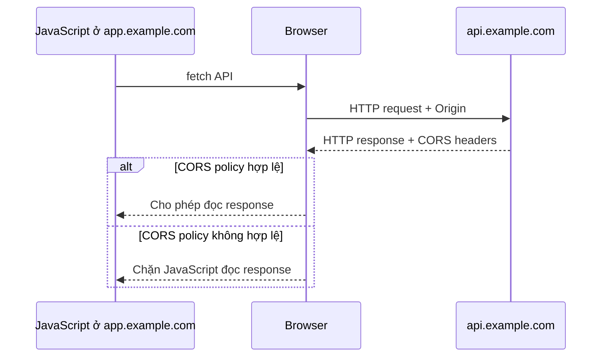
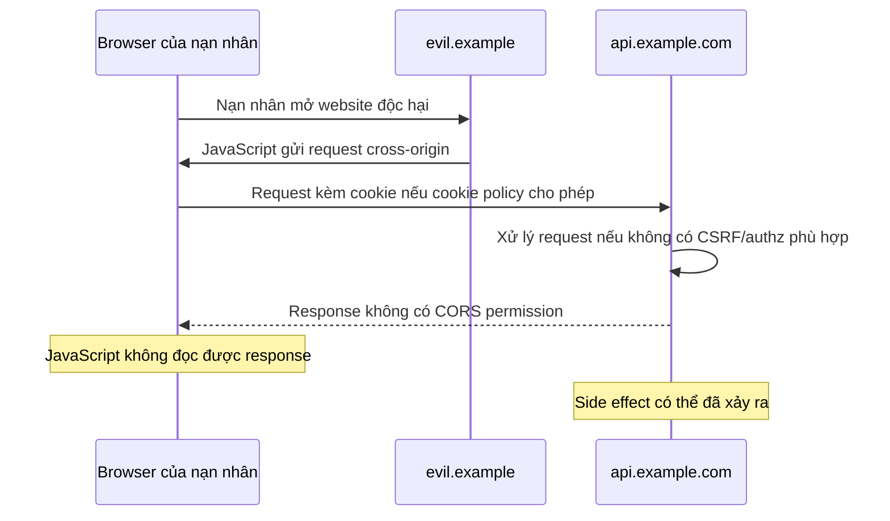

# Dùng CORS làm authorization

Trong chương **Anti-pattern** của module `SECURITY_API_SECURITY`, một sai lầm nguy hiểm là dùng cấu hình CORS để quyết định ai được phép đọc, sửa hoặc xóa dữ liệu qua API. CORS (Cross-Origin Resource Sharing) là cơ chế để browser kiểm soát việc JavaScript ở một origin có được đọc response từ origin khác hay không. Nó không xác thực người dùng, không kiểm tra quyền trên object và không ngăn mọi client gửi request tới server.

Nếu API chỉ dựa vào CORS để bảo vệ dữ liệu, một client ngoài browser có thể gọi endpoint trực tiếp; một request đơn giản từ website độc hại vẫn có thể được browser gửi dù JavaScript không đọc được response; và một lỗi CORS có thể khiến website không đáng tin đọc được response chứa dữ liệu của phiên đăng nhập. Authentication và authorization phải được thực hiện ở server cho từng request, theo principal, action, object, tenant và trạng thái nghiệp vụ.

## CORS thực sự bảo vệ điều gì?

Browser áp dụng Same-Origin Policy (SOP) để giới hạn cách một document hoặc script truy cập tài nguyên ở origin khác. Một origin gồm ba thành phần: **scheme, host và port**. Ví dụ `https://app.example.com` và `https://api.example.com` là hai origin khác nhau; `http://app.example.com` cũng khác `https://app.example.com`.

CORS cho phép server khai báo origin nào được browser cho phép đọc response. Khi JavaScript từ `https://app.example.com` gọi `https://api.example.com`, browser gửi header `Origin`. Server có thể trả `Access-Control-Allow-Origin` và các header liên quan. Browser kiểm tra các header đó rồi mới quyết định có cung cấp response cho JavaScript hay không.



Điểm quan trọng: server có thể đã nhận và xử lý request trước khi browser chặn JavaScript đọc response. CORS chủ yếu kiểm soát khả năng đọc response trong browser; nó không phải firewall cho endpoint và cũng không phải policy engine cho dữ liệu.

## Vì sao CORS không phải authorization?

Authentication trả lời “caller là ai?”. Authorization trả lời “principal này có được thực hiện action này trên resource này trong context hiện tại không?”. CORS trả lời một câu hỏi khác: “JavaScript ở origin này có được browser cho đọc response không?”.

| Cơ chế | Vai trò | Không thay thế được |
|---|---|---|
| Authentication | Xác minh user, API client hoặc workload identity | Quyền đọc/sửa từng object |
| Function-level authorization | Kiểm tra quyền gọi chức năng, ví dụ `invoice:export` | Quyền trên từng invoice |
| Object-level authorization | Kiểm tra owner, tenant, quan hệ và trạng thái object | Kiểm soát browser có đọc response cross-origin hay không |
| CORS | Browser kiểm tra origin và quyền đọc response | Authentication, authorization, CSRF protection, network firewall |
| CSRF protection | Ngăn browser bị lợi dụng gửi thao tác thay đổi trạng thái bằng phiên của nạn nhân | Quyền nghiệp vụ trên object |

Một API phải tự xác minh quyền ngay cả khi request đến từ origin hợp lệ. Origin chỉ là metadata về trang khởi tạo request trong browser; nó không chứng minh user đã đăng nhập, không chứng minh user thuộc tenant nào và không chứng minh user sở hữu tài nguyên.

### Client không phải lúc nào cũng là browser

CORS là chính sách được browser thực thi. `curl`, Postman, mobile app, backend service, script Python hoặc một chương trình tùy ý không bị browser áp dụng SOP/CORS. Các client này có thể gửi request trực tiếp và tự đặt header `Origin` nếu muốn.

Do đó, đoạn kiểm tra sau không phải authorization:

```java
// Sai: Origin có thể không có, bị giả mạo hoặc không chứng minh quyền dữ liệu.
if ("https://app.example.com".equals(request.getHeader("Origin"))) {
    return invoiceRepository.findById(invoiceId);
}
```

Một caller ngoài browser có thể gửi `Origin: https://app.example.com`. Ngược lại, một request server-to-server hợp lệ có thể không có header `Origin`. Dùng Origin để cấp quyền sẽ vừa có thể cho phép attacker, vừa có thể chặn nhầm integration hợp lệ.

## Những tình huống anti-pattern thường gặp

### 1. Cho rằng CORS chặn được request từ website độc hại

Giả sử nạn nhân đã đăng nhập vào `api.example.com` bằng cookie. Website `evil.example` chạy JavaScript gửi request tới API. Nếu request là loại đơn giản theo quy tắc CORS, browser có thể gửi request mà không cần preflight. Nếu server thực hiện thao tác thay đổi dữ liệu, việc browser không cho JavaScript đọc response không tự hoàn tác thao tác đó.



Đây là lý do CORS không thay thế CSRF protection. Với API dùng cookie session, cần CSRF token hoặc cơ chế chống CSRF phù hợp, cookie `SameSite` được cấu hình có chủ đích, kiểm tra Origin/Referer khi thích hợp và không dùng `GET` để thay đổi trạng thái. Quan trọng hơn, server vẫn phải kiểm tra quyền chức năng và object-level authorization.

### 2. Phản chiếu mọi Origin và bật credentials

Một cấu hình nguy hiểm là đọc `Origin` từ request rồi trả lại nguyên giá trị đó cùng `Access-Control-Allow-Credentials: true` mà không có allowlist:

```http
Access-Control-Allow-Origin: https://evil.example
Access-Control-Allow-Credentials: true
```

Nếu API dùng cookie hoặc browser-managed credentials và cookie được phép gửi trong ngữ cảnh đó, JavaScript ở origin attacker có thể đọc response riêng tư. Browser chấp nhận origin cụ thể được phản chiếu; việc phản chiếu không kiểm tra biến mọi website thành origin đáng tin.

Một biến thể khác là kiểm tra chuỗi lỏng lẻo:

```java
// Không an toàn: hostname giả có thể kết thúc bằng chuỗi được tin.
if (origin.endsWith("example.com")) {
    allowOrigin(origin);
}
```

Điều kiện trên có thể chấp nhận `https://evil-example.com`. Các cách dùng `contains`, regex quá rộng hoặc kiểm tra suffix không phân tích origin theo đúng scheme/host/port cũng dễ sai.

### 3. Dùng wildcard cho API chứa dữ liệu riêng tư

`Access-Control-Allow-Origin: *` cho phép mọi origin đọc response trong các trường hợp CORS phù hợp. Browser không chấp nhận wildcard này cho credentialed request có credentials mode `include`; nhưng điều đó không biến wildcard thành authorization. Với dữ liệu riêng tư, API cần xác thực và phân quyền ở server bất kể CORS được cấu hình ra sao.

Wildcard có thể phù hợp cho tài nguyên thực sự công khai, không phụ thuộc cookie hoặc quyền của caller, ví dụ ảnh public hoặc dữ liệu tra cứu public. Không dùng wildcard chỉ vì muốn frontend nào cũng gọi được API. Nếu API có dữ liệu theo user, tenant hoặc role, phải có authentication/authorization và CORS policy riêng theo nhu cầu frontend.

### 4. Chỉ kiểm tra CORS ở gateway

Gateway có thể cấu hình CORS đúng nhưng backend vẫn bị truy cập trực tiếp từ mạng nội bộ, service khác hoặc đường ingress phụ. CORS không ngăn một service gọi thẳng backend. Nếu backend bỏ object-level authorization vì nghĩ gateway đã bảo vệ, request bypass gateway có thể đọc hoặc sửa dữ liệu ngoài quyền.

Gateway có thể xử lý xác thực sơ bộ, TLS, route allowlist và rate limiting. Service sở hữu dữ liệu vẫn phải xác minh identity của caller/service và kiểm tra quyền trên object, tenant cùng workflow. Network policy nên giới hạn đường vào backend, nhưng network segmentation cũng không thay authorization.

## Preflight không phải cổng xác thực

Browser gửi preflight `OPTIONS` trước một số request cross-origin, chẳng hạn request dùng method không safelisted hoặc header tùy chỉnh. Preflight hỏi server liệu origin, method và header dự kiến có được phép hay không.

Ví dụ:

```http
OPTIONS /api/invoices/123 HTTP/1.1
Origin: https://app.example.com
Access-Control-Request-Method: PATCH
Access-Control-Request-Headers: authorization,content-type,x-csrf-token
```

Server có thể trả:

```http
HTTP/1.1 204 No Content
Access-Control-Allow-Origin: https://app.example.com
Access-Control-Allow-Methods: GET, POST, PATCH
Access-Control-Allow-Headers: Authorization, Content-Type, X-CSRF-Token
Access-Control-Max-Age: 600
Vary: Origin, Access-Control-Request-Method, Access-Control-Request-Headers
```

Preflight không phải request nghiệp vụ và thường không mang credentials của request thực tế. Không yêu cầu session cookie để trả lời preflight; cũng không thực hiện side effect trong `OPTIONS`. CORS middleware phải được xử lý đủ sớm để request preflight không bị chặn nhầm bởi authentication filter.

Nếu preflight thành công, browser mới gửi request thực tế. Request thực tế vẫn cần authentication, authorization, validation, CSRF protection nếu dùng cookie và kiểm tra nghiệp vụ. Việc một origin được phép gọi `PATCH` không có nghĩa user từ origin đó được sửa mọi invoice.

## Cách thiết kế đúng: CORS là cấu hình browser, authorization là policy server

Hãy tách hai quyết định thành hai lớp độc lập.

### 1. Cấu hình CORS theo allowlist chính xác

Với frontend đã đăng ký, server kiểm tra exact origin theo scheme, host và port. Không phản chiếu Origin một cách mù quáng, không dùng pattern `*` cho endpoint credentialed và không coi `Origin: null` là đáng tin mặc định.

Ví dụ Spring:

```java
@Bean
CorsConfigurationSource corsConfigurationSource() {
    CorsConfiguration cors = new CorsConfiguration();
    cors.setAllowedOrigins(List.of(
        "https://app.example.com",
        "https://admin.example.com"
    ));
    cors.setAllowedMethods(List.of("GET", "POST", "PATCH", "DELETE", "OPTIONS"));
    cors.setAllowedHeaders(List.of(
        "Authorization", "Content-Type", "X-CSRF-Token", "Idempotency-Key"
    ));
    cors.setExposedHeaders(List.of("Location", "X-Request-Id"));
    cors.setAllowCredentials(true);
    cors.setMaxAge(600L);

    UrlBasedCorsConfigurationSource source = new UrlBasedCorsConfigurationSource();
    source.registerCorsConfiguration("/api/**", cors);
    return source;
}
```

Trong `SecurityFilterChain`, bật CORS integration để preflight được xử lý đúng thứ tự:

```java
@Bean
SecurityFilterChain securityFilterChain(HttpSecurity http) throws Exception {
    return http
        .cors(Customizer.withDefaults())
        .authorizeHttpRequests(auth -> auth
            .requestMatchers("/api/public/**").permitAll()
            .requestMatchers("/api/**").authenticated()
            .anyRequest().denyAll()
        )
        .build();
}
```

Đây là cấu hình khung. Cần thêm authentication mechanism, CSRF policy và authorization chi tiết theo endpoint. Nếu dùng cookie session, không tắt CSRF chỉ vì đã cấu hình CORS. Nếu dùng bearer token do frontend tự đặt, vẫn phải xác minh token ở server và giới hạn scope/resource.

Với response origin động, thêm `Vary: Origin` để cache không dùng response CORS của origin này cho origin khác. Nếu preflight response phụ thuộc method/header yêu cầu, cân nhắc `Vary: Access-Control-Request-Method` và `Vary: Access-Control-Request-Headers`. CORS header phải nhất quán trên response thành công và lỗi của origin hợp lệ, nhưng không vì thế mà thêm wildcard vào response lỗi.

### 2. Xác thực principal ở server

API phải xác minh credential ở mỗi request theo cơ chế phù hợp:

- JWT: kiểm tra chữ ký, issuer, audience, thời hạn, key và các claim bắt buộc.
- Opaque token: introspection hoặc kiểm tra qua authorization server theo thiết kế.
- Session cookie: kiểm tra session, expiry, revoke và CSRF protection.
- API key: ánh xạ key ID tới client/service đã đăng ký; không coi Origin là client identity.
- Service-to-service: dùng workload identity, mTLS hoặc token audience phù hợp.

Không suy ra danh tính từ `Origin`, `Referer`, `User-Agent`, IP hoặc custom header do caller tự gửi. Các tín hiệu này có thể hỗ trợ risk detection nhưng không thay credential đã xác minh.

### 3. Kiểm tra function-level và object-level authorization

Sau authentication, kiểm tra quyền gọi chức năng và quyền trên object. Ví dụ service lấy tenant từ principal đã xác minh rồi truy vấn object trong tenant đó:

```java
@GetMapping("/api/invoices/{invoiceId}")
InvoiceResponse getInvoice(
        @PathVariable UUID invoiceId,
        @AuthenticationPrincipal ApiPrincipal principal
) {
    Invoice invoice = invoiceRepository
        .findByIdAndTenantId(invoiceId, principal.tenantId())
        .orElseThrow(() -> new ResponseStatusException(HttpStatus.NOT_FOUND));

    authorizationService.require(principal, "invoice:read", invoice);
    return InvoiceResponse.from(invoice);
}
```

Ví dụ dùng tenant-scoped query để giảm nguy cơ truy vấn nhầm object của tenant khác. `authorizationService.require` cần kiểm tra thêm owner/relationship, role, trạng thái nghiệp vụ và các điều kiện truy cập khác. Không lấy `tenantId` từ request body/header thay cho principal context. Với endpoint list, export, nested resource hoặc batch, phải kiểm tra quyền cho từng object hoặc giới hạn truy vấn ngay trong data access layer.

### 4. CSRF protection cho cookie-based API

Nếu browser tự gửi cookie session, attacker có thể lợi dụng browser gửi request thay mặt nạn nhân. Dùng CSRF token hoặc cơ chế phù hợp với framework, cookie `Secure`, `HttpOnly` và `SameSite` có chủ đích. `SameSite=None` thường cần `Secure` và có thể chịu thêm giới hạn third-party cookie của browser.

Kiểm tra `Origin`/`Referer` có thể là một lớp phòng vệ bổ sung cho request thay đổi trạng thái, nhưng không thay token CSRF hoặc authorization. Không dùng CORS deny làm bằng chứng request không thể đến server.

## Ví dụ một luồng API được bảo vệ đúng

Giả sử frontend `https://app.example.com` tạo yêu cầu thanh toán:

1. Browser gửi request; CORS allowlist chỉ cho frontend đã đăng ký đọc response.
2. Authentication filter xác minh access token/session và tạo principal tin cậy.
3. Rate limiter kiểm tra IP, identity và tenant theo policy.
4. Authorization kiểm tra principal có quyền `payment:create` và có quyền sử dụng tài khoản nguồn.
5. Business validation kiểm tra số tiền, currency, trạng thái account, idempotency key và hạn mức.
6. Service ghi transaction/outbox; không tin `ownerId` hoặc `tenantId` do client gửi.
7. Response được trả về; browser chỉ cho JavaScript đọc nếu CORS policy hợp lệ.

Nếu CORS từ chối response, điều đó không tự rollback transaction đã commit. Nếu authorization từ chối, request không được tạo side effect dù origin nằm trong allowlist. Hai kiểm soát cần được test độc lập.

## Kiểm thử để chứng minh CORS không bị dùng thay authorization

Test cần bao gồm browser và non-browser client. `curl` có thể gửi header `Origin` để quan sát response, nhưng không thực thi SOP/CORS; vì vậy không thể dùng curl làm bằng chứng browser sẽ chặn hoặc cho đọc response.

| Tình huống | Kết quả mong đợi |
|---|---|
| Origin hợp lệ, principal có quyền trên object | Browser đọc được response; server ghi nhận authorization allow |
| Origin hợp lệ, principal không có quyền trên object | Server trả deny/404 theo policy; CORS không cấp quyền dữ liệu |
| Origin không hợp lệ, credential hợp lệ | Browser không đọc được response; server vẫn áp dụng authz, không tin origin |
| Request không có Origin từ server-to-server client | Authentication/authorization vẫn quyết định quyền |
| Caller tự đặt Origin hợp lệ bằng curl | Không được cấp quyền nếu credential/principal không có quyền |
| Request đơn giản từ website độc hại dùng cookie | CSRF protection ngăn side effect; CORS không được coi là biện pháp duy nhất |
| Preflight hợp lệ | OPTIONS trả CORS headers, không yêu cầu cookie và không tạo side effect |
| Preflight không hợp lệ | Browser không gửi request thực tế theo policy; server vẫn bảo vệ endpoint nếu request được gửi trực tiếp |
| Backend bị gọi trực tiếp, bỏ qua gateway | Service vẫn xác thực caller và kiểm tra object/tenant authorization |
| CORS wildcard trên public resource | Chỉ dùng khi dữ liệu thực sự public, không phụ thuộc credentials |
| Dynamic origin response | Exact allowlist, `Vary: Origin` và cache policy phù hợp |
| Origin là `null` hoặc hostname gần giống allowlist | Bị từ chối trừ trường hợp riêng được đánh giá và phê duyệt |

### Kiểm thử browser

Tạo hai origin test: một origin được allowlist và một origin không được phép. Dùng browser automation để kiểm tra:

- Origin được phép có thể đọc response theo policy.
- Origin ngoài allowlist không đọc được response.
- Credentialed request chỉ hoạt động với exact origin và cấu hình credentials hợp lệ.
- Cookie được gửi đúng theo `SameSite`, `Secure`, third-party cookie policy và credentials mode.
- Request đơn giản có thể được gửi mà không preflight; CSRF token/policy vẫn ngăn thao tác trái phép.
- Preflight cache không làm policy cũ tồn tại ngoài thời hạn dự kiến.

### Kiểm thử server authorization

Gọi trực tiếp endpoint bằng integration test, MockMvc hoặc HTTP client không phụ thuộc CORS:

- Token thiếu/sai/hết hạn bị từ chối theo authentication contract.
- Token hợp lệ nhưng thiếu function permission bị từ chối.
- User Tenant A không đọc/sửa object Tenant B.
- User cùng tenant nhưng không phải owner không vượt được object-level policy.
- Service account chỉ truy cập đúng resource scope được cấp.
- Request bị từ chối không tạo database change, message, payment hoặc notification.
- Origin giả mạo không làm thay đổi authorization decision.

## Những sai lầm thường gặp

- Dùng `Origin` hoặc `Referer` làm bằng chứng user có quyền.
- Nghĩ rằng browser chặn response thì server không xử lý request.
- Cho rằng preflight là authentication handshake.
- Dùng CORS để ngăn `curl`, Postman, mobile app hoặc server-to-server request.
- Phản chiếu mọi Origin và bật credentials.
- Dùng suffix/substring/regex rộng để allow domain.
- Dùng wildcard origin cho dữ liệu phụ thuộc user/tenant.
- Chỉ cấu hình CORS ở gateway rồi bỏ authorization tại service.
- Dùng CORS thay CSRF protection cho cookie session.
- Bỏ kiểm tra object-level authorization vì frontend chỉ hiển thị nút theo role.
- Chỉ test bằng curl mà không test browser behavior và side effect phía server.
- Coi API response CORS error là bằng chứng dữ liệu chưa bị thay đổi hoặc lộ qua kênh khác.

## Checklist triển khai

- [ ] CORS được xem là browser read policy, không phải authentication hoặc authorization.
- [ ] Mỗi endpoint có authentication phù hợp và function-level authorization.
- [ ] Object-level authorization kiểm tra owner, tenant, relationship và trạng thái nghiệp vụ.
- [ ] Origin không được dùng làm identity hoặc điều kiện duy nhất để cấp quyền dữ liệu.
- [ ] CORS allowlist exact origin; không phản chiếu tùy ý và không cho phép `null` mặc định.
- [ ] Wildcard chỉ dùng cho tài nguyên thực sự public, không phụ thuộc credentials.
- [ ] Credentialed request dùng origin cụ thể và cấu hình credentials đúng.
- [ ] Preflight được xử lý sớm, không có side effect và chỉ cho method/header cần thiết.
- [ ] Cookie-based API có CSRF protection và thuộc tính cookie phù hợp.
- [ ] Backend không thể bị gọi bypass gateway mà bỏ qua authentication/authorization.
- [ ] Dynamic origin response có `Vary: Origin` và cache policy phù hợp.
- [ ] Có browser tests cho CORS/credentials/CSRF và server tests cho authorization/object/tenant.
- [ ] Test xác nhận request bị deny không tạo side effect.

CORS chỉ quyết định browser có cho JavaScript đọc response cross-origin hay không. API phải tự xác thực caller và kiểm tra quyền chức năng, quyền trên object, tenant cùng điều kiện nghiệp vụ ở server. Khi tách rõ hai lớp này, cấu hình CORS có thể hỗ trợ frontend mà không trở thành ranh giới bảo mật giả cho dữ liệu và workflow.
