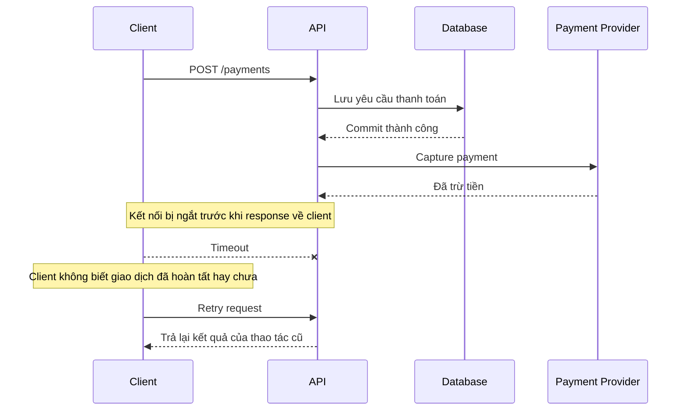

# Idempotency và tác động khi retry

## 1. Vì sao retry có thể tạo ra lỗi nghiệp vụ?

Trong hệ thống phân tán, client không phải lúc nào cũng biết server đã xử lý request hay chưa. Client gửi yêu cầu tạo thanh toán, server đã ghi nhận và gửi lệnh sang cổng thanh toán, nhưng kết nối bị ngắt trước khi response quay về. Từ phía client, request chỉ có vẻ như bị timeout. Nếu client gửi lại một request mới mà server xử lý lần nữa, khách hàng có thể bị trừ tiền hai lần.

Đây là vấn đề về **idempotency** (tính lũy đẳng) và **retry** (gửi lại request). Hai khái niệm cần được thiết kế cùng nhau:

- Idempotency xác định việc thực hiện lặp lại cùng một thao tác có tạo thêm tác động nghiệp vụ hay không.
- Retry là cách client hoặc hệ thống trung gian thử lại khi chưa nhận được kết quả hoặc gặp lỗi có thể tạm thời.

Một API bảo mật tốt cần bảo đảm retry không làm nhân đôi giao dịch, không vượt hạn mức, không lặp tác dụng phụ và không mở ra cơ hội phát lại request để lạm dụng nghiệp vụ. Điều này đặc biệt quan trọng với thanh toán, đặt hàng, hoàn tiền, cấp quyền, gửi thông báo và các thao tác thay đổi trạng thái.

## 2. Idempotency trong HTTP nghĩa là gì?

Theo ngữ nghĩa HTTP, một phương thức là idempotent nếu hiệu ứng dự kiến trên server của nhiều request giống hệt nhau giống với hiệu ứng của một request. Nói cách khác, sau request đầu tiên, gửi lại request đó không làm trạng thái nghiệp vụ thay đổi thêm lần nữa.

Idempotency nói về **hiệu ứng dự kiến trên server**, không yêu cầu mọi lần gọi phải trả về cùng status code, response body, thời gian xử lý hay log. Ví dụ, lần `DELETE` đầu tiên có thể trả `204 No Content`, lần sau có thể trả `404 Not Found` vì tài nguyên đã bị xóa; trạng thái cuối cùng vẫn là tài nguyên không còn tồn tại.

### Ngữ nghĩa thường gặp của các HTTP method

| Method | Safe? | Idempotent? | Lưu ý khi thiết kế |
|---|---|---|---|
| `GET` | Có | Có | Chỉ đọc dữ liệu; không dùng GET để tạo đơn, trừ tiền hoặc thay đổi trạng thái. |
| `HEAD` | Có | Có | Có ngữ nghĩa đọc như GET nhưng không trả response body. |
| `OPTIONS` | Có | Có | Trả thông tin về khả năng giao tiếp của tài nguyên. |
| `TRACE` | Có | Có | Phương thức kiểm tra vòng lặp request; thường bị tắt nếu không cần thiết. |
| `PUT` | Không | Có | Đặt trạng thái tài nguyên theo nội dung được gửi; lặp lại cùng nội dung không nên tạo thêm tác dụng phụ. |
| `DELETE` | Không | Có | Mục tiêu là làm tài nguyên không còn tồn tại; response các lần gọi có thể khác nhau. |
| `POST` | Không | Không mặc định | Thường tạo tài nguyên hoặc kích hoạt hành động; cần thiết kế thêm nếu muốn retry an toàn. |
| `PATCH` | Không | Không mặc định | Phụ thuộc phép cập nhật; gán một giá trị cố định có thể lũy đẳng, tăng số dư thì không. |

“Safe” nghĩa là phương thức được định nghĩa để đọc, không yêu cầu thay đổi trạng thái nghiệp vụ. Safe methods cũng là idempotent. Các method được định nghĩa là idempotent vẫn có thể tạo log, metric hoặc lịch sử truy cập cho từng request; những ghi nhận vận hành này không làm thay đổi hiệu ứng nghiệp vụ chính.

Không nên chỉ nhìn tên HTTP method để kết luận implementation đã lũy đẳng. Ví dụ:

- `PUT /users/42` đặt `displayName` thành `An` có thể lũy đẳng nếu gửi lại vẫn giữ nguyên giá trị đó.
- Nếu mỗi lần PUT lại tăng `version`, gửi email hoặc cộng điểm thưởng, implementation đã tạo thêm tác dụng phụ.
- `PATCH /carts/42` với thao tác “đặt số lượng thành 3” có thể lũy đẳng.
- `PATCH /accounts/42` với thao tác “tăng số dư thêm 100” không lũy đẳng; gửi lại sẽ tăng thêm lần nữa.

Hãy thiết kế theo ý nghĩa của thao tác và trạng thái dữ liệu, không dựa vào việc client hứa chỉ gửi một lần.

## 3. Vì sao client không biết chắc request đã thành công?

Một request đi qua client, mạng, proxy/gateway, API server, cơ sở dữ liệu và có thể thêm nhiều dịch vụ bên ngoài. Lỗi có thể xảy ra ở bất kỳ đoạn nào. Đặc biệt, timeout chỉ cho biết client không nhận được kết quả đúng hạn; nó không chứng minh server chưa thực hiện thao tác.



Nếu client tạo một thao tác mới cho lần retry, server có thể tạo hai khoản thanh toán. Nếu client gửi lại cùng một định danh thao tác và server nhận ra đó là lần lặp, server có thể trả lại kết quả đã lưu mà không thực hiện thanh toán lần nữa.

Vì vậy, cần phân biệt:

- **Request attempt:** một lần gửi qua mạng. Mỗi lần thử có thể có request ID riêng để truy vết.
- **Logical operation:** một ý định nghiệp vụ duy nhất, ví dụ “thanh toán đơn hàng ORD-100”. Mọi lần retry của ý định đó phải dùng chung idempotency key.

Request ID giúp tìm log của từng lần gọi. Idempotency key giúp nhận diện các lần gọi thuộc cùng một thao tác nghiệp vụ. Hai giá trị này không thay thế cho nhau.

## 4. Khi nào nên retry?

Retry chỉ phù hợp khi lỗi có khả năng tạm thời và thao tác có thể được gửi lại an toàn. Retry vô điều kiện có thể nhân đôi tác dụng phụ, làm tăng tải đúng lúc hệ thống đang quá tải hoặc tạo ra một vòng lặp lỗi giữa các dịch vụ.

| Tình huống | Cách xử lý thường dùng | Lý do |
|---|---|---|
| Lỗi kết nối trước khi nhận được response | Có thể retry có giới hạn | Kết quả có thể chưa rõ; vẫn cần idempotency nếu request có thể đã tới server. |
| Timeout khi chờ response | Retry cùng idempotency key nếu API hỗ trợ | Server có thể đã hoàn thành thao tác. |
| `408 Request Timeout` | Có thể retry có giới hạn | Request có thể chưa được xử lý đầy đủ; cần xét ngữ cảnh gateway và API. |
| `429 Too Many Requests` | Tôn trọng `Retry-After`, giảm tốc độ | Server đang áp dụng hạn mức. |
| `502`, `503`, `504` | Có thể retry có giới hạn nếu thao tác an toàn | Thường là lỗi gateway, dịch vụ tạm thời không sẵn sàng hoặc timeout upstream. |
| `400`, `401`, `403`, `404`, `422` | Thông thường không retry tự động | Request sai, chưa xác thực, không có quyền, không tìm thấy tài nguyên hoặc dữ liệu không hợp lệ cần được xử lý trước. |
| `409 Conflict` | Không retry mù quáng | Trạng thái nghiệp vụ hoặc key có thể đang xung đột; cần đọc chi tiết lỗi và trạng thái tài nguyên. |

Đây là hướng dẫn phổ biến, không phải quy tắc tuyệt đối cho mọi API. Client cần hiểu hợp đồng lỗi của endpoint. Một số hệ thống có thể định nghĩa riêng trường hợp retry được; response `500` cũng không tự chứng minh thao tác chưa tạo tác dụng phụ.

### Chính sách retry có giới hạn

- Chỉ retry lỗi được xác định là tạm thời.
- Đặt giới hạn số lần thử và tổng thời gian chờ theo deadline của thao tác.
- Dùng exponential backoff: khoảng chờ tăng dần theo số lần thử; thêm jitter ngẫu nhiên để các client không đồng loạt retry cùng thời điểm.
- Tôn trọng `Retry-After` nếu server trả về và giá trị phù hợp với deadline của client.
- Không retry liên tục ở nhiều tầng cùng lúc. Nếu client, gateway và service đều tự retry, số request thực tế có thể nhân lên nhanh chóng.
- Dừng retry khi thao tác đã có kết quả cuối cùng, khi dữ liệu đầu vào cần sửa hoặc khi người dùng phải quyết định bước tiếp theo.

Ví dụ, một client có thể chờ khoảng 200 ms, 400 ms, 800 ms rồi tăng dần đến một mức trần, cộng jitter và dừng sau một số lần thử. Các con số phải được chọn theo latency, deadline và khả năng chịu tải thực tế của dịch vụ.

## 5. Idempotency key cho thao tác tạo hoặc thực hiện hành động

Với `POST` hoặc một `PATCH` không lũy đẳng tự nhiên, API có thể hỗ trợ một key do client tạo cho mỗi ý định nghiệp vụ. Một quy ước phổ biến là truyền header `Idempotency-Key`:

Client nên tạo key duy nhất, khó trùng cho mỗi logical operation (ví dụ UUID ngẫu nhiên), tránh nhúng thông tin cá nhân vào key. Key có thể được ghi log ở dạng đã che hoặc fingerprint để đối chiếu, nhưng không được dùng thay token xác thực.

```http
POST /api/payments HTTP/1.1
Authorization: Bearer <access-token>
Idempotency-Key: 7f7f6e7a-1d4d-4c4d-a5a0-81c7e9bcb5c2
Content-Type: application/json

{
  "orderId": "ORD-100",
  "amount": 250000,
  "currency": "VND"
}
```

Nếu client timeout và muốn thử lại cùng thao tác, client gửi lại cùng key và cùng dữ liệu nghiệp vụ. Khi người dùng chủ động tạo một khoản thanh toán mới, đó là một logical operation khác và phải có key mới.

### Quy trình xử lý ở server

1. Xác thực request và kiểm tra quyền của principal trên chức năng, đối tượng và tenant liên quan.
2. Kiểm tra định dạng, độ dài và phạm vi của idempotency key. Key phải được ràng buộc với principal/tenant và loại thao tác; không dùng key như thông tin xác thực.
3. Chuẩn hóa dữ liệu nghiệp vụ và tạo request fingerprint (ví dụ hash của method, endpoint, principal/tenant và payload đã chuẩn hóa).
4. Thử tạo bản ghi idempotency với ràng buộc duy nhất cho phạm vi key.
5. Nếu key mới, ghi nhận thao tác và xử lý nghiệp vụ theo cơ chế nguyên tử phù hợp.
6. Nếu key đã tồn tại và fingerprint giống nhau, không chạy lại tác dụng phụ; trả kết quả đã lưu hoặc thông tin thao tác đang xử lý.
7. Nếu key đã tồn tại nhưng fingerprint khác nhau, từ chối request, thường bằng `409 Conflict`, vì một key không được đại diện cho hai ý định khác nhau.

Một bảng lưu trạng thái có thể có cấu trúc như sau (ví dụ PostgreSQL):

```sql
CREATE TABLE idempotency_record (
    tenant_id       VARCHAR(100) NOT NULL,
    principal_id    VARCHAR(100) NOT NULL,
    operation       VARCHAR(150) NOT NULL,
    idempotency_key VARCHAR(200) NOT NULL,
    request_hash    VARCHAR(128) NOT NULL,
    state           VARCHAR(20) NOT NULL,
    response_code   INTEGER,
    response_body   JSONB,
    resource_id     VARCHAR(150),
    created_at      TIMESTAMPTZ NOT NULL DEFAULT NOW(),
    expires_at      TIMESTAMPTZ NOT NULL,
    PRIMARY KEY (tenant_id, principal_id, operation, idempotency_key)
);
```

`operation` cần phân biệt các thao tác có ý nghĩa khác nhau, chẳng hạn `payment.create` và `refund.create`. `request_hash` giúp phát hiện việc dùng lại key với payload khác. `state` có thể là `IN_PROGRESS`, `COMPLETED` hoặc một trạng thái lỗi đã được định nghĩa rõ. Không lưu dữ liệu nhạy cảm trong response nếu không cần; nếu phải lưu, cần kiểm soát quyền truy cập, thời hạn lưu và mã hóa phù hợp.

### Xử lý request lặp và request đồng thời

Hai request cùng key có thể đến gần như đồng thời. Kiểm tra “đã tồn tại chưa?” rồi mới insert mà không có ràng buộc duy nhất sẽ tạo race condition: cả hai request đều thấy chưa có bản ghi và cùng thực hiện nghiệp vụ.

Hãy dùng unique constraint hoặc cơ chế khóa nguyên tử ở nơi lưu idempotency record. Chỉ một request được quyền tạo và sở hữu thao tác mới. Request còn lại phải đọc trạng thái đã được tạo:

- `COMPLETED`: xác minh quyền đọc kết quả rồi trả lại kết quả đã lưu.
- `IN_PROGRESS`: chờ trong giới hạn hợp lý, hoặc trả response cho biết thao tác đang xử lý (ví dụ `202 Accepted` hay `409 Conflict` theo hợp đồng API) kèm hướng dẫn tra cứu/retry.
- Cùng key nhưng khác fingerprint: trả lỗi xung đột và không thực hiện tác dụng phụ.

Phần ghi nhận key và thay đổi dữ liệu nghiệp vụ nên nằm trong cùng transaction cơ sở dữ liệu khi chúng thuộc cùng một database. Nếu ghi key thành công nhưng nghiệp vụ thất bại, hoặc nghiệp vụ thành công nhưng key chưa được đánh dấu hoàn tất, trạng thái có thể bị kẹt hoặc bị chạy lặp. Cần định nghĩa rõ cách phục hồi cho từng trạng thái và bảo đảm chuyển trạng thái nguyên tử ở mức có thể.

### Ví dụ điều phối ở tầng service

Đoạn mã dưới đây minh họa hợp đồng của service; chi tiết transaction, unique constraint và xử lý cạnh tranh phải được hiện thực trong repository/database:

```java
public PaymentResult createPayment(
        CreatePaymentCommand command,
        Principal principal,
        String idempotencyKey) {

    authorization.require(principal, "payment:create", command.orderId());

    String requestHash = fingerprint(command);
    IdempotencyDecision decision = idempotencyStore.reserve(
        principal.tenantId(),
        principal.id(),
        "payment.create",
        idempotencyKey,
        requestHash
    );

    if (decision.isPayloadConflict()) {
        throw new IdempotencyConflictException();
    }
    if (decision.isCompleted()) {
        authorization.requireCanRead(principal, decision.resourceId());
        return decision.savedPaymentResult();
    }
    if (decision.isInProgress()) {
        throw new PaymentStillProcessingException();
    }

    return paymentWorkflow.startOnce(command, principal, idempotencyKey);
}
```

`reserve` không thể chỉ là một lần SELECT rồi INSERT thông thường; nó phải bảo đảm chỉ một request thắng quyền tạo key. `startOnce` cần ghi trạng thái nghiệp vụ và kết quả theo transaction/state machine. Ví dụ này cũng kiểm tra quyền trước khi trả kết quả cũ để tránh người đã mất quyền vẫn đọc được dữ liệu chỉ vì biết key.

## 6. Giao dịch nhiều dịch vụ và tác dụng phụ bên ngoài

Một database transaction không thể tự bảo đảm một thao tác ở cổng thanh toán, dịch vụ email hoặc hệ thống kho chỉ chạy một lần. Giả sử API gọi nhà cung cấp thanh toán, nhà cung cấp đã capture tiền nhưng kết nối bị timeout. API không biết chắc kết quả và nếu gửi một lệnh capture mới, khách hàng có thể bị trừ tiền lần nữa.

Các biện pháp thường dùng:

- **Lan truyền idempotency key:** nếu nhà cung cấp hỗ trợ, gửi cùng key cho mọi lần retry của cùng một logical operation.
- **Transactional outbox:** trong một transaction, lưu thay đổi nghiệp vụ và một outbox event. Worker gửi event sau commit; event có ID ổn định để downstream deduplicate.
- **Idempotent consumer:** consumer lưu event ID hoặc business operation ID đã xử lý với unique constraint; nhận lại cùng event thì không áp dụng tác dụng phụ lần nữa.
- **Đối soát trạng thái:** khi kết quả bên ngoài không rõ, tra cứu giao dịch theo mã tham chiếu trước khi quyết định gửi lại.
- **State machine:** mô hình hóa `PENDING`, `PROCESSING`, `SUCCEEDED`, `FAILED` hoặc trạng thái phù hợp; quy định chuyển trạng thái và cách phục hồi khi worker dừng giữa chừng.

Nếu dịch vụ ngoài không hỗ trợ idempotency và cũng không có API tra cứu kết quả đáng tin cậy, hệ thống không thể tự khẳng định retry là an toàn sau một timeout không rõ kết quả. Khi đó cần thiết kế mã tham chiếu duy nhất, quy trình đối soát hoặc xử lý thủ công/compensation theo nghiệp vụ.

Không nên tuyên bố hệ thống có “exactly once” chỉ vì đã thêm idempotency key. Trong thực tế, message hoặc request có thể được giao nhiều lần; hệ thống tạo hiệu ứng gần như một lần bằng cách deduplicate và lưu trạng thái bền vững trong một phạm vi, thời hạn và hợp đồng xác định.

## 7. Các rủi ro bảo mật và toàn vẹn dữ liệu

Idempotency key là dữ liệu đầu vào do client cung cấp. Thiết kế sai có thể tạo thêm lỗ hổng:

- **Replay giữa người dùng hoặc tenant:** nếu key chỉ được tìm theo chuỗi key toàn cục, user khác có thể đoán hoặc lấy key rồi đọc response của thao tác trước. Hãy scope key theo tenant, principal và operation; kiểm tra quyền trên tài nguyên trước khi trả kết quả đã lưu.
- **Dùng lại key với payload khác:** nếu không so sánh fingerprint, client hoặc attacker có thể vô tình/ cố ý biến key cũ thành một lệnh khác. Từ chối trường hợp này.
- **Key bị coi như bí mật:** key không thay thế access token, chữ ký hay authorization. Ai có key cũng không mặc nhiên có quyền xem kết quả.
- **Tấn công làm đầy kho key:** attacker tạo vô số key khác nhau để tăng dung lượng lưu trữ. Giới hạn kích thước key, số thao tác, tốc độ tạo record và thời gian lưu; áp dụng quota theo principal/tenant.
- **Rò rỉ dữ liệu trong response đã lưu:** response có thể chứa dữ liệu cá nhân hoặc thông tin thanh toán. Chỉ lưu trường cần thiết, bảo vệ dữ liệu và kiểm tra lại quyền khi replay.
- **Xóa record quá sớm:** nếu TTL ngắn hơn cửa sổ retry thực tế, một request đến muộn có thể bị coi là thao tác mới. Thời hạn phải phù hợp với nghiệp vụ; giao dịch giá trị cao nên có unique business reference hoặc ràng buộc lâu dài.
- **Lỗi trạng thái treo:** worker hoặc server chết khi record đang `IN_PROGRESS`. Cần lease/timeout, cơ chế phục hồi và đối soát; không xóa record một cách tùy tiện rồi chạy lại tác dụng phụ.
- **Retry storm:** nhiều client retry đồng thời có thể làm hệ thống quá tải. Dùng backoff, jitter, rate limit, concurrency limit và circuit breaker phù hợp.

Không dùng một key duy nhất cho mọi thao tác của user. Mỗi logical operation cần key riêng; cùng key chỉ được dùng lại cho các lần thử của chính thao tác đó. Cũng không nhận một key do client cung cấp mà không giới hạn độ dài và định dạng.

## 8. Kiểm thử idempotency và retry

Kiểm thử cần xác nhận trạng thái và tác dụng phụ, không chỉ kiểm tra response code. Với một endpoint tạo thanh toán, có thể xây dựng các ca sau:

| Ca kiểm thử | Thao tác | Kết quả mong đợi |
|---|---|---|
| Retry tuần tự | Gửi hai request cùng key và cùng payload. | Chỉ một payment/business operation được tạo; lần sau nhận kết quả cũ hoặc trạng thái đã xử lý. |
| Retry đồng thời | Gửi nhiều request cùng key gần như cùng lúc. | Unique constraint/lock chỉ cho một request khởi tạo tác dụng phụ. |
| Khác payload | Dùng lại key nhưng đổi amount hoặc order ID. | Bị từ chối, không tạo thao tác thứ hai. |
| Khác principal | User B dùng key của User A. | Không đọc được kết quả của A và không ảnh hưởng thao tác của A. |
| Khác tenant | Tenant B dùng cùng chuỗi key với tenant A. | Hai phạm vi được cách ly theo chính sách; không rò dữ liệu chéo tenant. |
| Timeout sau commit | Server hoàn tất nghiệp vụ nhưng response bị làm mất. | Retry cùng key không lặp tác dụng phụ. |
| Server dừng giữa chừng | Dừng worker ở các điểm trước/sau khi gọi dịch vụ ngoài. | Khôi phục theo state machine, đối soát và cơ chế deduplicate. |
| Hết hạn key | Gửi lại sau khi record hết TTL. | Hành vi phù hợp hợp đồng lưu giữ; giao dịch quan trọng vẫn được bảo vệ bởi business reference nếu cần. |
| Quá tải | Nhiều client retry khi server trả `429` hoặc `503`. | Client tôn trọng backoff/Retry-After; server không bị khuếch đại tải vô hạn. |

Nên kiểm tra thêm số lần gọi nhà cung cấp bên ngoài, số bản ghi được tạo, số lần trừ tiền, số email phát đi và số lần chuyển trạng thái. Những số liệu này chứng minh tác dụng phụ có thực sự chỉ xảy ra một lần trong phạm vi thiết kế hay không.

## 9. Checklist thiết kế endpoint có retry

- [ ] Đã xác định method và hiệu ứng nghiệp vụ; endpoint có lũy đẳng tự nhiên hay cần idempotency key?
- [ ] Client có phân biệt request attempt với logical operation và dùng lại cùng key khi retry?
- [ ] API có xác thực, phân quyền chức năng, đối tượng, thuộc tính và tenant trước khi xử lý hoặc trả kết quả cũ?
- [ ] Key được scope theo principal/tenant/operation và có giới hạn định dạng, kích thước, tốc độ tạo?
- [ ] Payload được chuẩn hóa và fingerprint; cùng key với payload khác bị từ chối?
- [ ] Việc tạo key và thay đổi dữ liệu được bảo vệ trước race condition bằng transaction, unique constraint hoặc khóa phù hợp?
- [ ] Request đồng thời và trạng thái `IN_PROGRESS` có hợp đồng phản hồi, timeout và phục hồi rõ ràng?
- [ ] Tác dụng phụ ngoài được deduplicate, truyền key, ghi outbox hoặc đối soát trạng thái?
- [ ] TTL đủ dài so với cửa sổ retry và yêu cầu nghiệp vụ; dữ liệu lưu trữ được bảo vệ?
- [ ] Client retry có giới hạn, backoff, jitter, deadline và tôn trọng `Retry-After`?
- [ ] Có kiểm thử timeout sau commit, retry đồng thời, payload khác, principal khác và lỗi giữa chừng?
- [ ] Log/metric có thể truy vết từng request attempt và logical operation mà không làm lộ token hoặc dữ liệu nhạy cảm?

Idempotency giúp một thao tác nghiệp vụ giữ được cùng hiệu ứng khi request bị gửi lại. Retry giúp hệ thống phục hồi trước lỗi tạm thời. Chỉ khi hai cơ chế được thiết kế cùng với xác thực, phân quyền, transaction, kiểm soát tài nguyên và giám sát, API mới có thể xử lý lỗi mạng mà không biến một lần timeout thành nhiều lần trừ tiền, tạo đơn hoặc thực hiện tác dụng phụ.
