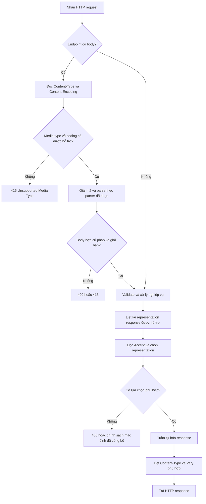

# Content-Type, Accept và content negotiation

HTTP truyền dữ liệu giữa client và server dưới dạng message. Với API REST, dữ liệu thường là JSON, nhưng cũng có thể là XML, form data, văn bản, ảnh hoặc tệp nhị phân. Hai header `Content-Type` và `Accept` giúp hai phía thống nhất cách hiểu dữ liệu: `Content-Type` mô tả định dạng của phần body đang gửi; `Accept` nêu những định dạng response mà client có thể nhận. Quá trình server chọn một representation phù hợp được gọi là *content negotiation*.

Đây là kiến thức giao thức cơ bản nhưng có tác động trực tiếp đến bảo mật API. Server chọn sai parser có thể diễn giải dữ liệu không như dự kiến; parser quá dễ dãi có thể chấp nhận payload ngoài hợp đồng; response sai media type có thể khiến client hoặc trình duyệt xử lý nội dung theo cách nguy hiểm. Mỗi endpoint cần xác định rõ định dạng đầu vào, định dạng đầu ra, cách xử lý định dạng không hỗ trợ và giới hạn tài nguyên khi parse.

## 1. Representation và media type trong HTTP

HTTP phân biệt tài nguyên (resource) với cách biểu diễn tài nguyên (representation). Một tài nguyên `/users/42` có thể được biểu diễn thành JSON, XML hoặc một định dạng khác. Các representation có thể mang cùng thông tin nghiệp vụ nhưng khác cấu trúc, cách mã hóa hoặc mức độ chi tiết.

**Media type** cho biết kiểu dữ liệu và định dạng của representation. Cấu trúc tổng quát là:

```text
type/subtype; parameter=value
```

Ví dụ:

```http
Content-Type: text/plain; charset=utf-8
Content-Type: application/json
Content-Type: application/problem+json
Content-Type: application/xml
Content-Type: multipart/form-data; boundary=----FormBoundary7MA4YWxk
```

- `type` là nhóm tổng quát, ví dụ `application`, `text`, `image`, `audio`, `video` hoặc `multipart`.
- `subtype` xác định định dạng cụ thể, ví dụ `json`, `xml`, `plain`, `jpeg` hoặc `form-data`.
- `parameter` bổ sung thông tin cho media type. `charset` thường gặp với văn bản; `boundary` xác định ranh giới các phần trong multipart.

Với JSON trao đổi giữa các hệ thống mở, encoding phải là UTF-8. Media type `application/json` không định nghĩa parameter `charset` để chọn encoding; vì vậy nên dùng `Content-Type: application/json` và thống nhất UTF-8 theo chuẩn JSON, thay vì dựa vào `charset` để đổi cách giải mã.

Một số media type thường dùng trong API:

| Media type | Ý nghĩa thường gặp | Ví dụ sử dụng |
|---|---|---|
| `application/json` | Dữ liệu JSON | Request/response API thông thường |
| `application/problem+json` | Nội dung lỗi theo Problem Details dạng JSON | Mô tả lỗi HTTP có cấu trúc |
| `application/xml` | Dữ liệu XML | Tích hợp với hệ thống dùng XML |
| `application/x-www-form-urlencoded` | Các trường form được mã hóa theo dạng key-value | Form đăng nhập hoặc form HTML đơn giản |
| `multipart/form-data` | Body gồm nhiều phần, mỗi phần có header riêng | Upload file cùng metadata |
| `text/plain` | Văn bản thuần | Webhook hoặc endpoint nhận nội dung văn bản |
| `application/octet-stream` | Dữ liệu byte không gắn với định dạng ứng dụng cụ thể | Upload/download dữ liệu nhị phân |
| `image/png` | Ảnh PNG | Endpoint trả ảnh hoặc tải lên ảnh |

Hậu tố có cấu trúc như `+json` cho biết định dạng dựa trên cú pháp JSON. Ví dụ `application/problem+json` là một media type riêng nhưng nội dung có cú pháp JSON. Server vẫn nên cho phép chính xác các media type mà endpoint hỗ trợ; không nên mặc định rằng mọi giá trị kết thúc bằng `+json` đều có cùng schema hoặc cùng ý nghĩa nghiệp vụ.

Tên media type không phân biệt chữ hoa/chữ thường theo quy tắc HTTP, nhưng nên dùng cách viết chữ thường nhất quán. Việc so sánh cần xử lý đúng token và parameter, không dùng phép so khớp chuỗi tùy tiện như `contains("json")`.

## 2. Content-Type: body đang được gửi theo định dạng nào?

`Content-Type` mô tả kiểu media của nội dung trong message body. Khi client gửi JSON, client khai báo:

```http
POST /api/orders HTTP/1.1
Host: api.example.test
Content-Type: application/json

{
  "productId": "P-100",
  "quantity": 2
}
```

Server đọc header để chọn bộ giải mã/parser tương ứng, sau đó kiểm tra cấu trúc và dữ liệu theo hợp đồng endpoint. Header này không chứng minh payload là an toàn, hợp lệ hoặc đáng tin. Client có thể khai báo `application/json` nhưng gửi XML, văn bản tùy ý hoặc dữ liệu nhị phân. Server phải kiểm tra nội dung thực tế bằng parser phù hợp và từ chối payload sai định dạng.

### 2.1. Content-Type của request và response

Header này có thể xuất hiện trong cả request lẫn response:

```http
HTTP/1.1 201 Created
Location: /api/orders/ORD-9001
Content-Type: application/json

{
  "id": "ORD-9001",
  "status": "CREATED"
}
```

Trong request, `Content-Type` nói cho server biết cách parse body. Trong response, nó nói cho client biết cách diễn giải body được trả về. Hai phía không nhất thiết phải dùng cùng media type: client có thể gửi JSON nhưng yêu cầu server trả XML nếu endpoint hỗ trợ cả hai.

### 2.2. Content-Type không phải Content-Encoding

`Content-Type` mô tả định dạng dữ liệu sau khi giải mã content coding. `Content-Encoding` mô tả cách body được mã hóa/trình bày ở tầng truyền tải, thường để nén.

Ví dụ một response có body là JSON được nén gzip:

```http
HTTP/1.1 200 OK
Content-Type: application/json
Content-Encoding: gzip
Vary: Accept-Encoding

<gzip-compressed bytes>
```

Sau khi giải nén, client nhận JSON. `application/gzip` sẽ mang ý nghĩa khác: bản thân representation là một tệp gzip. Không nhầm lẫn hai trường hợp này.

`Accept-Encoding` cũng là header riêng để client nêu các content coding có thể nhận. Vì vậy:

- `Content-Type`: dữ liệu là JSON, XML, ảnh hay loại nào?
- `Content-Encoding`: dữ liệu được nén/mã hóa truyền tải theo cách nào?
- `Accept-Encoding`: client chấp nhận những content coding nào?

Giới hạn kích thước phải được áp dụng phù hợp ở cả dữ liệu sau giải nén và trước giải nén. Nếu chỉ giới hạn số byte nén, payload có thể nở thành kích thước rất lớn và gây cạn bộ nhớ hoặc CPU.

### 2.3. Khi nào server trả 415 Unsupported Media Type?

Server thường trả `415 Unsupported Media Type` khi định dạng body hoặc content coding của request không được endpoint hỗ trợ. Ví dụ endpoint chỉ nhận JSON nhưng client gửi XML:

```http
POST /api/orders HTTP/1.1
Content-Type: application/xml

<order><quantity>2</quantity></order>
```

Response có thể là:

```http
HTTP/1.1 415 Unsupported Media Type
Content-Type: application/problem+json

{
  "type": "https://api.example.test/problems/unsupported-media-type",
  "title": "Unsupported Media Type",
  "status": 415,
  "detail": "Endpoint này chỉ hỗ trợ application/json."
}
```

`415` phản ánh định dạng request không được chấp nhận, không phải lỗi nghiệp vụ bên trong JSON. Cần phân biệt với:

- `400 Bad Request`: cú pháp HTTP hoặc nội dung request không thể parse theo hợp đồng, chẳng hạn JSON sai cú pháp.
- `413 Content Too Large`: body vượt giới hạn kích thước.
- `422 Unprocessable Content`: nội dung đúng cú pháp và media type được hỗ trợ nhưng không thể xử lý về mặt ngữ nghĩa/validation theo quy ước API.

Một API có thể chọn quy ước lỗi khác nhau trong một số trường hợp, nhưng phải nhất quán và mô tả rõ trong tài liệu.

## 3. Accept: client muốn nhận representation nào?

`Accept` là request header cho biết client muốn nhận những media type nào trong response. Ví dụ:

```http
GET /api/reports/2026 HTTP/1.1
Host: api.example.test
Accept: application/json
```

Client đang ưu tiên response dạng JSON. Nếu API hỗ trợ cả JSON và XML, server có thể chọn JSON. Client có thể nêu nhiều lựa chọn:

```http
Accept: application/json, application/xml;q=0.8, text/plain;q=0.5
```

Trong ví dụ này, client ưu tiên JSON, chấp nhận XML với mức ưu tiên thấp hơn và có thể nhận văn bản thuần với mức ưu tiên thấp hơn nữa.

### 3.1. Wildcard và quality value

`Accept` hỗ trợ wildcard:

| Giá trị | Ý nghĩa |
|---|---|
| `application/json` | Chấp nhận JSON thuộc nhóm application |
| `application/*` | Chấp nhận các subtype thuộc nhóm application |
| `*/*` | Chấp nhận mọi media type |

Tham số `q` (quality value) biểu diễn mức ưu tiên, có giá trị từ `0` đến `1`. Giá trị mặc định là `1` nếu không ghi. `q=0` có nghĩa là client không chấp nhận lựa chọn đó.

```http
Accept: application/json;q=1.0, application/xml;q=0.7, text/csv;q=0
```

Server cần xét cả độ cụ thể của media range. Một media type cụ thể thường có độ ưu tiên xác định cao hơn wildcard bao phủ nó. Ví dụ:

```http
Accept: application/*;q=0.8, application/json;q=0.5
```

JSON khớp cả hai range; range cụ thể `application/json` xác định mức chấp nhận dành cho JSON. Khi xây dựng thuật toán lựa chọn, cần tuân theo quy tắc so khớp và precedence của HTTP thay vì chỉ lấy `q` lớn nhất trong mọi chuỗi có chứa từ `json`.

Nếu request không có `Accept`, server thường có thể chọn representation mặc định mà endpoint hỗ trợ. Nếu `Accept: */*`, client không giới hạn loại media type ở tầng này. Điều đó không buộc server phải trả mọi định dạng; server vẫn chọn trong danh sách được triển khai và được phép.

### 3.2. Khi nào server trả 406 Not Acceptable?

Nếu client chỉ chấp nhận các media type mà endpoint không thể tạo ra, server có thể trả `406 Not Acceptable`.

```http
GET /api/orders/ORD-9001 HTTP/1.1
Accept: application/xml
```

Nếu endpoint chỉ hỗ trợ JSON:

```http
HTTP/1.1 406 Not Acceptable
Content-Type: application/problem+json

{
  "type": "https://api.example.test/problems/not-acceptable",
  "title": "Not Acceptable",
  "status": 406,
  "detail": "Endpoint này chỉ trả về application/json."
}
```

Theo HTTP, server có thể chọn một representation mặc định thay vì trả `406` trong một số thiết kế. Vì thế, API cần công bố chính sách rõ ràng: luôn trả JSON, thương lượng theo `Accept`, hay trả `406` khi không có lựa chọn phù hợp. Dù chọn chính sách nào, không nên âm thầm trả body XML/HTML khi client chỉ chấp nhận JSON mà không có quy ước tương thích.

### 3.3. Accept-Language và Accept-Encoding

Content negotiation có thể xét nhiều chiều, không chỉ media type:

- `Accept-Language` nêu ngôn ngữ nội dung client ưu tiên, ví dụ `vi`, `en` hoặc `en-US`.
- `Accept-Encoding` nêu content coding client chấp nhận, ví dụ `gzip` hoặc `br`.
- `Accept` nêu media type client chấp nhận, ví dụ JSON hoặc XML.

Các header này có mục đích khác nhau và không thay thế lẫn nhau. Nếu response thay đổi theo một header request, cache có thể cần `Vary` tương ứng để không dùng nhầm representation cho client khác.

## 4. Content negotiation diễn ra như thế nào?

Một endpoint có thể hỗ trợ nhiều representation. Khi nhận request, server cần xác định request body có được phép hay không, sau đó chọn định dạng response phù hợp với khả năng của server và mong muốn của client.



Một quy trình lựa chọn thực tế nên có các bước:

1. Xác định endpoint có nhận body không và những media type nào được phép.
2. Kiểm tra `Content-Type` và `Content-Encoding` trước khi parse; từ chối loại không hỗ trợ.
3. Giải mã/parse bằng parser đã cấu hình, áp giới hạn byte, thời gian, độ sâu và kích thước cấu trúc.
4. Validate schema và quy tắc nghiệp vụ; không xem parse thành công là dữ liệu hợp lệ.
5. Xác định danh sách representation response endpoint có thể tạo.
6. Phân tích `Accept` và chọn representation theo chính sách, bao gồm wildcard, quality value và trường hợp header vắng mặt.
7. Serialize response, đặt `Content-Type` chính xác và thêm `Vary` nếu nội dung thay đổi theo header dùng để thương lượng.

Việc lựa chọn media type phải dựa trên danh sách allowlist của endpoint. Không nạp class hoặc chọn parser tùy ý chỉ vì client gửi một chuỗi media type lạ.

## 5. Ví dụ request/response từ đầu đến cuối

Giả sử API tạo đơn hàng nhận JSON và có thể trả JSON hoặc XML.

Client gửi JSON và ưu tiên JSON:

```http
POST /api/orders HTTP/1.1
Host: api.example.test
Content-Type: application/json
Accept: application/json, application/xml;q=0.8

{
  "productId": "P-100",
  "quantity": 2
}
```

Server xác nhận request media type là JSON, parse và validate payload. Sau khi xử lý, server chọn JSON:

```http
HTTP/1.1 201 Created
Location: /api/orders/ORD-9001
Content-Type: application/json
Vary: Accept

{
  "id": "ORD-9001",
  "productId": "P-100",
  "quantity": 2,
  "status": "CREATED"
}
```

Nếu cùng request được gửi với `Accept: application/xml`, server có thể trả XML nếu endpoint hỗ trợ:

```http
HTTP/1.1 201 Created
Location: /api/orders/ORD-9001
Content-Type: application/xml; charset=utf-8
Vary: Accept

<order>
  <id>ORD-9001</id>
  <productId>P-100</productId>
  <quantity>2</quantity>
  <status>CREATED</status>
</order>
```

Nếu request gửi `Content-Type: text/plain`, server không nên cố đoán body có phải JSON hay không rồi tự chuyển parser. Nếu hợp đồng chỉ nhận JSON, trả `415`. Nếu client yêu cầu `Accept: image/png` trong khi endpoint chỉ trả JSON/XML, áp dụng chính sách `406` đã công bố.

Có thể thử nhanh bằng curl:

```bash
# Gửi JSON và yêu cầu JSON
curl -i https://api.example.test/api/orders \
  -H 'Content-Type: application/json' \
  -H 'Accept: application/json' \
  --data '{"productId":"P-100","quantity":2}'

# Gửi JSON nhưng yêu cầu XML
curl -i https://api.example.test/api/orders \
  -H 'Content-Type: application/json' \
  -H 'Accept: application/xml' \
  --data '{"productId":"P-100","quantity":2}'

# Gửi media type không được hỗ trợ
curl -i https://api.example.test/api/orders \
  -H 'Content-Type: text/plain' \
  -H 'Accept: application/json' \
  --data 'hello'
```

## 6. Triển khai với Spring MVC

Spring MVC cho phép khai báo media type endpoint nhận bằng `consumes` và media type endpoint trả bằng `produces`. Các converter sẽ thực hiện đọc/ghi body theo loại dữ liệu đã cấu hình.

```java
@RestController
@RequestMapping("/api/orders")
class OrderController {

    @PostMapping(
            consumes = MediaType.APPLICATION_JSON_VALUE,
            produces = MediaType.APPLICATION_JSON_VALUE)
    ResponseEntity<OrderResponse> create(
            @Valid @RequestBody CreateOrderRequest request) {

        OrderResponse created = orderService.create(request);
        return ResponseEntity
                .created(URI.create("/api/orders/" + created.id()))
                .contentType(MediaType.APPLICATION_JSON)
                .body(created);
    }
}
```

Trong ví dụ này:

- `consumes` giới hạn request body ở `application/json`; media type không khớp thường dẫn đến `415`.
- `produces` mô tả response representation endpoint tạo ra; nếu `Accept` không tương thích, framework có thể trả `406`.
- `@RequestBody` yêu cầu message converter đọc body.
- `@Valid` chạy bean validation sau khi parse thành công; lỗi validation cần được ánh xạ nhất quán sang response lỗi.
- `Content-Type` của response được đặt rõ ràng để client nhận biết representation.

DTO đầu vào nên mô tả đúng hợp đồng và có validation:

```java
public record CreateOrderRequest(
        @NotBlank
        @Size(max = 40)
        String productId,

        @NotNull
        @Min(1)
        @Max(100)
        Integer quantity) {
}
```

Không nên dùng trực tiếp entity persistence làm request DTO. DTO giúp giới hạn field được phép ghi, giảm nguy cơ mass assignment và tách hợp đồng HTTP khỏi mô hình dữ liệu nội bộ.

Nếu cần hỗ trợ nhiều response media type, có thể khai báo nhiều giá trị trong `produces` và cung cấp converter/serializer tương ứng:

```java
@GetMapping(
        value = "/{id}",
        produces = {
                MediaType.APPLICATION_JSON_VALUE,
                MediaType.APPLICATION_XML_VALUE
        })
OrderResponse getById(@PathVariable UUID id) {
    return orderService.getById(id);
}
```

Chỉ khai báo XML nếu ứng dụng đã cấu hình converter XML phù hợp và thực sự cần hỗ trợ định dạng đó. Khai báo `produces` không tự bảo đảm rằng mọi serializer đều an toàn hoặc schema của hai representation tương đương.

### 6.1. Xử lý lỗi nhất quán

Có thể dùng `@RestControllerAdvice` để ánh xạ lỗi parse, validation và nghiệp vụ thành Problem Details. Ví dụ minh họa:

```java
@RestControllerAdvice
class ApiExceptionHandler {

    @ExceptionHandler(MethodArgumentNotValidException.class)
    ResponseEntity<ProblemDetail> handleValidation(
            MethodArgumentNotValidException exception) {

        ProblemDetail problem = ProblemDetail.forStatusAndDetail(
                HttpStatus.UNPROCESSABLE_ENTITY,
                "Request body không thỏa mãn quy tắc validation.");
        problem.setTitle("Unprocessable Content");

        return ResponseEntity
                .status(HttpStatus.UNPROCESSABLE_ENTITY)
                .contentType(MediaType.APPLICATION_PROBLEM_JSON)
                .body(problem);
    }
}
```

Đây chỉ là ví dụ ánh xạ lỗi validation; cần xử lý riêng lỗi đọc message converter, media type không hỗ trợ, body quá lớn và lỗi nghiệp vụ theo phiên bản Spring đang dùng. Không trả stack trace, tên class nội bộ, câu SQL hoặc nội dung secret trong Problem Details.

## 7. Những rủi ro bảo mật liên quan đến media type và parser

`Content-Type` do client gửi là dữ liệu đầu vào không đáng tin. Nếu server tin header một cách mù quáng hoặc cho phép quá nhiều định dạng, kẻ tấn công có thể lợi dụng khác biệt giữa parser, validator, gateway và ứng dụng để đưa dữ liệu ngoài dự kiến vào hệ thống.

### 7.1. Giả mạo Content-Type và parser confusion

Client có thể gửi body không phải JSON nhưng khai báo `application/json`, hoặc khai báo một media type hợp lệ nhưng chứa cấu trúc sai. Server cần dùng parser tương ứng, giới hạn định dạng được phép và từ chối dữ liệu parse thất bại. Không tự động thử lần lượt nhiều parser cho đến khi một parser chấp nhận payload; hành vi này làm hợp đồng mơ hồ và mở rộng bề mặt tấn công.

Nếu API gateway, WAF và ứng dụng diễn giải header hoặc body khác nhau, một lớp có thể kiểm tra nội dung theo cách khác với lớp thực thi. Hãy chuẩn hóa quy tắc media type ở gateway và application, từ chối header mơ hồ/không hợp lệ và kiểm thử đường đi qua toàn bộ proxy chain. Request smuggling chủ yếu liên quan đến bất đồng về framing như `Content-Length` và `Transfer-Encoding`; không nên đánh đồng nó với lỗi `Content-Type`, dù bất đồng parser ở nhiều tầng đều cần được kiểm tra.

### 7.2. XML và XXE

Nếu endpoint hỗ trợ XML, parser phải được cấu hình an toàn. XML External Entity (XXE) có thể khiến parser đọc file cục bộ hoặc truy cập tài nguyên mạng thông qua external entity nếu tính năng này được bật không cần thiết.

Với XML không cần DTD hoặc external entity, hãy tắt DTD, external general entities, external parameter entities và truy cập external schema; bật chế độ secure processing theo thư viện. Không dựa vào việc chỉ chặn chuỗi `DOCTYPE` ở tầng ứng dụng. Cần kiểm tra cấu hình thực tế của XML parser và converter đang sử dụng.

### 7.3. JSON deserialization và dữ liệu ngoài hợp đồng

JSON không có external entity như XML, nhưng việc deserialize vẫn có rủi ro:

- Bật polymorphic/default typing quá rộng có thể cho phép payload điều khiển kiểu class được khởi tạo.
- JSON lồng nhau quá sâu, mảng quá lớn hoặc chuỗi rất dài có thể tiêu hao CPU/bộ nhớ.
- Field dư thừa hoặc field nhạy cảm ngoài DTO có thể bị bind vào entity nếu cấu hình quá dễ dãi.
- Các parser có thể xử lý key trùng lặp khác nhau; điều này tạo ra cách hiểu không nhất quán giữa gateway, validator và ứng dụng.

Chỉ bind vào DTO có field allowlist, tránh polymorphic deserialization không cần thiết, đặt giới hạn độ sâu/kích thước và quyết định rõ cách xử lý field không biết hoặc key trùng lặp. Không cho client gửi trực tiếp `role`, `ownerId`, `tenantId`, `approved`, `price` hoặc các thuộc tính nội bộ nếu họ không có quyền thay đổi chúng.

### 7.4. Multipart upload và file giả mạo

`multipart/form-data` thường dùng để gửi file cùng metadata. Mỗi part có thể có `Content-Disposition` và `Content-Type`, nhưng các giá trị này do client cung cấp nên không chứng minh loại file thật.

Ví dụ:

```http
POST /api/documents HTTP/1.1
Content-Type: multipart/form-data; boundary=----UploadBoundary

------UploadBoundary
Content-Disposition: form-data; name="description"

Invoice tháng 10
------UploadBoundary
Content-Disposition: form-data; name="file"; filename="invoice.pdf"
Content-Type: application/pdf

<file bytes>
------UploadBoundary--
```

Server cần:

- Allowlist loại file và mục đích upload; kiểm tra chữ ký/magic bytes và cấu trúc file bằng thư viện phù hợp, không chỉ tin phần mở rộng hoặc part `Content-Type`.
- Giới hạn tổng kích thước request, kích thước từng part, số lượng part, thời gian upload và dung lượng lưu trữ.
- Đổi tên file ở server, chuẩn hóa tên, tránh path traversal và lưu file ngoài web root hoặc trong object storage có quyền truy cập riêng.
- Quét malware hoặc xử lý file trong môi trường cô lập nếu nghiệp vụ yêu cầu.
- Không phục vụ file do người dùng tải lên dưới origin tin cậy với MIME type tùy tiện. Khi download, đặt `Content-Type` phù hợp, `Content-Disposition` an toàn và `X-Content-Type-Options: nosniff`.

Không tự tách multipart body bằng cách tìm chuỗi boundary thủ công; dùng thư viện HTTP/framework đã được cập nhật và cấu hình giới hạn phù hợp.

### 7.5. MIME sniffing và response sai Content-Type

Một số client hoặc trình duyệt có thể cố đoán loại nội dung dựa trên byte thay vì chỉ tin header. Hành vi sniffing có thể làm nội dung bị xử lý như HTML/script dù server dự định coi nó là văn bản hoặc tệp tải xuống.

Server phải đặt `Content-Type` chính xác với response. Với nội dung không nên được trình duyệt suy đoán, đặc biệt file upload hoặc nội dung do người dùng kiểm soát, cân nhắc `X-Content-Type-Options: nosniff`, `Content-Disposition: attachment` và tách nội dung người dùng sang origin riêng. Header `nosniff` là một lớp bảo vệ của trình duyệt, không thay thế kiểm tra file hoặc output encoding.

### 7.6. Content-Encoding và decompression bomb

Nếu API chấp nhận `gzip` hoặc coding khác, một body nhỏ sau nén có thể giải nén thành dữ liệu khổng lồ. Giới hạn kích thước sau giải nén, tỷ lệ nén, thời gian xử lý và số lớp giải nén. Chỉ hỗ trợ content coding thực sự cần thiết; từ chối coding không được hỗ trợ bằng phản hồi phù hợp. Tránh tự giải nén lặp lại hoặc không giới hạn.

### 7.7. Accept không phải cơ chế phân quyền

`Accept` chỉ mô tả representation client muốn nhận. Không dùng `Accept: application/admin+json` hoặc một media type tùy ý làm bằng chứng rằng người gọi là admin. Kẻ tấn công có thể tự đặt header này. Quyền truy cập phải dựa trên principal đã xác thực và policy ở endpoint/object.

Tương tự, không dựa vào `Content-Type` để quyết định người dùng có quyền gửi một loại dữ liệu hay không. Header chỉ giúp xác định parser; authorization phải kiểm tra độc lập.

## 8. Content negotiation, cache và tính nhất quán

Nếu server trả JSON khi client gửi `Accept: application/json` và XML khi client gửi `Accept: application/xml`, cùng một URL có nhiều representation. Cache trung gian cần biết response thay đổi theo header nào.

Ví dụ:

```http
HTTP/1.1 200 OK
Content-Type: application/json
Vary: Accept
Cache-Control: public, max-age=60
```

`Vary: Accept` báo cho cache rằng representation có thể khác theo giá trị `Accept`. Nếu nội dung còn thay đổi theo `Accept-Language` hoặc `Accept-Encoding`, cần khai báo các chiều tương ứng, ví dụ:

```http
Vary: Accept, Accept-Language, Accept-Encoding
```

Thiếu `Vary` có thể khiến cache dùng response JSON cho client yêu cầu XML, hoặc dùng nội dung ngôn ngữ của người dùng này cho người dùng khác. Trong tình huống xấu, cache key không đầy đủ kết hợp với response nhạy cảm có thể làm rò rỉ dữ liệu giữa các client. Cần kiểm tra cấu hình cache/CDN/API gateway và tránh cache response riêng tư nếu không có policy phù hợp.

Không phản chiếu nguyên văn header `Accept` vào response hoặc dùng chuỗi header chưa chuẩn hóa làm cache key tùy tiện. Hãy để framework/cache xử lý theo quy tắc HTTP đã được kiểm chứng; nếu tự triển khai, cần canonicalize và kiểm thử các biến thể khoảng trắng, thứ tự, wildcard và q-value.

## 9. Quy ước thiết kế endpoint

Mỗi endpoint nên công bố rõ:

| Thuộc tính | Câu hỏi cần trả lời |
|---|---|
| Request media type | Endpoint nhận `application/json`, XML, multipart hay loại nào? |
| Request content coding | Có hỗ trợ gzip hoặc coding nào khác không? Giới hạn giải nén là bao nhiêu? |
| Response media type | Endpoint trả JSON, XML, file hay nhiều representation? |
| Negotiation policy | Nếu thiếu `Accept`, có mặc định không? Nếu không phù hợp thì trả `406` hay dùng representation mặc định? |
| Validation | Schema, field allowlist, encoding, độ sâu và giới hạn kích thước nào được áp dụng? |
| Authorization | Ai được gọi endpoint và được truy cập object/tenant nào? |
| Error format | Lỗi `400`, `406`, `413`, `415`, `422` có cấu trúc thống nhất nào? |
| Cache | Response có được cache không? Có cần `Vary` theo header nào? |
| Logging | Có loại bỏ credential, cookie và dữ liệu nhạy cảm khỏi log/trace không? |

Một số nguyên tắc thực hành:

1. Chỉ hỗ trợ các media type có nhu cầu nghiệp vụ rõ ràng; mỗi định dạng bổ sung làm tăng chi phí kiểm thử và bề mặt parser.
2. Đặt `consumes` và `produces` rõ ràng trong framework thay vì để mọi endpoint nhận/trả mọi loại.
3. Dùng DTO và schema validation; giới hạn field, độ dài, số phần tử, độ sâu và kích thước body.
4. Parse theo một quy tắc thống nhất giữa gateway và application; từ chối header trùng lặp hoặc mơ hồ theo chính sách của stack.
5. Trả `Content-Type` chính xác; dùng Problem Details hoặc định dạng lỗi thống nhất.
6. Không dùng media type, `Accept` hoặc tên file để thay thế authentication/authorization.
7. Thêm `Vary` khi representation phụ thuộc request header; kiểm tra cache với nhiều client và nhiều ngôn ngữ/định dạng.
8. Giám sát tỷ lệ `400`, `406`, `413`, `415`, kích thước body, thời gian parse và lỗi parser để phát hiện lạm dụng.

## 10. Kiểm thử Content-Type, Accept và parser

Kiểm thử không chỉ xác minh response đúng định dạng mà còn phải chứng minh server từ chối dữ liệu không được phép và giữ giới hạn tài nguyên.

| Nhóm | Request/điều kiện kiểm thử | Kết quả mong đợi |
|---|---|---|
| Content-Type hợp lệ | Gửi JSON đúng schema với `application/json` | Parse và xử lý thành công |
| Content-Type không hỗ trợ | Gửi XML hoặc `text/plain` tới endpoint chỉ nhận JSON | `415`, không tự đoán parser |
| Header thiếu | Gửi body tới endpoint yêu cầu media type nhưng bỏ `Content-Type` | Từ chối theo hợp đồng đã công bố |
| Body sai cú pháp | Khai báo JSON nhưng gửi JSON hỏng | `400`, không lộ stack trace |
| Accept cụ thể | Gửi `Accept: application/json` | Trả JSON với `Content-Type` đúng |
| Accept wildcard | Gửi `Accept: application/*` hoặc `*/*` | Chọn representation server hỗ trợ theo policy |
| Quality value | Gửi nhiều media range với q-value khác nhau | Chọn đúng theo precedence và chất lượng |
| Accept không phù hợp | Chỉ chấp nhận media type endpoint không hỗ trợ | `406` hoặc default behavior đã công bố |
| Field ngoài schema | Gửi `role`, `tenantId` hoặc field nội bộ không được phép | Không bind/cập nhật trái phép |
| JSON quá sâu/quá lớn | Gửi nested object hoặc array vượt giới hạn | Từ chối có kiểm soát, không cạn tài nguyên |
| XML độc hại | Gửi payload thử XXE/DTD | External entity không được resolve |
| Multipart giả mạo | Đổi extension và part `Content-Type` nhưng giữ byte không đúng định dạng | Server phát hiện hoặc cách ly file |
| Nén quá mức | Body gzip nhỏ nhưng giải nén vượt giới hạn | Từ chối trước khi cạn bộ nhớ/CPU |
| Cache variation | Cùng URL, thay `Accept` hoặc `Accept-Language` | Cache không trả nhầm representation/ngôn ngữ |
| Response MIME | Kiểm tra header response và file download | `Content-Type` chính xác, có `nosniff` khi phù hợp |

Ví dụ kiểm thử bằng curl cho `415` và `406`:

```bash
# Kỳ vọng 415 nếu endpoint chỉ nhận JSON
curl -i https://api.example.test/api/orders \
  -H 'Content-Type: text/plain' \
  -H 'Accept: application/json' \
  --data 'not-json'

# Kỳ vọng 406 nếu endpoint chỉ trả JSON
curl -i https://api.example.test/api/orders/ORD-9001 \
  -H 'Accept: application/xml'
```

Trong kiểm thử tích hợp, nên đi qua cùng API gateway, reverse proxy và cache như production. Kiểm tra cả header ở request tới application và response cuối cùng tới client, vì tầng trung gian có thể sửa hoặc loại bỏ header.

## 11. Checklist nhanh trước khi phát hành

- [ ] Endpoint đã liệt kê request media type và response media type được hỗ trợ.
- [ ] `Content-Type` và `Content-Encoding` được kiểm tra trước khi parse.
- [ ] Parser được chọn từ allowlist, không dựa trên đoán nội dung hoặc class name do client gửi.
- [ ] Body có giới hạn kích thước, thời gian parse, độ sâu và số phần tử.
- [ ] DTO/schema validation giới hạn field có thể đọc/ghi; không bind trực tiếp entity nhạy cảm.
- [ ] XML, JSON, multipart và content coding được cấu hình theo yêu cầu bảo mật của từng parser.
- [ ] Response luôn có `Content-Type` đúng; file do người dùng cung cấp được phục vụ với chính sách an toàn.
- [ ] `Accept` được xử lý theo policy đã công bố; không được dùng để cấp quyền.
- [ ] `406`, `415`, `413` và lỗi parse/validation có response nhất quán, không lộ chi tiết nội bộ.
- [ ] Cache có `Vary` đúng với các header làm thay đổi representation.
- [ ] Log/trace không lưu credential hoặc body nhạy cảm; có giám sát lỗi parser và lạm dụng tài nguyên.
- [ ] Kiểm thử negative cases qua toàn bộ proxy chain.

`Content-Type` giúp server hiểu body cần được parse như thế nào; `Accept` giúp server chọn representation response mà client có thể xử lý; content negotiation kết nối hai quyết định này trong một cuộc trao đổi HTTP. Với API bảo mật, hợp đồng media type phải rõ ràng, parser phải được giới hạn và cấu hình an toàn, dữ liệu phải qua validation, response phải có MIME type chính xác, còn authorization và giới hạn tài nguyên luôn được thực thi độc lập với các header thương lượng nội dung.
