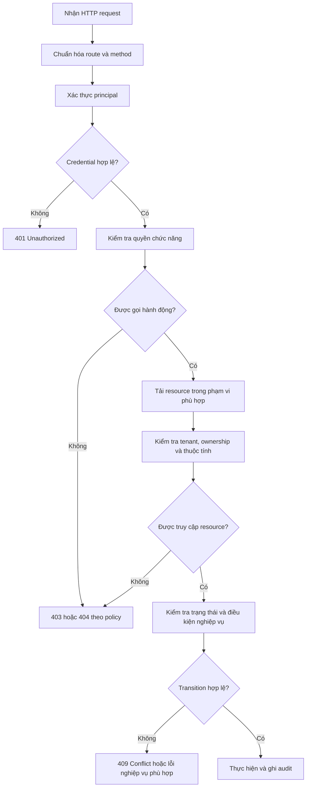

# Không xem REST convention là kiểm soát authorization

Một API tuân thủ REST có thể đặt tên tài nguyên rõ ràng, dùng đúng HTTP method và trả status code hợp lý nhưng vẫn để người dùng đọc hoặc sửa dữ liệu của người khác. `GET /orders/{id}` không tự bảo đảm người gọi chỉ đọc được đơn hàng của mình. `PATCH /users/{id}` không tự giới hạn những trường mà người dùng được phép cập nhật. Một route có vẻ dành cho quản trị cũng không tự xác minh người gọi có quyền quản trị.

Trong module `SECURITY_API_SECURITY`, bảo mật API phải được thiết kế theo từng endpoint, đối tượng dữ liệu và luồng nghiệp vụ. REST convention giúp API có hợp đồng nhất quán và dễ hiểu; authorization phải được thực thi bằng chính sách quyền độc lập, dựa trên danh tính, hành động, đối tượng, thuộc tính và ngữ cảnh nghiệp vụ.

## Mục tiêu học tập

Sau bài này, người học có thể:

- Phân biệt quy ước thiết kế REST/HTTP với cơ chế xác thực và phân quyền.
- Giải thích vì sao HTTP method, URL, UUID, status code, HTTPS hoặc việc ẩn nút trên giao diện không thay thế authorization.
- Xây dựng ma trận quyền theo endpoint, hành động, vai trò, tenant và loại dữ liệu.
- Kiểm tra quyền ở mức chức năng, đối tượng, thuộc tính và trạng thái nghiệp vụ.
- Nhận diện các đường vòng qua method khác, route alias, API version, batch endpoint hoặc chức năng xuất dữ liệu.
- Viết kiểm thử âm tính để phát hiện truy cập chéo người dùng/tenant và thao tác vượt quyền.

## 1. REST convention và authorization giải quyết hai vấn đề khác nhau

REST là phong cách kiến trúc cho các hệ thống phân tán. Trong API HTTP thường gặp, tài nguyên được biểu diễn bằng URI và thao tác được thể hiện qua method. Ví dụ:

| Request | Ý nghĩa theo hợp đồng HTTP/API |
|---|---|
| `GET /orders/42` | Lấy biểu diễn của đơn hàng 42 |
| `POST /orders` | Tạo đơn hàng hoặc khởi tạo một xử lý theo hợp đồng của endpoint |
| `PUT /orders/42` | Thay thế biểu diễn của đơn hàng 42 theo hợp đồng đã công bố |
| `PATCH /orders/42` | Cập nhật một phần đơn hàng 42 |
| `DELETE /orders/42` | Yêu cầu xóa đơn hàng 42 |

Các quy ước này giúp client và server hiểu request có ý nghĩa gì. Chúng không trả lời người gọi có được phép thực hiện thao tác đó hay không.

Authorization là quyết định có cho phép một principal thực hiện một hành động trên một tài nguyên trong một ngữ cảnh cụ thể hay không. Có thể mô hình hóa quyết định như sau:

```text
authorize(subject, action, resource, context) -> allow | deny
```

Trong đó:

- **Subject:** người dùng, service account hoặc workload đang thực hiện request.
- **Action:** hành động nghiệp vụ như đọc, sửa địa chỉ giao hàng, hủy đơn hoặc hoàn tiền.
- **Resource:** đối tượng cụ thể như đơn hàng, hồ sơ, hóa đơn hoặc tệp.
- **Context:** tenant, quan hệ sở hữu, vai trò, trạng thái đơn hàng, thời điểm, mức xác minh hoặc điều kiện nghiệp vụ.

Ví dụ, hai người dùng đều có thể đăng nhập và gọi `GET /orders/42`. Người dùng A là chủ đơn hàng 42 nên được phép đọc; người dùng B không có quan hệ với đơn hàng nên bị từ chối. Cùng một URL và method có thể tạo ra hai quyết định khác nhau vì resource và context gắn với principal khác nhau.

## 2. Vì sao convention không tạo ra ranh giới bảo mật?

### 2.1. HTTP method mô tả ngữ nghĩa, không mô tả quyền

HTTP định nghĩa một số method là *safe* hoặc *idempotent* để client, proxy và cache xử lý request đúng cách. Những thuộc tính này không đồng nghĩa với quyền truy cập:

- `GET` được thiết kế để lấy dữ liệu và là method safe theo ngữ nghĩa HTTP. Nhưng dữ liệu trả về có thể là hồ sơ cá nhân, thông tin thanh toán, báo cáo nội bộ hoặc dữ liệu thuộc tenant khác. Server vẫn phải kiểm tra quyền đọc.
- `POST` thường dùng để tạo tài nguyên hoặc kích hoạt xử lý. Một người dùng có thể được phép tạo yêu cầu của mình nhưng không được tạo yêu cầu thay cho tenant khác hoặc thực hiện thao tác quản trị.
- `PUT` và `PATCH` có thể thay đổi dữ liệu. Việc client biết URI của tài nguyên không chứng minh client có quyền cập nhật tài nguyên hoặc mọi thuộc tính trong payload.
- `DELETE` có ngữ nghĩa xóa theo hợp đồng API, nhưng chỉ principal được cấp quyền và đáp ứng điều kiện nghiệp vụ mới được xóa.
- `HEAD` có thể để lộ metadata như kích thước, thời gian sửa đổi hoặc sự tồn tại của tài nguyên. Cần xem xét quyền và mức độ nhạy cảm của metadata.
- `OPTIONS` thường phục vụ khám phá khả năng hoặc CORS preflight. Không nên để response này tiết lộ thông tin nội bộ không cần thiết; đồng thời CORS không phải cơ chế authorization.

Không thể suy luận rằng `GET` luôn công khai, `POST` luôn cần role quản trị hoặc `DELETE` đã an toàn chỉ vì route khó đoán. Quyền phải được xác định từ nghiệp vụ và kiểm tra ở server.

### 2.2. URL và ID khó đoán không chứng minh quyền sở hữu

Đổi `/orders/42` thành `/orders/550e8400-e29b-41d4-a716-446655440000` làm ID khó đoán hơn, nhưng UUID vẫn chỉ là định danh. Nếu server lấy đối tượng theo ID rồi trả dữ liệu mà không kiểm tra quan hệ giữa principal và đối tượng, lỗi BOLA/IDOR vẫn tồn tại.

Ví dụ request:

```http
GET /api/orders/550e8400-e29b-41d4-a716-446655440000
Authorization: Bearer <access-token-cua-user-B>
```

Nếu đơn hàng thuộc user A mà user B vẫn nhận được dữ liệu, API bị lỗi phân quyền mức đối tượng dù ID dài và khó đoán. Tính bí mật của ID có thể làm giảm khả năng dò tìm nhưng không phải bằng chứng authorization.

### 2.3. Ẩn chức năng trên giao diện chỉ là trải nghiệm người dùng

Frontend có thể ẩn nút xóa hoặc không hiển thị đường dẫn quản trị cho người dùng thường. Người dùng vẫn có thể gửi HTTP request bằng DevTools, curl, script hoặc một client khác. Nếu server chỉ dựa vào việc nút không xuất hiện, endpoint vẫn có thể bị gọi trực tiếp.

Giao diện có thể ẩn hoặc vô hiệu hóa chức năng để tránh gây nhầm lẫn. Server vẫn phải kiểm tra quyền trên mọi request, kể cả request đến từ ứng dụng chính thức.

### 2.4. HTTPS, CORS và status code có mục đích riêng

HTTPS bảo vệ tính bí mật và toàn vẹn của dữ liệu trên đường truyền, đồng thời xác thực server theo mô hình TLS. HTTPS không quyết định người dùng được đọc hồ sơ nào. CORS là policy của trình duyệt về việc JavaScript từ origin nào được phép đọc response; nó không ngăn client ngoài trình duyệt gọi API và không thay thế kiểm tra quyền ở server.

Status code `401`, `403` hoặc `404` chỉ mô tả kết quả HTTP mà server trả về. Trả `403` không có nghĩa endpoint đã được bảo vệ đầy đủ; server phải thực hiện kiểm tra trước khi trả dữ liệu hoặc tạo tác động. Trả `404` cho resource không được phép nhìn thấy có thể là lựa chọn giảm rò rỉ thông tin, nhưng quyết định từ chối phải được thực thi trước khi lộ nội dung.

## 3. Các lỗi authorization thường ẩn sau REST convention

### 3.1. BOLA: gọi đúng endpoint nhưng truy cập sai đối tượng

Một endpoint `GET /orders/{orderId}` có thể được bảo vệ ở mức đăng nhập: chỉ user có access token mới gọi được. Tuy nhiên, nếu server chỉ kiểm tra token hợp lệ rồi truy vấn `findById(orderId)`, người dùng có thể thay ID để đọc đơn hàng của người khác.

Thiết kế không an toàn:

```java
Order order = orderRepository.findById(orderId)
    .orElseThrow(NotFoundException::new);
return mapper.toResponse(order);
```

Đoạn mã trên không thể hiện bất kỳ quan hệ nào giữa principal và đơn hàng. Cần truy vấn trong phạm vi tenant hoặc kiểm tra policy trên đối tượng đã tải:

```java
Order order = orderRepository
    .findByIdAndTenantId(orderId, currentUser.tenantId())
    .orElseThrow(NotFoundException::new);

if (!orderPolicy.canRead(currentUser, order)) {
    throw new AccessDeniedException("Not allowed to read this order");
}

return mapper.toResponse(order);
```

Đây là ví dụ minh họa. Tên repository và policy cần được điều chỉnh theo mô hình dữ liệu thực tế. Nếu một vai trò hỗ trợ được phép đọc đơn hàng của nhiều tenant, policy phải thể hiện rõ quyền hỗ trợ đó, phạm vi tenant được cấp và lý do truy cập; không nên bỏ qua kiểm tra sở hữu cho mọi người dùng.

### 3.2. BFLA: truy cập chức năng vượt quyền

Một API có thể kiểm tra quyền sở hữu đơn hàng nhưng vẫn cho phép mọi user gọi `POST /orders/{id}/refund`. Đây là lỗi phân quyền mức chức năng: principal được xác thực và có thể đọc resource, nhưng không được phép hoàn tiền.

Ví dụ, quyền đọc, cập nhật địa chỉ, hủy đơn và hoàn tiền nên được xem là các hành động riêng. Một user có `order:read` không mặc nhiên có `order:refund`. Một nhân viên hỗ trợ có thể xem trạng thái nhưng chỉ quản lý mới được phê duyệt hoàn tiền vượt hạn mức.

### 3.3. Property-level authorization: sửa hoặc đọc thuộc tính không được phép

`PATCH /users/{id}` có thể kiểm tra user đang đăng nhập và thậm chí kiểm tra đúng chủ tài khoản. Tuy vậy, payload vẫn có thể chứa các thuộc tính nhạy cảm:

```http
PATCH /api/users/1001
Content-Type: application/json

{
  "displayName": "Minh",
  "role": "ADMIN",
  "tenantId": "tenant-other",
  "emailVerified": true
}
```

Nếu server bind trực tiếp toàn bộ JSON vào entity, user có thể thay đổi role, tenant hoặc trạng thái xác minh dù chỉ được phép sửa tên hiển thị. Đây là mass assignment và thiếu property-level authorization.

Server nên dùng DTO đầu vào chỉ chứa trường được phép cập nhật trong use case đó, sau đó kiểm tra quyền cho từng trường nhạy cảm. Response cũng cần được lọc theo quyền: không trả internal note, token, dữ liệu thanh toán hoặc thuộc tính quản trị chỉ vì entity có các trường đó.

### 3.4. Workflow bypass: gọi đúng route nhưng sai trạng thái nghiệp vụ

Giả sử quy trình đơn hàng gồm `DRAFT -> SUBMITTED -> PAID -> SHIPPED`. Nếu API cung cấp `PATCH /orders/{id}` và chấp nhận client gửi trực tiếp `status: SHIPPED`, người dùng có thể bỏ qua bước thanh toán hoặc phê duyệt.

Authorization phải kết hợp quyền và trạng thái hiện tại. Ví dụ, user có thể hủy đơn khi đơn còn `DRAFT` hoặc `SUBMITTED`, nhưng không được hủy sau khi đã giao; nhân viên kho chỉ được chuyển sang `SHIPPED` khi có xác nhận đóng gói hợp lệ. Không để client tự chọn trạng thái đích mà không kiểm tra transition.

## 4. Xây dựng ma trận authorization theo endpoint

Hãy lập danh sách tất cả route và hành động thực tế mà server hỗ trợ. Với mỗi endpoint, ghi rõ principal được phép, phạm vi resource, trường dữ liệu có thể đọc/ghi và điều kiện nghiệp vụ.

Ví dụ minh họa cho hệ thống quản lý đơn hàng:

| Endpoint | Hành động | Quyền/chính sách tối thiểu | Kiểm tra bổ sung |
|---|---|---|---|
| `GET /orders/{id}` | Đọc đơn hàng | `order:read` | Đơn thuộc tenant được phép; lọc trường response |
| `POST /orders` | Tạo đơn | `order:create` | Tenant lấy từ principal; không tin `tenantId` tùy ý trong body |
| `PATCH /orders/{id}/shipping-address` | Sửa địa chỉ | `order:update-address` | Là chủ đơn hoặc principal được ủy quyền; đơn chưa khóa giao hàng |
| `POST /orders/{id}/cancel` | Hủy đơn | `order:cancel` | Chủ đơn/role phù hợp; trạng thái cho phép hủy |
| `POST /orders/{id}/refund` | Hoàn tiền | `order:refund` | Vai trò, hạn mức, trạng thái thanh toán và phê duyệt |
| `GET /admin/orders` | Tìm kiếm toàn hệ thống | `order:admin-read` | Phạm vi tenant và mục đích hỗ trợ được cấp |
| `GET /orders/export` | Xuất dữ liệu | `order:export` | Giới hạn tenant, bộ lọc, số bản ghi và trường nhạy cảm |

Ma trận không nên chỉ ghi role như `USER`, `ADMIN`. Role thường quá thô để mô tả quan hệ sở hữu, tenant, trường dữ liệu và trạng thái nghiệp vụ. Có thể kết hợp role/permission với attribute-based policy hoặc quan hệ trên resource.

Một ma trận hoàn chỉnh cần trả lời:

1. Endpoint có cho phép anonymous, user, service account hay chỉ nhóm vận hành?
2. Principal cần permission nào cho từng hành động?
3. Resource phải thuộc tenant nào hoặc có quan hệ gì với principal?
4. Thuộc tính nào được đọc, tạo, sửa hoặc xóa?
5. Trạng thái và điều kiện nghiệp vụ nào cho phép thao tác?
6. Có route cũ, alias, API version hoặc endpoint batch nào thực hiện cùng hành động không?

## 5. Các đường vòng cần rà soát

Kiểm soát quyền ở một route chưa đủ nếu cùng hành động có thể đi qua route khác. Hãy kiểm tra toàn bộ bề mặt API, bao gồm:

| Đường vòng | Ví dụ | Cách kiểm soát |
|---|---|---|
| HTTP method khác | `GET /users/{id}` được kiểm tra nhưng `HEAD /users/{id}` để lộ metadata | Rà soát mọi method được bật và kiểm tra quyền tương ứng |
| Route alias hoặc API version cũ | `/v1/admin/users` bị bảo vệ nhưng `/legacy/users/update` không có policy | Duy trì inventory route; áp dụng policy nhất quán và loại bỏ endpoint hết hạn |
| Method override | Proxy hoặc framework cho phép `_method=DELETE` hay `X-HTTP-Method-Override` | Chỉ bật khi thật sự cần; chuẩn hóa method trước authorization và test qua proxy thực tế |
| Batch/bulk endpoint | `POST /orders/bulk-update` nhận danh sách ID thuộc nhiều tenant | Kiểm tra quyền riêng trên từng đối tượng và giới hạn số lượng |
| Export/download | Endpoint tải CSV hoặc file bỏ qua policy của endpoint xem chi tiết | Áp dụng cùng quyền trên từng bản ghi và từng trường xuất ra |
| Nested resource | `/customers/{customerId}/orders/{orderId}` chỉ kiểm tra orderId | Kiểm tra quan hệ giữa customer, order, tenant và principal |
| Content negotiation | JSON response đã lọc nhưng CSV/XML trả entity đầy đủ | Áp dụng property-level filtering cho mọi representation |
| Background job | API tạo job xuất dữ liệu rồi worker chạy bằng service account quyền rộng | Lưu principal, tenant, phạm vi được ủy quyền và xác minh lại khi worker thực thi |

Đặc biệt, batch và tác vụ nền dễ tạo ra khoảng cách giữa người khởi tạo và principal thực thi. Không để một service account có quyền toàn hệ thống biến yêu cầu giới hạn của người dùng thành tác vụ không giới hạn.

## 6. Đặt kiểm tra ở đúng lớp

### 6.1. Xác thực trước, authorization sau

Xác thực trả lời principal là ai và credential có hợp lệ không. Authorization trả lời principal đó được làm gì. Nếu không xác định được principal hoặc không có policy cho phép rõ ràng, mặc định từ chối.

Một luồng xử lý điển hình:



Sơ đồ thể hiện thứ tự khái quát. Có thể tải resource trước khi kiểm tra quyền đối tượng vì policy cần dữ liệu resource; khi đó phải tránh trả hoặc ghi log dữ liệu nhạy cảm trước khi quyết định. Với một số hệ thống, truy vấn đã giới hạn theo tenant giúp không tải được đối tượng ngoài phạm vi ngay từ đầu.

### 6.2. Gateway là lớp phòng thủ bổ sung

API Gateway có thể xác thực token, giới hạn tốc độ, chặn route không công khai và áp dụng policy coarse-grained. Tuy nhiên, gateway thường không có đủ dữ liệu nghiệp vụ để biết user có sở hữu đơn hàng cụ thể hay được phép sửa trường `refundAmount` hay không.

Service sở hữu dữ liệu phải thực thi authorization cuối cùng trên endpoint, resource và thuộc tính của chính nó. Nếu chỉ bảo vệ gateway, request nội bộ, route bị lộ hoặc một service khác gọi trực tiếp có thể đi vòng qua quyết định quyền.

### 6.3. Kiểm tra cả ở service và tầng dữ liệu

Có thể đưa điều kiện tenant hoặc ownership vào câu truy vấn để giảm nguy cơ trả nhầm dữ liệu:

```sql
SELECT id, status, total_amount, shipping_address
FROM orders
WHERE id = :order_id
  AND tenant_id = :authenticated_tenant_id;
```

`authenticated_tenant_id` phải được lấy từ principal đã xác minh hoặc context tin cậy, không lấy trực tiếp từ query parameter hay body của client. Với policy phức tạp, service vẫn cần kiểm tra quyền theo quan hệ và hành động. Truy vấn có điều kiện giúp thu hẹp tập resource nhưng không tự giải quyết mọi quy tắc như quyền hỗ trợ, trạng thái nghiệp vụ hoặc quyền trên từng trường.

### 6.4. Không để lỗi cấu hình tạo quyền mặc định

Các lỗi thường gặp gồm route mới không có policy, annotation bị bỏ quên, middleware chỉ chạy ở một router, rule khớp sai thứ tự hoặc policy service gặp lỗi nhưng ứng dụng vẫn cho phép request. Nên có policy mặc định từ chối, kiểm tra cấu hình khi khởi động và test các route nhạy cảm. Nếu hệ thống phân quyền không sẵn sàng, không tự động chuyển sang chế độ allow.

## 7. Ví dụ triển khai trong Spring Security

Giả sử endpoint lấy đơn hàng cần hai lớp kiểm tra: principal có quyền đọc đơn hàng và đơn hàng thuộc phạm vi mà principal được phép truy cập.

```java
@RestController
@RequestMapping("/api/orders")
class OrderController {
    private final OrderService orderService;

    OrderController(OrderService orderService) {
        this.orderService = orderService;
    }

    @GetMapping("/{orderId}")
    @PreAuthorize("hasAuthority('order:read')")
    OrderResponse getOrder(
            @PathVariable UUID orderId,
            Authentication authentication) {
        return orderService.getVisibleOrder(authentication, orderId);
    }
}
```

`@PreAuthorize` ở đây kiểm tra quyền chức năng. Service tiếp tục kiểm tra resource:

```java
@Service
class OrderService {
    private final OrderRepository orderRepository;
    private final OrderPolicy orderPolicy;
    private final OrderMapper orderMapper;

    OrderResponse getVisibleOrder(Authentication authentication, UUID orderId) {
        CurrentUser actor = currentUser(authentication);
        Order order = orderRepository
            .findByIdAndTenantId(orderId, actor.tenantId())
            .orElseThrow(NotFoundException::new);

        if (!orderPolicy.canRead(actor, order)) {
            throw new AccessDeniedException("Order access denied");
        }

        return orderMapper.toResponse(order, actor);
    }
}
```

Đây là ví dụ rút gọn để minh họa ranh giới giữa quyền chức năng và quyền trên đối tượng. Ứng dụng thực tế cần cấu hình method security, ánh xạ principal đáng tin cậy, xử lý exception nhất quán và bảo đảm mapper chỉ trả những trường principal được phép xem.

Với cập nhật, hãy dùng command/DTO riêng cho từng use case:

```java
record ChangeShippingAddressRequest(String address, String postalCode) {}

@PatchMapping("/{orderId}/shipping-address")
@PreAuthorize("hasAuthority('order:update-address')")
OrderResponse changeAddress(
        @PathVariable UUID orderId,
        @Valid @RequestBody ChangeShippingAddressRequest request,
        Authentication authentication) {
    return orderService.changeShippingAddress(authentication, orderId, request);
}
```

DTO chỉ chứa hai trường địa chỉ có thể thay đổi qua use case này. Service vẫn phải xác minh quan hệ với đơn hàng, tenant, trạng thái giao hàng và các điều kiện nghiệp vụ. Không nhận trực tiếp entity JPA làm request body.

## 8. Status code và thông tin lỗi

HTTP status code nên phản ánh kết quả xử lý nhất quán:

| Tình huống | Response thường dùng | Ghi chú |
|---|---|---|
| Thiếu hoặc credential không hợp lệ | `401 Unauthorized` | Có thể kèm `WWW-Authenticate` theo cơ chế xác thực |
| Principal hợp lệ nhưng không có quyền | `403 Forbidden` | Dùng khi có thể tiết lộ sự tồn tại của resource theo policy |
| Resource không tồn tại hoặc được cố ý che giấu | `404 Not Found` | Có thể dùng để tránh xác nhận resource thuộc người khác |
| Request hợp lệ về cú pháp nhưng xung đột trạng thái | `409 Conflict` | Ví dụ đơn hàng đã giao nên không thể hủy |
| Payload không hợp lệ | `400 Bad Request` hoặc `422 Unprocessable Content` | Theo quy ước API; không tiết lộ dữ liệu nhạy cảm trong lỗi validation |

Không nên dùng status code như một lớp bảo mật thay cho kiểm tra quyền. Chọn `403` hay `404` cần nhất quán và không được làm lộ tên, trạng thái, chủ sở hữu hoặc thuộc tính của resource mà caller không có quyền xem.

## 9. Kiểm thử authorization theo endpoint và đối tượng

Mỗi endpoint cần có kiểm thử cho người được phép và người không được phép. Không chỉ test một user có role `USER` và một user có role `ADMIN`; hãy tạo các principal thuộc tenant khác nhau, resource có chủ sở hữu khác nhau và các trạng thái nghiệp vụ khác nhau.

| Nhóm kiểm thử | Thử nghiệm | Kết quả mong đợi |
|---|---|---|
| Authentication | Không token, token hết hạn, token sai issuer/audience | Không thực hiện nghiệp vụ |
| Function-level | User chỉ có `order:read` gọi endpoint refund | Bị từ chối |
| Object-level | User B thay ID để đọc hoặc sửa đơn hàng của user A | Không đọc hoặc thay đổi resource của A |
| Tenant isolation | User tenant A gửi `tenantId` của tenant B trong body/query | Server vẫn giới hạn theo tenant đã xác thực |
| Property-level read | User thường gọi API hồ sơ có trường quản trị | Response không chứa trường không được phép |
| Property-level write | Thêm `role`, `tenantId`, `ownerId` hoặc `status` vào PATCH | Trường bị từ chối hoặc bỏ qua theo hợp đồng rõ ràng; không thay đổi dữ liệu nhạy cảm |
| Workflow | Gọi hủy đơn sau khi giao hoặc đánh dấu đã thanh toán từ client | Transition bị từ chối |
| Alternate route | Thử API version cũ, alias, HEAD, batch và export | Cùng chính sách quyền được áp dụng |
| Direct API call | Gọi endpoint trực tiếp khi frontend đã ẩn nút chức năng | Server vẫn từ chối nếu caller thiếu quyền |
| Failure mode | Policy engine hoặc kho quyền không sẵn sàng | Fail closed; không cho phép mặc định |

Kiểm thử cần xác nhận cả response lẫn side effect. Ví dụ, request PATCH bị trả `403` nhưng dữ liệu vẫn thay đổi là lỗi nghiêm trọng. Với thao tác tạo, hoàn tiền hoặc gửi thông báo, hãy kiểm tra database, event và hệ thống downstream để chắc chắn không có tác động ngoài ý muốn.

## 10. Audit, logging và giám sát

Với endpoint nhạy cảm, log audit nên ghi principal, action, resource ID, tenant, kết quả allow/deny, correlation ID và lý do policy ở mức an toàn. Không ghi access token, secret hoặc toàn bộ payload chứa dữ liệu cá nhân. Có thể theo dõi:

- Một principal liên tục thay ID để truy cập resource không thuộc phạm vi.
- Tỷ lệ `403`/`404` tăng bất thường ở một endpoint.
- User thường gọi route quản trị, export hoặc batch.
- Một service gọi endpoint ngoài allowlist hoặc sử dụng permission chưa từng xuất hiện.
- Số lượng bản ghi được export tăng đột biến hoặc request có page size bất thường.
- Các request cập nhật thuộc tính nhạy cảm hoặc thực hiện transition không hợp lệ.

Log cần đủ thông tin để điều tra nhưng phải tuân thủ chính sách bảo vệ dữ liệu, phân quyền người xem và thời hạn lưu. Không dùng correlation ID hoặc user ID do client gửi làm bằng chứng danh tính; các giá trị này chỉ phục vụ truy vết sau khi được kiểm chứng hoặc gắn với context tin cậy.

## 11. Checklist trước khi phát hành API

- [ ] Đã liệt kê mọi route, HTTP method, API version, alias và endpoint nội bộ.
- [ ] Mỗi endpoint có principal và permission được xác định rõ; mặc định từ chối khi chưa có policy.
- [ ] `GET`, `HEAD`, export và download được xem xét về quyền đọc và metadata.
- [ ] Mọi thao tác trên ID đều kiểm tra tenant, ownership hoặc quan hệ được ủy quyền.
- [ ] Quyền chức năng như đọc, sửa, xóa, hủy, phê duyệt và hoàn tiền được tách biệt.
- [ ] Request DTO chỉ nhận trường cần thiết; response chỉ trả trường caller được phép xem.
- [ ] Trạng thái nghiệp vụ và transition được xác minh phía server.
- [ ] Batch, nested resource, background job và webhook giữ nguyên ngữ cảnh quyền cần thiết.
- [ ] Gateway có thể chặn sớm nhưng service sở hữu dữ liệu vẫn kiểm tra quyền cuối cùng.
- [ ] CORS, HTTPS và việc ẩn nút giao diện không được coi là authorization.
- [ ] Có test âm tính cho truy cập chéo user/tenant, mass assignment, route alias và workflow bypass.
- [ ] Log audit đủ truy vết nhưng không chứa token, secret hoặc dữ liệu nhạy cảm không cần thiết.

## Kết luận

REST convention làm cho API dễ dự đoán và nhất quán, còn authorization quyết định principal nào được thực hiện hành động nào trên đối tượng và dữ liệu nào. Một route đúng tên, đúng HTTP method, dùng UUID, chạy qua HTTPS hoặc được ẩn trên giao diện vẫn có thể bị lạm dụng nếu server không kiểm tra quyền. Hãy thiết kế ma trận quyền theo endpoint, resource, thuộc tính và trạng thái nghiệp vụ; thực thi ở service sở hữu dữ liệu; rồi kiểm thử cả các đường gọi trực tiếp, route thay thế và tác động thực tế.
