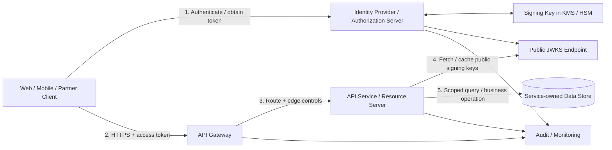
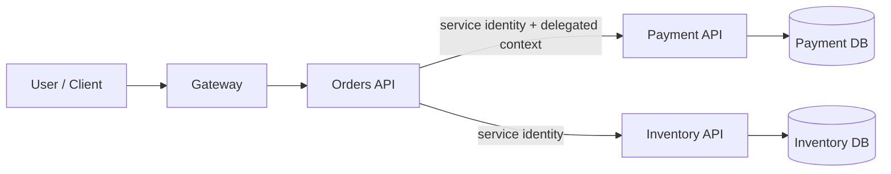
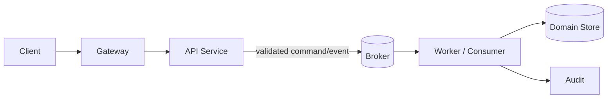
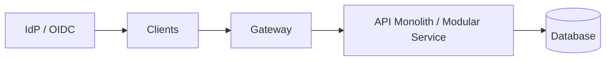
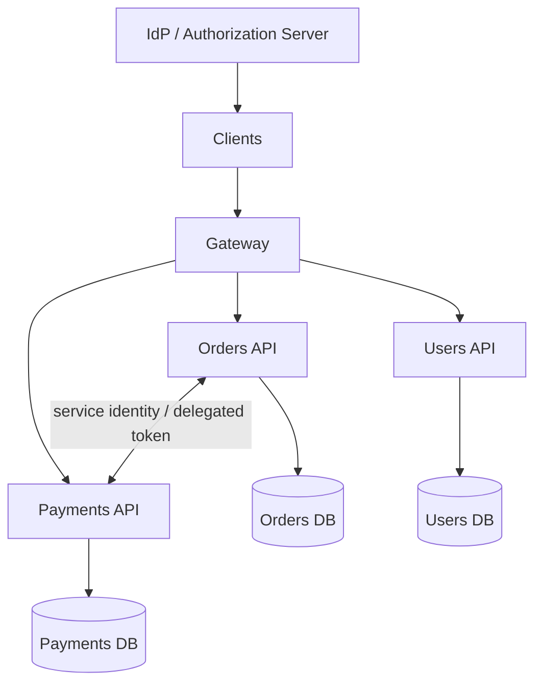
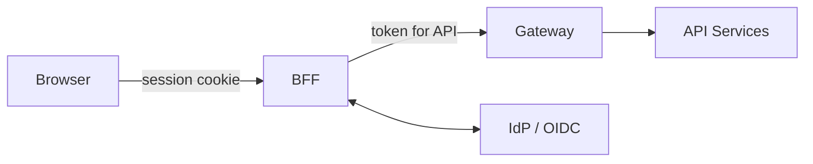

# Client, gateway, identity provider và API service

Một kiến trúc API an toàn cần xác định rõ client, API gateway, identity provider (IdP) và API service chịu trách nhiệm gì, tin cậy dữ liệu nào và kiểm tra quyền ở đâu. Bốn thành phần này phối hợp với nhau nhưng không thay thế vai trò của nhau:

- **Client** khởi tạo request và giữ credential trong phạm vi có thể bảo vệ của ứng dụng; mọi input từ client đều phải được xem là không đáng tin.
- **Identity provider / Authorization Server** xác thực người dùng hoặc client, quản lý phiên và phát hành token theo OAuth 2.0 / OpenID Connect (OIDC).
- **API gateway** là điểm vào tập trung để định tuyến và thực thi các kiểm soát biên như TLS, giới hạn lưu lượng, request size và policy truy cập tổng quát.
- **API service** xác minh danh tính của caller, kiểm tra quyền trên chức năng và object, validate dữ liệu, thực thi business rule và bảo vệ dữ liệu.

Một request đi qua gateway không có nghĩa nó tự động hợp lệ. API service vẫn phải xác minh access token hoặc workload identity, kiểm tra audience/scope phù hợp và quyết định caller có được thao tác trên resource cụ thể hay không. Đây là ranh giới quan trọng để ngăn BOLA/IDOR, function-level authorization lỗi và các đường truy cập trực tiếp bỏ qua gateway.

## 1. Bức tranh kiến trúc tổng thể

Sơ đồ tham chiếu cho một API platform có client bên ngoài, gateway, IdP và các service phía sau:



Sơ đồ này thể hiện các thành phần logic. Trong triển khai thực tế, gateway có thể xác minh token trước để từ chối request sớm; API service vẫn cần xác minh credential theo trust model của nó. Với JWT, service có thể xác minh chữ ký bằng public key đã cache từ JWKS; với opaque token, service có thể dùng introspection hoặc một cơ chế xác minh được tổ chức phê duyệt.

### 1.1. Trust boundaries

Không nên xem toàn bộ đường đi là một vùng tin cậy duy nhất. Có ít nhất các ranh giới:

1. Client và Internet.
2. Client và IdP.
3. Client và gateway.
4. Gateway và API service.
5. Service và service khác.
6. Service và database/cache/object storage.
7. Service và broker/worker.
8. Workload và KMS/secret manager.

Mỗi ranh giới cần xác định danh tính hai phía, cơ chế bảo vệ kênh, dữ liệu được phép đi qua và hành vi khi xác minh thất bại.

### 1.2. Hai loại identity thường cùng tồn tại

Trong một request có thể có:

- **End-user identity:** người dùng đang thực hiện hành động, ví dụ user A.
- **Workload/client identity:** ứng dụng hoặc service đang gửi request, ví dụ mobile app, partner integration hoặc orders API.

Hai identity trả lời hai câu hỏi khác nhau. Client application được phép gọi API không có nghĩa user hiện tại được đọc mọi order. Tương tự, user có quyền đọc order không có nghĩa một workload bất kỳ được phép giả làm user đó.

## 2. Trách nhiệm và giới hạn của từng thành phần

| Thành phần | Trách nhiệm chính | Không nên được coi là |
|---|---|---|
| Client | Lưu token an toàn, gửi request đúng contract, xử lý session và lỗi | Nguồn đáng tin để khai báo user ID, tenant, role hoặc quyền |
| IdP / Authorization Server | Xác thực principal, quản lý client, phát hành/thu hồi token, cung cấp signing keys | Nơi quyết định mọi object-level business rule của từng API |
| API Gateway | TLS, routing, request limits, coarse-grained access, rate limit, WAF và telemetry | Lớp duy nhất chống BOLA hoặc bảo vệ backend khi có đường bypass |
| API Service | Validate token/caller, authorization chức năng/object, validation, business rule và data protection | Thành phần được phép tin mọi header do gateway/client chuyển tiếp |
| Database / Storage | Enforce credential/role, tenant isolation, constraints và encryption theo thiết kế | Nơi có thể dựa vào gateway để bỏ qua authorization của service |

Các kiểm soát có thể được triển khai ở nhiều tầng. Ví dụ gateway và service đều xác minh JWT, nhưng service vẫn phải có policy riêng trên object. Defense in depth chỉ hiệu quả khi mỗi tầng có trách nhiệm cụ thể, không phải khi mọi tầng cùng tin rằng tầng khác đã kiểm tra.

## 3. Client: điểm bắt đầu của request

Client có thể là browser SPA, server-rendered web application, mobile app, desktop app, partner system hoặc một service gọi API. Khả năng giữ bí mật và cách xác thực của từng loại khác nhau.

### 3.1. Browser SPA

SPA chạy trong browser của người dùng là public client. Không thể bảo vệ một client secret được nhúng trong JavaScript bundle; người dùng hoặc attacker có thể đọc nó.

Với OAuth 2.0 / OIDC, SPA thường dùng Authorization Code Flow với PKCE:

1. Client tạo `code_verifier` ngẫu nhiên có entropy phù hợp, tính `code_challenge` bằng S256 và tạo giá trị `state` ngẫu nhiên.
2. Với OIDC, client tạo thêm `nonce` và lưu các giá trị giao dịch để kiểm tra callback.
3. Client chuyển user tới authorization endpoint của IdP.
4. IdP xác thực user và thực hiện consent/authorization nếu cần.
5. IdP redirect về callback URI đã đăng ký với authorization code và `state`.
6. Client xác minh `state`, đổi code cùng `code_verifier` để lấy token; client xác minh `nonce` trong ID token theo OIDC.
7. Client gửi access token tới API qua HTTPS.

PKCE ràng buộc authorization code với client đã khởi tạo flow, giúp giảm nguy cơ code interception. Nó không biến SPA thành confidential client và không bảo vệ token nếu JavaScript/XSS đã bị compromise.

### 3.2. Web application có backend

Với mô hình Backend for Frontend (BFF), browser giữ session cookie của BFF; backend giữ token và gọi API thay browser. Cookie nên có thuộc tính `Secure`, `HttpOnly`, `SameSite` phù hợp và CSRF protection theo cách ứng dụng xác thực request.

Ưu điểm của BFF:

- Access/refresh token không cần nằm trong JavaScript runtime của browser.
- Backend có thể quản lý refresh, rotation và logout.
- Browser chỉ giao tiếp với origin của ứng dụng.

BFF vẫn cần authorization ở API service. Cookie session của BFF không tự chứng minh user có quyền trên mọi object. Cần bảo vệ CSRF, session fixation, XSS và phân quyền ở backend.

### 3.3. Native mobile app

Mobile app cũng là public client; không nhúng client secret cố định vào app binary. Dùng system browser và Authorization Code + PKCE theo hướng dẫn OAuth native apps. Redirect URI cần được đăng ký và bảo vệ khỏi app khác chiếm callback.

Token nên được lưu trong secure storage của hệ điều hành khi cần persistence. Tránh log token, đưa token vào clipboard, analytics event hoặc URL. Không xem device ID hoặc app version do client gửi là bằng chứng authentication.

### 3.4. Partner hoặc machine client

Partner integration hoặc backend workload có thể là confidential client nếu có khả năng giữ credential an toàn. Dùng cơ chế phù hợp như `client_credentials`, `private_key_jwt`, mTLS hoặc workload identity federation theo trust model. `client_credentials` đại diện cho chính workload/client; không tự tạo ra user identity hay quyền delegated thay người dùng.

Không cấp quyền rộng chỉ vì client là partner. Credential phải gắn với partner/service cụ thể, audience rõ, scope tối thiểu, expiry/rotation và audit.

### 3.5. Client input luôn không đáng tin

Các giá trị sau có thể bị sửa bởi người dùng hoặc malware:

- `userId`, `tenantId`, `accountId`, `ownerId`.
- Role, permission, `isAdmin`, `isInternal`.
- Giá, discount, trạng thái payment hoặc approval.
- `X-Forwarded-*`, `X-User-*`, `X-Tenant-*` nếu không được gateway quản lý theo trust contract.
- Resource ID, pagination, filter, sort và callback URL.

Server phải lấy identity từ authentication context đã xác minh và kiểm tra object relationship trên server. Client có thể gửi resource ID để chỉ ra đối tượng muốn thao tác; ID đó không chứng minh quyền truy cập.

## 4. Identity Provider và Authorization Server

IdP xác thực user hoặc client và cung cấp token/identity assertion cho các thành phần khác. Trong OAuth 2.0, authorization server phát hành access token; OIDC bổ sung ID token và user authentication claims.

### 4.1. Authentication và authorization

Phân biệt:

- **Authentication:** principal là ai hoặc client nào đang kết nối?
- **Authorization:** principal đó được phép thực hiện hành động nào trên resource nào?

IdP thường xác minh password, passkey, MFA, federated identity hoặc client credential. Nó có thể đưa scope/role vào token, nhưng API service vẫn phải áp dụng policy theo resource và business context.

Ví dụ user có `orders.read` scope có thể được phép gọi nhóm API đọc order. Service vẫn cần kiểm tra order có thuộc tenant/owner/share scope của user đó không.

### 4.2. OAuth 2.0 và OpenID Connect

OAuth 2.0 là framework ủy quyền truy cập resource; OIDC là lớp identity trên OAuth 2.0. ID token dành cho client để biết kết quả authentication và claims của user. Access token dành cho resource server/API.

Không gửi ID token tới API thay access token. API service phải kiểm tra access token theo audience và profile dành cho chính API đó.

### 4.3. Token claims cần thiết

Một access token có thể chứa các claim như:

| Claim | Ý nghĩa | Kiểm tra tại resource server |
|---|---|---|
| `iss` | Issuer | Phải là issuer được tin cậy |
| `sub` | Subject/principal | Ánh xạ tới user/client theo contract |
| `aud` | Audience | Phải bao gồm API đang xử lý |
| `exp` | Expiration | Không chấp nhận token đã hết hạn |
| `nbf` | Not before | Không chấp nhận token chưa có hiệu lực |
| `iat` | Issued at | Dùng cho policy thời gian/điều tra |
| `scope` hoặc `scp` | Delegated permissions | Map theo convention đã thống nhất |
| `client_id` / `azp` | Client application | Xác định ứng dụng gọi theo token profile |
| `tenant` / custom claim | Context tenant | Chỉ tin nếu issuer và claim mapping đã được xác minh |

Không phải token nào cũng có cùng claim hoặc cùng tên. Hãy định nghĩa token profile giữa IdP và resource server, tránh tự đoán claim.

### 4.4. Lifetime, refresh và thu hồi token

Access token nên có lifetime phù hợp với mức rủi ro và khả năng refresh của client. Token sống lâu làm tăng khoảng thời gian attacker có thể dùng token bị đánh cắp. Refresh token cần được bảo vệ chặt hơn access token; áp dụng rotation/reuse detection và thu hồi theo khả năng của IdP.

Với JWT được xác minh offline, việc logout hoặc revoke ở IdP thường không làm mọi resource server lập tức biết token đã bị thu hồi. Các lựa chọn gồm access token ngắn hạn, introspection, denylist/revocation signal có kiểm soát hoặc cơ chế session/version claim. Chọn theo yêu cầu latency, availability và thời gian thu hồi chấp nhận được; không tuyên bố JWT có thể revoke tức thời nếu service chỉ kiểm tra chữ ký và expiry.

Với opaque token/introspection, trạng thái active có thể được kiểm tra tập trung nhưng cache kết quả vẫn tạo một cửa sổ thu hồi. TTL cache phải nằm trong policy.

### 4.5. Token phải có audience phù hợp

Token phát hành cho API A không nên tự động được chấp nhận bởi API B. Resource server phải kiểm tra `aud` và issuer. Nếu cần gọi API B, client/service nên lấy token dành cho API B theo authorization server policy hoặc token exchange.

Chỉ kiểm tra chữ ký hợp lệ là chưa đủ. Token có thể được ký đúng nhưng phát hành cho một resource khác, một issuer không được chấp nhận hoặc một client không có quyền gọi API này.

### 4.6. Signing key và JWKS

Với JWT ký bất đối xứng, IdP giữ private signing key và công bố public keys qua JWKS. API service dùng public key để xác minh chữ ký.

Thực hành:

- Pin issuer và cấu hình JWKS URI từ nguồn tin cậy; không lấy key URL tùy ý từ token.
- Chỉ cho phép thuật toán nằm trong allowlist của token profile.
- Xử lý `kid` không biết theo policy; có thể refresh JWKS có giới hạn khi key vừa rotate.
- Cache public key với TTL hợp lý, hỗ trợ overlap khi rotation.
- Không dùng chung key cho signing token và mục đích không liên quan.
- Theo dõi key rotation và thời gian phân phối tới gateway/service.

Không tự tải JWKS từ URL trong header `jku` hoặc claim do attacker kiểm soát nếu profile không cho phép và không có allowlist nghiêm ngặt.

### 4.7. Opaque token và introspection

Opaque access token không chứa claims tự xác minh như JWT. Resource server có thể gọi introspection endpoint của authorization server để biết token còn active và lấy metadata cần thiết.

Ưu điểm là trạng thái token có thể được kiểm tra tập trung; nhược điểm là thêm network dependency và latency. Cache introspection result cần cân bằng giữa hiệu năng và tốc độ thu hồi. Khi IdP/introspection unavailable, service phải có failure policy rõ, không tự coi token là hợp lệ.

## 5. API Gateway: điểm vào và kiểm soát biên

Gateway thường đứng trước nhiều API service để định tuyến và áp dụng các policy chung. Nó giúp giảm tải các kiểm soát lặp lại và tạo điểm quan sát traffic.

### 5.1. Trách nhiệm phù hợp của gateway

- TLS termination hoặc TLS pass-through theo kiến trúc.
- Routing theo host/path/version.
- Request size, header size, timeout và connection limits.
- Rate limiting/quota theo client, principal, IP hoặc route.
- WAF/bot protection và một số kiểm tra protocol.
- CORS policy nếu gateway là nơi quản lý browser edge.
- Kiểm tra token sơ bộ hoặc request-level authorization.
- Chuẩn hóa correlation ID và telemetry.
- Chặn route không công khai, chỉ cho phép network/workload phù hợp.

### 5.2. Gateway không thay thế authorization trong service

Gateway thường không có đủ ngữ cảnh nghiệp vụ để quyết định:

- User A có được đọc order ID cụ thể không?
- User có được xem account thuộc tenant khác không?
- Payment này có thể refund theo trạng thái hiện tại không?
- Caller có quyền sửa field `riskStatus` không?
- Một command đã được thực thi trước đó chưa?

Các quyết định này thuộc API/domain service. Nếu chỉ dựa vào gateway, các đường bypass như internal route, misconfiguration, alternate ingress hoặc message listener có thể bỏ qua policy.

### 5.3. Direct backend access và network boundary

Backend service không nên công khai trực tiếp ra Internet nếu thiết kế yêu cầu gateway là ingress. Nhưng network private không tự chứng minh request hợp lệ. Một workload nội bộ bị compromise vẫn có thể gọi service khác.

Kiểm soát nên gồm:

- Private ingress/service network và firewall/security group.
- Chỉ gateway/workload được phép kết nối tới endpoint phù hợp.
- mTLS hoặc workload identity giữa gateway và backend khi cần xác minh caller.
- API service tự xác minh end-user token hoặc delegated identity theo contract.
- Test cả đường gateway và đường backend nội bộ được cho phép.
- Chặn đường truy cập ngoài dự kiến ở load balancer, service mesh và cluster ingress.

### 5.4. Gateway identity headers

Một số gateway có thể thêm header như `X-Authenticated-User`, `X-Principal`, `X-Tenant` hoặc `X-Scopes`. Header chỉ đáng tin nếu:

1. Gateway xóa header cùng tên do client gửi trước khi tạo giá trị mới.
2. Backend chỉ nhận request từ gateway/workload đã xác thực.
3. Kênh gateway-backend được bảo vệ và identity của gateway được xác minh.
4. Header format, issuer, expiry và semantics được quy định rõ.
5. Backend không chấp nhận cùng header từ ingress khác hoặc client trực tiếp.

Ngay cả khi các điều kiện này được đáp ứng, cần quyết định header là identity assertion hay chỉ metadata. Với quyền quan trọng, signed assertion hoặc token có audience/service identity thường dễ xác minh hơn header thuần.

Không lấy `X-User-ID` hoặc `X-Role` trực tiếp từ client làm authentication context.

### 5.5. Forwarding headers và proxy trust

`Forwarded`, `X-Forwarded-For`, `X-Forwarded-Host` và `X-Forwarded-Proto` có thể bị giả mạo nếu proxy chain không được cấu hình đúng. Chỉ tin header do proxy nằm trong trusted proxy list ghi đè. Không dùng IP từ header bất kỳ làm căn cứ duy nhất cho authorization hoặc fraud decision.

Gateway cần chuẩn hóa header, xóa giá trị không được phép, giới hạn kích thước và tránh chuyển tiếp credential/secret không cần thiết.

## 6. API Service là Resource Server và Policy Enforcement Point

API service nhận request và là nơi cuối cùng chịu trách nhiệm không cho phép thao tác trái quyền trên dữ liệu/nghiệp vụ mà nó sở hữu.

### 6.1. Xác minh credential tại service

Với JWT access token, resource server thường kiểm tra:

- Chữ ký theo public key/algorithm profile tin cậy.
- `iss` đúng issuer được cấu hình.
- `aud` có API/service này.
- `exp`, `nbf` và thời gian hợp lệ.
- Scope/authority theo mapping của API.
- Token type/profile và client identity khi cần.

Với opaque token, dùng introspection theo policy và kiểm tra active, audience/scope/client context theo contract. Không chấp nhận token chỉ vì gateway đã nói request authenticated nếu backend không có trust contract an toàn cho assertion đó.

### 6.2. Ví dụ Spring Security Resource Server

Một cấu hình minh họa cho JWT:

```java
@Bean
SecurityFilterChain apiSecurity(HttpSecurity http) throws Exception {
    return http
        .authorizeHttpRequests(authorize -> authorize
            .requestMatchers("/actuator/health").permitAll()
            .requestMatchers("/api/**").authenticated()
            .anyRequest().denyAll()
        )
        .oauth2ResourceServer(oauth2 -> oauth2
            .jwt(Customizer.withDefaults())
        )
        .build();
}
```

Issuer/JWK configuration nên được cấu hình rõ bằng properties hoặc `JwtDecoder` bean. Ví dụ kiểm tra issuer và audience:

```java
@Bean
JwtDecoder jwtDecoder() {
    NimbusJwtDecoder decoder = NimbusJwtDecoder
        .withJwkSetUri("https://id.example.com/.well-known/jwks.json")
        .build();

    OAuth2TokenValidator<Jwt> issuerAndTime =
        JwtValidators.createDefaultWithIssuer("https://id.example.com/issuer");

    OAuth2TokenValidator<Jwt> audience = jwt -> {
        if (jwt.getAudience().contains("orders-api")) {
            return OAuth2TokenValidatorResult.success();
        }
        return OAuth2TokenValidatorResult.failure(
            new OAuth2Error("invalid_token", "Required audience is missing", null)
        );
    };

    decoder.setJwtValidator(
        new DelegatingOAuth2TokenValidator<>(issuerAndTime, audience)
    );
    return decoder;
}
```

Đây là ví dụ minh họa cho Spring Security Resource Server. JWK Set URI và issuer phải đến từ cấu hình tin cậy của IdP; validator ở trên kiểm tra issuer và thời gian mặc định cùng audience tùy chỉnh. Cần điều chỉnh URI, audience, claim mapping và error handling theo token profile thực tế. Không copy URL minh họa vào production.

### 6.3. Map scope thành authority

Spring Resource Server có thể map scope claim thành authority có prefix `SCOPE_` theo mặc định. Ví dụ scope `orders.read` có thể thành `SCOPE_orders.read`. Nếu method policy dùng `hasAuthority('order:read')`, cần converter/mapping rõ ràng giữa claim và authority.

Không giả định tên scope tự động giống tên permission nội bộ. Hãy có bảng mapping và test token thật.

## 7. Authorization tại API service

Sau authentication, service phải quyết định caller được phép làm gì.

### 7.1. Function-level authorization

Mỗi action có permission phù hợp:

| Action | Permission minh họa |
|---|---|
| Đọc order | `order:read` |
| Sửa order | `order:update` |
| Hủy order | `order:cancel` |
| Refund payment | `payment:refund` |
| Export dữ liệu | `customer:export` |
| Quản trị user | `user:admin` |

Tránh chỉ có một role chung `USER` hoặc `ADMIN` nếu các thao tác có rủi ro khác nhau.

### 7.2. Object-level authorization

Permission `order:read` chỉ nói caller được đọc một loại resource. Nó không tự cho phép đọc mọi order.

Ví dụ:

```java
@PreAuthorize("hasAuthority('order:read')")
public OrderView getOrder(UUID orderId) {
    AppPrincipal principal = currentPrincipal.require();

    Order order = orders.findByIdAndTenantId(
        orderId,
        principal.tenantId()
    ).orElseThrow(OrderNotFoundException::new);

    return mapper.toView(order);
}
```

Query ràng buộc tenant giúp tránh tải object ngoài phạm vi. Nếu có chia sẻ object, delegation hoặc support access, policy cần kiểm tra relationship tương ứng. Không dùng `tenantId` do client gửi làm tenant context có thẩm quyền.

### 7.3. Business authorization

Có quyền gọi `order:cancel` không có nghĩa order nào cũng có thể hủy. Service/domain phải kiểm tra trạng thái, thời hạn, payment status, ownership và các invariant trước side effect.

Ví dụ:

```java
@PreAuthorize("hasAuthority('order:cancel')")
@Transactional
public void cancelOrder(UUID orderId) {
    AppPrincipal principal = currentPrincipal.require();
    Order order = orders.findByIdAndTenantId(orderId, principal.tenantId())
        .orElseThrow(OrderNotFoundException::new);

    order.cancelBy(principal.userId()); // domain kiểm tra trạng thái
    orders.save(order);
}
```

Method annotation kiểm tra function permission; query kiểm tra tenant; domain method kiểm tra state transition. Ba kiểm soát này bổ sung nhau.

### 7.4. Property-level authorization và output filtering

Một caller được đọc customer không nhất thiết được xem tax ID, internal risk score hoặc payment credential reference. API service nên tạo DTO theo quyền và purpose, chỉ trả field cần thiết. Không serialize toàn bộ entity rồi dựa vào client để ẩn field.

## 8. Token và identity propagation giữa gateway và service

Đây là một trong những quyết định kiến trúc quan trọng nhất. Khi gateway nhận access token từ client, có một số cách truyền identity xuống backend.

| Cách | Mô tả | Phù hợp khi | Lưu ý |
|---|---|---|---|
| Forward original access token | Gateway chuyển token gốc tới API | Token có audience bao gồm API backend và policy cho phép | Backend phải tự validate; không forward ID token |
| Token exchange / on-behalf-of | Gateway/BFF đổi token lấy token audience cho service đích | Nhiều service có audience riêng hoặc cần delegated scope | Authorization server phải hỗ trợ và kiểm soát delegation |
| Signed internal assertion | Gateway phát assertion có chữ ký, audience và expiry ngắn | Backend trust gateway như identity broker | Backend phải verify signature/issuer/audience/expiry |
| mTLS/workload identity | Service xác minh gateway/workload ở transport | Cần xác thực caller service | Không tự mang end-user authorization |
| Plain identity headers | Gateway gửi user/tenant/role header | Chỉ khi có trust contract rất chặt | Dễ spoof nếu không strip/secure; tránh cho quyết định nhạy cảm |

### 8.1. Forward original access token

Nếu API service là audience của token, gateway có thể chuyển token gốc. Service xác minh chữ ký, issuer, audience, expiry và scope như resource server bình thường.

Không forward token nếu:

- Token được phát hành chỉ cho gateway/BFF.
- Audience không bao gồm service đích.
- Service không có policy chấp nhận issuer/client đó.
- Token chứa quyền rộng hơn mức service cần.

Không gửi access token qua URL, query string hoặc log. Chỉ truyền qua header `Authorization: Bearer` trên TLS.

### 8.2. Token exchange và delegated identity

Với nhiều service, token exchange có thể phát hành token ngắn hạn cho audience cụ thể, đồng thời giữ thông tin actor/subject và client/service đang thực hiện hành động. Service B nhận token dành riêng cho B, không cần chấp nhận mọi token của client.

Phải phân biệt:

- **Subject:** user hoặc principal thay mặt thực hiện.
- **Actor/client:** workload thực tế gọi service.
- **Audience:** resource server được phép nhận token.
- **Scope/delegated permission:** action được ủy quyền cho luồng này.

Service cần xác minh token exchange theo profile của authorization server và không tin một claim actor tùy ý nếu không được ký và định nghĩa.

### 8.3. mTLS không thay thế end-user authorization

mTLS chứng minh workload/service ở hai đầu kết nối theo certificate/trust policy. Nó không tự chứng minh user cuối cùng có quyền xem account hoặc thực hiện refund.

Một request nội bộ hợp lệ có thể gồm:

1. Xác minh workload identity của caller bằng mTLS.
2. Xác minh delegated user token/assertion nếu nghiệp vụ cần user context.
3. Kiểm tra scope/action và object-level policy.

Nếu chỉ có service identity, API phải áp dụng quyền của service principal và chỉ thực hiện nghiệp vụ mà service đó được cấp.

### 8.4. Không tin forwarded header từ client

Gateway phải xóa mọi header identity có thể do client gửi và chỉ thêm assertion mới sau khi đã xác minh token. Backend chỉ chấp nhận assertion từ gateway/workload được xác thực. Nếu có thể, dùng token/assertion có chữ ký và audience thay cho header thuần.

## 9. Service-to-service API

Trong microservice architecture, API service thường gọi service khác. Đây là một trust boundary mới, không phải phần mở rộng mặc định của request ban đầu.



Các nguyên tắc:

- Mỗi workload có identity riêng.
- Dùng mTLS/workload identity hoặc credential ngắn hạn.
- Token nội bộ có audience đúng service nhận.
- Scope giới hạn theo action cần thiết.
- Không dùng một service account toàn quyền cho toàn bộ cluster.
- Không tin network location là authentication.
- Service đích vẫn kiểm tra quyền trên resource và business state của nó.

### 9.1. Tránh confused deputy

Một service có quyền rộng có thể bị lợi dụng để thực hiện hành động thay user không đủ quyền. Ví dụ `orders-api` có credential gọi payment provider; nếu nó nhận request tùy ý rồi gọi provider mà không kiểm tra user/action/amount, nó trở thành confused deputy.

Service cần:

- Xác minh caller và delegated context.
- Chỉ expose operation hẹp, không expose generic proxy tới vendor.
- Kiểm tra ownership/tenant và business constraints.
- Giới hạn amount, currency, account và idempotency key theo domain.
- Ghi audit actor và service thực thi.

### 9.2. Không chia sẻ database credential giữa service

Mỗi service nên sở hữu dữ liệu và credential riêng. Nếu service A cần dữ liệu của service B, gọi API của B qua service identity/delegated token thay vì cấp password database của B cho A.

Database role phải giới hạn schema/table/action; secret store policy phải giới hạn workload nào lấy được credential đó.

## 10. Async message và background worker

Luồng bất đồng bộ tạo thêm một ranh giới vì message có thể được xử lý sau khi request ban đầu kết thúc.



Không gửi access token người dùng dài hạn vào queue nếu không cần. Message có thể tồn tại lâu, bị replay, copy vào DLQ hoặc đọc bởi consumer khác.

Một event/job nên mang metadata tối thiểu đã được xác thực:

- Message ID và correlation/causation ID.
- Event type/schema version.
- Issuer/producer identity.
- Actor/user ID và tenant context nếu cần cho audit.
- Action/resource reference và issued time/expiry.
- Chữ ký hoặc integrity protection nếu threat model yêu cầu.

Worker cần xác minh message source, schema, tenant và quyền thực thi. Với job chạy trễ, quyết định có thể cần dựa trên policy hiện tại hoặc snapshot authorization có expiry rõ; không mặc định user vẫn có quyền như lúc enqueue.

Idempotency và replay protection phải được xử lý riêng. Message hợp lệ về chữ ký vẫn có thể được giao nhiều lần.

## 11. Data plane và security controls

Kiến trúc tham chiếu cần bao phủ cả dữ liệu sau khi request đã qua authorization.

### 11.1. Data ownership

Service nên sở hữu dữ liệu và định nghĩa policy truy cập cho domain của mình. Tránh nhiều service cùng truy cập trực tiếp database của nhau vì sẽ phá vỡ ranh giới authorization và audit.

### 11.2. Database isolation

- Database credential riêng theo service/environment.
- Role chỉ có quyền trên schema/table cần thiết.
- Query luôn ràng buộc tenant/owner/relationship.
- Dùng constraint/transaction để bảo vệ invariant.
- Không để runtime account có quyền DDL/admin nếu không cần.
- Mã hóa at rest và quản lý key theo data classification.

### 11.3. Cache

Cache key cần bao gồm các chiều phân biệt quyền khi response phụ thuộc user/tenant/role. Cache shared theo URL nhưng bỏ tenant/principal context có thể trả dữ liệu của user khác.

Không cache authorization decision lâu hơn policy/credential lifetime nếu quyền có thể bị thu hồi. Xem xét cache invalidation khi membership, ownership hoặc permission thay đổi.

### 11.4. File/object storage

Không public bucket chỉ vì API đã xác thực user. Dùng private storage, scoped access hoặc short-lived signed URL với object key, method và expiry cụ thể. Trước khi phát URL, API service phải kiểm tra quyền trên object.

### 11.5. Outbound integration và SSRF

Nếu API service gọi URL do client cung cấp, phải có SSRF controls: allowlist destination khi có thể, kiểm tra DNS/IP sau resolve, chặn loopback/link-local/private metadata ranges theo threat model, kiểm tra redirect, giới hạn scheme/port và egress network. Không để gateway authorization thay thế kiểm soát outbound request.

## 12. Network và workload trust

Network segmentation giảm khả năng một thành phần bị xâm nhập gọi mọi service khác, nhưng không thay authentication/authorization.

Các lớp tham khảo:

- Public edge: chỉ gateway/WAF/load balancer cần public.
- Application network: API service chỉ nhận traffic từ ingress/workload phù hợp.
- Data network: database/cache chỉ nhận traffic từ service owner.
- Management plane: KMS, secret manager, control plane và admin endpoint được giới hạn riêng.
- Egress control: service chỉ kết nối destination cần thiết.

Trong Kubernetes/service mesh, NetworkPolicy, mTLS và workload identity cần được cấu hình đồng bộ. Namespace hoặc private IP một mình không phải bằng chứng caller hợp lệ.

## 13. Các luồng request điển hình

### 13.1. User đọc dữ liệu qua browser

1. Browser chuyển user tới IdP qua OIDC Authorization Code + PKCE hoặc dùng BFF session.
2. IdP xác thực user và phát access token cho API.
3. Client gửi request HTTPS tới gateway.
4. Gateway áp dụng edge policy, rate limit và định tuyến.
5. API service xác minh token: issuer, audience, signature, time và scope.
6. Service lấy subject/tenant từ authentication context đã xác minh.
7. Service truy vấn object trong tenant/relationship được phép.
8. Service trả DTO chỉ chứa field caller được phép xem.
9. Gateway/service ghi telemetry và audit phù hợp.

### 13.2. Partner machine gọi API

1. Partner client xác thực với authorization server bằng cơ chế confidential-client được phê duyệt.
2. Authorization server phát token audience cho API với scope tối thiểu.
3. Partner gọi gateway qua TLS.
4. Gateway xác minh client/rate/quota theo policy.
5. API service xác minh token và map client identity tới partner account.
6. Service kiểm tra partner có quyền với tenant/resource/action cụ thể.
7. Service validate idempotency, payload và business constraints.

Machine token không có user identity vẫn phải có principal/service identity rõ. Không gán mặc định một user admin cho partner client.

### 13.3. API service gọi API service khác

1. Service A xác thực workload identity của chính nó.
2. A lấy token hoặc assertion dành cho audience của B.
3. Nếu hành động cần đại diện user, A dùng token exchange/delegation theo policy.
4. A gọi B qua mTLS/TLS.
5. B xác minh workload identity và delegated context.
6. B áp dụng authorization trên resource thuộc quyền sở hữu của B.
7. B ghi audit cả actor và calling service.

### 13.4. Gateway không truy cập được IdP

Hành vi phụ thuộc token type và key/cache:

- Với JWT đã ký, gateway/service có thể tiếp tục xác minh offline nếu public key tin cậy đã cache và token chưa hết hạn.
- Token mới hoặc key ID mới có thể không xác minh được nếu JWKS không cập nhật.
- Với opaque token cần introspection, outage IdP ảnh hưởng trực tiếp đến xác minh trừ khi cache policy cho phép.
- Không bỏ qua audience, expiry hoặc signature vì IdP tạm thời unavailable.
- Không biến lỗi xác minh thành anonymous allow.

Service cần timeout, circuit breaker, cache TTL và alert phù hợp. Bounded cache chỉ áp dụng theo policy được phê duyệt; token đã hết hạn hoặc key bị xác định compromise phải bị từ chối.

## 14. Các failure mode và cách xử lý

| Sự cố | Rủi ro | Hành vi mong đợi |
|---|---|---|
| Token thiếu/sai signature | Caller giả mạo | Reject; không fallback sang header |
| Issuer không được tin | Token từ hệ thống khác | Reject |
| Audience sai | Token dành cho API khác | Reject |
| Token hết hạn/chưa có hiệu lực | Credential không còn hợp lệ | Reject, yêu cầu client lấy token mới |
| Scope không đủ | Function access không được cấp | Deny trước side effect |
| Object ngoài tenant | BOLA/cross-tenant leak | Deny hoặc 404 theo disclosure policy |
| Gateway bị bypass | Edge policy bị bỏ qua | Backend vẫn xác minh identity và authorization |
| Spoofed identity header | Impersonation | Strip ở gateway; backend chỉ tin assertion đã xác minh |
| IdP/JWKS outage | Không cập nhật được key/token state | Dùng cache trong giới hạn; nếu không xác minh được thì fail closed |
| Service identity bị lộ | Lateral movement | Revoke/rotate, giới hạn scope, điều tra service-to-service calls |
| Cache key thiếu tenant | Data leakage | Partition cache theo authorization context |
| Worker xử lý message replay | Side effect lặp | Deduplicate/idempotency và kiểm tra event trust |
| Database unavailable | Request lỗi hoặc retry storm | Timeout, backoff, circuit breaker; không bypass policy |

Không nên dùng một phản hồi lỗi duy nhất cho mọi trường hợp nếu làm mất khả năng vận hành. Client nhận thông báo an toàn, còn log nội bộ giữ reason code và correlation ID.

## 15. Deployment patterns

Không có một topology duy nhất phù hợp mọi hệ thống. Chọn theo loại client, số service, yêu cầu isolation và khả năng vận hành.

### 15.1. Single API behind gateway



Phù hợp hệ thống nhỏ hoặc modular monolith. Dù chỉ có một API service, vẫn nên tách authentication, function authorization, object authorization và data access policy.

### 15.2. Gateway với nhiều resource server



Phù hợp microservices. Mỗi service có audience, workload identity, policy và data ownership riêng. Gateway là edge entry point; service vẫn bảo vệ endpoint và resource của mình.

### 15.3. BFF cho web/mobile clients



BFF giữ token phía server và giảm token exposure ở browser. Cần session security, CSRF protection và authorization đầy đủ ở API.

### 15.4. Internal API không qua public gateway

Một số service chỉ được gọi nội bộ qua service mesh/private ingress. Chúng vẫn cần:

- Workload authentication.
- Audience hoặc service identity validation.
- Authorization theo caller/action/resource.
- Network policy và audit.
- Test đường gọi trực tiếp và service-to-service.

“Internal” không đồng nghĩa “trusted”.

## 16. Observability và audit xuyên suốt kiến trúc

Để điều tra request, các thành phần cần chia sẻ correlation/trace context nhưng không chia sẻ credential một cách tùy tiện.

Ghi nhận có kiểm soát:

- Correlation ID/trace ID.
- Client application ID hoặc partner ID.
- Subject/user ID đã pseudonymize nếu cần.
- Gateway route và API service/action.
- Issuer/audience hoặc token key ID khi phù hợp; không ghi raw token.
- Workload identity của service caller.
- Authorization decision, policy/reason code.
- Tenant/resource reference đã giảm thiểu dữ liệu.
- Kết quả và latency của IdP/JWKS/introspection/KMS dependency.

Không log:

- Access token, refresh token, ID token.
- Password, client secret, private key hoặc cookie.
- Payload nhạy cảm đầy đủ.
- Header chứa credential.

Trace context có thể do client cung cấp; cần giới hạn kích thước và xử lý như metadata không đáng tin. Không dùng trace ID làm identity hoặc quyền.

## 17. Kiểm thử kiến trúc và trust boundaries

Kiểm thử từng component là cần thiết nhưng chưa đủ. Cần test end-to-end qua các ranh giới.

### 17.1. Client và IdP

- Public client không dùng client secret nhúng trong app.
- PKCE verifier/challenge được ràng buộc đúng flow.
- Redirect URI được kiểm tra chính xác.
- ID token không được gửi thay access token.
- Refresh token được bảo vệ, rotation/reuse detection theo policy.
- Token không xuất hiện trong log, URL hoặc analytics.

### 17.2. Gateway

- Client không thể tự gửi `X-User-ID`/`X-Tenant-ID` để giả mạo identity.
- Gateway xóa header identity đầu vào trước khi tạo assertion.
- Rate limit áp dụng theo client/principal/route phù hợp.
- Request size, timeout và route allowlist hoạt động.
- Backend không public ngoài topology đã định.
- Direct backend path bị chặn hoặc backend vẫn xác minh độc lập.

### 17.3. API service

- Token sai issuer/audience/signature/expiry bị từ chối.
- Token hợp lệ nhưng thiếu scope bị từ chối.
- User A không đọc/sửa object của tenant B.
- User có read permission không thể gọi admin/approve/refund action.
- Field nhạy cảm không xuất hiện trong response ngoài quyền.
- Service-to-service caller không đúng audience/workload identity bị từ chối.
- Business state không hợp lệ không tạo side effect.

### 17.4. Token propagation và service-to-service

- Original token chỉ được forward tới audience đã đăng ký.
- Token exchange tạo audience/scope đúng service đích.
- ID token không được dùng làm service access token.
- mTLS service identity không được hiểu nhầm là end-user authorization.
- Spoofed forwarded header bị strip/reject.
- Service B xác minh cả calling workload và delegated user context khi cần.

### 17.5. Async và recovery

- Message không có producer identity/integrity hợp lệ bị quarantine.
- Replay không tạo side effect trùng.
- Worker kiểm tra tenant/action/resource.
- Job chạy sau khi quyền bị thu hồi tuân theo policy hiện tại.
- DLQ/replay tool không bỏ qua authorization.
- IdP/JWKS outage không dẫn tới fail-open.

### 17.6. Ma trận kiến trúc tối thiểu

| Scenario | Gateway | API service | Kết quả |
|---|---|---|---|
| Token hợp lệ, audience đúng, scope đủ, object thuộc tenant | Allow | Allow | Thành công |
| Token hết hạn | Reject hoặc forward để service reject | Reject | 401 |
| Token audience sai | Reject nếu có kiểm tra; nếu không service reject | Reject | Không xử lý |
| Header user giả mạo | Strip/overwrite | Không tin header | Không impersonate |
| Request bypass gateway | Không tham gia | Xác minh độc lập hoặc network chặn | Không bypass policy |
| Scope thiếu | Coarse deny nếu có; nếu không forward | Function policy deny | 403 |
| Object khác tenant | Có thể không biết | Object policy deny | 403/404 theo policy |
| Service identity không hợp lệ | Chặn ở network/mesh nếu có | Workload auth deny | Không xử lý |
| User hợp lệ nhưng business state sai | Allow request-level | Domain rule deny | Không có side effect |

## 18. Checklist thiết kế kiến trúc

- [ ] Vẽ trust boundary giữa client, IdP, gateway, API service, data store và broker.
- [ ] Xác định public/confidential client và flow OAuth/OIDC phù hợp.
- [ ] Không nhúng client secret vào SPA/mobile.
- [ ] Phân biệt ID token và access token.
- [ ] Access token có issuer, audience, expiry và scope profile rõ.
- [ ] API service xác minh signature/issuer/audience/time và token type.
- [ ] Gateway thực hiện edge controls nhưng không phải authorization layer duy nhất.
- [ ] Backend không tin forwarded identity header nếu chưa có trust contract và xác minh caller.
- [ ] Strip header identity do client gửi trước khi gateway tạo assertion.
- [ ] Network chỉ cho phép ingress/workload cần thiết tới backend.
- [ ] Mỗi service có workload identity và audience riêng.
- [ ] Service-to-service dùng mTLS/workload identity và delegated token khi cần.
- [ ] API service kiểm tra function, object, tenant, field và business state.
- [ ] Query/data access được scope theo tenant/owner/relationship.
- [ ] Cache key phân biệt principal/tenant khi response phụ thuộc quyền.
- [ ] Database và storage có credential/permission riêng theo service.
- [ ] Async worker xác minh producer, message context, replay và idempotency.
- [ ] IdP/JWKS/introspection outage có failure policy rõ và không fail-open.
- [ ] Log/audit có correlation và decision nhưng không chứa token/secret.
- [ ] Có test gateway bypass, spoofed headers, wrong audience, BOLA và service identity.

## 19. Nguyên tắc cần ghi nhớ

Client khởi tạo request nhưng không phải nguồn xác nhận quyền. IdP xác thực principal và phát hành token theo audience/scope; gateway quản lý điểm vào và các kiểm soát biên; API service xác minh caller và quyết định quyền trên chức năng, object, tenant, field và business state. Mỗi thành phần có trách nhiệm riêng và cần kiểm thử tại trust boundary.

Gateway giúp tập trung routing, rate limit, TLS và coarse-grained policy. Nó không thể thay API service hiểu ownership, tenant relationship hoặc trạng thái nghiệp vụ. Backend cần tự xác minh token hoặc một identity assertion được bảo vệ bằng trust contract rõ ràng. Header do client gửi không phải bằng chứng user identity.

Trong service-to-service flow, workload identity và end-user identity phải được phân biệt. mTLS xác minh service caller; delegated token hoặc assertion mang user context khi nghiệp vụ cần. Token phải có audience đúng service đích. Async worker cần xác minh message source và quyền tại thời điểm xử lý theo policy.

Một phép kiểm tra thực tế là gửi request hợp lệ qua gateway, sau đó thử gọi backend trực tiếp và thử thêm `X-User-ID`/`X-Tenant-ID` giả. Backend phải từ chối đường truy cập không được phép hoặc tự xác minh caller; header giả không được thay đổi principal. Tiếp theo, dùng token hợp lệ nhưng audience sai hoặc scope thiếu và xác nhận service không thực hiện side effect. Nếu các kiểm tra này thất bại, trust boundary giữa gateway và API service chưa được thiết kế đúng.

## Tài liệu tham khảo

- RFC 6749 — The OAuth 2.0 Authorization Framework.
- RFC 7636 — Proof Key for Code Exchange by OAuth Public Clients (PKCE).
- OpenID Connect Core 1.0.
- RFC 8705 — OAuth 2.0 Mutual-TLS Client Authentication and Certificate-Bound Access Tokens.
- RFC 8693 — OAuth 2.0 Token Exchange.
- RFC 9068 — JSON Web Token (JWT) Profile for OAuth 2.0 Access Tokens.
- RFC 8725 — JSON Web Token Best Current Practices.
- OWASP API Security Top 10 — Broken Object Level Authorization, Broken Authentication and Broken Function Level Authorization.
- OWASP API Security Cheat Sheet and Authorization Cheat Sheet.
- Spring Security Reference — OAuth2 Resource Server, JWT, Authorization and Method Security.
