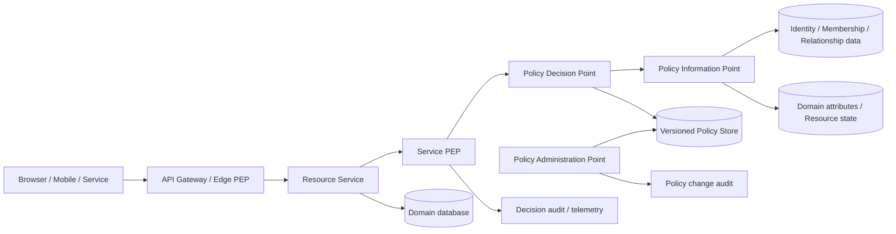

# Authentication, authorization và policy decision point

Một kiến trúc API an toàn cần trả lời hai câu hỏi độc lập: **caller là ai và credential có hợp lệ không?**; **caller đó có được thực hiện hành động cụ thể trên tài nguyên cụ thể trong ngữ cảnh hiện tại không?** Câu hỏi đầu thuộc authentication (xác thực). Câu hỏi thứ hai thuộc authorization (phân quyền).

Authentication thường dựa vào identity provider, access token, session hoặc workload identity. Authorization cần thêm action, resource, tenant, quan hệ giữa actor và object, trạng thái nghiệp vụ và các thuộc tính môi trường. Nếu chỉ kiểm tra JWT hợp lệ hoặc role ở gateway, API vẫn có thể mắc BOLA, function-level authorization lỗi hoặc cross-tenant data exposure.

Kiến trúc tham chiếu thường tách nơi thực thi quyết định khỏi nơi đưa ra quyết định. **Policy Enforcement Point (PEP)** chặn hoặc cho request đi tiếp; **Policy Decision Point (PDP)** đánh giá policy và trả kết quả; **Policy Information Point (PIP)** cung cấp thuộc tính đáng tin cậy; **Policy Administration Point (PAP)** quản lý và phát hành policy. Service sở hữu dữ liệu vẫn chịu trách nhiệm thực thi quyết định ngay trước khi đọc hoặc thay đổi object.

## 1. Authentication và authorization giải quyết hai vấn đề khác nhau

| Khái niệm | Câu hỏi | Ví dụ |
|---|---|---|
| Authentication | Caller là ai? | JWT có chữ ký hợp lệ, session còn hiệu lực, workload có mTLS identity |
| Function authorization | Caller có được gọi chức năng này không? | Có permission `orders:refund` để gọi thao tác hoàn tiền |
| Object authorization | Caller có quyền trên object này không? | User được đọc order `ORD-1001` vì là owner hoặc có grant READ |
| Tenant isolation | Object và thao tác có nằm trong tenant được phép không? | Query chỉ trả order của tenant đang được xác minh |
| Business authorization | Trạng thái nghiệp vụ có cho phép hành động không? | Chỉ hoàn tiền khi payment đã capture và chưa refund |

Một JWT hợp lệ chỉ chứng minh token được phát hành bởi issuer tin cậy và còn hợp lệ theo các điều kiện xác minh. Nó không tự chứng minh user có quyền trên mọi object, tenant hoặc thao tác. Tương tự, một role như `FINANCE` không nhất thiết có nghĩa user được refund mọi payment.

Hãy giữ các quyết định này thành các bước rõ ràng trong flow xử lý. Không dùng một boolean `authenticated` để đại diện cho tất cả các quyền.

## 2. Kiến trúc tham chiếu tổng thể

Một luồng API điển hình có thể được tổ chức như sau:



Các thành phần có thể triển khai thành service riêng, thư viện trong process, sidecar hoặc module của ứng dụng. Sơ đồ thể hiện trách nhiệm logic; không bắt buộc phải tạo một microservice cho từng điểm.

| Thành phần | Trách nhiệm | Ví dụ |
|---|---|---|
| Identity Provider (IdP) | Xác thực user/client và phát credential | OAuth 2.0/OIDC authorization server |
| API Gateway / Edge PEP | Chặn credential sai, route, coarse scope, rate limit | Gateway kiểm tra `orders:read` trước khi forward |
| Resource Server | Xác minh token hoặc identity assertion dành cho service | Spring Security OAuth2 Resource Server |
| Service PEP | Gọi authorization policy và enforce kết quả gần dữ liệu | Controller/service authorization interceptor |
| PDP | Đánh giá subject-action-resource-context theo policy | OPA, Cedar-compatible service hoặc policy module tự quản |
| PIP | Cung cấp thuộc tính có nguồn tin cậy | Tenant membership, object owner, approval state |
| PAP | Soạn, review, version và publish policy | Policy repository + approval pipeline |
| Audit/Observability | Ghi decision, policy version và side effect | Authorization audit event, metrics và trace |

Gateway có thể là một PEP ở biên nhưng không thay thế PEP trong service. Service là nơi biết resource cụ thể và phải bảo vệ nó dù request đi từ gateway, internal service, GraphQL resolver hay worker.

## 3. PEP, PDP, PIP và PAP

### Policy Enforcement Point (PEP)

PEP nằm trên đường thực thi request. Nó thu thập context cần thiết, yêu cầu quyết định và enforce kết quả. PEP không nên tự viết lại toàn bộ policy nghiệp vụ theo từng controller vì các rule sẽ bị trùng lặp và lệch nhau.

PEP có thể:

- Từ chối request thiếu identity hoặc permission chức năng.
- Lấy resource từ nguồn authoritative và tạo authorization input.
- Gọi PDP hoặc thư viện policy đã được nạp version.
- Chặn request khi PDP trả DENY hoặc không có quyết định hợp lệ.
- Thực hiện obligations như field masking, giới hạn export hoặc yêu cầu approval.
- Ghi audit decision và correlation ID.

### Policy Decision Point (PDP)

PDP đánh giá policy và trả quyết định dựa trên input có cấu trúc. PDP không nên tự tin các thuộc tính do client khai báo. Nó chỉ có thể ra quyết định chính xác nếu subject, resource và context đến từ nguồn được xác minh.

Quyết định cơ bản thường gồm:

- `PERMIT`: cho phép action trong phạm vi và thời hạn xác định.
- `DENY`: từ chối.
- `NOT_APPLICABLE`: không có policy phù hợp; thường được xử lý như deny ở PEP.
- `INDETERMINATE`: không thể đưa ra quyết định vì lỗi hoặc dữ liệu không xác định; thao tác nhạy cảm phải fail closed.

PDP có thể trả thêm policy ID/version, reason code, obligations và thời hạn cache tối đa. Không trả chi tiết policy nội bộ cho client nếu có thể tiết lộ rule hoặc cấu trúc dữ liệu.

### Policy Information Point (PIP)

PIP lấy thuộc tính từ các nguồn đáng tin cậy:

- Identity/IdP: subject, client ID, authentication strength.
- Membership service: user thuộc tenant/workspace nào và trạng thái membership.
- Relationship store: owner, member, delegated actor, share grant.
- Domain service/database: trạng thái order/payment, classification, region.
- Context provider: thời gian, network trust zone hoặc device posture đã được xác minh.

PIP cần xác định nguồn authoritative và freshness cho từng attribute. Ví dụ `tenant_id` trong JWT có thể là snapshot lúc token phát hành; nếu user vừa bị remove khỏi tenant, claim cũ có thể không phản ánh membership hiện tại.

### Policy Administration Point (PAP)

PAP quản lý policy lifecycle:

- Soạn và review policy.
- Version hóa và lưu lịch sử thay đổi.
- Chạy static validation và test policy.
- Yêu cầu approval phù hợp với policy nhạy cảm.
- Phát hành policy bundle có chữ ký hoặc checksum.
- Rollout, rollback và audit ai đã thay đổi gì.

Không cho client hoặc user thường tự sửa policy quyết định quyền của chính họ. Quản trị policy là một control plane riêng, cần authentication mạnh, separation of duties và audit.

## 4. Authorization input phải được tạo từ dữ liệu đáng tin cậy

Một quyết định thường có dạng:

```text
authorize(subject, action, resource, context) -> decision
```

Trong đó:

| Input | Nguồn khuyến nghị | Ví dụ |
|---|---|---|
| Subject | Principal đã xác minh hoặc workload identity | `user-123`, `billing-service` |
| Action | Route/handler do server xác định | `orders:cancel` |
| Resource | Object được tải từ repository theo ID và tenant context | Order `ORD-1001` |
| Tenant | Verified membership/tenant context | `tenant-A` |
| Relationship | PIP/relationship store | owner, assigned agent, share grant |
| Environment | Server/network/platform context đã xác minh | authentication assurance, trusted workload |
| Business state | Domain source of truth | `PAID`, `SHIPPED`, `REFUNDED` |

Không dùng `ownerId`, `tenantId`, `role`, `isAdmin`, `approved` hoặc `status` trong request body làm thuộc tính quyết định nếu server mới là bên sở hữu các giá trị đó. Client có thể cung cấp object ID để yêu cầu thao tác; service phải tải object và lấy thuộc tính từ nguồn authoritative.

## 5. RBAC, ABAC và ReBAC có thể phối hợp

Không nhất thiết chọn duy nhất một mô hình authorization. Hệ thống API thường kết hợp nhiều cách:

| Mô hình | Dựa trên | Phù hợp với |
|---|---|---|
| RBAC | Role gắn với user/service | Quyền chức năng tương đối ổn định như `SUPPORT_AGENT` |
| ABAC | Attribute của subject, resource, action và environment | Điều kiện theo tenant, classification, amount, region hoặc trạng thái |
| ReBAC | Relationship giữa subject và resource | Owner, member, assigned user, shared document, project collaborator |
| ACL | Danh sách principal và permission trên object | Quyền chia sẻ cụ thể cho một file hoặc record |

Ví dụ chính sách đọc invoice:

```text
PERMIT invoices:read nếu:
  subject có permission invoices:read
  AND subject có membership active trong resource.tenant
  AND (subject là owner OR có grant READ còn hiệu lực)
  AND resource.classification không vượt mức được phép
```

RBAC giúp quản lý quyền chức năng; ABAC/ReBAC giới hạn object và ngữ cảnh. Chỉ kiểm tra role `FINANCE` không đủ nếu user chỉ được xem invoice trong tenant của họ hoặc invoice được chia sẻ.

## 6. Decision flow cho một API request

Một luồng xử lý điển hình:

1. Gateway áp dụng TLS, route, rate limit và kiểm tra credential ở biên.
2. Resource service xác minh token/assertion/workload identity theo issuer, audience, signature và expiry.
3. PEP xác định action từ endpoint/handler, không lấy action tùy ý từ body.
4. Service tải resource theo ID và tenant context đáng tin cậy; không truy vấn toàn cục rồi trả object trước khi kiểm tra.
5. PIP bổ sung membership, relationship và business attributes cần thiết.
6. PDP đánh giá policy version đang có hiệu lực.
7. PEP enforce decision; DENY, NOT_APPLICABLE hoặc INDETERMINATE không được coi là PERMIT.
8. Nếu PERMIT có obligations, service thực hiện chúng, ví dụ field masking hoặc approval check.
9. Service thực hiện side effect trong transaction/locking phù hợp và ghi audit.
10. Response chỉ chứa dữ liệu được phép; cache và event propagation giữ đúng tenant/security context.

Không để một khoảng thời gian dài giữa kiểm tra quyền và side effect nếu object state có thể thay đổi. Với refund, transfer hoặc role change, kiểm tra policy và business invariant gần thời điểm commit.

## 7. Ví dụ policy cho đọc và hủy order

Một policy minh họa:

```text
POLICY order-read:
  PERMIT subject, action, order IF
    action == "orders:read"
    AND subject.hasPermission("orders:read")
    AND subject.isActiveMember(order.tenantId)
    AND (
      order.ownerSubject == subject.id
      OR relationshipStore.hasGrant(
           subject.id, order.id, "READ")
    )

POLICY order-cancel:
  PERMIT subject, action, order IF
    action == "orders:cancel"
    AND subject.hasPermission("orders:cancel")
    AND subject.isActiveMember(order.tenantId)
    AND order.status IN ["PENDING", "CONFIRMED"]
    AND order.cancelDeadline > now
```

Đây là pseudocode để thể hiện ý tưởng, không phải cú pháp trực tiếp của OPA, Cedar hoặc một policy engine cụ thể. Trong implementation, cần xác định rõ cách xử lý nhiều policy cùng áp dụng, deny precedence, missing attributes và policy version.

## 8. Fail-closed và cách kết hợp nhiều policy

Với API nhạy cảm, khi hệ thống không thể chứng minh caller được phép thì không thực hiện hành động. Một số trường hợp:

- PDP timeout hoặc không truy cập được.
- PIP không lấy được membership/ACL cần thiết.
- Resource attribute thiếu hoặc không xác định.
- Policy bundle không hợp lệ hoặc version chưa được nạp.
- Signature/checksum của policy bundle không hợp lệ.
- Quyết định hết hạn trước khi service thực hiện side effect.

Các trạng thái `NOT_APPLICABLE` và `INDETERMINATE` không được tự chuyển thành allow. Có thể định nghĩa fallback riêng cho dữ liệu public hoặc thao tác ít rủi ro, nhưng không được fallback sang quyền rộng hơn. Đọc invoice, export, refund, admin action và cross-tenant operation nên fail closed nếu policy không thể xác minh.

Nếu nhiều policy áp dụng, cần quy định combining algorithm. Ví dụ deny-overrides: chỉ cần một policy DENY hợp lệ là từ chối; chỉ PERMIT khi có ít nhất một policy allow và không có deny. Với policy phức tạp, ghi rõ precedence giữa explicit deny, grant, exception và obligations; không phụ thuộc thứ tự thực thi ngẫu nhiên.

## 9. Đặt PDP ở đâu: embedded, sidecar hay centralized service?

Không có một cách triển khai phù hợp cho mọi hệ thống:

| Cách triển khai | Ưu điểm | Rủi ro/đổi lại |
|---|---|---|
| Embedded library trong service | Latency thấp, không cần network call mỗi request | Cần phân phối/version policy nhất quán; mỗi process có thể nạp policy khác nhau |
| Sidecar/agent gần service | Tách policy runtime khỏi business code, local network hop | Thêm thành phần vận hành và đồng bộ bundle/cache |
| Centralized PDP service | Một nơi đánh giá policy, dễ quản trị tập trung | Network latency, availability bottleneck và dependency khi PDP lỗi |
| Hybrid | Policy bundle local cho rule ổn định, centralized lookup cho dữ liệu cần freshness cao | Cần quy định rõ rule nào local, rule nào online và cách xử lý consistency |

Với hệ thống nhiều request, gọi centralized PDP và nhiều PIP trên mọi API request có thể tạo latency và điểm lỗi mới. Có thể cache policy bundle tại service/sidecar, nhưng các thuộc tính quyền thay đổi nhanh như membership hoặc revocation cần freshness phù hợp. Không cache quyết định allow quá lâu chỉ để giảm latency.

## 10. Policy decision response và obligations

PDP nên trả kết quả có cấu trúc và có thể audit. Ví dụ:

```json
{
  "decision": "PERMIT",
  "policyId": "invoice-read-v4",
  "policyVersion": "authz-2026-11-18.2",
  "reasonCode": "OWNER_OR_ACTIVE_GRANT",
  "obligations": [
    {"type": "MASK_FIELDS", "fields": ["internalNotes"]}
  ],
  "validUntil": "2026-11-18T13:55:00Z",
  "decisionId": "dec-8f31"
}
```

PEP cần enforce obligations. Nếu PDP trả `MASK_FIELDS` nhưng service bỏ qua, quyết định allow chưa được thực thi đầy đủ. Không chấp nhận unknown obligation một cách im lặng; từ chối hoặc xử lý theo contract an toàn.

`validUntil` là giới hạn hiệu lực tối đa của decision cache, không phải cam kết rằng mọi thuộc tính nghiệp vụ vẫn đúng đến thời điểm đó. Với side effect nhạy cảm, có thể phải kiểm tra lại trạng thái resource ngay trước commit.

Không đưa reason nội bộ chi tiết vào response public. Client có thể nhận `403` hoặc `404` theo contract; audit nội bộ giữ policy ID/reason code để điều tra.

## 11. Ví dụ Spring: tách PEP và authorization service

Trong Spring, method security có thể là một PEP thuận tiện cho function-level permission. Object authorization nên gọi một component riêng nhận principal đã xác minh và resource được tải từ domain repository.

```java
@Service
@RequiredArgsConstructor
class OrderAuthorizationService {
    private final PolicyDecisionClient policyDecisionClient;
    private final OrderAttributeProvider attributeProvider;

    AuthorizationDecision canRead(Jwt principal, Order order) {
        AuthorizationInput input = new AuthorizationInput(
                principal.getSubject(),
                "orders:read",
                ResourceRef.of("order", order.getPublicId()),
                attributeProvider.attributesFor(principal, order));

        PolicyDecision result = policyDecisionClient.evaluate(input);
        return new AuthorizationDecision(
                result.decision() == Decision.PERMIT);
    }
}
```

Controller/service:

```java
@RestController
@RequestMapping("/api/orders")
@RequiredArgsConstructor
class OrderController {
    private final OrderRepository orderRepository;
    private final OrderAuthorizationService authorizationService;

    @GetMapping("/{orderId}")
    @PreAuthorize("hasAuthority('SCOPE_orders:read')")
    OrderResponse get(
            @PathVariable UUID orderId,
            @AuthenticationPrincipal Jwt principal) {

        String tenantId = principal.getClaimAsString("tenant_id");
        Order order = orderRepository
                .findByTenantAndPublicId(tenantId, orderId)
                .orElseThrow(OrderNotFoundException::new);

        AuthorizationDecision decision =
                authorizationService.canRead(principal, order);
        if (!decision.isGranted()) {
            throw new AccessDeniedException("Access denied");
        }

        return OrderResponse.from(order);
    }
}
```

Đây là code khung để minh họa ranh giới trách nhiệm. `PolicyDecisionClient` cần có timeout, authentication tới PDP, schema validation, decision mapping và fail-closed behavior. `attributeProvider` phải lấy dữ liệu từ nguồn tin cậy, không copy attribute nhạy cảm từ request body. Repository nên ràng buộc tenant trong query để giảm khả năng tải nhầm object ngay từ đầu. `@PreAuthorize` yêu cầu method security được bật bằng `@EnableMethodSecurity`.

Nếu PDP trả lỗi hoặc response không hợp lệ, `PolicyDecisionClient` phải ném lỗi được map thành deny/503 theo contract, không trả `granted=true` mặc định. Nếu endpoint thực hiện side effect, cần kiểm tra lại business state và quyền theo yêu cầu consistency trước transaction commit.

## 12. Spring AuthorizationManager và service-layer policy

Spring Security cung cấp `AuthorizationManager` để đóng gói quyết định authorization trong filter/method security. Có thể dùng cho rule chức năng hoặc gọi policy service khi phù hợp.

Ví dụ conceptual:

```java
@Bean
AuthorizationManager<RequestAuthorizationContext> orderReadPolicy(
        OrderPolicyAuthorizationManager manager) {
    return manager;
}
```

Không cố nhét mọi object rule vào URL matcher nếu cần tải object và kiểm tra quan hệ. URL-level rule phù hợp với route/method/scope coarse-grained. Object-level policy nên được gọi ở application service nơi đã có resource context và transaction phù hợp.

Tránh gọi PDP nhiều lần cho cùng một action trong một request nếu decision và input không đổi. Nhưng cũng không tái sử dụng decision của object A cho object B hoặc tenant khác. Decision cache key phải bao gồm mọi thuộc tính ảnh hưởng đến policy.

## 13. Tenant isolation là một điều kiện bắt buộc trong resource lookup

Một lỗi phổ biến là tải object bằng ID toàn cục trước, sau đó hy vọng PDP sẽ lọc đúng. Hãy giới hạn query ngay từ đầu bằng tenant context đã xác minh:

```sql
SELECT o.*
FROM orders o
WHERE o.tenant_id = :verified_tenant_id
  AND o.public_id = :requested_order_id;
```

Sau đó mới đánh giá owner/grant/action. `verified_tenant_id` phải đến từ principal/membership context đáng tin cậy và có thể cần kiểm tra lại membership hiện tại. Không dùng `tenantId` do client gửi làm nguồn authoritative.

Với list/search/export, áp dụng tenant/object predicate trước pagination và aggregation. Không trả `totalCount`, facet hoặc autocomplete có thể tiết lộ object ngoài phạm vi. Với cache, queue, file storage và signed URL, giữ tenant namespace và policy context xuyên suốt.

## 14. Authorization cho service-to-service và on-behalf-of

Service identity và user identity là hai actor khác nhau. Khi Billing Service gọi Order Service, cần biết:

- Workload nào đang gọi?
- Service đó có permission gọi operation nào?
- Có đang thay mặt user cuối không?
- Delegation có audience, scope, tenant và thời hạn nào?
- Resource có nằm trong phạm vi service/user được ủy quyền không?

Dùng mTLS/workload identity hoặc short-lived service token để xác minh caller service. Nếu cần user context, dùng token exchange/delegation token có audience và scope riêng. Không tin `X-User-Id` hoặc `X-Tenant-Id` do service tự gửi nếu không được bảo vệ và xác minh.

Không cấp cho một service account quyền toàn hệ thống chỉ vì nó cần gọi một operation downstream. Giới hạn permission theo service, action, tenant/resource scope và môi trường.

## 15. Authorization cho queue và background worker

Worker không đi qua API Gateway ở thời điểm thực thi. Nó cần trust context có nguồn gốc và policy riêng:

- Xác minh workload identity của producer/broker và ACL topic/queue.
- Validate message schema, version và event ID.
- Xác định actor, tenant và delegation từ dữ liệu có nguồn tin cậy.
- Quyết định quyền được snapshot lúc enqueue hay re-check lúc execute.
- Với action nhạy cảm, ưu tiên kiểm tra entitlement hiện tại hoặc dùng authorization grant có chữ ký, scope và expiry rõ.
- Idempotency và audit side effect.

Không coi message nằm trong private queue là tự động đáng tin. Message có thể được tạo bởi producer bị xâm nhập hoặc replay từ dead-letter queue. Worker cần validate object/tenant và trạng thái nghiệp vụ trước side effect.

## 16. Cache, revocation và freshness của policy

Authorization decision có thể phụ thuộc vào dữ liệu thay đổi thường xuyên: user bị remove khỏi tenant, grant bị revoke, account bị khóa hoặc object đổi owner. Cache allow quá lâu có thể giữ quyền đã bị thu hồi.

Thiết kế cache cần xác định:

- Cache key gồm subject, action, resource, tenant, environment và policy version nào.
- TTL tối đa theo mức rủi ro và freshness của PIP attributes.
- Invalidation khi role, membership, grant, owner hoặc tenant state thay đổi.
- Propagation SLA và cách xử lý event invalidation bị mất.
- Worker/async job có dùng cache lâu hơn request không.
- Quyết định nào cần online re-check trước side effect.

Với refund, role management, secret access, export dữ liệu nhạy cảm và cross-tenant operation, không nên dựa vào cache allow dài hạn. Khi PIP/PDP không khả dụng, thao tác nhạy cảm phải fail closed. Có thể giữ local policy bundle để tránh phụ thuộc network cho rule ổn định, nhưng attribute động cần freshness riêng.

## 17. Audit và observability cho authorization

Authentication log cho biết credential được xác minh như thế nào. Authorization audit cần ghi quyết định truy cập và side effect.

Trường hữu ích:

| Trường | Mục đích |
|---|---|
| decision ID | Liên kết PEP, PDP và audit event |
| subject/service reference | Ai thực hiện hành động |
| action | `orders:cancel`, `invoices:export` |
| resource reference | Loại object và ID/reference phù hợp |
| tenant reference | Phạm vi dữ liệu |
| decision | PERMIT/DENY/INDETERMINATE |
| policy ID/version | Rule nào đã được đánh giá |
| reason code | Nhóm lý do để điều tra |
| obligations applied | Masking, approval hoặc constraint đã thực thi |
| correlation/trace ID | Nối các bước trong request |
| outcome | Side effect thành công/thất bại |

Không log access token, refresh token, cookie, secret hoặc toàn bộ payload. Hạn chế PII trong log và metric label; dùng reference hoặc pseudonymous identifier khi phù hợp. Audit store cần access control, integrity protection, retention và truy vấn có kiểm soát.

Theo dõi các metric như authorization allow/deny rate theo policy version/action, PDP latency/error, PIP lookup latency, cache hit/invalidation lag, revocation propagation và số decision indeterminate. Không đưa raw user/object ID có cardinality lớn vào metric label.

## 18. Test policy như code

Policy cần có test độc lập và integration test tại PEP:

| Test case | Kết quả mong đợi |
|---|---|
| Owner đọc object trong tenant active | PERMIT |
| User cùng tenant nhưng không owner/grant | DENY |
| User tenant A đọc object tenant B | DENY |
| User có `orders:read` gọi cancel | DENY function permission |
| User có `orders:cancel` nhưng order đã shipped | DENY business state |
| Grant đã revoked hoặc expired | DENY |
| Membership bị inactive nhưng JWT claim cũ còn hạn | DENY theo freshness policy |
| PDP timeout/invalid response | Fail closed với thao tác nhạy cảm |
| Policy bundle signature sai | Không nạp policy bundle |
| Unknown obligation | Không bỏ qua âm thầm |
| Cache decision từ tenant A được hỏi cho tenant B | Cache miss/deny; không tái sử dụng |
| Queue worker chạy sau khi entitlement bị revoke | Re-check hoặc dùng snapshot hợp lệ theo policy |
| Service account sai audience | DENY |
| Client gửi `tenantId`/`ownerId` giả | Không thay đổi authorization input authoritative |

Policy unit test nên có cả allow và deny matrix, boundary condition, missing attribute, expired grant và conflict. Integration test phải chứng minh PEP thật sự enforce decision, không chỉ test PDP trả đúng boolean.

## 19. Policy rollout và thay đổi có kiểm soát

Policy mới có thể được chạy ở shadow mode trước khi enforce:

1. Version hóa policy bundle.
2. Chạy test matrix trên dữ liệu fixture.
3. Shadow evaluate trên request có context đã xác minh; policy cũ vẫn quyết định response.
4. Phân tích allow/deny delta và sửa dữ liệu/policy sai.
5. Canary theo tenant/action/service có phạm vi nhỏ.
6. Theo dõi decision, latency, revocation và audit.
7. Enforce toàn bộ sau approval.
8. Rollback chỉ về policy version đã review; không khôi phục grant đã bị revoke.

Không tự động biến kết quả shadow ALLOW thành quyền mới. Các khác biệt phải được owner/security review. Với lỗi cross-tenant allow, dừng rollout và containment ngay; không chờ hết thời gian canary.

## 20. Những anti-pattern trong PDP architecture

- **PDP chỉ nhận user ID và action:** thiếu resource/tenant/context nên không thể quyết định object permission.
- **PIP tin request body:** attacker có thể tự khai owner, tenant hoặc classification.
- **Gateway là PEP duy nhất:** service, worker hoặc direct path có thể bypass.
- **PDP lỗi thì allow:** biến lỗi availability thành bypass authorization.
- **Policy cache không có context:** decision của user/object/tenant này bị dùng cho đối tượng khác.
- **Policy trùng lặp trong nhiều service:** các implementation lệch nhau và khó audit.
- **Một role quá rộng:** permission chức năng bị nhầm với quyền trên mọi object.
- **PDP thực hiện side effect:** trộn decision logic với business transaction, khó kiểm soát consistency.
- **Policy không version hóa:** không thể xác định request đã được đánh giá bằng rule nào.
- **Worker tin message:** queue metadata không được xác minh như identity/delegation.

PDP nên quyết định dựa trên input rõ ràng; PEP enforce; domain service thực hiện nghiệp vụ. Policy không nên tự gửi email, refund hoặc ghi database như một side effect ngoài transaction được kiểm soát.

## 21. Checklist kiến trúc

- [ ] Authentication và authorization được mô hình hóa thành hai bước riêng.
- [ ] Gateway có coarse-grained PEP; service có PEP gần dữ liệu và nghiệp vụ.
- [ ] Service xác minh token/assertion/workload identity theo issuer, audience, expiry và trust contract.
- [ ] Authorization input gồm subject, action, resource và context có nguồn đáng tin cậy.
- [ ] PIP có nguồn authoritative và freshness policy cho membership, relationship và domain attributes.
- [ ] PDP trả decision có policy ID/version, reason code và obligations rõ ràng.
- [ ] PAP version hóa, review, test, ký và audit policy changes.
- [ ] RBAC kết hợp ABAC/ReBAC/ACL khi cần object và tenant scope.
- [ ] NOT_APPLICABLE/INDETERMINATE/PDP error không bị chuyển thành allow cho thao tác nhạy cảm.
- [ ] Combining algorithm và deny precedence được định nghĩa.
- [ ] Decision cache key bao gồm toàn bộ thuộc tính ảnh hưởng policy; TTL/invalidation phù hợp.
- [ ] Revocation và membership change có propagation SLA; side effect nhạy cảm re-check khi cần.
- [ ] Service-to-service và async worker xác minh workload/delegation context.
- [ ] Audit ghi decision và policy version mà không lưu credential hoặc payload nhạy cảm.
- [ ] Policy có allow/deny matrix, integration test tại PEP, shadow evaluation và canary rollout.
- [ ] Rollback không làm sống lại grant hoặc token đã bị thu hồi.

## Kết luận

Kiến trúc authentication, authorization và PDP cần tách rõ xác minh danh tính, quyết định policy và thực thi quyết định. Gateway là PEP ở biên; service phải có PEP gần resource và business logic. PDP đánh giá subject-action-resource-context, PIP cung cấp thuộc tính đáng tin cậy, còn PAP quản lý policy có version và audit. Kết hợp RBAC với ABAC/ReBAC, tenant-scoped lookup, fail-closed decision handling, cache/revocation có freshness và test policy như code giúp quyền truy cập được áp dụng nhất quán qua REST, service-to-service và worker. Quyết định PERMIT chỉ có ý nghĩa khi PEP thực thi đầy đủ obligations và service kiểm tra lại các invariant nghiệp vụ trước side effect.
