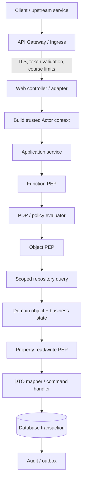

# Object, property và function authorization trong service

Một API có thể xác thực caller thành công nhưng vẫn cho phép caller thực hiện sai chức năng, truy cập object của người khác hoặc đọc/sửa thuộc tính ngoài quyền được cấp. Ví dụ, nhân viên có thể gọi endpoint quản trị vì thiếu function authorization; user có thể thay `{orderId}` để xem đơn hàng tenant khác vì thiếu object authorization; hoặc user được xem hồ sơ nhưng response lại chứa `internalRiskScore`, hay request cập nhật có thể tự gán `role=ADMIN` vì thiếu property authorization.

**Function authorization** quyết định caller có được thực hiện một hành động hay không. **Object authorization** quyết định caller có được thực hiện hành động đó trên object cụ thể hay không. **Property authorization** quyết định caller có được đọc hoặc thay đổi từng thuộc tính của object hay không. Ba lớp này phải được thực thi trong service theo ngữ cảnh nghiệp vụ, thay vì chỉ dựa vào việc đã đăng nhập, HTTPS, route gateway hoặc role ở frontend.

Kiến trúc tham chiếu trong bài đặt service layer làm nơi thực thi policy gần với dữ liệu và business rule. Gateway có thể xác thực token và chặn traffic không hợp lệ; controller có thể kiểm tra quyền thô cho endpoint; nhưng service phải kiểm tra action, object, property, tenant và trạng thái nghiệp vụ trước khi đọc hoặc thay đổi dữ liệu. Repository/query phải giới hạn dữ liệu theo phạm vi đã xác minh, mapper chỉ trả field được phép, còn transaction bảo đảm quyết định authorization và side effect không bị tách rời bởi race condition.

## 1. Ba lớp authorization cần có

Authentication trả lời “caller là ai?”. Authorization trả lời “caller được làm gì, trên tài nguyên nào và với dữ liệu nào?”. Một request hợp lệ về cú pháp và có token hợp lệ vẫn có thể bị từ chối vì không đủ quyền.

| Lớp | Câu hỏi | Ví dụ |
| --- | --- | --- |
| Function authorization | Caller có quyền gọi chức năng này không? | Chỉ actor có `orders:cancel` mới được yêu cầu hủy đơn. |
| Object authorization | Caller có quyền thao tác trên object cụ thể không? | User chỉ được hủy đơn thuộc tenant của mình và được giao cho họ. |
| Property authorization | Caller có quyền đọc/ghi field cụ thể không? | User được đổi `displayName`, không được tự đổi `ownerId`, `role` hoặc `paymentStatus`. |

Một quyết định cho request `PATCH /api/orders/{id}` có thể được mô hình hóa như sau:

```text
subject  = user-123, tenant-A, role=ORDER_OPERATOR
action   = order.update
resource = order-789, tenant-A, owner=user-123, state=OPEN
property = deliveryAddress
context  = channel=web, time=..., risk=normal
decision = ALLOW
```

Nếu caller gửi cùng request với `resource.tenantId=tenant-B`, quyết định object authorization phải là `DENY`. Nếu caller chỉ có quyền cập nhật địa chỉ giao hàng nhưng gửi `paymentStatus=PAID`, property authorization phải từ chối field đó. Nếu caller không có function `order.update`, request bị từ chối ngay cả khi object thuộc caller.

### 1.1. Không đồng nhất “đã đăng nhập” với “được phép”

Các kiểm tra sau không đủ nếu đứng riêng:

- Token có chữ ký hợp lệ: chứng minh token được issuer tin cậy phát hành, không chứng minh quyền trên object.
- User có role `USER`: role không cho biết user có quan hệ với object nào.
- Request đi qua API gateway: gateway có thể xác thực caller, nhưng thường không biết đầy đủ trạng thái nghiệp vụ và quyền field.
- Resource ID khó đoán: UUID hoặc ID ngẫu nhiên không thay thế authorization.
- Frontend ẩn nút hoặc field: attacker có thể gọi API trực tiếp.
- Service nằm trong private network: vị trí network không chứng minh request được phép.

### 1.2. Default deny

Mọi action/object/property phải bị từ chối nếu không có policy cho phép rõ ràng. Không có rule, PDP lỗi, thiếu context hoặc không thể xác minh quan hệ thì không suy diễn thành allow. Nếu cần fallback để duy trì availability, fallback phải được thiết kế cho một hành động có rủi ro thấp và có giới hạn rõ; không mở quyền mặc định khi authorization dependency gặp lỗi.

## 2. Kiến trúc tham chiếu: PEP, PDP và service layer

Một kiến trúc authorization thường có hai vai trò:

- **Policy Enforcement Point (PEP):** điểm thực thi kiểm tra và buộc request tuân theo quyết định. PEP có thể nằm ở gateway, controller, service, repository hoặc mapper tùy loại policy.
- **Policy Decision Point (PDP):** thành phần đánh giá policy và trả quyết định `ALLOW`/`DENY` cùng reason/obligations. PDP có thể là thư viện trong process, policy service riêng hoặc engine chuyên dụng.

Service là nơi phù hợp để phối hợp ba lớp authorization vì service biết use case, actor, object và business state. Controller chỉ là một entry point; cùng service có thể được gọi từ REST, GraphQL, message consumer, scheduled job hoặc một service khác. Nếu chỉ đặt check trong controller, các đường gọi khác có thể bỏ qua.



Các điểm kiểm soát không nhất thiết là các process độc lập. Một service có thể gọi policy library nội bộ; điều quan trọng là decision được thực thi ở đúng tầng và mọi entry point đều đi qua cùng policy.

### 2.1. Trách nhiệm theo từng tầng

| Tầng | Trách nhiệm authorization | Không nên đảm nhiệm một mình |
| --- | --- | --- |
| Edge/API gateway | TLS, token validation cơ bản, route/method allowlist, coarse scope, rate limit, request size | Object ownership, tenant relationship, field-level business rule. |
| Controller/adapter | Chuyển HTTP request thành command, lấy trusted actor, kiểm tra quyền thô nếu hữu ích | Quyết định quyền cuối cùng dựa trên object chưa load hoặc dữ liệu do client khai báo. |
| Application service | Function, object, property policy; phối hợp business use case và transaction | Tin role/tenant/object ID do client gửi mà không xác minh. |
| Domain model | Bảo vệ invariant và state transition; từ chối trạng thái không hợp lệ | Thay thế identity/policy checks bên ngoài domain. |
| Repository/data access | Query scope theo tenant/owner/relationship; chỉ load dữ liệu cần thiết | Cho phép caller tự truyền filter tùy ý để mở rộng phạm vi. |
| Mapper/serializer | Chỉ tạo representation có field được phép đọc | Serialize toàn bộ entity rồi hy vọng client bỏ qua field. |
| Audit/telemetry | Ghi decision, reason code và action cần truy vết | Ghi raw token, secret hoặc toàn bộ dữ liệu nhạy cảm. |

## 3. Tạo authorization context đáng tin cậy

Policy chỉ chính xác khi subject/context được xây dựng từ nguồn đã xác minh. `Actor` nên là object bất biến, được tạo từ security context hoặc identity propagation đã xác minh; không bind trực tiếp từ JSON request.

Một actor context có thể gồm:

```java
public record Actor(
    String subjectId,
    String tenantId,
    Set<String> authorities,
    String clientId,
    String authenticationMethod,
    Instant authenticatedAt
) {
    public Actor {
        authorities = Set.copyOf(authorities);
    }
}
```

Các trường phải được lấy từ JWT đã validate, opaque-token introspection, session hoặc workload identity được xác minh. `tenantId`, `role`, `ownerId`, `clientId` và `subjectId` do caller gửi trong body/query/header không được dùng làm nguồn sự thật. Nếu API hỗ trợ quản trị nhiều tenant, tenant đích phải được kiểm tra với quyền cross-tenant riêng, không ghi đè tenant context của actor một cách âm thầm.

### 3.1. Xác minh token trước khi tạo Actor

Với JWT, resource server cần kiểm tra ít nhất chữ ký, issuer, audience, expiry và các claim theo contract. Authority/scope phải được ánh xạ từ claim được tin cậy. Không decode token rồi sử dụng claim như thể đã xác minh. Với opaque token, introspection phải xác định trạng thái active và metadata cần thiết.

Không đưa toàn bộ token hoặc claims nhạy cảm vào `Actor`. Chỉ giữ các thuộc tính cần cho policy. Khi cần thêm context như region, device assurance hoặc risk level, xác định nguồn phát và độ tin cậy của từng thuộc tính.

### 3.2. Phân biệt user identity và workload identity

Request service-to-service có thể mang workload identity của caller và user identity được delegate:

- Workload identity xác định service nào đang kết nối, ví dụ `orders-api`.
- User/delegated identity xác định người dùng khởi tạo nghiệp vụ, nếu request hoạt động thay mặt user.
- Authorization kiểm tra cả hai: service được phép gọi operation, và user được phép thực hiện hành động trên resource.

Không dùng workload identity để bỏ qua user authorization. Ngược lại, không chỉ tin user claim nếu service gọi API không thuộc trust policy. Với gateway chuyển identity qua header, phải xóa header cùng tên do client gửi, xác minh peer và bảo vệ gateway-to-backend; backend cần từ chối đường truy cập bypass nếu header đó là nguồn identity.

## 4. Function authorization

Function authorization kiểm tra caller có quyền thực hiện operation cụ thể. Action nên được đặt tên theo nghiệp vụ thay vì chỉ dựa vào HTTP method.

Ví dụ:

| Endpoint | Business action | Authority/scope ví dụ |
| --- | --- | --- |
| `GET /api/orders/{id}` | `order.read` | `orders:read` |
| `POST /api/orders` | `order.create` | `orders:create` |
| `POST /api/orders/{id}/cancel` | `order.cancel` | `orders:cancel` |
| `POST /api/payments/{id}/refund` | `payment.refund` | `payments:refund` |
| `POST /api/admin/users/{id}/role` | `user.role.change` | `users:role:manage` |

Một route `POST` có thể đại diện cho nhiều hành động nghiệp vụ khác nhau. Không suy ra quyền chỉ từ method hoặc path; ánh xạ endpoint sang action rõ ràng và review khi contract thay đổi.

### 4.1. RBAC, scope và permission

RBAC gán role cho actor và permission cho role. OAuth scope thường mô tả quyền mà client/token được cấp. Hai khái niệm có liên quan nhưng không giống nhau:

- Role là nhóm quyền theo tổ chức hoặc nhiệm vụ.
- Permission là hành động cụ thể mà policy cho phép.
- Scope là quyền được token/client delegate trong một API/resource server.
- Object policy xác định permission đó áp dụng trên resource nào.

Ví dụ `orders:cancel` có thể là điều kiện function-level, nhưng vẫn cần object policy để xác định user có được hủy order `123` hay không. Scope không tự động cấp quyền trên mọi order.

### 4.2. Spring Security method authorization

Method security giúp thể hiện function-level rule tại service method:

```java
@Service
public class OrderService {

    @PreAuthorize("hasAuthority('orders:cancel')")
    @Transactional
    public OrderView cancel(UUID orderId, Actor actor) {
        // Object/property/business checks vẫn thực hiện bên dưới.
        // ...
        return null;
    }
}
```

Ví dụ giả định đã bật `@EnableMethodSecurity` và authority được map từ token đã xác minh. `@PreAuthorize` là function gate; nó không thay thế object authorization, tenant scoping hoặc kiểm tra state. Với code gọi nội bộ cùng bean, cần lưu ý self-invocation không đi qua Spring proxy nên method security có thể không chạy như mong đợi. Giữ enforcement trong service/policy API được gọi trực tiếp và test qua entry point thực tế.

### 4.3. Function permission không phải business invariant

Ngay cả actor có `orders:cancel` cũng không thể hủy đơn đã giao hoặc đã hoàn tất nếu business rule cấm. Authorization trả lời “actor có quyền yêu cầu action này?”; domain invariant trả lời “action có hợp lệ ở trạng thái hiện tại không?”. Cả hai đều cần thiết và nên được kiểm tra trước side effect.

## 5. Object authorization

Object authorization xác định actor có quyền thực hiện action trên resource cụ thể. Đây là lớp ngăn Broken Object Level Authorization (BOLA/IDOR).

Các thuộc tính thường tham gia policy:

- Owner/creator của object.
- Tenant/organization/project chứa object.
- Quan hệ giữa actor và resource, ví dụ member, assignee, manager hoặc collaborator.
- Trạng thái object và giai đoạn workflow.
- Sensitivity/classification của dữ liệu.
- Action đang thực hiện và context như channel hoặc approval.

### 5.1. Query trong phạm vi actor

Với multi-tenant API, nên giới hạn query bằng tenant lấy từ actor đã xác minh:

```java
Optional<Order> findByIdAndTenantId(UUID id, UUID tenantId);
```

Service gọi:

```java
Order order = orderRepository
    .findByIdAndTenantId(orderId, UUID.fromString(actor.tenantId()))
    .orElseThrow(NotFoundException::new);
```

Query scoped giúp object tenant khác không được load qua đường truy cập thông thường. Nó không thay thế các quan hệ chi tiết như assigned user hoặc delegated access; service vẫn cần policy phù hợp. Nếu nghiệp vụ cho phép cross-tenant support, dùng một use case riêng có quyền, audit và giới hạn phạm vi rõ.

### 5.2. Check trước khi thao tác

Một pattern phổ biến:

1. Xác thực actor.
2. Kiểm tra function permission.
3. Load resource trong tenant/owner scope.
4. Đánh giá object policy dựa trên actor và resource.
5. Kiểm tra business state.
6. Áp dụng command và commit trong transaction.

Có thể kiểm tra object policy trước khi query bằng query predicate để giảm lộ sự tồn tại, hoặc sau khi load nếu cần thuộc tính của object. Chọn semantics 403/404 theo contract và threat model; không để response tiết lộ resource khác tenant nếu chính sách yêu cầu che giấu.

### 5.3. Relationship-based authorization

Trong hệ thống có sharing hoặc delegation, ownership đơn giản không đủ. Ví dụ user có thể truy cập document nếu là owner, member của project chứa document, hoặc được cấp direct share có thời hạn. Policy cần kiểm tra quan hệ đã được lưu và xác minh ở server.

Không nhận `sharedWith`, `ownerId`, `memberRole` hoặc relationship graph từ client rồi coi đó là bằng chứng. Mọi thay đổi quan hệ phải đi qua use case quản lý membership/share với function authorization riêng.

## 6. Property authorization

Property authorization kiểm soát field được đọc và field được ghi. Một actor có thể được phép truy cập object nhưng chỉ được đọc một subset field hoặc thay đổi một subset khác.

### 6.1. Read authorization bằng response allowlist

Không trả trực tiếp JPA entity hoặc internal model. Tạo DTO riêng theo use case:

```java
public record OrderResponse(
    UUID id,
    String orderNumber,
    String status,
    BigDecimal total,
    Instant createdAt
) {}
```

Nếu support agent được xem thêm `customerEmail` hoặc `fraudReviewStatus`, dùng DTO riêng hoặc mapper có policy rõ. Không trả entity lớn rồi dùng `@JsonIgnore` làm authorization duy nhất. Field mới được thêm vào entity không nên tự động xuất hiện trong response.

Với field phụ thuộc actor/resource, mapper phải nhận actor và kiểm tra policy trước khi đưa field vào DTO. Cần phân biệt field không tồn tại, field null và field bị ẩn vì quyền; response contract nên mô tả rõ semantics.

### 6.2. Write authorization bằng request allowlist

Không bind request JSON trực tiếp vào entity có setter cho `role`, `tenantId`, `ownerId`, `paymentStatus`, `creditLimit` hoặc `verifiedAt`. Dùng request DTO riêng cho command:

```java
public record UpdateOrderAddressRequest(
    @NotBlank @Size(max = 200) String addressLine,
    @NotBlank @Size(max = 80) String city,
    @NotBlank @Size(max = 2) String countryCode
) {}
```

Service chỉ áp dụng field được khai báo:

```java
order.changeDeliveryAddress(
    request.addressLine(),
    request.city(),
    request.countryCode()
);
```

Không dùng `BeanUtils.copyProperties`, reflection hoặc generic map để copy mọi field từ request sang entity. Nếu API hỗ trợ JSON Patch, allowlist từng JSON Pointer path và kiểm tra quyền trước khi áp dụng; không cho patch tùy ý `/role`, `/tenantId` hoặc nested property.

### 6.3. Field policy theo use case

Ví dụ một user có thể cập nhật `displayName` nhưng không được sửa `emailVerified`. Support agent có thể đọc email đã mask nhưng không được thay đổi email. HR có thể cập nhật `employmentStatus` cho nhân viên trong phạm vi phụ trách nhưng không được thay đổi role hệ thống.

Không suy ra quyền field chỉ từ role tổng quát. Cần xét actor, object, tenant, relationship, field và action. Một field được phép đọc không có nghĩa được phép ghi; một field được phép ghi trong một workflow không có nghĩa được ghi qua mọi endpoint.

## 7. Chọn mô hình policy: RBAC, ABAC và ReBAC

Không có một mô hình authorization phù hợp mọi bài toán. Hệ thống thường kết hợp nhiều mô hình:

| Mô hình | Dựa trên | Phù hợp | Giới hạn cần lưu ý |
| --- | --- | --- | --- |
| RBAC | Role và permission | Function-level coarse gate, nhiệm vụ ổn định | Role có thể phình to và không mô tả quan hệ object chi tiết. |
| ABAC | Thuộc tính subject, resource, action và environment | Tenant, sensitivity, time, region, risk, trạng thái | Cần quản trị attribute nguồn, độ mới và policy complexity. |
| ReBAC | Quan hệ giữa subject và resource | Project membership, ownership, sharing, delegation | Cần mô hình hóa và cập nhật relationship graph chính xác. |

Ví dụ policy kết hợp:

```text
ALLOW order.cancel IF
  subject.permission contains "orders:cancel"
  AND subject.tenantId == resource.tenantId
  AND (resource.ownerId == subject.id OR relationship(subject, resource, "ORDER_OPERATOR"))
  AND resource.status IN ["DRAFT", "OPEN"]
  AND environment.riskLevel != "HIGH"
```

Đây là policy minh họa. Cần xác định semantics của relationship, risk signal và state trong hệ thống thật. Nếu thuộc tính không có hoặc không đáng tin cậy, quyết định phải deny hoặc yêu cầu step-up theo policy; không coi missing attribute là match.

### 7.1. Không tạo role cho mọi tổ hợp

Nếu mỗi tenant, department, object state và field tạo một role mới, role catalog sẽ phình to và khó review. Dùng RBAC cho chức năng ổn định; dùng ABAC/ReBAC cho thuộc tính và quan hệ thay đổi theo dữ liệu. Role vẫn có thể là một attribute của subject trong policy.

### 7.2. Policy có version và owner

Mỗi policy quan trọng cần có owner, purpose, version, test cases và quy trình review. Thay đổi policy có thể làm tăng quyền mà không đổi code endpoint. Do đó cần versioning, audit thay đổi và kiểm thử regression trước khi rollout.

## 8. Thiết kế PDP và PEP trong service

PDP có thể triển khai theo hai kiểu chính:

| Kiểu | Ưu điểm | Rủi ro/điểm cần kiểm soát |
| --- | --- | --- |
| Embedded/local policy engine | Latency thấp, không thêm network dependency trong request path | Policy bundle và attribute cache phải đồng bộ; cần cập nhật an toàn. |
| Central authorization service | Policy tập trung, audit/management thống nhất | Availability/latency dependency, timeout, network partition và cache consistency. |

Một mô hình lai thường hiệu quả: policy được quản lý tập trung nhưng bundle đã ký được phân phối tới service; PEP đánh giá tại chỗ với attribute đã xác minh. Với quyết định cần dữ liệu relationship rất mới hoặc approval tập trung, service có thể gọi PDP từ xa với timeout và fallback deny.

### 8.1. Authorization decision contract

Một decision nên có nhiều thông tin hơn boolean:

```java
public enum DecisionEffect {
    ALLOW, DENY
}

public record AuthorizationDecision(
    DecisionEffect effect,
    String reasonCode,
    String policyVersion,
    Set<String> obligations
) {}
```

`obligations` có thể yêu cầu mask field, ghi audit, áp dụng watermark, giới hạn export hoặc yêu cầu step-up. PEP phải thực thi obligations trước khi trả response hoặc commit side effect. Không trả raw policy internals cho client; reason code public nên được giới hạn, còn chi tiết policy nằm trong audit có phân quyền.

### 8.2. Xử lý lỗi PDP

Nếu PDP timeout hoặc không thể xác minh policy:

- Với hành động nhạy cảm như refund, role change, export hoặc đọc dữ liệu đặc biệt: fail closed.
- Không dùng cache `ALLOW` quá hạn để vượt qua policy mới hoặc revocation.
- Có thể dùng cached decision trong TTL ngắn nếu policy cho phép, context vẫn hợp lệ và resource version chưa thay đổi.
- Ghi metric cho `PDP_TIMEOUT`, `POLICY_UNAVAILABLE`, `ATTRIBUTE_MISSING` và `DENY`.
- Trả lỗi ổn định theo API contract; không để exception nội bộ lộ policy hoặc dependency detail.

Không biến “PDP unavailable” thành “allow để giữ availability”. Nếu cần emergency break-glass, thiết kế một workflow riêng có approval, MFA, thời hạn, scope nhỏ và audit bắt buộc.

## 9. Transaction boundary và TOCTOU

Authorization được kiểm tra trên một trạng thái resource. Nếu resource thay đổi giữa lúc check và lúc commit, quyết định có thể không còn đúng. Đây là vấn đề time-of-check to time-of-use (TOCTOU).

Ví dụ: service kiểm tra order đang `OPEN`, sau đó worker khác chuyển order sang `PAID`; request cũ vẫn tiếp tục cancel nếu không có kiểm tra đồng thời. Hoặc membership bị thu hồi sau khi PDP trả `ALLOW` nhưng trước khi dữ liệu được đọc.

Biện pháp:

- Đặt load, authorization cần thiết, kiểm tra invariant và update trong cùng transaction khi có thể.
- Dùng optimistic locking/version (`@Version`) hoặc row lock cho state transition quan trọng.
- Đưa điều kiện trạng thái vào câu update có điều kiện, ví dụ `WHERE status='OPEN' AND tenant_id=?`.
- Với relationship/permission có thể bị revoke, xác định consistency window và cách xử lý stale decision.
- Không gọi external provider hoặc phát side effect trước khi commit authorization/domain state; dùng outbox sau commit khi phù hợp.
- Nếu policy decision phụ thuộc attribute ngoài DB, gắn version/timestamp và xác định mức stale được chấp nhận.

### 9.1. Ví dụ service hoàn chỉnh hơn

```java
@Service
public class OrderService {
    private final OrderRepository orders;
    private final AuthorizationService authorization;
    private final OrderMapper mapper;
    private final ApplicationEventPublisher events;

    public OrderService(
            OrderRepository orders,
            AuthorizationService authorization,
            OrderMapper mapper,
            ApplicationEventPublisher events) {
        this.orders = orders;
        this.authorization = authorization;
        this.mapper = mapper;
        this.events = events;
    }

    @Transactional
    public OrderResponse cancel(UUID orderId, Actor actor) {
        authorization.requireFunction(actor, "order.cancel");

        Order order = orders
            .findByIdAndTenantId(orderId, UUID.fromString(actor.tenantId()))
            .orElseThrow(NotFoundException::new);

        authorization.requireObject(actor, "order.cancel", order);
        order.cancel(actor.subjectId()); // Domain invariant + state transition

        events.publishEvent(new OrderCancelled(order.getId(), actor.subjectId()));
        return mapper.toResponse(order, actor);
    }
}
```

Đây là ví dụ khái niệm; kiểu ID cần thống nhất với domain thực tế và event nên được ghi bằng transactional outbox nếu cần bảo đảm phát sau commit. `AuthorizationService` phải fail closed; `requireObject` kiểm tra tenant/relationship và không tin `tenantId` từ request. `Order.cancel` tự bảo vệ invariant như không hủy order đã settled. Nếu mapper trả field phụ thuộc quyền, `toResponse` cần áp dụng property read policy.

### 9.2. Không chỉ dựa vào `@PreAuthorize` ở controller

Annotation ở controller có thể bảo vệ HTTP path nhưng không bảo vệ service khi được gọi từ message consumer, scheduler hoặc một adapter khác. Function policy quan trọng nên được thực thi trong service/application layer; annotation có thể bổ sung để từ chối sớm nhưng không phải điểm enforcement duy nhất.

## 10. Property authorization trong transaction

Với update nhiều field, cần xác định tập field yêu cầu thay đổi trước khi áp dụng. Không update một phần rồi mới phát hiện field khác bị cấm trừ khi API có semantics partial success được định nghĩa.

Một command handler nên:

1. Validate request schema và field type/range.
2. Xác định actor và resource trong scope.
3. Kiểm tra function/object authorization.
4. Kiểm tra write permission cho từng field.
5. Áp dụng domain methods và business invariant.
6. Ghi audit/outbox và commit transaction.

Với field do server quản lý như `tenantId`, `ownerId`, `createdAt`, `approvedAt`, `role` hoặc `paymentStatus`, không nhận giá trị từ client trong request thông thường. Dùng use case riêng có permission mạnh hơn nếu nghiệp vụ thật sự cần thay đổi.

## 11. Authorization trong list, search và bulk operation

List/search thường có nguy cơ lớn vì một query có thể trả hàng nghìn object. Không lấy toàn bộ record rồi lọc quyền ở memory nếu có thể lọc ngay ở data access layer.

- Gắn tenant/owner/relationship scope vào query.
- Áp dụng property projection cho từng item.
- Kiểm tra filter/sort field; không cho caller suy ra dữ liệu nhạy cảm qua sort hoặc count.
- Giới hạn page size, export size và thời gian query.
- Với bulk action, đánh giá quyền trên từng object hoặc query scope đã được chứng minh tương đương.
- Quy định rõ semantics khi một phần item bị cấm: atomic reject, partial result có báo từng item, hoặc skip theo contract.
- Audit số lượng item và outcome; không log toàn bộ ID/payload nếu không cần.

Bulk API không được kiểm tra quyền chỉ trên object đầu tiên rồi áp dụng cho mọi object. Các object có thể thuộc tenant hoặc owner khác nhau.

## 12. Authorization qua nhiều service

Trong kiến trúc microservice, service nhận request có thể gọi downstream service để đọc hoặc thay đổi dữ liệu. Mỗi service phải xác định:

- Identity của service caller.
- User/delegated context nếu hành động thay mặt user.
- Action và resource mà service cần thao tác.
- Scope/audience của credential downstream.
- Quyền được delegate và giới hạn delegation.

Không truyền một header `X-User-Id` hoặc `X-Tenant-Id` do caller tự gửi rồi tin downstream. Dùng signed token/identity propagation, token exchange hoặc gateway/service mesh đã xác minh; backend phải bảo vệ đường gọi trực tiếp. Khi downstream có thể được gọi từ nhiều nguồn, nó phải tự xác minh credential và policy thay vì tin kết quả allow của upstream.

### 12.1. User delegation và workload identity

Workload identity chứng minh `orders-api` là caller; user token hoặc delegated token chứng minh user đã khởi tạo request. Có thể dùng token exchange để cấp credential downstream với audience và scope hẹp. Tránh forward access token có audience dành cho API khác hoặc scope rộng không cần thiết.

Nếu downstream chỉ cần xác nhận một tác vụ do upstream đã authorize, có thể dùng signed command/event chứa actor reference, action, resource, policy context/version và integrity protection. Consumer vẫn phải xác minh issuer/workload và kiểm tra các invariant mà nó chịu trách nhiệm; không tin message queue như ranh giới authentication.

### 12.2. Async job và queue

Authorization ở thời điểm enqueue có thể không còn đúng khi worker xử lý. Ví dụ user bị thu hồi quyền sau khi tạo export job. Cần xác định policy:

- Quyền được snapshot tại thời điểm submit và job là delegated operation có thời hạn; hoặc
- Worker re-evaluate quyền tại thời điểm thực thi; hoặc
- Kết hợp cả hai: kiểm tra quyền submit, lưu authorization context tối thiểu, rồi re-check quyền nhạy cảm khi chạy.

Job record nên lưu actor, tenant, action, resource scope, submittedAt, expiry, policy version và correlation ID đã xác minh. Không lưu bearer token thô trong queue. Worker dùng workload identity của chính nó, xác minh job integrity và enforce phạm vi. Với export dữ liệu nhạy cảm, nên re-check quyền và đảm bảo download link có TTL ngắn.

## 13. GraphQL, webhook, file và API phụ

Authorization cần nhất quán qua mọi adapter, không chỉ REST controller:

- **GraphQL:** kiểm tra quyền tại resolver/service cho từng object và field; giới hạn depth/complexity; không coi việc ẩn field ở schema là đủ.
- **Webhook:** xác minh signature/workload sender; kiểm tra tenant/event ownership và chỉ gửi field được phép cho partner.
- **File download:** kiểm tra object authorization trước khi tạo signed URL; giới hạn object, method và expiry; không để URL capability vượt quyền của actor.
- **Export/report:** áp dụng cùng property policy với API đọc; kiểm tra lại khi tạo và tải file nếu quyền có thể thay đổi.
- **WebSocket/event stream:** xác thực khi connect và authorize từng subscription/topic/resource; xử lý revoke khi connection đang mở.
- **Admin/support API:** dùng function permission riêng, object scope, reason/ticket reference và audit; không dùng role quản trị chung cho mọi thao tác.
- **Internal endpoint:** vẫn cần workload identity và authorization; private network không thay thế policy.

## 14. Cache và tính nhất quán của quyết định

Authorization có thể phụ thuộc role, relationship, tenant, resource state và property policy. Cache sai key hoặc TTL quá dài có thể trả dữ liệu đã bị thu hồi quyền.

Khi cache authorization decision hoặc response:

- Key phải bao gồm các dimension ảnh hưởng đến decision: subject/workload, action, resource, tenant, property và policy version khi cần.
- Không dùng resource ID đơn lẻ làm cache key cho decision theo actor.
- TTL phải phù hợp tốc độ thay đổi permission và yêu cầu revoke.
- Invalidate khi role, membership, ownership, policy hoặc resource state thay đổi.
- Không cache `ALLOW` vô thời hạn; khi PDP unavailable không dùng decision stale vượt giới hạn.
- Response khác nhau theo actor/tenant cần cache partition đúng hoặc `private/no-store`.
- Không để CDN/shared cache trả admin representation cho user thường.

Với hệ thống cần revocation nhanh, dùng event invalidation, version counter hoặc introspection/online check cho operation nhạy cảm. Cache consistency là một phần của authorization design, không chỉ là tối ưu hiệu năng.

## 15. Audit và monitoring

Ghi nhận quyết định authorization giúp điều tra và phát hiện abuse. Một audit event có thể gồm:

| Trường | Ý nghĩa |
| --- | --- |
| `actor_ref` | Subject/workload reference đã xác minh, theo định dạng được bảo vệ. |
| `action` | Function/business action chuẩn hóa. |
| `resource_type` / `resource_ref` | Loại object và reference nội bộ cần truy vết. |
| `tenant_ref` | Tenant đã xác minh nếu cần. |
| `decision` | `ALLOW` hoặc `DENY`. |
| `reason_code` | `MISSING_PERMISSION`, `TENANT_MISMATCH`, `RELATIONSHIP_DENIED`, `PROPERTY_DENIED`, `INVALID_STATE`. |
| `policy_version` | Version policy dùng để ra quyết định. |
| `correlation_id` | Liên kết request/trace. |
| `timestamp` | Thời điểm UTC. |

Không log access token, cookie, secret, raw payload hoặc giá trị field nhạy cảm. Audit store cần access control, retention, integrity protection và quy trình truy cập. Metric label nên là route/action/reason/outcome có cardinality thấp; không dùng user ID hoặc resource ID làm label metric.

Các tín hiệu hữu ích:

- Tăng đột biến `403` hoặc object/property denial trên một route.
- Một actor thử nhiều resource ID hoặc tenant.
- Nhiều request gửi field server-managed hoặc JSON Patch path bị cấm.
- Workload gọi action ngoài baseline hoặc audience không hợp lệ.
- PDP timeout, policy version mismatch hoặc attribute missing.
- Response size/export volume tăng bất thường.
- Cache decision dùng version cũ sau khi role/membership bị thu hồi.

## 16. Kiểm thử authorization theo ba lớp

Test phải xác minh cả response và side effect. Một request bị trả 403 nhưng database đã thay đổi vẫn là lỗi nghiêm trọng.

### 16.1. Test function authorization

- Actor có permission và token hợp lệ: action đi tiếp.
- Actor thiếu permission: bị từ chối trước side effect.
- Token sai issuer/audience/expiry: authentication fail, không vào policy như actor hợp lệ.
- Role/scope thay đổi: decision theo claim/policy mới đúng contract.
- Gọi cùng service từ REST, queue và scheduler: mọi entry point đều enforce function policy.

### 16.2. Test object authorization

- Owner thao tác object của mình.
- User cùng tenant nhưng không có relationship.
- User thuộc tenant khác.
- Manager truy cập object ngoài phạm vi quản lý.
- Resource chuyển state giữa check và update.
- Relationship bị revoke hoặc ownership đổi.
- Bulk request chứa object thuộc nhiều tenant.

### 16.3. Test property authorization

- Response không chứa field không được phép đọc, kể cả nested field.
- Request gửi `role`, `tenantId`, `ownerId`, `verifiedAt` không thể thay đổi field đó.
- Field hợp lệ nhưng actor không có write permission bị từ chối.
- Request trộn field allow và deny không tạo partial update ngoài ý muốn.
- JSON Patch path ngoài allowlist bị từ chối.
- Export, GraphQL, webhook và cache representation tuân cùng policy.

### 16.4. Ví dụ integration test

```java
@Test
void userCannotCancelAnotherTenantsOrder() throws Exception {
    Order order = orderRepository.save(
        Order.open(tenantB, userBob, new BigDecimal("125.00"))
    );

    mockMvc.perform(post("/api/orders/{id}/cancel", order.getId())
            .with(jwt().jwt(jwt -> jwt
                .subject("alice")
                .claim("tenant_id", tenantA.toString()))
                .authorities(new SimpleGrantedAuthority("orders:cancel"))))
        .andExpect(status().isNotFound());

    Order persisted = orderRepository.findById(order.getId()).orElseThrow();
    assertThat(persisted.getStatus()).isEqualTo(OrderStatus.OPEN);
}
```

Test minh họa giả định tenant B object không được tiết lộ nên contract trả 404; hệ thống khác có thể trả 403 nhưng phải nhất quán. Cấu hình JWT test phải đi qua cùng actor converter/policy path của ứng dụng. Assertion database sau request xác minh không có side effect.

### 16.5. Property-based và mutation tests

Có thể sinh nhiều actor/resource/tenant combination để kiểm tra invariant: actor tenant A không đọc/ghi object tenant B nếu không có cross-tenant permission. Mutation test có thể thay đổi condition trong policy hoặc bỏ một check để xem suite có phát hiện. Đây là cách đánh giá độ nhạy của test, không thay thế review policy.

## 17. Quy trình thiết kế authorization cho endpoint mới

Với mỗi endpoint/use case, thực hiện theo trình tự:

1. Xác định actor: user, service, admin, support hoặc delegated client.
2. Xác định business action: read, create, update, cancel, approve, refund, export.
3. Xác định resource/object và tenant boundary.
4. Liệt kê property có thể đọc và property có thể ghi.
5. Chọn policy model: RBAC cho function, ABAC/ReBAC cho context/relationship khi cần.
6. Xác định trusted attribute source và xử lý missing/stale attribute.
7. Đặt PEP tại service; dùng PDP/local policy evaluator có contract rõ.
8. Query resource trong scope; enforce domain invariant trong transaction.
9. Tạo request/response DTO allowlist và obligations như mask/audit.
10. Xác định cache, async, downstream và revoke semantics.
11. Viết positive/negative tests cho function, object, property và side effect.
12. Audit policy version, decision và reason code; theo dõi denial/anomaly.

### 17.1. Ví dụ authorization matrix

| Actor | Action | Resource scope | Read properties | Write properties |
| --- | --- | --- | --- | --- |
| Customer | `order.read` | Order của mình trong tenant | `id`, `items`, `status`, `total`, `createdAt` | Không áp dụng. |
| Customer | `order.update` | Order của mình, trạng thái `DRAFT` | Field response customer | `deliveryAddress`, `note` theo contract. |
| Customer | `order.cancel` | Order của mình, trạng thái `OPEN` | Summary | Không ghi trực tiếp state; gọi domain command. |
| Support agent | `order.read` | Ticket/tenant được giao | Field support cần thiết, email mask | Không áp dụng. |
| Support agent | `order.refund` | Chỉ theo approval/ticket và giới hạn | Transaction summary | Thực hiện command refund, không set `paymentStatus` tùy ý. |
| Payment service | `payment.authorize` | Order được delegate và audience đúng | Amount/currency/reference | Payment result qua service contract. |
| Security admin | `user.role.change` | Tenant/phạm vi được quản trị | Role và audit metadata | Role qua workflow có approval/audit. |

Matrix là contract khởi đầu để review. Cần bổ sung điều kiện state, time, approval, delegation và field cụ thể của domain thật.

## 18. Rollout và migration policy an toàn

Thêm authorization vào hệ thống đang chạy có thể gây lỗi tương thích hoặc làm consumer bị từ chối ngoài dự kiến. Một lộ trình có kiểm soát:

- Inventory endpoint, actor type, object, property và current checks.
- Xây dựng authorization matrix với owner nghiệp vụ.
- Thêm telemetry cho decision hiện tại và policy mới ở shadow mode; không ghi dữ liệu nhạy cảm.
- So sánh allow/deny difference và review false positive/false negative.
- Thực thi trước ở endpoint nội bộ hoặc cohort nhỏ.
- Bật enforcement theo route/tenant/consumer với kill switch có kiểm soát.
- Theo dõi denial, latency PDP, policy version và side effect.
- Mở rộng sau khi test và support readiness đạt.
- Thu hồi legacy bypass và cập nhật API documentation/contract.

Shadow mode chỉ phục vụ quan sát, không bảo vệ dữ liệu; không dùng nó như trạng thái hoàn thành security fix. Nếu phát hiện lỗ hổng đang bị khai thác, ưu tiên containment/restrict ngay theo incident policy thay vì rollout chậm.

## 19. Những sai lầm kiến trúc thường gặp

- **Chỉ kiểm tra role ở gateway:** không biết object ownership hoặc field permission.
- **Chỉ kiểm tra controller:** queue worker, scheduler hoặc internal caller có thể bỏ qua.
- **Dùng UUID thay authorization:** ID khó đoán không ngăn truy cập trái phép.
- **Tin tenant/owner từ request:** attacker có thể đổi context để truy cập dữ liệu khác.
- **Dùng một DTO cho mọi role:** response dễ lộ field và request dễ mass assign.
- **Role quá lớn:** role catalog bùng nổ hoặc cấp quyền rộng không kiểm soát được.
- **PDP fail-open:** khi policy service lỗi, hệ thống tự cho phép action nhạy cảm.
- **Cache ALLOW quá lâu:** permission đã revoke nhưng request vẫn được phép.
- **Check rồi mới update ngoài transaction:** tạo TOCTOU race.
- **Forward user token tùy tiện:** token có audience/scope sai được dùng ở downstream.
- **Tin header identity nội bộ:** caller có thể giả header hoặc bypass gateway.
- **Chỉ test status:** không kiểm tra database, event, payment hoặc file side effect.
- **Bỏ quên async/export/GraphQL:** các đường dữ liệu khác không áp dụng cùng policy.

## 20. Checklist kiến trúc object, property và function authorization

- [ ] Function action được định danh theo nghiệp vụ và có permission rõ.
- [ ] Object policy kiểm tra tenant, owner, relationship, state và delegation.
- [ ] Property read/write được định nghĩa riêng; không suy từ object access.
- [ ] Actor context được tạo từ identity đã xác minh, bất biến và không lấy từ request body.
- [ ] Workload identity và delegated user identity được phân biệt.
- [ ] PEP được đặt trong service/application layer cho mọi entry point.
- [ ] PDP trả decision/reason/policy version; missing context và error không tự allow.
- [ ] Repository query được scope theo actor/tenant và chỉ load dữ liệu cần thiết.
- [ ] Domain invariant và state transition được enforce trong transaction.
- [ ] DTO request/response dùng allowlist; không bind/serialize entity trực tiếp.
- [ ] JSON Patch, nested object, list, bulk, export và GraphQL có policy tương ứng.
- [ ] Async worker xác minh job identity, scope và quyền theo semantics đã định.
- [ ] Downstream service xác minh caller, audience và delegated context.
- [ ] Cache key/TTL/invalidation phản ánh subject, resource, action và policy version.
- [ ] Audit có actor/action/resource/decision/reason/policy version, không ghi secret.
- [ ] Test positive/negative cho function, object, property và xác minh side effect.
- [ ] Policy thay đổi có owner, review, version, regression test và rollout plan.

Function authorization xác định caller có được dùng chức năng; object authorization xác định chức năng đó áp dụng trên tài nguyên nào; property authorization xác định dữ liệu nào được đọc hoặc thay đổi. Khi các lớp này được thực thi trong service bằng actor context đáng tin cậy, query có scope, DTO allowlist, policy có version và transaction bảo vệ state transition, API có thể giữ cùng một mô hình quyền qua REST, queue, GraphQL và service-to-service. Authentication tạo ra danh tính; service authorization mới quyết định hành động nào được phép xảy ra trên dữ liệu thật.
