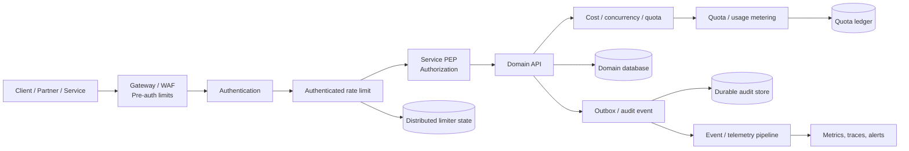

# Rate limit, quota, audit và monitoring

API có thể được bảo vệ tốt về authentication và authorization nhưng vẫn bị lạm dụng tài nguyên. Một caller hợp lệ có thể gửi hàng nghìn request, yêu cầu page size cực lớn, tạo nhiều report đồng thời, upload file liên tục hoặc gọi một operation tốn phí. Nếu hệ thống chỉ giới hạn số request tổng thể hoặc chỉ dựa vào IP, một tenant có thể chiếm hết capacity của tenant khác và gây gián đoạn dịch vụ.

Rate limit, quota, audit và monitoring giải quyết các phần khác nhau của vấn đề. **Rate limit** giới hạn tốc độ request trong một khoảng thời gian; **quota** giới hạn tổng mức sử dụng trong một chu kỳ hoặc ngân sách; **concurrency limit** giới hạn số công việc đang chạy đồng thời; **audit** ghi lại hành động và quyết định có ý nghĩa bảo mật/nghiệp vụ; **monitoring** phát hiện xu hướng, bất thường và suy giảm dịch vụ. Chúng cần phối hợp với authentication, authorization, tenant isolation và resource limits ở từng endpoint.

Trong một kiến trúc API an toàn, gateway bảo vệ traffic ở biên, service áp dụng giới hạn theo identity và chi phí nghiệp vụ, quota ledger ghi nhận usage có thể đối soát, còn audit/telemetry cung cấp bằng chứng và tín hiệu vận hành. Không một cơ chế riêng lẻ nào đủ để chống mọi dạng abuse hoặc DoS.

## 1. Phân biệt rate limit, quota, concurrency và budget

Các thuật ngữ thường bị dùng lẫn nhau nhưng chúng kiểm soát những khía cạnh khác nhau:

| Cơ chế | Giới hạn điều gì? | Ví dụ |
|---|---|---|
| Rate limit | Số request hoặc cost unit trong một khoảng thời gian | Tối đa 100 request/phút cho một API client |
| Quota | Tổng usage trong chu kỳ dài hơn | Tối đa 50.000 report unit/tháng cho tenant |
| Concurrency limit | Số operation đang chạy đồng thời | Tối đa 5 report generation job cùng lúc/tenant |
| Payload/resource limit | Kích thước hoặc độ phức tạp một request | Upload tối đa 20 MB, page size tối đa 100 |
| Budget/cost limit | Chi phí quy đổi của operation | Export 1.000 record tiêu thụ 10 unit, export 100.000 record bị từ chối |
| Circuit breaker | Lời gọi tới dependency đang suy giảm | Tạm ngừng gọi provider khi timeout/error vượt ngưỡng |

Rate limit bảo vệ tốc độ; quota bảo vệ tổng ngân sách; concurrency limit bảo vệ worker/thread/connection; payload limit bảo vệ chi phí của một request. Một endpoint tạo PDF có thể chỉ nhận một request nhưng tiêu tốn CPU và memory lớn hơn hàng trăm request đọc metadata. Vì vậy, không nên dùng một con số request/phút chung cho mọi endpoint.

## 2. Mô hình kiến trúc tham chiếu

Một hệ thống có thể phân chia trách nhiệm như sau:



Đây là sơ đồ trách nhiệm logic. Rate limiter có thể nằm ở gateway, service hoặc cả hai; quota ledger có thể là database, usage service hoặc billing platform. Điều quan trọng là mỗi lớp có key, semantics, nguồn dữ liệu và failure behavior rõ ràng.

| Thành phần | Trách nhiệm chính |
|---|---|
| Gateway/WAF | Giới hạn traffic trước authentication, bảo vệ listener và chặn burst/DDoS phổ biến |
| Authentication | Xác định principal/client/workload đã được xác minh |
| Authorization PEP | Chặn action không được phép trước khi tiêu tốn tài nguyên nghiệp vụ |
| Rate limiter | Đánh giá tốc độ theo identity, tenant, route và cost |
| Concurrency controller | Giới hạn operation đắt đang chạy và queue capacity |
| Quota/usage service | Tính usage theo chu kỳ, plan và ngân sách tenant |
| Audit pipeline | Lưu sự kiện bảo mật/nghiệp vụ bền vững và có thể truy vết |
| Monitoring | Tổng hợp metrics, traces, logs và cảnh báo bất thường |

## 3. Xác định threat model và tài nguyên cần bảo vệ

Trước khi chọn thuật toán, xác định endpoint nào có thể bị lạm dụng và tài nguyên nào có thể cạn:

- CPU: search phức tạp, regex, PDF rendering, image processing, cryptographic operation.
- Memory: body lớn, JSON nesting sâu, multipart, archive expansion, export buffering.
- Thread/worker: request chờ dependency, long polling, report generation.
- Connection: database pool, HTTP client pool, socket và queue consumer.
- Storage: upload, object version, log, audit event và file tạm.
- Network/egress: webhook, external API, file download và response lớn.
- Chi phí bên thứ ba: SMS, email, payment, geocoding, AI inference hoặc document conversion.
- Business capacity: số đơn, số lần refund, số export hoặc số integration event.

Phân loại endpoint theo chi phí và tác động. Ví dụ `GET /profile` có chi phí thấp; `POST /reports/export` có chi phí cao; `POST /payments/{id}/refund` có tác động tài chính và cần idempotency/approval ngoài rate limit.

Một request có thể hợp lệ về cú pháp và được xác thực nhưng vẫn là abuse. Rate limit là kiểm soát lạm dụng tài nguyên, không thay thế validation hay authorization.

## 4. Chọn thuật toán rate limiting

Không có thuật toán tốt nhất cho mọi workload. Hãy chọn theo yêu cầu về burst, độ chính xác, chi phí lưu trạng thái và khả năng phân phối.

### Fixed window counter

Chia thời gian thành các cửa sổ cố định, ví dụ mỗi phút. Bộ đếm tăng theo request; khi vượt giới hạn thì từ chối tới cửa sổ tiếp theo.

Ưu điểm:

- Dễ hiểu và triển khai.
- Ít trạng thái, phù hợp giới hạn đơn giản.

Nhược điểm: caller có thể gửi burst ở cuối một cửa sổ và đầu cửa sổ kế tiếp. Ví dụ 100 request lúc 12:00:59 và 100 request lúc 12:01:00 có thể tạo 200 request gần như trong một giây dù limit là 100/phút.

### Sliding log

Lưu timestamp của từng request trong một cửa sổ trượt và đếm số request còn hiệu lực.

Ưu điểm: chính xác theo khoảng thời gian thực.

Nhược điểm: cần lưu nhiều timestamp, tốn memory/IO và cleanup; không phù hợp khi traffic rất lớn nếu không có giới hạn tốt.

### Sliding window counter

Kết hợp bộ đếm cửa sổ hiện tại và cửa sổ trước, ước lượng lượng request còn nằm trong khoảng trượt. Nó giảm burst ở ranh giới so với fixed window và nhẹ hơn sliding log, nhưng là phép xấp xỉ.

### Token bucket

Bucket có capacity tối đa `B` token. Token được bổ sung với tốc độ `r` token/giây. Mỗi request tiêu thụ một hoặc nhiều token theo cost; nếu không đủ token thì request bị từ chối hoặc phải chờ.

\[
\text{tokens}_{new}=\min(B,\text{tokens}_{old}+r\cdot\Delta t)
\]

Ví dụ bucket capacity 20, refill 2 token/giây cho phép burst tối đa 20 request rồi duy trì trung bình khoảng 2 request/giây. Token bucket thường phù hợp API cần cho phép burst ngắn nhưng vẫn giới hạn tốc độ trung bình.

### Leaky bucket / paced queue

Request được đưa vào hàng đợi và xử lý với tốc độ ổn định. Cách này làm mượt burst nhưng cần giới hạn queue depth và thời gian chờ. Queue không giới hạn chỉ chuyển vấn đề từ rate sang memory/latency exhaustion.

### Concurrency limiter

Giới hạn số operation đang thực thi, ví dụ tối đa 10 report job đồng thời. Khi hết slot, hệ thống từ chối hoặc đưa vào queue có giới hạn. Đây là kiểm soát bổ sung, đặc biệt quan trọng với operation chạy lâu.

| Thuật toán | Kiểm soát tốt | Chi phí/giới hạn |
|---|---|---|
| Fixed window | Request count đơn giản theo chu kỳ | Burst ở ranh giới cửa sổ |
| Sliding log | Chính xác trong cửa sổ trượt | Lưu nhiều timestamp |
| Sliding counter | Cân bằng độ chính xác và chi phí | Kết quả xấp xỉ |
| Token bucket | Burst có giới hạn và tốc độ trung bình | Cần cập nhật token atomically |
| Leaky bucket/queue | Làm mượt tốc độ xử lý | Cần queue bound và backpressure |
| Concurrency limiter | Operation đang chạy | Không thay giới hạn request rate hoặc quota dài hạn |

## 5. Chọn rate-limit key đúng

Limit theo IP là lớp hữu ích trước authentication nhưng không đủ cho API đã xác thực. Nhiều user có thể dùng chung NAT/proxy; attacker có thể phân tán request qua nhiều IP; client cũng có thể giả mạo forwarding header nếu proxy trust sai.

Các dimension có thể dùng:

| Dimension | Dùng khi nào? | Lưu ý |
|---|---|---|
| Source IP | Pre-auth abuse và anonymous endpoint | Chỉ lấy IP từ proxy hop được tin cậy; không tin `X-Forwarded-For` do client gửi |
| Client/API key ID | Quota cho partner hoặc machine client | Key ID phải được xác thực và có lifecycle/revocation |
| User subject | Fairness giữa người dùng đã xác thực | Không dùng username/email làm key công khai nếu có ID ổn định |
| Tenant ID | Cô lập usage giữa khách hàng | Tenant phải lấy từ verified membership/context |
| Workload identity | Service-to-service traffic | Giới hạn theo service và operation |
| Route/operation | Endpoint có chi phí khác nhau | Dùng route template, không dùng raw URL chứa ID |
| Resource/cost class | Export, report, upload, search nặng | Tính cost theo kích thước/độ phức tạp đã validate |

Một request có thể chịu nhiều giới hạn đồng thời: IP pre-auth, client, tenant, user, route và global capacity. Không nên chỉ dùng một key vì attacker có thể vượt giới hạn theo một dimension khác.

Rate-limit key phải được tạo từ dữ liệu server đã xác minh. Không lấy `tenantId`, `userId`, `plan` hoặc `isPremium` từ body/query để quyết định hạn mức. Nếu cần tránh lưu raw identity trong limiter key, có thể dùng keyed hash/HMAC ổn định do server quản lý.

## 6. Giới hạn theo nhiều tầng

Một policy phân tầng có thể gồm:

1. **Global limit:** bảo vệ capacity tổng của service hoặc provider.
2. **Pre-auth IP/network limit:** giới hạn traffic chưa xác thực ở edge.
3. **Client limit:** giới hạn một API client hoặc partner integration.
4. **Tenant quota/rate:** bảo đảm fairness giữa tenants.
5. **User limit:** ngăn một user trong tenant chiếm toàn bộ quota.
6. **Route/action limit:** giới hạn riêng operation đắt hoặc nhạy cảm.
7. **Concurrency limit:** giới hạn công việc đang chạy và queue.

Request chỉ được xử lý khi đáp ứng tất cả các policy bắt buộc. Nếu một tầng từ chối, không tiếp tục tiêu thụ quota ở các tầng sau trừ khi contract định nghĩa rõ cách ghi nhận attempt. Ví dụ, request bị từ chối bởi authentication không nên tiêu thụ quota nghiệp vụ của tenant chưa được xác minh.

Tuy nhiên, pre-auth limiter vẫn cần đếm traffic sai để bảo vệ gateway. Có thể tách counter edge khỏi quota business để tránh nhầm lẫn giữa abuse traffic và usage tính phí.

## 7. Tính cost thay vì chỉ đếm request

Đếm mọi request là một đơn vị bằng nhau sẽ không bảo vệ tốt endpoint có chi phí khác nhau. Một search query trả 10 record và một export 100.000 record không có cùng cost.

Có thể gán cost unit theo operation:

| Operation | Cost minh họa |
|---|---:|
| Đọc metadata nhỏ | 1 |
| Search page tối đa 50 record | 2 |
| Upload file tới 10 MB | 5 |
| Export 1.000 record | 10 |
| Tạo report phức tạp | 20 |

Các giá trị chỉ minh họa; cần đo CPU, memory, DB time, egress và chi phí provider để hiệu chỉnh. Cost phải được tính từ tham số đã validate, không để client gửi `cost=1` để tự giảm mức tiêu thụ.

Với GraphQL, có thể tính query complexity/depth theo schema; với bulk API, tính theo số object; với report, tính theo số record, loại phép tổng hợp và khoảng thời gian. Đặt max cost cho một request để ngăn một request đơn lẻ chiếm quá nhiều tài nguyên.

## 8. Quota là ngân sách theo chu kỳ

Quota giới hạn tổng mức sử dụng trong một chu kỳ như giờ, ngày, tháng hoặc billing period. Quota có thể áp dụng cho:

- Tổng request hoặc cost unit.
- Số record lưu trữ.
- Dung lượng upload/egress.
- Số webhook delivery.
- Số SMS/email hoặc external API call.
- Số report/export/job được tạo.
- Số người dùng, API key hoặc integration được đăng ký.

Quota cần xác định rõ:

- Chu kỳ và múi giờ reset.
- Usage được tính lúc request được nhận, lúc job hoàn tất hay khi provider xác nhận.
- Request thất bại có tiêu thụ quota không?
- Retry có tính usage mới không?
- Có cho phép vượt quota tạm thời (overage) hay không?
- Tenant có thể mua thêm quota hoặc được admin cấp ngoại lệ không?
- Usage được điều chỉnh/refund khi job bị hủy thế nào?

Không dùng rate limiter làm quota ledger nếu cần đối soát billing. Rate limiter thường dùng state ngắn hạn và có thể xấp xỉ; quota tính phí cần record bền vững, idempotent và có khả năng reconciliation.

## 9. Usage metering và idempotency

Nếu một request tạo job hoặc gọi provider, usage event có thể được phát nhiều lần do retry. Dùng event ID/idempotency key để tránh tính quota hai lần.

Ví dụ schema minh họa:

```sql
CREATE TABLE usage_ledger (
    tenant_id UUID NOT NULL,
    usage_event_id VARCHAR(200) NOT NULL,
    operation VARCHAR(100) NOT NULL,
    quantity BIGINT NOT NULL,
    cost_units BIGINT NOT NULL,
    occurred_at TIMESTAMP NOT NULL,
    billing_period VARCHAR(20) NOT NULL,
    source_reference VARCHAR(200),
    PRIMARY KEY (tenant_id, usage_event_id)
);
```

Unique key theo tenant và usage event giúp chống ghi nhận trùng. Việc cập nhật aggregate theo billing period cần transaction hoặc pipeline có thể replay/reconcile. Không chỉ tăng một counter trong memory của instance vì restart hoặc scale-out có thể làm sai usage.

Với operation bất đồng bộ, có thể reserve quota trước khi enqueue rồi settle theo actual usage khi job hoàn tất. Cần quy định cách release reservation khi job thất bại/hủy và cách xử lý worker retry. Không cho phép reservation treo vô hạn.

## 10. Concurrency limit và queue bound

Rate limit không ngăn được một nhóm request chạy lâu đồng thời. Ví dụ 5 request/giây nhưng mỗi request giữ connection 60 giây có thể tạo hàng trăm operation đang chờ.

Áp dụng:

- Semaphore hoặc bulkhead theo dependency/operation.
- Giới hạn số report/export job đang chạy theo tenant và toàn hệ thống.
- Giới hạn queue depth, queue age và thời gian chờ.
- Backpressure hoặc trả `429`/`503` khi không còn capacity.
- Timeout và cancellation cho operation có thể dừng an toàn.
- Giải phóng permit trong mọi đường success/error/cancel.
- Không giữ concurrency permit trong thời gian backoff retry nếu không có chủ đích.

Với queue bất đồng bộ, `202 Accepted` chỉ nên trả sau khi job được ghi bền vững và quota/capacity đã được reserve theo contract. Response cần có job ID và trạng thái truy vấn; endpoint status cũng phải có authorization theo owner/tenant.

## 11. Distributed rate limiting trong môi trường nhiều instance

Một limiter trong memory của mỗi instance không tạo ra giới hạn toàn hệ thống. Nếu có 5 replica, mỗi replica cho 100 request/phút thì tổng có thể gần 500 request/phút khi traffic phân tán.

Các lựa chọn:

| Mô hình | Ưu điểm | Hạn chế |
|---|---|---|
| Local in-memory | Rất nhanh, không phụ thuộc network | Limit nhân theo số replica; state mất khi restart |
| Gateway shared state | Chặn sớm và dùng chung cho edge traffic | Có thể không hiểu cost/tenant/object trong domain |
| Redis/distributed cache atomic operation | Chia sẻ counter/bucket giữa replicas | Cần atomic update, HA, key expiry và xử lý network failure |
| Database transaction | Phù hợp quota/usage cần durability | Không nên dùng làm counter nóng cho mọi request nếu tải lớn |
| Dedicated rate-limit service | Central policy và observability | Thêm dependency, latency và failure mode |

Với Redis, thao tác đọc token, tính refill, quyết định allow và ghi state cần atomic (ví dụ Lua script hoặc primitive transaction phù hợp). Nếu thực hiện GET rồi SET tách rời, nhiều replica có thể cùng thấy token còn và cùng cho phép vượt limit.

Dùng server-side time hoặc clock strategy nhất quán; không để clock lệch giữa replicas làm refill sai. Đặt TTL cho limiter state để key cũ được dọn dẹp, nhưng TTL phải đủ dài để không reset bucket sớm hơn policy.

## 12. Chọn fail-open hay fail-closed khi limiter lỗi

Nếu Redis/rate-limit service không khả dụng, hệ thống phải có policy rõ ràng:

- Với endpoint public/ít rủi ro, có thể dùng local emergency limit để duy trì availability trong thời gian ngắn.
- Với operation có chi phí cao hoặc tác động tài chính, có thể từ chối tạm thời (`503`) nếu không thể xác minh quota/capacity.
- Với pre-auth edge protection, giữ WAF/network-level limit độc lập với distributed limiter.
- Không fallback sang unlimited traffic khi limiter lỗi.
- Ghi metric riêng cho limiter unavailable và emergency mode.
- Khi khôi phục, reconcile state/usage nếu có thể bị mất.

Fail-closed không có nghĩa trả `429` cho mọi lỗi dependency. `429` biểu thị caller đã vượt giới hạn; nếu hệ thống không thể xác minh limiter thì `503 Service Unavailable` thường diễn đạt đúng hơn. Status và retry guidance phải theo API contract.

## 13. HTTP response khi vượt rate limit hoặc quota

Khi rate limit bị vượt, thường trả `429 Too Many Requests`. Có thể kèm:

```http
HTTP/1.1 429 Too Many Requests
Content-Type: application/problem+json
Retry-After: 30
RateLimit-Limit: 100
RateLimit-Remaining: 0
RateLimit-Reset: 30
```

Các `RateLimit-*` là ví dụ header theo chuẩn RateLimit Fields for HTTP (RFC 9333); cần kiểm tra gateway/framework hỗ trợ và policy công bố phù hợp. `Retry-After` có thể biểu diễn số giây hoặc HTTP date. Không trả thời điểm reset giả nếu limiter không biết chính xác.

Body có thể dùng Problem Details:

```json
{
  "type": "https://api.example.test/problems/rate-limit-exceeded",
  "title": "Too many requests",
  "status": 429,
  "code": "RATE_LIMIT_EXCEEDED",
  "requestId": "req-8f31"
}
```

Với quota hết, API có thể dùng `429` nếu contract coi đây là usage limit, hoặc response lỗi nghiệp vụ có mã ổn định. Hãy phân biệt `RATE_LIMIT_EXCEEDED`, `QUOTA_EXCEEDED`, `CONCURRENCY_LIMIT_EXCEEDED` và `LIMITER_UNAVAILABLE` để client biết cách xử lý.

Không tiết lộ thông tin về tenant khác hoặc nội bộ limiter. Không yêu cầu client retry ngay khi `Retry-After` còn hiệu lực.

## 14. Authentication và authorization phải đi trước usage nghiệp vụ

Thứ tự thường dùng:

1. Edge pre-auth limit theo IP/network và bảo vệ TLS/connection.
2. Xác minh credential và tạo principal/tenant context đáng tin cậy.
3. Áp dụng authenticated request-rate limit sớm, trước các bước PDP/PIP hoặc truy vấn đắt.
4. Validate input và kiểm tra function permission, object/tenant scope cần thiết.
5. Tính cost từ dữ liệu đã validate; reserve concurrency/quota trước operation đắt.
6. Thực hiện operation và ghi usage/audit theo semantics.

Thứ tự có thể khác với một số endpoint vì cần giới hạn body trước khi authentication hoặc cần rate-limit trước khi đọc payload. Hãy áp dụng body size/connection limit sớm ở edge, sau đó thực hiện business quota theo identity đã xác minh.

Không tiêu thụ quota của tenant bằng `tenantId` do client gửi. Không cho caller thiếu permission gọi operation đắt chỉ để đốt quota hoặc dò dữ liệu. Đồng thời cần limit cả request authentication thất bại để chống credential stuffing/brute force ở edge.

## 15. Rate limit không thay thế idempotency và business rule

Rate limit chỉ giới hạn tần suất. Nó không bảo đảm một thao tác chỉ xảy ra một lần. Ví dụ client gửi `POST /payments/{id}/refund`, timeout rồi retry; hai request vẫn có thể nằm dưới rate limit nhưng cùng tạo side effect.

Với thao tác ghi hoặc tốn phí:

- Dùng idempotency key ổn định theo actor/tenant/operation.
- Lưu kết quả idempotency bền vững và xử lý concurrent duplicate atomically.
- Kiểm tra business state và approval trước side effect.
- Ghi usage event có ID duy nhất để không tính trùng do retry.
- Rate limit retry riêng nếu cần, nhưng không dùng nó thay idempotency.

Rate limit cũng không thay authorization. User có thể gửi request chậm và nằm trong quota nhưng vẫn không có quyền trên object. Service phải kiểm tra quyền trước khi xử lý.

## 16. Ví dụ Spring: đặt rate limit sau authentication

Một cách tổ chức là áp dụng limiter ở filter/interceptor chạy sau khi Spring Security đã tạo principal, hoặc trong application service cho operation có cost nghiệp vụ. Ví dụ dưới đây thể hiện contract; implementation `RateLimitService` phải dùng state atomic dùng chung nếu cần limit toàn cluster.

```java
public interface RateLimitService {
    LimitResult tryConsume(
            String key,
            int cost,
            LimitPolicy policy);
}

public record LimitResult(
        boolean allowed,
        long remaining,
        Duration retryAfter) {
}
```

Một interceptor đơn giản:

```java
@Component
@RequiredArgsConstructor
class ApiRateLimitInterceptor implements HandlerInterceptor {
    private final RateLimitService rateLimitService;
    private final RouteCostPolicy routeCostPolicy;

    @Override
    public boolean preHandle(
            HttpServletRequest request,
            HttpServletResponse response,
            Object handler) throws IOException {

        Authentication authentication =
                SecurityContextHolder.getContext().getAuthentication();
        if (authentication == null
                || authentication instanceof AnonymousAuthenticationToken
                || !authentication.isAuthenticated()) {
            // Anonymous traffic is limited at the edge. Authentication and
            // route access decisions belong to Spring Security's filter chain.
            return true;
        }

        String subject = authentication.getName();
        String route = routeCostPolicy.routeTemplate(handler);
        LimitPolicy policy = routeCostPolicy.policyFor(handler);
        int cost = routeCostPolicy.baseCostFor(handler);
        String key = "subject:" + subject + ":route:" + route;

        LimitResult result = rateLimitService.tryConsume(key, cost, policy);
        if (!result.allowed()) {
            response.setStatus(429);
            response.setHeader("Retry-After",
                    Long.toString(Math.max(1, result.retryAfter().toSeconds())));
            response.setContentType("application/problem+json");
            response.getWriter().write(
                    "{\"status\":429,\"code\":\"RATE_LIMIT_EXCEEDED\"}");
            return false;
        }

        response.setHeader("RateLimit-Remaining",
                Long.toString(result.remaining()));
        return true;
    }
}
```

Đây là skeleton để giải thích vị trí tích hợp, không phải limiter hoàn chỉnh. Cần bổ sung:

- Đăng ký interceptor sau Spring Security filter chain; kiểm tra thứ tự thực tế của ứng dụng.
- Dùng principal type/subject ổn định đã xác minh, không dùng raw `getRemoteAddr()` làm user identity.
- Nếu giới hạn theo tenant, lấy tenant từ verified context/membership.
- `routeTemplate` phải là route template như `/orders/{orderId}`, không dùng raw URI chứa ID.
- `baseCostFor` chỉ dùng cost cố định theo route. Cost động theo số record, kích thước hoặc độ phức tạp chỉ được tính ở application service sau khi input đã validate, rồi reserve thêm quota/concurrency trước khi chạy operation đắt.
- `retryAfter` phải được tính và giới hạn hợp lý; xử lý null/negative duration.
- Exception/response nên đi qua error handling chuẩn của ứng dụng thay vì tự ghi JSON ở nhiều nơi.
- Với nhiều replica, `RateLimitService` cần thao tác atomic trên distributed store.
- Endpoint anonymous/pre-auth phải có limiter riêng ở gateway hoặc filter trước authentication.

Không dùng `authentication.isAuthenticated()` một mình để quyết định permission. Authorization PEP vẫn phải chạy theo policy; interceptor chỉ minh họa rate limit theo identity.

## 17. Ví dụ Redis token bucket: yêu cầu atomicity

Một token bucket phân tán cần lưu ít nhất:

```text
key -> {tokens, last_refill_time}
```

Mỗi lần tiêu thụ phải thực hiện trong một atomic operation:

1. Lấy thời gian server dùng cho bucket.
2. Đọc token và thời điểm refill trước đó.
3. Tính số token được bổ sung theo elapsed time.
4. Cap ở bucket capacity.
5. Nếu đủ cost, trừ token và cho phép; nếu không, giữ token và tính thời gian chờ.
6. Ghi state mới cùng TTL.

Có thể dùng Redis Lua script hoặc một thư viện rate limiter có hỗ trợ distributed backend. Không viết chuỗi GET/compute/SET rời rạc vì các instance có thể race. Cũng cần kiểm tra failover/replication semantics: nếu acknowledged write bị mất khi failover, limiter có thể tạm thời cho phép vượt mức. Với abuse protection, có thể chấp nhận một sai số nhỏ; với quota tính phí, dùng ledger bền vững riêng.

Không đưa tenant ID hoặc user ID raw vào key nếu key có thể bị lộ qua Redis monitoring/export. Có thể dùng HMAC của identity reference để tạo key không thể suy ngược trực tiếp, nhưng secret HMAC phải được quản lý ổn định để không làm reset toàn bộ bucket khi rotate.

## 18. Audit khác với access log và metrics

Ba loại telemetry phục vụ mục đích khác nhau:

| Loại | Mục tiêu | Ví dụ |
|---|---|---|
| Access/application log | Chẩn đoán request và lỗi | Method, route template, status, latency, request ID |
| Security/business audit | Bằng chứng ai đã làm gì, trên object nào, kết quả ra sao | User export report, admin thay permission, key bị revoke |
| Metrics/traces | Đo xu hướng, hiệu năng và quan hệ giữa các service | 429 rate, quota usage, PDP latency, trace span |

Không coi log debug là audit trail. Audit cần schema ổn định, timestamp, actor, action, target, outcome và nguồn phát sinh. Với hành động nhạy cảm, nên ghi cả decision và kết quả side effect.

### Audit event mẫu

```json
{
  "eventId": "aud-7f91",
  "occurredAt": "2026-11-18T14:00:00Z",
  "actor": {"type": "user", "idRef": "usr-hash-123"},
  "tenantRef": "tenant-ref-A",
  "action": "reports.export",
  "target": {"type": "report", "idRef": "rpt-ref-91"},
  "decision": "PERMIT",
  "outcome": "ACCEPTED",
  "policyVersion": "authz-v3",
  "requestId": "req-8f31"
}
```

Đây là cấu trúc minh họa. Dùng ID/reference phù hợp, tránh ghi token, cookie, secret, raw payload hoặc dữ liệu cá nhân không cần thiết. Audit record nên có event ID duy nhất và nguồn phát sinh để chống duplicate/reconcile.

## 19. Ghi audit bền vững bằng outbox pattern

Nếu API thay đổi database rồi gửi audit event qua message broker, có thể xảy ra:

- Database commit thành công nhưng publish event thất bại.
- Event publish thành công nhưng transaction database rollback.
- Retry publish tạo duplicate event.

Outbox pattern giúp ghi domain change và audit/outbox event trong cùng database transaction:

```text
BEGIN
  update order/payment/permission
  insert audit_outbox(event_id, event_type, payload_ref, created_at)
COMMIT

Dispatcher:
  read unpublished outbox rows
  publish event with stable event_id
  mark published
```

Dispatcher có thể publish lặp nếu crash sau publish nhưng trước mark. Consumer cần idempotency theo event ID. Nếu audit là yêu cầu bắt buộc trước khi thực hiện side effect, xác định rõ transaction boundary và behavior khi audit store không khả dụng; không âm thầm bỏ audit rồi tiếp tục thao tác nhạy cảm.

## 20. Audit những hành động nào?

Không cần audit mọi health check như một security event. Tập trung vào sự kiện có ý nghĩa về danh tính, quyền, dữ liệu và cấu hình:

- Login, token issuance/revocation, failed authentication bất thường.
- Authorization DENY nhạy cảm, đặc biệt cross-tenant/object access attempt.
- Export/download dữ liệu nhạy cảm và bulk operation.
- Create/update/delete object quan trọng.
- Refund, transfer, payment state change và approval.
- Role, permission, membership, ACL và tenant setting change.
- API key/client secret create, rotate, revoke và failed use.
- Webhook registration, endpoint change và signature failure đáng kể.
- Quota override, rate-limit exception và admin action.
- Policy publish/rollback, gateway route exposure và security configuration change.

Audit DENY cần có sampling/aggregation hợp lý để tránh một attacker tạo lượng log khổng lồ. Tuy nhiên, không loại bỏ hoàn toàn tín hiệu tấn công; có thể aggregate theo source/key/window và giữ event chi tiết cho hành động đặc biệt nhạy cảm.

## 21. Bảo vệ audit data và quyền truy cập log

Audit trail có giá trị điều tra nên cũng là mục tiêu của attacker. Hãy:

- Ghi vào storage có quyền append hoặc hạn chế sửa/xóa.
- Tách quyền vận hành ứng dụng khỏi quyền xóa/sửa audit.
- Mã hóa khi truyền và khi lưu.
- Có retention, legal hold và purge policy phù hợp.
- Đồng bộ thời gian và giữ timestamp/source rõ ràng.
- Phát hiện gap, duplicate bất thường hoặc event đến trễ.
- Dùng integrity protection/chaining/signing khi mức đảm bảo yêu cầu.
- Kiểm soát truy vấn và export audit; audit viewer cũng cần authorization.

Không log bearer token, refresh token, password, private key, cookie hoặc secret. Mask/redact payload và query string nhạy cảm ở gateway, application, APM và tracing. Log access tới audit store cũng có thể cần audit riêng.

## 22. Monitoring: metrics, traces và logs bổ sung cho nhau

Monitoring API security nên kết hợp:

- **Metrics:** tổng hợp số lượng và tỷ lệ theo thời gian, phù hợp alert.
- **Traces:** cho thấy một request đi qua gateway, service, PDP và dependency như thế nào.
- **Logs:** cung cấp chi tiết sự kiện có cấu trúc để điều tra.
- **Audit:** lưu bằng chứng nghiệp vụ/bảo mật với retention và integrity phù hợp.

Một trace không thay audit vì sampling có thể bỏ qua request. Một metric không thay log vì không có chi tiết actor/action. Một access log không thay audit vì có thể không ghi decision hoặc side effect.

## 23. Metrics nên theo dõi

| Nhóm | Metric gợi ý | Ý nghĩa |
|---|---|---|
| Traffic | Request rate theo route/status/client class | Phát hiện burst và traffic bất thường |
| Rate limit | Allowed, rejected, limiter error, remaining tokens | Xác minh policy có hoạt động |
| Quota | Usage, reserved, remaining, overage, reset | Theo dõi tenant budget và billing |
| Concurrency | Active jobs, semaphore saturation, queue depth/age | Phát hiện resource exhaustion |
| Cost | Cost unit theo operation/tenant tier | Tìm endpoint đắt và noisy neighbor |
| Authentication | Success/failure theo issuer/client type | Phát hiện credential abuse |
| Authorization | Allow/deny theo action/policy version | Phát hiện policy drift và probing |
| Dependency | Timeout, retry, circuit state, pool saturation | Phát hiện lỗi lan truyền |
| Audit | Outbox lag, publish failure, audit gap | Đảm bảo evidence pipeline hoạt động |
| Data protection | Export/download volume, unusual object access | Phát hiện bulk exfiltration |

Không đưa raw user ID, object ID, token, email hoặc raw URL vào metric label. Cardinality quá lớn làm monitoring backend quá tải và có thể tạo rò rỉ dữ liệu. Dùng route template, status class, operation, policy version và tenant tier; dùng audit/log có kiểm soát cho phân tích chi tiết.

## 24. Phát hiện abuse và noisy neighbor

Một tenant có thể không vượt global rate limit nhưng vẫn chiếm phần lớn capacity. Cần theo dõi usage phân theo tenant/tier và so sánh với baseline.

Các dấu hiệu:

- Một tenant tăng request hoặc cost unit đột biến.
- Một user gọi nhiều object ID liên tiếp hoặc scan ID tuần tự.
- Tỷ lệ 401/403/404 tăng trên một route nhạy cảm.
- Export/download volume tăng bất thường.
- Một client/API key tạo nhiều webhook delivery hoặc retry.
- Nhiều request nhỏ nhưng tổng concurrency/queue age tăng cao.
- Request hợp lệ nhưng có pattern giống scraping hoặc enumeration.
- Quota override hoặc rate-limit exemption được tạo ngoài quy trình.

Detection nên kết hợp threshold, rolling baseline và context. Không tự động khóa tenant chỉ vì một metric tăng trong thời gian ngắn; cần phân biệt campaign hợp lệ, batch job và abuse. Với tín hiệu nghiêm trọng, có thể giảm rate hoặc tạm dừng operation đắt trong khi điều tra.

## 25. Alert và runbook

Alert cần có ngưỡng, thời gian kéo dài, owner và hành động tiếp theo. Ví dụ:

| Alert | Điều kiện minh họa | Hành động đầu tiên |
|---|---|---|
| Edge traffic spike | Request rate vượt baseline và 429/5xx tăng | Kiểm tra source pattern, WAF và gateway capacity |
| Tenant noisy neighbor | Một tenant vượt tỷ trọng cost đã định | Kiểm tra job/batch, áp dụng tenant cap nếu cần |
| Limiter unavailable | Distributed limiter error vượt ngưỡng | Kiểm tra Redis/network; xác minh emergency policy đang bật |
| Quota ledger lag | Usage event/outbox age vượt SLA | Kiểm tra dispatcher/consumer và reconcile trước billing |
| Queue saturation | Queue depth/oldest age vượt capacity | Tạm dừng intake hoặc giảm concurrency |
| Audit delivery gap | Outbox publish fail hoặc audit event mất | Bảo toàn outbox; không bỏ audit cho operation nhạy cảm |
| Unusual export | Export volume hoặc record count bất thường | Xác minh actor, permission, tenant và approval |
| Credential abuse | Failed auth tăng theo client/IP | Rate limit, revoke credential nếu compromise được xác nhận |

Alert không nên chứa token, raw payload hoặc PII. Runbook cần chỉ rõ dashboard, log/audit query, người escalation, cách giảm traffic và cách khôi phục quota/limiter mà không làm sai usage.

## 26. Ví dụ response và client behavior

Client nên tôn trọng `Retry-After` và dùng exponential backoff với jitter. Không retry ngay lập tức hoặc đồng loạt khi nhận 429.

Pseudo-flow:

```text
if response.status == 429:
    wait = parse Retry-After
    wait = min(wait, client_max_wait)
    sleep(random(0, wait))
    retry only if operation is safe/idempotent and deadline remains
```

Đối với POST tạo side effect, cần idempotency key trước khi retry. Nếu quota đã hết đến cuối billing period, `Retry-After` có thể không phù hợp; API nên trả error code và thông tin reset theo contract. Không tiết lộ ngày reset hoặc plan của tenant khác.

## 27. Kiểm thử rate limit, quota, audit và monitoring

Test cần chứng minh giới hạn hoạt động qua nhiều instance, không chỉ trong một process:

| Tình huống | Kết quả mong đợi |
|---|---|
| Request dưới rate limit | Được xử lý nếu authz hợp lệ |
| Vượt token bucket | Bị từ chối và có Retry-After hợp lý |
| Burst ở ranh giới fixed window | Hành vi khớp thuật toán đã chọn và được tài liệu hóa |
| Nhiều replica cùng nhận traffic | Tổng usage nằm trong sai số/giới hạn đã định |
| Tenant A tăng traffic | Không làm tenant B mất toàn bộ capacity ngoài policy |
| Client giả mạo `X-Forwarded-For` | Không đổi IP identity nếu header đến từ untrusted hop |
| Client gửi tenant ID khác | Không dùng tenant giả để nhận quota cao hơn |
| Request cost cao | Trừ cost đúng theo server-side calculation |
| Một report job đã đạt concurrency cap | Request bị từ chối/queue theo contract |
| Limiter store unavailable | Emergency behavior đúng policy; không unlimited fallback |
| Quota event được retry hai lần | Ledger chỉ ghi nhận một lần theo event ID |
| Job thất bại sau reservation | Reservation được release/settle đúng quy tắc |
| Client retry POST với cùng idempotency key | Không tạo side effect hoặc usage duplicate |
| Audit outbox publish bị lỗi | Event còn bền vững và được retry/reconcile |
| Audit viewer truy cập bởi user không quyền | Bị authorization từ chối |
| Metric traffic tăng đột biến | Alert hoạt động mà không tạo cardinality explosion |
| Log/trace chứa token hoặc secret | Redaction test phát hiện và ngăn phát hành |

Dùng fake clock hoặc clock abstraction để test refill/reset mà không phải chờ thật. Với distributed limiter, chạy test concurrency nhiều thread/process trên cùng backend. Với quota ledger, test transaction rollback, duplicate event, out-of-order event và reconciliation. Với audit, test crash giữa domain commit và event publish.

## 28. Rollout policy và thay đổi limit

Rate limit/quota mới có thể chặn client hợp lệ nếu cấu hình quá thấp hoặc key dimension thay đổi. Triển khai theo giai đoạn:

1. Đo baseline traffic, cost, burst và tenant distribution.
2. Chạy shadow mode để tính xem request nào sẽ bị giới hạn mà chưa từ chối.
3. Phân tích tenant/client bị ảnh hưởng và xác minh plan/contract.
4. Canary theo tenant hoặc route có rủi ro thấp.
5. Bật enforcement với threshold và alert.
6. Mở rộng sau khi 429, latency, queue và support signal ổn định.
7. Giữ rollback/config version và audit mọi override.

Không để rollback xóa usage ledger hoặc làm reset quota đã tiêu thụ. Thay đổi limit có thể rollback; usage event và billing evidence phải giữ semantics bền vững. Admin override cần actor, lý do, thời hạn và audit.

## 29. Checklist kiến trúc

- [ ] Phân biệt rate limit, quota, concurrency, payload limit và cost budget.
- [ ] Xác định resource/cost của từng endpoint và operation.
- [ ] Chọn thuật toán theo burst, accuracy, latency và storage trade-off.
- [ ] Có pre-auth edge limit và authenticated user/client/tenant limit.
- [ ] Rate-limit key dùng identity/tenant đã xác minh; không tin body/header client.
- [ ] Có global, tenant, client, user và route/action limit theo nhu cầu.
- [ ] Cost được tính server-side và có max cost cho một request.
- [ ] Quota ledger bền vững, idempotent và có reconciliation.
- [ ] Concurrency, queue depth, queue age và timeout đều có giới hạn.
- [ ] Distributed limiter cập nhật state atomically; local fallback có cap rõ.
- [ ] Limiter unavailable không tự động mở unlimited traffic.
- [ ] 429/Retry-After/error code có semantics rõ; client dùng backoff/jitter.
- [ ] Operation ghi/tốn phí có idempotency và business authorization.
- [ ] Audit phân biệt với access log/metrics; event có actor/action/target/outcome.
- [ ] Audit pipeline có outbox/retry, access control, integrity và retention.
- [ ] Log/metric/trace redact token, secret, cookie và dữ liệu cá nhân.
- [ ] Dashboard/alert theo dõi traffic, 429, quota, concurrency, cost, authz và audit lag.
- [ ] Có test nhiều replica, spoofed forwarding header, duplicate usage, failure mode và redaction.
- [ ] Limit change có shadow/canary, owner, approval và audit override.

## Kết luận

Rate limit giới hạn tốc độ, quota giới hạn tổng usage, concurrency và resource limits bảo vệ capacity của operation, còn audit và monitoring giúp truy vết và phát hiện abuse. Thiết kế hiệu quả cần dùng nhiều dimension dựa trên identity đã xác minh, tính cost theo operation, chia sẻ limiter state an toàn giữa replicas và lưu usage/audit theo cách bền vững, idempotent. Khi limiter hoặc audit pipeline gặp lỗi, hệ thống phải có degraded mode được xác định trước thay vì âm thầm cho phép traffic không giới hạn hoặc bỏ mất bằng chứng. Kết hợp các cơ chế này với authorization, tenant isolation, idempotency và quan sát theo từng operation giúp API vừa công bằng giữa tenants vừa chống được lạm dụng tài nguyên.
