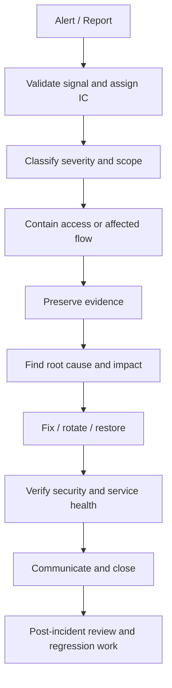

# Checklist logging, monitoring, testing và incident

## 1. Mục tiêu của checklist trước và sau deployment

Một API an toàn cần được quan sát và kiểm chứng trong suốt vòng đời vận hành. Authentication, authorization, validation, rate limit, SSRF protection hoặc tenant isolation có thể được triển khai đúng trong code nhưng vẫn thất bại khi cấu hình production sai, log không đủ ngữ cảnh, alert không phát hiện bất thường hoặc đội vận hành không có quy trình ứng phó.

Checklist này giúp đội phát triển, platform, security và operations xác nhận bốn năng lực trước khi phát hành:

1. **Logging:** hệ thống ghi lại sự kiện cần thiết để điều tra mà không tạo thêm nguồn rò rỉ dữ liệu.
2. **Monitoring:** phát hiện sớm lỗi, abuse, suy giảm bảo mật và mất khả năng quan sát.
3. **Security testing:** có bằng chứng rằng các kiểm soát quan trọng hoạt động trên đúng cấu hình và đường đi production.
4. **Incident response:** có người chịu trách nhiệm, runbook, quyền khẩn cấp và cách khôi phục khi kiểm soát thất bại.

Checklist không thay thế threat model, risk acceptance hay Content QA. Nó là một release và operations gate: mỗi mục quan trọng cần có owner, evidence, trạng thái và quyết định rõ ràng. Mục không áp dụng phải ghi lý do; mục chưa hoàn thành không được tự coi là đạt.

## 2. Xác định owner, phạm vi và bằng chứng

Trước khi đánh giá, xác định ai chịu trách nhiệm cho từng phần. Một mục checklist chỉ có giá trị khi có người xác nhận và bằng chứng có thể kiểm tra.

| Vai trò | Trách nhiệm chính |
|---|---|
| API/service owner | Xác nhận endpoint, business flow, security requirements, logging fields và behavior khi lỗi. |
| Development lead | Xác nhận code/config, test coverage, migration và rollback readiness. |
| Platform/SRE | Xác nhận ingress, runtime, telemetry pipeline, dashboard, alert routing và capacity. |
| Security owner | Xác nhận threat coverage, security test findings, detection rules và incident escalation. |
| Data/privacy owner | Xác nhận classification, log redaction, access policy và retention. |
| Incident commander/on-call | Xác nhận escalation path, runbook, contact và quyền containment. |
| Release manager | Tổng hợp go/no-go, risk acceptance và release record. |

Mỗi mục nên có các trường:

```text
Control / checklist item
Owner
Status: PASS | FAIL | BLOCKED | N/A
Evidence reference
Last verified time
Environment / release version
Exception or risk acceptance (if any)
```

Evidence có thể là CI job URL, test report, dashboard, alert test result, config review, runbook, change ticket hoặc incident exercise record. Không đính kèm access token, API key, private key, raw customer payload hoặc log chứa PII vào release ticket.

## 3. Logging: sự kiện đủ để điều tra

### 3.1 Chuẩn hóa event và correlation

- [ ] Application log, security event và audit log được phân biệt theo mục đích và retention.
- [ ] Event quan trọng có timestamp UTC, service name, version, environment và instance/workload identity.
- [ ] Có request ID và distributed trace/correlation ID để nối gateway, API, worker và dependency.
- [ ] Request ID nội bộ được tạo tại trusted edge/service; giá trị do client gửi được giữ riêng và giới hạn.
- [ ] Log route template, HTTP method, status và duration; tránh raw path/query có thể chứa token hoặc PII.
- [ ] Authentication event có mechanism, result và normalized reason code; không ghi credential.
- [ ] Authorization event có actor, action, resource type, decision, policy ID và tenant context ở dạng được phép ghi.
- [ ] Hành động đặc quyền và thay đổi dữ liệu nhạy cảm tạo audit event có actor, target, outcome và reference.
- [ ] Async job/message giữ correlation/event ID cần thiết; context được cleanup để không rò sang task khác.
- [ ] Log schema/version ổn định, field có kiểu rõ và không phụ thuộc vào một message text tự do.

Các event thường cần được ghi gồm đăng nhập thất bại, token/API key bị từ chối hoặc thu hồi, authorization deny quan trọng, cross-tenant attempt, rate-limit decision, SSRF destination bị chặn, thay đổi role/policy, truy cập/export dữ liệu nhạy cảm, webhook signature failure và thao tác break-glass.

Không nhất thiết tạo stack trace cho mọi request bị từ chối. Hãy chọn đúng tầng chịu trách nhiệm ghi event để tránh log trùng lặp và noise. Audit event quan trọng không nên phụ thuộc vào debug level hoặc trace sampling.

### 3.2 Secret, PII và log injection

- [ ] Authorization, Cookie, Set-Cookie, password, OTP, refresh token, API key và secret header bị loại khỏi log.
- [ ] Private key, signing secret, webhook secret và presigned URL có query credential không được ghi.
- [ ] Request/response body mặc định không log; field được phép ghi phải có allowlist và purpose.
- [ ] PII/payment data được loại bỏ, mask hoặc pseudonymize theo data classification.
- [ ] Rejected value và raw exception message không được phản chiếu nếu có thể chứa input nhạy cảm.
- [ ] Dữ liệu không tin cậy được ghi qua structured logger, escape CR/LF/control characters và giới hạn độ dài.
- [ ] Client không thể tự chọn log level, timestamp, actor ID hoặc event name.
- [ ] Log collector và tracing exporter cũng áp dụng redaction; không chỉ dựa vào application logger.
- [ ] Test output cuối cùng để tìm token/secret fixture và xác nhận không có dữ liệu bị cấm.

Ví dụ event JSON an toàn ở mức khái niệm:

```json
{
  "timestamp": "2026-11-18T10:15:30.000Z",
  "event.name": "api.authorization.denied",
  "service.name": "orders-api",
  "service.version": "2.4.0",
  "environment": "production",
  "request.id": "req_test_123",
  "trace.id": "trace_test_456",
  "http.method": "GET",
  "http.route": "/api/orders/{orderId}",
  "http.status_code": 403,
  "actor.type": "user",
  "actor.id": "usr_pseudonymous_7",
  "tenant.id": "tenant_42",
  "authorization.action": "order.read",
  "authorization.resource_type": "order",
  "authorization.decision": "deny",
  "authorization.policy_id": "order-owner-v2"
}
```

Ví dụ chỉ dùng dữ liệu giả. Trong production, xác định classification cho actor/resource ID và chỉ ghi field cần thiết cho điều tra.

### 3.3 Log pipeline và audit integrity

- [ ] Workload chỉ có quyền append vào log stream được cấp; không thể tự sửa/xóa audit record.
- [ ] Log truyền qua kênh xác thực và mã hóa; storage được mã hóa at rest.
- [ ] RBAC/ABAC giới hạn ai được search, reveal field, export và restore archive.
- [ ] Audit event quan trọng có retention, integrity/tamper-evidence và legal-hold policy phù hợp.
- [ ] Hoạt động search/export/restore, thay retention và break-glass trên log platform cũng được audit.
- [ ] Có metric cho dropped events, collector backlog, ingest latency, pipeline outage và clock drift.
- [ ] Retention và deletion bao gồm index, replica, archive, export và backup theo policy.

Nếu log pipeline tạm thời lỗi, hệ thống phải có failure policy rõ. Với thao tác đặc quyền cần audit bắt buộc, có thể phải từ chối thao tác khi không thể ghi audit bền vững. Với telemetry vận hành ít quan trọng hơn, local buffer có giới hạn và alert có thể phù hợp. Không để queue/buffer tăng vô hạn hoặc âm thầm drop event.

## 4. Monitoring: đo tín hiệu vận hành và bảo mật

Monitoring cần trả lời được ba câu hỏi: API có hoạt động không, security control có hoạt động không và hệ thống có đủ dữ liệu để nhận biết khi chúng ngừng hoạt động không?

### 4.1 Availability, latency và dependency health

- [ ] Theo dõi request rate, success/error rate và latency theo route, method, status class.
- [ ] Có p50/p95/p99 latency cho endpoint quan trọng, không chỉ average.
- [ ] Theo dõi timeout, connection pool, thread/worker saturation, CPU, memory và garbage collection.
- [ ] Theo dõi database pool, query latency, lock contention, queue lag và downstream dependency health.
- [ ] Có SLI/SLO hoặc ngưỡng vận hành cho luồng nghiệp vụ quan trọng.
- [ ] Health/readiness check không tiết lộ dependency detail, secret hoặc topology cho caller không được phép.
- [ ] Synthetic check đi qua ingress/edge thật để xác nhận TLS, routing và authentication hoạt động.

### 4.2 Security control signals

| Tín hiệu | Metric/event nên theo dõi | Dấu hiệu cần điều tra |
|---|---|---|
| Authentication | Success/failure theo mechanism, client, issuer và reason code. | Invalid signature, expired/revoked key tăng đột biến, token từ issuer lạ. |
| Authorization | Allow/deny theo route, action, role và tenant scope. | Một principal bị deny trên nhiều object/tenant hoặc đột ngột gọi admin action. |
| Rate limit/abuse | `429`, quota consumption, request size, concurrency và burst. | Một client/tenant tạo traffic khác baseline hoặc cố vượt quota. |
| SSRF/egress | Destination reject, DNS resolution policy, egress deny và redirect reject. | Service cố kết nối private/metadata/reserved IP hoặc host ngoài allowlist. |
| Input validation | `400`, `413`, schema mismatch, parser error và malformed payload. | Payload bất thường, body quá lớn, parser/decompression abuse. |
| Webhook/integration | Signature failure, duplicate event, retry, DLQ và semantic mismatch. | Signature fail tăng, event ID mismatch hoặc provider response sai contract. |
| Tenant isolation | Cross-tenant deny, query scope violation và object access anomaly. | Nhiều lần thử truy cập tenant khác hoặc response cache sai tenant. |
| File/API export | Upload reject, scan result, download deny và export volume. | File type mismatch, archive expansion hoặc tải dữ liệu hàng loạt. |
| Origin/edge | Direct-origin deny, mTLS failure, Host/SNI mismatch và firewall drift. | Traffic tới origin không qua edge hoặc listener phụ bị truy cập. |
| Logging pipeline | Ingest lag, dropped event, collector health và checkpoint mismatch. | Mất log đúng lúc API vẫn hoạt động hoặc audit stream bị gián đoạn. |

Không alert trên mọi `401` hoặc `403` đơn lẻ. Dùng baseline, rate, cardinality và correlation để phân biệt người dùng nhập sai thông tin với brute force, enumeration hoặc privilege probing. Alert cần có owner và hành động tiếp theo; nếu không có người xử lý, alert chỉ tạo noise.

### 4.3 Dashboard và alert quality

- [ ] Có dashboard service overview, route health, dependency, security signals và log pipeline.
- [ ] Có phân tách environment và release version để phát hiện lỗi sau deployment.
- [ ] Alert có severity, condition, owner, runbook link và escalation target.
- [ ] Có deduplication/grouping để một sự cố không tạo hàng trăm alert giống nhau.
- [ ] Có suppression/maintenance window được phê duyệt và tự hết hạn.
- [ ] Alert test được thực hiện trước release và kết quả được lưu.
- [ ] Có cảnh báo khi telemetry/agent ngừng gửi, không chỉ khi API trả lỗi.
- [ ] Có review false positive/false negative và cập nhật threshold theo baseline.

## 5. Security testing: bằng chứng trước khi phát hành

Security test phải chạy trên đúng build/config gần production và xác minh cả response lẫn side effect. Test unit hoặc mock đơn lẻ không chứng minh ingress, gateway, database, cache và worker cùng enforce policy.

### 5.1 Test coverage theo lớp

| Lớp test | Nội dung cần xác minh | Bằng chứng |
|---|---|---|
| Unit/policy | Token claims, role/scope, object/tenant/property policy, validators. | Test report và decision table. |
| Service/repository | Ownership, tenant query, transaction, state transition và field allowlist. | Test report, DB assertions. |
| API integration | Security filter chain, routing, error handling, body limits và persistence. | HTTP integration results. |
| Contract/integration | Partner schema, webhook signature, event version, retry và idempotency. | Contract tests, mock provider report. |
| Infrastructure | TLS, firewall, origin restriction, mTLS, secret injection và management endpoints. | Config review, connectivity test. |
| End-to-end | Luồng thật qua CDN/WAF/gateway, service, queue và downstream sandbox. | Synthetic journey và trace. |
| Regression | Các finding đã sửa và case BOLA/BFLA/BOPLA/SSRF trước đây. | Regression suite result. |

### 5.2 Security cases tối thiểu

- [ ] Authentication: missing/expired/invalid token, wrong issuer/audience, revoked API key và invalid mTLS identity.
- [ ] Function authorization: role thấp hơn không gọi được admin/support/financial operation.
- [ ] Object authorization: user khác không đọc/sửa/xóa object; same-tenant và cross-tenant đều được test.
- [ ] Property authorization: response không lộ field restricted; mass assignment không đổi field server-owned.
- [ ] Tenant isolation: list, search, bulk, export, cache, file, queue và background job đều giữ tenant scope.
- [ ] Input validation: boundary values, nested object, enum, parser depth, unknown fields và malformed input.
- [ ] Resource abuse: body/header/query size, batch limit, rate limit, timeout, concurrency và decompression.
- [ ] SSRF: URL/redirect allowlist, DNS rebinding test harness, private/loopback/link-local/metadata destinations và egress policy.
- [ ] File: extension/MIME spoofing, archive expansion, filename traversal, quarantine và storage key isolation.
- [ ] Webhook/message: signature, replay window, duplicate delivery, ordering, durable inbox và idempotent side effect.
- [ ] Third-party: TLS validation, wrong schema, semantic mismatch, oversized/chunked response, timeout và redirect.
- [ ] Origin/edge: direct-origin access, IPv4/IPv6, Host/SNI, forwarded-header spoofing và management port.
- [ ] Error/logging: response không lộ stack trace/secret; log redaction và correlation hoạt động.
- [ ] Recovery: rollback, retry, DLQ, key rotation và incident containment được diễn tập.

### 5.3 Test evidence và finding closure

- [ ] Mỗi test quan trọng có expected result và policy/reference tương ứng.
- [ ] Test chạy trên release candidate hoặc commit hash được ghi lại.
- [ ] Finding có severity, affected endpoint, precondition, impact, reproduction và owner.
- [ ] Request/response evidence đã redacted; không chứa credential hoặc dữ liệu khách hàng thật.
- [ ] Finding mức nghiêm trọng/cao đã được sửa hoặc có risk acceptance được phê duyệt đúng thẩm quyền.
- [ ] Retest xác minh lỗi không còn và regression test đã được thêm vào CI.
- [ ] Không dùng code coverage chung để thay thế authorization/security coverage.
- [ ] Test failure không bị bỏ qua hoặc retry tới khi xanh mà không điều tra nguyên nhân.

## 6. Incident response: sẵn sàng trước khi có sự cố

Incident response không bắt đầu khi alert đầu tiên xuất hiện. Trước release, đội vận hành cần biết ai nhận cảnh báo, ai có quyền containment, cách bảo toàn evidence và điều kiện phục hồi.

### 6.1 Vai trò và escalation

| Vai trò | Trách nhiệm trong incident |
|---|---|
| Incident commander (IC) | Điều phối, xác định mục tiêu, phân công, quyết định nhịp cập nhật và kết thúc incident. |
| Technical lead | Điều tra nguyên nhân kỹ thuật, chọn containment và recovery plan. |
| Security lead | Đánh giá phạm vi compromise, credential/data exposure và threat activity. |
| SRE/platform | Thực hiện traffic control, rollback, isolation, scaling và restore. |
| Service owner | Xác nhận business impact, data integrity và hành vi nghiệp vụ. |
| Privacy/legal/compliance contact | Đánh giá nghĩa vụ thông báo và preservation theo quy định áp dụng. |
| Communications owner | Soạn cập nhật nội bộ/khách hàng theo phê duyệt; tránh suy đoán khi chưa có facts. |

- [ ] Có on-call rota và escalation path cho service, platform, security và data owner.
- [ ] Contact/rotation được kiểm tra định kỳ và không phụ thuộc một cá nhân duy nhất.
- [ ] Có quyền khẩn cấp cho disable key, block route, isolate workload, revoke session và pause consumer.
- [ ] Break-glass dùng identity cá nhân, TTL, approval hoặc post-review, và được audit.
- [ ] Có kênh incident coordination dự phòng nếu hệ thống chính bị ảnh hưởng.

### 6.2 Severity và kích hoạt incident

Định nghĩa severity theo impact thực tế, không chỉ theo HTTP status hoặc số alert. Ví dụ:

| Mức | Tình huống tham khảo | Hành động |
|---|---|---|
| SEV-1 | Xác nhận truy cập trái phép dữ liệu nhạy cảm diện rộng, compromise signing key/root identity, cross-tenant write hoặc API quan trọng mất khả dụng diện rộng. | Kích hoạt IC ngay, containment ưu tiên, security/data owner tham gia. |
| SEV-2 | Một tenant/nhóm người dùng bị ảnh hưởng đáng kể, privilege escalation có thể khai thác, webhook/payment integrity nghiêm trọng. | Incident team phản hồi khẩn, giới hạn phạm vi và cập nhật thường xuyên. |
| SEV-3 | Abuse hoặc lỗi bảo mật giới hạn, có workaround và chưa thấy data exposure đáng kể. | Service/security owner điều tra theo SLA nội bộ. |
| SEV-4 | Anomaly nhỏ, test alert hoặc issue chưa ảnh hưởng người dùng. | Ghi nhận, phân tích trend và xử lý theo backlog. |

Các mức trên là ví dụ; tổ chức cần định nghĩa impact threshold, response time và notification policy riêng. Khi chưa rõ phạm vi, phân loại tạm theo impact tiềm năng và nâng/hạ severity khi có evidence.

## 7. Incident playbook theo nhóm API security

Mỗi playbook cần có trigger, containment, evidence, recovery và owner. Các bước dưới đây là khung để service owner cụ thể hóa theo kiến trúc.

### 7.1 Credential hoặc signing key bị lộ

**Trigger:** token/API key bất thường, secret xuất hiện trong log/repository, invalid signature tăng hoặc key được dùng từ nguồn lạ.

- Xác định credential/key ID, issuer/provider, service và thời điểm có thể bị lộ.
- Thu hồi hoặc disable key/session/token theo thứ tự giảm rủi ro; ưu tiên ngăn tiếp tục truy cập trái phép.
- Rotate secret/certificate qua secret manager; không gửi secret mới trong ticket/chat/log.
- Kiểm tra token audience/scope và các service dùng chung credential.
- Tìm request, actor, tenant và action liên quan trong audit log.
- Xác minh downstream integrations và webhook consumers đã chuyển sang key mới.
- Retest key cũ bị từ chối và key mới hoạt động đúng scope.

### 7.2 BOLA/BOPLA hoặc cross-tenant access

**Trigger:** user đọc/sửa object ngoài quyền, response lộ field restricted hoặc tenant scope bị bypass.

- Xác định endpoint, method, object type, tenant, role và field bị ảnh hưởng.
- Tạm disable route/action hoặc áp policy chặn nếu chưa có fix an toàn.
- Dừng export/bulk job và revoke signed URL/capability còn hiệu lực nếu liên quan.
- Bảo toàn request/response đã redacted, audit record, DB state và correlation ID.
- Xác định số object/tenant/user có thể bị ảnh hưởng; tránh truy cập thêm dữ liệu để “đếm” ngoài phạm vi.
- Sửa server-side object/property policy, query tenant scope và cache behavior.
- Retest same-tenant, cross-tenant, list, export, file và background path; xác minh side effect.

### 7.3 SSRF hoặc outbound connection bất thường

**Trigger:** service kết nối tới loopback, private/link-local/metadata address, host ngoài allowlist hoặc redirect bất thường.

- Xác định service, source input, resolved destination, DNS answers, redirect chain và egress route.
- Chặn egress/disable integration hoặc URL-fetch feature có rủi ro; tránh chặn dependency hợp lệ trên diện rộng khi chưa xác minh.
- Kiểm tra workload identity/metadata credential exposure và rotate credential nếu có khả năng bị truy cập.
- Bảo toàn DNS/network/egress logs và request correlation.
- Sửa allowlist, redirect policy, DNS pinning/egress proxy và response handling.
- Retest IPv4/IPv6, DNS rebinding harness, redirects và private destination deny.

### 7.4 Webhook hoặc third-party response không đáng tin

**Trigger:** signature mismatch, event replay, semantic mismatch, provider schema drift hoặc response gây thay đổi sai.

- Tạm quarantine event/response và pause consumer nếu có nguy cơ lan truyền.
- Xác minh provider/account, signing key, timestamp, event ID, schema version và request mapping.
- Kiểm tra durable inbox, idempotency record, outbox và downstream side effects.
- Đối soát trạng thái với provider qua kênh/API đã xác minh.
- Không xóa inbox/deduplication record để ép xử lý lại.
- Replay có kiểm soát sau khi xác nhận fix, dùng operation ID và audit trail.

### 7.5 Abuse, brute force hoặc resource exhaustion

**Trigger:** `429`/`5xx` tăng, body/query bất thường, queue backlog, CPU/memory saturation hoặc traffic burst.

- Xác định route/client/tenant và loại resource đang cạn.
- Áp rate limit, quota, concurrency cap hoặc block source theo policy; giữ đường cho traffic hợp lệ thiết yếu.
- Giảm worker concurrency/pause batch hoặc export job nếu cần.
- Bảo vệ database/downstream bằng timeout, bulkhead và circuit breaker.
- Kiểm tra log pipeline có bị log storm làm nghẽn không.
- Khôi phục dần theo load, xác minh SLO và theo dõi recurrence.

### 7.6 Direct-origin exposure hoặc edge bypass

**Trigger:** request từ nguồn ngoài edge tới origin, mTLS failure, Host/SNI lạ hoặc management listener public.

- Xác định IP/hostname/listener và đường bypass.
- Áp network ACL/private ingress, mTLS/origin authentication hoặc đóng listener ngoài thiết kế.
- Kiểm tra IPv4/IPv6, load balancer cũ, port phụ và management endpoints.
- Rà soát log trước thời điểm phát hiện để xác định direct access đã xảy ra chưa.
- Retest từ nguồn ngoài edge và qua edge; xác nhận WAF/rate limit không thể bypass.

## 8. Quy trình incident chung: detect, contain, investigate, recover



Trình tự thực tế có thể chạy song song: containment không nên chờ root cause hoàn chỉnh nếu đang có truy cập trái phép; evidence cần được bảo toàn trước khi log/instance bị rotate hoặc xóa. IC cần ghi decision, timestamp, owner và lý do để tránh nhiều nhóm thay đổi production mâu thuẫn.

### Detect và validate

- Xác nhận alert không phải test/maintenance noise.
- Thu thập service, version, route, actor, tenant, request/trace ID và thời gian.
- Đối chiếu application, edge, firewall, identity, database và provider logs.
- Xác định tín hiệu có thể bị spoof hoặc mất do sampling.

### Contain

- Revoke token/key/session hoặc certificate bị ảnh hưởng.
- Disable route, feature flag, integration hoặc consumer có vấn đề.
- Block source/egress/tenant theo phạm vi đã xác minh.
- Pause job, export, webhook replay hoặc payment action nếu cần.
- Cân nhắc impact tới khách hàng và availability khi chọn containment.

### Preserve và investigate

- Lưu log/audit evidence, config version, deployment artifact và relevant snapshots theo policy.
- Ghi hash/checksum và chain of custody nếu cần bảo toàn evidence.
- Không sửa/xóa record gốc để làm sạch môi trường trước khi thu thập bằng chứng.
- Xác định timeline, entry point, identity, privilege, resource và side effect.
- Ước lượng phạm vi ảnh hưởng bằng dữ liệu đã được phép truy cập.

### Recover và verify

- Triển khai fix đã review hoặc rollback sang artifact/config đã biết an toàn.
- Rotate/revoke credential và xác minh key cũ không còn được chấp nhận.
- Khôi phục queue/job theo thứ tự và idempotency; tránh phát lại side effect.
- Chạy smoke/security regression test trước khi mở lại traffic.
- Theo dõi alert, SLO, error rate và business reconciliation sau recovery.

## 9. Communications và post-incident review

- [ ] Có owner duy nhất cho incident update và phê duyệt thông tin gửi ra ngoài.
- [ ] Cập nhật nội bộ theo thời điểm, impact đã xác minh, action đang thực hiện và next update time.
- [ ] Không suy đoán nguyên nhân, số người bị ảnh hưởng hoặc data exposure khi chưa có evidence.
- [ ] Privacy/legal/compliance owner đánh giá nghĩa vụ thông báo theo jurisdiction, contract và loại dữ liệu.
- [ ] Khách hàng/đối tác nhận thông tin theo quy trình được phê duyệt; không gửi secret hoặc evidence thô.
- [ ] Sau incident có timeline, root cause, contributing factors, detection gap và impact assessment.
- [ ] Action item có owner, due date, priority và cách xác minh hoàn thành.
- [ ] Bổ sung regression test, alert/runbook/config guardrail để ngăn tái diễn.
- [ ] Review alert quality và response time; xác định tín hiệu nào đã thiếu hoặc đến muộn.
- [ ] Không dùng postmortem để đổ lỗi cá nhân; tập trung cải thiện hệ thống và quy trình.

## 10. Runbook và tabletop exercise

Runbook cần ngắn, dễ tìm và đủ cụ thể để on-call có thể thực hiện trong áp lực thời gian.

Mỗi runbook nên có:

- Trigger/alert name và điều kiện kích hoạt.
- Severity gợi ý và người/nhóm phải gọi.
- Dashboard, log query và service map liên quan.
- Lệnh hoặc thao tác containment đã được review, có điều kiện và rollback.
- Quy trình revoke/rotate credential, pause queue, disable route hoặc restore.
- Evidence cần bảo toàn và dữ liệu không được đưa vào ticket.
- Smoke/security tests sau containment và recovery.
- Escalation nếu owner không phản hồi hoặc quyền thao tác thiếu.
- Ngày kiểm tra gần nhất, version và owner runbook.

Tổ chức tabletop hoặc game day định kỳ với tình huống phù hợp:

1. API key của partner xuất hiện trong log.
2. Customer đọc được invoice của tenant khác.
3. Webhook payment được gửi lại và tạo refund trùng.
4. SSRF chạm metadata endpoint từ workload.
5. Direct-origin access bypass WAF.
6. Log collector ngừng nhận security events trong khi API vẫn hoạt động.
7. Deployment mới làm authorization policy từ chối nhầm khách hàng.

Sau exercise, ghi lại thời gian phát hiện, thời gian containment, điểm thiếu quyền, thiếu dashboard, runbook không đúng và action cần hoàn thành. Không chỉ đánh giá người tham gia nhớ lý thuyết; hãy xác minh họ có thể tìm đúng thông tin và thực hiện thao tác trong môi trường an toàn.

## 11. Deployment sequence và canary verification

Logging, monitoring và incident readiness nên được kiểm tra trước khi tăng traffic:

1. Xác nhận release artifact, config, secret reference và migration đã được review.
2. Xác nhận log/trace pipeline hoạt động, redaction được bật và audit event test đã đến storage.
3. Xác nhận dashboard/alert đã nhận telemetry của release candidate.
4. Chạy smoke test qua edge cho health, authentication và một luồng nghiệp vụ an toàn.
5. Chạy security smoke tests cho authorization deny, tenant boundary, rate limit và request limits.
6. Canary một tỷ lệ traffic được phê duyệt; theo dõi error rate, latency, security deny và dependency health.
7. Xác nhận không có secret leak, log drop, direct-origin traffic hoặc unexpected policy change.
8. Mở rộng traffic theo rollout plan; giữ rollback artifact/config sẵn sàng.
9. Sau rollout, chạy synthetic checks và đối chiếu business metrics/audit events.

Canary cần có rollback threshold rõ ràng. Ví dụ, tăng `5xx`, p99 latency, auth failure bất thường, cross-tenant alert hoặc dropped audit event có thể dừng rollout. Threshold phải dựa trên baseline/SLO của hệ thống, không copy một con số chung cho mọi API.

## 12. Go/no-go checklist cho release

### Logging readiness

- [ ] Event schema và correlation fields đã được xác minh.
- [ ] Secret/PII redaction đã được test ở output cuối.
- [ ] Audit event quan trọng được lưu bền vững và có access/retention policy.
- [ ] Log pipeline health, backlog và dropped-event alert hoạt động.

### Monitoring readiness

- [ ] Dashboard có availability, latency, dependency và security signals.
- [ ] Alert có owner, severity, runbook và escalation route.
- [ ] Synthetic check đi qua edge/ingress thật đã pass.
- [ ] Alert test và telemetry pipeline test đã có evidence.

### Testing readiness

- [ ] CI/security regression suite của release candidate pass.
- [ ] BOLA/BFLA/BOPLA, tenant isolation, SSRF, input/resource limits và webhook tests phù hợp đã pass.
- [ ] Không còn finding nghiêm trọng/cao chưa xử lý hoặc chưa có risk acceptance hợp lệ.
- [ ] Retest evidence và test artifact gắn với đúng commit/build.

### Incident readiness

- [ ] On-call, IC và escalation contact đã xác nhận.
- [ ] Runbook cho credential leak, unauthorized access, SSRF, abuse và dependency failure có sẵn.
- [ ] Có quyền revoke/disable/isolate/pause và thao tác được audit.
- [ ] Rollback/recovery plan và post-recovery verification đã được xác định.
- [ ] Privacy/legal/communications contact được biết khi incident có thể ảnh hưởng dữ liệu.

### Release decision

| Trạng thái | Điều kiện |
|---|---|
| **GO** | Các control bắt buộc PASS, evidence đầy đủ, owner xác nhận và không có rủi ro vượt ngưỡng chấp nhận. |
| **GO WITH APPROVED EXCEPTION** | Có ngoại lệ được owner có thẩm quyền phê duyệt, phạm vi/impact/mitigation/expiry rõ và có kế hoạch đóng. |
| **NO-GO** | Thiếu log/audit bắt buộc, không có detection cho rủi ro trọng yếu, security test nghiêm trọng fail, không có on-call/containment hoặc rollback không khả thi. |

Không dùng trạng thái “N/A” để che mục chưa làm. Ngoại lệ cần ghi lý do, người phê duyệt, ngày hết hạn, compensating control và điều kiện review.

## 13. Mẫu release evidence record

Có thể dùng mẫu ngắn sau cho mỗi release:

```yaml
release:
  service: orders-api
  version: 2.4.0
  environment: production
  commit: "<commit-sha>"
  deployed_at: "<UTC timestamp>"
checks:
  logging:
    status: PASS
    evidence: "<log-redaction-test-and-audit-event-link>"
    owner: "<team-or-person>"
  monitoring:
    status: PASS
    evidence: "<dashboard-and-alert-test-link>"
    owner: "<team-or-person>"
  security_testing:
    status: PASS
    evidence: "<ci-and-regression-report-link>"
    owner: "<team-or-person>"
  incident_readiness:
    status: PASS
    evidence: "<runbook-and-oncall-confirmation-link>"
    owner: "<team-or-person>"
decision:
  result: GO
  approver: "<release-approver>"
  exceptions: []
```

Đây là ví dụ record, không phải schema bắt buộc. Không đưa secret, token hoặc thông tin cá nhân vào evidence link/metadata. Hãy giữ release record trong hệ thống change management có quyền truy cập và audit phù hợp.

## 14. Anti-pattern khi vận hành logging, monitoring và incident

| Anti-pattern | Hậu quả | Cách khắc phục |
|---|---|---|
| Log toàn bộ request/response | Lộ token, PII và payload; tăng chi phí và rủi ro breach. | Structured allowlist, redaction và purpose-based logging. |
| Chỉ có dashboard, không có alert owner | Bất thường được hiển thị nhưng không ai xử lý. | Owner, severity, runbook và escalation cho từng alert. |
| Alert mọi `401`/`403` | Alert fatigue và bỏ lỡ tín hiệu thật. | Baseline, threshold, correlation và grouping. |
| Sampling audit event quan trọng | Mất bằng chứng hành động đặc quyền. | Audit pipeline riêng, durable và không phụ thuộc trace sampling. |
| Chỉ chạy unit test | Bỏ sót ingress, filter, cache, database và worker. | Integration/end-to-end test theo trust boundary. |
| Chỉ kiểm tra status code | Có thể đã có partial write hoặc downstream side effect. | Assert database, queue, outbox và provider sandbox. |
| Incident runbook chỉ là tài liệu cũ | On-call không thể thực hiện thao tác thật. | Owner, review date và tabletop/game day. |
| Không chuẩn bị quyền containment | Phải chờ người khác trong lúc sự cố tiếp diễn. | JIT/break-glass có kiểm soát và audit. |
| Rollback chỉ rollback code | Config/schema/credential/data migration vẫn ở trạng thái lỗi. | Rollback plan cho artifact, config, schema và credential. |
| Xóa log/evidence để dọn hệ thống | Mất khả năng điều tra và chain of custody. | Preserve evidence trước cleanup; theo retention/hold policy. |
| Chỉ đo API availability | API vẫn “xanh” dù authz/logging/SSRF control bị bypass. | Security signals và telemetry health trong SLO/dashboard. |

## 15. Review định kỳ sau deployment

Checklist không kết thúc khi release được đánh dấu GO. Sau deployment cần rà soát:

- [ ] Dashboard và alert phản ánh đúng traffic/version mới.
- [ ] Log event được ghi đủ và không có secret/PII ngoài policy.
- [ ] Security deny/rate-limit/validation metrics nằm trong baseline dự kiến.
- [ ] Không có direct-origin access, unexpected egress hoặc workload identity mới ngoài inventory.
- [ ] Queue/DLQ/retry và webhook delivery không tăng bất thường.
- [ ] Audit events cho thao tác đặc quyền và data access có thể truy vấn.
- [ ] On-call nhận alert test và biết runbook tương ứng.
- [ ] Risk exception được review trước ngày hết hạn.
- [ ] Incident hoặc near-miss tạo regression test và action item.
- [ ] Retention, access review và runbook được rà soát theo lịch.

Đặt review cadence theo rủi ro và tốc độ thay đổi: sau mỗi release lớn, thay đổi identity/authorization, thay provider/gateway hoặc incident nghiêm trọng cần review ngay; ngoài ra có lịch định kỳ cho access review, alert tuning và tabletop exercise.

## 16. Checklist tổng hợp

### Logging

- [ ] Structured events, UTC timestamp, service/version và request/trace correlation.
- [ ] Authentication, authorization, security và audit events có field phù hợp.
- [ ] Secret/PII redaction, log injection protection và body logging policy đã test.
- [ ] Log transport/storage được xác thực, mã hóa, phân quyền và retention đúng.
- [ ] Audit-of-audit, dropped-event metrics và pipeline alert hoạt động.

### Monitoring

- [ ] Availability, latency, saturation và dependency health được đo.
- [ ] Authn/authz, abuse, SSRF, validation, webhook, tenant và origin signals được theo dõi.
- [ ] Dashboard/alert có owner, severity, runbook và escalation.
- [ ] Telemetry pipeline outage và missing data được phát hiện.

### Security testing

- [ ] Unit, service, API integration, contract, infrastructure và E2E test phù hợp đã chạy.
- [ ] BOLA/BFLA/BOPLA, tenant isolation, SSRF, resource limits và credential tests đã có.
- [ ] Test xác minh side effect, data state, log redaction và failure behavior.
- [ ] Finding được phân loại, sửa hoặc risk-accept đúng thẩm quyền; retest pass.

### Incident

- [ ] On-call, IC, severity model và escalation path rõ.
- [ ] Playbook cho credential, data access, SSRF, webhook, abuse và origin exposure sẵn sàng.
- [ ] Containment, evidence preservation, recovery và communications có owner.
- [ ] Tabletop/game day và post-incident action được thực hiện.

### Release

- [ ] Evidence gắn đúng commit/build/environment.
- [ ] Các mục bắt buộc PASS hoặc có exception được phê duyệt và hết hạn rõ.
- [ ] Go/no-go được release owner ghi nhận.
- [ ] Post-deployment verification và review được lên lịch.

Một deployment chỉ sẵn sàng khi đội ngũ có thể quan sát điều gì đang xảy ra, phát hiện khi security control suy yếu, chứng minh các kiểm soát đã được test và hành động có phối hợp khi xảy ra sự cố. Logging, monitoring, testing và incident response phải dùng chung context như service, route, actor, tenant, request/trace ID và release version; nhờ vậy đội vận hành có thể nối tín hiệu từ alert tới evidence, containment và recovery mà không phải dựa vào phỏng đoán.
