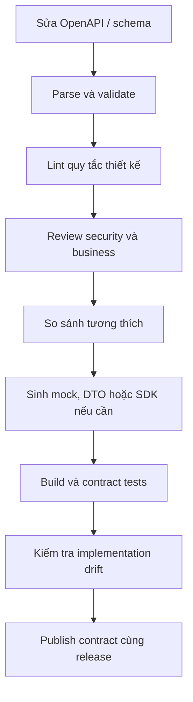

# OpenAPI hoặc schema là nguồn mô tả contract

## 1. Contract là cam kết kỹ thuật giữa các bên

Một API contract mô tả cách một bên được phép giao tiếp với bên còn lại: endpoint nào tồn tại, dùng HTTP method nào, gửi dữ liệu gì, nhận kết quả gì, lỗi được biểu diễn ra sao và những điều kiện kỹ thuật nào phải được đáp ứng. Contract là căn cứ chung cho nhóm xây dựng API, nhóm tích hợp, người kiểm thử, vận hành và các bên tiêu thụ dịch vụ.

Trong phạm vi **SECURITY_API_SECURITY**, contract còn là một phần của thiết kế bảo mật. Khi mô tả rõ request, response, kiểu dữ liệu, giới hạn, cơ chế xác thực và hành vi lỗi, nhóm phát triển có thể phát hiện sớm những điểm như:

- Endpoint nhận thêm thuộc tính đặc quyền mà client không nên điều khiển.
- Response trả về trường nội bộ hoặc dữ liệu nhạy cảm ngoài nhu cầu.
- Tham số phân trang, kích thước payload hoặc bộ lọc không có giới hạn.
- Một thao tác nhạy cảm thiếu yêu cầu xác thực hoặc mô tả quyền cần có.
- Schema chấp nhận dữ liệu không hợp lệ về kiểu, phạm vi hoặc cấu trúc.
- Các nhóm triển khai hiểu khác nhau về trạng thái, lỗi hoặc quy tắc tương thích.

**OpenAPI** là một định dạng đặc tả phổ biến để mô tả API HTTP. Một tài liệu OpenAPI có thể chứa đường dẫn, operation, parameter, request body, response, security scheme và schema của dữ liệu. Với API dùng JSON, các schema thường được biểu diễn bằng Schema Object trong OpenAPI và có quan hệ chặt chẽ với JSON Schema.

Cụm từ “OpenAPI hoặc schema là nguồn mô tả contract” nhấn mạnh một nguyên tắc: contract cần có một nguồn chuẩn được quản lý rõ ràng. Nếu mỗi nhóm tự duy trì một bản mô tả riêng, tài liệu, mã nguồn, SDK và hành vi chạy thật dễ lệch nhau. Tuy nhiên, schema chỉ mô tả cấu trúc và một phần ràng buộc dữ liệu; nó không tự mô tả đầy đủ mọi quy tắc nghiệp vụ hay thực thi phân quyền.

Sau bài học này, người học có thể:

1. Giải thích vai trò của OpenAPI và schema trong việc định nghĩa API contract.
2. Xác định tài liệu nào là nguồn chuẩn và cách các thành phần khác được tạo hoặc kiểm chứng từ nguồn đó.
3. Mô tả endpoint, request, response, lỗi và cơ chế xác thực một cách nhất quán.
4. Thiết kế schema hạn chế dữ liệu ngoài dự kiến và tránh phơi bày thuộc tính nhạy cảm.
5. Phân biệt validation cấu trúc với phân quyền và validation nghiệp vụ.
6. Kiểm soát thay đổi contract, kiểm thử tương thích và đưa contract vào quy trình phát triển.

## 2. Chọn nguồn chuẩn và xác định ranh giới của contract

### 2.1. Một nguồn chuẩn có chủ sở hữu

Một dự án có thể lưu contract dưới dạng:

- Tài liệu OpenAPI YAML hoặc JSON.
- Các schema độc lập, chẳng hạn JSON Schema, được tham chiếu từ tài liệu API.
- Đặc tả giao thức khác phù hợp với hệ thống, nhưng phải xác định rõ cách quản lý và kiểm tra.

Với REST API qua HTTP, OpenAPI thường phù hợp vì nó mô tả được cả giao thức HTTP lẫn cấu trúc dữ liệu. Nếu tổ chức chọn các schema độc lập, cần có tài liệu cấp API liên kết chúng với method, path, status code, content type và security requirement.

Nguồn chuẩn nên có:

- **Owner:** nhóm hoặc cá nhân chịu trách nhiệm về contract.
- **Version:** phiên bản đặc tả và phiên bản API được mô tả.
- **Location:** vị trí có kiểm soát phiên bản, quyền sửa và lịch sử thay đổi.
- **Review:** quy trình xem xét thay đổi ảnh hưởng tới consumer, bảo mật và vận hành.
- **Validation:** công cụ kiểm tra cú pháp, quy tắc thiết kế và tương thích.
- **Release mapping:** cách xác định contract nào tương ứng với bản API đang triển khai.

Không nên để tài liệu API, mã nguồn controller, DTO, ví dụ trong README và schema của gateway trở thành những nguồn sự thật độc lập mà không có cơ chế đồng bộ. Nếu có nhiều nguồn kỹ thuật cần tồn tại, phải chỉ rõ nguồn nào là chuẩn và nguồn nào được sinh ra hoặc kiểm chứng từ nguồn chuẩn đó.

### 2.2. Contract mô tả điều gì?

Một API contract tốt thường mô tả:

| Nhóm | Nội dung |
|---|---|
| Nhận diện API | Tên, phiên bản, mô tả, server hoặc môi trường |
| Operation | Path, HTTP method, operationId, tags và mô tả |
| Input | Path/query/header/cookie parameter, request body và content type |
| Output | Status code, response header, body và content type |
| Schema | Kiểu dữ liệu, thuộc tính, required, giới hạn, enum và cấu trúc lồng nhau |
| Security | Cơ chế xác thực và security requirement ở cấp API hoặc operation |
| Lỗi | Mã lỗi, cấu trúc lỗi và điều kiện có thể phát sinh |
| Ví dụ | Request/response mẫu, tình huống thành công và thất bại |
| Vận hành | Phân trang, giới hạn kích thước, timeout hoặc cơ chế retry khi phù hợp |
| Tiến hóa | Phiên bản, quy tắc tương thích và chính sách ngừng hỗ trợ |

Không phải mọi quy tắc đều biểu diễn được trực tiếp bằng OpenAPI. Ví dụ, “chỉ chủ sở hữu đơn hàng hoặc nhân viên được phân công mới được xem đơn hàng” cần mô tả trong phần mô tả nghiệp vụ, extension hoặc tài liệu liên quan; quan trọng hơn, quy tắc đó phải được thực thi ở server và có kiểm thử. Một mô tả trong YAML không tự tạo ra kiểm soát truy cập.

### 2.3. Phân biệt ba lớp

Cần tách ba lớp để tránh đặt quá nhiều kỳ vọng vào schema:

1. **Protocol contract:** HTTP method, path, parameter, header, status code, content type, request và response.
2. **Data contract:** cấu trúc dữ liệu, kiểu, giới hạn, quan hệ trường và cách biểu diễn giá trị.
3. **Business/security contract:** ai được làm gì trên object nào, trạng thái nào hợp lệ, điều kiện phê duyệt, giới hạn nghiệp vụ và tác động phụ.

OpenAPI có thể mô tả phần lớn protocol contract, nhiều phần của data contract và một số thông tin bảo mật ở mức khai báo. Business/security contract thường cần mô tả bổ sung và luôn cần kiểm soát thực thi ở phía server.

## 3. Cấu trúc cơ bản của tài liệu OpenAPI

Một tài liệu OpenAPI thường có các thành phần chính:

| Thành phần | Vai trò |
|---|---|
| `openapi` | Phiên bản đặc tả OpenAPI dùng để đọc tài liệu |
| `info` | Tên, mô tả và phiên bản của tài liệu API |
| `servers` | Các địa chỉ server được mô tả |
| `paths` | Các path và operation HTTP |
| `components` | Schema, parameter, response, request body và security scheme dùng lại |
| `security` | Yêu cầu xác thực mặc định ở cấp tài liệu |
| `tags` | Nhóm operation để tổ chức tài liệu |
| `externalDocs` | Liên kết đến tài liệu bổ sung |
| `webhooks` | Mô tả webhook do API gửi đi, nếu sử dụng phiên bản hỗ trợ |

Một cấu trúc rút gọn:

```yaml
openapi: 3.1.0
info:
  title: Order API
  version: 1.0.0
  description: API quản lý đơn hàng
servers:
  - url: https://api.example.com
paths:
  /v1/orders/{orderId}:
    get:
      operationId: getOrder
      summary: Lấy thông tin đơn hàng
      parameters:
        - name: orderId
          in: path
          required: true
          schema:
            type: string
            format: uuid
      responses:
        "200":
          description: Tìm thấy đơn hàng
        "404":
          description: Không tìm thấy đơn hàng
components:
  schemas: {}
```

Đây chỉ là ví dụ cấu trúc. Trong tài liệu thực tế, response cần mô tả schema và content type; operation nhạy cảm cần khai báo security requirement; các tham số cần mô tả chính xác cách serialize và giới hạn.

### 3.1. Path và operation

Mỗi cặp path và HTTP method tạo thành một operation. Ví dụ:

- `GET /v1/orders/{orderId}`: đọc một đơn hàng.
- `POST /v1/orders`: tạo đơn hàng.
- `PATCH /v1/orders/{orderId}`: cập nhật một phần thông tin.
- `POST /v1/orders/{orderId}/refund`: yêu cầu hoàn tiền.

Không nên dùng một endpoint chung với payload tùy ý để thực hiện nhiều hành động nhạy cảm nếu điều đó làm mờ quyền, trạng thái và audit. Các thao tác khác nhau thường có điều kiện và hậu quả khác nhau, do đó nên có operation rõ ràng.

Mỗi operation nên có `operationId` ổn định và duy nhất trong tài liệu. Tên này hỗ trợ sinh SDK, liên kết test và tra cứu log. Tránh đổi tên tùy tiện vì consumer có thể phụ thuộc vào tên operation được sinh trong client.

### 3.2. Parameter và request body

OpenAPI phân biệt parameter theo vị trí:

- `path`: một phần của đường dẫn, thường định danh object.
- `query`: lọc, sắp xếp, phân trang hoặc tùy chọn truy vấn.
- `header`: thông tin điều khiển hoặc metadata của request.
- `cookie`: giá trị được truyền qua cookie khi API có sử dụng.

Parameter cần mô tả `name`, `in`, `required`, `description`, `schema` và cách serialize khi cần. Path parameter luôn phải có `required: true`.

Request body mô tả nội dung gửi trong body, thường theo từng media type như `application/json` hoặc `multipart/form-data`. Không nên mô tả body chỉ bằng một câu chung chung; schema phải chỉ rõ trường nào bắt buộc, trường nào tùy chọn và giá trị được chấp nhận.

### 3.3. Response và status code

Mỗi operation nên mô tả các status code có ý nghĩa:

- `2xx`: xử lý thành công.
- `3xx`: chuyển hướng nếu API thực sự sử dụng.
- `4xx`: request không hợp lệ, chưa xác thực, không đủ quyền, không tìm thấy object, xung đột hoặc vượt giới hạn.
- `5xx`: lỗi phía server hoặc phụ thuộc.

Không nên dùng `200` cho mọi kết quả rồi nhét mã lỗi nghiệp vụ vào body mà không có quy ước rõ ràng. Status code giúp client, gateway, monitoring và người vận hành phân biệt loại kết quả. Cũng cần tránh tiết lộ chi tiết nội bộ qua response lỗi.

Với mỗi response, hãy mô tả:

- Status code.
- Ý nghĩa và điều kiện phát sinh.
- Header quan trọng như `Location`, `ETag`, `Retry-After` hoặc correlation ID khi có.
- Media type.
- Schema body nếu có.
- Những trường nào được trả về và có nhạy cảm hay không.

## 4. Thiết kế schema dữ liệu có ràng buộc rõ ràng

Schema là mô tả có cấu trúc về dữ liệu. Schema tốt giúp các bên thống nhất kiểu dữ liệu, trường bắt buộc, giá trị hợp lệ và hình dạng của object.

### 4.1. Các từ khóa thường dùng

| Từ khóa | Ý nghĩa |
|---|---|
| `type` | Kiểu dữ liệu như `object`, `array`, `string`, `integer`, `number`, `boolean` |
| `properties` | Các trường của object |
| `required` | Danh sách thuộc tính bắt buộc |
| `additionalProperties` | Có cho phép thuộc tính ngoài danh sách khai báo hay không |
| `enum` | Tập giá trị cho phép |
| `const` | Một giá trị duy nhất được phép trong JSON Schema dialect hỗ trợ |
| `format` | Gợi ý hoặc ràng buộc định dạng như `date-time`, `email`, `uuid` |
| `minimum`, `maximum` | Giới hạn số |
| `minLength`, `maxLength` | Giới hạn độ dài chuỗi |
| `pattern` | Biểu thức chính quy mô tả chuỗi |
| `minItems`, `maxItems` | Giới hạn số phần tử của mảng |
| `items` | Schema của từng phần tử trong mảng |
| `minProperties`, `maxProperties` | Giới hạn số thuộc tính của object |
| `oneOf`, `anyOf`, `allOf`, `not` | Kết hợp hoặc loại trừ schema |

Các từ khóa chỉ có tác dụng theo dialect và phiên bản đặc tả mà tài liệu sử dụng. Cần cấu hình validator đúng phiên bản; không nên giả định mọi công cụ đều hiểu mọi từ khóa giống nhau.

### 4.2. Required không đồng nghĩa với non-null

Một thuộc tính có thể:

- Bắt buộc phải xuất hiện.
- Có thể vắng mặt.
- Có thể xuất hiện với giá trị `null`.
- Chỉ được trả về từ server.
- Chỉ được client gửi lên server.

Đây là những khái niệm khác nhau. Ví dụ trong OpenAPI 3.1:

```yaml
CustomerInput:
  type: object
  additionalProperties: false
  required:
    - email
  properties:
    email:
      type: string
      format: email
    displayName:
      type: ["string", "null"]
      maxLength: 120
```

Trong ví dụ này, `email` phải có mặt và không nhận `null` vì kiểu chỉ là string. `displayName` có thể bị bỏ qua; nếu có thì có thể là string hoặc null. `required` điều khiển sự hiện diện của thuộc tính, còn danh sách `type` quyết định giá trị null có được chấp nhận không.

Với OpenAPI 3.0, cách khai báo nullable khác, thường dùng `nullable: true` cùng một type đơn. Không sao chép cú pháp nullable giữa 3.0 và 3.1 mà không kiểm tra phiên bản và công cụ.

### 4.3. Giới hạn đầu vào

Schema nên khai báo giới hạn phù hợp với nghiệp vụ:

```yaml
pageSize:
  type: integer
  minimum: 1
  maximum: 100

description:
  type: string
  minLength: 1
  maxLength: 2000

items:
  type: array
  minItems: 1
  maxItems: 50
  items:
    type: string
    format: uuid
```

Giới hạn trong schema hỗ trợ client và validator, nhưng server vẫn phải thực thi. Nếu server nhận pageSize không giới hạn dù OpenAPI ghi maximum 100, contract và triển khai đang lệch nhau.

Cần cân nhắc giới hạn cho:

- Kích thước request body và từng trường văn bản.
- Số phần tử trong danh sách.
- Độ sâu object lồng nhau.
- Số lượng bộ lọc, sort key và giá trị query.
- Kích thước tệp và số lượng tệp upload.
- Số lượng kết quả export hoặc batch.
- Giá trị số, độ chính xác và quy tắc làm tròn.

Không nên đặt giới hạn quá rộng chỉ để “dễ dùng”. Giới hạn cần phản ánh năng lực xử lý và yêu cầu nghiệp vụ, sau đó được kiểm thử ở server và gateway.

### 4.4. additionalProperties và dữ liệu ngoài dự kiến

Với object nhận từ client, `additionalProperties: false` có thể giúp từ chối trường không được khai báo. Điều này hữu ích để phát hiện typo, ngăn client gửi thuộc tính đặc quyền và giảm rủi ro mass assignment.

Ví dụ:

```yaml
ProfileUpdate:
  type: object
  additionalProperties: false
  properties:
    displayName:
      type: string
      maxLength: 80
    phone:
      type: string
      maxLength: 30
```

Payload có `role`, `tenantId` hoặc `isAdmin` sẽ không phù hợp với schema trên. Tuy nhiên, hiệu quả chỉ có khi validator thực sự được gọi và hành vi khi có trường lạ được xác định. Nếu ứng dụng bỏ qua thuộc tính không biết đến thay vì từ chối, điều đó cần được ghi nhận và kiểm thử nhất quán.

Không phải mọi object đều nên đóng hoàn toàn. Một số API cần metadata mở rộng hoặc map key-value. Trong trường hợp đó, hãy giới hạn kiểu và phạm vi của giá trị:

```yaml
labels:
  type: object
  maxProperties: 20
  additionalProperties:
    type: string
    maxLength: 100
```

Đừng dùng `additionalProperties: true` cho payload nhạy cảm chỉ vì thuận tiện. Nếu cần mở rộng, hãy xác định rõ namespace, kiểu dữ liệu và quyền sở hữu từng thuộc tính.

### 4.5. readOnly và writeOnly

`readOnly` và `writeOnly` biểu diễn hướng sử dụng của thuộc tính:

- `readOnly: true`: thuộc tính chỉ có ý nghĩa trong response.
- `writeOnly: true`: thuộc tính chỉ có ý nghĩa trong request, ví dụ mật khẩu khi tạo tài khoản.

Ví dụ:

```yaml
Account:
  type: object
  properties:
    id:
      type: string
      format: uuid
      readOnly: true
    email:
      type: string
      format: email
    password:
      type: string
      writeOnly: true
```

Đây là metadata của contract, không tự động bảo vệ dữ liệu ở runtime. Server phải tránh trả password, hash, secret hoặc trường nội bộ trong response. Nếu cùng một object được dùng cho cả request và response, hãy kiểm tra cách validator, generator và framework diễn giải các thuộc tính này. Với API có khác biệt lớn giữa input và output, nên định nghĩa schema riêng như `AccountCreateRequest`, `AccountUpdateRequest` và `AccountResponse`.

### 4.6. Composition: allOf, oneOf và anyOf

Các từ khóa composition giúp tái sử dụng và biểu diễn biến thể:

- `allOf`: dữ liệu phải thỏa tất cả schema được ghép.
- `oneOf`: dữ liệu phải thỏa đúng một schema.
- `anyOf`: dữ liệu phải thỏa ít nhất một schema.

Ví dụ một payment method có thể là thẻ hoặc chuyển khoản:

```yaml
PaymentMethod:
  oneOf:
    - $ref: "#/components/schemas/CardPayment"
    - $ref: "#/components/schemas/BankTransfer"
  discriminator:
    propertyName: methodType
    mapping:
      card: "#/components/schemas/CardPayment"
      bank_transfer: "#/components/schemas/BankTransfer"
```

Schema của từng biến thể nên có `methodType` với giá trị cố định tương ứng và giới hạn thuộc tính phù hợp. Nếu dùng `oneOf` mà các nhánh chồng lấn, dữ liệu có thể khớp nhiều schema và bị từ chối. Discriminator hỗ trợ lựa chọn biến thể trong một số công cụ, nhưng không thay thế việc kiểm tra tính hợp lệ của payload.

Cần thử composition bằng chính validator được dùng trong CI và runtime. Một số generator xử lý `allOf`, `oneOf`, discriminator hoặc schema lồng nhau khác nhau; không nên giả định mã sinh ra luôn tương đương với ý nghĩa của tài liệu.

## 5. Phân biệt phiên bản OpenAPI và JSON Schema

OpenAPI và JSON Schema có liên quan nhưng không phải mọi phiên bản đều dùng cùng một dialect.

- **OpenAPI 3.0.x:** Schema Object dựa trên một tập con và các mở rộng riêng so với JSON Schema. Một số từ khóa JSON Schema hiện đại không được hỗ trợ như trong 3.1; cú pháp nullable thường dùng `nullable: true`.
- **OpenAPI 3.1.x:** Schema Object được điều chỉnh để tương thích với JSON Schema 2020-12 và có khai báo dialect. Cú pháp union type, ví dụ `type: ["string", "null"]`, có thể được sử dụng theo JSON Schema.
- **JSON Schema độc lập:** tài liệu cần khai báo hoặc xác định dialect phù hợp, chẳng hạn thông qua `$schema`. Không nên đưa schema độc lập vào OpenAPI rồi giả định mọi tool sẽ diễn giải giống nhau.

Ví dụ hai cách nullable:

```yaml
# OpenAPI 3.0.x
displayName:
  type: string
  nullable: true
```

```yaml
# OpenAPI 3.1.x
displayName:
  type:
    - string
    - "null"
```

Không trộn các cách viết chỉ vì chúng trông gần giống nhau. Trước khi nâng phiên bản OpenAPI, cần kiểm tra parser, linter, code generator, validator, gateway và tài liệu API đang sử dụng có hỗ trợ phiên bản mới hay không.

### 5.1. Format không phải lúc nào cũng là kiểm tra bắt buộc

`format: email`, `format: uuid` hoặc `format: date-time` mô tả ý nghĩa định dạng. Tùy validator và cấu hình, format có thể chỉ được xem là annotation hoặc được kiểm tra như assertion. Do đó:

- Không giả định ghi `format: email` đồng nghĩa server đã xác minh email.
- Kiểm tra cấu hình validator để biết format có được thực thi không.
- Thực hiện kiểm tra nghiệp vụ bổ sung, ví dụ email đã được xác minh hoặc thuộc miền được phép.
- Tránh dùng format thay cho kiểm tra giới hạn độ dài, quyền sở hữu hoặc trạng thái.

Schema có thể xác nhận một chuỗi trông giống UUID; nó không xác nhận UUID đó thuộc về người đang gọi API.

## 6. Mô tả security trong OpenAPI

OpenAPI có thể khai báo cách client xác thực với API thông qua `components.securitySchemes` và `security`.

Các loại thường gặp gồm:

- HTTP authentication, ví dụ `bearer`.
- API key truyền qua header, query hoặc cookie.
- OAuth 2.0 với các flow phù hợp.
- OpenID Connect discovery.

Ví dụ khai báo bearer token:

```yaml
components:
  securitySchemes:
    bearerAuth:
      type: http
      scheme: bearer
      bearerFormat: JWT

security:
  - bearerAuth: []
```

Khai báo này mô tả client cần gửi bearer token. `bearerFormat: JWT` là gợi ý định dạng; nó không định nghĩa đầy đủ cách xác minh chữ ký, issuer, audience, thời hạn, thuật toán hoặc trạng thái thu hồi. Các bước xác minh token phải được thực hiện trong hệ thống xác thực.

Có thể đặt `security` ở cấp tài liệu để áp dụng mặc định cho các operation. Operation có thể ghi đè yêu cầu đó. Ví dụ `security: []` ở một operation có nghĩa operation đó không yêu cầu security scheme được kế thừa từ cấp tài liệu. Cần review cẩn thận các ngoại lệ như health check hoặc endpoint công khai để tránh vô tình bỏ xác thực.

Với OAuth 2.0, OpenAPI có thể mô tả flow và scope. Scope cho biết phạm vi quyền được cấp trong token, nhưng không thay thế phân quyền theo object hoặc kiểm tra quy tắc nghiệp vụ. Một token có scope `orders:read` không có nghĩa chủ thể được xem mọi đơn hàng.

### 6.1. Security scheme không phải authorization policy đầy đủ

Cần phân biệt:

- **Authentication:** xác định danh tính hoặc thông tin xác thực của caller.
- **Function-level authorization:** caller có được gọi chức năng này không?
- **Object-level authorization:** caller có quyền trên object cụ thể không?
- **Property-level authorization:** caller được đọc hoặc sửa trường nào?
- **Workflow authorization:** hành động có hợp lệ ở trạng thái hiện tại và đúng thứ tự không?

OpenAPI có thể mô tả security scheme và một số scope. Nhưng kiểm tra owner, tenant, trạng thái, hạn mức, quan hệ giữa các object và phân tách nhiệm vụ thường cần logic nghiệp vụ phía server.

Có thể dùng mô tả operation hoặc vendor extension để ghi chú quyền cần có:

```yaml
paths:
  /v1/orders/{orderId}/refund:
    post:
      summary: Yêu cầu hoàn tiền cho đơn hàng
      description: |
        Caller phải có quyền hoàn tiền trong phạm vi được giao.
        Server kiểm tra quyền trên orderId, trạng thái thanh toán,
        số tiền còn đủ điều kiện và yêu cầu phê duyệt.
      x-required-permissions:
        - orders:refund
```

`x-required-permissions` là extension do tổ chức tự định nghĩa. Tool OpenAPI chung có thể không hiểu nó và nó không tự thi hành quyền. Cần có quy ước, validator hoặc tài liệu nội bộ cho extension này, đồng thời kiểm tra logic tương ứng trong ứng dụng.

## 7. Contract an toàn theo endpoint, object và thuộc tính

Một contract chỉ ghi “endpoint yêu cầu bearer token” là chưa đủ cho một API nghiệp vụ. Mỗi operation cần được xem xét theo dữ liệu đầu vào, dữ liệu đầu ra, actor và object.

### 7.1. Request schema phải thể hiện quyền sở hữu dữ liệu

Không nên cho client điều khiển những trường server phải tự xác định, chẳng hạn:

- `ownerId`, `tenantId`, `createdBy`.
- `role`, `isAdmin`, `approvedBy`.
- `balance`, `creditLimit`, `internalStatus`.
- `paymentStatus`, `refundStatus`, `riskScore`.

Các trường này thường thuộc quyền kiểm soát của server hoặc quy trình phê duyệt. Nếu client cần chỉ định một tham chiếu, server phải kiểm tra caller có quyền sử dụng tham chiếu đó.

Thay vì nhận một object database đầy đủ, nên thiết kế request DTO theo đúng hành động. Ví dụ `OrderCreateRequest` chỉ chứa sản phẩm, địa chỉ giao hàng và thông tin cần thiết; server tự xác định owner, tenant, giá được áp dụng và trạng thái ban đầu.

### 7.2. Response schema phải giới hạn dữ liệu trả ra

Không trả trực tiếp entity hoặc bản ghi cơ sở dữ liệu nếu chúng chứa trường nội bộ. Hãy xác định response DTO rõ ràng:

- Chỉ chứa trường consumer cần.
- Không chứa secret, hash mật khẩu, token hoặc ghi chú nội bộ.
- Phân biệt response của khách hàng với response dành cho nhân viên nếu quyền và nhu cầu dữ liệu khác nhau.
- Xác định rõ dữ liệu có thể null, bị ẩn hoặc không có trong một trạng thái.
- Không để schema chung vô tình mở rộng response khi entity được thêm cột mới.

Schema response đóng giúp phát hiện thay đổi không chủ ý. Tuy nhiên, response filtering và authorization vẫn phải được thực hiện ở server; tài liệu không ngăn framework serialize thêm trường nếu code trả sai object.

### 7.3. Schema không thể thay thế kiểm tra quan hệ object

Ví dụ `orderId` có định dạng UUID không chứng minh caller sở hữu đơn hàng. Tương tự, `customerId` đúng kiểu không chứng minh caller được tạo đơn cho khách hàng đó.

Server cần kiểm tra:

1. Danh tính và tenant context của caller.
2. Object có tồn tại và thuộc phạm vi được phép không.
3. Caller có quyền thực hiện đúng hành động trên object không.
4. Quan hệ giữa các object có hợp lệ không.
5. Trạng thái hiện tại có cho phép hành động không.

Đây là cách giảm BOLA/IDOR và các lỗi phân quyền nghiệp vụ.

## 8. Ví dụ contract cho API đơn hàng

Ví dụ dưới đây dùng OpenAPI 3.1.0 để mô tả hai operation: đọc đơn hàng và yêu cầu hoàn tiền. Các schema request/response tách biệt, trường ngoài dự kiến bị giới hạn và security scheme được khai báo ở cấp tài liệu.

```yaml
openapi: 3.1.0
info:
  title: Order API
  version: 1.0.0
  description: API đọc đơn hàng và yêu cầu hoàn tiền.
servers:
  - url: https://api.example.com
security:
  - bearerAuth: []
paths:
  /v1/orders/{orderId}:
    get:
      operationId: getOrder
      summary: Lấy thông tin đơn hàng
      parameters:
        - name: orderId
          in: path
          required: true
          description: ID của đơn hàng cần đọc.
          schema:
            type: string
            format: uuid
      responses:
        "200":
          description: Đơn hàng được trả về.
          content:
            application/json:
              schema:
                $ref: "#/components/schemas/OrderResponse"
        "401":
          $ref: "#/components/responses/Unauthorized"
        "403":
          $ref: "#/components/responses/Forbidden"
        "404":
          $ref: "#/components/responses/NotFound"
        "429":
          $ref: "#/components/responses/TooManyRequests"

  /v1/orders/{orderId}/refund:
    post:
      operationId: requestOrderRefund
      summary: Yêu cầu hoàn tiền
      description: |
        Server kiểm tra quyền của caller trên đơn hàng, trạng thái
        thanh toán, số tiền còn đủ điều kiện và yêu cầu phê duyệt.
        orderId hợp lệ về định dạng không đồng nghĩa caller có quyền
        hoàn tiền cho đơn hàng đó.
      x-required-permissions:
        - orders:refund
      parameters:
        - name: orderId
          in: path
          required: true
          schema:
            type: string
            format: uuid
        - name: Idempotency-Key
          in: header
          required: true
          description: Khóa duy nhất cho một yêu cầu hoàn tiền logic.
          schema:
            type: string
            minLength: 16
            maxLength: 128
      requestBody:
        required: true
        content:
          application/json:
            schema:
              $ref: "#/components/schemas/RefundRequest"
      responses:
        "202":
          description: Yêu cầu hoàn tiền đã được tiếp nhận.
          content:
            application/json:
              schema:
                $ref: "#/components/schemas/RefundAccepted"
        "400":
          $ref: "#/components/responses/BadRequest"
        "401":
          $ref: "#/components/responses/Unauthorized"
        "403":
          $ref: "#/components/responses/Forbidden"
        "404":
          $ref: "#/components/responses/NotFound"
        "409":
          description: Trạng thái đơn hàng không cho phép hoàn tiền hoặc khóa idempotency xung đột.
          content:
            application/json:
              schema:
                $ref: "#/components/schemas/ApiError"
        "422":
          description: Dữ liệu hợp lệ về cấu trúc nhưng không thỏa quy tắc nghiệp vụ.
          content:
            application/json:
              schema:
                $ref: "#/components/schemas/ApiError"
        "429":
          $ref: "#/components/responses/TooManyRequests"

components:
  securitySchemes:
    bearerAuth:
      type: http
      scheme: bearer
      bearerFormat: JWT

  schemas:
    OrderResponse:
      type: object
      additionalProperties: false
      required:
        - id
        - status
        - total
        - currency
      properties:
        id:
          type: string
          format: uuid
          readOnly: true
        status:
          type: string
          enum: [pending, paid, fulfilled, cancelled, refunded]
          readOnly: true
        total:
          type: number
          minimum: 0
          readOnly: true
        currency:
          type: string
          pattern: "^[A-Z]{3}$"
          readOnly: true

    RefundRequest:
      type: object
      additionalProperties: false
      required:
        - amount
        - reason
      properties:
        amount:
          type: number
          exclusiveMinimum: 0
          description: Số tiền yêu cầu hoàn; server xác minh phần còn đủ điều kiện.
        reason:
          type: string
          enum: [duplicate, customer_request, damaged, other]
        note:
          type: string
          maxLength: 500

    RefundAccepted:
      type: object
      additionalProperties: false
      required:
        - refundRequestId
        - status
      properties:
        refundRequestId:
          type: string
          format: uuid
          readOnly: true
        status:
          type: string
          enum: [accepted, pending_approval]
          readOnly: true

    ApiError:
      type: object
      additionalProperties: false
      required:
        - code
        - message
      properties:
        code:
          type: string
        message:
          type: string
        traceId:
          type: string
          readOnly: true

  responses:
    BadRequest:
      description: Request không hợp lệ.
      content:
        application/json:
          schema:
            $ref: "#/components/schemas/ApiError"
    Unauthorized:
      description: Thiếu hoặc không có thông tin xác thực hợp lệ.
      content:
        application/json:
          schema:
            $ref: "#/components/schemas/ApiError"
    Forbidden:
      description: Caller không được phép thực hiện hành động.
      content:
        application/json:
          schema:
            $ref: "#/components/schemas/ApiError"
    NotFound:
      description: Không tìm thấy tài nguyên hoặc tài nguyên không hiển thị trong phạm vi caller.
      content:
        application/json:
          schema:
            $ref: "#/components/schemas/ApiError"
    TooManyRequests:
      description: Vượt giới hạn request.
      headers:
        Retry-After:
          schema:
            type: integer
      content:
        application/json:
          schema:
            $ref: "#/components/schemas/ApiError"
```

Ví dụ cho thấy một số điểm thiết kế:

- `RefundRequest` chỉ nhận `amount`, `reason` và `note`; không nhận `approvedBy`, `status`, `tenantId` hoặc `ownerId`.
- `additionalProperties: false` làm rõ các trường ngoài contract không được chấp nhận theo schema này.
- `OrderResponse` chỉ trả các trường đã chọn; không dùng entity nội bộ làm response.
- `Idempotency-Key` được mô tả thành header bắt buộc cho operation hoàn tiền.
- Security scheme mô tả bearer token, còn quyền hoàn tiền theo object và trạng thái phải được server kiểm tra.
- `202` thể hiện yêu cầu được tiếp nhận để xử lý; nó không khẳng định giao dịch hoàn tiền bên ngoài đã hoàn tất.
- `404` có thể được dùng để tránh tiết lộ sự tồn tại của object ngoài phạm vi caller nếu chính sách bảo mật chọn cách phản hồi đó. Hành vi này phải nhất quán và được kiểm thử.

Đây là ví dụ thiết kế để học tập. Contract triển khai thực tế cần được hiệu chỉnh theo nghiệp vụ, quy tắc tiền tệ, cách xử lý idempotency, quy ước lỗi và chính sách tiết lộ tài nguyên của hệ thống.

## 9. Từ contract đến implementation

Có hai cách tiếp cận thường gặp:

### 9.1. Contract-first

Nhóm định nghĩa hoặc cập nhật contract trước khi triển khai. Các bên review path, schema, quyền, lỗi và tính tương thích; sau khi thống nhất, nhóm triển khai server và client theo contract.

Quy trình tham khảo:

1. Thu thập yêu cầu nghiệp vụ và xác định consumer.
2. Xác định operation, actor, object và trạng thái.
3. Viết OpenAPI hoặc schema.
4. Review thiết kế API, dữ liệu, bảo mật và khả năng vận hành.
5. Lint và validate tài liệu.
6. Sinh stub, DTO, SDK hoặc tài liệu nếu phù hợp.
7. Triển khai server theo contract.
8. Kiểm thử implementation với contract.
9. So sánh contract mới với phiên bản đã phát hành.
10. Phát hành tài liệu cùng phiên bản API và lưu lại bằng chứng.

Ưu điểm của contract-first là các bên có thể phát hiện bất đồng trước khi viết nhiều code. Consumer có thể xem trước API và tạo mock server hoặc test client trong lúc backend đang phát triển.

### 9.2. Code-first

Nhóm viết controller, DTO hoặc annotation trước rồi sinh OpenAPI từ code. Cách này phù hợp khi framework có khả năng sinh tài liệu tốt và nhóm có quy tắc review contract rõ ràng.

Rủi ro xuất hiện khi tài liệu sinh ra chỉ phản ánh type của code nhưng thiếu mô tả nghiệp vụ, quyền, giới hạn hoặc response thực tế. Annotation cũng có thể không diễn đạt đầy đủ quy tắc kiểm tra ở service layer.

Dù chọn code-first, OpenAPI phát hành vẫn cần được review và kiểm tra như một artifact có phiên bản. Không nên coi output từ generator là chính xác tuyệt đối nếu chưa xác minh.

### 9.3. Không duy trì hai nguồn độc lập

Một vấn đề phổ biến là nhóm vừa sửa OpenAPI vừa sửa DTO hoặc tài liệu thủ công mà không có kiểm tra chéo. Kết quả là:

- OpenAPI nói trường `status` chỉ đọc nhưng server cho phép client sửa.
- Schema ghi `maxLength: 100` nhưng server chấp nhận 10.000 ký tự.
- Response thực tế chứa thêm trường nhạy cảm không có trong schema.
- Một operation mới được triển khai nhưng chưa được mô tả.
- SDK sinh ra từ contract cũ gửi payload không còn hợp lệ.

Hãy xác định rõ nguồn chuẩn, hướng sinh artifact và kiểm tra drift. Nếu code-first, OpenAPI được sinh ra cần được kiểm tra và phát hành như contract chuẩn. Nếu contract-first, implementation cần có contract test hoặc schema validation để phát hiện sai lệch.

## 10. Validation contract và validation runtime

### 10.1. Validation tài liệu

Validation tài liệu kiểm tra OpenAPI hoặc schema có hợp lệ theo đặc tả và quy tắc của dự án không. Có thể bao gồm:

- Cú pháp YAML/JSON.
- Phiên bản OpenAPI và dialect schema.
- Tham chiếu `$ref` có phân giải được không.
- `operationId` có duy nhất không.
- Path parameter có khai báo đúng không.
- Response có mô tả phù hợp không.
- Security scheme có được tham chiếu đúng không.
- Schema có từ khóa không tương thích hoặc cấu trúc mơ hồ không.
- Quy tắc đặt tên, mô tả, example và tag của tổ chức.

Linter có thể phát hiện contract thiếu response lỗi, không có mô tả operation hoặc dùng schema quá rộng. Đây là kiểm tra chất lượng đặc tả, chưa chứng minh server tuân thủ contract.

### 10.2. Validation request ở runtime

Server cần xác minh request thực tế:

- Content-Type và kích thước body.
- Kiểu, cấu trúc và trường bắt buộc.
- Giá trị trong enum, phạm vi số và độ dài.
- Số phần tử, page size và các giới hạn tài nguyên.
- Trường ngoài dự kiến theo chính sách.
- Định dạng và tính nhất quán giữa các trường.

Validation nên xảy ra trước khi dữ liệu đi vào tầng xử lý nhạy cảm. Dữ liệu không hợp lệ cần được từ chối với phản hồi ổn định và không làm lộ stack trace hoặc chi tiết nội bộ.

Không phải mọi validation đều phù hợp để thực hiện ở gateway. Gateway có thể kiểm tra một số điều kiện chung như kích thước body, content type hoặc rate limit; quy tắc phụ thuộc dữ liệu và trạng thái thường cần thực hiện ở service sở hữu nghiệp vụ.

### 10.3. Validation nghiệp vụ và authorization

Schema có thể xác nhận `amount` là số dương. Nó không thể xác nhận:

- Số tiền đó không vượt số tiền đã thanh toán còn đủ điều kiện hoàn.
- Đơn hàng thuộc tenant mà caller được phép xử lý.
- Người yêu cầu có vai trò hoàn tiền.
- Người tạo giao dịch không tự phê duyệt nếu chính sách cấm.
- Đơn hàng đang ở trạng thái cho phép hoàn tiền.
- Giao dịch chưa được xử lý bởi request trước đó.

Các điều kiện này phải được kiểm tra trong logic nghiệp vụ và phân quyền phía server. Không dựa vào validation phía client, mô tả OpenAPI hoặc việc token hợp lệ để bỏ qua các kiểm tra đó.

### 10.4. Response validation

Kiểm tra response giúp phát hiện server trả sai schema hoặc lộ trường không dự kiến. Trong môi trường kiểm thử, có thể xác thực response theo OpenAPI và kiểm tra:

- Status code đúng với tình huống.
- Content-Type đúng.
- Body tuân theo schema.
- Không có thuộc tính nhạy cảm ngoài contract.
- Response không tiết lộ tài nguyên ngoài phạm vi caller.
- Các header quan trọng được trả đúng.

Response validation có thể tốn chi phí nếu bật cho mọi request trong production. Cần chọn chiến lược phù hợp: chạy đầy đủ trong CI/test, bật có chọn lọc hoặc dùng sampling và monitoring trong môi trường thật.

## 11. Contract testing

Contract testing kiểm tra sự phù hợp giữa contract và implementation hoặc giữa provider và consumer.

### 11.1. Provider contract test

Provider test xác nhận API thực tế đáp ứng tài liệu:

- Mỗi operation được triển khai.
- Request hợp lệ được chấp nhận.
- Request sai schema bị từ chối đúng quy ước.
- Response có status, header, media type và body đúng.
- Error response có cấu trúc ổn định.
- Security scheme được áp dụng đúng.
- Giới hạn được thực thi ở server.

### 11.2. Consumer contract test

Consumer test xác nhận client chỉ dựa vào phần contract mà nó cần và provider đáp ứng kỳ vọng đã thống nhất. Với nhiều consumer, cần xác định rõ phần nào là cam kết chung và phần nào là hành vi riêng.

Không nên để consumer dựa vào trường nội bộ hoặc hành vi chưa được mô tả. Nếu client đang phụ thuộc vào response ngoài contract, thay đổi server có thể gây lỗi dù contract vẫn hợp lệ.

### 11.3. Security negative tests

Với API bảo mật, test thành công là chưa đủ. Cần kiểm tra các trường hợp bị từ chối:

| Nhóm | Trường hợp kiểm thử |
|---|---|
| Authentication | Không token, token hết hạn, token sai issuer hoặc audience |
| Function authorization | Vai trò không được phép gọi operation |
| Object authorization | ID của user hoặc tenant khác |
| Property authorization | Gửi thêm `role`, `ownerId`, `tenantId`, `status` hoặc trường nội bộ |
| Workflow | Chuyển trạng thái sai, bỏ qua phê duyệt, thao tác lặp |
| Validation | Thiếu trường, kiểu sai, giá trị ngoài enum, vượt giới hạn |
| Resource abuse | Page size lớn, batch quá nhiều, body lớn, gọi liên tục |
| Response leakage | Kiểm tra trường nhạy cảm, metadata, error và log |
| Compatibility | Consumer cũ với contract mới và consumer mới với provider hiện tại |

Các test này cần dùng danh tính, object và tenant thử nghiệm riêng biệt để phát hiện lỗi phân quyền chéo. Một test chỉ dùng một tài khoản và một object sẽ khó phát hiện BOLA.

## 12. Quản lý thay đổi và tương thích contract

API contract thường được consumer sử dụng lâu hơn một lần triển khai backend. Vì vậy, thay đổi cần được đánh giá về khả năng tương thích.

### 12.1. Thay đổi thường có nguy cơ breaking

Các thay đổi sau thường có thể làm client hiện tại lỗi:

- Xóa path hoặc operation.
- Đổi HTTP method hoặc kiểu parameter.
- Đổi tên trường hoặc thay đổi kiểu dữ liệu.
- Thêm trường bắt buộc vào request.
- Thu hẹp enum hoặc giới hạn giá trị mà client đang gửi.
- Thay đổi ý nghĩa status code hoặc cấu trúc lỗi.
- Xóa response field mà client đang sử dụng.
- Thay đổi security requirement khiến consumer không còn đủ quyền.
- Thay đổi pagination hoặc serialization.

Thêm trường response thường được xem là thay đổi tương thích với nhiều client, nhưng không phải lúc nào cũng an toàn. Client sinh code có thể từ chối trường lạ; schema đóng có thể làm response validator cũ thất bại. Vì vậy, cần kiểm tra cách consumer và công cụ xử lý `additionalProperties`.

### 12.2. Phân loại thay đổi

| Loại thay đổi | Ví dụ | Việc cần làm |
|---|---|---|
| Thêm operation độc lập | Thêm endpoint đọc metadata | Review quyền và kiểm tra tài liệu |
| Thêm optional request field | Thêm `note` tùy chọn | Xem default, validation và consumer |
| Thêm required request field | Bắt buộc `reason` | Có nguy cơ breaking; cần versioning hoặc lộ trình chuyển đổi |
| Xóa response field | Bỏ `legacyCode` | Kiểm tra consumer và thời gian deprecation |
| Thay kiểu hoặc enum | String thành number | Thường breaking; cần kế hoạch migration |
| Thay security requirement | Thêm scope hoặc yêu cầu xác thực | Kiểm tra token và quyền của mọi consumer |
| Siết giới hạn | Page size tối đa giảm từ 500 xuống 100 | Kiểm tra hành vi client, tải và thông báo lỗi |

### 12.3. Versioning và deprecation

Có thể version API trong path, header hoặc cơ chế khác do tổ chức quy định. Điều quan trọng là:

- Consumer biết đang sử dụng contract nào.
- Provider có thể hỗ trợ thời gian chuyển đổi cần thiết.
- Tài liệu ghi rõ thời điểm deprecation và ngừng hỗ trợ.
- Log hoặc metric giúp xác định consumer còn dùng phiên bản cũ.
- Thay đổi bảo mật khẩn cấp có quy trình xử lý riêng.

Không nên tăng version chỉ vì mọi thay đổi nhỏ, cũng không nên cố giữ tương thích bằng cách duy trì hành vi không an toàn. Khi cần thay đổi breaking để khắc phục lỗ hổng, hãy đánh giá tác động và phối hợp lộ trình migration có kiểm soát.

## 13. Tự động hóa contract trong CI/CD

Contract chỉ có giá trị khi được kiểm tra liên tục. Một pipeline tham khảo:



Các bước có thể gồm:

1. **Parse:** tài liệu YAML/JSON có đọc được không?
2. **Spec validation:** cấu trúc có hợp lệ theo đúng phiên bản OpenAPI không?
3. **Lint:** có vi phạm quy ước thiết kế, thiếu mô tả hoặc schema quá rộng không?
4. **Security review:** operation có security requirement phù hợp? Có endpoint nhạy cảm hoặc trường đặc quyền không?
5. **Compatibility diff:** thay đổi có breaking với consumer đã phát hành không?
6. **Generation:** sinh mock server, SDK, DTO hoặc tài liệu khi quy trình sử dụng.
7. **Contract tests:** implementation có khớp request/response và lỗi không?
8. **Negative security tests:** có kiểm tra sai quyền, object khác tenant, trường lạ và giới hạn không?
9. **Drift check:** tài liệu được phát hành có tương ứng với code và API đang chạy không?
10. **Publish:** gắn contract với artifact, version và release tương ứng.

Không nên để pipeline chỉ kiểm tra YAML parse thành công rồi kết luận contract an toàn. Lint, compatibility, security review và runtime test giải quyết các loại vấn đề khác nhau.

### 13.1. Quản lý artifact và môi trường

Contract cần được lưu cùng lịch sử thay đổi và có thể truy xuất theo release. Nếu môi trường development, staging và production dùng server URL khác nhau, cần quản lý cấu hình môi trường rõ ràng. Tránh đưa secret thật vào `servers`, example, default hoặc tài liệu.

Một bản contract được publish nên cho biết:

- Phiên bản OpenAPI và phiên bản API.
- Commit hoặc artifact release tương ứng.
- Ngày phát hành và owner.
- Trạng thái hỗ trợ/deprecation.
- Cách consumer lấy đúng phiên bản.
- Kết quả validation và compatibility check.

## 14. Các lỗi thiết kế thường gặp

1. **Nhiều nguồn sự thật.** OpenAPI, DTO, tài liệu và gateway schema được sửa độc lập nên dần lệch nhau.
2. **Schema quá rộng.** Object nhận mọi thuộc tính hoặc dùng kiểu `object` chung mà không giới hạn nội dung.
3. **Dùng entity làm request/response.** Trường nội bộ hoặc đặc quyền vô tình trở thành một phần contract công khai.
4. **Nhầm required với non-null.** Thuộc tính bắt buộc nhưng cho phép null, hoặc tùy chọn nhưng lại bị client hiểu là luôn có.
5. **Dùng sai dialect.** Tài liệu OpenAPI 3.0 chứa từ khóa chỉ được hỗ trợ theo JSON Schema mới hoặc ngược lại.
6. **Tin format đã được validate.** `format: email` hoặc `uuid` có thể chỉ là annotation trong cấu hình validator.
7. **Chỉ khai báo bearer token.** Không kiểm tra function, object, property và workflow authorization.
8. **Dùng scope thay cho quyền trên object.** Token có scope đọc đơn hàng không đồng nghĩa được đọc mọi đơn hàng.
9. **Mô tả giới hạn nhưng server không thực thi.** Schema ghi max page size nhưng backend vẫn nhận giá trị lớn hơn.
10. **Thiếu response lỗi.** Consumer không biết cách xử lý 401, 403, 404, 409, 422 hoặc 429.
11. **Dùng `additionalProperties: false` mà không kiểm tra toolchain.** Gateway, validator và generator có thể xử lý schema composition khác nhau.
12. **Không kiểm tra response.** Server trả thêm dữ liệu nhạy cảm mà contract không mô tả.
13. **Không kiểm tra tương thích.** Một thay đổi nhỏ trong schema làm client cũ không hoạt động.
14. **Coi tài liệu là kiểm soát runtime.** OpenAPI không tự xác thực token, kiểm tra owner, khóa giao dịch hoặc giới hạn tài nguyên.
15. **Không quản lý phiên bản.** Không biết contract nào đang chạy ở môi trường nào và consumer đang dùng bản nào.

## 15. Checklist review OpenAPI hoặc schema

Trước khi chấp nhận một thay đổi contract, hãy kiểm tra:

- [ ] Có xác định nguồn chuẩn, owner, phiên bản OpenAPI và phiên bản API không?
- [ ] Mọi operation có path, method, operationId và mô tả rõ ràng không?
- [ ] Parameter có khai báo vị trí, kiểu, required và serialization phù hợp không?
- [ ] Request body có media type, schema, required và giới hạn không?
- [ ] Schema có phân biệt trường bắt buộc, nullable, readOnly và writeOnly không?
- [ ] Các object nhận từ client có giới hạn thuộc tính ngoài dự kiến không?
- [ ] Trường owner, tenant, role, status và approval có được kiểm soát đúng không?
- [ ] Response chỉ chứa dữ liệu consumer cần và không lộ trường nội bộ không?
- [ ] Có mô tả status code, response header và error schema không?
- [ ] Security scheme và security requirement có áp dụng đúng operation không?
- [ ] Có ghi chú rõ authorization theo chức năng, object, thuộc tính và workflow không?
- [ ] Giới hạn payload, page size, batch và số phần tử có hợp lý không?
- [ ] Validator, linter và generator có hỗ trợ đúng phiên bản/dialect không?
- [ ] Có provider test, consumer test và negative security test không?
- [ ] Có compatibility diff và kế hoạch deprecation/versioning không?
- [ ] Contract phát hành có thể truy ngược về commit và release không?

## 16. Kết luận

OpenAPI hoặc schema là nền tảng để mô tả API contract bằng một cấu trúc có thể đọc, review, kiểm tra và tự động hóa. Khi được quản lý như nguồn chuẩn, contract giúp các nhóm thống nhất endpoint, parameter, request, response, lỗi, kiểu dữ liệu và cơ chế xác thực. Nó cũng tạo đầu vào cho tài liệu, SDK, mock, validation và contract test.

Trong bảo mật API, giá trị của contract nằm ở việc làm rõ dữ liệu nào được gửi và trả, giới hạn nào được chấp nhận, operation nào yêu cầu xác thực và những điều kiện nào cần được kiểm tra. Tuy nhiên, schema không chứng minh quyền sở hữu object, không thực hiện authorization, không xác nhận trạng thái nghiệp vụ và không tự bảo vệ tài nguyên. Các điều kiện đó phải được thực thi ở server và kiểm chứng bằng test.

Một contract đáng tin cậy có một nguồn chuẩn, đúng phiên bản, có chủ sở hữu, có quy trình review, được kiểm tra trong CI/CD và được đối chiếu với implementation. Khi thay đổi contract, nhóm cần đánh giá tác động tới consumer, bảo mật và vận hành trước khi phát hành. Nhờ vậy, contract trở thành một phần thực tế của quy trình thiết kế và bảo vệ API thay vì chỉ là tài liệu tham khảo.

