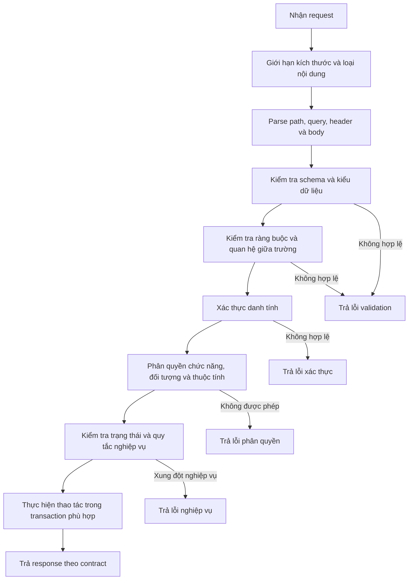

# Validate request theo kiểu, bắt buộc và giới hạn

Trong chương **API contract và schema** của module `SECURITY_API_SECURITY`, validation request là lớp kiểm tra đầu vào giúp API chỉ tiếp nhận dữ liệu đúng cấu trúc, đúng kiểu, nằm trong giới hạn đã công bố và phù hợp với quy tắc nghiệp vụ. Một request có JSON hợp lệ vẫn có thể chứa giá trị sai, trường không được phép, dữ liệu quá lớn hoặc thông tin mà người gọi không có quyền cung cấp. Vì vậy, contract cần định nghĩa cụ thể kiểu dữ liệu, trường bắt buộc, miền giá trị, độ dài, số lượng phần tử, cấu trúc lồng nhau và cách xử lý trường không biết.

Validation là một phần của thiết kế bảo mật API theo từng endpoint, đối tượng dữ liệu và luồng nghiệp vụ. Nó hỗ trợ chống injection, mass assignment và lạm dụng tài nguyên, đồng thời giúp client nhận lỗi nhất quán. Tuy nhiên, validation không thay thế xác thực, phân quyền đối tượng, kiểm tra quyền thuộc tính hay kiểm tra trạng thái nghiệp vụ. Một `orderId` đúng định dạng vẫn có thể thuộc về người khác; một URL đúng cú pháp vẫn có thể trỏ tới mạng nội bộ.

## 1. Xác định validation nằm ở đâu trong xử lý request

Một request thường đi qua nhiều bước trước khi tạo ra thay đổi dữ liệu:



Thứ tự chi tiết có thể thay đổi theo framework và chính sách hệ thống. Ví dụ, một số API xác thực token trước khi parse toàn bộ body để tránh tiêu tốn tài nguyên cho request không có danh tính. Điều cần giữ nhất quán là không thực hiện tác động nghiệp vụ trước khi các kiểm tra cần thiết hoàn tất, và không để lỗi validation làm lộ dữ liệu nội bộ.

Có thể chia validation thành các lớp:

| Lớp | Mục đích | Ví dụ |
|---|---|---|
| Giới hạn ở tầng nhận request | Bảo vệ parser và tài nguyên | Giới hạn body, header, số phần multipart và thời gian đọc |
| Validation cú pháp | Kiểm tra dữ liệu có parse được không | JSON hợp lệ, encoding hợp lệ, content type được hỗ trợ |
| Validation schema | Kiểm tra cấu trúc, kiểu và constraint | `quantity` là số nguyên dương; `email` không vượt độ dài tối đa |
| Validation liên trường | Kiểm tra quan hệ giữa nhiều trường | `endDate` không trước `startDate` |
| Validation nghiệp vụ | Kiểm tra điều kiện của use case | Chỉ hủy đơn khi đơn chưa được giao |
| Phân quyền | Kiểm tra người gọi có quyền trên dữ liệu hay không | Đơn hàng thuộc đúng tài khoản hoặc tenant |

Không nên gộp tất cả vào một hàm `validate()` không có phân biệt. Việc tách lớp giúp xác định lỗi ở đâu, lựa chọn mã HTTP phù hợp và viết kiểm thử chính xác.

## 2. Thiết kế contract cho mọi vị trí nhận dữ liệu

Request không chỉ có JSON body. Mỗi endpoint có thể nhận dữ liệu từ nhiều vị trí và mỗi vị trí cần quy tắc rõ ràng.

| Vị trí | Ví dụ | Điều cần định nghĩa |
|---|---|---|
| Path parameter | `/orders/{orderId}` | Kiểu, định dạng, độ dài và cách xử lý ID không hợp lệ |
| Query parameter | `?page=2&pageSize=50` | Kiểu, giá trị mặc định, min/max, số lần xuất hiện và cách xử lý tham số lặp |
| Header | `Idempotency-Key`, `If-Match` | Định dạng, độ dài, tính bắt buộc và phạm vi áp dụng |
| Body | JSON tạo đơn hàng | Schema, trường bắt buộc, trường tùy chọn, kiểu và giới hạn |
| Cookie | Cookie phiên | Tên, định dạng, chữ ký và thuộc tính cookie; không coi dữ liệu cookie là đáng tin chỉ vì trình duyệt gửi |
| Multipart | File và metadata | Số file, kích thước từng file, tổng kích thước, loại nội dung và tên file |
| Webhook | Payload từ đối tác | Chữ ký, timestamp, chống replay, schema và giới hạn payload |

Hãy chỉ rõ endpoint chấp nhận `Content-Type` nào. Nếu endpoint chỉ hỗ trợ `application/json`, request gửi XML hoặc form data cần bị từ chối theo một cách ổn định. Không nên để parser tự đoán định dạng khi contract không cho phép. Với dữ liệu JSON, quy định encoding được chấp nhận và từ chối nội dung sai encoding.

Các tham số lặp cần có quy tắc rõ. Chẳng hạn `?role=user&role=admin` có thể được parser diễn giải thành giá trị đầu, giá trị cuối hoặc danh sách tùy framework. Sự khác biệt giữa gateway, framework và ứng dụng có thể dẫn đến kiểm tra một giá trị nhưng xử lý một giá trị khác. Nếu tham số không phải danh sách, nên từ chối khi xuất hiện nhiều lần.

## 3. Định nghĩa kiểu dữ liệu chặt chẽ

Kiểu dữ liệu trong contract cần mô tả cả biểu diễn trên wire và miền giá trị hợp lệ. Không dựa vào việc ngôn ngữ lập trình có thể ép kiểu để tự động chấp nhận dữ liệu.

### 3.1. Chuỗi (string)

Với chuỗi, định nghĩa:

- Độ dài tối thiểu và tối đa, tính theo quy tắc thống nhất.
- Có cho phép chuỗi rỗng, chỉ chứa khoảng trắng hoặc ký tự xuống dòng không.
- Bộ ký tự hoặc định dạng cần thiết nếu có.
- Quy tắc chuẩn hóa Unicode, khoảng trắng và chữ hoa/chữ thường.
- Chuỗi có được dùng làm định danh, đường dẫn, tên file hay giá trị truy vấn không.

Ví dụ, tên hiển thị có thể chấp nhận Unicode và khoảng trắng, còn mã tiền tệ cần theo danh sách mã được hỗ trợ. Không áp dụng một regex ASCII chung cho mọi trường vì có thể loại bỏ tên hợp lệ hoặc tạo ra các quy tắc khó hiểu.

`trim()` cũng là một quyết định nghiệp vụ. Với trường tên hiển thị, có thể loại bỏ khoảng trắng ở hai đầu. Với mật khẩu hoặc chữ ký, tự ý trim hoặc đổi encoding có thể làm thay đổi dữ liệu người dùng gửi. Chỉ chuẩn hóa khi contract quy định rõ.

Không dùng regex để thay thế mọi validation. Regex phù hợp với định dạng đơn giản và giới hạn độ dài; biểu thức phức tạp có thể gây tiêu tốn CPU theo cấp số nhân nếu có backtracking. Cần giới hạn độ dài trước khi áp dụng regex và ưu tiên parser chuyên dụng cho định dạng phức tạp.

### 3.2. Số nguyên và số thập phân

Với số, quy định miền giá trị, dấu, độ chính xác và cách biểu diễn. Nếu `quantity` phải là số nguyên dương, đừng nhận `2.5`, chuỗi `"2"` hoặc giá trị quá lớn chỉ vì thư viện có thể ép kiểu.

Với tiền tệ, dùng kiểu decimal có độ chính xác xác định hoặc biểu diễn số tiền bằng đơn vị nhỏ nhất dưới dạng số nguyên nếu nghiệp vụ phù hợp. Tránh dùng floating point nhị phân cho phép tính tiền vì một số số thập phân không thể biểu diễn chính xác. Contract cần quy định currency, scale, giới hạn và cách làm tròn.

Ví dụ:

```json
{
  "quantity": 3,
  "unitPrice": "125000.00",
  "currency": "VND"
}
```

Trong ví dụ này, `quantity` là integer; `unitPrice` được biểu diễn dưới dạng chuỗi decimal để tránh phụ thuộc cách client serialize số thực. Nếu chọn kiểu JSON number cho tiền, contract phải nêu độ chính xác và cách xử lý ở mọi client/server.

Luôn kiểm tra overflow khi chuyển kiểu. Một giá trị lớn hơn phạm vi `int` hoặc `long` không được âm thầm wrap, truncate hay chuyển thành giá trị mặc định.

### 3.3. Boolean, enum và giá trị lựa chọn

Boolean nên có đúng hai giá trị `true` và `false` theo kiểu JSON. Không mặc định nhận các chuỗi `"yes"`, `"1"`, `"on"` hoặc số `1` nếu contract không cho phép. Với query parameter vốn là chuỗi, quy định cách chuyển đổi một cách tường minh.

Enum nên dùng allowlist giá trị đã công bố:

```json
{
  "status": "PENDING"
}
```

Nếu chỉ hỗ trợ `PENDING`, `CONFIRMED` và `CANCELLED`, các giá trị khác phải bị từ chối. Không map giá trị lạ thành quyền cao hơn, trạng thái mặc định hoặc nhánh xử lý không xác định. Khi mở rộng enum, cần đánh giá khả năng tương thích với client cũ.

### 3.4. Ngày, giờ và múi giờ

Định nghĩa rõ định dạng ngày và thời điểm. Một ngày lịch như ngày sinh có thể dùng `YYYY-MM-DD`. Một thời điểm diễn ra trên toàn hệ thống nên có offset hoặc được quy định theo UTC, ví dụ `2026-11-18T10:30:00Z`.

Không diễn giải thời điểm không có múi giờ theo timezone mặc định của máy chủ nếu contract chưa nói rõ. Điều đó có thể làm kết quả khác nhau giữa môi trường. Kiểm tra cả giá trị lịch không tồn tại, như ngày 30 tháng 2, và khoảng thời gian nghiệp vụ hợp lệ.

### 3.5. UUID, ID và định danh bên ngoài

Nếu ID có định dạng UUID, contract có thể yêu cầu đúng cú pháp UUID. Nếu ID là chuỗi opaque do hệ thống phát hành, chỉ kiểm tra theo định dạng thực tế đã công bố. Không suy luận quyền từ việc ID khó đoán. UUID ngẫu nhiên vẫn không thay thế kiểm tra quyền đối tượng.

Định danh từ đối tác nên có namespace hoặc nguồn phát hành rõ ràng để tránh nhầm lẫn với ID nội bộ. Không cho phép client gửi ID nội bộ của chủ sở hữu, tenant hoặc người tạo nếu những giá trị này phải được xác định từ danh tính đã xác thực.

## 4. Phân biệt bắt buộc, tùy chọn, null và giá trị mặc định

Đây là một trong những phần dễ gây lỗi nhất của API contract. Bốn trạng thái sau không giống nhau:

| Trạng thái | Ý nghĩa thường dùng | Ví dụ |
|---|---|---|
| Thiếu trường | Client không gửi thuộc tính | `{}` |
| Có `null` | Client gửi giá trị null tường minh | `{"nickname": null}` |
| Chuỗi rỗng | Client gửi chuỗi có độ dài 0 | `{"nickname": ""}` |
| Có giá trị | Client gửi một giá trị cụ thể | `{"nickname": "An"}` |

Contract phải chỉ rõ trường nào bắt buộc, trường nào được phép null và trường nào được phép rỗng. Một trường tùy chọn không đồng nghĩa với trường cho phép null. Ví dụ, `nickname` có thể được phép bỏ qua nhưng nếu có mặt thì phải là chuỗi không rỗng.

Giá trị mặc định cũng cần quy định rõ: mặc định do client gửi hay server áp dụng khi trường vắng mặt? Với trường ảnh hưởng bảo mật hoặc quyền, không lấy giá trị mặc định từ client. Ví dụ, `role`, `ownerId`, `tenantId`, `approved` và `isAdmin` phải do server hoặc quy trình được ủy quyền quản lý.

### 4.1. Quy tắc cho PATCH

Với `PATCH`, cần định nghĩa ngữ nghĩa của trường bị bỏ qua, trường `null` và trường có giá trị. Ví dụ:

- Không gửi `phone`: giữ nguyên số điện thoại.
- Gửi `phone: null`: xóa số điện thoại nếu nghiệp vụ cho phép.
- Gửi `phone: "..."`: thay đổi số điện thoại sau khi validation và xác minh cần thiết.

Nếu API dùng JSON Merge Patch hoặc JSON Patch, hãy tuân theo semantics của định dạng đó và công bố media type tương ứng. Không trộn semantics giữa các endpoint mà không giải thích. Với cập nhật một phần, kiểm tra quyền thuộc tính trên từng trường được thay đổi.

## 5. Kiểm tra cấu trúc object và collection

### 5.1. Object lồng nhau

Schema cần xác định object con có bắt buộc hay không, trường nào được phép và độ sâu lồng tối đa. Không nhận object tùy ý rồi chuyển thẳng thành map để xử lý nếu nghiệp vụ chỉ cần một số trường cố định.

Ví dụ:

```json
{
  "customer": {
    "name": "Nguyen An",
    "email": "an@example.test"
  },
  "shippingAddress": {
    "city": "Da Nang",
    "postalCode": "550000"
  }
}
```

Contract phải nêu rõ các trường hợp lệ của `customer` và `shippingAddress`, độ dài của từng trường và việc có chấp nhận thuộc tính bổ sung hay không.

### 5.2. Array

Với array, định nghĩa:

- Số phần tử tối thiểu và tối đa.
- Kiểu và schema của từng phần tử.
- Có cho phép phần tử trùng lặp không.
- Có yêu cầu thứ tự không.
- Giới hạn tổng kích thước hoặc tổng chi phí xử lý.

Ví dụ, API tạo đơn có thể giới hạn tối đa 50 dòng hàng. Mỗi dòng cần `productId` hợp lệ và `quantity` nằm trong khoảng cho phép. Chỉ giới hạn số phần tử mà không giới hạn chi phí tra cứu từng sản phẩm vẫn có thể tạo ra tải lớn; cần xem xét cả số truy vấn và tổng khối lượng xử lý.

Nếu array biểu diễn tập giá trị, cân nhắc loại bỏ phần tử trùng lặp hoặc từ chối request có phần tử trùng theo contract. Nếu array biểu diễn thứ tự xử lý, không được tự ý sắp xếp lại.

### 5.3. Từ chối thuộc tính không biết

Với request object, lựa chọn chính sách cho thuộc tính không được khai báo:

- **Reject:** từ chối request nếu xuất hiện thuộc tính lạ.
- **Ignore:** bỏ qua thuộc tính lạ.
- **Preserve:** giữ lại thuộc tính lạ để chuyển tiếp hoặc lưu trữ.

Đối với endpoint nhận lệnh thay đổi dữ liệu nhạy cảm, `Reject` thường dễ phát hiện lỗi client và giảm nguy cơ mass assignment. `Ignore` có thể hữu ích cho tương thích trong một số API, nhưng cần đảm bảo các thành phần không diễn giải khác nhau. `Preserve` chỉ phù hợp khi có nhu cầu rõ ràng, có giới hạn và kiểm soát quyền; không nên dùng mặc định.

Nếu gateway từ chối trường lạ nhưng service lại chấp nhận, hoặc ngược lại, hành vi hệ thống có thể khó dự đoán. Quy tắc cần nhất quán ở nơi kiểm tra contract và nơi thực thi nghiệp vụ.

## 6. Ràng buộc liên trường và quy tắc nghiệp vụ

Schema có thể kiểm tra từng trường riêng, nhưng nhiều điều kiện cần so sánh giữa các trường hoặc với trạng thái hiện tại của tài nguyên.

Ví dụ:

- `startDate` phải nhỏ hơn hoặc bằng `endDate`.
- `discount` không vượt quá tổng giá trị đơn hàng.
- `currency` phải được hỗ trợ bởi phương thức thanh toán đã chọn.
- `shippingAddress` bắt buộc khi phương thức giao hàng là chuyển phát.
- `quantity` không vượt số lượng có thể đặt.
- Chỉ cho phép chuyển trạng thái từ `PENDING` sang `CONFIRMED` nếu điều kiện nghiệp vụ thỏa mãn.

Phân biệt constraint thuần dữ liệu với constraint phụ thuộc trạng thái. Kiểm tra `endDate` sau `startDate` có thể thực hiện trên request. Kiểm tra số lượng tồn kho cần đọc trạng thái hệ thống và phải xử lý đồng thời để tránh hai request cùng vượt qua validation rồi đặt vượt tồn kho.

Không dựa vào validation ở tầng API để bảo đảm invariant trong môi trường có nhiều service hoặc nhiều luồng ghi. Các invariant quan trọng cần được bảo vệ ở transaction, database constraint hoặc cơ chế đồng bộ phù hợp. Validation sớm giúp trả lỗi thân thiện; kiểm soát ở tầng lưu trữ bảo vệ tính toàn vẹn khi có cạnh tranh.

## 7. Ví dụ JSON Schema và OpenAPI

JSON Schema giúp diễn đạt kiểu, thuộc tính bắt buộc, giới hạn và cấu trúc lồng nhau. Ví dụ dưới đây mô tả request tạo địa chỉ giao hàng:

```json
{
  "$schema": "https://json-schema.org/draft/2020-12/schema",
  "type": "object",
  "additionalProperties": false,
  "required": ["recipientName", "phone", "addressLine", "city", "countryCode"],
  "properties": {
    "recipientName": {
      "type": "string",
      "minLength": 1,
      "maxLength": 120
    },
    "phone": {
      "type": "string",
      "minLength": 7,
      "maxLength": 20
    },
    "addressLine": {
      "type": "string",
      "minLength": 1,
      "maxLength": 300
    },
    "city": {
      "type": "string",
      "minLength": 1,
      "maxLength": 100
    },
    "countryCode": {
      "type": "string",
      "pattern": "^[A-Z]{2}$"
    },
    "postalCode": {
      "type": "string",
      "maxLength": 20
    },
    "deliveryNote": {
      "type": "string",
      "maxLength": 500
    }
  }
}
```

Schema trên yêu cầu năm trường, từ chối thuộc tính không được khai báo và đặt giới hạn độ dài cho các chuỗi. `postalCode` và `deliveryNote` là tùy chọn; do schema không khai báo `null` trong type, nếu client gửi `null` thì request không hợp lệ. `minLength: 1` không tự loại bỏ chuỗi chỉ chứa khoảng trắng; nếu contract yêu cầu semantics như `@NotBlank` trong ví dụ Java, schema validator cũng cần quy tắc tương đương hoặc một custom validation. Pattern của `countryCode` chỉ kiểm tra hình thức hai chữ in hoa; việc quốc gia đó có được hệ thống hỗ trợ hay không là kiểm tra nghiệp vụ bổ sung.

Có thể tham chiếu schema trong OpenAPI 3.1 để công bố request body:

```yaml
openapi: 3.1.0
paths:
  /v1/addresses:
    post:
      operationId: createShippingAddress
      requestBody:
        required: true
        content:
          application/json:
            schema:
              $ref: '#/components/schemas/CreateShippingAddressRequest'
      responses:
        '201':
          description: Address created
        '400':
          description: Request validation failed
        '401':
          description: Authentication required
        '403':
          description: Operation not permitted
components:
  schemas:
    CreateShippingAddressRequest:
      type: object
      additionalProperties: false
      required:
        - recipientName
        - phone
        - addressLine
        - city
        - countryCode
      properties:
        recipientName:
          type: string
          minLength: 1
          maxLength: 120
        phone:
          type: string
          minLength: 7
          maxLength: 20
        addressLine:
          type: string
          minLength: 1
          maxLength: 300
        city:
          type: string
          minLength: 1
          maxLength: 100
        countryCode:
          type: string
          pattern: '^[A-Z]{2}$'
        postalCode:
          type: string
          maxLength: 20
        deliveryNote:
          type: string
          maxLength: 500
```

Schema mô tả cấu trúc và một phần constraint; nó không tự thực thi trong service nếu ứng dụng không dùng validator tương ứng. Cũng không thể chỉ dựa vào OpenAPI để thể hiện đầy đủ quyền đối tượng, quyền thuộc tính, giới hạn tài nguyên ở gateway hay trạng thái nghiệp vụ. Những điều kiện đó cần được ghi ở phần mô tả hoặc chính sách liên kết với operation.

## 8. Minh họa validation trong Java

Với Java và Jakarta Bean Validation, có thể đặt constraint trên request DTO để framework kiểm tra trước khi gọi logic nghiệp vụ. Ví dụ sau minh họa request tạo địa chỉ:

```java
import jakarta.validation.Valid;
import jakarta.validation.constraints.NotBlank;
import jakarta.validation.constraints.Pattern;
import jakarta.validation.constraints.Size;

public record CreateShippingAddressRequest(
        @NotBlank
        @Size(max = 120)
        String recipientName,

        @NotBlank
        @Size(min = 7, max = 20)
        String phone,

        @NotBlank
        @Size(max = 300)
        String addressLine,

        @NotBlank
        @Size(max = 100)
        String city,

        @NotBlank
        @Pattern(regexp = "^[A-Z]{2}$")
        String countryCode,

        @Size(max = 20)
        String postalCode,

        @Size(max = 500)
        String deliveryNote
) {}
```

Controller có thể kích hoạt validation cho body bằng `@Valid`:

```java
@RestController
@RequestMapping("/v1/addresses")
class ShippingAddressController {

    private final ShippingAddressService service;

    ShippingAddressController(ShippingAddressService service) {
        this.service = service;
    }

    @PostMapping
    ResponseEntity<ShippingAddressResponse> create(
            @Valid @RequestBody CreateShippingAddressRequest request,
            Authentication authentication) {

        ShippingAddressResponse response = service.create(request, authentication);
        return ResponseEntity.status(HttpStatus.CREATED).body(response);
    }
}
```

Đoạn code giả định ứng dụng đã cấu hình Spring MVC và Jakarta Bean Validation provider. Các import của Spring và kiểu response/service được lược bớt để tập trung vào request validation. `@NotBlank` từ chối `null`, chuỗi rỗng và chuỗi chỉ có khoảng trắng; `@Size` giới hạn kích thước; `@Pattern` kiểm tra hình thức mã quốc gia.

Nếu DTO có object lồng nhau, dùng `@Valid` ở thuộc tính lồng để kích hoạt kiểm tra các constraint bên trong:

```java
import java.util.List;

import jakarta.validation.Valid;
import jakarta.validation.constraints.NotBlank;
import jakarta.validation.constraints.NotEmpty;
import jakarta.validation.constraints.NotNull;
import jakarta.validation.constraints.Positive;
import jakarta.validation.constraints.Size;

public record CreateOrderRequest(
        @NotBlank
        String customerReference,

        @NotEmpty
        @Size(max = 50)
        List<@Valid OrderLineRequest> lines
) {}

public record OrderLineRequest(
        @NotBlank
        String productId,

        @NotNull
        @Positive
        Integer quantity
) {}
```

Constraint `@Valid` trên phần tử yêu cầu validation đệ quy từng `OrderLineRequest`. Ngoài ra, service vẫn cần kiểm tra sản phẩm có tồn tại, có được phép bán cho tenant hiện tại và số lượng còn đáp ứng hay không.

### 8.1. Không bind trực tiếp request vào entity

Tránh nhận entity persistence làm `@RequestBody`:

```java
// Không nên dùng entity làm request DTO cho thao tác cập nhật công khai.
@PutMapping("/{id}")
void update(@PathVariable Long id, @RequestBody UserEntity entity) {
    repository.save(entity);
}
```

Entity có thể chứa `role`, `tenantId`, `ownerId`, `createdAt`, trạng thái nội bộ hoặc các trường không dành cho client. Bind trực tiếp làm tăng nguy cơ mass assignment và có thể ghi đè dữ liệu mà người gọi không được phép thay đổi.

Thay vào đó, định nghĩa DTO chỉ gồm trường được phép cập nhật, sau đó service lấy đối tượng hiện tại trong phạm vi quyền của người gọi và áp dụng các thay đổi được phép:

```java
public record UpdateProfileRequest(
        @Size(max = 80) String displayName,
        @Size(max = 300) String bio
) {}
```

Service cần phân biệt trường không gửi và trường gửi `null` nếu endpoint hỗ trợ PATCH. Với record hoặc DTO thông thường, kiểu dữ liệu có thể cần wrapper riêng để biểu diễn ba trạng thái: absent, explicit null và value. Không giả định mọi framework tự giữ được sự khác biệt đó.

## 9. Giới hạn request để chống lạm dụng tài nguyên

Validation schema phải đi cùng giới hạn ở tầng nhận request. Nếu ứng dụng đọc toàn bộ body vào bộ nhớ trước khi kiểm tra `maxLength`, kẻ tấn công vẫn có thể tiêu tốn tài nguyên bằng payload lớn.

Xác định giới hạn ở nhiều cấp:

| Tài nguyên | Giới hạn cần cân nhắc |
|---|---|
| Request line và URL | Độ dài path, query string và số lượng parameter |
| Header | Tổng kích thước, số header, kích thước từng giá trị |
| Body | Kích thước tối đa theo endpoint và content type |
| JSON | Độ sâu object, số thuộc tính, số phần tử và độ dài chuỗi |
| Multipart | Số file, kích thước từng file, tổng kích thước và metadata |
| Parser | Thời gian parse, nesting depth và số token |
| Xử lý nghiệp vụ | Số truy vấn, concurrency, timeout, quota và rate limit |

Với file upload, không tin `Content-Type` hay phần mở rộng do client gửi. Kiểm tra nội dung thực tế bằng thư viện phù hợp, giới hạn kích thước, lưu file ngoài web root và dùng tên lưu trữ do server sinh. Nếu file sẽ được phân tích hoặc chuyển đổi, cần giới hạn tài nguyên cho bước đó.

Nếu hỗ trợ nén request, phải giới hạn cả kích thước dữ liệu sau giải nén. Payload nén nhỏ có thể mở rộng thành dữ liệu rất lớn. Cân nhắc từ chối content encoding không được hỗ trợ và đặt giới hạn cho tỷ lệ hoặc tổng kích thước giải nén.

Giới hạn `pageSize` cần được áp dụng ở server dù client đã gửi giá trị hợp lệ theo UI. Giá trị âm, bằng không, vượt tối đa hoặc quá lớn phải được xử lý theo contract. Không cho phép client tùy ý chọn tên cột, biểu thức lọc hoặc sort expression; dùng allowlist cho các trường truy vấn có thể lựa chọn.

## 10. Validation không thay thế các kiểm soát bảo mật khác

Một số nhầm lẫn thường gặp cần tránh:

| Nhầm lẫn | Vì sao chưa đủ | Kiểm soát cần bổ sung |
|---|---|---|
| ID đúng UUID nghĩa là được phép truy cập | Định dạng không chứng minh quyền sở hữu | Authorization trên từng đối tượng và tenant |
| Token hợp lệ nghĩa là request hợp lệ | Token chỉ liên quan đến danh tính và claims | Schema, quyền chức năng, quyền đối tượng và quyền thuộc tính |
| Chuỗi không có ký tự đặc biệt là an toàn | Injection phụ thuộc ngữ cảnh sử dụng | Truy vấn tham số hóa, encode theo ngữ cảnh và allowlist |
| URL đúng format là an toàn để fetch | URL có thể phân giải đến IP nội bộ hoặc redirect sang đích khác | SSRF defense, kiểm tra DNS/IP, redirect và egress policy |
| JSON schema giới hạn số phần tử là đủ | Chi phí xử lý từng phần tử có thể rất lớn | Giới hạn truy vấn, concurrency, timeout và quota |
| Ẩn trường trên giao diện là đủ | Client có thể tự tạo request | DTO và response filtering ở server |
| Bỏ qua trường lạ luôn an toàn | Thành phần khác có thể diễn giải trường đó | Chính sách unknown field thống nhất, ưu tiên reject với lệnh nhạy cảm |

Với SQL, dùng parameterized query thay vì ghép chuỗi. Với tên cột hoặc hướng sort vốn không thể bind như value, dùng allowlist cố định. Với HTML hoặc JavaScript, encode theo đúng ngữ cảnh khi hiển thị. Với đường dẫn file, dùng API path an toàn, chuẩn hóa và xác minh đường dẫn nằm trong thư mục cho phép. Validation là lớp giảm đầu vào bất thường; nó không thay thế cách sử dụng dữ liệu an toàn.

Đối với SSRF, một chuỗi URL vượt qua regex vẫn cần kiểm tra scheme, hostname, DNS, IP thực tế, redirect và giới hạn kết nối. Không dùng validation định dạng làm căn cứ duy nhất cho phép service truy cập mạng.

## 11. Chuẩn hóa lỗi validation

Client cần biết request thất bại ở trường nào và phải sửa ra sao, nhưng response không được làm lộ dữ liệu nội bộ hoặc giá trị nhạy cảm. Có thể dùng cấu trúc lỗi thống nhất theo Problem Details (RFC 9457) hoặc định dạng tương đương đã công bố.

Ví dụ:

```http
HTTP/1.1 400 Bad Request
Content-Type: application/problem+json

{
  "type": "https://api.example.test/problems/validation-error",
  "title": "Request validation failed",
  "status": 400,
  "detail": "One or more request fields are invalid.",
  "code": "REQUEST_VALIDATION_FAILED",
  "errors": [
    {
      "field": "quantity",
      "code": "MUST_BE_POSITIVE",
      "message": "quantity must be greater than zero"
    }
  ],
  "traceId": "01J..."
}
```

Contract nên thống nhất:

- Mã HTTP cho lỗi cú pháp, schema, xác thực, phân quyền và xung đột nghiệp vụ.
- Mã lỗi ổn định để client xử lý mà không phải phân tích nội dung message.
- Cách biểu diễn lỗi theo path của trường, bao gồm object và array lồng nhau.
- Số lượng lỗi tối đa được trả về để tránh response quá lớn.
- Ngôn ngữ và mức chi tiết của message.
- Correlation ID hoặc trace ID để hỗ trợ điều tra.

Không phản hồi giá trị bí mật hoặc toàn bộ payload trong thông báo lỗi. Không trả stack trace, tên class nội bộ, câu SQL, đường dẫn file trên server, token hay thông tin cấu hình. Log nội bộ có thể lưu thêm ngữ cảnh đã được lọc và phân quyền; không sao chép nguyên request nhạy cảm vào log.

Lựa chọn giữa `400` và `422` tùy contract và semantics của API. Điều quan trọng là cùng một loại lỗi được xử lý nhất quán. `401` dành cho vấn đề xác thực; `403` dành cho trường hợp đã xác thực nhưng không có quyền; `409` phù hợp với xung đột trạng thái. Không biến mọi lỗi thành `400` vì sẽ khiến client khó xử lý và làm mờ ranh giới bảo mật.

## 12. Kiểm thử validation theo ranh giới

Với mỗi field, hãy kiểm thử giá trị hợp lệ, giá trị biên và giá trị không hợp lệ. Không chỉ kiểm tra một trường hợp sai chung chung.

Ví dụ cho `quantity` có miền từ 1 đến 100:

| Giá trị | Kết quả mong đợi |
|---|---|
| `1` | Chấp nhận |
| `100` | Chấp nhận |
| `0` | Từ chối vì nhỏ hơn min |
| `101` | Từ chối vì lớn hơn max |
| `-1` | Từ chối |
| `1.5` | Từ chối vì không phải integer |
| `"1"` | Từ chối nếu contract yêu cầu JSON number |
| `null` | Từ chối nếu trường bắt buộc và không nullable |
| Thiếu trường | Từ chối nếu trường bắt buộc |
| Số vượt phạm vi kiểu | Từ chối, không overflow hoặc truncate |

Với object, kiểm tra trường thiếu, trường thừa, `null`, object lồng sai kiểu, độ sâu vượt giới hạn và tên thuộc tính trùng lặp trong JSON. Với array, kiểm tra rỗng, đúng min/max, vượt max, phần tử sai kiểu, phần tử trùng và tổng chi phí xử lý. Với chuỗi, kiểm tra Unicode, ký tự điều khiển, khoảng trắng, chuỗi dài sát biên và regex đầu vào bất thường.

Một bộ kiểm thử tốt bao gồm:

1. **Unit test cho DTO/schema:** xác minh từng constraint và lỗi liên trường.
2. **Integration test:** gửi request qua HTTP stack thực tế để xác minh parser, binding, validation và error mapping.
3. **Contract test:** đối chiếu implementation với OpenAPI hoặc schema được công bố.
4. **Negative security test:** gửi trường `role`, `ownerId`, `tenantId`, tham số lặp và payload vượt giới hạn; xác minh không có thay đổi dữ liệu trái phép.
5. **Fuzz/property-based test:** sinh nhiều đầu vào biên, Unicode, cấu trúc lồng và chuỗi bất thường để phát hiện parser hoặc validator có hành vi ngoài dự kiến.
6. **Load test có giới hạn:** xác minh request hợp lệ ở sát ngưỡng không gây suy giảm bất thường và request vượt ngưỡng bị chặn sớm.

Với mỗi request bị từ chối, kiểm tra cả tác động phụ: không ghi dữ liệu, không phát message, không gọi dịch vụ ngoài và không tiêu thụ tài nguyên vượt mức thiết kế. Kiểm tra response code một mình không chứng minh request đã bị chặn đúng cách.

## 13. Checklist review contract validation

Trước khi implementation hoặc phát hành endpoint, reviewer có thể dùng checklist sau:

- [ ] Đã liệt kê mọi vị trí nhận dữ liệu: path, query, header, body, cookie, file và webhook.
- [ ] Đã công bố content type và encoding được chấp nhận.
- [ ] Mỗi trường có kiểu dữ liệu, định dạng, miền giá trị và giới hạn rõ ràng.
- [ ] Đã phân biệt trường bắt buộc, tùy chọn, nullable, rỗng và giá trị mặc định.
- [ ] Đã quy định semantics cho PATCH và cập nhật từng phần.
- [ ] Đã định nghĩa cấu trúc object/array, độ sâu và số lượng phần tử tối đa.
- [ ] Đã chọn chính sách đối với thuộc tính không biết và áp dụng nhất quán.
- [ ] Đã loại bỏ các trường nhạy cảm do server quản lý khỏi request DTO.
- [ ] Đã kiểm tra ràng buộc liên trường và điều kiện nghiệp vụ.
- [ ] Đã giới hạn body, header, URL, file, parser, thời gian và concurrency.
- [ ] Đã xác định mã lỗi và cấu trúc lỗi ổn định, không làm lộ dữ liệu nhạy cảm.
- [ ] Đã có ca kiểm thử giá trị hợp lệ, biên, sai kiểu, thiếu trường và vượt giới hạn.
- [ ] Đã kiểm thử mass assignment, tham số lặp, truy cập chéo đối tượng và tác động phụ.
- [ ] Đã bảo đảm validation không bị dùng thay cho authentication, authorization hoặc SSRF defense.

## Kết luận

Một API contract tốt phải nói chính xác request được phép chứa gì, từng trường có kiểu và giới hạn nào, khi nào trường là bắt buộc hoặc nullable, và hệ thống phản hồi ra sao khi dữ liệu không hợp lệ. Validation cần được áp dụng cho mọi vị trí nhận dữ liệu, kết hợp giới hạn tài nguyên ở tầng parser và kiểm tra nghiệp vụ ở tầng service. Khi schema, DTO, chính sách quyền và bộ kiểm thử cùng phản ánh một contract, API sẽ dễ tích hợp, dễ kiểm tra và giảm đáng kể nguy cơ xử lý đầu vào ngoài dự kiến.
