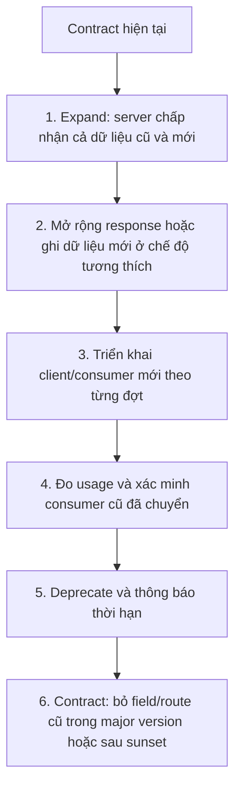

# Version hóa schema mà không phá client an toàn

API contract mô tả hình dạng dữ liệu, hành vi endpoint và những điều client có thể dựa vào. Khi schema thay đổi, server và client có thể được triển khai ở những thời điểm khác nhau: mobile app cũ vẫn đang chạy, một đối tác chưa nâng cấp SDK, worker xử lý message còn dùng schema trước đó hoặc một bản web cũ vẫn nằm trong cache. Vì vậy, một thay đổi có vẻ nhỏ trong JSON hoặc OpenAPI vẫn có thể làm request bị từ chối, response không parse được hoặc nghiệp vụ chạy sai.

Trong module `SECURITY_API_SECURITY`, contract và schema còn là một phần của ranh giới bảo mật. Schema cần giới hạn dữ liệu đầu vào, tránh mass assignment, xác định trường nhạy cảm trong response và giữ nguyên các điều kiện nghiệp vụ. Version hóa an toàn phải phối hợp tương thích dữ liệu, kiểm soát quyền, triển khai nhiều phiên bản trong thời gian chuyển tiếp và quan sát việc sử dụng trước khi loại bỏ contract cũ.

## Mục tiêu học tập

Sau bài này, người học có thể:

- Phân biệt version của API, version của schema và version của ứng dụng client.
- Phân tích thay đổi nào tương thích ngược, tương thích xuôi hoặc có nguy cơ phá vỡ consumer.
- Thiết kế thay đổi additive, optional field, enum, nullability và error schema một cách có kiểm soát.
- Áp dụng expand-contract để triển khai schema mới khi client và server không nâng cấp đồng thời.
- Chọn chiến lược versioning phù hợp cho REST API và event/message schema.
- Dùng OpenAPI, consumer-driven contract test, compatibility check và telemetry để quản lý vòng đời contract.
- Ngừng hỗ trợ version cũ có kế hoạch mà không làm mất dữ liệu hoặc mở rộng quyền truy cập.

## 1. API contract, schema và compatibility

API contract là thỏa thuận giữa producer và consumer. Với REST API, producer thường là server, consumer là web app, mobile app, đối tác hoặc service khác. Contract bao gồm nhiều phần hơn JSON schema:

- Endpoint, HTTP method, query/path/header parameter và content type.
- Request schema, response schema và error response.
- Authentication, authorization và scope cần thiết.
- Quy tắc validation, giới hạn kích thước, pagination và rate limit.
- Ngữ nghĩa nghiệp vụ: trạng thái, thứ tự thao tác, idempotency và side effect.
- Các bảo đảm vận hành như timeout, retry, ordering hoặc thời gian lưu dữ liệu.

Schema mô tả cấu trúc dữ liệu, kiểu, trường bắt buộc, miền giá trị và quan hệ giữa các trường. Hai schema có thể trông gần giống nhau nhưng vẫn không tương thích nếu ý nghĩa của trường thay đổi. Ví dụ, `amount` từng biểu diễn số tiền theo đơn vị nhỏ nhất (cents) nhưng nay lại biểu diễn đơn vị tiền tệ chính; kiểu JSON vẫn là `integer`, nhưng client cũ sẽ tính toán sai.

### 1.1. Producer và consumer đọc/ghi dữ liệu theo hai chiều

Khi đánh giá thay đổi, hãy xác định ai ghi và ai đọc:

| Luồng | Producer | Consumer | Câu hỏi tương thích |
|---|---|---|---|
| REST request | Client | API server | Server mới có chấp nhận request từ client cũ không? Client mới có gửi request mà server cũ hiểu được không? |
| REST response | API server | Client | Client cũ có parse và xử lý response mới không? Client mới có xử lý response từ server cũ không? |
| Event/message | Service phát event | Consumer/worker | Consumer cũ có đọc event mới không? Consumer mới có đọc được event còn nằm trong queue với schema cũ không? |
| Lưu trữ | Ứng dụng ghi dữ liệu | Ứng dụng đọc dữ liệu | Bản ứng dụng mới và cũ có thể cùng đọc/ghi dữ liệu trong giai đoạn rollout không? |

**Backward compatibility** thường nói đến khả năng consumer mới đọc hoặc xử lý dữ liệu được tạo theo contract cũ, hoặc server mới tiếp tục phục vụ client cũ. **Forward compatibility** thường nói đến khả năng consumer cũ chịu được dữ liệu có bổ sung từ producer mới. Cần nêu rõ chiều tương thích trong từng dự án vì thuật ngữ có thể được dùng khác nhau giữa REST, schema registry và hệ thống message.

Không nên kết luận một thay đổi là an toàn chỉ bằng câu “không đổi endpoint”. Hãy đánh giá mọi consumer được triển khai độc lập, kể cả tác vụ nền và đối tác bên ngoài.

## 2. Nhận diện thay đổi tương thích và thay đổi phá vỡ

### 2.1. Các thay đổi thường có khả năng tương thích

Những thay đổi sau thường an toàn hơn nếu consumer tuân thủ contract và triển khai hỗ trợ trường mở rộng:

- Thêm một endpoint mới mà không thay đổi endpoint hiện tại.
- Thêm một trường response tùy chọn với ý nghĩa rõ ràng, có kiểu ổn định và không làm thay đổi cách diễn giải trường cũ.
- Thêm một trường request tùy chọn mà server cũ có thể bỏ qua hoặc xử lý theo mặc định an toàn.
- Thêm một giá trị metadata không ảnh hưởng tới quyết định nghiệp vụ của client cũ.
- Tăng giới hạn theo cách không làm giảm khả năng xử lý và không gây quá tải cho consumer.

Tuy nhiên, “thêm trường là non-breaking” không phải quy tắc tuyệt đối. Client dùng decoder nghiêm ngặt có thể từ chối response có field lạ. Server bật `additionalProperties: false` có thể từ chối request chứa field mới. Client dùng `switch` exhaustive trên enum có thể lỗi khi gặp giá trị mới. Tính tương thích phụ thuộc vào cách schema được validate và cách consumer xử lý dữ liệu không biết trước.

### 2.2. Thay đổi thường phá vỡ contract

| Thay đổi | Rủi ro với consumer hiện tại | Hướng xử lý an toàn hơn |
|---|---|---|
| Xóa hoặc đổi tên field | Client còn đọc field cũ sẽ thiếu dữ liệu hoặc lỗi parse | Thêm field mới, duy trì field cũ trong giai đoạn chuyển tiếp rồi mới loại bỏ theo version major |
| Đổi kiểu `string` thành `integer` | Decoder và logic client có thể lỗi | Tạo field mới hoặc endpoint/version mới; chuyển dữ liệu có kiểm soát |
| Đổi đơn vị hoặc ý nghĩa field | Parse thành công nhưng nghiệp vụ sai | Dùng tên field mới có đơn vị/ý nghĩa rõ ràng và tài liệu chuyển đổi |
| Thêm field bắt buộc vào request | Client cũ không gửi field nên request bị từ chối | Bắt đầu bằng optional, triển khai client, đo mức sử dụng rồi mới cân nhắc bắt buộc trong version mới |
| Làm field nullable hoặc non-nullable theo chiều chặt hơn | Client/server có thể không xử lý `null` hoặc thiếu field | Xác định riêng trạng thái absent, null và value; chuyển đổi có giai đoạn |
| Thu hẹp miền giá trị hoặc giới hạn | Giá trị hợp lệ trước đây bị từ chối | Kiểm tra dữ liệu đang dùng, cảnh báo trước và phát hành version phù hợp |
| Xóa giá trị enum hoặc đổi ý nghĩa enum | Client có thể không nhận diện giá trị hoặc hiểu sai | Giữ giá trị cũ; thêm giá trị mới theo quy tắc consumer tolerant hoặc version major |
| Thay đổi cấu trúc object/array | Client truy cập đường dẫn cũ không còn tồn tại | Thêm cấu trúc mới song song và chuyển consumer dần |
| Thay đổi status code/error shape | Client retry, hiển thị lỗi hoặc xử lý luồng sai | Duy trì error contract; công bố thay đổi và test hành vi client |
| Thay đổi semantics hoặc side effect | Client hiểu sai kết quả dù schema không đổi | Tài liệu hóa, thêm operation mới hoặc phát hành version mới |

### 2.3. Phân biệt absent, null và giá trị mặc định

Ba trạng thái này có thể mang ý nghĩa khác nhau:

```json
{}
```

```json
{"middleName": null}
```

```json
{"middleName": "An"}
```

Trường không xuất hiện có thể có nghĩa “client không yêu cầu thay đổi”; `null` có thể có nghĩa “xóa giá trị”; chuỗi có nội dung là “đặt giá trị”. Với PATCH, cần định nghĩa rõ hành vi cho từng trường hợp. Nếu server mới coi absent là xóa dữ liệu trong khi client cũ mong absent là giữ nguyên, đây là thay đổi semantics nguy hiểm dù schema vẫn cho phép cùng kiểu dữ liệu.

Không tự ý biến trường tùy chọn thành bắt buộc, hoặc gán default làm thay đổi ý nghĩa nghiệp vụ. Default phải được xác định trong contract và giống nhau giữa các phiên bản.

## 3. Thiết kế schema có khả năng mở rộng

### 3.1. Giữ trường hiện tại ổn định

Một khi field đã được công bố, consumer có thể đã dựa vào tên, kiểu, đơn vị, nullability, format và semantics của nó. Tránh tái sử dụng tên trường cũ cho ý nghĩa mới. Nếu cần thay đổi đơn vị, ví dụ từ cents sang decimal amount, hãy tạo field mới như `amountMinor` hoặc một cấu trúc tiền tệ có `value` và `currency`.

Ví dụ response ban đầu:

```json
{
  "id": "ord_1001",
  "amountMinor": 125000,
  "currency": "VND"
}
```

Khi cần biểu diễn thêm số tiền đã định dạng để hiển thị, có thể thêm field mới:

```json
{
  "id": "ord_1001",
  "amountMinor": 125000,
  "currency": "VND",
  "displayAmount": "125.000 ₫"
}
```

`displayAmount` chỉ phục vụ hiển thị. Tính toán, đối soát và thanh toán vẫn phải dựa trên giá trị số có quy ước đơn vị và currency rõ ràng, không parse chuỗi hiển thị.

### 3.2. Thiết kế field mới theo hướng optional trước

Khi thêm field vào response, mô tả kiểu, ý nghĩa, điều kiện xuất hiện và quyền đọc. Khi thêm field vào request, server nên xác định default hoặc hành vi khi field vắng mặt. Chỉ nâng thành bắt buộc sau khi có version mới hoặc đã chứng minh mọi consumer cần thiết đều gửi field đó.

Ví dụ OpenAPI rút gọn:

```yaml
components:
  schemas:
    OrderResponse:
      type: object
      required:
        - id
        - amountMinor
        - currency
      properties:
        id:
          type: string
        amountMinor:
          type: integer
          format: int64
          description: Số tiền theo đơn vị nhỏ nhất của loại tiền tệ
        currency:
          type: string
          minLength: 3
          maxLength: 3
        displayAmount:
          type: string
          description: Giá trị đã định dạng theo locale, chỉ dùng để hiển thị
```

Trong ví dụ này, `displayAmount` không nằm trong `required`, nên consumer có thể xử lý khi field chưa xuất hiện. Contract thực tế cần định nghĩa quy tắc locale, định dạng và quyền đọc nếu giá trị hiển thị phụ thuộc người dùng.

### 3.3. Cẩn thận với enum và giá trị mới

Giả sử `orderStatus` ban đầu có `PENDING`, `PAID`, `CANCELLED`. Thêm `PARTIALLY_REFUNDED` có thể phá client dùng enum đóng hoặc logic mặc định coi mọi trạng thái lạ là thành công. Trước khi thêm giá trị:

- Kiểm tra các client có decoder enum nghiêm ngặt hoặc `switch` exhaustive.
- Yêu cầu consumer xử lý unknown value bằng nhánh fallback an toàn.
- Không để unknown status kích hoạt hành động như giao hàng, hoàn tiền hoặc cấp quyền.
- Nếu giá trị mới thay đổi workflow hoặc ý nghĩa bảo mật, cân nhắc version mới và cập nhật policy.
- Thêm test với giá trị chưa biết để bảo đảm client không crash hoặc thực hiện side effect.

Ví dụ xử lý an toàn về mặt ý tưởng:

```text
switch (order.status):
    case PENDING: showPending()
    case PAID: showPaid()
    case CANCELLED: showCancelled()
    default: showUnknownStatusAndDisableSensitiveActions()
```

### 3.4. Không để schema làm yếu validation hoặc authorization

Schema validation kiểm tra cấu trúc và miền dữ liệu; nó không tự quyết định người gửi được thay đổi trường nào. Một request có `role: "ADMIN"` có thể hoàn toàn hợp lệ theo JSON Schema nhưng vẫn không được phép đối với user thường.

Khi version hóa schema:

- Giữ `required`, enum, min/max và format phản ánh đúng quy tắc nghiệp vụ.
- Không mở `additionalProperties` một cách vô điều kiện chỉ để tránh lỗi tương thích; trường lạ có thể trở thành mass assignment nếu mapper bind tự động.
- Tách DTO theo use case và principal; chỉ cho phép trường mà endpoint hỗ trợ.
- Không trả trường nhạy cảm chỉ vì schema response chung chứa trường đó.
- Duy trì kiểm tra tenant, ownership, permission và workflow ở service xử lý nghiệp vụ.
- Kiểm tra giới hạn payload, độ sâu object, số phần tử và kích thước string ở mọi version.

Tính tương thích không được đánh đổi bằng việc chấp nhận dữ liệu không xác định hoặc bỏ qua kiểm tra bảo mật.

## 4. Chiến lược version hóa API

Không có một chiến lược duy nhất phù hợp với mọi hệ thống. Chọn cách version sao cho consumer có thể nhận biết contract, cache/proxy xử lý đúng và server có thể theo dõi vòng đời từng phiên bản.

### 4.1. URI path versioning

Ví dụ:

```http
GET /api/v1/orders/ord_1001
GET /api/v2/orders/ord_1001
```

Ưu điểm là dễ nhìn, dễ định tuyến, dễ ghi log và thuận tiện cho tài liệu. Nhược điểm là version xuất hiện trong URL và có thể tạo nhiều route song song. Thường phù hợp khi có thay đổi contract lớn hoặc semantics không thể giữ tương thích.

### 4.2. Header hoặc media type versioning

Ví dụ dùng header riêng:

```http
GET /api/orders/ord_1001
Accept: application/vnd.example.order-v2+json
```

Hoặc dùng header version được quy định rõ trong contract:

```http
GET /api/orders/ord_1001
API-Version: 2026-01-01
```

Ưu điểm là URI tài nguyên không đổi và có thể tách representation theo version. Nhược điểm là khó quan sát bằng cách nhìn URL, cần cấu hình cache đúng theo header (`Vary`) và phải bảo đảm gateway, log, SDK cùng hiểu version. Không nên tự tạo nhiều header gần giống nhau mà không có quy ước thống nhất.

### 4.3. Version theo ngày hoặc theo release

Một số API công bố version theo ngày hoặc mốc release để consumer chọn contract ổn định. Cách này hữu ích khi nhà cung cấp cần kiểm soát thay đổi thường xuyên, nhưng cần chính sách hỗ trợ rõ ràng, lịch nâng cấp và tài liệu liệt kê khác biệt giữa các mốc.

### 4.4. Version schema không nhất thiết là version API

API `v1` có thể bổ sung field optional mà không cần đổi path. Một event `OrderCreated` có thể có schema version riêng vì vòng đời message và REST endpoint khác nhau. Không nên tăng version cho mọi thay đổi nhỏ; cũng không nên giữ cùng version nếu semantics hoặc cấu trúc đã phá vỡ consumer.

Quy tắc thực tế:

- Thay đổi tương thích và additive: thường giữ major API version, cập nhật schema/documentation và theo dõi consumer.
- Thay đổi không tương thích về cấu trúc hoặc semantics: phát hành major version hoặc contract mới song song.
- Thay đổi bảo mật khẩn cấp: có thể cần thu hồi hành vi cũ hoặc yêu cầu nâng cấp nhanh; cần đánh giá tác động và thông báo rõ.
- Thay đổi nội bộ không ảnh hưởng contract công khai: không cần tăng API version chỉ vì implementation thay đổi.

## 5. Expand-contract: triển khai thay đổi mà client không phải nâng cấp cùng lúc

Expand-contract là cách triển khai theo các bước tương thích để nhiều phiên bản ứng dụng cùng hoạt động trong một khoảng thời gian.



Ví dụ cần đổi `customerName` thành `customerDisplayName`:

**Giai đoạn 1 — Expand:** server trả cả hai field, nhưng hai field cùng phản ánh một nguồn dữ liệu và cùng quy tắc quyền. Request mới có thể gửi field mới; server vẫn đọc field cũ trong thời gian chuyển tiếp. Nếu cả hai cùng xuất hiện, contract phải quy định rõ ưu tiên hoặc từ chối trường hợp xung đột để tránh dữ liệu mơ hồ.

```json
{
  "id": "ord_1001",
  "customerName": "Lan",
  "customerDisplayName": "Lan"
}
```

**Giai đoạn 2 — Migrate:** phát hành SDK/client mới, cập nhật consumer nội bộ và hướng dẫn đối tác. Theo dõi request nào còn gửi `customerName` và response nào còn cần field cũ. Không chỉ dựa vào số lượng phiên bản app được phát hành; cần quan sát request thực tế và tác vụ nền.

**Giai đoạn 3 — Deprecate:** đánh dấu field cũ là deprecated trong OpenAPI, thông báo consumer, cung cấp mốc ngừng hỗ trợ và tài liệu chuyển đổi. Có thể dùng response header `Deprecation`, `Sunset` và đường dẫn tài liệu deprecation khi phù hợp với hạ tầng.

**Giai đoạn 4 — Contract:** chỉ loại bỏ field cũ sau khi đã hết consumer được hỗ trợ hoặc khi version major mới được chọn. Giữ dữ liệu lưu trữ và khả năng đọc lịch sử nếu còn yêu cầu nghiệp vụ.

Với trường dữ liệu được lưu trong database, không xóa cột cũ ngay khi deploy code mới. Dùng migration mở rộng trước, ghi/đọc song song có kiểm soát nếu cần, backfill dữ liệu, xác minh rồi mới thu hẹp schema. Cần tránh hai nguồn ghi có thể lệch nhau; xác định một nguồn chuẩn và cách giải quyết xung đột.

## 6. Version hóa event và message schema

Event trong queue thường tồn tại lâu hơn một HTTP request. Message được phát hôm nay có thể chỉ được consumer xử lý ngày mai; queue retry hoặc dead-letter có thể giữ event cũ trong nhiều ngày. Vì vậy, consumer mới thường phải đọc được cả message cũ trong giai đoạn chuyển tiếp.

### 6.1. Đặt schema version trong metadata

Ví dụ envelope:

```json
{
  "eventId": "evt_9001",
  "eventType": "OrderCreated",
  "schemaVersion": 2,
  "occurredAt": "2026-11-18T09:00:00Z",
  "data": {
    "orderId": "ord_1001",
    "amountMinor": 125000,
    "currency": "VND"
  }
}
```

Metadata version giúp consumer chọn decoder hoặc adapter phù hợp. Không dùng version để bỏ qua validation; mỗi version vẫn cần schema xác định và giới hạn dữ liệu rõ ràng.

### 6.2. Chọn compatibility mode theo hệ thống schema

Schema registry có thể hỗ trợ các chế độ như backward, forward, full và các biến thể transitive. Ý nghĩa chính xác phụ thuộc định dạng và registry:

- **Backward:** schema mới có thể đọc dữ liệu được ghi bằng schema trước đó theo quy tắc của registry.
- **Forward:** consumer/schema cũ có thể đọc dữ liệu được ghi bằng schema mới.
- **Full:** đáp ứng cả hai chiều.
- **Transitive:** so sánh với nhiều version trước đó, không chỉ version liền kề.

Đối với Avro, default của field mới và quy tắc reader/writer schema resolution ảnh hưởng trực tiếp đến tương thích. Với Protocol Buffers, không tái sử dụng field number đã xóa; hãy reserve field number và tên nếu phù hợp. Với JSON Schema, cách xử lý property lạ, required, nullable và enum của từng consumer cần được kiểm thử. Đừng áp dụng một quy tắc compatibility của Avro hoặc Protobuf cho REST JSON mà không kiểm tra semantics của runtime.

### 6.3. Giữ consumer idempotent và chịu được dữ liệu cũ

Consumer cần xử lý event trùng, event đến trễ và version cũ. Có thể đặt adapter chuyển các schema version cũ về một mô hình nội bộ ổn định:

```text
function normalizeOrderCreated(event):
    switch event.schemaVersion:
        case 1:
            return mapV1ToInternalModel(event.data)
        case 2:
            return mapV2ToInternalModel(event.data)
        default:
            quarantine(event, reason="unsupported schema version")
            stopProcessing()
```

Không âm thầm bỏ message không hiểu nếu việc đó làm mất giao dịch. Đưa message không hỗ trợ vào dead-letter/quarantine có kiểm soát, ghi nhận event ID và cảnh báo. Không thực hiện side effect trước khi xác định schema và xác thực dữ liệu.

## 7. Bảo mật khi duy trì nhiều version song song

Hỗ trợ version cũ không có nghĩa duy trì lỗ hổng hoặc quyền cũ. Mỗi version phải đi qua cùng tiêu chuẩn bảo mật hiện hành:

- Xác thực token, issuer, audience, thời hạn và scope trên mọi version.
- Kiểm tra quyền chức năng, tenant, ownership và thuộc tính tại service sở hữu dữ liệu.
- Duy trì validation và giới hạn payload; không nới lỏng validation chỉ để client cũ tiếp tục gửi dữ liệu không hợp lệ.
- Áp dụng rate limit, quota, timeout và giới hạn pagination cho cả route cũ.
- Không trả thêm trường nhạy cảm trong response tương thích nếu client cũ không cần hoặc không có quyền xem.
- Không để route v1 bỏ qua policy vì gateway chỉ bảo vệ v2.
- Ghi audit version được gọi, principal, endpoint và kết quả authorization.
- Có thể thu hẹp hoặc ngừng một version nếu có rủi ro bảo mật nghiêm trọng, theo quy trình ứng phó và thông báo phù hợp.

Nếu schema v1 có một field nhạy cảm đã được trả quá rộng, không nên giữ nguyên hành vi chỉ vì tương thích. Có thể cần sửa bảo mật có kiểm soát, thông báo breaking change khẩn cấp và cung cấp lộ trình di chuyển. Bảo vệ dữ liệu và quyền truy cập là điều kiện bắt buộc của mọi version.

## 8. Contract testing và kiểm soát thay đổi trong CI/CD

Không nên chỉ review diff OpenAPI bằng mắt. Một pipeline tốt có thể kiểm tra nhiều lớp:

1. **Lint contract:** kiểm tra naming, mô tả, security scheme, response, pagination và quy ước error.
2. **Schema validation:** xác minh ví dụ request/response hợp lệ với schema đã công bố.
3. **Compatibility diff:** so sánh schema mới với version được hỗ trợ để phát hiện xóa field, thay kiểu, đổi required, enum hoặc response code.
4. **Consumer-driven contract test:** chạy contract do consumer quan trọng công bố để bảo đảm producer mới vẫn đáp ứng.
5. **Provider integration test:** kiểm tra server thực tế trả đúng schema, status code, header và semantics.
6. **Security test:** kiểm tra authorization, mass assignment, field filtering, tenant isolation và validation trên từng version.
7. **Deployment gate:** không phát hành thay đổi phá vỡ khi chưa có version mới hoặc kế hoạch migration được phê duyệt.

### 8.1. Ví dụ kiểm tra tương thích

Giả sử schema trước:

```yaml
OrderResponse:
  type: object
  required: [id, status]
  properties:
    id:
      type: string
    status:
      type: string
      enum: [PENDING, PAID, CANCELLED]
```

Schema mới thêm trường tùy chọn:

```yaml
OrderResponse:
  type: object
  required: [id, status]
  properties:
    id:
      type: string
    status:
      type: string
      enum: [PENDING, PAID, CANCELLED, PARTIALLY_REFUNDED]
    displayAmount:
      type: string
```

Thay đổi này có thể tương thích với consumer tolerant, nhưng cần test enum mới và decoder strict. Nếu đổi `id` thành integer, xóa `status` hoặc thêm `displayAmount` vào `required`, đó là dấu hiệu breaking change với nhiều consumer hiện tại.

### 8.2. Kiểm thử consumer cũ và mới

Với mỗi thay đổi, nên có ma trận tối thiểu:

| Producer | Consumer | Điều cần xác minh |
|---|---|---|
| Server mới | Client cũ | Client cũ parse response, không gửi request bị server mới từ chối và không kích hoạt hành vi sai |
| Server mới | Client mới | Contract mới hoạt động đúng và quyền vẫn được kiểm tra |
| Server cũ | Client mới | Client mới có fallback hoặc không sử dụng field/operation chưa được server cũ hỗ trợ |
| Consumer mới | Message cũ trong queue | Consumer đọc được message cũ hoặc xử lý quarantine theo chính sách |
| Consumer cũ | Message mới | Consumer xử lý unknown field/value an toàn hoặc producer chưa phát message mới cho nhóm đó |

Không phải mọi tổ hợp đều phải được hỗ trợ vô thời hạn. Ma trận cần phản ánh những tổ hợp có thể tồn tại thực tế trong thời gian rollout và rollback.

## 9. Deprecation và retirement có thể quan sát được

Một version chỉ nên ngừng hỗ trợ khi có bằng chứng consumer đã chuyển hoặc đã có quyết định rõ ràng về việc chấp nhận ngắt kết nối. Quy trình nên bao gồm:

- Công bố version hoặc field bị deprecate, lý do và lựa chọn thay thế.
- Công bố ngày ngừng nhận request hoặc ngày ngừng phát hành dữ liệu cũ.
- Gửi thông báo tới owner của consumer đã đăng ký; cung cấp migration guide và ví dụ code.
- Theo dõi request theo version, client ID, API key hoặc consumer identity; không chỉ dựa vào user-agent vì có thể thiếu hoặc giả mạo.
- Cảnh báo consumer còn hoạt động gần ngày sunset và hỗ trợ kiểm thử trước khi tắt.
- Kiểm tra log, queue, retry và dead-letter để phát hiện consumer nền chưa migrate.
- Sau khi tắt, trả lỗi có hướng dẫn nếu phù hợp và xóa route/schema cũ theo quy trình quản lý dữ liệu.

Ví dụ response header khi công bố thời điểm kết thúc hỗ trợ:

```http
Deprecation: @1798588800
Sunset: Wed, 30 Dec 2026 00:00:00 GMT
Link: <https://developer.example.com/migrations/orders-v2>; rel="deprecation"
```

Giá trị ngày trong ví dụ chỉ minh họa cách biểu diễn header; khi phát hành cần chọn thời điểm thực tế, thống nhất múi giờ và kiểm tra định dạng theo tiêu chuẩn đang áp dụng. Không gửi header sunset rồi âm thầm tắt API sớm hơn thông báo.

## 10. Ví dụ lộ trình nâng cấp endpoint

Giả sử API cũ trả `fullName`, nhưng contract mới cần tách `givenName` và `familyName` để hỗ trợ tìm kiếm và cá nhân hóa. Không nên đổi kiểu hoặc xóa `fullName` ngay trong một lần deploy.

| Giai đoạn | Server/API | Consumer | Điều kiện chuyển bước |
|---|---|---|---|
| 0. Baseline | Ghi nhận contract v1 và usage hiện tại | Client cũ đang dùng `fullName` | Có inventory consumer và owner |
| 1. Expand | Bổ sung hai field mới, giữ `fullName`; cùng kiểm soát quyền đọc | Client cũ không cần đổi | Response cũ vẫn hợp lệ; test schema pass |
| 2. Migrate | Chấp nhận request theo quy tắc rõ ràng cho field mới/cũ | Client mới ưu tiên hai field mới | Consumer test và telemetry cho thấy migration thành công |
| 3. Deprecate | Đánh dấu `fullName` deprecated, gửi sunset | Owner chuyển SDK/app/job | Không còn consumer quan trọng chỉ đọc field cũ hoặc đã có ngoại lệ được phê duyệt |
| 4. Contract | Bỏ field cũ trong v2 hoặc sau sunset đã công bố | Consumer chọn v2 | Monitoring, rollback và support plan sẵn sàng |

Trong toàn bộ quá trình, không dùng `givenName`/`familyName` để thay thế quyền truy cập. Nếu hai trường có dữ liệu cá nhân, quyền đọc và log vẫn cần tuân theo policy dữ liệu. Việc chuyển đổi schema không được làm lộ trường trước đây bị giới hạn.

## 11. Checklist version hóa an toàn

- [ ] Đã xác định producer, consumer, hướng dữ liệu và những version có thể chạy đồng thời.
- [ ] Đã phân loại thay đổi theo cấu trúc, kiểu, required/nullability, enum và semantics.
- [ ] Không tái sử dụng tên field cũ cho ý nghĩa mới hoặc đổi đơn vị ngầm.
- [ ] Field mới có mô tả, kiểu, default/absence semantics và quy tắc quyền rõ ràng.
- [ ] Đã kiểm tra strict decoder, `additionalProperties`, enum exhaustive và client SDK được sinh tự động.
- [ ] Request schema không vô tình cho phép mass assignment; response schema không làm lộ trường nhạy cảm.
- [ ] Đã chọn version strategy và định nghĩa thời gian hỗ trợ cho breaking change.
- [ ] Đã có expand-contract, rollback và kế hoạch xử lý dữ liệu/message cũ.
- [ ] Đã chạy schema compatibility, consumer contract, provider integration và security tests.
- [ ] Đã đo usage theo client/consumer identity và có owner cho consumer quan trọng.
- [ ] Có thông báo deprecation, migration guide, sunset và quy trình retirement.
- [ ] Mọi version vẫn thực thi authentication, authorization, validation, quota và audit.

## Kết luận

Version hóa schema an toàn đòi hỏi hiểu rõ producer, consumer và hướng tương thích của từng luồng dữ liệu. Ưu tiên thay đổi additive có semantics ổn định, giữ field cũ trong giai đoạn migrate, dùng expand-contract và kiểm tra compatibility bằng contract test cùng telemetry. Khi thay đổi thực sự phá vỡ contract, phát hành version mới có lộ trình chuyển đổi và retirement rõ ràng. Mọi version phải duy trì validation, authorization, bảo vệ dữ liệu và giới hạn tài nguyên như nhau.
