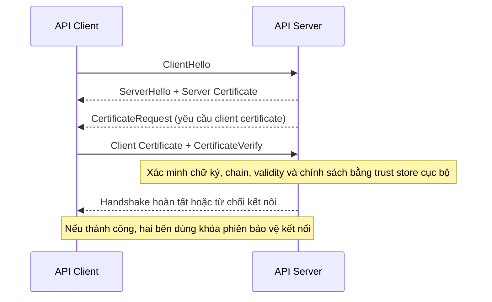

# mTLS và certificate authentication

## 1. mTLS giải quyết vấn đề gì?

Trong HTTPS thông thường, TLS xác thực máy chủ với client: client kiểm tra chứng chỉ của server để biết mình đang kết nối đến đúng dịch vụ, sau đó hai bên thiết lập kênh được mã hóa và có kiểm tra toàn vẹn. Server thường không yêu cầu client chứng minh danh tính ở tầng TLS; ứng dụng xác thực client bằng session, mật khẩu, API key hoặc access token.

**Mutual TLS (mTLS)** mở rộng TLS để server cũng yêu cầu client trình chứng chỉ và chứng minh đang nắm giữ private key tương ứng. Nếu chứng chỉ được cấp bởi CA mà server tin cậy và vượt qua các kiểm tra chính sách, kết nối có thể được xác thực ở mức thiết bị, workload hoặc dịch vụ gọi.

mTLS hữu ích cho giao tiếp máy-với-máy, service-to-service, API nội bộ, kết nối đối tác và các hệ thống cần nhận diện client ở tầng kết nối. Nó giúp giảm phụ thuộc vào shared API key và bảo vệ credential bằng cơ chế khóa công khai. Tuy nhiên, mTLS chỉ xác thực một danh tính kỹ thuật ở tầng TLS. Nó không tự quyết định danh tính người dùng cuối, quyền đọc một bản ghi, quyền gọi chức năng hay giới hạn nghiệp vụ.

## 2. TLS client authentication hoạt động như thế nào?

Trong handshake mTLS, server gửi chứng chỉ server như HTTPS thông thường và yêu cầu client gửi chứng chỉ. Client gửi certificate chain cần thiết cùng chữ ký handshake chứng minh nó sở hữu private key tương ứng. Server kiểm tra chuỗi chứng chỉ dựa trên trust store và chính sách xác thực client.



Sơ đồ mô tả khái quát. Thứ tự và cách bảo vệ thông điệp khác nhau giữa TLS 1.2 và TLS 1.3; trong TLS 1.3, phần lớn handshake sau ServerHello được mã hóa. Việc xác minh chữ ký `CertificateVerify` chứng minh bên kết nối có private key, còn kiểm tra certificate chain xác định CA nào đã chứng thực public key và thuộc tính của certificate.

Khi mTLS thành công, hai bên đã có một kênh TLS và server có thông tin certificate client đã được TLS stack chấp nhận. Ứng dụng vẫn cần ánh xạ certificate đó sang một principal nội bộ và áp dụng authorization.

Client certificate được xác minh trong quá trình thiết lập TLS connection. Với HTTP/1.1 keep-alive hoặc HTTP/2 multiplexing, nhiều request có thể đi qua cùng một connection và cùng dùng danh tính certificate đó. Vì vậy, mTLS nhận diện workload/đầu kết nối; nó không tự tạo danh tính riêng cho từng người dùng hoặc từng request. Nếu gateway dùng một connection chung để gọi service phía sau, service thường nhìn thấy danh tính gateway trừ khi có cơ chế delegation riêng được xác thực.

## 3. Các thành phần của certificate authentication

Chứng chỉ X.509 chứa public key và các thuộc tính định danh do CA ký. Private key tương ứng phải được giữ bí mật ở client. Các thành phần quan trọng gồm:

| Thành phần | Ý nghĩa | Cách sử dụng khi bảo vệ API |
|---|---|---|
| Subject | Tên chủ thể trong certificate. | Có thể chứa thông tin định danh; không nên chỉ dựa vào chuỗi CN cũ để cấp quyền. |
| Subject Alternative Name (SAN) | Tên DNS, URI, IP hoặc định danh khác của chủ thể. | Thường là nơi phù hợp để biểu diễn workload/service identity. |
| Issuer | CA đã ký certificate. | Xác định chuỗi tin cậy và chính sách CA được phép cấp danh tính. |
| Serial number | Số serial do issuer cấp. | Dùng tra cứu, thu hồi và điều tra cùng với issuer. |
| Validity | Thời điểm bắt đầu và kết thúc hiệu lực. | Server kiểm tra thời gian hiện tại nằm trong khoảng hiệu lực. |
| Key Usage / Extended Key Usage (EKU) | Mục đích sử dụng khóa/chứng chỉ. | Client certificate cần phù hợp mục đích `clientAuth` theo chính sách. |
| Basic Constraints | Cho biết certificate có phải CA hay không. | Ngăn certificate leaf được dùng làm CA khi không được phép. |
| Signature và certificate chain | Chữ ký của issuer và các certificate trung gian. | Xây dựng đường dẫn từ leaf đến trust anchor được cấu hình. |

**Trust store** chứa CA hoặc trust anchor mà server chấp nhận để xác minh client certificate. **Key store** phía client chứa certificate và private key của client; key store phía server chứa certificate và private key server. Không nhầm trust store với nơi lưu private key: server không cần private key của client, và client không cần private key của server.

Certificate có thể được cấp bởi CA nội bộ, private PKI của tổ chức hoặc một hệ thống quản lý danh tính workload. Việc một certificate có chữ ký hợp lệ không có nghĩa mọi dịch vụ đều phải tin nó; phạm vi tin cậy phải được cấu hình theo mục đích và đối tượng.

## 4. Xác minh certificate và ánh xạ sang danh tính

Server không nên dừng ở bước “certificate được ký bởi một CA đáng tin”. Một chính sách client authentication đầy đủ cần kiểm tra:

1. **Chain of trust:** xây dựng chuỗi từ leaf certificate qua intermediate CA đến trust anchor được cấu hình; xác minh chữ ký và giới hạn CA.
2. **Thời hạn:** certificate chưa có hiệu lực hoặc đã hết hạn phải bị từ chối.
3. **Mục đích sử dụng:** kiểm tra Key Usage và EKU phù hợp client authentication.
4. **Tên và danh tính:** kiểm tra SAN theo quy ước của tổ chức, chẳng hạn URI `spiffe://example.org/ns/payments/sa/checkout` hoặc DNS name của workload.
5. **Trạng thái thu hồi:** áp dụng CRL, OCSP hoặc cơ chế thu hồi/denylist tương ứng với PKI và yêu cầu rủi ro.
6. **Chính sách issuer:** chỉ tin CA/intermediate được phép cấp loại danh tính đang cần; có thể cần giới hạn subject/SAN, policy OID hoặc đường dẫn CA.

Sau khi TLS stack xác minh certificate, ứng dụng cần ánh xạ danh tính đã xác minh thành principal nội bộ. Ví dụ, SAN URI đại diện `service:checkout` có thể được ánh xạ thành principal `checkout-service`. Không nên lấy một chuỗi CN tùy ý rồi coi đó là vai trò quản trị. Định danh phải duy nhất trong phạm vi trust domain và được ràng buộc với issuer/chính sách thích hợp.

Nếu nhiều CA được tin cậy, cùng một SAN có thể xuất hiện ở các trust domain khác nhau. Vì vậy, khi cần phân biệt, principal mapping nên xét cả issuer/trust domain và SAN, không chỉ một thuộc tính tên đơn lẻ.

## 5. Thiết kế PKI cho API

Một triển khai mTLS an toàn bắt đầu từ mô hình cấp phát certificate và quản lý khóa, không phải chỉ bật một cờ TLS trên server.

### Phân cấp CA và phạm vi tin cậy

- Giữ root CA ở môi trường được bảo vệ cao, thường offline hoặc dùng HSM; dùng intermediate CA cho hoạt động cấp phát thường ngày.
- Tách CA hoặc intermediate theo môi trường, trust domain hoặc nhóm workload khi cần giới hạn phạm vi ảnh hưởng.
- Không đưa một public Web PKI root rộng vào trust store client của API nội bộ nếu chính sách không chủ đích chấp nhận mọi certificate client từ CA đó.
- Chỉ cấp certificate cho workload đã được xác minh danh tính; kiểm soát ai hoặc hệ thống nào được yêu cầu cấp, gia hạn và thu hồi.
- Dùng certificate leaf cho endpoint; không cấp quyền CA cho workload thông thường.

### Định danh workload

Certificate nên đại diện một workload hoặc một danh tính dịch vụ có vòng đời rõ ràng. Dùng SAN URI/DNS theo quy ước ổn định, ví dụ:

```text
spiffe://example.org/prod/ns/orders/sa/order-api
```

Định danh này có thể ánh xạ đến một principal trong hệ thống authorization. Không nên đưa thông tin thay đổi liên tục như IP pod hoặc hostname ngẫu nhiên làm định danh duy nhất nếu hệ thống orchestration có thể cấp lại chúng. Cũng không nên dùng một certificate chung cho toàn bộ ứng dụng hoặc toàn bộ đội ngũ: khi một client bị lộ, phạm vi thu hồi và điều tra sẽ rất lớn.

### Bảo vệ private key

- Sinh private key ở nơi sử dụng nếu có thể để tránh truyền key qua pipeline cấp phát.
- Lưu key trong keystore được bảo vệ, secret manager, TPM hoặc HSM tùy môi trường và mức độ rủi ro.
- Hạn chế quyền đọc file/key; không commit key vào Git, image container, artifact build hoặc log.
- Dùng thuật toán và kích thước khóa được nền tảng hỗ trợ và chính sách tổ chức phê duyệt; ưu tiên cấu hình TLS hiện đại.
- Có quy trình xoay vòng, thay thế và thu hồi khi workload bị xâm nhập hoặc key nghi bị lộ.

## 6. Cấu hình mTLS ở API server và client

Ở server, cần cấu hình certificate của chính server, trust store dành cho client CA và chế độ yêu cầu client certificate. Ví dụ cấu hình Spring Boot với servlet container hỗ trợ TLS:

```yaml
server:
  port: 8443
  ssl:
    enabled: true
    key-store: "file:/run/secrets/api-server.p12"
    key-store-type: PKCS12
    key-store-password: ${SERVER_KEYSTORE_PASSWORD}
    trust-store: "file:/run/secrets/client-ca-trust.p12"
    trust-store-type: PKCS12
    trust-store-password: ${CLIENT_TRUSTSTORE_PASSWORD}
    client-auth: need
```

`client-auth: need` yêu cầu client trình certificate; kết nối không có certificate client hợp lệ sẽ thất bại ở TLS handshake. `want` thường cho phép client không gửi certificate và chỉ yêu cầu nếu có; hành vi chính xác phụ thuộc server/container. Với endpoint bắt buộc mTLS, không dùng chế độ tùy chọn nếu ứng dụng không có chính sách xác thực thay thế rõ ràng.

Client cần trust certificate của API server và trình certificate/private key của chính nó. Ví dụ cấu hình minh họa cho một HTTP client Java dùng SSL context đã được tạo từ key store và trust store:

```java
KeyStore clientKeys = KeyStore.getInstance("PKCS12");
try (InputStream in = Files.newInputStream(Path.of(clientKeyStorePath))) {
    clientKeys.load(in, clientKeyStorePassword);
}

KeyStore serverTrust = KeyStore.getInstance("PKCS12");
try (InputStream in = Files.newInputStream(Path.of(serverTrustStorePath))) {
    serverTrust.load(in, serverTrustStorePassword);
}

KeyManagerFactory kmf = KeyManagerFactory.getInstance(
    KeyManagerFactory.getDefaultAlgorithm());
kmf.init(clientKeys, clientKeyStorePassword);

TrustManagerFactory tmf = TrustManagerFactory.getInstance(
    TrustManagerFactory.getDefaultAlgorithm());
tmf.init(serverTrust);

SSLContext sslContext = SSLContext.getInstance("TLS");
sslContext.init(kmf.getKeyManagers(), tmf.getTrustManagers(), null);

HttpClient client = HttpClient.newBuilder()
    .sslContext(sslContext)
    .build();
```

Đoạn mã giả định key store chứa private key và certificate client, trust store chứa CA dùng xác minh server. Trong ứng dụng thực tế, nạp mật khẩu từ secret manager, đóng stream, quản lý vòng đời SSLContext và không tắt hostname verification. Không dùng trust manager chấp nhận mọi certificate hoặc cấu hình bỏ qua xác minh hostname để “làm cho mTLS chạy được”.

Tên property và hành vi chi tiết có thể khác theo phiên bản Spring Boot, servlet container và Java runtime; cần xác minh theo phiên bản triển khai. Cấu hình TLS nên được kiểm tra ở runtime vì gateway, ingress hoặc service mesh có thể kết thúc TLS trước ứng dụng.

## 7. mTLS tại API gateway, ingress và service mesh

Trong kiến trúc thực tế, TLS có thể kết thúc ở load balancer, API gateway, ingress controller hoặc sidecar proxy. Cần xác định chính xác thành phần nào xác minh client certificate và thành phần nào nhận danh tính đã được xác minh.

Ba mô hình thường gặp:

| Mô hình | Luồng | Điều cần bảo vệ |
|---|---|---|
| mTLS kết thúc tại gateway | Client mTLS với gateway; gateway gọi service phía sau. | Gateway phải xác minh certificate và truyền danh tính qua kênh nội bộ được bảo vệ. |
| mTLS xuyên suốt đến service | TLS được chuyển tiếp hoặc service tự kết thúc mTLS. | Service phải tự xác minh client certificate và chính sách trust. |
| mTLS ở cả hai chặng | Client mTLS với gateway; gateway mTLS tiếp đến service. | Danh tính client ban đầu và danh tính gateway phải được phân biệt; không mặc định chúng là cùng một principal. |

Nếu gateway chuyển danh tính qua header như `X-Client-Cert` hoặc `X-Authenticated-Principal`, service chỉ được tin header đó khi:

- Chỉ gateway tin cậy mới có thể kết nối đến service; không có đường truy cập trực tiếp bỏ qua gateway.
- Gateway xóa mọi header cùng tên do client gửi và tự tạo giá trị sau khi xác minh certificate.
- Kênh gateway-service được bảo vệ, tốt nhất bằng mTLS nội bộ khi phù hợp.
- Service xác thực nguồn proxy và chỉ chấp nhận header từ proxy được cấu hình rõ ràng.
- Định dạng header được chuẩn hóa, tránh truyền nguyên certificate không cần thiết hoặc xử lý chuỗi không an toàn.

Nếu client có thể tự gửi header principal và service tin nó, attacker có thể giả mạo danh tính mà không cần sở hữu certificate. Đây là lỗi trust boundary phổ biến khi triển khai mTLS ở gateway.

## 8. Certificate authentication không thay thế authorization

mTLS trả lời câu hỏi “workload nào đang thiết lập kết nối?”. API vẫn phải trả lời “workload đó được phép làm gì, trên đối tượng nào và trong điều kiện nào?”.

Ví dụ, certificate của `order-api` có thể cho phép gọi `inventory:reserve` đến service kho. Nó không mặc nhiên cho phép `admin:delete-user`, đọc dữ liệu của mọi tenant hoặc thay đổi số tiền thanh toán.

Một luồng xử lý nên gồm:

1. TLS stack xác minh client certificate và private-key possession.
2. Ứng dụng lấy principal từ certificate đã xác minh hoặc từ proxy đáng tin cậy.
3. Authorization engine kiểm tra quyền chức năng, đối tượng, tenant và điều kiện nghiệp vụ.
4. API kiểm tra payload, giới hạn tài nguyên và ghi audit event theo chính sách.

Không đồng nhất workload identity với user identity. Khi một service thay mặt người dùng gọi service khác, cần truyền ngữ cảnh người dùng một cách có xác thực và giới hạn, chẳng hạn access token có audience/scope phù hợp hoặc cơ chế delegation nội bộ. Certificate xác định service gọi; token/delegation có thể xác định người dùng được đại diện. Cả hai cần được xác minh và liên kết đúng với request.

Với OAuth 2.0, mTLS còn có thể được dùng để xác thực confidential client tại authorization server hoặc ràng buộc access token với certificate (certificate-bound access token). Trong trường hợp token được ràng buộc, resource server cần xác minh certificate của kết nối phù hợp với thumbprint được gắn trong token. Chỉ bật mTLS ở transport mà không kiểm tra ràng buộc token thì chưa có hiệu ứng sender-constrained access token.

## 9. Vòng đời certificate: cấp phát, xoay vòng và thu hồi

Certificate có thời hạn hữu hạn. Quản lý vòng đời cần tự động hóa để tránh certificate hết hạn gây gián đoạn và để phản ứng nhanh khi private key bị lộ.

### Cấp phát và gia hạn

- Xác minh workload trước khi cấp certificate; giới hạn danh tính và SAN được phép yêu cầu.
- Cấp certificate có thời hạn phù hợp với khả năng tự động gia hạn và mức độ rủi ro. Certificate ngắn hạn giảm cửa sổ sử dụng khi key bị lộ nhưng yêu cầu hạ tầng cấp phát sẵn sàng.
- Tự động gia hạn trước khi hết hạn; theo dõi lỗi cấp phát và cảnh báo thời gian còn lại.
- Khi xoay vòng, hỗ trợ giai đoạn overlap có kiểm soát để certificate mới hoạt động trước khi certificate cũ bị loại bỏ.
- Không chia sẻ private key giữa các replica nếu mỗi workload có thể có key riêng.

### Thu hồi

Khi certificate hoặc private key bị lộ, cần chặn danh tính liên quan và thay thế credential. Tùy PKI, việc kiểm tra trạng thái có thể dùng:

- **CRL (Certificate Revocation List):** danh sách serial đã bị thu hồi do CA phát hành. Hệ thống phải cập nhật và kiểm tra CRL theo chính sách.
- **OCSP (Online Certificate Status Protocol):** truy vấn trạng thái certificate đến responder. Cần xem xét độ sẵn sàng, timeout, caching và chính sách fail-open/fail-closed.
- **Denylist nội bộ hoặc policy engine:** chặn fingerprint, serial, issuer hoặc SAN đã bị vô hiệu hóa khi cần phản ứng nhanh.

Không phải TLS stack hoặc load balancer nào cũng kiểm tra CRL/OCSP theo cùng một cách; cấu hình trust store đơn thuần không đồng nghĩa đã bật kiểm tra thu hồi. Hãy kiểm chứng hành vi thực tế. Với API có rủi ro cao, cần quyết định rõ khi không thể kiểm tra trạng thái thu hồi thì kết nối bị từ chối hay được tiếp tục, dựa trên mức độ sẵn sàng và hậu quả bảo mật.

Khi key bị lộ, thu hồi certificate là cần thiết nhưng chưa đủ nếu một proxy hoặc cache vẫn chấp nhận phiên đã thiết lập. Có thể cần đóng connection, hết hạn session, cập nhật trust/denylist và thu hồi token liên quan. Phải xác định thời gian lan truyền thay đổi chính sách trong toàn hệ thống.

## 10. Các lỗi cấu hình và giới hạn bảo mật thường gặp

| Lỗi | Hậu quả | Cách phòng tránh |
|---|---|---|
| Tin mọi certificate từ CA quá rộng | Bất kỳ client nào có certificate phù hợp từ CA đó có thể kết nối. | Dùng private CA/intermediate riêng và ràng buộc SAN/issuer/policy. |
| Chấp nhận certificate tùy chọn ngoài ý muốn | Request không có certificate vẫn vào ứng dụng. | Dùng chế độ bắt buộc ở endpoint cần mTLS; kiểm tra cấu hình gateway và service. |
| Chỉ kiểm tra CN hoặc chuỗi tên tùy ý | Danh tính dễ trùng, ánh xạ nhầm hoặc không theo trust domain. | Dùng SAN có quy ước, issuer/trust domain và mapping rõ ràng. |
| Chia sẻ một private key cho nhiều service | Một service bị xâm nhập có thể giả mạo nhiều workload. | Cấp certificate/key riêng theo workload hoặc danh tính. |
| Bỏ qua hostname verification của server | Client có thể kết nối nhầm server hoặc bị MITM. | Luôn xác minh SAN/hostname của server và trust chain. |
| Tin header danh tính từ client | Client giả mạo principal mà không cần certificate. | Gateway xóa header đầu vào, tạo lại sau xác minh; chặn truy cập trực tiếp. |
| Không có quy trình rotation/revocation | Key bị lộ hoặc certificate hết hạn kéo dài rủi ro/gián đoạn. | Tự động gia hạn, cảnh báo, thu hồi và diễn tập sự cố. |
| Dùng certificate làm quyền quản trị | Xác thực workload bị nhầm với authorization. | Áp dụng policy theo chức năng, object, tenant và nghiệp vụ. |
| Log toàn bộ private key hoặc secret | Credential bị lộ qua log và hệ thống phân tích. | Không ghi private key; log fingerprint/serial/issuer và principal ở mức cần thiết. |

mTLS cũng không bảo vệ khỏi một workload đã bị chiếm quyền trong khi private key vẫn được sử dụng hợp lệ. Attacker điều khiển tiến trình có thể yêu cầu TLS stack ký handshake hoặc gửi request bằng danh tính của workload. Cần kết hợp hardening runtime, giới hạn quyền workload, phát hiện hành vi bất thường, quota và authorization ở API.

## 11. Kiểm thử và giám sát mTLS

Kiểm thử cần bao gồm cả handshake, ánh xạ danh tính và quyền ở tầng ứng dụng:

| Ca kiểm thử | Thao tác | Kết quả mong đợi |
|---|---|---|
| Certificate hợp lệ | Client trình certificate do CA được tin cậy cấp, đúng SAN/EKU và còn hạn. | TLS handshake thành công; principal được ánh xạ đúng. |
| Không có certificate | Gọi endpoint bắt buộc mTLS mà không trình certificate. | Handshake bị từ chối. |
| CA không tin cậy | Dùng certificate tự ký hoặc chain từ CA ngoài trust store. | Bị từ chối. |
| Hết hạn/chưa có hiệu lực | Dùng certificate ngoài khoảng validity. | Bị từ chối. |
| Sai mục đích | Certificate không có EKU phù hợp client authentication. | Bị từ chối theo chính sách. |
| Sai SAN hoặc issuer | Certificate hợp lệ về chữ ký nhưng không đại diện workload được phép. | Không ánh xạ principal hoặc bị từ chối. |
| Đã thu hồi | Dùng certificate nằm trong CRL/OCSP/denylist. | Bị từ chối theo chính sách thu hồi đã cấu hình. |
| Sai private key | Client không chứng minh được quyền sở hữu key tương ứng. | Handshake thất bại. |
| Certificate rotation | Chuyển từ certificate cũ sang mới trong giai đoạn overlap. | Không gián đoạn ngoài kế hoạch; certificate cũ bị loại đúng thời điểm. |
| Header spoofing | Gửi `X-Authenticated-Principal` giả qua gateway hoặc gọi thẳng service. | Header bị xóa/từ chối; không thể giả mạo danh tính. |
| Sai authorization | Workload có certificate hợp lệ nhưng gọi chức năng hoặc object ngoài quyền. | TLS có thể thành công nhưng API trả từ chối quyền. |

Giám sát nên ghi nhận principal đã ánh xạ, issuer, serial hoặc fingerprint, thời hạn còn lại, kết quả handshake/xác thực, quyết định authorization, endpoint, request ID và nguồn kết nối ở mức cần thiết. Không log private key, mật khẩu keystore, token hoặc toàn bộ certificate nếu không có nhu cầu rõ ràng. Theo dõi certificate sắp hết hạn, lỗi gia hạn, thay đổi issuer/SAN bất thường, tỷ lệ handshake thất bại, truy cập từ workload lạ và hành vi vượt quyền.

## 12. Checklist triển khai

- [ ] Đã xác định endpoint nào bắt buộc mTLS và trust domain nào được chấp nhận?
- [ ] Server yêu cầu client certificate ở đúng điểm kết thúc TLS?
- [ ] Trust store chỉ chứa CA/intermediate cần thiết cho client authentication?
- [ ] Certificate chain, validity, EKU, SAN và issuer/policy được xác minh?
- [ ] Principal mapping duy nhất và không dựa vào header do client tự đặt?
- [ ] Private key được bảo vệ, không đóng gói vào source code hoặc image?
- [ ] Có tự động cấp phát, gia hạn, rotation và thu hồi certificate?
- [ ] Đã xác minh hành vi CRL/OCSP hoặc denylist khi certificate bị thu hồi?
- [ ] Nếu TLS kết thúc tại gateway, service phía sau chỉ tin danh tính từ proxy xác thực và có kênh nội bộ bảo vệ?
- [ ] Authorization vẫn kiểm tra chức năng, đối tượng, thuộc tính, tenant và điều kiện nghiệp vụ?
- [ ] Có kiểm thử certificate sai/hết hạn/thu hồi, key mismatch, header spoofing và truy cập vượt quyền?
- [ ] Có log/metric/cảnh báo phục vụ điều tra mà không làm lộ private key hoặc secret?

mTLS tạo một cơ chế xác thực client mạnh ở tầng kết nối bằng certificate và bằng chứng sở hữu private key. Giá trị bảo mật của nó phụ thuộc vào trust store có phạm vi hẹp, định danh được ánh xạ đúng, private key được bảo vệ và vòng đời certificate được quản lý. Khi kết hợp với authorization ở từng endpoint, kiểm soát dữ liệu và giám sát, mTLS giúp API nhận diện đáng tin cậy các workload gọi đến mà vẫn giữ nguyên nguyên tắc mỗi hành động phải được cấp quyền riêng.
