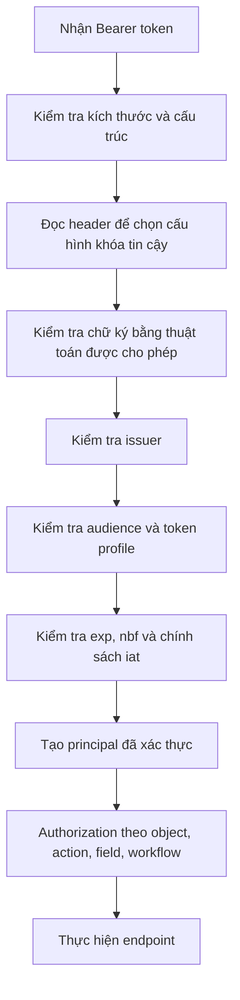

# JWT signature, issuer, audience và expiry

JSON Web Token (JWT) thường được dùng để mang thông tin xác thực từ hệ thống cấp token đến API. Việc token có cấu trúc hợp lệ hoặc giải mã Base64URL thành JSON đọc được không chứng minh token đáng tin cậy. API chỉ được sử dụng claims sau khi xác minh chữ ký bằng khóa tin cậy và kiểm tra token có được phát hành bởi đúng issuer, dành cho đúng API, còn trong thời hạn hiệu lực và đáp ứng profile mà hệ thống chấp nhận.

Trong phạm vi `SECURITY_API_SECURITY`, xác thực cần được thiết kế theo từng endpoint và luồng nghiệp vụ. JWT giúp truyền danh tính và một số quyền ở mức coarse-grained; nó không tự động chứng minh người gọi được truy cập mọi object hoặc mọi field. Sau khi xác thực token, API vẫn phải thực hiện authorization trên tài nguyên, action và trạng thái nghiệp vụ.

## 1. JWT giải quyết việc gì và không giải quyết việc gì?

JWT là một định dạng biểu diễn claims dưới dạng JSON. Một JWT có thể được bảo vệ bằng chữ ký hoặc mã hóa. Hai dạng thường gặp là:

- **JWS (JSON Web Signature):** bảo vệ tính toàn vẹn và xác thực nguồn phát hành của nội dung được ký. Payload thường được mã hóa Base64URL, không được mã hóa bí mật; người có token có thể đọc claims.
- **JWE (JSON Web Encryption):** bảo vệ tính bí mật của nội dung bằng mã hóa. JWE có cấu trúc khác JWS và cần quy trình giải mã tương ứng.

JWT access token trong API thường là JWS. Ba phần được phân tách bởi dấu chấm:

```text
BASE64URL(protected-header).
BASE64URL(payload).
BASE64URL(signature)
```

Ví dụ header và payload sau khi giải mã:

```json
{
  "alg": "RS256",
  "kid": "signing-key-2026-01",
  "typ": "at+jwt"
}
```

```json
{
  "iss": "https://identity.example.com",
  "sub": "user-1842",
  "aud": ["https://api.example.com/orders"],
  "iat": 1795000000,
  "nbf": 1795000000,
  "exp": 1795000900,
  "jti": "a7d4...",
  "scope": "orders:read orders:update"
}
```

Đây là dữ liệu minh họa. `alg` chỉ ra thuật toán bảo vệ JWS; `kid` gợi ý khóa ký tương ứng; `iss` là issuer; `sub` là subject; `aud` là API nhận token; `iat`, `nbf`, `exp` là các mốc thời gian; `jti` là định danh token; `scope` biểu diễn quyền ở mức chức năng theo quy ước của hệ thống. Tên claim và profile cụ thể phải được thống nhất giữa issuer và resource server.

Base64URL không phải mã hóa. Không đưa mật khẩu, private key, API key, refresh token, dữ liệu thanh toán hoặc thông tin bí mật vào payload chỉ vì JWT đã được ký. Chữ ký giúp phát hiện nội dung bị sửa và xác minh bên ký; nó không che giấu nội dung.

JWT cũng thường là bearer token: bất kỳ ai lấy được token hợp lệ đều có thể sử dụng nó trong thời hạn hiệu lực, trừ khi hệ thống có thêm cơ chế ràng buộc token với người gửi. Vì vậy cần bảo vệ token khi truyền và lưu trữ; với hệ thống có rủi ro cao, cân nhắc sender-constrained token như mTLS hoặc DPoP theo kiến trúc OAuth phù hợp.

## 2. Quy trình xác minh JWT ở API

Resource server nên xử lý token theo một quy trình có thứ tự. Chỉ sau khi chữ ký và các điều kiện tin cậy được xác minh mới được dùng claims để tạo principal hoặc ra quyết định quyền.



Các bước kiểm tra có thể được thư viện thực hiện bên trong một lệnh `decode`, nhưng về mặt bảo mật cần bảo đảm:

1. Token có cấu trúc và kích thước nằm trong giới hạn.
2. Thuật toán ký nằm trong allowlist cấu hình ở server.
3. Khóa xác minh đến từ nguồn tin cậy đã cấu hình cho issuer.
4. Chữ ký hợp lệ trước khi tin cậy payload.
5. `iss`, `aud`, thời gian và profile token đáp ứng chính sách của API.
6. Chỉ sau đó mới tạo authentication principal và đánh giá quyền.

Không lấy `iss`, `jku`, `x5u` hoặc URL nào trong token chưa xác minh để tự động tải khóa hay metadata từ một địa chỉ tùy ý. Làm như vậy có thể biến bước xác minh thành SSRF hoặc cho phép kẻ tấn công tự chọn nguồn tin cậy. Với nhiều issuer, phải có registry các issuer được phép và cấu hình khóa tương ứng; token chỉ được đối chiếu với một issuer đã nằm trong danh sách tin cậy.

## 3. Xác minh chữ ký và thuật toán

### 3.1. Chữ ký chứng minh điều gì?

Với JWS, bên phát hành ký phần protected header và payload. Resource server dùng khóa phù hợp để xác minh chữ ký. Nếu payload hoặc header bị sửa, chữ ký sẽ không còn hợp lệ. Nếu xác minh thành công với khóa được tin cậy, API có cơ sở xác nhận token được tạo bởi bên giữ khóa ký tương ứng và nội dung chưa bị thay đổi.

Chữ ký hợp lệ không chứng minh mọi claim đều đúng với nghiệp vụ. Token vẫn có thể có issuer không được chấp nhận, audience dành cho API khác, đã hết hạn, hoặc chứa quyền đã bị thu hồi sau thời điểm phát hành. Do đó, chữ ký chỉ là một bước trong quá trình xác thực.

### 3.2. Cấu hình thuật toán ở server

API phải cấu hình rõ thuật toán JWS được phép, ví dụ `RS256` hoặc `ES256` tùy tiêu chuẩn và hệ sinh thái khóa. Không để token tự quyết định thuật toán mà server sẽ dùng. Header `alg` là dữ liệu do bên gửi cung cấp; server cần so sánh nó với allowlist đã cấu hình và xác minh khóa tương thích với thuật toán đó.

Các lỗi cần tránh:

- Chấp nhận `alg: none`, tức token không có chữ ký bảo vệ.
- Tin mọi giá trị `alg` mà thư viện nhận được mà không giới hạn thuật toán.
- Dùng nhầm public key như một HMAC secret do nhầm lẫn giữa thuật toán bất đối xứng và đối xứng.
- Dùng một khóa cho nhiều mục đích hoặc nhiều loại token không liên quan.
- Tự viết thuật toán xác minh chữ ký hoặc xử lý JWS bằng các phép nối chuỗi tùy tiện.

Với HMAC như `HS256`, issuer và mọi resource server xác minh đều cần cùng secret. Bất kỳ dịch vụ nào có secret cũng có khả năng tự ký token. Secret phải có entropy cao, được lưu trong secret manager/KMS thích hợp, có quy trình luân chuyển và không được hard-code vào source code hoặc log.

Với thuật toán bất đối xứng như `RS256` hoặc `ES256`, issuer giữ private key để ký; resource server chỉ cần public key để xác minh. Cách này thường phù hợp khi nhiều API cần xác minh token nhưng không được phép phát hành token. Private key nên được bảo vệ bằng KMS/HSM hoặc cơ chế quản lý khóa tương đương. Chọn thuật toán theo khả năng hỗ trợ của thư viện, chính sách mật mã và hệ thống vận hành; không tự ghép hoặc hạ cấp thuật toán khi xác minh thất bại.

### 3.3. Xử lý `kid` và JWKS an toàn

`kid` (Key ID) là gợi ý để chọn khóa trong tập khóa của issuer. Nó không phải bằng chứng rằng khóa được tin cậy. API nên:

- Lấy JWKS từ URI cố định hoặc metadata của issuer đã được tin cậy và cấu hình trước.
- Chọn khóa có `kid` khớp, `kty`/use/key operations phù hợp và thuật toán tương thích.
- Từ chối token nếu không tìm được khóa phù hợp hoặc chữ ký không hợp lệ.
- Không nối `kid` vào đường dẫn file, câu SQL hoặc URL tùy ý.
- Không tải `jku`/`x5u` do token tự khai báo nếu URL đó chưa được cho phép bởi cấu hình tin cậy.
- Giới hạn kích thước token/header/JWKS, timeout và số lần refresh JWKS.

Khi gặp `kid` chưa biết, resource server có thể refresh JWKS từ nguồn đã cấu hình một lần theo cơ chế có giới hạn rồi xác minh lại. Không refresh không giới hạn theo từng request, vì attacker có thể gửi nhiều `kid` ngẫu nhiên để gây tải hoặc tạo điều kiện DoS. Nếu vẫn không có khóa phù hợp, từ chối token.

### 3.4. Luân chuyển khóa

Khi thay khóa ký, issuer cần công bố public key mới trước khi phát hành token bằng private key mới. Trong giai đoạn chuyển tiếp, JWKS có thể chứa cả khóa cũ và khóa mới. Resource server cần cập nhật JWKS theo cache policy hợp lý để xác minh được token đã phát hành bằng khóa cũ trong thời hạn còn hiệu lực.

Một quy trình cơ bản:

1. Tạo khóa mới trong KMS/HSM hoặc hệ thống quản lý khóa.
2. Công bố public key mới trong JWKS với `kid` mới.
3. Chờ các resource server có cơ hội tải và cache public key mới.
4. Chuyển issuer sang ký bằng private key mới.
5. Giữ public key cũ đến khi mọi token ký bằng khóa cũ đã hết hạn, cộng thêm clock skew và thời gian cache phù hợp.
6. Gỡ khóa cũ sau khi hết thời gian chuyển tiếp; nếu khóa bị lộ, thực hiện quy trình thu hồi khẩn cấp và vô hiệu token liên quan.

Nếu private key bị xâm phạm, chỉ chờ token hết hạn có thể không đủ. Cần dừng ký bằng khóa đó, loại khóa khỏi nguồn tin cậy theo quy trình khẩn cấp, đánh giá token đã phát hành và áp dụng cơ chế thu hồi/denylist hoặc yêu cầu xác thực lại khi mức độ sự cố đòi hỏi.

## 4. Xác minh issuer (`iss`)

Issuer xác định hệ thống đã phát hành token. Claim `iss` phải khớp chính xác với issuer mà API tin cậy. Không chỉ kiểm tra claim này có tồn tại hoặc có vẻ giống domain hợp lệ.

Ví dụ, nếu API tin cậy:

```text
https://identity.example.com
```

thì cần từ chối issuer khác như:

```text
https://identity.example.net
https://identity.example.com.attacker.invalid
http://identity.example.com
```

So sánh issuer theo giá trị đã cấu hình và quy tắc của giao thức, không tự ý bỏ scheme, đổi chữ hoa/chữ thường, bỏ path hoặc so sánh bằng phép `contains`. Một issuer có thể là URI với path; API cần so khớp đúng giá trị mà issuer và resource server đã thống nhất.

### 4.1. Nhiều issuer

Nếu một API phục vụ nhiều identity provider, không nên lấy `iss` từ token chưa xác minh rồi tải metadata/JWKS từ URL đó. Thay vào đó, xây dựng registry tĩnh hoặc registry được quản trị:

| Issuer được tin cậy | JWKS URI | Audience được phép |
|---|---|---|
| `https://id-a.example.com` | URI JWKS đã cấu hình cho A | `orders-api`, `profile-api` |
| `https://id-b.example.com` | URI JWKS đã cấu hình cho B | `billing-api` |

Quy trình là đọc giá trị `iss` như một gợi ý chưa tin cậy, tìm issuer trong registry, sau đó chỉ dùng cấu hình khóa của issuer đã tìm thấy để xác minh chữ ký. Nếu không có issuer tương ứng, từ chối token. Sau khi chữ ký hợp lệ, kiểm tra lại claim `iss` đúng với issuer của cấu hình đó.

Không mặc định mọi tenant đều là issuer riêng. Trong hệ thống multi-tenant, một issuer có thể phát token cho nhiều tenant; tenant claim phải được xác minh là do issuer tin cậy phát hành và được kiểm tra theo chính sách tenant. Không cho client tự chọn tenant chỉ bằng cách sửa request body.

## 5. Xác minh audience (`aud`)

Audience cho biết token được phát hành để bên nhận nào sử dụng. API phải kiểm tra audience có chứa đúng identifier của chính API hoặc resource server hay không. Token dành cho một API khác không được chấp nhận chỉ vì chữ ký và issuer hợp lệ.

Ví dụ token có:

```json
{
  "aud": ["https://api.example.com/orders"]
}
```

API Orders có thể chấp nhận nếu identifier này đúng với audience đã cấu hình. API Billing cần từ chối nếu audience của nó là `https://api.example.com/billing`.

Theo JWT, `aud` có thể được biểu diễn dưới dạng một chuỗi hoặc một mảng chuỗi. Validator cần xử lý cả hai dạng theo thư viện, nhưng phải yêu cầu audience mong đợi xuất hiện chính xác trong tập giá trị. Không dùng kiểm tra chuỗi con, tiền tố hoặc so sánh gần đúng.

### 5.1. Vì sao audience ngăn token substitution?

Nếu nhiều API cùng chấp nhận mọi token do một issuer phát hành mà không kiểm tra audience, token vốn dành cho API A có thể bị mang sang API B. API B có thể hiểu nhầm token và cấp quyền theo claims không được thiết kế cho nó. Đây là một dạng token substitution/confusion.

Mỗi resource server nên có audience riêng hoặc một tập audience được định nghĩa rõ. Issuer chỉ cấp audience phù hợp với resource mà client được phép yêu cầu. API phải xác minh audience ở mọi endpoint cần xác thực, kể cả endpoint nội bộ hoặc endpoint được gọi qua gateway.

### 5.2. Không nhầm ID token với access token

Trong OpenID Connect, ID token mô tả kết quả xác thực người dùng dành cho client ứng dụng. Access token được cấp để gọi resource server. Không chấp nhận ID token làm access token chỉ vì cả hai đều có dạng JWT và chữ ký hợp lệ.

Hãy phân biệt token bằng profile, audience, issuer, loại token (`typ`) và các quy tắc claim phù hợp. Nếu dùng JWT access token theo profile OAuth, cần tuân theo profile đã chọn, chẳng hạn loại `at+jwt` theo JWT Profile for OAuth 2.0 Access Tokens. Không suy ra loại token chỉ từ tên claim `sub` hoặc việc token có `email`.

## 6. Kiểm tra expiry và các claim thời gian

JWT sử dụng NumericDate cho các claim thời gian tiêu chuẩn. NumericDate là số giây kể từ Unix epoch, có thể có phần thập phân; không phải số mili giây.

| Claim | Ý nghĩa | Quy tắc kiểm tra |
|---|---|---|
| `exp` | Thời điểm hết hạn | Thời điểm hiện tại phải trước `exp`; từ thời điểm `exp` trở đi token hết hạn |
| `nbf` | Thời điểm bắt đầu có hiệu lực | Không chấp nhận token trước thời điểm này |
| `iat` | Thời điểm phát hành | Có thể dùng để phát hiện token phát hành trong tương lai và giới hạn tuổi token |

### 6.1. `exp` phải được kiểm tra

Claim `exp` là thời điểm token không còn được chấp nhận. Với access token, nên yêu cầu `exp` và đặt lifetime ngắn phù hợp với mức độ nhạy cảm của API. Không chỉ kiểm tra chữ ký rồi bỏ qua thời hạn.

Ví dụ:

```json
{
  "iat": 1795000000,
  "exp": 1795000900
}
```

Khoảng cách giữa hai mốc trong ví dụ là 15 phút. Đây chỉ là ví dụ, không phải thời hạn mặc định phù hợp cho mọi hệ thống. Token truy cập quyền cao hoặc thao tác tài chính có thể cần thời hạn ngắn hơn, xác minh bổ sung hoặc sender constraint.

### 6.2. `nbf` và `iat`

`nbf` ngăn token được sử dụng trước thời điểm bắt đầu hiệu lực. `iat` ghi nhận thời điểm token được phát hành, nhưng tự thân `iat` không làm token hết hạn. Nếu hệ thống yêu cầu token không được quá cũ, hãy kiểm tra `iat` với một giới hạn tuổi tối đa được định nghĩa rõ.

Có thể từ chối token có `iat` nằm quá xa trong tương lai so với đồng hồ server. Điều này giúp phát hiện token bất thường hoặc sai lệch đồng hồ. Không nên coi `iat` là bằng chứng duy nhất rằng người dùng vừa xác thực; claim này do issuer ký và phản ánh thời điểm issuer tạo token.

### 6.3. Clock skew

Các máy có thể lệch đồng hồ một khoảng nhỏ. Validator thường cho phép clock skew có giới hạn để tránh từ chối nhầm token tại ranh giới thời gian. Khoảng lệch phải nhỏ, được cấu hình có chủ đích và đồng bộ thời gian bằng NTP hoặc cơ chế tương đương.

Không đặt clock skew quá lớn để “chữa” lỗi đồng hồ. Nếu cho phép lệch 10 phút, token đã hết hạn có thể tiếp tục được chấp nhận thêm khoảng thời gian đó. Cần đánh giá tổng thời gian token có thể được sử dụng, lifetime, skew, cache và thời gian lan truyền thu hồi.

### 6.4. Kiểm tra claim thời gian trong thực tế

- Từ chối token thiếu `exp` nếu profile access token của hệ thống yêu cầu claim này.
- Từ chối token hết hạn hoặc chưa đến `nbf`, có tính đến clock skew nhỏ đã cấu hình.
- Kiểm tra `iat` không nằm trong tương lai quá mức cho phép.
- Nếu có chính sách max token age, kiểm tra `now - iat` không vượt giới hạn.
- Dùng UTC và thư viện JWT đã được kiểm chứng; không tự parse NumericDate bằng cách đoán đơn vị.
- Kiểm thử ở sát ranh giới `exp`/`nbf`, bao gồm clock skew và đồng hồ lệch.

## 7. Các claim khác và giới hạn của JWT

Sau khi chữ ký, issuer, audience và thời gian hợp lệ, API có thể sử dụng một số claim khác theo profile:

| Claim | Mục đích thường gặp | Lưu ý |
|---|---|---|
| `sub` | Định danh subject | Xác định theo namespace của issuer; không mặc định là email |
| `jti` | Định danh token | Có thể dùng cho denylist, phát hiện replay hoặc audit |
| `scope` | Quyền ở mức chức năng | Không tự cấp quyền trên mọi object |
| `client_id` | Ứng dụng/client được cấp token | Hữu ích để áp dụng policy theo client |
| `tenant_id` hoặc claim tương đương | Phạm vi tenant | Chỉ tin sau khi token đã xác minh; vẫn kiểm tra membership/policy |
| `roles` | Vai trò theo profile riêng | Cần giới hạn nguồn phát hành và ánh xạ rõ sang quyền API |

### 7.1. Claims không thay thế authorization

Ví dụ token có scope `orders:read` không có nghĩa user được đọc mọi đơn hàng. API vẫn phải kiểm tra object ID thuộc phạm vi nào, user có quan hệ sở hữu/chia sẻ phù hợp không và field nào được phép trả về. Tương tự, role `ADMIN` trong token không nên tự động vượt qua các giới hạn tenant, nguyên tắc tách nhiệm vụ hoặc kiểm soát workflow.

Phân quyền nên kết hợp:

- **Function-level:** actor có được gọi action như `orders:read`, `orders:refund` hay không.
- **Object-level:** actor có quyền trên đúng order/customer/project hay không.
- **Property-level:** actor được đọc hoặc sửa field nào.
- **Workflow-level:** trạng thái hiện tại có cho phép action và các điều kiện nghiệp vụ có được đáp ứng không.

### 7.2. Thu hồi token và quyền thay đổi

JWT thường được thiết kế để xác minh cục bộ, không cần tra cứu session ở mỗi request. Đổi lại, một token đã ký có thể còn hợp lệ đến `exp` dù user bị khóa, role bị thu hồi hoặc quyền truy cập đã thay đổi sau lúc phát hành.

Các lựa chọn giảm thời gian tồn tại của quyền cũ:

- Dùng access token lifetime ngắn và refresh token có bảo vệ, rotation và phát hiện reuse.
- Kiểm tra trạng thái tài khoản hoặc phiên ở nơi cần bảo đảm thu hồi gần như tức thời.
- Dùng denylist theo `jti` hoặc token identifier trong thời gian token còn hiệu lực cho sự cố cần thu hồi cụ thể.
- Thu hồi signing key khi khóa bị xâm phạm, đồng thời đánh giá tác động trên mọi token ký bằng khóa đó.
- Thiết kế quyền nhạy cảm được kiểm tra lại tại thời điểm thao tác thay vì chỉ dựa vào role cũ trong token.

Denylist hoặc tra cứu trạng thái làm giảm tính stateless và tăng chi phí vận hành; chỉ áp dụng theo yêu cầu thu hồi và mức rủi ro. Không đưa toàn bộ thông tin quyền có thể thay đổi thường xuyên vào một JWT sống quá lâu.

### 7.3. Phòng chống token confusion

Một hệ thống có thể phát hành nhiều loại JWT: access token, ID token, token reset mật khẩu, token xác minh email, token service-to-service hoặc token cho một audience khác. Không dùng chung một validator lỏng lẻo cho mọi loại.

Hãy tách profile bằng các yếu tố như:

- Issuer và audience phù hợp.
- Thuật toán và tập khóa được phép.
- `typ` hoặc claim phân loại theo profile đã thống nhất.
- Các claim bắt buộc và thời hạn riêng.
- Mục đích sử dụng và endpoint chấp nhận token.

Ví dụ, token reset mật khẩu chỉ nên được chấp nhận ở endpoint đặt lại mật khẩu, với audience, type, thời hạn và quyền rất hạn chế. Không dùng nó để gọi API dữ liệu thông thường.

## 8. Cấu hình minh họa với Spring Security

Ví dụ dưới đây minh họa một resource server chỉ chấp nhận JWT ký bằng `RS256`, được phát hành bởi issuer đã cấu hình và dành cho audience `orders-api`. URI JWKS là cấu hình tin cậy của ứng dụng, không được lấy từ header token.

```java
@Configuration
class JwtSecurityConfiguration {

    @Bean
    JwtDecoder jwtDecoder(
            @Value("${security.jwt.issuer}") String issuer,
            @Value("${security.jwt.jwk-set-uri}") String jwkSetUri,
            @Value("${security.jwt.audience}") String audience) {

        NimbusJwtDecoder decoder = NimbusJwtDecoder
            .withJwkSetUri(jwkSetUri)
            .jwsAlgorithm(SignatureAlgorithm.RS256)
            .build();

        OAuth2TokenValidator<Jwt> issuerAndTimeValidator =
            JwtValidators.createDefaultWithIssuer(issuer);

        OAuth2TokenValidator<Jwt> audienceValidator = jwt ->
            jwt.getAudience().contains(audience)
                ? OAuth2TokenValidatorResult.success()
                : OAuth2TokenValidatorResult.failure(
                    new OAuth2Error(
                        "invalid_token",
                        "Required audience is missing",
                        null
                    )
                );

        decoder.setJwtValidator(new DelegatingOAuth2TokenValidator<>(
            issuerAndTimeValidator,
            audienceValidator
        ));

        return decoder;
    }
}
```

Đây là cấu hình minh họa cho một issuer và một audience. `createDefaultWithIssuer` cung cấp validator issuer và thời gian mặc định của Spring Security; decoder xác minh chữ ký bằng JWKS và thuật toán đã chỉ định trước khi token được chấp nhận. Tên API có thể thay đổi theo phiên bản Spring Security, vì vậy cần đối chiếu phiên bản thư viện thực tế của dự án.

Trong production, cần bổ sung các chính sách theo profile cụ thể:

- Bắt buộc `exp` và các claim bắt buộc của access token profile đang dùng.
- Kiểm tra `nbf`, `iat`, max token age và clock skew theo yêu cầu.
- Kiểm tra `typ`/token profile nếu hệ thống có nhiều loại JWT.
- Xác minh claim tenant, client hoặc scope theo hợp đồng issuer.
- Cấu hình timeout, cache, TLS, refresh và giới hạn truy cập JWKS.
- Bảo đảm mọi endpoint cần bảo vệ đều đi qua cùng cấu hình resource server.

Không viết một bộ xác minh JWT riêng bằng cách tự Base64URL decode rồi so sánh payload. Hãy dùng thư viện đã được duy trì, cấu hình thuật toán và validator rõ ràng, đồng thời cập nhật thư viện khi có bản vá bảo mật.

## 9. Các tình huống tấn công và cách phòng vệ

| Tình huống | Rủi ro | Kiểm soát cần có |
|---|---|---|
| Sửa `sub`, `role`, `tenant_id` trong payload | Giả mạo danh tính hoặc quyền | Xác minh chữ ký trước khi tin claims |
| `alg: none` hoặc thuật toán ngoài allowlist | Bỏ qua hoặc hạ cấp xác minh | Pin thuật toán ở server, từ chối `none` |
| Nhầm HMAC secret với public key | Giả mạo token | Ràng buộc thuật toán với đúng loại khóa |
| `iss` giả hoặc issuer không được tin cậy | Chấp nhận token từ bên lạ | So khớp issuer chính xác với registry tin cậy |
| Token của API A được gửi sang API B | Token substitution | Kiểm tra audience chính xác |
| Token hết hạn vẫn được chấp nhận | Dùng credential quá thời gian | Kiểm tra `exp`, `nbf`, `iat` và clock skew |
| `kid`/`jku` điều khiển tải khóa | SSRF, đọc file hoặc DoS | Chọn key từ JWKS đã cấu hình, giới hạn refresh |
| ID token dùng làm access token | Nhầm mục đích token | Kiểm tra audience, typ và profile |
| Quyền bị thu hồi nhưng JWT còn hạn | Quyền cũ tiếp tục có hiệu lực | Lifetime ngắn, denylist hoặc kiểm tra trạng thái phù hợp |
| Token bị đánh cắp | Replay bearer token | Bảo vệ token, TLS, thời hạn ngắn, sender constraint khi cần |

### 9.1. SSRF qua nguồn khóa động

Một lỗi nghiêm trọng là lấy URL trong header JWT chưa xác minh, ví dụ `jku` hoặc `x5u`, rồi server tự truy cập để lấy khóa. Attacker có thể đưa URL trỏ đến loopback, metadata endpoint của cloud hoặc host nội bộ. Điều này biến resource server thành công cụ SSRF.

Hãy cố định nguồn JWKS theo cấu hình issuer đã tin cậy. Nếu kiến trúc bắt buộc dùng metadata động, phải giới hạn domain, scheme, DNS/IP đích, redirect, timeout và kích thước response; đồng thời không để token tự do thay đổi địa chỉ đích. Kiểm soát SSRF vẫn cần được thực hiện ở tầng HTTP client và mạng.

### 9.2. JWT không thay thế TLS

JWS không mã hóa payload và bearer token có thể bị sử dụng lại nếu bị đánh cắp. Luôn dùng TLS cho API và đường phân phối khóa. Không ghi token vào access log, exception, analytics hoặc URL query string. Nếu phải chuyển token giữa các service, dùng cơ chế truyền credential được bảo vệ và giới hạn audience theo service nhận.

## 10. Kiểm thử xác thực JWT

Kiểm thử phải xác nhận token hợp lệ được chấp nhận và token sai bị từ chối ở đúng điểm. Không chỉ kiểm tra một JWT do môi trường dev tự ký.

| Nhóm | Trường hợp cần thử | Kết quả mong đợi |
|---|---|---|
| Cấu trúc | Token thiếu segment, sai Base64URL, quá lớn | Từ chối; không gây lỗi 500 hoặc tiêu thụ tài nguyên quá mức |
| Chữ ký | Payload bị sửa sau khi ký | Từ chối |
| Chữ ký | Ký bằng khóa không thuộc issuer tin cậy | Từ chối |
| Thuật toán | `alg: none` hoặc thuật toán ngoài allowlist | Từ chối |
| Khóa | `kid` không tồn tại | Refresh JWKS có giới hạn rồi từ chối |
| Issuer | `iss` thiếu hoặc khác issuer đã cấu hình | Từ chối |
| Audience | `aud` thiếu, sai API hoặc chỉ chứa audience khác | Từ chối |
| Audience | `aud` là mảng có đúng audience được phép | Chấp nhận nếu các kiểm tra khác đạt |
| Thời gian | `exp` đã qua | Từ chối |
| Thời gian | Chưa đến `nbf` | Từ chối |
| Thời gian | `iat` ở tương lai hoặc token quá cũ theo policy | Từ chối |
| Profile | ID token hoặc token reset mật khẩu gửi đến API dữ liệu | Từ chối |
| Thu hồi | `jti` nằm trong denylist | Từ chối theo policy thu hồi |
| Phân quyền | Token hợp lệ nhưng thiếu scope cần thiết | Từ chối action, thường là `403` |
| Object | Token hợp lệ và scope đúng nhưng object thuộc user/tenant khác | Từ chối theo chính sách object, có thể `404` để che giấu |
| Vận hành | JWKS endpoint timeout hoặc không sẵn sàng | Không chấp nhận khóa chưa xác minh; xử lý cache/fail closed theo policy |

Với các kiểm tra thời gian, tạo test ở sát ranh giới `exp` và `nbf`, bao gồm trường hợp đồng hồ lệch trong giới hạn và vượt giới hạn. Với key rotation, kiểm tra token ký bằng khóa cũ và mới trong giai đoạn chuyển tiếp, sau đó xác nhận khóa cũ bị loại đúng thời điểm.

### 10.1. Kiểm thử âm tính và dương tính

Kiểm thử âm tính xác nhận token không hợp lệ bị từ chối. Kiểm thử dương tính bảo đảm token hợp lệ từ issuer được tin cậy, đúng audience và còn hạn vẫn gọi được endpoint mà actor được phép sử dụng. Nếu chỉ có test từ chối, một validator cấu hình quá chặt có thể làm hỏng toàn bộ tích hợp mà không được phát hiện.

Nên kiểm thử qua HTTP/security filter chain thực tế, không chỉ gọi trực tiếp hàm validator. Cần xác minh status code và error response không tiết lộ chữ ký, issuer, key ID nội bộ, cấu hình JWKS hoặc token nguyên bản. Token không hợp lệ thường được biểu diễn là lỗi xác thực `401`; token hợp lệ nhưng thiếu quyền chức năng thường là `403`, trừ khi chính sách che giấu tài nguyên yêu cầu `404`.

## 11. Giám sát và vận hành

Log xác thực nên ghi nhận kết quả và ngữ cảnh tối thiểu để điều tra:

- Thời điểm, endpoint, method và correlation ID.
- Issuer đã được ánh xạ trong registry (nếu phù hợp), client ID hoặc loại principal.
- Kết quả xác minh: thành công, chữ ký không hợp lệ, issuer/audience không khớp, hết hạn hoặc key không tìm thấy.
- `kid` ở mức cần thiết để điều tra vận hành; không ghi toàn bộ token hoặc payload nhạy cảm.
- Kết quả authorization sau xác thực, loại action và phạm vi tài nguyên ở dạng đã giảm nhạy cảm.

Không ghi access token, refresh token, private key, HMAC secret, toàn bộ claims hoặc dữ liệu cá nhân không cần thiết. Log xác thực cần được giới hạn quyền đọc, thời hạn lưu và giám sát sửa đổi.

Theo dõi các tín hiệu:

- Tăng đột biến token có chữ ký sai hoặc thuật toán không được hỗ trợ.
- Nhiều request có issuer/audience không hợp lệ.
- `kid` ngẫu nhiên liên tục gây refresh JWKS.
- JWKS endpoint lỗi, TLS certificate bất thường hoặc khóa mới chưa được phân phối.
- Nhiều token hết hạn hoặc sai thời gian có thể phản ánh lỗi đồng hồ.
- Một token hoặc `jti` xuất hiện từ nhiều nguồn bất thường, nếu có khả năng quan sát phù hợp.
- Tỷ lệ `401`/`403` tăng bất thường hoặc nhiều lần truy cập chéo tenant.

Đặt cảnh báo và runbook cho việc khóa ký bị lộ, issuer ngừng hoạt động, JWKS không sẵn sàng, đồng hồ lệch và thu hồi token. Khi JWKS tạm thời không truy cập được, có thể dùng public key đã cache còn trong thời gian tin cậy theo chính sách; không tự động chấp nhận token với chữ ký chưa xác minh hoặc tải khóa từ nguồn không tin cậy để duy trì availability.

## 12. Checklist review JWT cho API

- [ ] API chỉ chấp nhận loại token và profile đã công bố.
- [ ] Chữ ký được xác minh bằng thư viện tin cậy trước khi sử dụng claims.
- [ ] Thuật toán được pin bằng allowlist cấu hình; từ chối `none` và thuật toán ngoài chính sách.
- [ ] Khóa được lấy từ issuer/JWKS đã tin cậy; `kid`, `jku`, `x5u` không điều khiển nguồn tải tùy ý.
- [ ] `iss` khớp chính xác với issuer được cấu hình hoặc registry.
- [ ] `aud` chứa chính xác identifier của API nhận token.
- [ ] ID token, reset token và access token được phân biệt theo profile, audience và type.
- [ ] `exp` được yêu cầu và kiểm tra; `nbf`, `iat`, max age và clock skew có chính sách rõ ràng.
- [ ] NumericDate được xử lý theo giây; đồng hồ hệ thống được đồng bộ.
- [ ] Claims chỉ được tin sau khi chữ ký hợp lệ; scope/role không thay thế object và field authorization.
- [ ] Có kế hoạch key rotation, cache JWKS, xử lý unknown `kid` và thu hồi khi khóa bị lộ.
- [ ] Token không chứa dữ liệu bí mật không cần thiết và không xuất hiện trong log/URL.
- [ ] Có test cho token hợp lệ, token giả mạo, issuer/audience sai, hết hạn, key rotation và quyền trên object.
- [ ] Có giám sát lỗi xác minh, refresh JWKS, bất thường thời gian và truy cập trái phép.

JWT chỉ đáng tin khi toàn bộ chuỗi xác minh được thực hiện đúng: chữ ký hợp lệ bằng khóa tin cậy, issuer đúng, audience dành cho API, thời hạn còn hiệu lực và token đúng mục đích sử dụng. Sau bước xác thực đó, API vẫn phải kiểm tra quyền trên object, field, function và workflow. Cách thiết kế này giúp tránh chấp nhận token giả, token dành cho hệ thống khác, token hết hạn hoặc token hợp lệ nhưng bị sử dụng vượt quá quyền được cấp.
