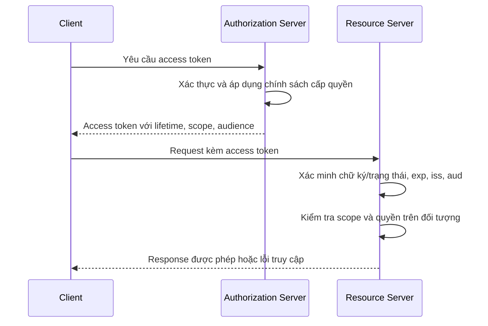

# Token lifetime, scope và audience

Trong module `SECURITY_API_SECURITY`, quản lý token cần được thiết kế theo từng endpoint, tài nguyên và luồng nghiệp vụ. Một token hợp lệ không đồng nghĩa người mang token được phép làm mọi việc, và token được phát hành cho một API không mặc nhiên có thể dùng ở API khác. Ba thuộc tính cần được xác định rõ là **lifetime** (thời hạn sử dụng), **scope** (phạm vi hành động được cấp) và **audience** (dịch vụ nhận token). Kết hợp đúng ba thuộc tính này giúp giới hạn thiệt hại khi token bị lộ, giảm quyền dư thừa và ngăn token bị sử dụng sai nơi.

## 1. Token trong luồng xác thực và truy cập API

Token là thông tin đại diện cho một lần cấp quyền hoặc một phiên truy cập. Trong OAuth 2.0, authorization server phát hành access token để client gửi đến resource server. Resource server xác minh token và áp dụng chính sách truy cập trước khi xử lý request.

Các thành phần thường gặp:

- **Resource owner:** thường là người dùng có quyền cho phép client truy cập một số tài nguyên.
- **Client:** ứng dụng web, ứng dụng di động hoặc service yêu cầu token và gọi API.
- **Authorization server:** xác thực người dùng hoặc client, áp dụng chính sách cấp quyền và phát hành token.
- **Resource server:** API nhận access token, xác minh token và quyết định có thực hiện hành động hay không.

Luồng rút gọn:



Access token là credential dùng để truy cập API. Client thường gửi token trong header:

```http
GET /v1/orders/ord_123 HTTP/1.1
Host: orders-api.example.com
Authorization: Bearer <access_token>
```

Với bearer token, bên nào nắm được token đều có thể thử sử dụng token trong thời gian token còn hiệu lực và trong phạm vi hệ thống chấp nhận. Vì vậy, bảo vệ token khi lưu trữ, truyền tải và ghi log là một phần của thiết kế bảo mật, bên cạnh việc giới hạn lifetime, scope và audience.

## 2. Phân biệt access token, refresh token và ID token

Không phải token nào cũng có cùng mục đích. Dùng nhầm loại token có thể làm sai ranh giới tin cậy giữa client, identity provider và API.

| Loại token | Mục đích | Nơi sử dụng | Đặc điểm cần chú ý |
|---|---|---|---|
| Access token | Truy cập resource server/API | Gửi đến API theo audience được cấp | Có lifetime giới hạn, scope hoặc quyền tương ứng |
| Refresh token | Xin access token mới khi access token hết hạn | Chỉ gửi đến authorization server | Có giá trị cao, cần lưu giữ chặt chẽ và hỗ trợ thu hồi/rotation theo thiết kế |
| ID token | Truyền thông tin xác thực người dùng cho client trong OpenID Connect | Client OIDC nhận và xác minh | `aud` thường xác định client OIDC; không dùng ID token thay access token để gọi API |

Access token trả lời câu hỏi: “Client có thể gọi resource server nào và với quyền nào?”. Refresh token cho phép client yêu cầu một access token mới theo phiên cấp quyền đã có. ID token cho client biết kết quả xác thực và các claim về người dùng theo OpenID Connect.

Resource server phải kiểm tra access token theo hợp đồng của API. Không chấp nhận ID token chỉ vì chữ ký của nó hợp lệ: loại token, issuer, audience và mục đích sử dụng phải khớp với API đang xử lý.

## 3. Token lifetime: thời hạn và cách chọn

### 3.1. Các mốc thời gian trong token

Với JWT, các claim thời gian thường gặp gồm:

| Claim | Ý nghĩa | Cách xử lý |
|---|---|---|
| `iat` (Issued At) | Thời điểm token được phát hành | Có thể dùng để kiểm tra tuổi token và điều tra sự kiện; không tự thay thế `exp` |
| `nbf` (Not Before) | Thời điểm token bắt đầu có hiệu lực | Từ chối token trước thời điểm này, có tính đến clock skew nhỏ theo chính sách |
| `exp` (Expiration Time) | Thời điểm token hết hạn | Từ chối token khi đã hết hạn |
| `jti` (JWT ID) | Định danh duy nhất của JWT nếu được sử dụng | Hỗ trợ audit, chống replay hoặc denylist khi hệ thống có cơ chế tương ứng |

Các claim thời gian JWT dùng NumericDate, tức số giây tính từ Unix epoch theo UTC. Không diễn giải chúng như mili giây hoặc giờ địa phương. Token có `exp` là 0 hoặc thiếu `exp` không nên được chấp nhận như một access token có thời hạn nếu profile và chính sách của hệ thống yêu cầu thời điểm hết hạn.

Ví dụ payload minh họa:

```json
{
  "iss": "https://identity.example.com/",
  "sub": "user_123",
  "aud": "https://orders-api.example.com",
  "iat": 1795000000,
  "nbf": 1795000000,
  "exp": 1795000900,
  "jti": "at_7f31c2",
  "scope": "orders:read orders:cancel"
}
```

Trong ví dụ, thời gian chỉ mang tính minh họa; access token có hiệu lực trong một khoảng hữu hạn bắt đầu từ `nbf` và kết thúc tại `exp`. Resource server phải xác minh chữ ký trước khi tin các claim. Nội dung JWT chỉ được mã hóa Base64URL trong phần header và payload, không mặc nhiên được mã hóa bí mật.

### 3.2. Chọn lifetime theo rủi ro

Không có một thời hạn cố định phù hợp cho mọi API. Lifetime nên dựa trên mức nhạy cảm của dữ liệu, mức độ nguy hiểm của hành động, khả năng làm mới token, cách lưu token ở client và khả năng thu hồi khi có sự cố.

| Yếu tố | Tác động đến quyết định lifetime |
|---|---|
| Độ nhạy cảm của dữ liệu | Dữ liệu tài chính, sức khỏe hoặc dữ liệu cá nhân nhạy cảm thường cần thời gian phơi nhiễm ngắn hơn |
| Mức độ ảnh hưởng của hành động | Chuyển tiền, đổi quyền, xuất dữ liệu hàng loạt cần kiểm soát chặt hơn thao tác đọc thông thường |
| Loại client | Trình duyệt và thiết bị di động có rủi ro lưu trữ khác với service chạy trong môi trường được kiểm soát |
| Khả năng thu hồi | JWT tự xác minh offline khó thu hồi tức thời nếu không có denylist hoặc cơ chế kiểm tra trạng thái |
| Tần suất sử dụng | Lifetime quá ngắn làm tăng số lần refresh và tải cho authorization server |
| Điều kiện nghiệp vụ | Phiên làm việc, thời gian giao dịch và yêu cầu xác nhận lại danh tính có thể đặt giới hạn riêng |

Access token thường nên có lifetime ngắn vừa đủ cho công việc của client. Hành động rủi ro cao có thể yêu cầu xác thực lại, step-up authentication hoặc kiểm tra bổ sung ngay cả khi access token vẫn còn hạn. Không nên kéo dài access token chỉ để tránh xử lý refresh; hãy cân bằng trải nghiệm, tải hệ thống và hậu quả nếu token bị đánh cắp.

Refresh token thường có thời hạn dài hơn access token, nhưng cần chính sách riêng cho thời hạn tuyệt đối, thời gian không hoạt động, thu hồi và xoay vòng. Không cấp refresh token cho client hoặc grant không cần khả năng duy trì phiên. Với client công khai như ứng dụng di động hoặc SPA, cần đặc biệt chú ý bảo vệ refresh token và cân nhắc rotation cùng phát hiện tái sử dụng.

### 3.3. Kiểm tra hết hạn và sai lệch đồng hồ

Resource server cần kiểm tra `exp` và `nbf` bằng đồng hồ hệ thống được đồng bộ. Các máy có thể lệch vài giây do đồng bộ thời gian, nên hệ thống có thể cho phép một khoảng clock skew nhỏ, có giới hạn và được cấu hình thống nhất.

Clock skew không được biến thành cách chấp nhận token hết hạn lâu. Nếu cho phép sai lệch quá lớn, thời gian sử dụng thực tế sẽ dài hơn chính sách. Hãy giám sát đồng bộ thời gian và kiểm thử các trường hợp token vừa hết hạn, chưa đến `nbf`, hoặc có claim thời gian không hợp lệ.

`iat` có thể giúp phát hiện token quá cũ hoặc token được phát hành trong tương lai bất thường, nhưng việc áp dụng các quy tắc này phải phù hợp với issuer và profile token. Không thay thế kiểm tra `exp` bằng kiểm tra `iat`.

### 3.4. Access token hết hạn và refresh token

Khi access token hết hạn, client có thể dùng refresh token để yêu cầu access token mới nếu grant, phiên và chính sách vẫn còn hiệu lực. Refresh token chỉ được gửi đến authorization server; không gửi nó đến resource server hoặc đính kèm vào request nghiệp vụ.

Luồng refresh khái quát:

```http
POST /oauth/token
Content-Type: application/x-www-form-urlencoded

grant_type=refresh_token&refresh_token=<refresh_token>
```

Authorization server phải kiểm tra refresh token, client ràng buộc với token (nếu có), trạng thái phiên, thời hạn và chính sách cấp quyền hiện tại. Access token mới chỉ được cấp với scope và audience được phép. Client không thể tự nâng quyền bằng cách gửi scope tùy ý trong yêu cầu refresh.

Với refresh token rotation, mỗi lần refresh thành công sẽ phát hành refresh token mới và vô hiệu hóa token cũ theo chính sách. Nếu token cũ bị dùng lại, đó có thể là dấu hiệu token đã bị sao chép. Authorization server có thể thu hồi cả token family hoặc phiên liên quan, sau đó yêu cầu người dùng xác thực lại. Rotation cần được triển khai nhất quán ở server và client để tránh hai request refresh đồng thời làm mất phiên hợp lệ.

### 3.5. Thu hồi và giới hạn thời gian sử dụng thực tế

Hết hạn và thu hồi là hai cơ chế khác nhau. `exp` giới hạn thời điểm cuối cùng token được chấp nhận; thu hồi làm token không còn được chấp nhận trước thời điểm đó khi có sự kiện như logout, phát hiện lộ token, khóa tài khoản hoặc thay đổi quyền.

Một số cách xử lý thường dùng:

- **Access token lifetime ngắn:** giới hạn thời gian sử dụng còn lại nếu token bị lộ.
- **Token introspection:** resource server hỏi authorization server về trạng thái token, phù hợp với opaque token hoặc hệ thống cần kiểm tra trạng thái tập trung.
- **Denylist theo `jti`:** resource server từ chối token có ID đã bị thu hồi; cần lưu danh sách đến khi token tương ứng hết hạn.
- **Phiên hoặc token version:** service kiểm tra trạng thái phiên hay phiên bản quyền hiện tại khi nghiệp vụ yêu cầu thu hồi nhanh.
- **Xoay vòng khóa ký:** thay khóa theo quy trình có kiểm soát; thu hồi một khóa có thể ảnh hưởng đồng thời nhiều token được ký bằng khóa đó.

JWT tự chứa cho phép resource server xác minh offline, giảm phụ thuộc vào authorization server trên mỗi request. Đổi lại, một JWT đã ký hợp lệ có thể tiếp tục được chấp nhận đến khi hết hạn nếu không có cơ chế kiểm tra trạng thái bổ sung. Opaque token thường yêu cầu introspection hoặc tra cứu trạng thái, giúp tập trung khả năng thu hồi nhưng tăng phụ thuộc mạng và cần cân nhắc cache.

Logout ở client chỉ xóa token khỏi nơi lưu trữ của client; điều đó không tự động làm một access token JWT đã phát hành mất hiệu lực trên mọi resource server. Hợp đồng logout phải nói rõ cơ chế thu hồi nào được áp dụng và thời gian có hiệu lực dự kiến.

## 4. Scope: giới hạn hành động được cấp

### 4.1. Scope có ý nghĩa gì?

Scope biểu diễn phạm vi quyền mà client được cấp trong một access token. Tên scope nên mô tả hành động và tài nguyên đủ rõ để resource server kiểm tra. Ví dụ:

| Scope | Quyền dự kiến |
|---|---|
| `orders:read` | Đọc thông tin đơn hàng trong phạm vi được phép |
| `orders:create` | Tạo đơn hàng |
| `orders:cancel` | Yêu cầu hủy đơn hàng khi điều kiện nghiệp vụ cho phép |
| `profile:read` | Đọc một tập trường hồ sơ được công bố |
| `payments:refund` | Thực hiện hoàn tiền theo quyền chức năng được cấp |

Scope nên tuân theo nguyên tắc quyền tối thiểu. Tránh cấp một scope quá rộng như `admin` cho các client chỉ cần đọc một loại tài nguyên. Nếu API có hành động có mức rủi ro khác nhau, hãy tách scope để có thể cấp, kiểm tra, audit và thu hồi theo nhu cầu.

### 4.2. Cấp và kiểm tra scope

Authorization server quyết định scope nào có thể được cấp dựa trên client, grant, danh tính người dùng, consent và chính sách của hệ thống. Client có thể yêu cầu một tập scope, nhưng yêu cầu đó không buộc authorization server phải cấp toàn bộ.

Resource server phải kiểm tra scope ở phía server cho từng endpoint hoặc operation. Ví dụ, endpoint `POST /v1/orders/{id}/cancellations` có thể yêu cầu `orders:cancel`; endpoint đọc đơn có thể yêu cầu `orders:read`. Nếu token thiếu scope cần thiết, request bị từ chối theo contract, thường là `403 Forbidden` với bearer token hợp lệ nhưng không đủ quyền.

Không tin giá trị scope do client tự gửi trong header hoặc body. Scope dùng để quyết định truy cập phải đến từ token đã xác minh hoặc từ kết quả introspection đáng tin cậy. Với JWT, claim `scope` thường được biểu diễn thành chuỗi các giá trị phân cách bằng dấu cách; cách parse và tên claim phải theo profile token mà hệ thống đã thống nhất.

### 4.3. Scope không thay thế phân quyền đối tượng

Scope thường biểu đạt quyền chức năng ở mức API. `orders:read` không có nghĩa người dùng được đọc mọi đơn hàng trong hệ thống. Resource server vẫn phải xác minh quan hệ giữa danh tính, tenant và đối tượng đang truy cập.

Ví dụ, một người dùng có `orders:read` có thể đọc đơn hàng của chính họ, nhưng không được thay `orderId` để đọc đơn hàng của người khác. Tương tự, scope `profile:read` không tự quyết định người dùng được xem những thuộc tính nhạy cảm nào. Chính sách quyền đối tượng và quyền thuộc tính vẫn phải được áp dụng.

Phân biệt các khái niệm:

| Khái niệm | Câu hỏi trả lời | Ví dụ |
|---|---|---|
| Scope | Client được thực hiện nhóm hành động API nào? | `orders:read` |
| Role | Người dùng thuộc nhóm hoặc chức năng tổ chức nào? | `support-agent`, `finance-manager` |
| Claim | Token khẳng định thuộc tính nào về subject hoặc phiên? | `sub`, `tenant_id`, `acr` |
| Quyền đối tượng | Subject có quyền trên bản ghi cụ thể này không? | Đơn hàng có thuộc tài khoản/tenant được phép không? |
| Quyền thuộc tính | Subject được đọc hoặc ghi trường nào? | Có được xem địa chỉ hoặc thay đổi trạng thái không? |

Role có thể là đầu vào để authorization server hoặc policy engine quyết định scope. Tuy nhiên, resource server không nên suy diễn quyền đối tượng chỉ từ tên role nếu quan hệ với tài nguyên chưa được kiểm tra.

### 4.4. Tránh scope dư thừa và scope mơ hồ

Scope cần có tên nhất quán, tài liệu mô tả rõ và mapping cụ thể đến endpoint hoặc operation. Tránh các scope trùng nghĩa, tên không nói rõ hành động, hoặc scope có hiệu lực khác nhau giữa các service.

Khi thiết kế scope:

- Tách quyền đọc, tạo, cập nhật, xóa và hành động nhạy cảm khi nghiệp vụ cần mức kiểm soát riêng.
- Không cấp scope chỉ vì client yêu cầu; authorization server phải áp dụng allowlist và chính sách cấp quyền.
- Giới hạn scope theo resource server hoặc audience phù hợp.
- Xác định rõ scope mặc định, scope tùy chọn và scope bị cấm cho từng loại client/grant.
- Có quy trình thay đổi và thu hồi scope khi vai trò, consent hoặc hợp đồng tích hợp thay đổi.
- Kiểm thử trường hợp token có scope lạ, thiếu scope, scope dư và scope được cấp cho sai client.

## 5. Audience: xác định API được phép nhận token

### 5.1. Audience là gì?

Audience (`aud`) xác định người nhận dự kiến của token. Với access token, audience thường là resource server hoặc định danh API. Khi một API nhận token, nó phải xác minh rằng định danh của chính nó nằm trong audience được phép.

Ví dụ:

```json
{
  "iss": "https://identity.example.com/",
  "sub": "user_123",
  "aud": "https://orders-api.example.com",
  "scope": "orders:read",
  "exp": 1795000900
}
```

Token trên được phát hành cho `orders-api`. `billing-api` không được chấp nhận token này chỉ vì token có chữ ký hợp lệ hoặc cùng được phát hành bởi một identity provider. Nếu một token được thiết kế có nhiều audience, mỗi resource server chỉ chấp nhận khi chính nó được liệt kê và chính sách cho phép việc chia sẻ đó.

### 5.2. Audience khác scope

Audience và scope giải quyết hai câu hỏi khác nhau:

- `aud`: token được gửi đến dịch vụ nào?
- `scope`: token cho phép thực hiện những hành động nào trong phạm vi được cấp?

Một token có `aud` đúng nhưng thiếu `scope` vẫn phải bị từ chối cho hành động đó. Một token có scope phù hợp nhưng `aud` sai cũng phải bị từ chối vì token không được phát hành cho API đang nhận request.

| Audience | Scope | Quyết định ví dụ tại Orders API |
|---|---|---|
| Đúng `orders-api` | Có `orders:read` | Có thể tiếp tục kiểm tra quyền đối tượng và trả dữ liệu nếu được phép |
| Đúng `orders-api` | Thiếu `orders:read` | Từ chối do thiếu quyền chức năng |
| Sai `billing-api` | Có `orders:read` | Từ chối vì sai người nhận |
| Sai `billing-api` | Thiếu `orders:read` | Từ chối; cả người nhận và quyền đều không phù hợp |

Không dùng scope để thay cho audience hoặc audience để thay cho scope. Cần xác minh cả hai độc lập.

### 5.3. Kiểm tra audience chính xác

Theo định dạng JWT, `aud` có thể là một chuỗi hoặc một mảng chuỗi. Resource server phải kiểm tra định danh mong đợi có mặt theo quy tắc chính xác của hệ thống. Không kiểm tra bằng cách tìm một đoạn con trong chuỗi, vì các định danh gần giống nhau có thể bị chấp nhận nhầm.

Mỗi API nên có một định danh audience ổn định, được cấu hình ở server. Không lấy audience kỳ vọng từ query parameter, header tùy ý hoặc dữ liệu client gửi. Nếu API hỗ trợ nhiều audience, danh sách đó phải được cấu hình rõ ràng và có lý do nghiệp vụ.

Trong OpenID Connect, `aud` của ID token thường xác định client OIDC mà ID token được phát hành cho. `aud` của access token xác định resource server theo profile access token đang sử dụng. Vì vậy, không dùng ID token thay access token hoặc áp dụng cùng một quy tắc audience mà không phân biệt loại token.

### 5.4. Phân tách token giữa các API

Giả sử một hệ thống có `orders-api`, `billing-api` và `profile-api`. Nếu tất cả API cùng chấp nhận mọi token do một issuer phát hành, token bị đánh cắp từ một client có thể được thử ở nhiều nơi. Việc giới hạn audience giúp giảm khả năng token bị dùng chéo dịch vụ.

Thiết kế nên hướng đến:

- Mỗi resource server có audience riêng hoặc một quy ước định danh resource rõ ràng.
- Authorization server chỉ phát hành token cho audience mà client và grant được phép truy cập.
- Resource server xác minh `iss` và `aud` theo cấu hình tin cậy của chính nó.
- Token dùng cho một API không tự động được chuyển tiếp đến API khác.
- Nếu service cần gọi service khác, cấp token phù hợp cho đích tiếp theo hoặc dùng cơ chế token exchange theo kiến trúc đã chọn; không chuyển tiếp nguyên token người dùng sang mọi downstream service một cách mặc định.

## 6. Xác minh token tại resource server

Trước khi kiểm tra scope và thực hiện nghiệp vụ, resource server phải xác minh token theo một profile rõ ràng. Với JWT ký số, các bước phổ biến gồm:

1. Đọc header và payload như dữ liệu chưa tin cậy; chưa sử dụng claim để cấp quyền.
2. Chọn thuật toán từ allowlist cấu hình của server; từ chối thuật toán không hỗ trợ hoặc không được phép.
3. Lấy khóa xác minh từ nguồn tin cậy gắn với issuer đã cấu hình. `kid` chỉ dùng để chọn khóa trong tập khóa tin cậy đó.
4. Xác minh chữ ký trước khi tin cậy payload. Không chấp nhận JWT chỉ vì giải mã Base64URL thành công.
5. Xác minh `iss` khớp issuer mong đợi.
6. Xác minh `aud` chứa audience của resource server theo quy tắc chính xác.
7. Xác minh `exp`, `nbf` và các quy tắc thời gian cần thiết.
8. Xác minh loại và mục đích token theo profile; không nhầm ID token, access token hoặc token cho một giao thức khác.
9. Đọc scope từ token đã xác minh và kiểm tra quyền cần thiết cho operation.
10. Kiểm tra quyền đối tượng, quyền thuộc tính và trạng thái nghiệp vụ trước khi đọc hoặc thay đổi dữ liệu.

Không lấy URL khóa như `jku` hoặc `x5u` từ JWT không tin cậy để tải khóa tùy ý. Không cho token tự quyết định thuật toán xác minh. Cấu hình issuer, endpoint metadata và JWKS cần được thiết lập từ nguồn đáng tin cậy; xử lý `kid` không tìm thấy phải từ chối an toàn và có log phù hợp.

Với opaque access token, resource server thường gọi endpoint introspection qua kênh bảo vệ để biết token có đang active và các thuộc tính cần thiết hay không. Cần xác minh kết quả introspection đến từ authorization server tin cậy, xử lý timeout và lỗi mạng theo chính sách, đồng thời đặt TTL cache đủ ngắn để không làm chậm hiệu lực thu hồi quá mức.

## 7. Lưu trữ và truyền token an toàn

Lifetime ngắn, scope hẹp và audience đúng không bảo vệ được token nếu token bị lộ ở client hoặc log. Hãy coi access token và đặc biệt là refresh token như bí mật xác thực.

- Chỉ truyền token qua TLS; không đưa token vào URL, query string hoặc tên file vì các vị trí này dễ xuất hiện trong access log, lịch sử trình duyệt và hệ thống phân tích.
- Không ghi token đầy đủ vào log, exception, trace, analytics hoặc báo cáo lỗi. Nếu cần đối chiếu, dùng ID sự kiện hoặc fingerprint đã được thiết kế an toàn.
- Trên trình duyệt, cân nhắc mô hình Backend for Frontend (BFF) để giữ token phía server và dùng cookie phiên với thuộc tính `HttpOnly`, `Secure`, `SameSite` phù hợp; đánh giá thêm CSRF theo cách xác thực cookie.
- Nếu SPA giữ token trong bộ nhớ trình duyệt, đánh giá rủi ro XSS, thời gian tồn tại và khả năng làm mới phiên. Tránh lưu refresh token dài hạn trong nơi JavaScript có thể đọc nếu kiến trúc có lựa chọn an toàn hơn.
- Trên thiết bị di động, dùng kho lưu trữ bí mật do hệ điều hành cung cấp và kiểm soát backup, log, clipboard cũng như dữ liệu chẩn đoán.
- Với service-to-service, dùng secret manager hoặc cơ chế credential của nền tảng; giới hạn quyền đọc secret và xoay vòng theo quy trình.
- Không gửi refresh token đến resource server. Chỉ authorization server được phép xử lý grant refresh token.

Nếu có yêu cầu giảm nguy cơ token bearer bị đánh cắp, kiến trúc có thể xem xét token ràng buộc với người gửi (sender-constrained), chẳng hạn mTLS hoặc DPoP theo khả năng hỗ trợ của client và server. Các cơ chế này bổ sung kiểm soát việc sử dụng token; chúng không thay thế kiểm tra lifetime, audience, scope hay quyền trên đối tượng.

## 8. Ví dụ chính sách token cho hệ thống nhiều API

Giả sử hệ thống có ba resource server: Orders API, Billing API và Profile API. Chính sách có thể được mô tả như sau:

| API | Audience | Scope ví dụ | Quy tắc bổ sung |
|---|---|---|---|
| Orders API | `https://orders-api.example.com` | `orders:read`, `orders:create`, `orders:cancel` | Kiểm tra chủ sở hữu/tenant và trạng thái đơn hàng |
| Billing API | `https://billing-api.example.com` | `payments:read`, `payments:refund` | Hành động hoàn tiền cần quyền chức năng riêng và audit |
| Profile API | `https://profile-api.example.com` | `profile:read`, `profile:update` | Lọc thuộc tính được đọc/ghi theo danh tính |

Client ứng dụng mua hàng chỉ cần đọc đơn và tạo đơn có thể được cấp access token cho Orders API với `orders:read orders:create`. Token đó không nên chứa `payments:refund` và không nên có audience của Billing API. Nếu luồng cần hoàn tiền, service hoặc người dùng có quyền tương ứng phải lấy credential được cấp cho Billing API theo chính sách riêng.

Ví dụ request bị từ chối:

```text
Request: GET /v1/orders/ord_999
Token audience: https://billing-api.example.com
Token scope: orders:read

Kết quả: từ chối vì audience không khớp Orders API.
```

Ngay cả khi audience đúng và scope có `orders:read`, API vẫn cần kiểm tra `ord_999` có thuộc phạm vi truy cập của subject hay không. Nếu không, request phải bị từ chối theo chính sách quyền đối tượng. Điều này ngăn nhầm lẫn giữa quyền gọi một loại endpoint và quyền truy cập mọi bản ghi.

## 9. Kiểm thử lifetime, scope và audience

Kiểm thử cần bao phủ token hợp lệ, token sai và các ranh giới giữa các API. Không chỉ xác minh mã HTTP; với request bị từ chối, hãy kiểm tra dữ liệu và tác động phụ không bị thay đổi.

| Nhóm kiểm thử | Trường hợp | Kết quả mong đợi |
|---|---|---|
| Lifetime | Token đã qua `exp` | Từ chối; không thực hiện nghiệp vụ |
| Lifetime | Thời điểm hiện tại trước `nbf` | Từ chối theo clock skew đã công bố |
| Lifetime | Thiếu `exp` trong profile yêu cầu expiration | Từ chối |
| Lifetime | `exp` không hợp lệ hoặc claim thời gian sai kiểu | Từ chối an toàn |
| Issuer | `iss` không thuộc issuer tin cậy | Từ chối |
| Chữ ký | Chữ ký sai, khóa không tin cậy hoặc thuật toán ngoài allowlist | Từ chối |
| Audience | Token dành cho API khác | Từ chối dù chữ ký hợp lệ |
| Audience | `aud` là mảng có chứa đúng resource | Chấp nhận bước audience nếu profile cho phép; tiếp tục kiểm tra khác |
| Scope | Thiếu scope endpoint yêu cầu | Từ chối do thiếu quyền chức năng |
| Scope | Có scope lạ hoặc scope client tự thêm ngoài token | Không cấp thêm quyền |
| Đối tượng | Có scope nhưng ID thuộc tenant khác | Từ chối theo chính sách quyền đối tượng |
| Loại token | Gửi ID token vào API | Từ chối do sai mục đích/loại token |
| Refresh | Refresh token hết hạn hoặc đã thu hồi | Không cấp access token mới |
| Refresh rotation | Dùng lại refresh token cũ đã xoay vòng | Phát hiện reuse và xử lý phiên/token family theo chính sách |
| Thu hồi | Token bị thu hồi trước `exp` | Từ chối trong giới hạn thời gian thu hồi đã công bố |

Ngoài kiểm thử tự động, cần kiểm tra cấu hình thực tế: đồng bộ thời gian giữa các node, cache introspection, cập nhật JWKS khi xoay khóa, xử lý issuer không khả dụng và cách client xử lý refresh đồng thời. Kiểm thử tích hợp giúp phát hiện trường hợp một service xác minh token khác với service còn lại.

## 10. Checklist thiết kế và review

Trước khi phát hành một API sử dụng token, nhóm phát triển nên xác nhận:

1. **Mục đích token:** phân biệt rõ access token, refresh token và ID token; mỗi loại chỉ được dùng ở đúng nơi.
2. **Lifetime:** có `exp` phù hợp, quy tắc `nbf`/`iat`, clock skew nhỏ và chính sách refresh được công bố.
3. **Thu hồi:** xác định logout, khóa tài khoản, lộ token và thay đổi quyền tác động đến token đang hoạt động như thế nào.
4. **Refresh token:** giới hạn nơi lưu trữ và nơi gửi; quy định rotation, reuse detection, inactivity timeout và absolute lifetime khi phù hợp.
5. **Scope:** tên scope rõ, quyền tối thiểu, mapping tới endpoint và chính sách cấp quyền ở authorization server.
6. **Audience:** mỗi API có định danh người nhận được cấu hình; token sai audience bị từ chối.
7. **Xác minh:** kiểm tra chữ ký, issuer, audience, thời gian, loại token và scope trước khi xử lý nghiệp vụ.
8. **Phân quyền sâu:** kiểm tra quyền chức năng, đối tượng và thuộc tính; scope không thay thế các kiểm tra này.
9. **Bảo vệ token:** TLS, lưu trữ an toàn, không đưa token vào URL hoặc log, kiểm soát quyền truy cập secret.
10. **Kiểm thử và giám sát:** có ca negative, kiểm thử chéo API, audit sự kiện refresh/revoke và cảnh báo hành vi bất thường.

## Kết luận

Lifetime giới hạn khoảng thời gian token có thể được sử dụng; scope giới hạn các hành động API được cấp; audience giới hạn resource server được phép nhận token. Resource server cần xác minh cả ba cùng với chữ ký, issuer, loại token và quyền trên đối tượng trước khi thực hiện nghiệp vụ. Khi các quy tắc này được định nghĩa theo từng endpoint và API, token trở thành credential có phạm vi rõ ràng, dễ kiểm thử và có thể xử lý khi bị lộ hoặc cần thu hồi.
