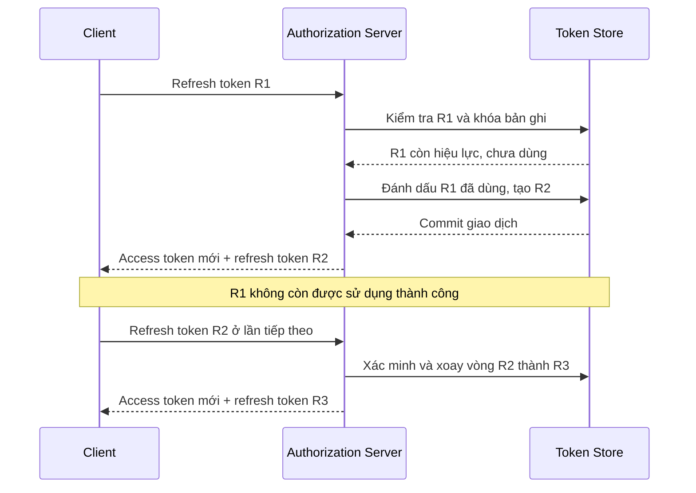
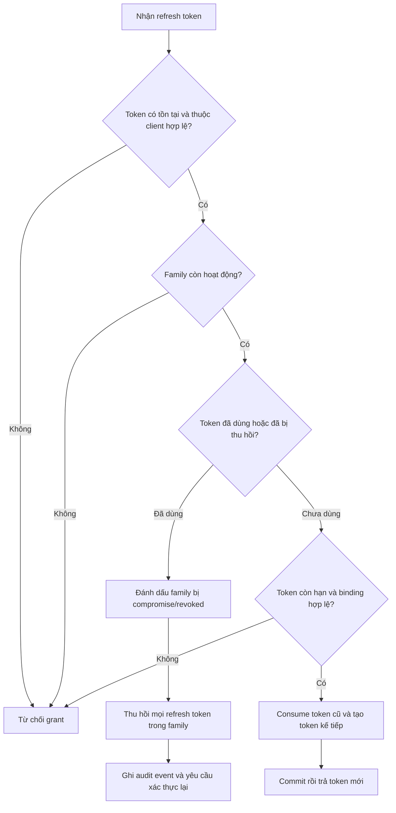

# Refresh token rotation và reuse detection

Refresh token cho phép client xin access token mới khi access token hiện tại hết hạn mà không yêu cầu người dùng đăng nhập lại ở mỗi lần. Vì refresh token thường có thời gian sống dài và có thể cấp ra nhiều access token, nó là thông tin xác thực có giá trị cao. Nếu bị đánh cắp, refresh token có thể giúp attacker duy trì quyền truy cập lâu hơn thời hạn của một access token.

**Refresh token rotation** giới hạn rủi ro bằng cách cấp một refresh token mới sau mỗi lần sử dụng thành công và vô hiệu hóa token cũ. **Reuse detection** phát hiện trường hợp token cũ đã được sử dụng lại, một dấu hiệu cho thấy token có thể đã bị sao chép hoặc có hai bên đang sử dụng cùng một phiên. Khi phát hiện reuse, authorization server có thể thu hồi toàn bộ nhóm token (*token family*) liên quan và yêu cầu xác thực lại.

Đây là một phần trong thiết kế API Security theo từng luồng xác thực: cần xác minh client, kiểm tra trạng thái phiên, xử lý cạnh tranh đồng thời, bảo vệ token khi lưu trữ và truyền tải, đồng thời giám sát các lần refresh bất thường. Chỉ thay chuỗi token sau mỗi lần gọi mà không quản lý vòng đời và quan hệ giữa các token sẽ không tạo ra cơ chế phát hiện replay đáng tin cậy.

## 1. Access token và refresh token có vai trò khác nhau

| Loại token | Mục đích | Đặc điểm thường gặp |
|---|---|---|
| Access token | Gửi tới resource server để truy cập API | Thời gian sống ngắn; mang scope/claim hoặc tham chiếu quyền; có thể là JWT hoặc opaque token |
| Refresh token | Gửi tới authorization server để xin access token mới | Thời gian sống dài hơn; không dùng để gọi resource API; cần được bảo vệ như credential dài hạn |

Client chỉ gửi refresh token tới token endpoint của authorization server qua TLS. Resource server không nên chấp nhận refresh token thay cho access token. Refresh token cũng không nên chứa dữ liệu nghiệp vụ mà client có thể tự diễn giải thành quyền truy cập.

Ví dụ, access token có thể có thời hạn 5 đến 15 phút, trong khi refresh token có thời hạn theo chính sách phiên dài hơn. Đây chỉ là ví dụ cấu hình; thời hạn thực tế cần dựa trên mức nhạy cảm của dữ liệu, khả năng phát hiện gian lận, trải nghiệm người dùng và khả năng thu hồi phiên.

## 2. Rotation hoạt động như thế nào?

Mỗi refresh token chỉ được sử dụng thành công một lần. Khi client gửi token hiện tại, authorization server xác minh token, đánh dấu nó đã tiêu thụ và phát hành một token kế tiếp. Token mới thuộc cùng một token family và trở thành token duy nhất còn hiệu lực để tiếp tục refresh trong phiên đó.



Một chuỗi token được liên kết thành family:

```text
Family F
  R1 (consumed) -> R2 (consumed) -> R3 (active)
```

Mỗi lần rotation phải thực hiện như một giao dịch nguyên tử: vô hiệu hóa token cũ và tạo token mới cùng thành công hoặc cùng rollback. Nếu server vô hiệu hóa token cũ rồi gặp lỗi trước khi lưu token mới, client có thể mất phiên. Nếu tạo token mới nhưng không vô hiệu hóa token cũ, hai token có thể cùng sử dụng được và rotation mất ý nghĩa.

## 3. Token family và reuse detection

Token family là tập các refresh token được cấp nối tiếp trong cùng một phiên hoặc grant. Server cần giữ mối quan hệ này để biết token cũ thuộc phiên nào và có thể thu hồi toàn bộ phiên khi phát hiện replay.

Giả sử người dùng đăng nhập trên một thiết bị và nhận `R1`. Sau đó:

1. Client hợp lệ dùng `R1`; server đánh dấu `R1` đã dùng và cấp `R2`.
2. Attacker có bản sao của `R1` và gửi nó sau đó.
3. Server thấy `R1` đã được tiêu thụ. Vì `R1` thuộc family đang hoạt động, đây là reuse.
4. Server thu hồi family chứa `R1`, `R2` và token kế tiếp nếu có, rồi từ chối refresh.
5. Client phải thực hiện lại quy trình xác thực hoặc cấp quyền theo chính sách.



Reuse detection là tín hiệu về khả năng credential bị sao chép hoặc phiên bị sử dụng đồng thời. Nó không chứng minh bên nào là chủ sở hữu hợp lệ. Nếu attacker sử dụng token bị đánh cắp trước client thật, attacker có thể nhận token kế tiếp; lần sử dụng sau của client thật mới làm lộ reuse. Vì vậy rotation cần kết hợp với bảo vệ thiết bị, xác thực client, sender-constrained token khi phù hợp, thời hạn phiên hợp lý và giám sát.

## 4. Thiết kế dữ liệu để quản lý token family

Có thể lưu trạng thái family và từng token ở hai bảng. Ví dụ giản lược:

```sql
CREATE TABLE refresh_token_family (
    family_id UUID PRIMARY KEY,
    subject_id VARCHAR(200) NOT NULL,
    client_id VARCHAR(200) NOT NULL,
    status VARCHAR(20) NOT NULL,
    created_at TIMESTAMP NOT NULL,
    last_used_at TIMESTAMP NOT NULL,
    idle_expires_at TIMESTAMP NOT NULL,
    absolute_expires_at TIMESTAMP NOT NULL,
    revoked_at TIMESTAMP NULL,
    revoke_reason VARCHAR(40) NULL,
    sender_key_thumbprint VARCHAR(200) NULL
);

CREATE TABLE refresh_token (
    token_id UUID PRIMARY KEY,
    family_id UUID NOT NULL REFERENCES refresh_token_family(family_id),
    token_hash VARCHAR(128) NOT NULL UNIQUE,
    issued_at TIMESTAMP NOT NULL,
    expires_at TIMESTAMP NOT NULL,
    consumed_at TIMESTAMP NULL,
    revoked_at TIMESTAMP NULL,
    replaced_by UUID NULL REFERENCES refresh_token(token_id)
);
```

Đây là mô hình minh họa; kiểu thời gian, index, khóa ngoại và chiến lược partition cần điều chỉnh theo database. Các trạng thái nên có quy ước rõ ràng, chẳng hạn family `ACTIVE`, `REVOKED`, `EXPIRED`; token được nhận biết qua `consumed_at`, `revoked_at` và `expires_at`.

Các trường có ý nghĩa:

- `subject_id` và `client_id` xác định phiên được cấp cho ai và client nào.
- `family_id` liên kết mọi token kế tiếp trong cùng phiên.
- `token_hash` là giá trị băm của secret; database không lưu refresh token dạng rõ.
- `consumed_at` cho biết token đã được dùng để rotation.
- `replaced_by` giúp truy vết chuỗi token và hỗ trợ điều tra.
- `idle_expires_at` giới hạn thời gian không hoạt động; `absolute_expires_at` giới hạn tổng tuổi thọ phiên.
- `sender_key_thumbprint` có thể lưu dấu vân tay khóa nếu token được ràng buộc với khóa của client.

Không nhất thiết phải lưu mọi token cũ vô thời hạn. Có thể lưu dấu vết tối thiểu trong khoảng thời gian cần phát hiện reuse và đáp ứng yêu cầu audit, sau đó dọn dẹp theo retention policy. Tuy nhiên, xóa token cũ quá sớm sẽ làm mất khả năng nhận diện việc sử dụng lại token đã bị tiêu thụ.

## 5. Tạo và lưu refresh token an toàn

Refresh token cần có entropy cao, khó đoán và không mang ý nghĩa có thể suy ra. Một cách phổ biến là tạo secret ngẫu nhiên mật mã có ít nhất 256 bit, mã hóa Base64 URL-safe và gắn với một selector hoặc ID ngẫu nhiên để tra cứu bản ghi.

Ví dụ định dạng:

```text
<token-id>.<random-secret>
```

`token-id` giúp tìm bản ghi; `random-secret` là phần bí mật. Server chỉ lưu hash của secret, chẳng hạn SHA-256 hoặc HMAC-SHA-256 với khóa server-side riêng. Vì secret có entropy ngẫu nhiên rất cao, hash mật mã phù hợp để xác minh; không dùng hash mật khẩu chậm như BCrypt để xử lý token ngẫu nhiên có entropy cao. Nếu dùng HMAC, khóa pepper phải được quản lý và xoay vòng an toàn.

Khi nhận token, server tra cứu bằng selector, tính lại hash của secret và so sánh an toàn theo thời gian không phụ thuộc vị trí byte đầu tiên khác nhau (*constant-time comparison*) khi so sánh trong ứng dụng. Không ghi token rõ vào database, log, trace, analytics hoặc thông báo lỗi.

Các nguyên tắc bổ sung:

- Sinh token bằng cryptographically secure random number generator, không dùng timestamp, UUID tuần tự hoặc `Random` thông thường làm secret.
- Chỉ truyền token qua TLS và chỉ gửi tới authorization server đúng địa chỉ.
- Không đưa refresh token vào URL, query string hoặc referrer.
- Hạn chế quyền đọc token store; mã hóa ổ đĩa/backup theo chính sách dữ liệu và bảo vệ khóa mã hóa.
- Không trả refresh token trong response cache; đặt header cache phù hợp như `Cache-Control: no-store` và `Pragma: no-cache` cho token response.
- Xử lý token trong bộ nhớ trong thời gian ngắn và tránh đưa nó vào exception message.

## 6. Luồng xử lý refresh ở phía authorization server

Một request refresh cần kiểm tra nhiều điều kiện trước khi cấp token mới:

1. **Xác định client:** với confidential client, xác thực client theo cơ chế đã đăng ký. Với public client, kiểm tra `client_id` và ràng buộc token với client/grant theo chính sách; không giả định `client_id` tự nó là bí mật.
2. **Xác minh token:** parse selector, tra cứu bản ghi, so sánh secret hash và xác minh family liên quan.
3. **Kiểm tra family:** family phải còn active, chưa bị thu hồi và chưa vượt thời hạn tuyệt đối.
4. **Kiểm tra trạng thái token:** token không được hết hạn, bị thu hồi hoặc đã tiêu thụ.
5. **Kiểm tra binding:** nếu token gắn với client, thiết bị hoặc khóa sender-constrained, request phải chứng minh đúng binding.
6. **Kiểm tra quyền cấp lại:** scope/resource không được mở rộng vượt quá grant ban đầu; các điều kiện về consent và account status vẫn phải hợp lệ.
7. **Rotation nguyên tử:** đánh dấu token hiện tại đã dùng, tạo token mới trong cùng family và cập nhật thời gian hoạt động trong một transaction.
8. **Trả response:** chỉ sau khi commit thành công mới trả access token và refresh token kế tiếp.

Với OAuth 2.0, refresh token được gửi tới token endpoint bằng `grant_type=refresh_token`; server trả lỗi `invalid_grant` khi grant/token không còn hợp lệ. Không nên trả chi tiết cho attacker biết token thất bại do không tồn tại, đã bị dùng hay family đã bị thu hồi. Chi tiết điều tra được ghi trong audit log nội bộ.

## 7. Rotation phải an toàn khi có request đồng thời

Một tình huống phổ biến là hai request refresh cùng gửi `R1` gần như đồng thời. Nếu server chỉ đọc trạng thái rồi cập nhật mà không có khóa hoặc điều kiện nguyên tử, cả hai request có thể cùng thấy `R1` chưa dùng và cấp ra `R2a`, `R2b`. Khi đó có hai nhánh token cùng hoạt động và reuse detection trở nên không rõ ràng.

Server cần bảo đảm chỉ một request thắng. Có thể dùng row-level lock (`SELECT ... FOR UPDATE`), optimistic locking hoặc một câu lệnh compare-and-swap có điều kiện. Ví dụ về transaction ở mức khái niệm:

```sql
BEGIN;

SELECT *
FROM refresh_token
WHERE token_id = :token_id
FOR UPDATE;

-- Ứng dụng kiểm tra family, hash, expiry, consumed_at và revoked_at.
-- Nếu token còn hợp lệ:

UPDATE refresh_token
SET consumed_at = CURRENT_TIMESTAMP,
    replaced_by = :new_token_id
WHERE token_id = :token_id
  AND consumed_at IS NULL
  AND revoked_at IS NULL;

-- Chỉ tiếp tục nếu đúng một hàng được cập nhật.
INSERT INTO refresh_token (...)
VALUES (... :new_token_id, :family_id, :new_token_hash, ...);

UPDATE refresh_token_family
SET last_used_at = CURRENT_TIMESTAMP,
    idle_expires_at = :new_idle_expiry
WHERE family_id = :family_id
  AND status = 'ACTIVE';

COMMIT;
```

Đây là pseudocode SQL: cần kiểm tra số hàng cập nhật, family vẫn active và thời hạn không vượt `absolute_expires_at` trước khi commit. Nếu bất kỳ bước nào không đạt, rollback toàn bộ transaction. Unique constraint và khóa ngoại hỗ trợ ngăn token trùng hoặc quan hệ không hợp lệ, nhưng không thay thế logic kiểm tra trạng thái.

Khi hai request cạnh tranh, request đầu tiên tiêu thụ token. Request thứ hai sau khi lấy được lock sẽ thấy token đã dùng và có thể kích hoạt reuse detection. Điều này có thể xảy ra do hai tab hoặc hai component của cùng một client refresh cùng lúc, không nhất thiết là attacker.

Vì vậy client nên triển khai *single-flight refresh*: tại một thời điểm chỉ một luồng refresh cho mỗi phiên, các request API khác chờ kết quả đó rồi dùng access token mới. Với ứng dụng có nhiều tiến trình hoặc nhiều tab, cần cơ chế phối hợp phù hợp như shared worker, lock liên tiến trình hoặc đồng bộ trạng thái phiên.

Không thêm một khoảng grace period rộng để mọi request dùng lại token cũ đều được chấp nhận. Cách đó làm suy yếu tính một lần của token và có thể che giấu replay. Nếu hệ thống thật sự cần xử lý retry do response bị mất sau khi server đã commit, phải thiết kế giao thức retry có ràng buộc rõ ràng, ví dụ khóa sender-constrained, request identifier được quản lý an toàn và kết quả idempotent được lưu có thời hạn. Không trả lại token kế tiếp chỉ vì caller đưa lại một refresh token đã dùng mà không chứng minh được đó là cùng một thao tác hợp lệ.

## 8. Xử lý reuse và thu hồi family

Khi server nhận token đã được tiêu thụ trong một family còn hoạt động, nó nên:

1. Đánh dấu family là `REVOKED` hoặc trạng thái tương đương với lý do `REFRESH_TOKEN_REUSE`.
2. Thu hồi mọi refresh token còn hiệu lực trong family.
3. Ghi audit event gồm subject/client, family ID, token ID, thời điểm, IP/device signal và correlation ID theo chính sách riêng tư.
4. Từ chối request với lỗi OAuth phù hợp, thường là `invalid_grant`.
5. Yêu cầu client xóa credential cục bộ và thực hiện xác thực lại; thông báo cho người dùng nếu rủi ro và sản phẩm yêu cầu.
6. Đưa sự kiện vào luồng cảnh báo hoặc điều tra khi reuse xuất hiện bất thường.

Việc thu hồi family cần được commit ngay cả khi request bị từ chối. Trong code, không ném exception làm rollback transaction sau khi vừa đánh dấu family revoked. Có thể để transaction trả về kết quả `REUSE_DETECTED`, commit việc thu hồi, rồi tầng HTTP mới chuyển kết quả thành lỗi `invalid_grant`.

Thu hồi family không tự động làm mọi access token đã cấp trước đó mất hiệu lực. Nếu access token là JWT tự chứa, resource server có thể tiếp tục chấp nhận token cho đến khi `exp` hết hạn, trừ khi có cơ chế kiểm tra trạng thái bổ sung. Các lựa chọn giảm khoảng thời gian này gồm:

- Access token có thời hạn ngắn.
- Introspection hoặc session/family status check cho API có rủi ro cao.
- Denylist theo `jti` hoặc session identifier khi cần thu hồi tức thời, có cân nhắc chi phí lưu trữ và độ trễ đồng bộ.
- Xác minh trạng thái tài khoản/phiên tại những thao tác đặc biệt nhạy cảm.

Chọn cơ chế theo yêu cầu độ trễ, tính sẵn sàng và mức độ rủi ro. Không tuyên bố “đã revoke toàn bộ phiên” nếu resource server vẫn chấp nhận access token cũ mà không kiểm tra trạng thái.

## 9. Thời hạn, logout và các sự kiện thu hồi khác

Refresh token nên chịu ít nhất hai giới hạn thời gian:

- **Idle timeout:** phiên bị hết hạn nếu không có hoạt động refresh trong một khoảng thời gian.
- **Absolute lifetime:** phiên hết hạn sau tổng thời gian tối đa kể từ lúc được cấp, kể cả khi người dùng hoạt động liên tục.

Rotation có thể cập nhật `idle_expires_at`, nhưng không được kéo dài `absolute_expires_at` vô hạn. Token kế tiếp cũng không được có hạn dùng vượt quá thời hạn family. Thời hạn cần ngắn hơn với quyền truy cập dữ liệu nhạy cảm hoặc thiết bị có mức bảo vệ thấp.

Thu hồi family cũng cần được thực hiện trong các trường hợp phù hợp:

- Người dùng logout khỏi thiết bị hiện tại.
- Người dùng chọn logout khỏi tất cả thiết bị.
- Tài khoản bị khóa, xóa hoặc nghi ngờ bị xâm nhập.
- Mật khẩu hoặc yếu tố xác thực được thay đổi theo chính sách bảo mật.
- Consent hoặc grant bị thu hồi.
- Client bị thu hồi, khóa ký hoặc credential của client bị lộ.
- Phát hiện reuse hoặc sự kiện rủi ro khác.

Logout một thiết bị nên thu hồi family tương ứng. Logout mọi thiết bị có thể thu hồi tất cả family của subject. Cần xác định rõ phạm vi và thông báo trạng thái cho người dùng; xóa cookie hoặc token ở client không thay thế thu hồi phía server.

## 10. Ràng buộc refresh token với client hoặc thiết bị

Rotation phát hiện reuse sau khi token cũ được dùng lần đầu. Sender-constrained token bổ sung một lớp bảo vệ bằng cách yêu cầu client chứng minh quyền sở hữu khóa gắn với token. Khi token bị sao chép mà attacker không có khóa tương ứng, token khó bị sử dụng từ thiết bị khác.

Các cơ chế có thể dùng tùy loại client và hạ tầng gồm:

- **mTLS:** ràng buộc credential với chứng thư client trong môi trường service-to-service hoặc client có khả năng quản lý chứng thư.
- **DPoP:** client ký proof bằng khóa riêng để chứng minh đang sở hữu khóa gắn với token; server xác minh proof, thời điểm, HTTP method/URI và chống replay theo quy định.
- **Client authentication:** confidential client xác thực tại token endpoint bằng credential được quản lý an toàn.

`client_id` trong request không phải bằng chứng rằng caller sở hữu client. Public client không giữ được client secret một cách đáng tin cậy. Với public client, cần dùng rotation có reuse detection hoặc sender-constrained refresh token theo chính sách OAuth hiện hành; với confidential client, vẫn cần xác thực client và bảo vệ token.

Không dùng fingerprint thiết bị như một bí mật duy nhất. IP, user-agent và thông tin thiết bị có thể thay đổi hoặc bị giả mạo; chúng hữu ích như tín hiệu rủi ro nhưng không thay thế cryptographic binding.

## 11. Lưu trữ refresh token ở phía client

Server có thể triển khai rotation đúng nhưng phiên vẫn bị đánh cắp nếu client lưu token không an toàn. Cách lưu phụ thuộc loại ứng dụng:

- **Ứng dụng native:** ưu tiên kho lưu trữ bảo mật của hệ điều hành như Keychain hoặc Keystore; hạn chế backup hoặc đồng bộ token ra ngoài thiết bị nếu không có thiết kế bảo vệ tương ứng.
- **Ứng dụng web có backend-for-frontend (BFF):** giữ refresh token ở backend; trình duyệt dùng cookie `HttpOnly`, `Secure`, `SameSite` phù hợp và có CSRF protection cho request thay đổi trạng thái.
- **SPA thuần:** giảm tối đa thời gian token tồn tại trong JavaScript-accessible storage; cân nhắc BFF hoặc sender-constrained token. Không xem `localStorage` là kho bí mật vì JavaScript chạy cùng origin có thể đọc token khi xảy ra XSS.
- **Service-to-service:** lưu secret trong secret manager hoặc cơ chế workload identity; giới hạn quyền đọc, audit và xoay vòng credential.

Nếu dùng cookie tự động gửi kèm request, cần đánh giá CSRF và cấu hình SameSite theo luồng đăng nhập. `HttpOnly` ngăn JavaScript đọc cookie nhưng không tự ngăn XSS thực hiện hành động thay người dùng. CSP, output encoding, dependency hygiene và các biện pháp chống XSS vẫn cần thiết.

## 12. Ví dụ logic xử lý ở Spring

Đoạn code sau là pseudocode Java để thể hiện thứ tự quyết định; nó không phải implementation có thể copy nguyên trạng. Các phương thức repository cần dùng transaction và row lock hoặc cơ chế compare-and-swap tương đương.

```java
enum RefreshOutcome {
    ROTATED,
    INVALID_GRANT,
    REUSE_DETECTED
}

@Service
@RequiredArgsConstructor
class RefreshTokenService {
    private final RefreshTokenRepository tokenRepository;
    private final RefreshTokenFamilyRepository familyRepository;
    private final SecureTokenGenerator tokenGenerator;
    private final TokenHasher tokenHasher;

    @Transactional
    RefreshResult rotate(String rawToken, String clientId) {
        ParsedRefreshToken parsed = ParsedRefreshToken.parse(rawToken);

        RefreshToken current = tokenRepository
                .findByIdForUpdate(parsed.tokenId())
                .orElse(null);
        if (current == null || !tokenHasher.matches(
                parsed.secret(), current.getTokenHash())) {
            return RefreshResult.invalid();
        }

        RefreshTokenFamily family = familyRepository
                .findByIdForUpdate(current.getFamilyId())
                .orElse(null);
        if (family == null || !family.isActive()
                || !family.getClientId().equals(clientId)) {
            return RefreshResult.invalid();
        }

        if (current.isConsumed()) {
            family.revoke("REFRESH_TOKEN_REUSE");
            tokenRepository.revokeActiveTokens(family.getId());
            return RefreshResult.reuseDetected();
        }

        if (current.isExpired() || current.isRevoked()
                || !family.isWithinLifetime()) {
            return RefreshResult.invalid();
        }

        String nextRawToken = tokenGenerator.generate();
        RefreshToken next = RefreshToken.create(
                family.getId(), tokenHasher.hash(nextRawToken),
                family.nextTokenExpiry());

        current.consumeAndReplaceWith(next.getId());
        tokenRepository.save(next);
        family.touchWithinAbsoluteExpiry();

        return RefreshResult.rotated(nextRawToken);
    }
}
```

Ở đây `RefreshResult.reuseDetected()` là kết quả bình thường của transaction để việc revoke được commit; tầng controller chỉ trả lỗi sau khi transaction kết thúc. Cần bảo đảm `findByIdForUpdate` khóa đúng bản ghi, family cũng được khóa theo thứ tự nhất quán để giảm deadlock, và cập nhật trạng thái chỉ thành công khi điều kiện vẫn đúng. Nếu có nhiều đường code cập nhật family, hãy thống nhất thứ tự khóa.

Ví dụ cũng cần được mở rộng trong ứng dụng thật để kiểm tra issuer/client authentication, sender binding, scope/resource, account status, idle timeout, absolute expiry, rate limit và audit event. Không phát hành access token trước khi transaction rotation commit thành công.

## 13. Kiểm thử rotation và reuse detection

Kiểm thử không chỉ xác minh token mới được trả về. Cần xác minh trạng thái token store và tác động tới phiên:

| Tình huống | Kết quả mong đợi |
|---|---|
| Refresh token hiện tại hợp lệ | Cấp access token mới và refresh token kế tiếp; token cũ được đánh dấu consumed |
| Dùng lại token cũ sau rotation | Phát hiện reuse, revoke family và trả `invalid_grant` |
| Dùng token thuộc client khác | Từ chối; không cấp token hoặc mở rộng grant |
| Secret sai hoặc selector không tồn tại | Từ chối với phản hồi không tiết lộ token có tồn tại hay không |
| Token hết hạn hoặc family hết absolute lifetime | Từ chối và không tạo token kế tiếp |
| Family đã bị logout/revoke | Từ chối mọi token thuộc family |
| Hai request cùng refresh một token | Chỉ một request có thể rotate; request còn lại thấy trạng thái đã dùng và xử lý theo reuse policy |
| Lỗi giữa lúc consume và tạo token mới | Transaction rollback; không để token cũ mất hiệu lực mà không có token kế tiếp |
| Lỗi sau commit nhưng response bị mất | Retry được xử lý theo chính sách đã thiết kế; không âm thầm chấp nhận replay |
| Token family bị revoke | Các refresh token kế tiếp đều không thể sử dụng |
| Access token JWT cũ sau family revoke | Hành vi được xác định rõ theo TTL, introspection hoặc cơ chế thu hồi bổ sung |
| Refresh token không có sender proof hợp lệ | Từ chối nếu grant yêu cầu sender constraint |

Nên có integration test chạy song song để xác minh khóa và transaction thực sự hoạt động trên loại database production sử dụng. Mock repository không chứng minh được tính nguyên tử hoặc hành vi row lock.

## 14. Giám sát và điều tra reuse

Authorization server nên ghi nhận các sự kiện quan trọng:

- Refresh thành công và family/token được xoay vòng.
- Refresh bị từ chối vì token sai, hết hạn, revoked hoặc client không hợp lệ.
- Reuse detection và family bị thu hồi.
- Client/device binding thất bại hoặc DPoP/mTLS proof không hợp lệ.
- Tỷ lệ refresh bất thường, nhiều family bị revoke từ cùng một nguồn hoặc cùng subject.
- Lỗi token store, transaction conflict và độ trễ refresh tăng cao.

Audit event nên có subject/client/family/token ID dạng tham chiếu, thời điểm, correlation ID và tín hiệu rủi ro phù hợp. Không ghi raw refresh token, secret, authorization header hoặc proof đầy đủ. Hạn chế quyền truy cập log và thiết lập retention phù hợp.

Khi reuse được phát hiện, đội vận hành cần có quy trình xác định phạm vi ảnh hưởng, kiểm tra sự kiện đăng nhập và refresh gần đó, đánh giá access token còn hiệu lực, thông báo người dùng khi cần và yêu cầu đăng nhập lại. Nếu có dấu hiệu compromise ở cấp tài khoản hoặc client, có thể cần thu hồi nhiều family hơn hoặc xoay vòng credential liên quan.

Không đặt cảnh báo chỉ dựa trên một IP hoặc user-agent thay đổi. Người dùng di chuyển mạng, cập nhật ứng dụng hoặc dùng nhiều thiết bị có thể tạo biến động bình thường. Kết hợp nhiều tín hiệu và phân biệt lỗi cạnh tranh do client với dấu hiệu replay thực tế.

## 15. Checklist triển khai

- [ ] Refresh token chỉ dùng tại authorization server/token endpoint và được truyền qua TLS.
- [ ] Token có entropy cao, không thể đoán và chỉ lưu hash ở server.
- [ ] Mỗi token chỉ được dùng một lần; rotation tạo token kế tiếp trong cùng family.
- [ ] Consume token cũ và tạo token mới nằm trong một transaction nguyên tử.
- [ ] Database có khóa hoặc compare-and-swap để xử lý request đồng thời.
- [ ] Token đã dùng được nhận diện; reuse trong family active dẫn đến thu hồi family theo policy.
- [ ] Family có idle timeout và absolute lifetime; rotation không kéo dài phiên vô hạn.
- [ ] Logout, đổi trạng thái tài khoản và sự kiện bảo mật có thể thu hồi đúng phạm vi phiên.
- [ ] Client xác thực/binding được kiểm tra; public client có rotation với reuse detection hoặc sender constraint theo chính sách.
- [ ] Client phối hợp refresh để tránh nhiều request đồng thời dùng cùng token.
- [ ] Revoke family và hiệu lực access token đã cấp được xử lý rõ ràng.
- [ ] Không ghi token hoặc secret vào log; có audit event và cảnh báo reuse.
- [ ] Có integration test cho rotation, reuse, concurrency, rollback, expiry và logout.

## Kết luận

Refresh token rotation biến refresh token thành credential dùng một lần: mỗi lần refresh hợp lệ tạo token kế tiếp và vô hiệu hóa token trước. Token family cho phép authorization server nhận diện token cũ bị dùng lại và thu hồi phiên liên quan. Để cơ chế này đáng tin cậy, việc xoay vòng phải nguyên tử, xử lý cạnh tranh đồng thời, lưu token an toàn, giới hạn thời gian phiên và có quy trình ứng phó reuse. Rotation giúp phát hiện một số tình huống token bị sao chép, nhưng cần kết hợp xác thực client hoặc sender constraint, access token TTL hợp lý và giám sát để giảm tác động khi credential bị lộ.
