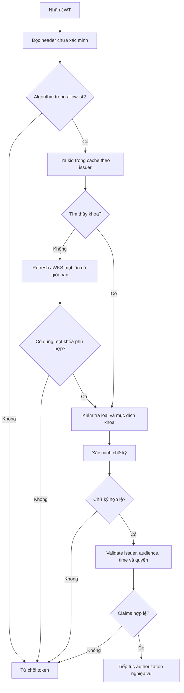

# Key rotation và resolver public key

API thường dùng access token dạng JWT được ký bằng khóa bất đối xứng. Authorization server giữ private key để ký token; resource server dùng public key tương ứng để xác minh chữ ký. Cách làm này giúp nhiều API xác minh token mà không cần chia sẻ bí mật ký. Tuy nhiên, khóa có thể hết hạn, cần thay định kỳ, bị lộ hoặc phải thu hồi khẩn cấp. Nếu các service không nhận biết khóa mới đúng lúc, token hợp lệ sẽ bị từ chối; nếu tiếp tục tin khóa cũ sau khi khóa bị lộ, kẻ tấn công có thể giả mạo token.

**Key rotation** là quy trình thay khóa ký theo kế hoạch hoặc khi có sự cố. **Public key resolver** là thành phần tìm và cung cấp đúng public key cho bộ xác minh chữ ký, thường dựa trên `kid` trong JWT và bộ khóa công khai JWKS của issuer. Hai thành phần phải phối hợp để hệ thống chuyển khóa an toàn, không gián đoạn ngoài dự kiến và có thể phản ứng khi khóa bị xâm phạm.

Trong API Security, resolver chỉ được tin nguồn khóa đã cấu hình cho issuer tin cậy; `kid` chỉ là gợi ý chọn khóa, không phải bằng chứng token hợp lệ. Sau khi tìm được public key và xác minh chữ ký, resource server vẫn phải kiểm tra issuer, audience, thời hạn, loại token, scope và authorization trên tài nguyên.

## 1. Khóa bất đối xứng và vai trò của public key

Với chữ ký số bất đối xứng, hai khóa có quan hệ toán học:

- **Private key:** dùng để ký JWT. Phải được giữ bí mật và chỉ workload ký được phép sử dụng.
- **Public key:** dùng để xác minh chữ ký. Có thể phân phối cho resource server qua một kênh tin cậy mà không tiết lộ khả năng ký.

Ví dụ với RS256, issuer ký bằng private RSA key và API xác minh bằng public RSA key. Với ES256 hoặc EdDSA, cơ chế tương ứng sử dụng khóa elliptic-curve hoặc Ed25519 nếu thư viện và hạ tầng hỗ trợ. Việc chọn thuật toán cần dựa trên chuẩn, khả năng tương thích, yêu cầu hiệu năng và chính sách mật mã của tổ chức.

Không được công bố private key trong JWKS. Một RSA public JWK thường chứa `kty`, `kid`, `n`, `e`; private JWK còn có thành phần bí mật như `d`, `p`, `q` và các giá trị liên quan. Với EC, public key gồm đường cong và tọa độ công khai; private scalar không được xuất bản.

### 1.1. Vì sao không chia sẻ private key cho mọi API?

Nếu nhiều resource server cùng giữ private signing key, một API bị xâm nhập có thể bị dùng để ký token giả mạo cho toàn hệ thống. Khi chỉ issuer giữ private key, các API chỉ cần public key để xác minh và không có khả năng phát hành token mới.

Mô hình này giảm phạm vi ảnh hưởng của một resource server bị xâm nhập. Private key nên được lưu trong KMS/HSM hoặc dịch vụ quản lý khóa tương đương; quyền ký được cấp cho đúng workload và được audit.

### 1.2. Phân biệt khóa ký JWT với khóa TLS

Khóa ký JWT và khóa chứng thư TLS phục vụ mục đích khác nhau. Khóa TLS bảo vệ kênh truyền và xác thực endpoint theo PKI; khóa ký JWT xác minh tính toàn vẹn và nguồn phát hành token theo issuer. Không dùng chung một key pair cho hai mục đích chỉ để giảm số lượng khóa. Cần quản lý vòng đời, quyền truy cập và rotation riêng cho từng loại khóa.

## 2. JWKS và cấu trúc JWK

JWKS (JSON Web Key Set) là một JSON object chứa mảng `keys`, mỗi phần tử là một JWK (JSON Web Key). Issuer thường công bố public JWKS tại một endpoint HTTPS được xác định qua cấu hình tin cậy hoặc metadata discovery của issuer.

Ví dụ JWKS rút gọn với hai public key:

```json
{
  "keys": [
    {
      "kty": "RSA",
      "use": "sig",
      "key_ops": ["verify"],
      "alg": "RS256",
      "kid": "signing-2026-01",
      "n": "base64url-encoded-modulus",
      "e": "AQAB"
    },
    {
      "kty": "RSA",
      "use": "sig",
      "key_ops": ["verify"],
      "alg": "RS256",
      "kid": "signing-2026-02",
      "n": "base64url-encoded-new-modulus",
      "e": "AQAB"
    }
  ]
}
```

Các giá trị modulus trong ví dụ chỉ là placeholder, không phải khóa dùng được. JWKS công khai chỉ chứa material cần để xác minh; không chứa private key hoặc secret khác.

Các thuộc tính quan trọng:

| Thuộc tính | Ý nghĩa | Cách resolver sử dụng |
| --- | --- | --- |
| `kid` | Key ID, định danh một khóa trong phạm vi issuer | Chọn public key tương ứng với JWT header. |
| `kty` | Loại khóa, ví dụ `RSA`, `EC`, `OKP` | Kiểm tra loại khóa phù hợp với thuật toán được phép. |
| `use` | Mục đích sử dụng, thường `sig` cho chữ ký | Chỉ dùng khóa đúng mục đích xác minh chữ ký. |
| `key_ops` | Các thao tác được phép, ví dụ `verify` | Kiểm tra khóa cho phép xác minh. |
| `alg` | Thuật toán gắn với JWK nếu có | Kiểm tra tương thích với allowlist thuật toán. |
| `n`, `e` | Thành phần public của RSA | Dựng RSA public key. |
| `crv`, `x`, `y` | Đường cong và tọa độ public của EC | Dựng EC public key. |

`kid` cần duy nhất trong một JWKS của issuer tại cùng thời điểm. Khi có nhiều issuer, cache key nên gồm issuer và `kid`, không chỉ `kid`, vì hai issuer khác nhau có thể dùng cùng chuỗi ID.

### 2.1. `kid` là gợi ý chọn khóa, không phải bằng chứng tin cậy

JWT header có thể chứa:

```json
{
  "alg": "RS256",
  "typ": "JWT",
  "kid": "signing-2026-02"
}
```

Header này chưa được xác minh trước khi chữ ký hợp lệ. Attacker có thể tự tạo token với `kid` tùy ý, `alg` không phù hợp hoặc các header khác. Resolver chỉ dùng `kid` để tra cứu trong tập khóa đã được lấy từ nguồn tin cậy; nó không được xem `kid` là chứng cứ rằng token do issuer phát hành.

Không lấy URL JWKS từ header JWT như `jku` hoặc `x5u` để tải khóa tùy ý. Nếu chấp nhận URL do token điều khiển, attacker có thể khiến API truy cập máy chủ của họ hoặc endpoint nội bộ, tạo nguy cơ SSRF và xác minh bằng khóa do attacker cung cấp. `jwks_uri` phải đến từ cấu hình issuer tin cậy hoặc discovery metadata đã được xác minh.

## 3. Public key resolver hoạt động như thế nào?

Resolver là phần nối giữa JWT verifier và kho public key. Với JWT có chữ ký, quy trình cơ bản gồm:

1. Chọn issuer theo cấu hình của API. Nếu dùng claim `iss` chưa xác minh làm routing hint, chỉ tra trong allowlist issuer đã đăng ký; không tải metadata từ issuer tùy ý.
2. Đọc header chưa xác minh để lấy `kid` và thuật toán khai báo.
3. Kiểm tra thuật toán thuộc allowlist của issuer/API.
4. Tìm khóa có `kid` tương ứng trong JWKS cache của đúng issuer.
5. Nếu chưa có khóa, thực hiện một lần refresh JWKS có kiểm soát từ `jwks_uri` đã tin cậy.
6. Kiểm tra `kty`, `use`, `key_ops`, `alg`, kích thước khóa hoặc curve theo chính sách.
7. Xác minh chữ ký bằng public key đã chọn.
8. Kiểm tra claims như `iss`, `aud`, `exp`, `nbf`, `iat`, loại token và quyền cần thiết.



Nếu không tìm được khóa hoặc không xác minh được chữ ký, resource server phải từ chối token. Không được bỏ qua xác minh chỉ vì JWKS endpoint đang lỗi.

### 3.1. Nguồn lấy JWKS

Có thể cấu hình `jwks_uri` trực tiếp trong resource server hoặc lấy từ OpenID Connect/OAuth authorization server metadata tại issuer đã biết. Discovery giúp tránh hard-code endpoint khi issuer hỗ trợ chuẩn, nhưng URL metadata và `jwks_uri` vẫn phải được ràng buộc với issuer tin cậy.

Không cho token quyết định host, scheme hoặc port mà resolver sẽ truy cập. Dùng HTTPS, xác minh TLS certificate, giới hạn host theo cấu hình và áp dụng egress policy. Việc này cũng ngăn resolver trở thành một điểm SSRF.

## 4. Cache public key và xử lý `kid` chưa biết

Không nên tải JWKS cho mọi request. Resolver thường cache tập public key và tái sử dụng cho nhiều lần xác minh. Cache giúp giảm latency, giảm tải authorization server và hạn chế phụ thuộc mạng trong đường xử lý request.

Cache cần có chính sách rõ ràng:

- **Cache key:** định danh issuer kết hợp `kid` hoặc cache toàn bộ JWKS theo issuer.
- **TTL:** dựa trên cache header như `Cache-Control: max-age`, `Expires` hoặc chính sách nội bộ có giới hạn.
- **HTTP validator:** hỗ trợ `ETag`/`If-None-Match` hoặc `Last-Modified` nếu issuer cung cấp để giảm tải khi refresh.
- **Refresh coordination:** nhiều request cùng gặp `kid` mới chỉ kích hoạt một lần refresh (single-flight), tránh stampede.
- **Timeout và retry:** đặt timeout, retry có backoff và giới hạn; không retry vô hạn trong request path.
- **Stale policy:** xác định có tiếp tục dùng khóa đã cache khi JWKS endpoint tạm thời không truy cập được hay không, trong giới hạn thời gian và rủi ro đã phê duyệt.
- **Memory bound:** giới hạn kích thước JWKS, số key và cache entry để tránh tiêu thụ tài nguyên bất thường.

### 4.1. Khi gặp `kid` không có trong cache

Một token mới có thể được ký bằng khóa vừa được rotate trong khi resource server chưa refresh JWKS. Resolver nên:

1. Tra cache theo issuer và `kid`.
2. Nếu không thấy, kiểm tra thời gian refresh gần nhất và dùng cơ chế single-flight để refresh JWKS.
3. Sau refresh, tìm lại `kid` và xác minh các thuộc tính khóa.
4. Nếu vẫn không thấy hoặc có nhiều khóa trùng `kid`, từ chối token.

Không refresh JWKS không giới hạn cho mỗi `kid` lạ. Attacker có thể gửi hàng nghìn token với `kid` ngẫu nhiên để gây request storm đến issuer hoặc làm cạn tài nguyên resolver. Cần rate limit refresh theo issuer, cooldown, giới hạn concurrency và ghi nhận metric `unknown_kid`.

### 4.2. Khi JWKS endpoint tạm thời không sẵn sàng

Nếu cache đang có public key đã xác minh trước đó, một số hệ thống có thể tiếp tục xác minh token bằng key cache trong một khoảng stale window đã định nghĩa. Quyết định này cân bằng availability với khả năng thu hồi khóa. Nếu khóa vừa bị xâm phạm, tiếp tục tin cache cũ là nguy hiểm.

Vì vậy, stale policy cần gắn với mức độ nhạy cảm, thời gian sống token và khả năng nhận tín hiệu thu hồi khẩn cấp. Với `kid` chưa từng thấy, không có public key tin cậy để xác minh thì phải từ chối. Không dùng một key mặc định hoặc tự tải key từ nguồn khác để “cứu” request.

## 5. Quy trình key rotation không gián đoạn

Rotation định kỳ cần có giai đoạn overlap để issuer và tất cả resource server chuyển đổi theo trình tự. Giả sử `K_old` đang ký token và `K_new` là khóa kế tiếp.

1. **Tạo khóa mới an toàn.** Sinh `K_new` trong KMS/HSM hoặc key management service. Cấp quyền ký cho issuer, gán `kid` duy nhất và lưu metadata về thuật toán, mục đích, thời điểm tạo và trạng thái.
2. **Công bố public key mới.** Thêm public JWK của `K_new` vào JWKS trong khi `K_old` vẫn còn. Không công bố private material.
3. **Chờ phân phối.** Cho resource server đủ thời gian refresh JWKS và nhận biết `kid` mới. Thời gian chờ cần tính cache TTL, độ trễ phân phối, số region và các consumer ít hoạt động.
4. **Chuyển sang ký bằng khóa mới.** Issuer bắt đầu ký token mới bằng private key `K_new` và đặt `kid` tương ứng trong header. Resource server vẫn giữ `K_old` để xác minh token đã phát hành trước đó.
5. **Duy trì overlap.** Giữ public key cũ trong JWKS ít nhất đến khi mọi token được ký bằng `K_old` đã hết hạn, cộng clock skew và khoảng dự phòng theo chính sách. Nếu token có TTL khác nhau, phải tính theo token có thời hạn dài nhất được phát hành trước khi chuyển khóa.
6. **Gỡ khóa cũ.** Sau khi hết thời gian overlap và xác minh không còn token hợp lệ phụ thuộc `K_old`, loại public JWK cũ khỏi JWKS. Lưu metadata/audit về khóa đã nghỉ theo chính sách quản lý khóa.

Ví dụ timeline:

```text
T0       T1             T2                 T3
|--------|--------------|------------------|
Tạo Knew  Publish Knew   Bắt đầu ký Knew    Hết token Kold
           Kold + Knew   Giữ Kold để verify  Gỡ public Kold
```

`T1` đến `T2` phải đủ dài để các verifier nhận biết khóa mới. `T2` đến `T3` phải bao phủ thời hạn còn lại của token ký bằng khóa cũ. Không gỡ public key cũ ngay khi bắt đầu ký bằng khóa mới, vì token cũ vẫn có thể còn hiệu lực.

### 5.1. Tính thời gian overlap

Giả sử access token có TTL tối đa 10 phút, clock skew cho phép 60 giây và issuer ngừng dùng `K_old` tại thời điểm `T2`. Public key cũ cần được giữ ít nhất đến sau thời điểm phát hành cuối cùng bằng `K_old` cộng 10 phút và 60 giây, cùng khoảng dự phòng vận hành. Nếu có token TTL dài hơn hoặc token được phát hành qua nhiều issuer/region, phải dùng giá trị lớn nhất thực tế.

Không tính overlap chỉ từ thời điểm bắt đầu rotation. Cần biết thời điểm issuer thực sự ngừng ký bằng khóa cũ, cấu hình TTL token ở tất cả luồng và sai lệch đồng hồ giữa các hệ thống.

### 5.2. Rollback khi rotation định kỳ gặp lỗi

Nếu verifier chưa nhận được `K_new`, có thể tạm dừng chuyển signing key hoặc quay lại `K_old` nếu khóa cũ vẫn an toàn và còn được công bố. Không được rollback sang khóa đã bị nghi ngờ xâm phạm. Khi rollback, giữ cả hai public key theo kế hoạch, điều tra cache/distribution và chỉ chuyển lại sau khi các verifier đã sẵn sàng.

## 6. Rotation khẩn cấp khi private key bị lộ

Rotation định kỳ khác với xử lý compromise. Nếu private key bị lộ, cần giả định attacker có thể ký token giả mạo với `kid` tương ứng. Chỉ chờ token cũ hết hạn là không đủ.

Quy trình phản ứng có thể gồm:

1. **Ngừng ký ngay bằng khóa bị ảnh hưởng.** Thu hồi quyền sử dụng key trong KMS/HSM, khóa workload hoặc credential có liên quan.
2. **Tạo và công bố khóa thay thế.** Tạo key mới, publish public JWK và chuyển issuer sang ký bằng key mới.
3. **Từ chối khóa bị compromise.** Gỡ key khỏi JWKS và/hoặc phát tín hiệu denylist theo `issuer + kid` đến các resource server. Nếu cùng public key có thể xuất hiện dưới nhiều `kid`, nên nhận diện thêm bằng thumbprint/fingerprint của key material để tránh alias vượt qua denylist. Việc gỡ khỏi JWKS có thể chưa đủ ngay lập tức vì verifier có thể còn cache.
4. **Làm mới cache.** Kích hoạt cơ chế invalidation hoặc refresh khẩn cấp trên các region, gateway và service; theo dõi xác nhận đã nhận chính sách mới.
5. **Xử lý token đã phát hành.** Cân nhắc TTL ngắn, token introspection, denylist hoặc thu hồi phiên/token family theo khả năng của kiến trúc. Với JWT tự chứa, resource server không tự biết token bị thu hồi nếu không có tín hiệu bổ sung.
6. **Điều tra phạm vi ảnh hưởng.** Xác định thời điểm key có thể bị lộ, token giả mạo đã được sử dụng, API và dữ liệu bị truy cập; thu hồi credential liên quan và ghi audit.

Trong sự cố, ưu tiên từ chối `kid` bị compromise kể cả khi điều đó gây gián đoạn xác thực trong thời gian ngắn. Availability không được dùng làm lý do tiếp tục chấp nhận chữ ký có thể bị giả mạo.

### 6.1. Giới hạn của việc xóa khóa khỏi JWKS

Verifier có thể đang cache public key cũ cho đến khi TTL hết. Vì vậy, gỡ JWK khỏi endpoint không bảo đảm mọi API ngừng tin khóa ngay lập tức. Hệ thống cần có kênh invalidation khẩn cấp, denylist `kid`, TTL cache có giới hạn và quy trình xác nhận các verifier đã cập nhật.

Nếu yêu cầu thu hồi tức thời rất cao, cân nhắc opaque token/introspection hoặc một lớp policy kiểm tra trạng thái token bổ sung. Cần đánh giá độ sẵn sàng và chi phí của dependency này vì nó có thể đưa authorization server vào đường xử lý mỗi request.

## 7. Thuật toán và kiểm tra tính phù hợp của khóa

Resolver không được để JWT header tự quyết định thuật toán một cách không giới hạn. API cần cấu hình allowlist thuật toán, ví dụ chỉ chấp nhận RS256 hoặc ES256 theo chuẩn nội bộ. Không chấp nhận `alg: none`, thuật toán yếu hoặc cách diễn giải nhầm giữa HMAC và chữ ký bất đối xứng.

Khi chọn JWK, kiểm tra:

- `kid` khớp duy nhất trong JWKS của issuer hiện tại.
- `kty` tương thích với thuật toán cho phép.
- `use` là `sig` nếu trường này được cung cấp.
- `key_ops` cho phép `verify` nếu trường này được cung cấp.
- `alg` của JWK, nếu có, khớp với thuật toán đã cấu hình.
- RSA modulus có kích thước đáp ứng chính sách; EC curve được cho phép; key material có định dạng hợp lệ.
- Key không nằm trong danh sách thu hồi/denylist và issuer vẫn được tin cậy.

Sau khi xác minh chữ ký, vẫn cần kiểm tra `iss`, `aud`, `exp`, `nbf`, `iat` và claim bắt buộc. `kid` hợp lệ không thay thế các kiểm tra claims. Không dùng ID token thay access token; resource server cần kiểm tra loại token theo profile được áp dụng.

## 8. Ví dụ cấu hình Spring Security Resource Server

Spring Security Resource Server có thể dùng `NimbusJwtDecoder` với JWKS URI để phân giải public key. Decoder chọn khóa theo `kid` trong JWKS và xác minh chữ ký; ứng dụng cần cấu hình issuer, audience và thuật toán được chấp nhận.

```java
@Configuration
public class JwtResourceServerConfiguration {

    @Bean
    JwtDecoder jwtDecoder() {
        String issuer = "https://identity.example.internal/";
        String jwksUri = "https://identity.example.internal/.well-known/jwks.json";
        String audience = "https://orders-api.example.internal";

        NimbusJwtDecoder decoder = NimbusJwtDecoder
            .withJwkSetUri(jwksUri)
            .jwsAlgorithm(SignatureAlgorithm.RS256)
            .build();

        OAuth2TokenValidator<Jwt> issuerAndTime =
            JwtValidators.createDefaultWithIssuer(issuer);

        OAuth2TokenValidator<Jwt> audienceValidator = token ->
            token.getAudience().contains(audience)
                ? OAuth2TokenValidatorResult.success()
                : OAuth2TokenValidatorResult.failure(
                    new OAuth2Error("invalid_token", "Invalid audience", null));

        decoder.setJwtValidator(new DelegatingOAuth2TokenValidator<>(
            issuerAndTime, audienceValidator));

        return decoder;
    }
}
```

Đây là ví dụ cấu hình rút gọn; cần điều chỉnh package/import, phiên bản Spring Security, thuật toán và claim theo issuer thực tế. `jwksUri` phải là URL tin cậy được cấu hình từ trước, không lấy từ JWT header. Với nhiều issuer, nên ánh xạ issuer sang decoder và JWKS URI đã đăng ký thay vì tải metadata từ issuer tùy ý.

`JwtValidators.createDefaultWithIssuer` hỗ trợ kiểm tra issuer và các validator mặc định của framework; cần xác minh hành vi cụ thể theo phiên bản đang dùng. Nếu hệ thống yêu cầu `typ`, `client_id`, token use hoặc claim khác, hãy thêm validator tương ứng. Cấu hình audience phải khớp chính xác định danh resource server.

### 8.1. Spring Security xử lý rotation như thế nào?

Khi issuer publish cả `K_old` và `K_new`, decoder có thể lấy JWKS mới và dùng `kid` để chọn public key tương ứng. Khi issuer bắt đầu ký bằng `K_new`, verifier phải có khả năng lấy được JWK đó. Trong giai đoạn overlap, token cũ vẫn được xác minh bằng `K_old`.

Chi tiết cache, refresh, timeout và cách xử lý unknown `kid` phụ thuộc phiên bản Spring Security/Nimbus và cấu hình HTTP/JWK source. Cần kiểm tra hành vi thư viện đang dùng, đặt timeout/cache policy rõ ràng và kiểm thử tình huống rotation; không giả định mọi phiên bản đều refresh hoặc invalidate cache theo cùng cách.

## 9. Vận hành key lifecycle

Mỗi key nên có metadata và trạng thái vòng đời rõ ràng:

| Trạng thái | Ý nghĩa | Hành động |
| --- | --- | --- |
| `GENERATED` | Key vừa được tạo | Chưa dùng ký; kiểm tra metadata và quyền. |
| `PUBLISHED` | Public key đã có trong JWKS | Chờ verifier nhận key. |
| `ACTIVE` | Private key đang được issuer dùng ký | Theo dõi hoạt động ký và quyền KMS/HSM. |
| `RETIRING` | Ngừng ký mới nhưng public key vẫn cần xác minh token cũ | Giữ trong JWKS trong thời gian overlap. |
| `RETIRED` | Hết thời gian xác minh hợp lệ | Gỡ khỏi JWKS theo kế hoạch và lưu audit metadata. |
| `REVOKED` | Key bị thu hồi do compromise hoặc vi phạm policy | Chặn sử dụng, phát tín hiệu thu hồi và điều tra. |

Không nhầm `RETIRED` với `REVOKED`: key retired có thể vẫn cần để xác minh token đã phát hành hợp lệ; key revoked phải bị từ chối theo chính sách sự cố.

Một quy trình quản lý khóa tốt cần có:

- Inventory issuer, key ID, thuật toán, mục đích, owner, ngày tạo, ngày active và ngày dự kiến retire.
- KMS/HSM policy giới hạn ai hoặc workload nào được ký, export, rotate hoặc revoke.
- Audit cho thao tác tạo, activate, deactivate, export và delete key.
- Lịch rotation định kỳ, cảnh báo key sắp hết hạn và diễn tập emergency rotation.
- Tách key theo môi trường, issuer và mục đích; không tái sử dụng private key giữa dev, staging và production.
- Quy trình backup/recovery phù hợp với KMS/HSM; bảo vệ bản backup và quyền khôi phục.
- Kiểm soát quyền thay đổi JWKS và metadata discovery để attacker không thể thay public key tin cậy.

## 10. Các lỗi thường gặp khi triển khai resolver và rotation

- **Chỉ publish key mới sau khi đã ký token bằng key mới:** verifier chưa có public key và sẽ từ chối token.
- **Gỡ key cũ ngay khi chuyển signing:** token cũ còn hạn không thể xác minh.
- **Giữ key cũ mãi mãi:** tăng bề mặt tin cậy và làm khó xử lý khi key bị compromise.
- **Không kiểm tra issuer trong cache key:** có thể dùng nhầm key giữa hai issuer.
- **Chấp nhận `jku` hoặc `x5u` từ token:** tạo nguy cơ SSRF và cho attacker cung cấp key xác minh.
- **Refresh JWKS trên mọi unknown `kid`:** dễ bị lợi dụng gây request storm.
- **Không giới hạn thuật toán:** có nguy cơ algorithm confusion hoặc chấp nhận thuật toán không mong muốn.
- **Chỉ xóa key khỏi JWKS khi key bị lộ:** verifier đang cache vẫn có thể chấp nhận chữ ký giả.
- **Đưa private key vào JWKS hoặc repository:** làm mất hoàn toàn tính bảo mật của signing key.
- **Không kiểm thử cache và nhiều region:** một số API có thể nhận key mới, một số khác vẫn dùng key cũ.
- **Nhầm rotate client secret với rotate JWT signing key:** hai loại credential có phạm vi và cơ chế phân phối khác nhau.

## 11. Kiểm thử key rotation và public key resolver

Kiểm thử cần bao phủ cả giai đoạn bình thường, overlap, key mới, key cũ và tình huống compromise.

| Kịch bản | Điều kiện | Kết quả mong đợi |
| --- | --- | --- |
| Key đang active | JWT ký bằng `K_old`, `kid` có trong JWKS | Xác minh thành công nếu claims hợp lệ. |
| Key mới được publish | JWKS chứa cả `K_old` và `K_new` | Verifier nhận được cả hai key. |
| Chuyển signing | JWT mới có `kid=K_new` | Verifier refresh/chọn đúng public key và xác minh thành công. |
| Token cũ còn hạn | JWT ký bằng `K_old` trong overlap | Vẫn xác minh thành công. |
| Token cũ hết hạn | JWT ký bằng `K_old` đã hết `exp` | Bị từ chối dù public key cũ vẫn còn. |
| Gỡ key cũ đúng hạn | JWKS chỉ còn key đang được dùng | Token mới hoạt động; token cũ không còn được chấp nhận theo thời hạn. |
| Unknown `kid` | Token chứa ID không có trong JWKS | Refresh có giới hạn rồi từ chối nếu vẫn không tìm thấy. |
| Duplicate `kid` | JWKS có nhiều key cùng ID trong một issuer | Từ chối lựa chọn mơ hồ và phát cảnh báo. |
| Sai algorithm/key type | Header hoặc JWK không khớp allowlist | Từ chối token. |
| Header có `jku` độc hại | URL trỏ đến host ngoài cấu hình | Resolver bỏ qua header URL và không thực hiện request đến host đó. |
| JWKS outage | Cache có key hợp lệ đã tải trước đó | Hành vi theo stale policy; không chấp nhận key mới chưa xác minh. |
| Emergency revoke | `kid` bị compromise được denylist | Từ chối token ngay khi verifier nhận tín hiệu thu hồi. |
| Nhiều region | Cache ở các region có thời điểm refresh khác nhau | Phân phối và xác nhận rotation theo SLA đã định nghĩa. |
| Issuer collision | Hai issuer dùng cùng `kid` | Mỗi issuer chỉ tra key trong JWKS của chính nó. |

Nên có integration test với JWKS test server cho phép thay đổi bộ khóa, cache header, timeout, response `304`, key bị gỡ và unknown `kid`. Test cần xác minh không chỉ status HTTP mà còn số lần refresh, side effect mạng, thời gian cache và khả năng từ chối token bị thu hồi.

## 12. Monitoring và xử lý sự cố khóa

Theo dõi tối thiểu:

- Thời điểm key được tạo, publish, activate, retire và revoke.
- Số lượng JWT được xác minh theo `issuer` và `kid` ở dạng an toàn.
- JWKS cache hit/miss, refresh success/failure, refresh latency và tuổi dữ liệu cache.
- Số token có unknown `kid`, duplicate `kid`, sai thuật toán hoặc sai key type.
- Signature validation failure theo issuer, route và client; tránh log token nguyên vẹn.
- Trạng thái phân phối key giữa các region/resource server.
- Key sắp đến hạn rotation hoặc certificate/key metadata có bất thường.

Khi phát hiện unknown `kid` tăng đột biến, cần phân biệt rotation hợp lệ, cấu hình issuer sai và hành vi dò tìm. Khi phát hiện private key compromise, kích hoạt quy trình emergency rotation, denylist `kid`, làm mới cache và rà soát token đã được chấp nhận trong khoảng thời gian nghi ngờ.

Không ghi JWT đầy đủ, private key, client secret hoặc dữ liệu nhạy cảm vào log. Có thể ghi `issuer` đã chuẩn hóa, `kid`, reason code, correlation ID và metadata thời gian để điều tra.

## 13. Checklist thiết kế key rotation và resolver

- [ ] Private signing key chỉ nằm trong KMS/HSM hoặc vùng lưu trữ được bảo vệ; resource server chỉ nhận public key.
- [ ] JWKS chỉ công bố public JWK và mỗi `kid` duy nhất trong issuer.
- [ ] `jwks_uri` được lấy từ cấu hình/discovery tin cậy; issuer routing dùng allowlist, không từ JWT header.
- [ ] Resolver cache theo issuer, có TTL, timeout, refresh coordination và giới hạn memory.
- [ ] Unknown `kid` chỉ kích hoạt refresh có giới hạn; nếu vẫn không thấy thì từ chối token.
- [ ] Kiểm tra allowlist thuật toán, `kty`, `use`, `key_ops`, kích thước khóa và curve.
- [ ] Validate chữ ký trước khi tin claims; tiếp tục kiểm tra issuer, audience, thời hạn và loại token.
- [ ] Publish public key mới trước khi bắt đầu ký bằng private key mới.
- [ ] Giữ public key cũ đến khi token cũ hết hạn cộng clock skew và khoảng dự phòng.
- [ ] Có quy trình rollback an toàn cho rotation định kỳ và quy trình revoke khẩn cấp riêng.
- [ ] Có cơ chế cache invalidation/denylist theo issuer và key ID (hoặc thumbprint khi cần) để xử lý key compromise trên mọi region.
- [ ] Có test cho overlap, unknown `kid`, JWKS outage, duplicate key, sai thuật toán và emergency revoke.
- [ ] Có inventory, owner, lịch rotation, audit và cảnh báo key lifecycle.
- [ ] Log/metric đủ điều tra nhưng không chứa token hoặc private material.

Key rotation và public key resolver là một phần của vòng đời token, không chỉ là thao tác thay file khóa. Khi public key được phân phối trước khi sử dụng, resolver chọn khóa từ issuer tin cậy, cache được kiểm soát và khóa cũ chỉ bị gỡ sau thời gian phù hợp, hệ thống có thể chuyển đổi bình thường mà vẫn xác minh token đúng. Khi khóa bị lộ, cơ chế denylist, cache invalidation và emergency rotation giúp ngăn resource server tiếp tục tin chữ ký có thể bị giả mạo.
