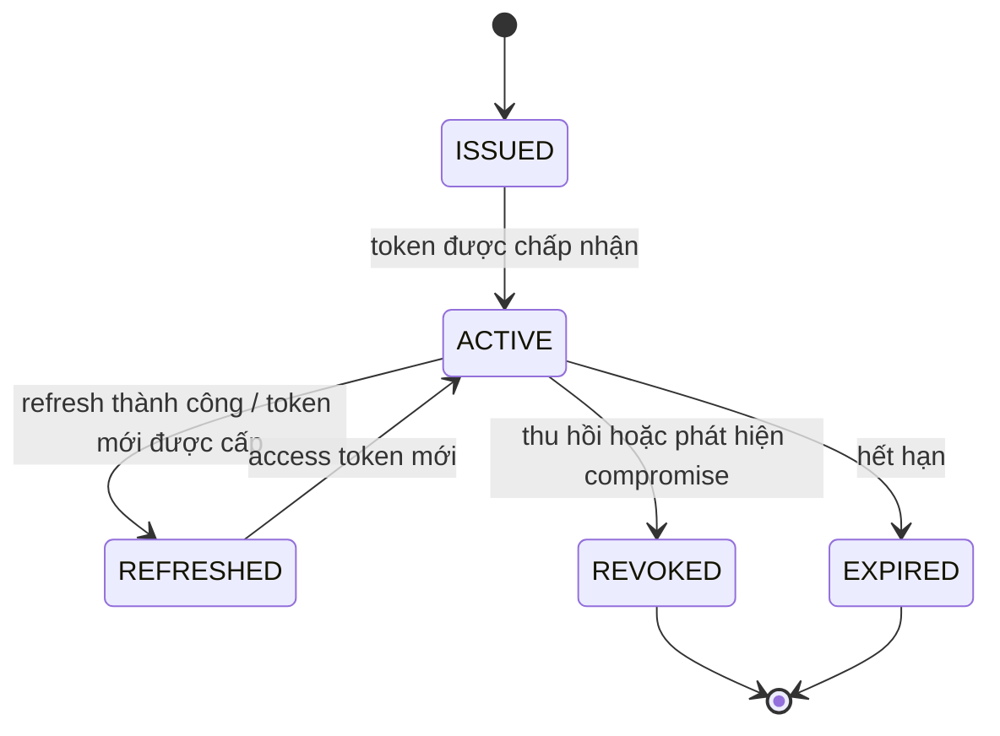
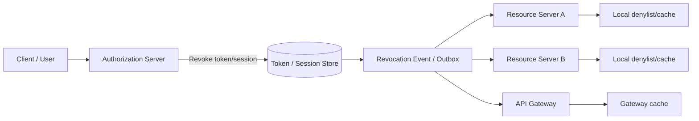

# Revocation, introspection và logout

Một access token được phát hành hợp lệ không nên được tin vô thời hạn. Người dùng có thể đăng xuất, tài khoản có thể bị khóa, refresh token có thể bị đánh cắp, quyền truy cập có thể thay đổi hoặc một thiết bị có thể bị mất. Hệ thống cần cách làm cho credential không còn được chấp nhận và cách để API biết token hiện tại còn hiệu lực hay không.

Ba cơ chế thường được dùng là **revocation**, **introspection** và **logout**:

- **Revocation** yêu cầu authorization server thu hồi token hoặc credential liên quan.
- **Introspection** cho resource server hỏi authorization server về trạng thái hiện tại của token.
- **Logout** kết thúc phiên đăng nhập ở ứng dụng hoặc Identity Provider (OP), đồng thời có thể kích hoạt thu hồi token tùy kiến trúc.

Chúng liên quan nhưng không đồng nghĩa. Xóa cookie ở trình duyệt không tự thu hồi access token; thu hồi refresh token không nhất thiết làm JWT access token đang lưu ở client mất hiệu lực ngay; introspection chỉ có tác dụng nếu API thực sự gọi và xử lý kết quả đúng cách.

## 1. Vì sao cần revocation, introspection và logout?

Token thường được cấp để client gọi API mà không phải xác thực lại ở mỗi request. Cơ chế này thuận tiện và có thể mở rộng tốt, nhưng tạo ra một câu hỏi vận hành: nếu token bị lộ hoặc quyền thay đổi trước khi token hết hạn, làm sao hệ thống ngừng chấp nhận nó?

Các tình huống thường gặp:

- Người dùng nhấn **Đăng xuất** trên thiết bị dùng chung.
- Nhân viên rời tổ chức hoặc tài khoản bị quản trị viên vô hiệu hóa.
- Người dùng đổi mật khẩu hoặc thay đổi phương thức xác thực sau một sự cố.
- Refresh token bị đánh cắp và có dấu hiệu được sử dụng từ thiết bị khác.
- API key hoặc client credential bị lộ.
- Role, scope hoặc quyền trên tenant bị thu hồi.
- Một phiên đăng nhập cần bị chấm dứt trên tất cả thiết bị.
- Một service cần xác minh token opaque còn active trước khi phục vụ request nhạy cảm.

Nếu hệ thống chỉ dựa vào `exp` của access token, token đã phát hành có thể tiếp tục được chấp nhận đến khi hết hạn, kể cả khi người dùng đã logout hoặc tài khoản đã bị khóa. Đó là một trade-off có thể chấp nhận trong một số hệ thống rủi ro thấp, nhưng cần được quyết định rõ.

### 1.1. Phân biệt ba cơ chế

| Cơ chế | Ai thực hiện? | Mục đích | Ví dụ |
|---|---|---|---|
| Revocation | Client yêu cầu authorization server; authorization server thay đổi trạng thái token | Làm token hoặc token family không còn được chấp nhận | Thu hồi refresh token bị lộ |
| Introspection | Resource server gọi authorization server | Kiểm tra trạng thái và metadata của token | API hỏi token opaque còn `active` không |
| Logout | User, RP/client hoặc OP khởi tạo theo giao thức | Kết thúc phiên đăng nhập và cập nhật trạng thái phiên | Xóa session local, chuyển tới OIDC end-session endpoint |

Một quy trình logout tốt có thể gọi revocation, nhưng không phải mọi logout đều thu hồi mọi token ở mọi hệ thống. Một token có thể được xác minh offline mà không có trạng thái tập trung; khi đó cần cơ chế khác nếu muốn thu hồi trước `exp`.

## 2. Vòng đời token và các trạng thái cần quản lý

Token thường trải qua các giai đoạn: cấp phát, sử dụng, làm mới, thu hồi và hết hạn. Refresh token và access token có vai trò khác nhau nên trạng thái của chúng cũng cần được quản lý riêng.



Sơ đồ đơn giản hóa; trong thực tế refresh token rotation có thể tạo một token family với nhiều phiên bản. Một token cũ có thể chuyển sang trạng thái đã dùng (consumed) thay vì chỉ `REVOKED`, và việc tái sử dụng token cũ có thể kích hoạt thu hồi cả family.

### 2.1. Access token

Access token được gửi tới resource server để truy cập API. Nó thường có thời hạn ngắn hơn refresh token và được giới hạn bằng audience, scope hoặc permission. Access token có thể là:

- **JWT/self-contained token:** resource server có thể xác minh chữ ký và claims offline mà không hỏi authorization server ở mỗi request.
- **Opaque/reference token:** chuỗi không mang claims có thể đọc trực tiếp; resource server thường dùng introspection hoặc cơ chế tra cứu trạng thái để xác minh.

JWT giúp giảm phụ thuộc mạng trong đường request nhưng khó thu hồi tức thời nếu resource server chỉ xác minh chữ ký và thời hạn. Opaque token dễ quản lý trạng thái tập trung hơn nhưng introspection tạo thêm dependency, latency và yêu cầu availability.

### 2.2. Refresh token

Refresh token dùng để xin access token mới, thường không gửi tới resource API. Nó có giá trị cao vì ai sở hữu refresh token có thể tiếp tục lấy access token trong phạm vi được cấp.

Refresh token cần được bảo vệ chặt hơn access token:

- Chỉ gửi tới token endpoint của authorization server qua TLS.
- Gắn với client, user/session và scope/resource policy phù hợp.
- Có thời hạn idle và absolute hoặc chính sách vòng đời tương đương.
- Dùng rotation và reuse detection cho public client khi hỗ trợ.
- Có khả năng thu hồi một token hoặc cả token family.
- Không ghi token vào log, URL, analytics hoặc error report.

### 2.3. Session của ứng dụng và session tại Identity Provider

Một hệ thống OIDC thường có ít nhất hai trạng thái phiên:

- **RP session:** session của ứng dụng relying party, ví dụ cookie đăng nhập tại `shop.example`.
- **OP session:** session đăng nhập tại OpenID Provider/Identity Provider, ví dụ phiên SSO tại `identity.example`.

Đóng RP session không nhất thiết đóng OP session. Người dùng có thể logout khỏi một ứng dụng nhưng vẫn đăng nhập tại IdP và các ứng dụng khác. Ngược lại, OP session có thể bị kết thúc nhưng một RP vẫn giữ local session nếu không nhận hoặc không xử lý thông báo logout.

## 3. Revocation theo RFC 7009

OAuth 2.0 Token Revocation (RFC 7009) định nghĩa endpoint để client yêu cầu authorization server thu hồi token. Endpoint thường được công bố qua metadata của authorization server hoặc tài liệu triển khai.

Ví dụ request:

```http
POST /oauth2/revoke HTTP/1.1
Host: identity.example.com
Authorization: Basic <client-credentials>
Content-Type: application/x-www-form-urlencoded

token=<token-value>&token_type_hint=refresh_token
```

`token_type_hint` là gợi ý loại token, ví dụ `access_token` hoặc `refresh_token`; authorization server không được dựa vào hint như bằng chứng chắc chắn về loại token. Client authentication phụ thuộc loại client và policy của authorization server. Không đưa token vào query string vì URL thường bị lưu trong log và hệ thống trung gian.

### 3.1. Endpoint revocation làm gì?

Khi nhận request, authorization server cần:

1. Xác thực client theo cơ chế được cấu hình nếu endpoint yêu cầu.
2. Kiểm tra request và token parameter.
3. Xác định token thuộc client/user/session nào và có thể thu hồi theo quyền của caller không.
4. Đánh dấu token hoặc trạng thái liên quan là revoked/inactive.
5. Áp dụng chính sách với token liên quan, ví dụ refresh token family hoặc grant.
6. Ghi audit event cần thiết mà không lưu token nguyên văn.

Theo RFC 7009, response thành công `200 OK` được trả về cả khi token đã bị thu hồi trước đó hoặc token không hợp lệ/không được nhận diện. Điều này giúp endpoint idempotent và tránh tạo oracle cho phép caller dò token có tồn tại hay không. Lỗi client authentication hoặc request không hợp lệ vẫn có thể trả lỗi theo giao thức.

Ví dụ response:

```http
HTTP/1.1 200 OK
Content-Length: 0
```

Client không nên diễn giải `200` là bằng chứng token chắc chắn đã tồn tại. Nó có nghĩa authorization server đã xử lý yêu cầu theo semantics của revocation endpoint.

### 3.2. Thu hồi access token và refresh token

Khi thu hồi refresh token, authorization server có thể cần vô hiệu hóa token family hoặc grant liên quan theo chính sách. Việc thu hồi refresh token ngăn client lấy access token mới, nhưng access token đã phát hành có thể vẫn còn hiệu lực cho tới `exp` nếu resource server xác minh offline.

RFC 7009 quy định thêm quan hệ giữa các token cùng authorization grant: khi thu hồi refresh token, authorization server **SHOULD** thu hồi các access token được cấp dựa trên cùng grant nếu server hỗ trợ thu hồi access token. Khi thu hồi access token, server **MAY** thu hồi refresh token liên quan. Cách triển khai cụ thể vẫn cần được kiểm tra vì resource server xác minh JWT offline có thể không nhận ra trạng thái mới nếu không có introspection, denylist hoặc cơ chế state check.

Khi thu hồi access token opaque, resource server có thể phát hiện trạng thái inactive qua introspection hoặc trạng thái server-side. Với JWT access token, kết quả phụ thuộc cách resource server kiểm tra revocation: nếu chỉ verify chữ ký và `exp`, nó không tự biết token đã bị thu hồi.

Do đó, khi thiết kế logout hoặc incident response, cần nói rõ “thu hồi token” bao gồm những loại nào và API nhận biết thay đổi trong bao lâu.

### 3.3. Thu hồi token family

Với refresh token rotation, mỗi lần refresh thành công server cấp refresh token mới và đánh dấu token cũ đã dùng. Các token này liên kết thành một family/session. Nếu token cũ xuất hiện lần nữa, có thể là dấu hiệu token bị sao chép và sử dụng đồng thời.

Một policy thường dùng là thu hồi toàn bộ family khi phát hiện reuse. Điều này có thể làm user phải đăng nhập lại trên thiết bị tương ứng, nhưng giảm khả năng attacker tiếp tục refresh. Cần lưu quan hệ family, trạng thái token đã dùng và sự kiện reuse một cách an toàn.

Không phải mọi lần refresh thất bại đều chứng minh compromise. Client có thể retry do timeout và vô tình gửi lại token đã rotate. Hệ thống cần thiết kế idempotency/grace behavior cẩn thận, nhưng không được mở một cửa sổ reuse quá rộng làm mất ý nghĩa rotation.

## 4. Introspection theo RFC 7662

OAuth 2.0 Token Introspection (RFC 7662) cho phép resource server hỏi authorization server về trạng thái hiện tại của token. Đây là lựa chọn phổ biến với opaque/reference token, nhưng cũng có thể dùng cho JWT nếu kiến trúc muốn kiểm tra trạng thái tập trung.

Ví dụ request:

```http
POST /oauth2/introspect HTTP/1.1
Host: identity.example.com
Authorization: Basic <resource-server-credentials>
Content-Type: application/x-www-form-urlencoded

token=<token-value>&token_type_hint=access_token
```

Introspection endpoint thường yêu cầu xác thực resource server/client để tránh cho bất kỳ caller nào tra cứu trạng thái token. Authorization server trả metadata của token theo quyền và profile đã định nghĩa.

### 4.1. Response `active`

Ví dụ token đang active:

```json
{
  "active": true,
  "scope": "orders.read orders.write",
  "client_id": "web-store",
  "username": "user-42",
  "token_type": "Bearer",
  "exp": 1795005000,
  "iat": 1795001400,
  "sub": "user-42",
  "aud": ["orders-api"],
  "iss": "https://identity.example.com"
}
```

Ví dụ token không active:

```json
{
  "active": false
}
```

Resource server chỉ được tin metadata sau khi gọi introspection endpoint đã xác thực qua kênh an toàn và kiểm tra response theo hợp đồng. `active: true` không tự cấp quyền trên mọi object; API vẫn cần kiểm tra audience, scope, permission, tenant và object authorization theo policy.

### 4.2. Khi nào token được xem là active?

Authorization server quyết định trạng thái active dựa trên chính sách và dữ liệu quản lý token. Có thể bao gồm token đã được phát hành, chưa hết hạn, chưa bị thu hồi, thuộc client/grant hợp lệ và đáp ứng các điều kiện cần thiết.

Resource server cần kiểm tra các thuộc tính có liên quan đến API, chẳng hạn:

- `active` phải là `true`.
- `aud` phù hợp với resource server hoặc API hiện tại nếu profile cung cấp.
- `iss` là issuer được tin cậy.
- `exp` chưa qua thời hạn nếu được trả về.
- `scope` hoặc permission đáp ứng action đang yêu cầu.
- `client_id`/`sub` phù hợp với loại principal và chính sách.

Không nên giả định mọi authorization server trả đầy đủ cùng một tập claim. Hãy thống nhất profile introspection giữa issuer và resource server.

### 4.3. Introspection và cache

Gọi introspection ở mỗi request giúp trạng thái thu hồi có thể được phản ánh nhanh hơn, nhưng tạo thêm network call và phụ thuộc vào authorization server. Nhiều hệ thống cache kết quả introspection trong một khoảng thời gian ngắn.

TTL cache tạo ra trade-off:

- TTL dài giảm tải và latency nhưng token bị thu hồi có thể tiếp tục được chấp nhận trong khoảng TTL.
- TTL ngắn giúp phát hiện revocation nhanh hơn nhưng tăng tải và độ nhạy với outage.
- Không cache lâu hơn thời hạn token còn lại.
- Có thể cần invalidate cache qua event khi token/session bị thu hồi.
- Cache key cần dùng fingerprint an toàn của token hoặc cơ chế nội bộ phù hợp; không đưa token nguyên văn vào log hoặc metric.

Ví dụ, nếu introspection cache có TTL 60 giây, một token bị thu hồi ngay sau lần cache active có thể vẫn được chấp nhận tối đa gần 60 giây, tùy cách hệ thống làm mới và invalidation. Đây phải là một giới hạn rủi ro được chấp nhận rõ ràng, không phải một chi tiết bị bỏ qua.

### 4.4. Introspection endpoint bị lỗi

Nếu authorization server không phản hồi, resource server phải có chính sách failure rõ ràng. Với API nhạy cảm, thường nên fail closed: không có kết quả xác minh mới thì từ chối hoặc tạm thời không phục vụ request. Một số hệ thống có thể dùng kết quả cache còn trong TTL đã định nghĩa; không được tự chuyển sang tin token chưa xác minh.

Nên áp dụng timeout, circuit breaker, connection pool giới hạn và monitoring. Introspection endpoint là dependency bảo mật quan trọng; nếu không thiết kế năng lực và HA phù hợp, nó có thể trở thành bottleneck cho toàn bộ API.

## 5. JWT revocation và các lựa chọn thiết kế

JWT access token có thể được xác minh offline bằng chữ ký và claims. Đây là ưu điểm về hiệu năng và khả năng hoạt động độc lập, nhưng token self-contained không tự biết trạng thái thu hồi mới nhất.

Các lựa chọn thường gặp:

| Cách làm | Cách hoạt động | Trade-off |
|---|---|---|
| Access token ngắn hạn | Chờ token hết hạn; refresh token bị thu hồi để ngăn cấp token mới | Đơn giản, nhưng không thu hồi tức thời |
| Introspection | API hỏi authorization server về trạng thái token | Tập trung, có thêm latency và dependency |
| Denylist theo `jti` | API kiểm tra token ID có nằm trong danh sách thu hồi không | Thu hồi chọn lọc, cần store/cache phân tán và TTL |
| Token/session version | So sánh version trong token với version hiện tại của user/session | Thu hồi theo user/session, cần truy cập trạng thái |
| Signing key rotation | Loại bỏ một signing key để vô hiệu hóa mọi token ký bằng key đó | Phạm vi ảnh hưởng rộng, không phù hợp thu hồi một token riêng lẻ |

### 5.1. Short-lived access token

Một thiết kế phổ biến là access token sống ngắn, refresh token được bảo vệ và có thể thu hồi. Khi logout, client xóa access token khỏi nơi lưu, server thu hồi refresh token/session. Access token đã cấp có thể tiếp tục hoạt động đến `exp` nếu resource server không kiểm tra trạng thái tập trung.

Thời hạn cần cân bằng giữa rủi ro và trải nghiệm. Token quá dài tăng cửa sổ bị lợi dụng; token quá ngắn có thể làm tăng refresh traffic và phụ thuộc IdP. Không có một giá trị TTL phù hợp cho mọi ứng dụng.

### 5.2. Denylist theo `jti`

Nếu JWT có claim `jti` duy nhất, authorization server có thể phát sự kiện thu hồi để resource server thêm `jti` vào denylist. API kiểm tra denylist sau khi verify chữ ký và claims.

Các lưu ý:

- Chỉ tin `jti` sau khi token đã được xác minh.
- Denylist entry cần tồn tại ít nhất đến thời điểm token hết hạn.
- Dùng storage phân tán và cơ chế invalidation nhất quán giữa các instance.
- Không ghi raw token làm key; dùng identifier/fingerprint phù hợp.
- Có kế hoạch khi denylist store lỗi hoặc không truy cập được.

Denylist giúp thu hồi một token cụ thể nhưng tạo một lookup trạng thái trên đường request, làm giảm phần nào lợi thế offline của JWT.

### 5.3. Token version hoặc session version

Một user/session có thể có `tokenVersion` hoặc `sessionVersion`. Token chứa version tại thời điểm cấp; API so sánh với version hiện tại trong store. Khi logout all sessions, đổi password hoặc khóa tài khoản, server tăng version để token cũ không còn khớp.

Cách này hữu ích khi cần thu hồi nhiều token theo user/session, nhưng đòi hỏi cache hoặc database lookup. Nếu version được cache lâu, revocation cũng bị trễ tương ứng. Cần xác định version áp dụng toàn user, từng session hay từng client.

### 5.4. Không dùng signing key rotation để thu hồi một token thông thường

Xoay hoặc loại bỏ signing key có thể làm nhiều JWT bị từ chối cùng lúc. Đây là biện pháp khẩn cấp khi private signing key bị lộ hoặc cần ngừng tin một key, không phải lựa chọn mặc định để logout một user. Nó có thể làm gián đoạn mọi client và service đang sử dụng token ký bằng key đó.

## 6. Logout ở ứng dụng: kết thúc local session

Trong ứng dụng web dùng session cookie, logout cần vô hiệu hóa session phía server và xóa cookie phía client. Chỉ xóa cookie trên trình duyệt là chưa đủ nếu session ID bị sao chép hoặc attacker đã có bản sao.

Một luồng logout local:

1. Xác thực session hiện tại.
2. Đánh dấu session ID hoặc session record là revoked/invalid trong session store.
3. Thu hồi refresh token hoặc token family gắn với session nếu kiến trúc sử dụng.
4. Xóa cookie bằng `Set-Cookie` với cùng tên, path và domain phù hợp, đồng thời giữ các thuộc tính bảo mật.
5. Hủy cache/session state liên quan và ghi audit event.
6. Chuyển user tới trang đã logout hoặc trả response phù hợp.

Ví dụ:

```http
Set-Cookie: __Host-session=; Path=/; Max-Age=0; Secure; HttpOnly; SameSite=Lax
```

Cookie cần được xóa với thuộc tính phù hợp với cookie ban đầu. Nếu session được lưu trong Redis hoặc database, cần xóa/đánh dấu trạng thái phía server để cookie cũ không còn dùng được.

### 6.1. Logout và CSRF

Nếu logout endpoint dùng cookie tự động gửi, hãy xem xét CSRF và các request cross-site không mong muốn. Logout CSRF thường ít nghiêm trọng hơn hành động tài chính, nhưng có thể gây gián đoạn hoặc tạo điều kiện cho phishing. Với các thao tác thay đổi trạng thái phiên hoặc token, áp dụng chính sách CSRF phù hợp với kiến trúc cookie/session.

Logout endpoint nên dùng semantics rõ ràng và idempotent: gọi nhiều lần không tạo lỗi bảo mật hoặc khôi phục session. Không nên dùng `GET` để thực hiện thao tác logout nếu có thể tránh, vì prefetch/crawler có thể kích hoạt request GET ngoài ý muốn.

## 7. Logout với OpenID Connect

Trong OIDC, ứng dụng thường là Relying Party (RP), còn Identity Provider là OpenID Provider (OP). RP-Initiated Logout cho phép RP chuyển user tới endpoint logout của OP để kết thúc hoặc yêu cầu kết thúc OP session.

### 7.1. RP-Initiated Logout

RP có thể lấy `end_session_endpoint` từ OpenID Provider metadata. Request logout có thể chứa:

- `id_token_hint`: ID token gần đây để OP nhận diện phiên/user liên quan.
- `post_logout_redirect_uri`: URI đã đăng ký để chuyển user về sau logout.
- `state`: giá trị do RP tạo để liên kết response/redirect với yêu cầu logout.
- `client_id`: có thể được dùng theo profile/triển khai, đặc biệt khi không có `id_token_hint`.

Ví dụ minh họa:

```http
GET https://identity.example.com/logout?
  id_token_hint=<id-token>&
  post_logout_redirect_uri=https%3A%2F%2Fapp.example.com%2Fsigned-out&
  state=<random-state>
```

`post_logout_redirect_uri` phải được kiểm tra theo danh sách URI đã đăng ký. Không chấp nhận redirect URL tùy ý do client gửi vì có thể tạo open redirect hoặc chuyển user tới trang giả mạo.

RP-Initiated Logout có thể được gửi bằng GET hoặc POST tùy khả năng của OP. Nếu dùng GET, `id_token_hint` nằm trong URL và có nguy cơ xuất hiện trong access log, browser history hoặc telemetry; cần redaction ở proxy/logging và tránh gửi URL đó tới analytics hoặc bên thứ ba. Dùng POST form khi OP hỗ trợ có thể giảm việc token xuất hiện trong URL, nhưng vẫn phải bảo vệ request và log.

RP nên kết thúc local session của mình và xóa cookie trước hoặc trong quy trình điều hướng logout, theo kiến trúc. Sau khi quay lại, RP xác minh `state` nếu có response/redirect binding theo profile.

### 7.2. Logout tại OP không tự động thu hồi mọi access token

Kết thúc OP session có thể khiến lần đăng nhập SSO tiếp theo yêu cầu tương tác lại, nhưng không tự động bảo đảm mọi access token đã phát hành bị thu hồi ngay. Token có thể vẫn hợp lệ theo `exp`, introspection state hoặc policy của authorization server.

Nếu cần logout đồng thời thu hồi token, RP cần dùng revocation endpoint hoặc cơ chế session/token management mà authorization server cung cấp. Phải xác định token nào bị thu hồi: refresh token, access token, token family hay grant. Không nên hứa “logout khỏi mọi nơi” nếu chỉ mới xóa cookie local.

## 8. Front-channel logout và back-channel logout

OIDC có các cơ chế để OP thông báo tới các RP khi một session kết thúc. Hai cách phổ biến có đặc điểm khác nhau.

| Cơ chế | Cách thông báo | Ưu điểm | Hạn chế |
|---|---|---|---|
| Front-channel logout | OP điều hướng hoặc tải nội dung logout của RP qua trình duyệt | Có thể tận dụng browser session/context | Phụ thuộc trình duyệt, iframe/cookie policy và việc trang thực sự được tải |
| Back-channel logout | OP gửi Logout Token trực tiếp tới endpoint của RP qua server-to-server | Không phụ thuộc browser đang mở trang | Cần endpoint server-to-server, xác minh Logout Token và quản lý session mapping |

### 8.1. Front-channel logout

Front-channel logout thường dùng browser để thông báo tới các RP. RP cần xác định session liên quan và kết thúc local session. Tuy nhiên, trình duyệt có thể chặn third-party cookies, iframe hoặc nội dung cross-site; user có thể đóng tab hoặc mạng bị ngắt. Vì vậy, không nên chỉ dựa vào front-channel nếu cần bảo đảm thu hồi phiên ở server.

### 8.2. Back-channel logout

Back-channel logout cho phép OP gửi Logout Token tới endpoint của RP qua kênh server-to-server. RP phải xác minh Logout Token theo OIDC Back-Channel Logout specification, gồm chữ ký, issuer, audience, thời gian và các claim/event bắt buộc.

Logout Token thường mang thông tin liên kết session/user như `sid` và/hoặc `sub`, cùng event claim cho back-channel logout. RP dùng các giá trị đã xác minh để tìm và vô hiệu hóa local session tương ứng. Theo Back-Channel Logout specification, token cần có các claim bắt buộc như `iss`, `aud`, `iat`, `jti`, `events` và ít nhất một trong `sid` hoặc `sub`; `nonce` không được xuất hiện. Không nên chấp nhận một POST chỉ chứa `userId` hoặc `sid` do caller tự gửi mà không có Logout Token hợp lệ.

Các nguyên tắc:

- Xác minh issuer và audience đúng RP.
- Xác minh chữ ký bằng key của OP đã tin cậy và xử lý key rotation.
- Kiểm tra claim/event theo specification; Logout Token có quy tắc riêng và không nên áp dụng máy móc validator của ID token thông thường.
- Yêu cầu các claim bắt buộc và từ chối Logout Token có `nonce`.
- Kiểm tra `iat`, `jti` và chống replay theo policy.
- Liên kết `sid`/`sub` với local session; chỉ thu hồi phạm vi phù hợp.
- Xử lý idempotent nếu cùng Logout Token được gửi lại.
- Ghi audit nhưng không log token nguyên văn.

## 9. Logout all sessions và quản lý thiết bị

Nhiều ứng dụng cung cấp chức năng “Đăng xuất khỏi tất cả thiết bị” hoặc trang quản lý session. Để thực hiện đúng, hệ thống cần lưu quan hệ giữa user, session, refresh token family và client/device.

Một bản ghi session có thể gồm:

```text
sessionId
userId
clientId
createdAt
lastSeenAt
authTime
authenticationMethods
deviceLabel (nếu có và được phép lưu)
status
refreshTokenFamilyId
```

Không nên lưu access token/refresh token nguyên văn trong danh sách session để hiển thị cho người dùng. Có thể dùng session ID hoặc identifier nội bộ, fingerprint và metadata tối thiểu.

### 9.1. Logout một thiết bị

Khi user chọn logout một thiết bị, server thu hồi session/refresh token family tương ứng, xóa cookie/session ở thiết bị hiện tại nếu đó là thiết bị đang sử dụng và phát sự kiện để resource server cập nhật cache/denylist khi cần.

### 9.2. Logout tất cả thiết bị

Một luồng logout-all có thể:

1. Yêu cầu authentication hiện tại và step-up nếu policy cần.
2. Tăng session/token version hoặc đánh dấu mọi session đang active là revoked.
3. Thu hồi các refresh token family liên quan.
4. Phát event invalidation tới các service cần biết.
5. Kết thúc local session của thiết bị hiện tại.
6. Nếu cần, khởi tạo OP logout hoặc revoke grant theo cơ chế OIDC/OAuth.
7. Ghi audit và thông báo cho user.

Nếu access token là JWT được xác minh offline, logout-all có thể không làm các JWT đang lưu ở thiết bị khác mất hiệu lực tức thời nếu API không kiểm tra version/denylist/introspection. Cần công bố rõ độ trễ thu hồi hoặc dùng cơ chế trạng thái tập trung cho API nhạy cảm.

## 10. Truyền trạng thái revocation tới nhiều resource server

Trong hệ thống microservices, authorization server có thể thu hồi token nhưng nhiều API instance vẫn giữ cache hoặc tự verify JWT. Cần cơ chế truyền trạng thái thay đổi.

Một kiến trúc có thể gồm:



Các lựa chọn:

- Introspection trực tiếp hoặc qua cache.
- Event-driven invalidation tới gateway/resource server.
- Shared denylist/session store.
- Token/session version được kiểm tra qua cache phân tán.
- Short-lived access token để giới hạn thời gian nếu event bị trễ.

### 10.1. Event revocation cần idempotent và đáng tin cậy

Event có thể bị gửi trùng, đến sai thứ tự hoặc bị trễ. Consumer nên xử lý idempotent theo event ID/session/token identifier, ghi nhận version hoặc timestamp để không áp dụng trạng thái cũ sau trạng thái mới.

Nếu việc ghi trạng thái revoke và phát event không nguyên tử, có thể dùng transactional outbox: ghi thay đổi token/session và event trong cùng database transaction, sau đó worker phát event. Consumer có retry và dead-letter handling phù hợp.

Không đưa raw access token hoặc refresh token vào event bus. Event chỉ cần identifier nội bộ, token family/session ID, user/client, loại sự kiện và thời điểm.

### 10.2. Độ trễ propagation

Hãy định nghĩa mục tiêu thu hồi, ví dụ token bị thu hồi phải bị từ chối trong tối đa N giây ở các API nhạy cảm. Đo độ trễ từ lúc revoke đến khi mọi resource server áp dụng trạng thái mới.

Nếu một service mất kết nối event bus hoặc cache invalidation, cần có cách tự phục hồi: replay event, version check, refresh snapshot hoặc introspection. Không nên giả định mọi node luôn nhận event đúng một lần và đúng thứ tự.

## 11. Thứ tự xử lý khi logout hoặc thu hồi credential

Một quy trình logout/revocation an toàn cần tránh khoảng thời gian mà client vẫn có thể tiếp tục dùng session sau khi UI đã báo logout.

Một thứ tự tham khảo cho web app:

1. Xác thực yêu cầu logout và xác định local session.
2. Đánh dấu session server-side là revoked để request tiếp theo không còn được chấp nhận.
3. Thu hồi refresh token/token family và grant liên quan nếu policy yêu cầu.
4. Phát invalidation event hoặc cập nhật trạng thái dùng chung.
5. Xóa cookie/session ở browser bằng thuộc tính phù hợp.
6. Điều hướng tới RP/OP logout nếu cần SSO logout.
7. Ghi audit và trả kết quả không tiết lộ credential.

Thứ tự cụ thể phụ thuộc giao thức và trải nghiệm. Nếu gọi OP logout trước, browser có thể bị điều hướng hoặc đóng giữa chừng trước khi RP kết thúc local session. Vì vậy, local session cần được vô hiệu hóa chắc chắn ở server và không phụ thuộc duy nhất vào browser callback.

## 12. Bảo vệ endpoint revocation, introspection và logout

Các endpoint này có ảnh hưởng trực tiếp tới authentication state, nên cần được bảo vệ như endpoint nhạy cảm.

### 12.1. Revocation endpoint

- Xác thực client theo yêu cầu của authorization server.
- Kiểm tra token thuộc client hoặc grant mà caller được phép thu hồi.
- Hỗ trợ idempotency theo semantics của RFC 7009.
- Không tiết lộ token tồn tại hay không qua response.
- Giới hạn request rate và ghi audit theo client/token identifier.
- Không log token nguyên văn hoặc đặt token trong URL.

### 12.2. Introspection endpoint

- Chỉ cho resource server/client đã được cấp quyền gọi.
- Kiểm tra caller có quyền introspect loại token/issuer phù hợp.
- Giới hạn scope dữ liệu trả về; không trả claims nhạy cảm không cần thiết.
- Bảo vệ bằng TLS và client authentication phù hợp.
- Rate limit, timeout và monitoring để tránh bị dùng làm oracle hoặc bottleneck.
- Không cache `active=true` quá lâu so với yêu cầu revocation.

### 12.3. Logout endpoint và callback

- Xác minh session hiện tại trước khi kết thúc phiên local.
- Bảo vệ CSRF nếu dùng cookie tự động gửi.
- Chỉ redirect tới URI đã đăng ký.
- Với back-channel logout, xác minh Logout Token và chống replay.
- Xử lý idempotent; không để request giả mạo logout user khác.
- Không ghi ID token, Logout Token hoặc session cookie vào log.

## 13. Những lỗi triển khai thường gặp

| Lỗi | Tác động | Cách khắc phục |
|---|---|---|
| Chỉ xóa cookie ở browser | Session server-side hoặc token bị sao chép vẫn dùng được | Vô hiệu hóa session phía server và xử lý token liên quan |
| Logout nhưng không thu hồi refresh token | Client có thể xin access token mới | Revoke refresh token/family theo policy |
| Nghĩ revoke refresh token làm JWT access token mất hiệu lực ngay | JWT offline có thể tiếp tục được chấp nhận đến `exp` | Dùng introspection, denylist/version hoặc TTL ngắn và nêu rõ propagation |
| Introspection cache quá lâu | Revoked token vẫn active trong cache | TTL ngắn, invalidation event và đo propagation |
| Introspection timeout thì fail open | Token không xác minh được vẫn được chấp nhận | Fail closed hoặc chỉ dùng cache còn hiệu lực theo policy |
| Thu hồi một token bằng cách rotate signing key | Có thể làm hỏng mọi token ký bằng key đó | Dùng token/session revocation phù hợp; chỉ rotate key khi key compromise |
| Không xử lý refresh token reuse | Attacker và client có thể cùng refresh | Rotation, family tracking và reuse detection |
| RP logout nhưng không kết thúc OP session | SSO vẫn đăng nhập | Dùng RP-Initiated Logout khi cần và hiểu phạm vi |
| OP logout nhưng RP không nhận event | Local session còn hoạt động | Front/back-channel logout và local session invalidation |
| Tin `sid`/`sub` trong POST logout không chữ ký | Attacker có thể kết thúc session tùy ý | Xác minh Logout Token theo OIDC Back-Channel Logout |
| Redirect URI logout tùy ý | Open redirect/phishing | Allowlist URI đã đăng ký |
| Log token hoặc Logout Token | Credential có thể bị lộ | Redact và log identifier/correlation ID |

## 14. Kiểm thử revocation, introspection và logout

Kiểm thử cần xác minh trạng thái trên authorization server, gateway và mọi resource server liên quan, không chỉ kiểm tra response của endpoint.

| Tình huống | Kết quả mong đợi |
|---|---|
| Revoke refresh token hợp lệ | Authorization server đánh dấu token/family theo policy; refresh tiếp theo bị từ chối |
| Revoke token đã bị revoke | Request idempotent; không tiết lộ token có tồn tại hay không |
| Revoke token không hợp lệ | Response tuân semantics RFC 7009; không tạo token oracle |
| Revoke bằng client không sở hữu token | Bị xử lý theo policy và không thu hồi credential của client khác |
| Introspection token active | Trả `active: true` và metadata theo profile |
| Introspection token expired/revoked/unknown | Trả `active: false` |
| Introspection caller không được phép | Bị từ chối xác thực/ủy quyền |
| Introspection server timeout | Resource server áp dụng fail policy; không tự động tin token mới |
| Cache có kết quả active rồi token bị revoke | Invalidation hoặc TTL giới hạn độ trễ theo mục tiêu |
| Logout local | Session server-side không còn dùng được; cookie được xóa |
| RP-Initiated Logout | Local session kết thúc; redirect chỉ tới URI đã đăng ký |
| Back-channel logout token hợp lệ | Session đúng `sid`/`sub` bị vô hiệu hóa |
| Back-channel logout token sai issuer/audience/signature | Bị từ chối; không logout session |
| Back-channel logout token thiếu claim bắt buộc hoặc có `nonce` | Bị từ chối; không logout session |
| Logout token phát lại | Xử lý idempotent và chống replay theo policy |
| Logout all devices | Các session/refresh family liên quan bị vô hiệu hóa; propagation được đo |
| JWT access token sau refresh revoke | Kết quả đúng với chiến lược đã chọn: offline đến exp hoặc bị chặn qua state check |
| Event revoke bị gửi trùng/sai thứ tự | Consumer idempotent, trạng thái cuối không bị ghi đè ngược |

### 14.1. Kiểm thử độ trễ thu hồi

Một bài test hữu ích:

1. Cấp token và gọi API thành công từ nhiều resource server instance.
2. Thu hồi token tại authorization server.
3. Gọi lại API ngay sau revoke và theo chu kỳ trong thời gian propagation mục tiêu.
4. Ghi thời điểm instance cuối cùng bắt đầu từ chối token.
5. Lặp lại khi cache, event bus hoặc introspection endpoint gặp lỗi.

Kết quả giúp xác nhận SLA thu hồi thực tế. Nếu policy yêu cầu thu hồi trong vài giây nhưng cache TTL là vài phút, thiết kế đang không đáp ứng yêu cầu.

## 15. Logging, audit và monitoring

Các sự kiện nên được ghi nhận:

- Token/session được cấp, refresh, revoke, expire hoặc reuse detected.
- Client nào yêu cầu revocation và kết quả xử lý.
- Introspection success/failure, latency và trạng thái active/inactive theo mức tổng hợp phù hợp.
- Local logout, RP-Initiated Logout, front-channel/back-channel logout.
- Logout Token bị từ chối do issuer, audience, signature, time hoặc replay.
- Event invalidation được phát, nhận, retry hoặc dead-letter.
- Độ trễ từ revoke tới khi các resource server áp dụng trạng thái mới.

Không ghi access token, refresh token, ID token, Logout Token, session cookie, API key hoặc private key nguyên văn. Dùng session ID/token family ID hoặc fingerprint được thiết kế an toàn để liên kết sự kiện. Log/audit cần có quyền truy cập giới hạn, mã hóa, retention và bảo vệ khỏi sửa đổi.

Metrics hữu ích:

- Revocation requests/second và tỷ lệ lỗi theo client.
- Introspection latency p50/p95/p99, timeout, error rate và cache hit ratio.
- Số token/session active, revoked và expired theo nhóm.
- Refresh token reuse events.
- Logout completion và back-channel delivery success.
- Revocation propagation lag theo resource server.
- Số request bị từ chối vì token revoked/expired/inactive.

Alert nên được kích hoạt khi introspection endpoint quá tải, revocation event bị tồn đọng, propagation lag vượt mục tiêu, refresh token reuse tăng bất thường hoặc back-channel logout liên tục thất bại.

## 16. Checklist thiết kế

- [ ] Xác định rõ access token, refresh token, session và OP session được quản lý ở đâu.
- [ ] Có endpoint revocation phù hợp RFC 7009 hoặc cơ chế thu hồi tương đương.
- [ ] Revocation không tiết lộ token có tồn tại hay không; xử lý idempotent.
- [ ] Xác định refresh token rotation, family tracking và reuse detection.
- [ ] Quyết định JWT access token được thu hồi bằng short TTL, introspection, denylist hay version check.
- [ ] Nếu dùng introspection, bảo vệ endpoint, kiểm tra `active` và metadata theo profile.
- [ ] Đặt timeout, cache TTL, fail policy và invalidation cho introspection.
- [ ] Logout local vô hiệu hóa session phía server và xóa cookie phù hợp.
- [ ] Phân biệt RP session với OP session; không giả định logout một bên kết thúc bên còn lại.
- [ ] Dùng RP-Initiated Logout và redirect URI đã đăng ký khi cần SSO logout.
- [ ] Nếu dùng back-channel logout, xác minh Logout Token, issuer, audience, signature, event và replay.
- [ ] Có logout một thiết bị và logout all sessions nếu sản phẩm yêu cầu.
- [ ] Có cơ chế truyền revocation tới gateway/resource server và đo propagation lag.
- [ ] Event revoke xử lý idempotent, retry và chống sai thứ tự.
- [ ] Không log token/secret; audit bằng identifier/fingerprint an toàn.
- [ ] Có kiểm thử revoke, introspection failure, cache, logout, replay và độ trễ propagation.

## 17. Nguyên tắc cần ghi nhớ

Revocation thay đổi trạng thái token hoặc session; introspection cho resource server biết token còn active hay không; logout kết thúc phiên ở RP/OP và có thể phối hợp revocation. Xóa cookie hoặc điều hướng về trang đăng xuất không tự làm mọi access token mất hiệu lực.

Với JWT được xác minh offline, revocation tức thời cần một cơ chế trạng thái bổ sung như denylist, token/session version hoặc introspection. Short-lived access token giới hạn cửa sổ rủi ro nhưng không thay thế việc thu hồi refresh token và session. Với opaque token, introspection giúp kiểm tra trạng thái tập trung nhưng cần cache TTL, timeout và failure policy rõ ràng.

Trong OIDC, RP-Initiated Logout, front-channel và back-channel logout có phạm vi khác nhau. Back-channel cần xác minh Logout Token và liên kết đúng session; logout OP không tự bảo đảm mọi token đã bị revoke. Hãy định nghĩa mục tiêu propagation, kiểm thử trên mọi resource server và không log credential.

Một phép kiểm tra thực tế là cấp token, gọi API từ nhiều instance, revoke token rồi đo thời gian từng instance bắt đầu từ chối. Nếu kết quả không đáp ứng yêu cầu bảo mật, cần điều chỉnh TTL, introspection, event invalidation hoặc chiến lược session version trước khi coi logout/revocation đã hoàn tất.

## Tài liệu tham khảo

- RFC 7009 — OAuth 2.0 Token Revocation.
- RFC 7662 — OAuth 2.0 Token Introspection.
- OpenID Connect RP-Initiated Logout 1.0.
- OpenID Connect Front-Channel Logout 1.0.
- OpenID Connect Back-Channel Logout 1.0.
- RFC 6749 — The OAuth 2.0 Authorization Framework.
- RFC 6819 — OAuth 2.0 Threat Model and Security Considerations (tài liệu threat model nền; xem các best current practices hiện hành khi triển khai).
- OWASP Session Management Cheat Sheet — session lifecycle, invalidation và logout.
- OWASP OAuth 2.0 Cheat Sheet — bảo vệ token và luồng OAuth/OIDC.
