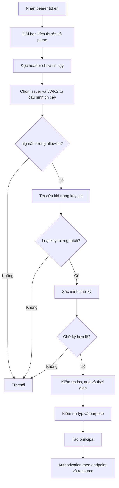

# Chống algorithm confusion và token type confusion

JWT thường được dùng để mang danh tính, quyền và ngữ cảnh giữa client, identity provider và API. Chữ ký số giúp phát hiện token bị sửa đổi, nhưng chỉ khi resource server xác minh token bằng đúng thuật toán, đúng loại khóa và đúng mục đích sử dụng. Nếu API để token tự quyết định thuật toán hoặc chấp nhận một loại JWT trong ngữ cảnh không dành cho nó, attacker có thể khiến một token hợp lệ ở hệ thống này được diễn giải thành credential có quyền ở hệ thống khác.

Hai nhóm lỗi cần kiểm soát là **algorithm confusion** và **token type confusion**. Algorithm confusion xảy ra khi verifier chấp nhận cách xác minh khác với thuật toán và loại khóa mà hệ thống dự kiến. Token type confusion xảy ra khi một JWT được phát hành cho mục đích này, chẳng hạn đăng nhập giao diện hoặc đặt lại mật khẩu, lại được chấp nhận như access token để gọi API. Cả hai đều bắt nguồn từ việc verifier không ràng buộc token với một hợp đồng xác minh rõ ràng.

## 1. JWT header là dữ liệu đầu vào chưa đáng tin cậy

Một JWT dạng compact JWS thường có ba phần Base64URL, ngăn cách bằng dấu chấm:

```text
BASE64URL(protected-header).
BASE64URL(payload).
BASE64URL(signature)
```

Ví dụ header có thể chứa:

```json
{
  "alg": "RS256",
  "typ": "at+jwt",
  "kid": "orders-signing-2026-02"
}
```

- `alg` khai báo thuật toán được dùng để tạo chữ ký.
- `typ` mô tả loại nội dung/token theo quy ước của hệ thống hoặc profile.
- `kid` gợi ý khóa nào trong tập khóa đã cấu hình được dùng để xác minh.

Các trường này nằm trong protected header nên được bảo vệ bởi chữ ký sau khi token được xác minh. Nhưng trước khi xác minh thành công, chúng vẫn là dữ liệu do bên gửi kiểm soát. Attacker có thể tự tạo token với `alg`, `kid`, `typ`, `jku` hoặc `x5u` tùy ý. Không được tin các giá trị đó chỉ vì chúng xuất hiện trong một JWT có cấu trúc hợp lệ.

Payload cũng chưa đáng tin trước khi chữ ký được xác minh. Không dùng `sub`, `role`, `scope`, `tenant_id`, `iss` hoặc `aud` từ payload để cấp quyền trước bước xác minh chữ ký và các claim bắt buộc.

## 2. Algorithm confusion là gì?

Algorithm confusion xảy ra khi verifier chấp nhận thuật toán dựa trên thông tin không đáng tin trong token hoặc dùng khóa sai loại cho thuật toán được yêu cầu. Lỗi kinh điển xuất hiện khi hệ thống phát hành JWT ký bằng RSA, chẳng hạn `RS256`, nhưng verifier lại cho phép token chuyển sang thuật toán HMAC như `HS256`.

Với chữ ký RSA, server dùng private key để ký và public key để xác minh. Với HMAC, cùng một secret được dùng để tạo và xác minh MAC. Nếu thư viện hoặc code xác minh lấy public key RSA rồi diễn giải chính bytes của public key như HMAC secret khi token khai báo `HS256`, attacker có thể dùng public key vốn công khai để tự tạo chữ ký HMAC. Nếu verifier chấp nhận chữ ký đó, attacker có thể tự sửa payload, ví dụ thay `sub` hoặc `role`, rồi tạo token giả.

Điều này không có nghĩa mọi thư viện JWT đều mắc lỗi. Rủi ro xuất hiện khi ứng dụng cấu hình verifier quá rộng, dùng API không phân biệt loại khóa hoặc để `alg` trong token quyết định cách xử lý khóa. Cấu hình đúng của thư viện là một phần quan trọng của ranh giới bảo mật.

### 2.1. Ví dụ về cách cấu hình nguy hiểm

Một mẫu logic không an toàn là:

```java
// Pseudocode nguy hiểm: không dùng header từ token để quyết định
// thuật toán được phép và cách diễn giải verification key.
String algorithm = unverifiedJwt.header("alg");
verify(unverifiedJwt, configuredKeyBytes, algorithm);
```

Các vấn đề:

- Caller có thể chọn `alg` bằng cách sửa protected header và ký lại token.
- Verifier chấp nhận nhiều thuật toán dù issuer chỉ phát hành một thuật toán.
- Cùng một biến `key` có thể bị diễn giải như RSA public key hoặc HMAC secret.
- Một token có thể đi vào nhánh xác minh yếu hơn mà người thiết kế không dự định.

Một biến thể nguy hiểm khác là cho phép thuật toán `none` hoặc chấp nhận chữ ký rỗng trong khi ứng dụng yêu cầu token có chữ ký. Với access token bảo vệ API, không bật chế độ unsigned trừ khi có một profile đặc biệt được thiết kế, giới hạn và đánh giá riêng; hầu hết hệ thống nên từ chối.

## 3. Pin thuật toán và ràng buộc đúng loại khóa

Resource server phải cấu hình thuật toán được chấp nhận từ chính sách tin cậy của ứng dụng, không lấy danh sách thuật toán từ token. Nếu issuer phát hành access token bằng `RS256`, verifier chỉ chấp nhận `RS256` cho profile đó. Không tự động chấp nhận `HS256`, `none`, `ES256` hoặc thuật toán khác chỉ vì thư viện hỗ trợ.

| Thuật toán | Loại khóa xác minh | Quy tắc cần giữ |
|---|---|---|
| `RS256` | RSA public key | Chỉ xác minh RSA signature bằng public key phù hợp; private key chỉ nằm ở bên ký |
| `PS256` | RSA public key | Cấu hình đúng RSA-PSS parameters và chỉ chấp nhận khi profile cho phép |
| `ES256` | EC public key trên curve phù hợp | Chỉ dùng EC key tương thích với thuật toán và thư viện |
| `HS256` | Shared secret | Chỉ dùng secret HMAC đủ mạnh, được quản lý riêng và không dùng public key làm secret |
| `none` | Không có khóa/chữ ký | Từ chối đối với access token cần chữ ký |

Không dùng một key material cho nhiều họ thuật toán. Không chuyển đổi RSA public key thành HMAC secret, không dùng một shared secret cho nhiều issuer hoặc nhiều mục đích token nếu có thể tách biệt. Khóa cần có metadata về thuật toán, loại khóa, issuer, mục đích và thời hạn sử dụng.

### 3.1. Thuật toán kỳ vọng phải đến từ cấu hình tin cậy

Verifier cần biết trước:

- Issuer nào được phép phát hành token cho API này.
- Profile token nào được endpoint chấp nhận.
- Thuật toán hoặc tập thuật toán được cho phép cho profile đó.
- Nguồn khóa công khai hoặc secret xác minh đáng tin cậy.
- Audience chính xác của resource server.

Không cấu hình kiểu “chấp nhận bất kỳ thuật toán nào trong thư viện”. Nếu cần hỗ trợ nhiều issuer hoặc thuật toán trong giai đoạn chuyển đổi, tạo cấu hình rõ ràng theo từng issuer/key set và giới hạn thuật toán cho từng key. Không cho token tự mở rộng tập thuật toán được chấp nhận.

### 3.2. Không tin `kid` để chọn đường dẫn hoặc nguồn khóa tùy ý

`kid` chỉ là gợi ý tra cứu một khóa trong tập khóa đã tin cậy. Hãy dùng nó để tìm một entry trong JWKS đã tải từ issuer được cấu hình, không ghép `kid` vào đường dẫn file, tên bảng, câu SQL hoặc URL tùy ý.

Không tải khóa từ `jku` hoặc `x5u` do token cung cấp nếu không có cơ chế allowlist và xác minh nguồn độc lập. Nếu verifier tự truy cập URL trong token, attacker có thể dẫn nó tới máy chủ do attacker kiểm soát hoặc địa chỉ nội bộ, tạo rủi ro SSRF và thay thế trust anchor. JWKS URL nên được cấu hình từ metadata tin cậy của issuer, truy cập qua TLS và có chính sách cache/rotation rõ ràng.

Nếu `kid` không tồn tại, trùng lặp hoặc ánh xạ tới key có loại/thuật toán không tương thích, từ chối token. Không fallback sang “thử tất cả khóa và thuật toán” một cách không giới hạn.

## 4. Token type confusion là gì?

Một hệ thống có thể phát hành nhiều JWT hợp lệ nhưng phục vụ các mục đích khác nhau:

- Access token để client gọi resource server.
- ID token để client xác nhận người dùng đã đăng nhập theo OIDC.
- Refresh token để lấy access token mới.
- Password reset token để đặt lại mật khẩu.
- Email verification token để xác minh địa chỉ email.
- Service token hoặc token nội bộ giữa các workload.
- Token ngắn hạn cho một workflow như phê duyệt hoặc liên kết tài khoản.

Token type confusion xảy ra khi một endpoint chỉ kiểm tra “chữ ký JWT hợp lệ” rồi chấp nhận token của mục đích khác. Ví dụ, API nhận ID token thay cho access token; endpoint reset password nhận access token; hoặc service nội bộ chấp nhận token được phát hành cho frontend.

Một JWT có chữ ký hợp lệ không tự nói rằng nó được phép dùng ở mọi nơi. Chữ ký chỉ giúp xác minh token được tạo bởi bên giữ khóa theo thuật toán tương ứng và nội dung chưa bị sửa. Verifier còn phải kiểm tra token có đúng loại, đúng issuer, đúng audience và đúng mục đích của endpoint hay không.

### 4.1. Access token và ID token không thể thay thế nhau

Trong OpenID Connect:

- ID token được phát hành cho client OIDC để client biết kết quả xác thực người dùng; `aud` thường chứa client ID.
- Access token được phát hành để client truy cập một resource server; `aud` phải phù hợp với API nhận token theo profile/issuer sử dụng.

Nếu `orders-api` chấp nhận ID token có `aud=web-client`, API có thể đang xác thực nhầm token dành cho ứng dụng frontend. Ngay cả khi `sub` giống nhau, token vẫn không được phát hành cho API đó.

Resource server cần kiểm tra audience của chính mình và profile access token mà issuer cam kết. Không dùng ID token làm bearer credential gọi API chỉ vì nó là JWT hợp lệ.

### 4.2. Các token nội bộ cũng cần ranh giới riêng

Password reset token có thể chứa subject và thời hạn hợp lệ, nhưng quyền của nó chỉ nên giới hạn cho endpoint reset password. Nếu API nghiệp vụ chấp nhận token đó như access token, người có link reset có thể nhận quyền ngoài mục đích ban đầu.

Tương tự, token xác minh email, invitation token, token magic link hoặc service-to-service token không được dùng thay access token thông thường. Mỗi loại cần profile, audience, thời hạn và quy tắc validation riêng.

## 5. Dùng explicit typing và mutually exclusive validation rules

Một cách phòng token type confusion là xác định loại token một cách rõ ràng và bảo đảm verifier của từng loại có quy tắc riêng. JWT Best Current Practice khuyến nghị dùng explicit typing khi phù hợp và các validation rule loại trừ lẫn nhau giữa những loại JWT có thể bị nhầm lẫn.

### 5.1. Kiểm tra `typ` sau khi xác minh chữ ký

Protected header có thể dùng `typ` để khai báo loại token. Ví dụ, profile OAuth 2.0 JWT access token có thể sử dụng `at+jwt`. Hệ thống khác có thể quy định type riêng cho token nội bộ.

Verifier cần kiểm tra `typ` theo profile mà endpoint chấp nhận. Tuy nhiên:

- `typ` không thay thế xác minh chữ ký.
- Không tin `typ` trước khi token được xác minh.
- Không dựa duy nhất vào `typ` nếu các loại token còn chia sẻ issuer, audience, key và claim rules.
- Phải có quy tắc tương thích rõ ràng khi issuer phát hành token theo profile cũ.

### 5.2. Dùng claim mục đích riêng khi cần

Một issuer có thể thêm claim như `token_use`, `purpose` hoặc `credential_type` để phân biệt access token, reset token và service token. Ví dụ:

```json
{
  "iss": "https://identity.example.test",
  "sub": "user-123",
  "aud": "orders-api",
  "token_use": "access",
  "scope": "orders:read",
  "exp": 1795003600
}
```

Claim này chỉ có ý nghĩa sau khi chữ ký được xác minh và issuer được tin cậy. Không tự thêm claim rồi giả định mọi token cũ đều có nó; cần quy định rõ issuer, thời gian chuyển đổi và hành vi khi claim thiếu.

### 5.3. Validation rule phải loại trừ lẫn nhau

Ví dụ, verifier access token có thể yêu cầu đồng thời:

- Issuer đúng identity provider.
- Audience chứa chính resource server.
- Thuật toán và loại khóa đúng profile.
- `typ` đúng profile access token nếu profile yêu cầu.
- `token_use=access` nếu issuer phát hành claim này.
- `exp`, `nbf` và các claim thời gian hợp lệ.
- Scope/permission phù hợp với endpoint sau khi xác minh token.

Verifier reset token cần audience riêng như `password-reset`, purpose riêng như `password_reset`, thời hạn ngắn và quyền rất hẹp. Không tạo một verifier “JWT chung” chấp nhận cả hai loại rồi dựa vào controller để tự nhớ phân biệt.

## 6. Ràng buộc issuer, audience và claim thời gian

Kiểm tra chữ ký đúng vẫn chưa đủ. Sau khi xác minh chữ ký, cần kiểm tra các claim bắt buộc theo profile:

| Claim | Ý nghĩa | Kiểm tra cần có |
|---|---|---|
| `iss` | Issuer phát hành token | So khớp chính xác với issuer được cấu hình; không chấp nhận issuer tùy ý |
| `aud` | Đối tượng nhận token | Phải chứa audience của API hiện tại theo profile |
| `exp` | Thời điểm hết hạn | Từ chối token đã hết hạn; chỉ cho clock skew nhỏ theo chính sách |
| `nbf` | Thời điểm token bắt đầu có hiệu lực | Không chấp nhận token trước thời điểm này ngoài clock skew đã định nghĩa |
| `iat` | Thời điểm phát hành | Kiểm tra hợp lý nếu profile yêu cầu; tránh token phát hành trong tương lai |
| `jti` | Mã định danh token | Có thể dùng cho revocation/replay control khi hệ thống triển khai |
| `sub` | Subject | Diễn giải theo issuer và loại token; không mặc định là user trong mọi token |
| `scope` / `roles` | Quyền được cấp | Chỉ dùng sau khi token được xác minh; tiếp tục authorization theo endpoint/resource |

Không bỏ qua `aud` chỉ vì issuer đã đúng. Một issuer có thể phát hành token cho nhiều client và nhiều API; API phải chắc chắn token được dành cho chính nó. Không dùng `sub` hoặc role để thay thế audience.

Với hệ thống đa issuer, danh sách issuer và JWKS endpoint phải đến từ cấu hình tin cậy hoặc quy trình đăng ký tenant có kiểm soát. Nếu dùng claim `iss` chưa xác minh để chọn cấu hình, chỉ được dùng nó như khóa tra cứu trong allowlist cố định, sau đó vẫn phải xác minh chữ ký và so khớp issuer chính xác. Không fetch URL issuer hoặc JWKS tùy ý từ token.

## 7. Tách key set và verifier theo mục đích token

Ranh giới mạnh nhất thường là không dùng cùng một key và verifier cho mọi loại token. Có thể tách:

| Token | Signing key/profile | Audience | Verifier |
|---|---|---|---|
| Access token cho Orders API | Key set của access-token issuer, thuật toán cố định | `orders-api` | Orders resource server |
| ID token cho web client | Key set/profile OIDC của identity provider | `web-client` | OIDC client |
| Password reset token | Key riêng hoặc profile riêng | `password-reset` | Password reset endpoint |
| Service token | Key set hoặc workload identity riêng | `inventory-service` | Inventory service |

Nếu một issuer dùng chung key set vì lý do vận hành, vẫn cần phân tách thuật toán, audience, type và validation rules. Tuy nhiên, key riêng theo mục đích làm giảm nguy cơ một loại token bị chấp nhận nhầm ở verifier khác.

Không dùng token có quyền rộng cho nhiều API chỉ để tiện tích hợp. Audience hẹp và scope tối thiểu giúp giảm tác động nếu token bị lộ hoặc gửi nhầm service.

## 8. Quy trình xác minh JWT an toàn

Một verifier nên thực hiện các bước theo profile được cấu hình trước:

1. Giới hạn kích thước token và parse compact structure; từ chối định dạng không hợp lệ.
2. Đọc header ở chế độ chưa xác minh chỉ để lấy thông tin tra cứu có giới hạn như `kid`; không cấp quyền dựa trên header hoặc payload.
3. Chọn issuer/key set từ cấu hình tin cậy, không từ URL tùy ý trong token.
4. Kiểm tra thuật toán trong header đúng với allowlist được cấu hình cho verifier.
5. Chọn key theo `kid` trong key set tin cậy và xác minh loại key tương thích với thuật toán.
6. Xác minh chữ ký; từ chối chữ ký thiếu, sai hoặc thuật toán không được hỗ trợ.
7. Kiểm tra `iss`, `aud`, `exp`, `nbf` và các claim bắt buộc.
8. Kiểm tra token type/purpose theo endpoint hoặc resource server.
9. Tạo principal từ claim đã xác minh.
10. Thực hiện authorization theo chức năng, đối tượng, thuộc tính và trạng thái nghiệp vụ.

Một số thư viện cần đọc `kid` hoặc `iss` trước bước xác minh để chọn key. Điều đó chỉ an toàn khi giá trị chưa xác minh được dùng như selector trong tập cấu hình giới hạn, không được dùng để tin issuer hoặc truy cập tài nguyên tùy ý. Không thực hiện side effect trước khi toàn bộ bước xác minh bắt buộc hoàn tất.



## 9. Ví dụ cấu hình verifier theo profile

Ví dụ pseudocode dưới đây thể hiện những điều kiện cần được pin trong cấu hình. Tên builder chỉ mang tính minh họa, không phải API của một thư viện cụ thể:

```java
JwtVerifier ordersAccessTokenVerifier = JwtVerifier.builder()
    .trustedIssuer("https://identity.example.test")
    .trustedJwksUri("https://identity.example.test/.well-known/jwks.json")
    .allowedAlgorithms(Set.of("RS256"))
    .requiredAudience("orders-api")
    .requiredType("at+jwt")
    .requiredClaim("token_use", "access")
    .requireExpiration()
    .validateNotBeforeWhenPresent()
    .build();
```

Điểm quan trọng là `allowedAlgorithms`, issuer, JWKS URI và audience đến từ cấu hình triển khai đã tin cậy. Header `alg` chỉ được so với allowlist; `kid` chỉ được tra trong JWKS đã cấu hình; `typ` và `token_use` chỉ được tin sau khi chữ ký cùng issuer đã được xác minh.

Nếu dùng Spring Security Resource Server hoặc thư viện JWT khác, hãy cấu hình decoder với thuật toán chữ ký cụ thể, issuer và audience validator rõ ràng. Không dùng một decoder chung có danh sách thuật toán rộng cho nhiều loại token nếu các endpoint có mục đích khác nhau.

## 10. Quản lý JWKS và xoay vòng khóa

JWKS là tập khóa công khai mà issuer công bố để resource server xác minh chữ ký. Việc dùng JWKS không tự bảo đảm an toàn nếu URL hoặc nội dung JWKS không đáng tin.

Các nguyên tắc cần áp dụng:

- Cấu hình issuer và JWKS URI từ nguồn tin cậy; không lấy `jku`/`x5u` trong token làm URL tự do.
- Truy cập JWKS qua TLS và kiểm tra hostname/chứng thư như client HTTPS bình thường.
- Cache key set có TTL hợp lý, giới hạn kích thước và xử lý lỗi refresh rõ ràng.
- `kid` phải ánh xạ duy nhất tới key trong tập khóa; từ chối key không tương thích.
- Không tự động tin key mới chỉ vì nó xuất hiện trong response từ một URL do token chỉ định.
- Có kế hoạch overlap khi xoay vòng: phát hành key mới, công bố JWKS, chuyển issuer sang ký bằng key mới, tiếp tục giữ public key cũ đủ lâu cho token còn hiệu lực rồi mới loại bỏ.
- Khi key bị lộ, có quy trình thu hồi khẩn cấp và làm mới cache/denylist theo rủi ro.

Không log private key, shared secret hoặc toàn bộ token trong quá trình debug JWKS. Có thể ghi `kid`, issuer đã cấu hình và kết quả xác minh ở mức phù hợp để điều tra.

## 11. Token type validation trong các luồng thực tế

### 11.1. Resource server chỉ nhận access token

API `orders-api` nên chỉ nhận access token được phát hành cho `orders-api`. Nó không chấp nhận ID token của web client, refresh token, password reset token hoặc token của service khác. Việc một JWT có cùng issuer và chữ ký hợp lệ không đủ.

### 11.2. Password reset token chỉ dùng một lần cho reset

Token reset password nên có audience/purpose riêng, thời hạn ngắn, ràng buộc với user và trạng thái yêu cầu reset. Endpoint reset không được chấp nhận access token như bằng chứng reset trừ khi thiết kế flow quy định rõ. Sau khi dùng thành công, token cần bị vô hiệu hóa hoặc không thể sử dụng lại theo cơ chế đã chọn.

### 11.3. Service-to-service token

Token dành cho `inventory-service` không nên được `orders-api` chấp nhận chỉ vì cùng issuer ký. Audience, client identity, scope và profile cần khớp service nhận. Nếu workload có thể dùng mTLS hoặc workload identity, có thể kết hợp để ràng buộc credential với workload cụ thể.

### 11.4. Token dùng cho nhiều mục đích trong một ứng dụng

Nếu hệ thống có invitation token, email verification token và access token, không dùng một endpoint “verify JWT” chung rồi trả principal có quyền tùy theo payload. Mỗi flow cần verifier và command riêng; invitation token không tự trở thành quyền đăng nhập lâu dài.

## 12. Kiểm thử algorithm confusion và token type confusion

Kiểm thử cần tạo token sai có chủ đích trong môi trường test và xác minh mọi verifier từ chối đúng cách. Không chỉ kiểm tra một token hợp lệ do issuer phát hành.

| Test case | Kết quả cần xác minh |
|---|---|
| Token dùng thuật toán đúng và key đúng | Xác minh thành công nếu mọi claim hợp lệ |
| Đổi `alg` từ `RS256` sang `HS256` | Bị từ chối; verifier không diễn giải RSA public key thành HMAC secret |
| Token có `alg=none` hoặc chữ ký rỗng | Bị từ chối |
| Thuật toán không nằm trong allowlist | Bị từ chối trước khi cấp principal |
| `kid` không tồn tại hoặc trùng lặp | Bị từ chối; không fallback tùy tiện |
| Key có `kty`/curve không tương thích với `alg` | Bị từ chối |
| Header chứa `jku` hoặc `x5u` trỏ tới URL lạ | Không fetch URL tùy ý; chỉ dùng JWKS đã tin cậy |
| ID token gửi tới resource server | Bị từ chối do audience/type/profile không phù hợp |
| Access token gửi tới endpoint reset password | Bị từ chối do purpose/audience không phù hợp |
| Reset token gửi tới API nghiệp vụ | Bị từ chối |
| Service token của API khác | Bị từ chối do audience hoặc client profile |
| `iss` không đúng | Bị từ chối |
| `aud` không chứa API hiện tại | Bị từ chối |
| `exp` đã qua hoặc `nbf` ở tương lai | Bị từ chối theo clock skew đã định nghĩa |
| Thiếu `typ` hoặc `token_use` bắt buộc | Bị từ chối theo profile |
| Token hợp lệ nhưng thiếu scope | Authentication thành công, authorization bị từ chối |
| Key rotation trong giai đoạn overlap | Key mới và token cũ còn hiệu lực được xử lý đúng theo kế hoạch |
| JWKS endpoint lỗi hoặc key không tải được | Không chuyển sang thuật toán/key yếu hơn |

Nên có test hồi quy ở từng resource server, không chỉ ở thư viện dùng chung. Cấu hình một API có thể khác API khác; route hoặc service mới có thể vô tình dùng decoder mặc định. Test cần xác minh cả response status, principal không được tạo khi token sai và không có side effect.

## 13. Logging và xử lý lỗi

Lỗi xác minh token nên được ghi nhận ở mức đủ để phát hiện cấu hình sai hoặc tấn công, nhưng không làm lộ credential.

Có thể ghi:

- API/resource server và verifier profile.
- `kid` hoặc issuer selector sau khi đã làm sạch.
- Nhóm lỗi như unsupported algorithm, unknown key, invalid signature, wrong audience hoặc wrong token type.
- Correlation ID, thời điểm và kết quả từ chối.

Không ghi toàn bộ JWT, access token, refresh token, HMAC secret, private key hoặc nội dung claim nhạy cảm vào log. Response cho caller nên dùng thông báo xác thực chung; không tiết lộ chi tiết khóa hoặc cấu hình xác minh nội bộ.

Theo dõi đột biến về token bị từ chối do `alg` lạ, `kid` không tồn tại, issuer/audience sai hoặc token type không đúng. Đây có thể là tín hiệu client cấu hình sai, token bị phát lại ở sai hệ thống hoặc hành vi dò tìm.

## 14. Checklist triển khai

Trước khi đưa JWT verifier vào production, hãy xác nhận:

- [ ] Thuật toán được pin từ cấu hình tin cậy; không để token quyết định tập thuật toán được chấp nhận.
- [ ] Không chấp nhận `none` hoặc chữ ký rỗng cho access token thông thường.
- [ ] Mỗi thuật toán chỉ dùng đúng loại key và key parameters tương thích.
- [ ] Không dùng RSA public key như HMAC secret; không tái sử dụng key giữa các họ thuật toán.
- [ ] `kid` chỉ tra cứu trong key set tin cậy; không ghép vào file path, SQL hoặc URL tùy ý.
- [ ] `jku`/`x5u` từ token không được dùng để fetch khóa tùy ý.
- [ ] Issuer và audience được kiểm tra chính xác.
- [ ] Token type/purpose được xác định rõ bằng profile, `typ` và/hoặc claim bắt buộc.
- [ ] Access token, ID token, refresh token, reset token và service token có validation rules loại trừ lẫn nhau.
- [ ] `exp`, `nbf`, `iat` và clock skew được xử lý theo chính sách.
- [ ] Principal chỉ được tạo sau khi chữ ký và claim validation thành công.
- [ ] Authorization theo chức năng, đối tượng, thuộc tính và trạng thái vẫn được thực hiện sau authentication.
- [ ] JWKS cache, rotation, key compromise và lỗi tải key có hành vi rõ ràng.
- [ ] Test âm bao phủ algorithm confusion, type confusion, wrong audience, wrong issuer và key mismatch.
- [ ] Log ghi nhóm lỗi nhưng không ghi token hoặc key material.

## 15. Nguyên tắc thiết kế

Hãy coi mọi JWT nhận từ client là dữ liệu chưa đáng tin cho đến khi verifier xác minh bằng một profile được cấu hình trước. Pin thuật toán, ràng buộc loại khóa, chỉ tra `kid` trong key set tin cậy và không fetch URL khóa do token tùy ý cung cấp. Sau khi chữ ký hợp lệ, kiểm tra issuer, audience, thời gian và loại token trước khi tạo principal.

Tách verifier theo mục đích sử dụng. Access token của API, ID token của client, reset token và service token cần audience, type/purpose, key profile và validation rules phù hợp, loại trừ lẫn nhau. Cuối cùng, token hợp lệ chỉ chứng minh credential được chấp nhận trong một ngữ cảnh; API vẫn phải kiểm tra quyền cụ thể trên endpoint và dữ liệu nghiệp vụ.

**JWT an toàn không chỉ là JWT có chữ ký hợp lệ. Nó phải được xác minh bằng đúng thuật toán, đúng khóa, đúng issuer, đúng audience và đúng loại token cho chính resource server đang nhận nó.**
