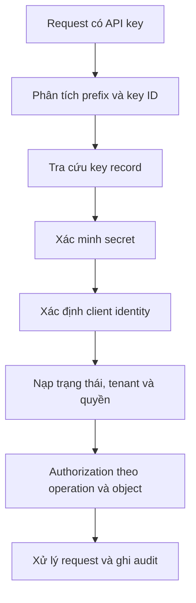

# Sinh key đủ entropy và nhận diện client

## 1. API key là credential của ứng dụng hoặc dịch vụ

API key là một credential do hệ thống cấp để một ứng dụng, dịch vụ hoặc client chứng minh mình đang gọi API bằng thông tin xác thực đã đăng ký. Trong tích hợp server-to-server, key thường giúp hệ thống nhận diện một client, áp dụng chính sách truy cập, hạn mức và theo dõi hoạt động của tích hợp đó.

Ví dụ một request gửi key trong HTTP header:

```http
GET /v1/reports HTTP/1.1
Host: api.example.com
X-API-Key: ak_live_<key-id>.<secret>
Accept: application/json
```

Đây là định dạng minh họa; secret thực tế phải được sinh từ nguồn ngẫu nhiên mật mã. Request phải đi qua HTTPS/TLS và key không được ghi vào log.

API key thường là *bearer credential*: bên nào sở hữu giá trị bí mật và gửi nó đúng cách có thể sử dụng key. Vì vậy, lộ key thường đồng nghĩa với việc kẻ khác có thể giả làm client tương ứng cho đến khi key bị thu hồi hoặc hết hạn.

Trong phạm vi **SECURITY_API_SECURITY**, việc sinh key cần đi cùng xác thực, phân quyền, validation, bảo vệ dữ liệu, giới hạn tài nguyên, kiểm thử và giám sát. Một chuỗi khó đoán mới chỉ giải quyết phần chống đoán credential. Hệ thống còn phải xác định key thuộc client nào, môi trường nào, có quyền gì, còn hiệu lực không và có thể thu hồi ra sao.

Sau bài học này, người học có thể:

1. Giải thích entropy và lý do API key phải được tạo từ nguồn ngẫu nhiên mật mã.
2. Chọn độ dài key phù hợp và tính số bit entropy từ không gian giá trị.
3. Sinh API key an toàn bằng Java SecureRandom.
4. Phân biệt key ID, secret, client ID và danh tính người dùng.
5. Ánh xạ key sang client identity và cấu hình quyền theo nguyên tắc tối thiểu.
6. Lưu trữ, xác minh, xoay vòng, thu hồi và giám sát API key an toàn.

## 2. Phân biệt API key, key ID, client ID và user identity

Những khái niệm này có quan hệ với nhau nhưng không thể dùng thay thế cho nhau.

| Thành phần | Ý nghĩa | Có phải bí mật? |
|---|---|---|
| API key secret | Phần bí mật chứng minh caller đang sở hữu credential | Có |
| Key ID (kid) | Định danh một bản ghi key để tra cứu và thu hồi | Thường không |
| Client ID | Định danh ổn định của ứng dụng hoặc dịch vụ tích hợp | Thường không |
| User ID | Định danh một người dùng cuối | Không phải credential |
| Tenant ID | Định danh tổ chức hoặc vùng dữ liệu | Không phải credential |
| Scope/permission | Phạm vi hành động mà client được cấp | Không phải bí mật; cần bảo vệ tính toàn vẹn |
| Key record | Bản ghi quản lý trạng thái, client, quyền và metadata của key | Là dữ liệu bảo mật; cần hạn chế truy cập |

Một client có thể có nhiều API key. Ví dụ, dịch vụ billing-worker có một key cho staging và một key cho production; khi xoay vòng, nó có thể tạm thời có hai key production cùng hiệu lực. Các key có key_id khác nhau nhưng cùng ánh xạ đến một client_id.



### 2.1. API key nhận diện client, không tự nhận diện người dùng cuối

API key thường trả lời câu hỏi: “Ứng dụng hoặc dịch vụ nào đang gọi API?”. Nó không nhất thiết trả lời: “Người dùng nào đang thao tác?”.

Ví dụ, một ứng dụng đối tác gửi request tạo đơn hàng bằng key của đối tác. Hệ thống có thể nhận diện client là partner-order-sync. Nếu hành động được thực hiện thay mặt một người dùng, danh tính người dùng cần được xác thực bằng cơ chế phù hợp, chẳng hạn OAuth 2.0/OIDC hoặc token ủy quyền có thể kiểm chứng.

Không nên tin một header tùy ý như X-User-Id để kết luận ai là người dùng. Client có thể tự sửa giá trị đó. Nếu nghiệp vụ cần ghi nhận người dùng đã khởi tạo hành động, phải có bằng chứng danh tính và quan hệ ủy quyền rõ ràng.

### 2.2. Client identity không đồng nghĩa với quyền truy cập mọi dữ liệu

Xác thực thành công cho biết credential hợp lệ và gắn với một client. Authorization vẫn phải kiểm tra:

- Client có được phép gọi operation này không?
- Client có được truy cập object hoặc tenant cụ thể không?
- Client có được đọc hoặc sửa các thuộc tính cụ thể không?
- Trạng thái nghiệp vụ hiện tại có cho phép hành động không?
- Có hạn mức, thời gian hoặc điều kiện bổ sung nào không?

Một key có scope orders:read không có nghĩa client được đọc mọi đơn hàng. Server vẫn phải kiểm tra object có thuộc phạm vi mà client được giao hay không. Đây là điểm quan trọng để tránh BOLA/IDOR và truy cập chéo tenant.

## 3. Entropy: độ khó đoán của API key

Entropy biểu diễn mức bất định của một giá trị ngẫu nhiên. Với API key được sinh đồng đều từ một không gian gồm N giá trị, entropy tối đa là:

\[
H = \log_2(N)
\]

Nếu mỗi ký tự được chọn độc lập, đồng đều từ bảng chữ cái có A ký tự và key có L ký tự:

\[
H = L \times \log_2(A)
\]

Entropy càng lớn thì không gian tìm kiếm càng rộng và việc đoán trúng key càng khó, giả sử nguồn sinh thực sự ngẫu nhiên và không bị lộ.

### 3.1. Ví dụ về số bit entropy

| Cách biểu diễn | Độ dài | Entropy khi sinh đều |
|---|---:|---:|
| Hexadecimal | 32 ký tự | 128 bit |
| Hexadecimal | 64 ký tự | 256 bit |
| Base64url của 16 byte | 22 ký tự, không padding | 128 bit |
| Base64url của 32 byte | 43 ký tự, không padding | 256 bit |
| Chỉ chữ số | 20 chữ số | Khoảng 66,4 bit |
| Chỉ chữ thường | 32 ký tự | Khoảng 150,4 bit |

Độ dài chuỗi không tự quyết định entropy. Một chuỗi 64 ký tự được tạo từ timestamp, tên client và số thứ tự có thể gần như không có entropy bí mật. Ngược lại, 32 byte được sinh độc lập bằng CSPRNG chứa 256 bit entropy trước khi mã hóa thành chuỗi.

### 3.2. Khuyến nghị độ dài

Với API key đóng vai trò bearer secret, nên dùng ít nhất 128 bit entropy từ nguồn ngẫu nhiên mật mã. Trong thiết kế mới, dùng 256 bit entropy thường là lựa chọn đơn giản, có biên an toàn lớn và chi phí lưu trữ/truyền tải thấp.

Ví dụ, sinh 32 byte ngẫu nhiên:

\[
32 \text{ bytes} \times 8 = 256 \text{ bits}
\]

Khi mã hóa Base64url không padding, 32 byte thường được biểu diễn thành 43 ký tự. Các ký tự prefix như ak_live_ hoặc phần key ID giúp phân loại và tra cứu; chúng không được tính vào entropy của secret.

Không tăng độ dài một cách tùy tiện mà bỏ qua chất lượng nguồn ngẫu nhiên. Một secret 256 bit lấy từ java.util.Random không trở thành an toàn chỉ vì nó dài.

### 3.3. Xác suất đoán trúng và va chạm

Nếu secret có b bit entropy và attacker thử q giá trị độc lập, xác suất đoán trúng khi q nhỏ hơn rất nhiều so với không gian tìm kiếm có thể xấp xỉ:

\[
P \approx \frac{q}{2^b}
\]

Với secret 256 bit, việc đoán vét cạn là không thực tế. Tuy vậy, entropy cao không giúp ích nếu key bị lấy từ log, source code, biến môi trường bị lộ hoặc máy chủ bị chiếm quyền.

Nếu hệ thống có nhiều key, cần cân nhắc cả khả năng trùng lặp. Với n giá trị được chọn ngẫu nhiên từ không gian \(2^b\), xác suất va chạm xấp xỉ theo birthday bound:

\[
P_{\text{collision}} \approx \frac{n(n-1)}{2^{b+1}}
\]

Với secret 256 bit, nguy cơ va chạm ngẫu nhiên là không đáng kể trong quy mô thông thường. Key ID cũng nên được sinh ngẫu nhiên đủ dài và có ràng buộc unique trong cơ sở dữ liệu; nếu phát hiện trùng ID, sinh lại trước khi lưu.

## 4. Dùng CSPRNG để sinh key

CSPRNG (Cryptographically Secure Pseudorandom Number Generator) tạo ra các giá trị khó dự đoán ngay cả khi attacker biết một phần đầu ra. Bộ sinh cần được seed và quản lý bởi runtime hoặc hệ điều hành theo cơ chế an toàn.

Trong Java, sử dụng java.security.SecureRandom. Không dùng các nguồn sau để tạo secret:

- java.util.Random.
- Math.random().
- Timestamp, số thứ tự hoặc ID tăng dần.
- Ghép tên ứng dụng, email, tenant ID hoặc dữ liệu người dùng.
- Hash của dữ liệu công khai hoặc một chuỗi cố định.
- UUID tự tạo từ các trường dễ đoán.

UUID.randomUUID() trong Java dùng nguồn ngẫu nhiên an toàn của nền tảng và UUIDv4 có 122 bit ngẫu nhiên. Tuy nhiên, khi thiết kế API key, sinh số byte entropy tường minh bằng SecureRandom giúp kiểm soát rõ độ dài và mục đích của secret.

### 4.1. Sinh secret 256 bit trong Java

```java
import java.security.SecureRandom;
import java.util.Base64;

public final class ApiKeyGenerator {
    private static final SecureRandom RANDOM = new SecureRandom();

    private ApiKeyGenerator() {
    }

    public static String generateSecret() {
        byte[] secretBytes = new byte[32]; // 32 bytes = 256 bits
        RANDOM.nextBytes(secretBytes);

        return Base64.getUrlEncoder()
                .withoutPadding()
                .encodeToString(secretBytes);
    }
}
```

SecureRandom tạo byte ngẫu nhiên; Base64url chỉ là cách biểu diễn các byte đó thành chuỗi an toàn cho header và hệ thống truyền tải. Mã hóa Base64 không làm tăng entropy.

Nên tạo một instance SecureRandom dùng chung theo hướng dẫn của nền tảng thay vì tự seed bằng timestamp. Không gọi setSeed() với một giá trị do ứng dụng tự tạo để thay thế seed an toàn. Nếu cần tuân thủ FIPS hoặc yêu cầu crypto provider cụ thể, cấu hình và xác minh provider theo tiêu chuẩn môi trường triển khai.

### 4.2. Sinh key ID riêng biệt

Key ID dùng để tra cứu bản ghi, không phải secret. Có thể sinh 12 byte ngẫu nhiên và mã hóa Base64url:

```java
import java.security.SecureRandom;
import java.util.Base64;

public final class KeyIdGenerator {
    private static final SecureRandom RANDOM = new SecureRandom();

    private KeyIdGenerator() {
    }

    public static String generateKeyId() {
        byte[] idBytes = new byte[12]; // 96 bits
        RANDOM.nextBytes(idBytes);

        return Base64.getUrlEncoder()
                .withoutPadding()
                .encodeToString(idBytes);
    }
}
```

Không nên dùng client_id hoặc tenant_id làm secret. Các ID nghiệp vụ có thể công khai trong log hoặc request, có cấu trúc và có thể đoán được. Key ID ngẫu nhiên giúp tìm đúng bản ghi key mà không tiết lộ thông tin nội bộ.

### 4.3. Tạo định dạng key có thể nhận diện

Một định dạng dễ vận hành có thể là:

```text
ak_live_<key-id>.<secret>
ak_test_<key-id>.<secret>
```

Trong đó:

- ak: loại credential là API key.
- live hoặc test: nhãn môi trường để hỗ trợ phát hiện nhầm lẫn.
- key-id: định danh công khai để tra cứu key record.
- secret: giá trị bí mật ngẫu nhiên 256 bit.

Prefix và key ID không thay thế kiểm tra trạng thái. Server phải xác định môi trường và chính sách thực tế từ cấu hình đáng tin cậy. Không cho phép caller đổi test thành live rồi được cấp quyền production.

Không đưa tên khách hàng, email, tenant, scope hoặc quyền vào secret. Những thông tin này thuộc metadata phía server và cần thay đổi độc lập với credential.

### 4.4. Không tự thiết kế bộ sinh ngẫu nhiên

Không viết thuật toán PRNG riêng, không dùng phép nối chuỗi hoặc hash đơn giản để “làm rối” một giá trị có thể đoán. Hãy dùng API crypto chuẩn của ngôn ngữ và provider đã được nền tảng hỗ trợ.

Nếu sinh key ở nhiều node, mỗi node phải dùng nguồn entropy an toàn của môi trường. Không clone trạng thái PRNG, snapshot VM/container theo cách khiến nhiều instance sinh ra cùng chuỗi ngẫu nhiên, và không khởi tạo generator bằng seed giống nhau do cấu hình triển khai.

## 5. Định dạng và cách truyền API key

### 5.1. Truyền qua header

Thông thường, gửi API key qua custom header như X-API-Key. Một số hệ thống dùng Authorization: Bearer .... Cần chọn một quy ước rõ ràng để tránh nhầm API key với OAuth access token hoặc các bearer credential khác.

Dù chọn header nào, request phải đi qua HTTPS/TLS. Không gửi API key trong query string vì URL thường xuất hiện trong access log, proxy log, browser history, analytics, trace và header Referer.

Không truyền key qua:

- Query parameter hoặc fragment URL.
- Nội dung lỗi hoặc thông báo exception.
- Tên file, tên branch hoặc commit message.
- Trường metadata không được bảo vệ.
- Request body của API không có lý do nghiệp vụ rõ ràng.
- Cookie nếu hệ thống không thiết kế cơ chế chống CSRF và quản lý cookie phù hợp.

### 5.2. API key trong ứng dụng browser và mobile

Một secret được nhúng trong JavaScript bundle, mobile binary, source map hoặc file cấu hình phát hành cho client không thể được xem là bí mật lâu dài. Người dùng có thể tải ứng dụng, phân tích bundle hoặc quan sát request để lấy key.

Nếu cần nhận diện ứng dụng công khai, có thể cấp publishable key với quyền rất hạn chế và giới hạn rõ ràng. Publishable key không được dùng làm bằng chứng duy nhất để cho phép thao tác đặc quyền, đọc dữ liệu riêng tư hoặc truy cập hệ thống nội bộ.

Đối với thao tác cần danh tính người dùng, browser/mobile nên dùng cơ chế đăng nhập và token ngắn hạn phù hợp. Secret của backend cần được giữ ở server hoặc secret manager.

### 5.3. Không nhầm mã hóa với bảo mật

Base64url chỉ mã hóa biểu diễn. Nó không mã hóa bí mật và không ngăn người đọc khôi phục giá trị. Prefix cũng không phải cơ chế bảo vệ. Secret cần được bảo vệ bằng TLS khi truyền, lưu trữ an toàn và không hiển thị lại sau khi cấp.

## 6. Lưu trữ API key và xác minh secret

### 6.1. Chỉ hiển thị secret một lần

Khi tạo key, hệ thống cần:

1. Sinh key ID và secret bằng CSPRNG.
2. Tạo key record gắn với client và chính sách.
3. Tính verifier để lưu trữ.
4. Lưu metadata và verifier trong một giao dịch nhất quán.
5. Hiển thị đầy đủ key đúng một lần cho người có quyền tạo.
6. Nhắc người dùng lưu key vào secret manager hoặc nơi lưu trữ được phê duyệt.
7. Không cung cấp chức năng đọc lại secret sau khi đóng màn hình cấp key.

Nếu người dùng làm mất secret, tạo key mới và thu hồi key cũ theo quy trình. Không thể khôi phục plaintext từ verifier một chiều, và đó là chủ đích bảo mật.

### 6.2. Lưu verifier thay vì plaintext

Do API key được sinh ngẫu nhiên với entropy cao, có thể lưu digest một chiều để xác minh. Ví dụ, lưu SHA-256 của secret hoặc HMAC-SHA-256 với một khóa bí mật phía server được quản lý trong KMS/secret manager.

Không nên áp dụng trực tiếp mô hình lưu mật khẩu yếu cho API key. Password của người dùng thường có entropy thấp và cần password hashing chậm như Argon2id, scrypt hoặc bcrypt. API key được sinh đồng đều với 256 bit entropy có đặc tính khác: dò vét cạn là không thực tế; SHA-256 hoặc HMAC-SHA-256 có thể phù hợp để tạo verifier. Quyết định cụ thể cần dựa trên mô hình đe dọa và yêu cầu quản lý khóa.

Ví dụ HMAC verifier:

```java
import javax.crypto.Mac;
import javax.crypto.spec.SecretKeySpec;
import java.nio.charset.StandardCharsets;
import java.security.GeneralSecurityException;

public final class ApiKeyVerifier {
    private ApiKeyVerifier() {
    }

    public static byte[] calculateVerifier(
            byte[] serverPepper,
            String secret
    ) throws GeneralSecurityException {
        Mac mac = Mac.getInstance("HmacSHA256");
        SecretKeySpec key = new SecretKeySpec(
                serverPepper,
                "HmacSHA256"
        );
        mac.init(key);

        return mac.doFinal(secret.getBytes(StandardCharsets.US_ASCII));
    }
}
```

serverPepper là khóa HMAC riêng của hệ thống, không lưu cùng cơ sở dữ liệu key record. Khóa này cần được quản lý trong KMS hoặc secret manager, có quyền truy cập hạn chế và có quy trình rotation. Nếu không dùng pepper, SHA-256 của một secret ngẫu nhiên đủ entropy vẫn là một lựa chọn verifier có thể xem xét.

Không dùng mã hóa hai chiều để lưu key chỉ nhằm mục đích hiển thị lại cho người dùng. Nếu hệ thống buộc phải có khả năng khôi phục credential cho một tích hợp đặc biệt, đó là một thiết kế lưu secret riêng với rủi ro và kiểm soát khác, không phải lý do mặc định để lưu plaintext API key.

### 6.3. Xác minh bằng key ID và constant-time comparison

Với định dạng ak_live_<key-id>.<secret>, server có thể:

1. Kiểm tra cấu trúc, prefix và độ dài.
2. Tách key ID và secret.
3. Tra cứu key record theo key ID.
4. Kiểm tra key có tồn tại, đang active, đúng môi trường và chưa hết hạn.
5. Tính verifier từ secret nhận được.
6. So sánh verifier bằng phép so sánh constant-time.
7. Nếu hợp lệ, nạp client identity và quyền.
8. Ghi nhận sự kiện xác thực theo cách không ghi secret.

Ví dụ so sánh byte array:

```java
import java.security.MessageDigest;

boolean valid = MessageDigest.isEqual(
        storedVerifier,
        candidateVerifier
);
```

Không dùng phép so sánh chuỗi thông thường hoặc vòng lặp tự viết có thể dừng ngay tại byte khác đầu tiên cho verifier bí mật. Thư viện crypto chuẩn cung cấp phép so sánh phù hợp. Cần tránh phản hồi lỗi khác nhau quá chi tiết làm lộ key ID có tồn tại hay không, đặc biệt với endpoint public.

### 6.4. Phân tích key trước khi xác minh

Parser cần từ chối định dạng sai, chuỗi quá dài hoặc ký tự không hợp lệ trước khi truy vấn sâu. Không chấp nhận nhiều cách biểu diễn khác nhau nếu không cần thiết; canonical format giúp giảm lỗi parse và ambiguity.

Nếu key ID không tồn tại, secret sai, key hết hạn hoặc bị thu hồi, phản hồi công khai nên tuân theo một quy ước thống nhất. Trong log nội bộ có thể phân loại lý do để điều tra nhưng không ghi secret và cần hạn chế quyền đọc log.

## 7. Key record và ánh xạ sang client identity

Một key record có thể được thiết kế theo cấu trúc khái niệm sau:

| Trường | Mục đích |
|---|---|
| key_id | Định danh ngẫu nhiên, duy nhất của key |
| client_id | Client/service principal sở hữu key |
| environment | test, staging hoặc live theo chính sách |
| secret_verifier | Digest hoặc HMAC verifier của secret |
| verifier_version | Phiên bản thuật toán hoặc key pepper dùng để xác minh |
| status | active, expired, revoked, pending |
| scopes | Quyền chức năng được cấp |
| tenant_binding | Tenant hoặc phạm vi dữ liệu mà client được phép sử dụng |
| created_at | Thời điểm tạo |
| expires_at | Thời điểm hết hạn, nếu có |
| revoked_at | Thời điểm thu hồi |
| last_used_at | Lần sử dụng gần nhất |
| created_by | Chủ thể có quyền tạo key |
| description | Mục đích tích hợp, không chứa secret |

Bản ghi client riêng có thể chứa client_id, tên tích hợp, owner, contact, trạng thái, tenant, nhóm API được phép và chính sách hạn mức. Nhiều key record có thể tham chiếu cùng một client record.

### 7.1. Không nhúng quyền vào key

Quyền và trạng thái nên nằm trong metadata phía server, không suy ra từ chuỗi secret. Nếu key bị cấp nhầm scope hoặc client thay đổi quyền, hệ thống có thể cập nhật metadata hoặc thu hồi key mà không phải thiết kế lại định dạng credential.

Cần tránh nhúng các thông tin như role, quyền quản trị, danh sách tenant, hạn mức tài chính, thời điểm hết hạn do client tự khai báo hoặc trạng thái active/revoked do client tự điều khiển.

Prefix môi trường chỉ giúp phân loại và giảm nhầm lẫn; server vẫn phải kiểm tra môi trường từ cấu hình và key record.

### 7.2. Mỗi client có thể có nhiều key

Cho phép nhiều key cùng thuộc một client giúp:

- Xoay vòng mà không cần dừng tích hợp.
- Tách key theo môi trường hoặc workload.
- Tách quyền theo nhóm API.
- Thu hồi một key bị lộ mà không ảnh hưởng mọi tích hợp của client.
- Theo dõi key nào đang được dùng và bởi thành phần nào.

Tránh dùng một key dùng chung cho nhiều ứng dụng độc lập. Khi có sự cố, key dùng chung khiến phạm vi ảnh hưởng khó xác định và việc thu hồi có thể làm gián đoạn nhiều bên.

### 7.3. Không tin client ID do request tự gửi

Nếu request chứa X-Client-Id, server không được dùng giá trị này làm nguồn xác thực độc lập. Client ID đáng tin cậy phải được suy ra từ key record đã xác minh hoặc một cơ chế danh tính máy tương đương.

Nếu client gửi tenantId, server phải kiểm tra tenant đó có nằm trong phạm vi client được cấp hay không. Với nhiều hệ thống, tenant context nên được lấy từ metadata đã xác minh và được truyền nội bộ theo cách có thể kiểm soát.

## 8. Authorization sau khi nhận diện client

Sau khi xác minh key, hệ thống đã có client principal. Bước tiếp theo là kiểm tra quyền trên operation và tài nguyên.

### 8.1. Phân quyền chức năng

Ví dụ:

| Client | Quyền |
|---|---|
| invoice-exporter | invoices:read, invoices:export |
| order-sync | orders:read, orders:create |
| refund-worker | refunds:create, refunds:read |

Không cấp admin:* chỉ để một tích hợp hoạt động được. Mỗi client chỉ nên có các quyền cần thiết cho nhiệm vụ đã đăng ký.

### 8.2. Phân quyền object và tenant

Scope chức năng không đủ để xác định object. Một client có quyền invoices:read vẫn có thể chỉ được đọc hóa đơn của một tenant, một nhóm khách hàng hoặc một tập hợp object cụ thể.

Server cần kiểm tra quan hệ giữa client principal, tenant được gắn với client, object được yêu cầu, hành động đang thực hiện và trạng thái/điều kiện nghiệp vụ.

Không dựa vào UUID khó đoán để thay thế authorization. Object ID không phải bằng chứng quyền sở hữu.

### 8.3. Kết hợp API key với OAuth, mTLS hoặc HMAC

API key phù hợp với nhiều tích hợp đơn giản, nhưng không phải giải pháp duy nhất:

- **OAuth 2.0 client credentials:** phù hợp khi cần access token có thời hạn, scope và cơ chế cấp quyền tập trung.
- **mTLS:** xác thực client bằng certificate ở tầng TLS, phù hợp cho kết nối dịch vụ với yêu cầu danh tính certificate.
- **HMAC request signing:** xác minh tính toàn vẹn và nguồn gốc request bằng chữ ký, timestamp và nonce; cần thiết kế chống replay.
- **OIDC/user token:** phù hợp khi hành động cần gắn với danh tính người dùng hoặc quyền được ủy quyền.

Có thể kết hợp API key với các cơ chế khác theo mức rủi ro. Ví dụ, API key xác định integration, còn OAuth access token xác định quyền truy cập ngắn hạn hoặc user delegation. Tránh tạo nhiều credential mà không xác định rõ trách nhiệm của từng loại.

## 9. Vòng đời API key

API key phải có vòng đời quản lý rõ ràng từ lúc yêu cầu đến khi thu hồi.

### 9.1. Cấp key

Quy trình cấp nên xác định:

1. Ai có quyền yêu cầu và phê duyệt tích hợp?
2. Client nào sẽ sở hữu key?
3. Key dùng cho môi trường nào?
4. Endpoint và scope nào cần thiết?
5. Tenant hoặc dữ liệu nào được phép truy cập?
6. Hạn mức và ngày hết hạn là bao nhiêu?
7. Ai chịu trách nhiệm lưu secret và xử lý khi bị lộ?

Tạo key phải được audit. Người có quyền tạo key không nhất thiết có quyền cấp mọi scope hoặc tạo key production.

### 9.2. Hiển thị và phân phối

Secret chỉ nên hiển thị một lần sau khi tạo. Gửi key qua kênh được phê duyệt và hạn chế số người có thể xem. Không dán key vào ticket, chat công khai, email phân phối rộng hoặc file cấu hình được commit vào repository.

Khuyến khích consumer lưu key trong secret manager hoặc kho bí mật của nền tảng triển khai. Quyền đọc secret chỉ cấp cho workload cần sử dụng.

### 9.3. Rotation không gây gián đoạn

Một quy trình rotation thường gồm:

1. Tạo key mới cho cùng client với quyền và môi trường phù hợp.
2. Phân phối key mới qua secret manager.
3. Cập nhật workload để dùng key mới.
4. Xác nhận request thành công bằng key mới và theo dõi lỗi.
5. Giữ key cũ trong khoảng chuyển tiếp ngắn đã định trước.
6. Thu hồi key cũ.
7. Xác minh key cũ không còn được sử dụng.
8. Ghi nhận kết quả rotation.

Không giữ hai key active vô thời hạn chỉ vì consumer chưa chuyển đổi. Hãy có deadline và owner cho từng đợt rotation.

### 9.4. Thu hồi khẩn cấp

Khi key bị lộ hoặc có dấu hiệu lạm dụng:

- Đánh dấu key là revoked và từ chối xác thực ngay khi chính sách có hiệu lực.
- Xác định client, tenant, scope và endpoint đã bị truy cập.
- Kiểm tra log và audit event để ước lượng phạm vi ảnh hưởng.
- Cấp key mới nếu tích hợp vẫn cần hoạt động.
- Điều tra đường rò rỉ và loại bỏ secret khỏi nguồn gây lộ nếu có thể.
- Xem xét credential liên quan, dữ liệu đã truy cập và giao dịch đã thực hiện.
- Ghi nhận quyết định, người xử lý và thời điểm thu hồi.

Nếu key bị lộ trong Git history, xóa file ở commit mới không làm secret cũ mất hiệu lực. Phải thu hồi hoặc xoay vòng key, sau đó xử lý lịch sử và bản sao theo quy trình của tổ chức.

### 9.5. Expiration và key không hoạt động

Key nên có ngày hết hạn hoặc chính sách tái xác nhận phù hợp với mức rủi ro. Key không dùng trong thời gian dài cần được rà soát, vì chúng có thể là credential bỏ quên nhưng vẫn còn quyền.

Không tự động thu hồi key chỉ dựa vào một khoảng thời gian ngắn không hoạt động nếu điều đó có thể gây gián đoạn nghiệp vụ. Cần có cảnh báo, owner xác nhận và quy trình thông báo trước.

## 10. Bảo vệ key trong hệ thống và pipeline

API key có thể rò rỉ ở nhiều nơi hơn code ứng dụng. Cần xem xét toàn bộ đường đi của credential.

### 10.1. Nguồn rò rỉ thường gặp

- Repository công khai hoặc repository nội bộ có quá nhiều người đọc.
- File .env, YAML, cấu hình deployment hoặc Docker image.
- CI/CD logs, build output, test report và artifact.
- Shell history, command line arguments và process listing.
- Access log, reverse proxy, API gateway và distributed tracing.
- Error report, crash dump, analytics hoặc support ticket.
- Browser local storage, JavaScript bundle và source map.
- Screenshot, tài liệu onboarding hoặc ví dụ code.
- Backup và bản export cơ sở dữ liệu chứa secret plaintext.

### 10.2. Quy tắc bảo vệ

- Lưu secret trong secret manager hoặc hệ thống quản lý credential được phê duyệt.
- Inject secret vào workload bằng cơ chế phù hợp; tránh ghi vào image hoặc source control.
- Mask giá trị nhạy cảm trong CI/CD và kiểm tra log sau khi thay đổi pipeline.
- Không ghi API key vào log; nếu cần đối chiếu, chỉ ghi key ID hoặc fingerprint đã được thiết kế an toàn.
- Giới hạn quyền đọc secret theo workload identity và nguyên tắc tối thiểu.
- Mã hóa backup và giới hạn quyền truy cập.
- Quét secret trong repository và pipeline.
- Thu hồi key ngay khi có bằng chứng lộ lọt.

### 10.3. Không log toàn bộ request header

Middleware logging thường ghi header để phục vụ điều tra. Hãy cấu hình loại bỏ hoặc mask X-API-Key, Authorization và các header nhạy cảm khác. Cần kiểm tra cả log tại gateway, load balancer, application, tracing agent và hệ thống bên thứ ba.

Nếu cần biết key nào được sử dụng, ghi key_id, client_id, endpoint, kết quả xác thực và correlation ID. Không ghi secret hoặc verifier.

## 11. Rate limit, quota và chống lạm dụng

API key giúp phân biệt client để áp dụng chính sách tài nguyên. Nhưng key không tự ngăn DoS hoặc lạm dụng.

Nên có giới hạn theo nhiều chiều:

- Key ID để phát hiện một credential bị lạm dụng.
- Client ID để áp dụng hạn mức tổng cho một integration.
- Tenant để bảo vệ công bằng giữa các tổ chức.
- Endpoint hoặc nhóm operation để giới hạn các thao tác đắt tiền.
- IP hoặc mạng nguồn như một tín hiệu bổ sung, không phải danh tính duy nhất.

Ví dụ, invoice-exporter có thể được phép gọi API đọc hóa đơn thường xuyên nhưng chỉ được export tối đa một số batch trong một khoảng thời gian. Một key bị lộ không được phép tiêu thụ vô hạn tài nguyên hoặc chi phí dịch vụ bên ngoài.

Rate limit phải được thực thi ở phía server/gateway với trạng thái nhất quán phù hợp. Không tin một header do client gửi như X-RateLimit-Remaining để quyết định hạn mức. Phản hồi 429 Too Many Requests có thể kèm Retry-After để consumer biết khi nào thử lại.

## 12. Lỗi xác thực và phản hồi API

Hành vi lỗi cần nhất quán và không tiết lộ thông tin nội bộ.

| Tình huống | Phản hồi thường dùng | Lưu ý |
|---|---|---|
| Thiếu key | 401 Unauthorized | Không có credential phù hợp |
| Key sai hoặc không tồn tại | 401 Unauthorized | Không tiết lộ key ID có tồn tại hay không |
| Key hết hạn hoặc bị thu hồi | 401 Unauthorized | Ghi nhận lý do ở audit log nội bộ |
| Key hợp lệ nhưng thiếu quyền | 403 Forbidden | Client đã xác thực nhưng không được phép |
| Vượt hạn mức | 429 Too Many Requests | Có thể trả Retry-After |
| Request sai schema | 400 Bad Request hoặc quy ước tương ứng | Không đưa secret vào thông báo lỗi |
| Dữ liệu hợp lệ về cấu trúc nhưng vi phạm nghiệp vụ | 409 hoặc 422 tùy semantics | Giữ mã lỗi ổn định |

Không trả lại API key, secret verifier, nội dung header hoặc chi tiết cách hệ thống tra cứu key. Không phân biệt quá chi tiết giữa “key ID đúng nhưng secret sai” và “key ID không tồn tại” ở response công khai nếu điều đó giúp dò credential.

## 13. Kiểm thử API key security

Kiểm thử cần bao phủ cả khâu tạo key, xác minh, ánh xạ client và authorization.

### 13.1. Kiểm thử bộ sinh key

- Kiểm tra secret có đúng 32 byte ngẫu nhiên trước khi encode.
- Kiểm tra output có đúng format và không chứa ký tự ngoài alphabet cho phép.
- Kiểm tra key ID có unique constraint.
- Kiểm tra không seed bằng timestamp hoặc giá trị cố định.
- Kiểm tra hai lần sinh không tạo cùng secret trong các lần chạy thử.
- Review code để xác nhận dùng SecureRandom, không dùng PRNG không an toàn.

Không thể chứng minh entropy bằng cách chỉ sinh vài nghìn key rồi nhìn chúng khác nhau. Bằng chứng quan trọng là thuật toán, API crypto, cấu hình provider và cách quản lý seed.

### 13.2. Kiểm thử xác minh

- Key hợp lệ được xác thực.
- Secret bị sửa một ký tự bị từ chối.
- Key ID không tồn tại bị từ chối.
- Key hết hạn và key revoked bị từ chối.
- Key của môi trường test không dùng được ở production.
- Key thuộc client A không được ánh xạ nhầm sang client B.
- Header thiếu, trùng lặp, quá dài hoặc sai format được xử lý ổn định.
- So sánh verifier dùng hàm constant-time phù hợp.

### 13.3. Kiểm thử authorization

- Client không có scope không gọi được operation.
- Client có scope nhưng object ngoài tenant vẫn bị từ chối.
- Client không sửa được owner, tenant, role hoặc trạng thái hệ thống.
- Client không tự nâng quyền bằng cách gửi client ID khác.
- Hành động nhạy cảm tuân thủ workflow và phê duyệt.
- Key của một workload không được dùng thay cho danh tính user.

### 13.4. Kiểm thử vận hành

- Rotation cho phép chuyển đổi có kiểm soát.
- Thu hồi key có hiệu lực theo mục tiêu thời gian đã định.
- Secret không xuất hiện trong log, trace, error hoặc artifact.
- Rate limit áp dụng đúng theo key, client, tenant và endpoint.
- Audit event đủ để xác định key/client nào đã gọi API.
- Hệ thống xử lý an toàn khi kho key hoặc KMS tạm thời không khả dụng.

## 14. Giám sát và phát hiện lạm dụng

Sau khi cấp key, cần theo dõi cách key được sử dụng. Một số tín hiệu hữu ích:

**Xác thực:**

- Tăng đột biến số lần xác thực thất bại.
- Một key ID được dùng từ nhiều vị trí hoặc mạng bất thường.
- Key hết hạn hoặc revoked vẫn liên tục được thử.
- Một client đột ngột thay đổi user agent, IP hoặc pattern request.

**Authorization:**

- Client thường xuyên gọi operation ngoài scope.
- Truy cập object ngoài tenant hoặc nhiều ID không liên quan.
- Nhiều request bị từ chối do workflow hoặc thuộc tính không hợp lệ.

**Tài nguyên:**

- Request rate, concurrency, p95/p99 latency và tỷ lệ 429.
- Số lượng export, batch, upload hoặc thao tác có chi phí cao.
- Chi phí dịch vụ phụ thuộc và mức tiêu thụ quota theo client.

**Vòng đời key:**

- Key sắp hết hạn.
- Key không hoạt động trong thời gian dài.
- Rotation quá hạn.
- Key được tạo hoặc thu hồi ngoài lịch dự kiến.
- Nhiều key cùng client có quyền quá rộng.

Log nên ghi key_id, client_id, endpoint, timestamp, kết quả xác thực, kết quả authorization, correlation ID và thông tin mạng ở mức cần thiết. Không ghi secret, header nhạy cảm hoặc toàn bộ payload nếu không cần.

Cảnh báo cần có owner và quy trình xử lý. Một cảnh báo key bị dùng từ nhiều vùng mạng có thể cần xác minh lịch triển khai hoặc NAT trước khi kết luận credential bị lộ.

## 15. Ví dụ luồng xác thực API key trong Java

Một luồng xử lý khái niệm có thể được tổ chức thành các bước:

1. Middleware nhận header X-API-Key.
2. Parser kiểm tra format và tách key_id cùng secret.
3. Repository tra cứu key record bằng key_id.
4. Service xác minh secret với verifier đã lưu.
5. Service kiểm tra trạng thái, môi trường, ngày hết hạn và client.
6. Hệ thống tạo một client principal đáng tin cậy.
7. Security layer kiểm tra quyền chức năng và object.
8. Controller/service xử lý nghiệp vụ.
9. Audit ghi nhận client, key ID, endpoint và kết quả.

Ví dụ pseudocode:

```java
public Authentication authenticateApiKey(String presentedKey) {
    ParsedApiKey parsed = parser.parse(presentedKey);

    ApiKeyRecord record = repository
            .findByKeyId(parsed.keyId())
            .orElseThrow(InvalidApiKeyException::new);

    if (!record.isActiveAt(clock.instant())) {
        throw new InvalidApiKeyException();
    }

    byte[] candidate = verifier.calculate(parsed.secret());
    if (!MessageDigest.isEqual(record.secretVerifier(), candidate)) {
        throw new InvalidApiKeyException();
    }

    ClientRecord client = clientRepository
            .findActiveById(record.clientId())
            .orElseThrow(InvalidApiKeyException::new);

    return clientAuthenticationFactory.create(client, record);
}
```

Đây là pseudocode để giải thích trách nhiệm của từng lớp, không phải triển khai hoàn chỉnh. Trong ứng dụng thực tế, cần xử lý lỗi provider/KMS, cache trạng thái key có thời hạn ngắn và khả năng thu hồi, chống timing/lookup enumeration, kiểm tra môi trường, rate limit xác thực và audit. Không để exception chứa presentedKey hoặc secret.

### 15.1. Tạo principal thay vì truyền chuỗi key khắp ứng dụng

Sau khi xác thực, nên tạo principal có kiểu rõ ràng, chẳng hạn ClientPrincipal, chứa clientId, keyId, tenantBindings, scopes và metadata cần thiết. Controller hoặc service nhận principal từ security context.

Không truyền API key thô vào các service nghiệp vụ. Điều này giảm nguy cơ secret bị ghi nhầm vào log, exception hoặc trace và giúp authorization sử dụng dữ liệu đã xác minh.

### 15.2. Cache và thu hồi

Nếu kết quả xác minh được cache, cache cần có thời hạn phù hợp và cơ chế invalidation khi key bị thu hồi hoặc thay đổi quyền. Cache quá lâu khiến key revoked vẫn hoạt động sau khi database đã cập nhật.

Với hệ thống yêu cầu thu hồi nhanh, có thể dùng cache ngắn, event invalidation hoặc kiểm tra trạng thái tập trung. Khi kho key hoặc KMS lỗi, cần xác định chính sách fail-closed cho xác thực credential; không tự động cho phép request chỉ vì không thể kiểm tra key.

## 16. Checklist thiết kế và vận hành

Trước khi đưa API key vào production, hãy xác nhận:

- [ ] Secret được sinh bằng CSPRNG như Java SecureRandom.
- [ ] Secret có ít nhất 128 bit entropy; thiết kế mới ưu tiên 256 bit.
- [ ] Key ID và secret được tách biệt; key ID chỉ dùng để tra cứu.
- [ ] Client ID được suy ra từ key record đã xác minh, không tin giá trị client tự gửi.
- [ ] API key được gắn với một client, môi trường và owner rõ ràng.
- [ ] Quyền chức năng, object, thuộc tính và tenant được kiểm tra riêng.
- [ ] Secret chỉ hiển thị một lần và không lưu plaintext.
- [ ] Verifier được lưu bằng hash/HMAC phù hợp với mô hình đe dọa.
- [ ] So sánh verifier dùng primitive constant-time.
- [ ] Request truyền qua TLS và key không nằm trong URL.
- [ ] Không nhúng secret vào browser bundle, mobile binary hoặc repository.
- [ ] Log, trace, CI/CD và error report đã mask credential.
- [ ] Có expiration, rotation, revocation và owner chịu trách nhiệm.
- [ ] Có rate limit theo key/client/tenant/endpoint.
- [ ] Có audit event và cảnh báo hành vi bất thường.
- [ ] Có test cho key sai, key revoked, sai môi trường, sai scope và truy cập chéo tenant.
- [ ] Có quy trình ứng phó khi key bị lộ.

## 17. Kết luận

API key cần được tạo từ nguồn ngẫu nhiên mật mã với entropy đủ lớn, được biểu diễn theo định dạng nhất quán và được quản lý như một bearer secret. Dùng SecureRandom để sinh secret, tách key ID khỏi phần bí mật và chỉ lưu verifier giúp giảm rủi ro đoán key hoặc lộ cơ sở dữ liệu credential.

Key ID hỗ trợ tra cứu bản ghi; client ID xác định ứng dụng hoặc dịch vụ sở hữu key; user identity là một lớp danh tính khác. Sau khi xác minh secret, server phải ánh xạ key sang client principal đáng tin cậy rồi tiếp tục kiểm tra quyền theo operation, object, tenant, thuộc tính và trạng thái nghiệp vụ.

Một API key an toàn còn cần vòng đời rõ ràng: cấp có kiểm soát, hiển thị một lần, lưu trữ đúng cách, rotation, expiration, revocation, audit và monitoring. Khi kết hợp các bước này với TLS, authorization, giới hạn tài nguyên, kiểm thử và giám sát, API key mới trở thành một cơ chế nhận diện client có thể vận hành an toàn trong hệ thống API.

