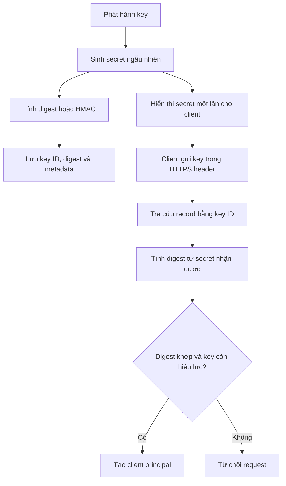
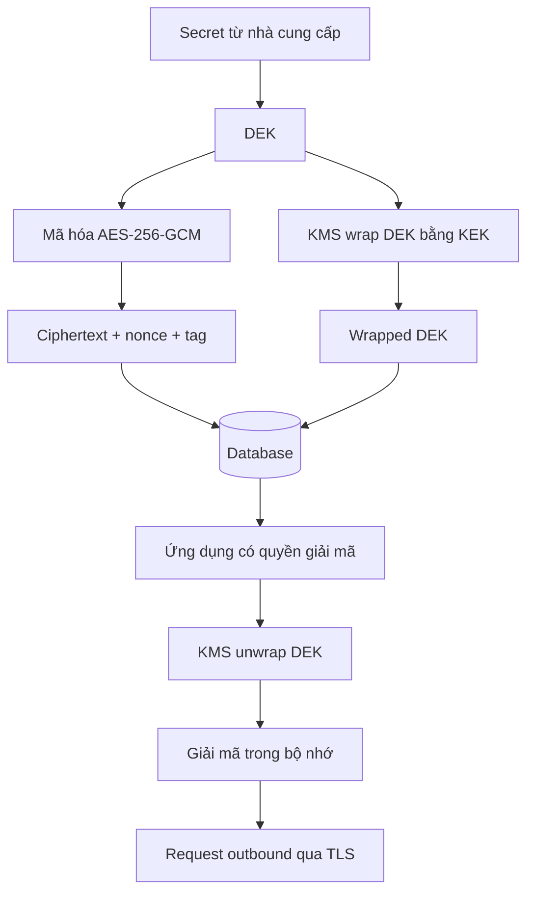

# Hash hoặc bảo vệ key khi lưu server-side

API key là một credential dạng bearer: bên nào sở hữu giá trị bí mật thường có thể thử sử dụng nó trong phạm vi quyền đã cấp. Vì vậy, cách lưu key ở phía máy chủ quyết định mức độ thiệt hại khi cơ sở dữ liệu, bản sao lưu, log hoặc tài khoản vận hành bị xâm phạm.

Trước khi chọn kỹ thuật lưu trữ, cần xác định máy chủ có cần đọc lại secret hay chỉ cần xác minh secret do client gửi lên. Nếu máy chủ chỉ cần xác minh request đến, nên lưu một giá trị một chiều như digest hoặc HMAC. Nếu máy chủ phải lấy lại key để gọi một dịch vụ bên ngoài, cần mã hóa có thể giải mã và quản lý khóa mã hóa riêng. Hai nhu cầu này có mô hình bảo vệ khác nhau.

## 1. Xác định mục đích lưu trữ trước khi chọn thuật toán

Có hai tình huống phổ biến:

| Tình huống | Máy chủ cần làm gì với key? | Cách lưu phù hợp |
|---|---|---|
| Key do hệ thống phát hành cho client gọi API của mình | Nhận key từ request và xác minh nó thuộc về một credential còn hiệu lực | Lưu digest hoặc HMAC của secret; không cần khôi phục secret gốc |
| Key của nhà cung cấp bên ngoài được lưu để hệ thống gọi API thay mặt tổ chức | Lấy lại secret để đặt vào request gửi đến nhà cung cấp | Mã hóa có thể giải mã, ưu tiên envelope encryption và KMS/secret manager |

Ví dụ thứ nhất giống hệ thống phát hành `X-API-Key` cho đối tác. Khi đối tác gọi API, máy chủ nhận secret, tính digest rồi so sánh với giá trị đã lưu. Máy chủ không cần biết lại secret ban đầu.

Ví dụ thứ hai là ứng dụng tích hợp với dịch vụ vận chuyển, thanh toán hoặc gửi email. Ứng dụng cần dùng credential do nhà cung cấp cấp để tạo request outbound. Chỉ lưu hash sẽ không đáp ứng được vì không thể khôi phục giá trị gốc. Trong trường hợp này, secret phải được mã hóa và chỉ giải mã tại thành phần thực sự cần sử dụng nó.

Không nên chọn mã hóa chỉ vì muốn “lưu an toàn hơn” nếu hệ thống chỉ cần xác minh key. Mã hóa tạo ra khả năng khôi phục secret, đồng thời bổ sung yêu cầu bảo vệ khóa giải mã. Ngược lại, không thể dùng hash cho một secret mà hệ thống cần gửi lại nguyên vẹn đến dịch vụ khác.

## 2. Tạo API key đủ ngẫu nhiên

Khả năng chống đoán bắt đầu từ cách tạo key. Một key có cấu trúc rõ ràng giúp tra cứu record nhanh, nhưng phần bí mật phải được sinh từ bộ tạo số ngẫu nhiên mật mã an toàn (Cryptographically Secure Pseudorandom Number Generator – CSPRNG).

Một định dạng thường dùng:

```text
ak_live_<key-id>.<secret>
```

- `ak_live_` là prefix cho biết loại credential hoặc môi trường.
- `<key-id>` là mã định danh không bí mật để tra cứu record.
- `<secret>` là phần bí mật được dùng để xác minh quyền sở hữu key.

Ví dụ minh họa:

```text
ak_live_7f3a91c2d4e8.Yx9n...random-secret...Q2pA
```

Secret nên có ít nhất 128 bit entropy; 256 bit là lựa chọn phổ biến khi chi phí lưu trữ và truyền tải không đáng kể. Có thể tạo 32 byte ngẫu nhiên rồi mã hóa Base64 URL-safe để truyền trong header. Không tạo secret từ tên client, email, timestamp, số thứ tự, UUID không rõ nguồn ngẫu nhiên hoặc chuỗi do người dùng tự nghĩ ra.

Key ID cũng nên khó va chạm và không chứa thông tin nhạy cảm. Tuy nhiên, key ID không phải secret và không được dùng một mình để cấp quyền. Biết key ID chỉ giúp tìm record; người gọi vẫn phải chứng minh đang sở hữu secret tương ứng.

Ví dụ Java tạo secret bằng `SecureRandom`:

```java
public String generateApiKeySecret() {
    byte[] random = new byte[32]; // 256 bit
    secureRandom.nextBytes(random);
    return Base64.getUrlEncoder()
            .withoutPadding()
            .encodeToString(random);
}
```

`secureRandom` cần là một instance `SecureRandom` do runtime cung cấp và được khởi tạo đúng cách. Không dùng `java.util.Random`, timestamp hoặc bộ sinh giả ngẫu nhiên thông thường cho credential.

## 3. Lưu digest khi chỉ cần xác minh key

### 3.1. Quy trình một chiều

Khi phát hành key, máy chủ tạo secret ngẫu nhiên, tính digest và lưu digest cùng metadata. Secret nguyên bản chỉ được hiển thị cho người nhận tại thời điểm tạo. Khi client gửi request, máy chủ lấy secret từ header, tính lại digest rồi so sánh.



Nếu cơ sở dữ liệu bị đọc trái phép, kẻ tấn công chỉ nhìn thấy digest và metadata. Họ không thể lấy trực tiếp secret gốc từ digest. Mức bảo vệ thực tế còn phụ thuộc entropy của secret, thuật toán, việc tách biệt khóa bí mật và các kênh khác có thể làm lộ key.

### 3.2. SHA-256 hay HMAC-SHA-256?

Với API key được hệ thống tự sinh bằng CSPRNG và có entropy cao, SHA-256 là một lựa chọn thực tế để lưu digest. Vì không gian secret rất lớn và không có mẫu dễ đoán, việc thử vét cạn thường không khả thi.

Có thể tăng lớp bảo vệ bằng HMAC-SHA-256 với một pepper bí mật nằm ngoài cơ sở dữ liệu:

\[
digest = HMAC\text{-}SHA256(pepper, secret)
\]

Pepper là khóa bí mật dùng chung hoặc theo phiên bản, được giữ trong KMS/secret manager. Cơ sở dữ liệu chỉ lưu digest và mã phiên bản pepper. Nếu kẻ tấn công chỉ lấy được database mà không lấy được pepper, họ không thể tự tính HMAC cho các secret phỏng đoán để đối chiếu.

| Phương pháp | Ưu điểm | Điều cần lưu ý |
|---|---|---|
| SHA-256 | Đơn giản, nhanh, dễ triển khai và đối soát | Bảo vệ phụ thuộc nhiều vào entropy của key và quyền truy cập database |
| HMAC-SHA-256 với pepper | Secret digest còn phụ thuộc vào khóa bí mật tách khỏi database | Phải quản lý pepper, phân quyền KMS và kế hoạch xoay vòng |
| Argon2id hoặc bcrypt | Làm chậm việc đoán secret có entropy thấp | Tăng chi phí CPU/RAM cho mỗi request; không cần thiết cho API key ngẫu nhiên đủ mạnh |

Không nên mặc định dùng hàm băm mật khẩu chậm cho mọi API key. Argon2id, scrypt hoặc bcrypt phù hợp khi đầu vào có thể do con người chọn và có entropy thấp. Với key máy sinh có 128–256 bit entropy, hàm băm nhanh như SHA-256 hoặc HMAC-SHA-256 thường phù hợp hơn. Nếu cho phép client tự đặt key, hãy xem đó là một bài toán khác và xử lý như mật khẩu.

Salt ngẫu nhiên thường được dùng cho password hashing để chống bảng băm dựng sẵn và bảo đảm mỗi mật khẩu có digest riêng. Với key ngẫu nhiên có entropy cao, salt không phải điều kiện bắt buộc để chống vét cạn. HMAC pepper có mục đích khác: giữ một bí mật ngoài database để kẻ chỉ lấy được database không thể kiểm tra phỏng đoán ngoại tuyến.

### 3.3. So sánh digest an toàn

Không dùng phép so sánh chuỗi thông thường nếu có thể tránh được. Thời gian xử lý có thể phụ thuộc vào vị trí byte khác nhau và tạo ra tín hiệu timing. Sau khi tính digest, dùng phép so sánh constant-time phù hợp với runtime.

Ví dụ Java:

```java
public boolean matches(byte[] candidateDigest, byte[] storedDigest) {
    return MessageDigest.isEqual(candidateDigest, storedDigest);
}
```

Hàm so sánh này chỉ giải quyết việc so sánh byte array. Nó không thay thế việc xác thực key ID, kiểm tra trạng thái credential, giới hạn đầu vào hoặc bảo vệ secret khỏi log và memory dump.

### 3.4. Ví dụ tính HMAC-SHA-256 trong Java

```java
public byte[] calculateDigest(byte[] pepper, String secret) {
    try {
        Mac mac = Mac.getInstance("HmacSHA256");
        mac.init(new SecretKeySpec(pepper, "HmacSHA256"));
        return mac.doFinal(secret.getBytes(StandardCharsets.UTF_8));
    } catch (GeneralSecurityException ex) {
        throw new IllegalStateException("Cannot calculate API key digest", ex);
    }
}
```

Trong triển khai thực tế:

- `pepper` phải được nạp từ KMS hoặc secret manager theo quyền tối thiểu; không hard-code trong source code, Docker image hoặc file cấu hình commit vào Git.
- Cùng một encoding phải được dùng khi tạo key và khi xác minh key.
- Digest nên lưu dạng binary hoặc Base64 chuẩn hóa, không trộn nhiều encoding.
- Không đưa `secret`, `pepper` hoặc request header chứa key vào log hay exception.
- Cần giới hạn độ dài key trước khi tính HMAC để tránh đầu vào bất thường tiêu tốn tài nguyên.

## 4. Thiết kế record trong cơ sở dữ liệu

Một bảng key có thể lưu thông tin nhận diện, digest, phạm vi và vòng đời. Ví dụ giản lược:

```sql
CREATE TABLE api_key_credentials (
    key_id            VARCHAR(64) PRIMARY KEY,
    client_id         VARCHAR(128) NOT NULL,
    tenant_id         VARCHAR(128),
    key_prefix        VARCHAR(24) NOT NULL,
    secret_digest     BYTEA NOT NULL,
    digest_algorithm  VARCHAR(32) NOT NULL,
    pepper_version    VARCHAR(32),
    environment       VARCHAR(16) NOT NULL,
    status            VARCHAR(16) NOT NULL,
    created_at        TIMESTAMP NOT NULL,
    expires_at        TIMESTAMP,
    revoked_at        TIMESTAMP,
    last_used_at      TIMESTAMP,
    quota_policy_id   VARCHAR(64)
);

CREATE INDEX idx_api_key_client
    ON api_key_credentials(client_id);
```

`BYTEA` là kiểu minh họa cho PostgreSQL; hệ quản trị khác có kiểu binary tương đương. Tùy mô hình dữ liệu, scope có thể được lưu trong bảng liên kết riêng để dễ quản lý quyền và audit.

Các nguyên tắc quan trọng:

- `key_id` phải duy nhất và được dùng để tra cứu nhanh.
- `secret_digest` chứa digest/HMAC, không chứa secret gốc.
- `digest_algorithm` và `pepper_version` cho biết cách xác minh record.
- `status`, `expires_at` và `revoked_at` giúp kiểm tra vòng đời.
- `client_id`, `tenant_id`, môi trường và quota phải do máy chủ quản lý.
- Không lưu secret trong cột debug, JSON metadata hoặc bản sao để “dễ hỗ trợ khách hàng”.

Không cần lưu toàn bộ API key đã gửi trong request để hỗ trợ truy vết. Dùng `key_id`, `client_id` và audit event là đủ trong đa số trường hợp.

## 5. Xác minh key trong request pipeline

Một luồng xác minh nên thực hiện theo thứ tự rõ ràng:

1. Đọc key từ header đã quy định, ví dụ `X-API-Key`; từ chối nếu thiếu, sai định dạng hoặc có nhiều giá trị gây nhập nhằng.
2. Kiểm tra độ dài và phân tích prefix, key ID, secret.
3. Tra cứu record bằng key ID.
4. Kiểm tra môi trường, trạng thái, thời hạn và điều kiện thu hồi.
5. Nạp pepper theo phiên bản của record nếu dùng HMAC.
6. Tính digest của secret nhận được và so sánh constant-time.
7. Tạo client principal từ metadata đáng tin cậy trong database.
8. Tiếp tục kiểm tra scope, quyền trên đối tượng, tenant và quota.

Ví dụ khung:

```java
public ClientPrincipal authenticate(String presentedKey) {
    ParsedApiKey parsed = apiKeyParser.parse(presentedKey);
    if (parsed == null || parsed.secret().length() > MAX_SECRET_LENGTH) {
        throw new InvalidApiKeyException();
    }

    ApiKeyRecord record = repository.findByKeyId(parsed.keyId())
            .orElseThrow(InvalidApiKeyException::new);

    if (!record.isActive()
            || record.isExpired(clock.instant())
            || !record.environment().equals(currentEnvironment)) {
        throw new InvalidApiKeyException();
    }

    byte[] pepper = pepperProvider.get(record.pepperVersion());
    byte[] candidate = digestService.hmacSha256(pepper, parsed.secret());
    if (!MessageDigest.isEqual(candidate, record.secretDigest())) {
        throw new InvalidApiKeyException();
    }

    return ClientPrincipal.from(record);
}
```

Đây là ví dụ cấu trúc, cần bổ sung xử lý lỗi KMS, cache và transaction phù hợp. Không trả thông báo khác nhau cho trường hợp key ID không tồn tại, secret sai, key hết hạn hoặc key bị thu hồi nếu điều đó giúp người gọi dò tìm credential hợp lệ. Có thể ghi lý do chi tiết ở audit log nội bộ bằng mã sự kiện không chứa secret.

Sau xác thực, không kết thúc kiểm tra bảo mật ở đây. API phải tiếp tục xác minh client có scope phù hợp, được truy cập tenant và đối tượng cụ thể, cũng như thao tác có hợp lệ với trạng thái nghiệp vụ hay không.

## 6. Khi nào phải mã hóa để có thể đọc lại key?

Nếu máy chủ cần gửi lại credential đến một nhà cung cấp bên ngoài, cần giữ khả năng giải mã. Trong trường hợp này, không thể dùng hash một chiều. Hãy mã hóa secret bằng thuật toán mã hóa xác thực (authenticated encryption) và quản lý khóa mã hóa bên ngoài database.

### 6.1. Dùng envelope encryption

Envelope encryption tách khóa mã hóa dữ liệu (Data Encryption Key – DEK) khỏi khóa mã hóa gốc được quản lý bởi KMS (Key Encryption Key – KEK hoặc wrapping key):

1. Ứng dụng yêu cầu KMS tạo hoặc cấp một DEK.
2. DEK mã hóa secret bằng thuật toán AEAD như AES-256-GCM.
3. KMS dùng KEK để bọc (wrap) DEK.
4. Database lưu ciphertext, nonce, authentication tag, wrapped DEK và phiên bản khóa.
5. Khi cần gọi dịch vụ bên ngoài, ứng dụng yêu cầu KMS mở wrapped DEK, giải mã secret trong bộ nhớ và gửi request qua TLS.



Không tự thiết kế thuật toán mã hóa. Dùng thư viện mật mã chuẩn và chế độ AEAD đã được kiểm chứng. AES-GCM yêu cầu nonce không bị tái sử dụng với cùng một khóa; nonce nên được tạo ngẫu nhiên theo hướng dẫn thư viện và độ dài chuẩn của thuật toán. Authentication tag phải được xác minh trước khi sử dụng plaintext.

### 6.2. Lưu metadata mã hóa

Một record lưu secret mã hóa có thể chứa:

| Trường | Ý nghĩa |
|---|---|
| `ciphertext` | Nội dung secret đã mã hóa |
| `nonce` | Nonce dùng cho AEAD |
| `authentication_tag` | Tag xác minh tính toàn vẹn, nếu thư viện lưu tách |
| `wrapped_dek` | DEK đã được KMS bọc |
| `kek_key_id` | ID/phiên bản khóa KMS đã dùng để bọc DEK |
| `algorithm` | Thuật toán và phiên bản định dạng mã hóa |
| `associated_data_version` | Phiên bản cấu trúc AAD nếu có |

Có thể ràng buộc ciphertext với metadata bằng Additional Authenticated Data (AAD), chẳng hạn record ID, tenant ID, tên nhà cung cấp và mục đích tích hợp. Nhờ vậy, nếu ciphertext bị tráo giữa hai record, bước giải mã sẽ thất bại do AAD không khớp. AAD không bí mật nhưng cần được chuẩn hóa nhất quán giữa lúc mã hóa và giải mã.

### 6.3. Giới hạn quyền giải mã

Không phải mọi thành phần đọc được database đều cần quyền giải mã. Chỉ workload thực sự cần sử dụng secret mới được gọi KMS decrypt. Tách quyền đọc metadata khỏi quyền lấy plaintext, dùng IAM role riêng, giới hạn key theo môi trường và ghi audit cho thao tác giải mã.

Secret chỉ nên xuất hiện trong bộ nhớ trong thời gian cần thiết. Không ghi plaintext vào log, exception, heap dump tùy tiện, tracing hoặc file tạm. Khi xử lý xong, giải phóng tham chiếu và vùng nhớ có thể xóa an toàn nếu runtime hỗ trợ; cần hiểu rằng garbage collector và bản sao nội bộ có thể khiến việc xóa tuyệt đối khỏi bộ nhớ khó bảo đảm.

## 7. Quản lý pepper và khóa mã hóa

Digest/HMAC và encryption có vòng đời khóa riêng. Không dùng cùng một khóa cho HMAC pepper, AES encryption, ký JWT hoặc mục đích mật mã khác. Phân tách theo mục đích giúp giới hạn ảnh hưởng khi một khóa bị lộ và hỗ trợ xoay vòng độc lập.

### 7.1. Xoay vòng pepper khi lưu HMAC

HMAC digest phụ thuộc vào pepper. Nếu thay pepper, digest cũ không thể được tính lại chỉ từ digest cũ vì secret gốc không còn được lưu.

Một quy trình có thể là:

1. Tạo pepper phiên bản mới trong KMS/secret manager.
2. Đánh dấu phiên bản mới là phiên bản dùng cho key phát hành từ thời điểm này.
3. Giữ pepper cũ ở chế độ chỉ xác minh trong thời gian chuyển tiếp.
4. Khi client gửi key hợp lệ dùng pepper cũ, máy chủ đã có secret trong request nên có thể tính lại HMAC với pepper mới và cập nhật digest cùng `pepper_version` trong transaction.
5. Theo dõi số record còn dùng pepper cũ.
6. Khi mọi key đã được chuyển hoặc thu hồi, vô hiệu hóa và xóa pepper cũ theo chính sách KMS.

Nếu key cũ không hoạt động trong thời gian chuyển tiếp, không thể chuyển digest của nó sang pepper mới nếu không có secret. Có thể yêu cầu client xoay vòng key, hoặc tiếp tục giữ pepper cũ trong giới hạn thời gian đã phê duyệt. Không được giả định có thể “mã hóa lại” digest mà không có secret ban đầu.

### 7.2. Xoay vòng khóa mã hóa

Với envelope encryption, KMS thường hỗ trợ tạo phiên bản KEK mới và rewrap DEK mà không cần giải mã rồi mã hóa lại secret bằng một DEK mới. Cách thực hiện phụ thuộc nhà cung cấp KMS và định dạng lưu trữ. Cần giữ khả năng đọc ciphertext cũ trong giai đoạn chuyển đổi, xác minh backup và có kế hoạch phục hồi nếu rewrap lỗi.

Không xóa khóa cũ ngay sau khi tạo khóa mới. Bản backup, replica hoặc dữ liệu lưu trữ có thể vẫn chứa ciphertext được mã hóa bằng khóa cũ. Chỉ vô hiệu hóa hoặc hủy khóa sau khi xác minh mọi dữ liệu cần giữ đã được chuyển, thời hạn lưu trữ đã kết thúc và quy trình khôi phục đã được kiểm thử.

### 7.3. Phân tách môi trường và mục đích

Development, staging và production cần dùng khóa khác nhau. Nhân viên hoặc workload có quyền ở staging không mặc nhiên có quyền đọc secret production. Tương tự, dịch vụ xác minh API key inbound không cần quyền giải mã credential outbound của một tích hợp khác.

Quyền KMS nên giới hạn theo:

- Danh tính workload hoặc service account.
- Hành động cụ thể như `GenerateDataKey`, `Encrypt`, `Decrypt` hoặc `ReEncrypt`.
- Key ID và môi trường.
- Context/AAD hoặc điều kiện ràng buộc phù hợp với nền tảng.
- Mạng, vùng triển khai và thời hạn credential nếu hệ thống hỗ trợ.

## 8. Bảo vệ database, cache và bản sao lưu

Digest không thay thế các biện pháp bảo vệ dữ liệu. Cần kiểm soát toàn bộ nơi dữ liệu có thể xuất hiện:

- Database production: tài khoản ứng dụng chỉ có quyền đọc/ghi các bảng cần thiết; tài khoản hỗ trợ không mặc định được xem digest hoặc ciphertext.
- Backup và replica: mã hóa, giới hạn quyền khôi phục, ghi audit và không đưa dữ liệu production nguyên vẹn vào môi trường phát triển.
- Migration và export: không tạo file CSV, dump hoặc snapshot chứa secret plaintext.
- Cache: chỉ cache metadata hoặc kết quả xác thực trong thời gian ngắn; không cache key plaintext nếu không có nhu cầu bắt buộc.
- Secret manager/KMS: giới hạn quyền truy cập, bật audit và cảnh báo thao tác bất thường.
- CI/CD: không đưa pepper, KEK hoặc secret outbound vào biến build, artifact hoặc log pipeline.

Nếu cache trạng thái key, cần có TTL và cơ chế invalidation khi thu hồi. Một key đã bị thu hồi không nên tiếp tục được chấp nhận vô thời hạn chỉ vì cache ở một API instance chưa được cập nhật. Với endpoint rủi ro cao, cân nhắc tra cứu trạng thái mới hơn hoặc dùng cơ chế phân phối sự kiện thu hồi đáng tin cậy.

## 9. Các sai lầm thường gặp

**Lưu API key nguyên bản trong database để tiện hỗ trợ.** Nếu chỉ cần xác minh inbound key, việc lưu plaintext khiến một lần đọc database có thể làm lộ toàn bộ credential. Hãy lưu digest/HMAC và chỉ hiển thị secret một lần.

**Mã hóa mọi API key dù không cần khôi phục.** Mã hóa yêu cầu quản lý khóa giải mã và làm tăng số thành phần có quyền truy cập plaintext. Với key chỉ dùng để xác minh, digest một chiều thường phù hợp hơn.

**Hash một secret có entropy thấp rồi coi như an toàn.** Hash nhanh không ngăn được đoán ngoại tuyến nếu key dễ đoán. Hãy sinh key ngẫu nhiên đủ mạnh; nếu cho phép secret do con người chọn, dùng cơ chế bảo vệ mật khẩu phù hợp.

**Đặt pepper cạnh database hoặc trong source code.** Nếu database và pepper cùng bị lộ, lợi ích tách biệt biến mất. Lưu pepper trong KMS/secret manager với quyền truy cập tối thiểu.

**Dùng cùng một khóa cho HMAC và mã hóa.** Điều này làm tăng phạm vi ảnh hưởng khi khóa bị xâm phạm và gây khó khăn cho xoay vòng. Tách khóa theo mục đích.

**So sánh digest bằng chuỗi thông thường.** Dùng phép so sánh constant-time phù hợp và không tiết lộ khác biệt giữa các lỗi xác thực cho caller.

**Nghĩ rằng xóa secret khỏi database là đã thu hồi key.** Cần cập nhật nguồn xác thực, cache, replica và mọi instance; đồng thời kiểm tra key không còn được chấp nhận.

**Ghi key vào log để tiện debug.** Che header, loại bỏ secret khỏi trace và chỉ ghi key ID hoặc client ID.

## 10. Kiểm thử và ứng phó khi secret bị lộ

### 10.1. Ma trận kiểm thử

| Tình huống | Kết quả cần xác minh |
|---|---|
| Key hợp lệ và active | Xác thực thành công, principal lấy metadata từ record phía máy chủ |
| Secret sai nhưng key ID đúng | Bị từ chối; không tiết lộ thông tin credential |
| Key ID không tồn tại | Phản hồi bên ngoài không giúp dò key ID hợp lệ |
| Key hết hạn hoặc đã thu hồi | Bị từ chối trên mọi API instance trong giới hạn chính sách |
| Database dump bị lộ | Không có secret plaintext; digest không thể bị dò thực tế nếu key đủ entropy |
| Database bị lộ nhưng pepper không bị lộ | Không thể tự xác minh phỏng đoán HMAC nếu không có pepper |
| Pepper không truy cập được | Xử lý lỗi theo chính sách, không tự động bỏ qua bước xác minh |
| Pepper được xoay vòng | Key mới dùng pepper mới; key cũ được migrate khi xác minh hoặc buộc xoay vòng |
| Ciphertext bị sửa hoặc tráo record | AEAD tag/AAD không hợp lệ và giải mã thất bại |
| KMS từ chối decrypt | Không gửi request outbound với secret rỗng hoặc dữ liệu chưa xác minh |
| Secret xuất hiện trong log hoặc trace | Kiểm thử xác nhận header và plaintext đã được che |
| Cache chưa nhận sự kiện thu hồi | Thời gian chấp nhận key sau thu hồi không vượt giới hạn đã đặt |

Nên có kiểm thử tích hợp cho luồng tạo key, xác minh, thu hồi, xoay vòng pepper, giải mã outbound và phục hồi backup. Kiểm thử đơn vị cho hàm HMAC không chứng minh KMS policy, IAM, logging và cache trong production được cấu hình đúng.

### 10.2. Khi database hoặc secret store bị xâm phạm

Khi phát hiện database chứa digest bị truy cập trái phép, cần xác định dữ liệu nào bị lấy, pepper có bị truy cập cùng lúc hay không, các credential nào còn active và những request nào bất thường đã xảy ra. Nếu secret là ngẫu nhiên đủ mạnh và pepper được tách biệt, digest bị lộ không đồng nghĩa secret đã lộ, nhưng vẫn cần đánh giá theo bằng chứng và chính sách tổ chức.

Nếu pepper bị lộ, xem xét thay pepper và xoay vòng các key chịu ảnh hưởng. Nếu plaintext outbound secret hoặc khóa giải mã bị lộ, thu hồi hoặc thay credential tại nhà cung cấp tương ứng, sau đó cập nhật ciphertext và kiểm tra quyền KMS. Khi có dấu hiệu sử dụng trái phép, bảo toàn audit log và trace trước khi dọn dữ liệu.

Quy trình ứng phó nên ghi rõ owner, phạm vi credential, thời điểm phát hiện, quyết định thu hồi, kết quả xác minh và thời hạn theo dõi. Không chỉ thay đổi một biến cấu hình rồi kết thúc sự cố mà không xác minh các instance, cache và bản sao lưu có còn sử dụng khóa cũ hay không.

## 11. Nguyên tắc thiết kế

Hãy bắt đầu bằng câu hỏi máy chủ có cần lấy lại secret hay không. Nếu chỉ cần xác minh API key inbound, sinh key ngẫu nhiên đủ mạnh, tách key ID khỏi secret, lưu digest hoặc HMAC và so sánh constant-time. Nếu cần sử dụng credential outbound, dùng mã hóa xác thực và envelope encryption với KMS; giới hạn quyền giải mã cho đúng workload.

Trong cả hai trường hợp, cần quản lý phiên bản thuật toán và khóa, phân tách môi trường, bảo vệ database và backup, che secret khỏi log, kiểm soát cache và có quy trình xoay vòng/thu hồi đã kiểm thử. **Hash bảo vệ secret khi máy chủ chỉ cần xác minh; mã hóa bảo vệ secret khi máy chủ phải sử dụng lại giá trị gốc. Chọn đúng theo nhu cầu, rồi bảo vệ toàn bộ vòng đời của dữ liệu và khóa.**
