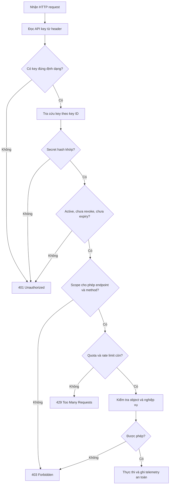

# Scope, quota và expiry cho từng key

API key là credential thường dùng để nhận diện một ứng dụng, tích hợp hoặc service đang gọi API. Key giúp hệ thống biết request thuộc về client nào, áp dụng quyền chức năng, giới hạn mức sử dụng và theo dõi vòng đời của từng tích hợp. Tuy nhiên, một key tĩnh có thể bị sao chép và sử dụng bởi bất kỳ ai nắm giữ nó. Vì vậy, API key cần được cấp quyền tối thiểu, có quota và thời hạn rõ ràng, được lưu trữ an toàn, có thể xoay vòng hoặc thu hồi, và được giám sát riêng.

Trong API Security, không nên xem API key là bằng chứng đầy đủ về danh tính người dùng cuối. Key thường nhận diện ứng dụng hoặc project. Nếu request thực hiện hành động thay mặt một người dùng, hệ thống còn phải xác thực người dùng và kiểm tra quyền trên từng object, thuộc tính cùng trạng thái nghiệp vụ. Ba chính sách `scope`, `quota` và `expiry` giải quyết ba câu hỏi khác nhau: key được làm gì, được sử dụng bao nhiêu và được sử dụng đến khi nào.

## 1. API key nhận diện điều gì?

API key là một chuỗi bí mật được cấp cho một ứng dụng hoặc tích hợp. Khi client gửi key, server dùng nó để tra cứu bản ghi key, xác định chủ sở hữu, môi trường, quyền và chính sách sử dụng.

Ví dụ request:

```http
GET /api/v1/catalog/products HTTP/1.1
Host: api.example.com
X-API-Key: ak_live_7Kp2mQ.<secret-part>
Accept: application/json
```

Một số API dùng header `Authorization` với scheme riêng, nhưng cần tuân theo hợp đồng của API. Với API key, header chuyên biệt như `X-API-Key` giúp phân biệt credential ứng dụng với Bearer token đại diện cho người dùng hoặc phiên OAuth.

API key thường nhận diện:

- Một project hoặc workspace tích hợp API.
- Một ứng dụng backend, đối tác hoặc service account.
- Một môi trường cụ thể như development, staging hoặc production.
- Một integration cụ thể để có thể cấp quyền, quota, expiry và thu hồi độc lập.

API key không tự trả lời người dùng cuối nào đang thao tác. Nếu nhiều người cùng sử dụng một key của ứng dụng, server chỉ biết request đến từ ứng dụng đó. Không thể suy ra user identity từ key dùng chung.

## 2. Scope, quota và expiry giải quyết ba vấn đề khác nhau

| Chính sách | Câu hỏi | Ví dụ |
|---|---|---|
| Scope | Key được phép làm gì? | Chỉ đọc danh mục, không tạo hoặc xóa đơn hàng |
| Quota và rate limit | Key được sử dụng bao nhiêu? | 10.000 request/ngày, tối đa 10 request/giây |
| Expiry | Key còn hiệu lực đến khi nào? | Hết hạn vào một thời điểm UTC hoặc bị thu hồi sớm hơn |

Ba chính sách cần được đánh giá riêng. Key có scope `orders:read` vẫn có thể tạo tải lớn nếu không có giới hạn request. Key còn quota nhưng đã hết hạn vẫn phải bị từ chối. Key còn hạn và dưới quota vẫn không được gọi chức năng ngoài scope.

Một key có thể đồng thời chịu chính sách ở nhiều cấp: key, project, tenant, endpoint và toàn hệ thống. Ví dụ, một key có quota 5.000 request/ngày nhưng project sở hữu nó chỉ được sử dụng tối đa 20.000 request/ngày cho tất cả key cộng lại. Giới hạn tổng giúp ngăn việc tạo nhiều key để né quota của project.

## 3. Thiết kế định dạng và sinh API key

API key nên là chuỗi ngẫu nhiên có entropy cao, được tạo bằng bộ sinh số ngẫu nhiên mật mã. Không dùng ID tuần tự, tên ứng dụng, email, timestamp hoặc chuỗi dễ đoán làm bí mật.

Một định dạng dễ vận hành có thể gồm:

```text
ak_live_<key-id>.<secret>
```

- `ak` cho biết đây là API key.
- `live` phân biệt môi trường production với `test` hoặc `dev`.
- `key-id` là phần định danh công khai để tìm bản ghi key; nó không được dùng như bí mật xác thực.
- `secret` là phần ngẫu nhiên bí mật, chỉ hiển thị khi tạo key.

Ví dụ Java tạo phần bí mật bằng `SecureRandom`:

```java
import java.security.SecureRandom;
import java.util.Base64;

public final class ApiKeyGenerator {
    private static final SecureRandom RANDOM = new SecureRandom();

    private ApiKeyGenerator() {}

    public static String generateSecret() {
        byte[] bytes = new byte[32]; // 256 bit ngẫu nhiên
        RANDOM.nextBytes(bytes);
        return Base64.getUrlEncoder()
            .withoutPadding()
            .encodeToString(bytes);
    }
}
```

Không dùng `java.util.Random` để tạo credential. Bí mật nên đủ dài để không thể dò bằng brute force trong thực tế. Nếu key có prefix hoặc key ID, phần đó chỉ giúp nhận diện và tra cứu; bảo mật phải dựa vào secret ngẫu nhiên.

Nên tạo key riêng cho từng ứng dụng, project, môi trường hoặc đối tác. Không dùng chung một key production cho nhiều service không liên quan. Khi một tích hợp bị xâm phạm, việc tách key giúp thu hồi đúng credential và giảm ảnh hưởng đến các hệ thống khác.

## 4. Lưu trữ key an toàn phía server

Server cần xác minh key ở mỗi request, nhưng không cần lưu lại secret dạng rõ. Một quy trình phổ biến là:

1. Client gửi key qua HTTPS trong header đã quy định.
2. Server parse key ID hoặc prefix để tìm bản ghi ứng viên.
3. Server tính hash/HMAC của secret nhận được bằng thuật toán và pepper được quản lý an toàn.
4. So sánh giá trị tính được với giá trị đã lưu bằng phép so sánh constant-time.
5. Nếu khớp, kiểm tra trạng thái, thời hạn, scope, quota và các ràng buộc khác.

Vì API key được sinh ngẫu nhiên với entropy cao, có thể lưu hash mật mã như SHA-256. HMAC-SHA-256 với pepper lưu ngoài database trong secret manager hoặc KMS tạo thêm lớp bảo vệ nếu database bị lộ. Không dùng hash nhanh cho mật khẩu người dùng có entropy thấp; API key ngẫu nhiên có mô hình khác, nhưng vẫn phải bảo vệ pepper và quy trình rotation của nó.

Ví dụ tính HMAC-SHA-256 ở Java:

```java
import javax.crypto.Mac;
import javax.crypto.spec.SecretKeySpec;
import java.nio.charset.StandardCharsets;

public final class ApiKeyHasher {
    private ApiKeyHasher() {}

    public static byte[] hmacSha256(String secret, byte[] pepper)
            throws Exception {
        Mac mac = Mac.getInstance("HmacSHA256");
        mac.init(new SecretKeySpec(pepper, "HmacSHA256"));
        return mac.doFinal(secret.getBytes(StandardCharsets.UTF_8));
    }
}
```

Khi so sánh byte array, dùng hàm constant-time như `MessageDigest.isEqual` thay vì tự so sánh từng byte rồi dừng ngay khi khác nhau. Pepper phải được tải từ secret manager, không hardcode trong source code hoặc lưu cạnh hash trong cùng database.

Một bản ghi key có thể có các trường:

| Field | Mục đích |
|---|---|
| `key_id` | Định danh bản ghi, không bí mật |
| `secret_hash` | Hash/HMAC của secret, không lưu secret rõ |
| `owner_id` / `project_id` | Chủ sở hữu key |
| `environment` | `test`, `staging` hoặc `live` |
| `scopes` | Danh sách quyền chức năng được cấp |
| `resource_constraints` | Phạm vi project, tenant hoặc tài nguyên được phép |
| `rate_limit_policy_id` | Chính sách giới hạn tốc độ |
| `quota_policy_id` | Chính sách quota theo kỳ |
| `created_at`, `created_by` | Dấu vết tạo key |
| `expires_at` | Thời điểm hết hạn |
| `revoked_at`, `revoked_by` | Thời điểm và người thu hồi |
| `last_used_at` | Lần sử dụng gần nhất |
| `status` | Trạng thái hiện tại theo quy tắc vòng đời |

Secret chỉ nên được hiển thị một lần khi tạo. Nếu người dùng làm mất secret, hãy tạo key mới và thu hồi key cũ thay vì cung cấp lại secret đã lưu. Không đưa secret vào email, ticket, log, analytics hoặc nội dung thông báo.

## 5. Cấp scope tối thiểu cho từng key

Scope là tập quyền chức năng mà key được phép sử dụng. Scope cần cụ thể theo hành động, tránh một quyền chung như `full_access` nếu ứng dụng chỉ cần một phần API.

Ví dụ:

| Scope | Khả năng |
|---|---|
| `catalog:read` | Đọc danh mục sản phẩm |
| `orders:read` | Đọc đơn hàng trong phạm vi được cấp |
| `orders:create` | Tạo đơn hàng |
| `orders:update` | Cập nhật trường được phép của đơn hàng |
| `reports:export` | Xuất báo cáo |
| `users:admin` | Chức năng quản trị người dùng, chỉ cấp khi thật sự cần |

Nếu một tích hợp chỉ đồng bộ danh mục, key chỉ cần `catalog:read`. Không cấp `orders:create`, `orders:delete` hoặc `users:admin` vì tiện cấu hình. Khi nhu cầu thay đổi, chủ sở hữu có thể yêu cầu nâng scope theo quy trình review và audit.

### Scope không thay thế quyền trên object

Scope `orders:read` chỉ cho biết key được gọi chức năng đọc đơn hàng. Nó không có nghĩa key được đọc mọi đơn hàng trong hệ thống. Server vẫn phải ràng buộc object theo project, tenant, khách hàng hoặc quan hệ được cấp. Với tích hợp đối tác, có thể giới hạn key vào một tập account hoặc một project cụ thể.

Nếu request kết hợp API key và access token người dùng, hãy áp dụng giao của hai tập quyền: ứng dụng có được gọi chức năng đó không và người dùng có được thực hiện hành động trên object cụ thể không. Một key hợp lệ không thể nâng quyền người dùng vượt chính sách của họ.

### Phân biệt scope với role

Role thường mô tả nhóm trách nhiệm như `ADMIN`, `OPERATOR` hoặc `VIEWER`. Scope mô tả hành động API mà một credential được cấp như `orders:read`. Một role có thể ánh xạ thành nhiều scope, nhưng không nên coi tên role do client gửi là nguồn quyền đáng tin cậy. Quyền phải được suy ra từ bản ghi key hoặc token đã xác minh và chính sách server.

## 6. Quota và rate limit cho từng key

Quota và rate limit đều giới hạn mức sử dụng, nhưng phục vụ mục đích khác nhau.

| Cơ chế | Giới hạn | Ví dụ |
|---|---|---|
| Rate limit | Tốc độ request trong một khoảng thời gian ngắn | 10 request/giây, burst tối đa 20 |
| Quota | Tổng mức tiêu thụ trong một kỳ | 100.000 request/tháng hoặc 5 GB dữ liệu/ngày |
| Concurrency limit | Số request/tác vụ đang chạy đồng thời | Tối đa 5 tác vụ export đồng thời |
| Payload/resource limit | Kích thước hoặc chi phí của một request | Upload tối đa 10 MB, batch tối đa 100 object |

Rate limit bảo vệ khả năng phục vụ và giảm burst bất thường. Quota kiểm soát ngân sách, hợp đồng hoặc mức sử dụng được cấp trong một kỳ. Concurrency và payload limit bảo vệ các tài nguyên cụ thể mà số request đơn thuần không phản ánh hết.

### Chính sách theo từng key

Ví dụ một key đối tác có thể được cấp:

```yaml
keyId: partner-inventory-live
scopes:
  - catalog:read
  - inventory:read
rateLimit:
  requestsPerSecond: 8
  burst: 16
quota:
  requestsPerDay: 50000
  resetZone: UTC
concurrency:
  maxInFlight: 4
expiry:
  expiresAt: 2027-03-31T23:59:59Z
```

Đây là cấu hình minh họa. Giá trị thật phải dựa trên năng lực hệ thống, mức tiêu thụ dự kiến, hợp đồng và mức độ nhạy cảm của endpoint.

### Kết hợp giới hạn ở nhiều cấp

Không chỉ giới hạn từng key. Nếu một project có thể tạo nhiều key, giới hạn riêng từng key có thể bị né bằng cách tạo thêm key. Hãy cân nhắc đồng thời:

- Giới hạn theo key để phát hiện tích hợp cụ thể bị lạm dụng.
- Giới hạn tổng theo project/tenant để kiểm soát tổng mức sử dụng.
- Giới hạn theo endpoint hoặc nhóm tài nguyên để bảo vệ API đắt đỏ.
- Giới hạn toàn hệ thống để bảo vệ năng lực chung.
- Giới hạn theo IP hoặc nguồn mạng khi phù hợp, nhưng không dùng IP làm danh tính duy nhất.

Một request có thể phải vượt qua nhiều bucket giới hạn. Hệ thống nên xác định thứ tự kiểm tra, cách tính chi phí và thông tin phản hồi nhất quán để client biết khi nào có thể thử lại.

## 7. Triển khai rate limit và quota đáng tin cậy

Trong môi trường nhiều instance, không nên chỉ dùng bộ đếm trong bộ nhớ của từng application instance. Nếu có 5 instance, mỗi instance cho phép 100 request/phút thì một key có thể đạt gần 500 request/phút khi request phân tán đều. Dùng kho trạng thái dùng chung hoặc API gateway để thực thi giới hạn nhất quán.

Các thuật toán thường gặp:

- **Fixed window:** đếm request trong các cửa sổ cố định, dễ triển khai nhưng có thể tạo burst ở ranh giới hai cửa sổ.
- **Sliding window:** tính mức sử dụng trong cửa sổ trượt, mượt hơn nhưng có thể tốn trạng thái hoặc phép tính hơn.
- **Token bucket:** token được bổ sung theo tốc độ xác định; request tiêu thụ token, cho phép burst có giới hạn.
- **Leaky bucket:** xử lý hoặc phát request theo tốc độ ổn định, giúp làm phẳng lưu lượng.

Quota theo ngày/tháng cần cập nhật nguyên tử để hai request đồng thời không cùng vượt giới hạn. Với request có chi phí khác nhau, nên tính quota theo đơn vị tiêu thụ như số record, byte, giây xử lý hoặc số lần gọi upstream thay vì chỉ đếm số request.

Phải xác định rõ request nào bị tính quota: request được nhận, request thành công, request tới upstream hay tác vụ hoàn tất. Với API bất đồng bộ, có thể trừ quota khi nhận tác vụ hoặc khi thực thi, nhưng hợp đồng cần công bố nhất quán. Retry và idempotency cũng cần được tính đến để client không bị tính phí nhiều lần cho cùng một thao tác đã được xác nhận.

Khi vượt rate limit, API thường trả `429 Too Many Requests`, có thể kèm `Retry-After` hoặc các header thông báo giới hạn còn lại. Khi vượt quota của kỳ, cũng có thể dùng `429` nếu hợp đồng coi đó là giới hạn sử dụng; một số API dùng lỗi nghiệp vụ riêng hoặc `403` cho quota đã hết. Điều quan trọng là phân biệt quota hết với token/key không hợp lệ và mô tả rõ thời điểm reset.

## 8. Expiry: thời hạn hiệu lực của key

Mỗi key nên có `expires_at` hoặc một chính sách thời hạn tối đa. Key không nên tồn tại vô thời hạn chỉ vì tích hợp đã hoạt động lâu. Thời hạn tạo ra một điểm buộc chủ sở hữu xem xét lại nhu cầu, scope và người đang sử dụng credential.

Khi xác minh key, server cần kiểm tra:

1. Key có tồn tại và secret có khớp không?
2. Key có đang ở trạng thái active không?
3. `revoked_at` đã được đặt chưa?
4. Thời gian hiện tại có trước `expires_at` không?
5. Key có thuộc môi trường và resource server hiện tại không?
6. Scope, quota, rate limit và các điều kiện bổ sung có cho phép request không?

Nên lưu thời gian dưới dạng UTC và thống nhất cách xử lý thời điểm biên. Ví dụ, key hết hạn khi `now >= expires_at`; tránh dùng timezone địa phương không rõ ràng khiến key hết hạn sớm hoặc muộn ngoài dự kiến.

Expiry nên khác với inactivity timeout. `expires_at` là thời điểm hết hạn cố định; `last_used_at` giúp phát hiện key không còn được dùng. Hệ thống có thể cảnh báo key không hoạt động trong thời gian dài và yêu cầu chủ sở hữu xác nhận hoặc thu hồi, nhưng không nên tự động gia hạn chỉ vì có request bất kỳ.

## 9. Rotation và thu hồi key

Rotation là thay key cũ bằng key mới theo quy trình có kiểm soát. Quy trình thường gồm:

1. Tạo key mới với owner, environment, scope, quota và expiry phù hợp.
2. Hiển thị secret một lần và chuyển qua kênh quản lý secret an toàn cho ứng dụng tích hợp.
3. Cập nhật ứng dụng để dùng key mới; kiểm tra request thành công và telemetry ghi nhận key mới.
4. Duy trì khoảng chuyển tiếp ngắn nếu cần để tránh gián đoạn, nhưng phải có thời hạn kết thúc rõ ràng.
5. Thu hồi key cũ và xác nhận request dùng key cũ bị từ chối.
6. Ghi audit event cho người tạo, thời điểm rotation và key cũ đã thu hồi.

Không để hai key cùng tồn tại vĩnh viễn chỉ vì chưa xác định được client nào còn dùng key cũ. Có thể dùng `last_used_at`, client ID, môi trường và log đã che secret để tìm tích hợp còn phụ thuộc. Nếu key bị lộ, thu hồi khẩn cấp trước, sau đó xử lý cập nhật client và khôi phục dịch vụ theo quy trình sự cố.

Thu hồi cần có hiệu lực nhanh trên tất cả instance và gateway. Nếu trạng thái key được cache, cần cơ chế invalidation hoặc TTL ngắn phù hợp. Một key đã bị thu hồi không được tiếp tục hoạt động chỉ vì cache ở một instance chưa cập nhật.

## 10. Quy trình xác minh key trong API

Một luồng xử lý có thể được tổ chức như sau:



Sơ đồ là thứ tự logic minh họa. Hệ thống thực tế có thể thực hiện một số bước ở gateway, filter hoặc service. Không được bỏ kiểm tra object/tenant chỉ vì key đã vượt qua bước xác thực.

Khi trả lỗi, tránh tiết lộ key ID hoặc trạng thái chi tiết cho người không được phép. Có thể dùng cùng một thông báo chung cho key không tồn tại, sai secret, hết hạn hoặc đã thu hồi để giảm khả năng dò key. Log nội bộ vẫn cần phân loại nguyên nhân mà không ghi secret thô.

## 11. Ví dụ mô hình dữ liệu và kiểm tra quyền

Ví dụ mô hình rút gọn theo cú pháp PostgreSQL:

```sql
CREATE TABLE api_keys (
    key_id VARCHAR(80) PRIMARY KEY,
    secret_hash BYTEA NOT NULL,
    owner_id UUID NOT NULL,
    project_id UUID NOT NULL,
    environment VARCHAR(20) NOT NULL,
    scopes JSONB NOT NULL,
    quota_policy_id UUID,
    rate_limit_policy_id UUID,
    created_at TIMESTAMPTZ NOT NULL,
    expires_at TIMESTAMPTZ NOT NULL,
    revoked_at TIMESTAMPTZ,
    last_used_at TIMESTAMPTZ
);
```

Schema thực tế còn có thể lưu `created_by`, `revoked_by`, trạng thái, phiên bản pepper, resource constraints và metadata audit. Không lưu raw secret vào cột database.

Pseudocode kiểm tra:

```java
ApiKeyRecord key = keyRepository.findByKeyId(parsed.keyId())
    .orElseThrow(InvalidApiKeyException::new);

byte[] candidate = hasher.hmacSha256(
    parsed.secret(), pepperProvider.forVersion(key.pepperVersion()));
if (!MessageDigest.isEqual(candidate, key.secretHash())) {
    throw new InvalidApiKeyException();
}

Instant now = clock.instant();
if (key.revokedAt() != null || !now.isBefore(key.expiresAt())) {
    throw new InvalidApiKeyException();
}

if (!key.scopes().contains(requiredScope)) {
    throw new InsufficientApiKeyScopeException();
}

quotaService.consume(key.keyId(), key.projectId(), requestCost);
```

Đây là pseudocode, không phải filter hoàn chỉnh. Trong triển khai thật, cần xử lý key không tồn tại và secret sai theo cách thống nhất, chọn pepper theo phiên bản lưu trên bản ghi, áp dụng rate limit/quota nguyên tử, tránh cập nhật `last_used_at` gây ghi database cho mọi request nếu lưu lượng lớn, và kiểm tra quyền object trong service nghiệp vụ. Nếu `quotaService.consume` từ chối, không thực hiện side effect nghiệp vụ.

## 12. API key trong browser và ứng dụng công khai

Một key nhúng trong JavaScript frontend, ứng dụng di động phân phối rộng hoặc mã nguồn công khai có thể bị người dùng trích xuất. Minify, obfuscation hoặc đặt key trong biến môi trường lúc build không biến nó thành bí mật; giá trị vẫn có thể xuất hiện trong bundle, bộ nhớ hoặc request của client.

Nếu cần key công khai để nhận diện project hoặc dùng API có dữ liệu công khai, hãy:

- Chỉ cấp quyền đọc dữ liệu công khai cần thiết.
- Hạn chế API, endpoint và tài nguyên được phép.
- Dùng giới hạn theo origin/referrer khi nhà cung cấp hỗ trợ, đồng thời hiểu rằng các giới hạn này không thay thế xác thực cho server-to-server.
- Đặt quota và rate limit chặt, theo dõi mức sử dụng và cảnh báo khi vượt mẫu bình thường.
- Không bao giờ gắn quyền truy cập dữ liệu riêng tư hoặc hành động nhạy cảm vào key công khai.

Đối với thao tác cần secret, gọi API qua backend/BFF do tổ chức kiểm soát. Backend giữ key trong secret manager và áp dụng authorization của người dùng cuối. CORS chỉ điều khiển việc trình duyệt đọc response cross-origin; nó không làm API key trong frontend trở nên bí mật.

## 13. Kết hợp API key với xác thực người dùng

Một API đối tác có thể cần biết cả ứng dụng gọi và người dùng mà ứng dụng đại diện. Khi đó, API key và access token người dùng có vai trò riêng:

| Credential | Nhận diện | Kiểm soát |
|---|---|---|
| API key | Ứng dụng/project/đối tác | Scope của tích hợp, quota, expiry, môi trường |
| User access token | Người dùng hoặc phiên người dùng | Danh tính, scope người dùng, audience và thời hạn |

Server cần xác minh cả hai credential theo hợp đồng. Quyền cuối cùng phải thỏa mãn chính sách của ứng dụng lẫn người dùng. Ví dụ, API key có `orders:read` nhưng user token không có quyền đọc đơn hàng thì request vẫn phải bị từ chối. Nếu user token có quyền cao hơn nhưng key chỉ có `catalog:read`, key cũng không được dùng để gọi chức năng đơn hàng.

Với service-to-service, API key dài hạn thường không phải lựa chọn tốt nhất nếu hệ thống có thể dùng OAuth 2.0 Client Credentials, workload identity hoặc mTLS. Các cơ chế này hỗ trợ xác thực client và quản lý credential theo hạ tầng tốt hơn trong nhiều môi trường. Nếu vẫn dùng API key, hãy giới hạn thời hạn, scope, nguồn sử dụng và khả năng thu hồi.

## 14. Kiểm thử scope, quota và expiry

Kiểm thử cần bao gồm cả trường hợp hợp lệ, sai quyền và các điều kiện biên:

| Nhóm | Ca kiểm thử |
|---|---|
| Định dạng và xác minh | Thiếu key, sai prefix, key ID không tồn tại, secret sai, secret bị cắt hoặc key có entropy/định dạng không hợp lệ |
| Scope | Key chỉ có `catalog:read` thử gọi `orders:create`; key chỉ đọc thử gọi `PATCH`; scope hợp lệ nhưng object thuộc tenant khác |
| Quota | Request cuối cùng vừa chạm quota, request tiếp theo vượt quota, reset kỳ, nhiều request đồng thời, nhiều key cùng project |
| Rate limit | Burst, vượt tốc độ, thử lại sau `Retry-After`, nhiều instance và nhiều gateway cùng xử lý |
| Expiry | Ngay trước thời điểm hết hạn, đúng thời điểm hết hạn, sau thời điểm hết hạn, timezone và clock skew |
| Revocation | Thu hồi khi key đang được cache, request đồng thời lúc revoke, xác minh tất cả instance từ chối key cũ |
| Rotation | Key mới hoạt động, giai đoạn overlap, key cũ bị thu hồi, client cũ nhận lỗi phù hợp |
| Leakage | Secret không xuất hiện trong log, trace, exception, analytics, response hoặc thông báo lỗi |
| Phạm vi | Key test không gọi được API live; key của project A không truy cập tài nguyên project B |

Đặc biệt kiểm thử quota đồng thời và thu hồi phân tán. Một test tuần tự đơn giản có thể bỏ sót lỗi race condition khiến nhiều request cùng vượt ngưỡng hoặc một instance vẫn chấp nhận key đã thu hồi.

## 15. Giám sát và ứng phó khi key bị lộ

Log nên ghi `key_id`, owner/project, environment, route template, method, scope đã kiểm tra, kết quả xác thực, quota còn lại, status code và request ID. Không ghi raw key hoặc secret. Có thể theo dõi:

- Key được dùng từ nguồn mạng hoặc môi trường khác thường.
- Tăng đột biến request, lỗi xác thực hoặc số lần bị `429`.
- Key gọi endpoint ngoài mẫu sử dụng bình thường.
- Key sắp hết hạn, không còn được sử dụng hoặc có scope rộng hơn nhu cầu.
- Một project tạo quá nhiều key hoặc nhiều key cùng đạt giới hạn bất thường.

Khi nghi ngờ key bị lộ, xác định key ID và project liên quan, thu hồi key, kiểm tra log theo khoảng thời gian, đánh giá dữ liệu và hành động đã bị truy cập, rồi tạo key thay thế với scope/quota/expiry phù hợp. Nếu key đã xuất hiện trong repository hoặc log, xử lý cả lịch sử và bản sao theo quy trình quản lý secret. Xóa key khỏi file hiện tại không làm cho bản sao cũ tự mất hiệu lực.

## 16. Checklist quản lý từng API key

- [ ] Mỗi key thuộc một owner/project và một môi trường cụ thể.
- [ ] Secret được sinh bằng bộ sinh ngẫu nhiên mật mã, đủ entropy và chỉ hiển thị một lần.
- [ ] Server chỉ lưu hash/HMAC, pepper được quản lý ngoài database và phép so sánh tránh timing leak.
- [ ] Mỗi key chỉ có scope cần thiết; quyền chức năng không thay thế kiểm tra object/property.
- [ ] Quota, rate limit, concurrency và payload limit được cấu hình theo mức sử dụng và rủi ro.
- [ ] Có giới hạn tổng ở project/tenant để tránh né quota bằng cách tạo nhiều key.
- [ ] Mỗi key có expiry, trạng thái revoke, người tạo/người thu hồi và `last_used_at`.
- [ ] Rotation có giai đoạn chuyển tiếp ngắn, xác minh key mới và thu hồi key cũ.
- [ ] Key không xuất hiện trong URL, source code, log, trace, ticket hoặc client công khai dưới dạng secret.
- [ ] API kiểm tra audience/môi trường, scope, quota và object trước khi thực hiện side effect.
- [ ] Có cảnh báo key sắp hết hạn, key không hoạt động và mức sử dụng bất thường.
- [ ] Có quy trình ứng phó và xác minh thu hồi trên mọi instance khi key bị lộ.

## Kết luận

Mỗi API key cần một chính sách riêng về quyền, mức sử dụng và thời hạn. Scope giới hạn chức năng, quota/rate limit bảo vệ năng lực và ngân sách, còn expiry cùng rotation/revocation kiểm soát vòng đời credential. Khi kết hợp với lưu trữ hash an toàn, phân tách key theo project/môi trường, kiểm tra object và giám sát, hệ thống có thể giới hạn đáng kể tác động nếu một key bị lộ. API key vẫn chỉ nhận diện tích hợp; quyền của người dùng cuối và quyền trên từng tài nguyên phải được kiểm tra theo chính sách riêng.
