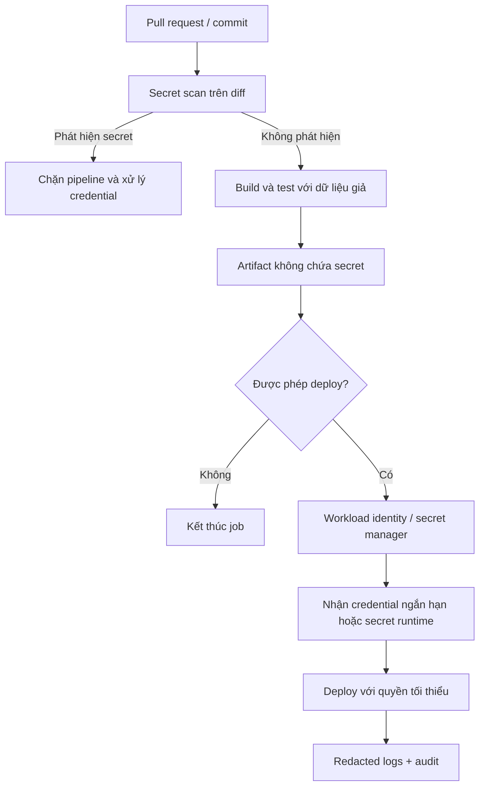

# Không commit key vào source hoặc pipeline log

## 1. Vì sao API key và secret phải được quản lý riêng?

API key, client secret, access token, signing key, mật khẩu database và webhook secret đều là thông tin xác thực. Ai có được credential phù hợp có thể gọi API, đọc dữ liệu, tạo giao dịch hoặc triển khai mã với quyền của hệ thống đang sở hữu nó. Một key bị lộ trong Git hoặc pipeline log có thể bị sao chép và sử dụng từ bên ngoài mà không cần xâm nhập trực tiếp vào server.

Credential thường xuất hiện ở nhiều nơi trong vòng đời phát triển:

- Source code, file cấu hình, file `.env`, ví dụ README, test fixture và script migration.
- Git commit, pull request, branch, tag, fork, patch, code review và lịch sử repository.
- CI/CD variable, command line, shell trace, log build, log test, artifact và cache.
- Dockerfile, build argument, image layer, container environment, crash dump và diagnostic bundle.
- Ticket, chat, paste, ảnh chụp màn hình và tài liệu chia sẻ.

Một credential được xóa khỏi file hiện tại vẫn có thể tồn tại trong commit cũ, fork, cache hoặc log đã lưu. Vì vậy, quy tắc an toàn là không đưa secret vào source, lịch sử Git, đầu ra build hay nội dung log ngay từ đầu. Nếu key đã bị lộ, phải coi nó là không còn bí mật và xử lý theo quy trình sự cố.

## 2. Nhận diện dữ liệu cần bảo vệ

Không phải mọi chuỗi trông giống key đều có cùng mức độ nhạy cảm. Hãy phân loại theo khả năng sử dụng và quyền mà credential cấp:

| Loại dữ liệu | Ví dụ | Cách xử lý |
|---|---|---|
| API key có quyền truy cập dịch vụ | Key gọi payment, email, cloud hoặc dịch vụ AI. | Lưu trong secret manager; giới hạn scope, quota, IP/audience nếu hỗ trợ; xoay vòng khi cần. |
| OAuth client secret | Secret của confidential client. | Lưu ở server/secret manager; không đóng gói vào SPA, mobile app hoặc desktop app phân phối công khai. |
| Access token / refresh token | Token truy cập API hoặc gia hạn phiên. | Không commit hoặc log; giới hạn audience, scope, thời hạn và khả năng thu hồi. |
| Private signing key | Khóa ký JWT, webhook hoặc dữ liệu. | Dùng KMS/HSM hoặc kho khóa được bảo vệ; không lưu plaintext trong repository hoặc pipeline. |
| Mật khẩu và connection string | Database password, Redis password, JDBC URL chứa credential. | Cấp phát lúc chạy; che/redact toàn bộ giá trị trong log và cấu hình chẩn đoán. |
| Webhook secret | Secret xác minh chữ ký webhook. | Quản lý như khóa mật mã; hỗ trợ rotation và xác minh chữ ký an toàn. |
| Public identifier | Client ID, key ID hoặc tên secret không có khả năng xác thực. | Có thể xuất hiện trong cấu hình nếu thực sự không nhạy cảm; vẫn cần tránh nhầm với secret. |

Tên biến như `API_KEY`, `TOKEN` hay `PASSWORD` không tự chứng minh dữ liệu là secret. Ngược lại, một giá trị nhạy cảm có thể được đặt tên rất bình thường. Phân loại theo chức năng và quyền thực tế, không chỉ theo tên field.

## 3. Không đưa key vào source code hoặc cấu hình được commit

### Cách làm không an toàn

```java
public final class PaymentClientConfig {
    // Ví dụ minh họa giá trị giả, tuyệt đối không dùng key thật tại đây.
    private static final String API_KEY = "sk_example_do_not_use_123456";
}
```

Credential trong source có thể bị nhân bản qua mọi clone, fork, bản build và môi trường triển khai. Việc repository là private không loại bỏ rủi ro: quyền đọc repository có thể thay đổi, máy developer có thể bị xâm nhập, hoặc log/patch có thể được chia sẻ ra ngoài.

Các vị trí cần tránh gồm:

- Hằng số trong Java, JavaScript, Python hoặc mã nguồn khác.
- `application.yml`, `application.properties`, file cấu hình theo môi trường có giá trị thật.
- `.env` chứa key thật, file JSON credentials, file `.p12`/`.jks` có private key và file export từ secret manager.
- Unit test, integration test, snapshot, fixture, mock server hoặc dữ liệu mẫu dùng key thật.
- README, tài liệu onboarding, ví dụ lệnh, commit message, issue và pull request description.
- URL query string như `?api_key=...`; URL thường được ghi vào access log, proxy log, browser history và hệ thống analytics.

### Cách làm an toàn hơn

Source chỉ tham chiếu đến tên cấu hình hoặc secret reference. Ứng dụng nhận secret từ môi trường chạy thông qua secret manager, workload identity hoặc cơ chế cấp phát phù hợp.

```yaml
# application.yml: chỉ khai báo tên property, không đặt giá trị bí mật.
payment:
  api-key: ${PAYMENT_API_KEY}
```

```java
@ConfigurationProperties(prefix = "payment")
public record PaymentProperties(String apiKey) {
    public PaymentProperties {
        if (apiKey == null || apiKey.isBlank()) {
            throw new IllegalStateException("Payment API credential is not configured");
        }
    }
}
```

Ví dụ trên chỉ minh họa việc inject cấu hình. Trong production, `PAYMENT_API_KEY` nên được cấp bởi secret manager hoặc nền tảng triển khai với quyền đọc giới hạn. Không ghi giá trị property vào log khi debug cấu hình, dump object hoặc xử lý lỗi.

Với ứng dụng cần gọi API bên thứ ba, chỉ backend đáng tin cậy mới nên giữ key bí mật. Nếu key được nhúng trong JavaScript, mobile app hoặc binary phân phối cho người dùng, attacker có thể trích xuất nó; obfuscation không biến secret phía client thành bí mật.

### `.gitignore` giúp gì và không giúp gì?

Có thể bỏ qua file chứa secret cục bộ:

```gitignore
.env
.env.*
!.env.example
*.p12
*.jks
secrets/
```

`.env.example` chỉ nên chứa tên biến và giá trị giả, chẳng hạn `PAYMENT_API_KEY=replace-me`. Quy tắc ignore không gỡ một file đã được Git track khỏi index hoặc lịch sử; file đã commit vẫn cần được xử lý riêng. Cũng không nên dựa vào `.gitignore` như hàng rào duy nhất: secret có thể bị copy vào file khác hoặc được truyền trực tiếp qua command line.

## 4. Không làm lộ key trong pipeline log

CI/CD thường có quyền truy cập repository, registry, cloud account và môi trường triển khai. Pipeline log có thể được lưu lâu, chia sẻ cho nhiều người hoặc tự động gửi sang hệ thống quan sát. Một lệnh debug tưởng vô hại có thể in toàn bộ môi trường và làm lộ hàng loạt credential.

### Những nguồn rò rỉ thường gặp

- Shell tracing như `set -x`, chế độ verbose hoặc debug command in giá trị biến đã mở rộng.
- `echo`, `printf`, `env`, `printenv`, `set`, `export -p` hoặc lệnh dump toàn bộ cấu hình.
- Truyền key trực tiếp trong command-line argument; process listing hoặc diagnostic output có thể hiển thị tham số.
- Đưa secret vào URL, query string, HTTP header dump, curl verbose hoặc exception message.
- Test thất bại in request/response đầy đủ, object `ConfigurationProperties`, environment hoặc connection string.
- Build tool in cấu hình đã resolve; plugin, script hoặc dependency độc hại đọc biến môi trường.
- Upload log, test report, crash dump, artifact, cache hoặc Docker image layer chứa dữ liệu đã mở rộng.
- Pipeline bật debug trace hoặc chia sẻ log/artifact rộng hơn quyền truy cập secret.

### Truyền secret có kiểm soát

Ví dụ dưới đây minh họa một job GitHub Actions. Giá trị secret được đưa vào environment của đúng step cần sử dụng; script không in giá trị đó:

```yaml
jobs:
  integration-test:
    runs-on: ubuntu-latest
    steps:
      - uses: actions/checkout@v4

      - name: Run integration tests
        env:
          PAYMENT_API_KEY: ${{ secrets.PAYMENT_API_KEY }}
        run: ./gradlew integrationTest
```

Đây là ví dụ cú pháp cho GitHub Actions; cần điều chỉnh theo chính sách pin action/version và nền tảng CI đang dùng. Chỉ cấp secret cho job/step cần nó. Với pull request từ fork hoặc mã nguồn chưa được tin cậy, không cấp credential production. Không in biến, không dump environment và không bật shell trace quanh đoạn xử lý secret.

Không dựa hoàn toàn vào tính năng masking của CI. Masking thường chỉ che đúng chuỗi đã đăng ký; biến đổi như Base64, URL encoding, cắt chuỗi, thêm khoảng trắng hoặc in từng phần có thể vượt qua bộ lọc. Masking là lớp giảm thiểu hậu quả, không phải quyền được phép in secret.

### Quy tắc cho log và lỗi

- Log tên secret, secret reference, key ID hoặc fingerprint đã được phê duyệt thay vì giá trị credential.
- Không log `Authorization`, `Cookie`, `Set-Cookie`, private key, refresh token, password hoặc request header chứa secret.
- Khi ghi request/response, dùng allowlist field cần thiết và redact các field nhạy cảm trước khi serialize.
- Không nối giá trị secret vào exception, assertion message, test report hoặc thông báo lỗi trả về client.
- Tắt verbose HTTP/TLS logging ở production hoặc cấu hình bộ lọc nhạy cảm đã được kiểm thử.
- Giới hạn người có quyền xem log, thời hạn lưu, khả năng tải xuống và quyền chia sẻ artifact.
- Nếu cần debug, tái hiện bằng credential giả có quyền thấp trong môi trường thử nghiệm.

Ví dụ hàm che dữ liệu chỉ nên được xem là một lớp phòng vệ bổ sung:

```java
private static String safeAuthorizationLog(String authorization) {
    if (authorization == null || authorization.isBlank()) {
        return "<absent>";
    }
    return "<redacted>";
}
```

Trong thực tế tốt hơn là không đưa header nhạy cảm vào đối tượng log ngay từ đầu. Một bộ lọc redact có thể bỏ sót tên header viết khác kiểu, field lồng nhau hoặc dữ liệu được mã hóa; allowlist log an toàn thường dễ kiểm soát hơn blacklist.

## 5. Quản lý secret trong CI/CD và quá trình build

### Lưu trữ API key do hệ thống của mình phát hành

Cần phân biệt key mà ứng dụng **phát hành để xác thực caller** với key mà ứng dụng **nhận từ nhà cung cấp để gọi dịch vụ khác**:

- Với key ngẫu nhiên do hệ thống phát hành và chỉ cần so sánh khi caller gửi lên, lưu hash an toàn của key thay vì plaintext. Khi tạo key, chỉ hiển thị giá trị đầy đủ một lần; lưu metadata như key ID/prefix, chủ sở hữu, scope, thời hạn, trạng thái và thời điểm dùng gần nhất. Khi xác thực, tìm record bằng key ID/prefix rồi so sánh hash theo cách an toàn.
- Với credential bên thứ ba mà backend cần lấy lại để ký request hoặc gọi API upstream, hash một chiều không đủ. Lưu giá trị trong secret manager hoặc kho mã hóa được bảo vệ, giới hạn workload được đọc và không đưa vào database/log ở dạng plaintext.

Trong cả hai trường hợp, API key phải có scope, quota, thời hạn và cơ chế revoke. Không dùng chính key đầy đủ làm ID hiển thị trong giao diện hoặc log; dùng một prefix không nhạy cảm hay key ID riêng.

### Secret manager và quyền tối thiểu

Lưu secret trong kho chuyên dụng như cloud secret manager, Vault hoặc cơ chế secret của nền tảng triển khai. Tổ chức cần kiểm soát:

- Ai được tạo, đọc, cập nhật, rotate và revoke secret.
- Workload nào được đọc secret nào, ở môi trường nào và trong khoảng thời gian nào.
- Secret có được phân tách theo dev, test, staging, production và theo ứng dụng hay không.
- Ai đã truy cập secret, vào thời điểm nào và từ workload nào.
- Secret được cache trong bộ nhớ bao lâu, khi rotate thì ứng dụng nhận giá trị mới bằng cách nào.

Không dùng một key production chung cho laptop developer, CI, staging và tất cả service. Mỗi workload nên có credential riêng, scope nhỏ và quota phù hợp để giới hạn phạm vi ảnh hưởng khi bị lộ.

### Ưu tiên credential ngắn hạn

Nếu nền tảng hỗ trợ workload identity hoặc federation, dùng danh tính workload để đổi lấy token ngắn hạn thay vì lưu cloud access key dài hạn trong CI. Ví dụ OIDC federation cho phép pipeline chứng minh danh tính thông qua issuer, repository, branch/environment hoặc claims đã được ràng buộc; cloud IAM cấp quyền trong thời gian ngắn theo policy.

Điều này giảm số secret dài hạn phải lưu và xoay vòng. Tuy nhiên, trust policy phải giới hạn đúng repository, workflow, branch hoặc environment; một OIDC trust rule quá rộng vẫn có thể cho pipeline không mong muốn lấy credential. Không cấp quyền production cho mọi branch hoặc mọi pull request.

### Không đóng gói secret vào image hoặc artifact

Không truyền secret bằng Docker `ARG` hoặc ghi vào `ENV` trong Dockerfile để dùng ở build time. Giá trị có thể xuất hiện trong metadata, layer, history hoặc được giữ lại trong image. Dùng cơ chế secret mount của BuildKit hoặc cấp secret ở runtime. Không copy `.env`, keystore hoặc file credential vào build context; giới hạn context bằng `.dockerignore`.

Artifact và cache cần được xem như dữ liệu có thể rò rỉ. Không upload file cấu hình đã resolve, thư mục home của runner, dump môi trường, keystore hoặc report chứa request thật. Chỉ giữ artifact cần thiết và đặt quyền truy cập/thời hạn phù hợp.

### Phân tách pipeline theo mức độ tin cậy

- Pull request chạy từ fork chỉ được dùng dữ liệu giả và dependency không có quyền truy cập production.
- Job build/test không cần deploy credential thì không được nhận deploy credential.
- Job deploy production chỉ chạy sau điều kiện phê duyệt và policy của môi trường.
- Dùng runner riêng hoặc ephemeral runner cho công việc nhạy cảm; xóa workspace, credential tạm và cache sau job.
- Pin action/plugin/dependency quan trọng, kiểm soát thay đổi pipeline và hạn chế script bên thứ ba được chạy trong job có secret.

## 6. Secret scanning và ngăn chặn trước khi push

Secret scanning nên có nhiều lớp vì không có một công cụ nào bắt được mọi định dạng hoặc mọi đường rò rỉ.

| Lớp kiểm soát | Thời điểm | Mục tiêu |
|---|---|---|
| Developer review và pre-commit hook | Trước commit | Phát hiện secret trong diff khi chi phí sửa còn thấp. |
| Secret scanning cục bộ | Trước push | Quét staged files và có thể quét lịch sử local theo chính sách. |
| Push protection/server-side scanning | Khi push hoặc mở PR | Chặn credential nhận diện được trước khi vào repository trung tâm. |
| CI secret scan | Trong pipeline | Quét diff, source, cấu hình, IaC và một số artifact phù hợp. |
| Periodic repository/history scan | Định kỳ | Phát hiện secret cũ, secret bị bỏ sót hoặc credential mới được thêm vào. |
| Runtime detection và audit | Khi chạy | Phát hiện key bị sử dụng từ nguồn, thời điểm hoặc mức độ bất thường. |

Công cụ có thể dùng gồm secret scanning tích hợp của nền tảng Git, Gitleaks, TruffleHog hoặc scanner được tổ chức phê duyệt. Cần cấu hình rule và baseline cẩn thận để giảm false positive; không đưa giá trị secret thật vào allowlist hoặc file suppression. Khi cần bỏ qua một kết quả giả, ghi nhận lý do và chỉ suppress fingerprint/đường dẫn cụ thể theo quy trình review.

Secret scanning có giới hạn: key tùy biến có thể không khớp pattern; secret được mã hóa hoặc chia nhỏ có thể không bị phát hiện; công cụ không chứng minh key còn hiệu lực hay không. Kết quả “không phát hiện” không thay thế việc quản lý secret đúng cách.

## 7. Nếu key đã bị commit hoặc xuất hiện trong log

Hãy xử lý như một sự cố credential. Xóa dòng secret khỏi file hiện tại là chưa đủ.

1. **Thu hồi hoặc vô hiệu hóa key bị lộ ngay:** dùng console/API quản lý của nhà cung cấp hoặc hệ thống cấp phát. Nếu cần duy trì dịch vụ, tạo credential thay thế với quyền tối thiểu và chuyển ứng dụng sang key mới trước khi thu hồi key cũ khi quy trình cho phép.
2. **Xác định phạm vi:** key thuộc môi trường nào, quyền gì, được lưu ở commit/branch/tag/fork/log/artifact/cache nào, ai có thể đọc và thời gian lộ kéo dài bao lâu.
3. **Điều tra việc sử dụng:** xem audit log, IP/identity, thời gian, API được gọi, quota và tác dụng phụ phát sinh. Coi cả hành vi chưa thấy trong log là chưa được loại trừ nếu log không đầy đủ.
4. **Cấp lại và giới hạn quyền:** tạo key mới riêng cho workload cần dùng; giảm scope/quota; cập nhật secret manager và pipeline; xác nhận ứng dụng hoạt động bằng credential mới.
5. **Làm sạch bản sao:** loại secret khỏi source hiện tại, Git history, branch/tag, PR diff, artifact, cache và log theo khả năng của nền tảng. Việc rewrite history cần phối hợp người quản lý repository vì ảnh hưởng clone/fork và người đang làm việc.
6. **Kiểm tra lại:** chạy secret scan trên working tree và lịch sử theo phạm vi; xác minh key cũ không còn được chấp nhận; kiểm tra pipeline không tiếp tục in secret.
7. **Ghi nhận và cải thiện:** lập timeline, nguyên nhân gốc, phạm vi ảnh hưởng, hành động khắc phục và bổ sung push protection, policy hoặc kiểm thử còn thiếu.

Thứ tự ưu tiên là vô hiệu hóa khả năng sử dụng credential, sau đó mới dọn các bản sao. Rewrite Git history hoặc xóa log không thể làm một key đã bị sao chép trở lại an toàn. Nếu key thuộc đối tác hoặc khách hàng, thực hiện quy trình thông báo theo hợp đồng và chính sách sự cố của tổ chức.

## 8. Ví dụ quy trình pipeline an toàn

Một pipeline deploy nên lấy credential đúng lúc, dùng trong phạm vi nhỏ và không đưa giá trị vào output:



Pipeline cần bảo đảm secret không được truyền sang job không cần nó. Nếu nhiều job dùng chung workspace, kiểm tra file tạm và biến môi trường có được dọn đúng cách hay không. Không dùng log của job trước làm nơi trao đổi secret giữa các job.

## 9. Kiểm thử và giám sát

Kiểm soát secret cần được kiểm thử bằng giá trị giả được đánh dấu rõ, không thử bằng key production thật.

| Ca kiểm thử | Thao tác | Kết quả mong đợi |
|---|---|---|
| Secret trong staged file | Thêm chuỗi giả có pattern secret vào file rồi chạy pre-commit/scan. | Scanner phát hiện hoặc chặn theo policy. |
| Secret trong Git diff | Thử push commit chứa credential giả. | Push protection hoặc CI scan phát hiện. |
| Secret trong log | Chạy job test có biến secret giả và tạo lỗi có kiểm soát. | Log/report không chứa giá trị gốc hoặc biến thể dễ đảo ngược. |
| Shell tracing | Bật debug trong môi trường kiểm thử và xác minh policy ngăn in secret. | Job nhạy cảm không trace lệnh chứa secret; pipeline policy phát hiện cấu hình nguy hiểm. |
| Pull request từ fork | Tạo PR từ nguồn không tin cậy. | Không được cấp secret production hoặc deploy permission. |
| Artifact và cache | Kiểm tra file được upload và cache sau build. | Không có `.env`, keystore, dump environment hoặc credential. |
| Quyền secret manager | Workload không được cấp quyền đọc secret của service khác. | Access bị từ chối và có audit event. |
| Rotation | Thay key theo quy trình và thu hồi key cũ. | Workload chuyển sang key mới; key cũ không còn xác thực được. |
| Incident simulation | Dùng key giả được đánh dấu là compromised. | Runbook xác định được thao tác revoke, điều tra và xác minh. |

Giám sát nên ghi nhận secret access theo principal/workload, secret reference, hành động đọc/rotate/revoke, thời gian và kết quả. Theo dõi key được dùng từ nguồn lạ, tăng đột biến request, vượt quota, quyền truy cập secret bất thường và lỗi rotation. Không ghi chính giá trị secret vào audit log.

## 10. Checklist cho repository và pipeline

- [ ] Source code chỉ chứa tên cấu hình hoặc secret reference, không chứa credential thật?
- [ ] `.env`, keystore, file credential và output nhạy cảm đã được ignore khỏi Git?
- [ ] `.env.example` và test fixture chỉ chứa dữ liệu giả?
- [ ] Không truyền key qua URL, command-line argument, commit message hoặc pull request?
- [ ] Pipeline không dump environment, không echo secret và không bật shell trace quanh secret?
- [ ] Log, test report, artifact, cache và Docker image không chứa secret?
- [ ] CI cấp secret đúng job/step và không cấp cho pull request không tin cậy?
- [ ] Secret được lưu trong secret manager hoặc cơ chế bảo vệ tương đương, có quyền tối thiểu?
- [ ] Có ưu tiên workload identity/credential ngắn hạn khi nền tảng hỗ trợ?
- [ ] Có secret scanning trước commit/push, tại server và trong CI?
- [ ] Có rotation, revoke, audit và runbook xử lý key bị lộ?
- [ ] Key mới/cũ được quản lý riêng theo service, môi trường và scope?

Không commit key vào source hoặc pipeline log là yêu cầu xuyên suốt vòng đời phát triển. Secret manager, workload identity, quyền tối thiểu, secret scanning và log redaction giúp giảm khả năng lộ lọt; quy trình revoke/rotation giúp giới hạn thiệt hại khi một credential vẫn bị phát hiện. Mỗi endpoint và workload cần có credential riêng, quyền rõ ràng và cách giám sát việc sử dụng.
