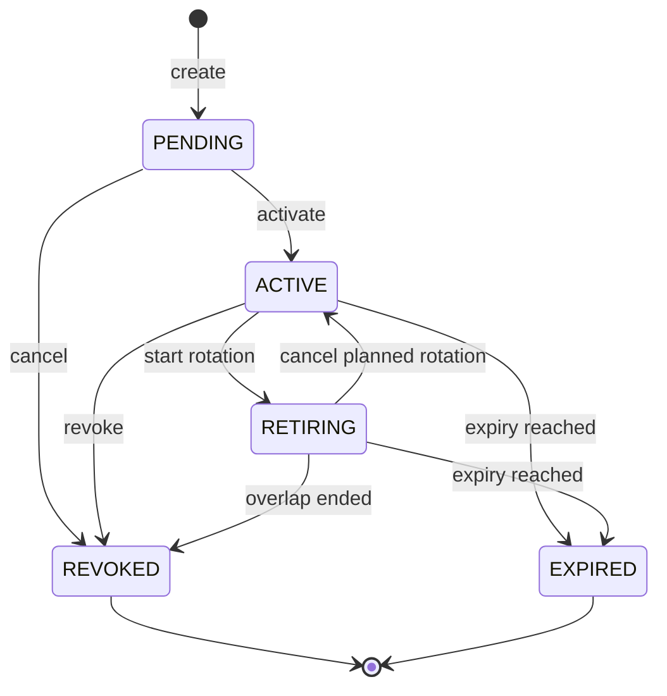
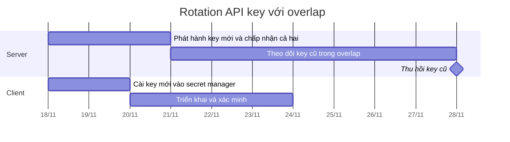

# Rotation với overlap và migration

API key là một credential dạng bearer: bất kỳ bên nào sở hữu key hợp lệ đều có thể gửi request trong phạm vi quyền mà key được cấp. Vì vậy, key cần có vòng đời rõ ràng, được giới hạn quyền và có khả năng thay thế khi đến hạn, khi thay đổi chủ sở hữu hoặc khi nghi ngờ bị lộ. Nếu thay key đồng loạt mà không có kế hoạch chuyển đổi, client đang chạy có thể bị gián đoạn. Nếu giữ key cũ vô thời hạn để tránh gián đoạn, rủi ro từ credential cũ cũng tồn tại vô thời hạn.

Chiến lược **rotation với overlap** giải quyết bài toán chuyển đổi bằng cách cho phép key cũ và key mới cùng hợp lệ trong một khoảng thời gian được kiểm soát. Client được chuyển dần sang key mới; hệ thống quan sát mức sử dụng của từng key; sau khi xác nhận migration hoàn tất, key cũ được thu hồi. Overlap phải có thời hạn và điều kiện kết thúc cụ thể. Khi key bị xâm phạm, cần thu hồi khẩn cấp thay vì duy trì overlap để chờ client chuyển đổi.

## 1. API key và lý do phải rotation

API key thường xác định một ứng dụng, integration hoặc workload gọi API. Nó có thể đại diện cho một khách hàng kỹ thuật hoặc một service account, nhưng không nên mặc định rằng nó chứng minh danh tính của một con người cụ thể.

Một API key tốt có các đặc điểm:

- Được sinh bằng bộ sinh số ngẫu nhiên mật mã (CSPRNG), có entropy đủ lớn.
- Gắn với một integration/service account và một tập quyền cụ thể.
- Có trạng thái, thời điểm tạo, thời hạn, lần sử dụng gần nhất và thông tin người sở hữu.
- Có thể thu hồi độc lập mà không phải thay mọi credential khác của integration.
- Chỉ được hiển thị secret đầy đủ khi tạo; sau đó hệ thống không thể đọc lại secret gốc.
- Được truyền qua TLS và nằm trong header, không nằm trong URL hoặc log.

Rotation giúp giảm thời gian một secret có thể bị lạm dụng nếu đã bị sao chép, lưu nhầm hoặc lộ ra ngoài. Nó cũng hỗ trợ thay đổi nhân sự vận hành, chuyển môi trường, thay nhà cung cấp, thay chính sách mật mã hoặc đáp ứng quy định về tuổi credential.

Rotation không thay thế các kiểm soát khác. Một key còn mới nhưng có quyền quản trị toàn hệ thống vẫn nguy hiểm. Mỗi key cần có scope, tenant, quota, giới hạn tài nguyên và quyền trên dữ liệu phù hợp với workload sử dụng nó.

## 2. Phân biệt rotation định kỳ, migration và thu hồi khẩn cấp

Ba hoạt động này có mục tiêu và cách xử lý khác nhau:

| Hoạt động | Mục tiêu | Cách xử lý key cũ |
|---|---|---|
| Rotation định kỳ | Thay credential theo lịch hoặc chính sách tuổi key | Cho overlap ngắn, có hạn kết thúc và theo dõi migration |
| Migration | Chuyển client sang cơ chế/key mới hoặc phiên bản API mới | Có thể duy trì key cũ trong cửa sổ chuyển đổi được phê duyệt |
| Thu hồi khẩn cấp | Chặn credential bị lộ, bị đánh cắp hoặc bị lạm dụng | Thu hồi ngay; không chờ overlap nếu việc tiếp tục chấp nhận key tạo rủi ro |

Không nên dùng một quy trình rotation định kỳ để xử lý sự cố key bị xâm phạm. Overlap trong tình huống đó đồng nghĩa với việc tiếp tục chấp nhận credential mà attacker có thể đang sở hữu.

## 3. Mô hình dữ liệu và trạng thái của API key

Không nên ghi đè secret cũ trong cùng một bản ghi rồi mất khả năng xác định key nào đang được client sử dụng. Mỗi lần phát hành key mới nên tạo một bản ghi credential độc lập, liên kết về cùng integration hoặc service account.

Một bản ghi key có thể lưu các metadata sau:

| Trường | Mục đích |
|---|---|
| `key_id` | Định danh công khai để tra cứu key; không phải secret |
| `integration_id` | Chủ sở hữu kỹ thuật của key |
| `secret_verifier` | Giá trị kiểm chứng một chiều, không lưu secret gốc |
| `status` | Trạng thái như `PENDING`, `ACTIVE`, `RETIRING`, `REVOKED`, `EXPIRED` |
| `scopes` | Quyền chức năng của key |
| `created_at` | Thời điểm phát hành |
| `not_before` | Thời điểm bắt đầu có hiệu lực nếu có lịch kích hoạt |
| `expires_at` | Thời điểm hết hạn tối đa |
| `retire_at` | Hạn cuối của overlap cho key cũ |
| `last_used_at` | Lần sử dụng gần nhất đã quan sát |
| `revoked_at` | Thời điểm thu hồi |
| `created_by` | Actor đã yêu cầu phát hành key |

Trạng thái nên có quy tắc chuyển rõ ràng:



Đây là mô hình tham khảo. Nếu một key bị thu hồi vì sự cố, không cho phép chuyển ngược từ `REVOKED` về `ACTIVE`. Khi cần credential khác, hãy tạo key mới. Trạng thái `RETIRING` có nghĩa key vẫn được chấp nhận trong một cửa sổ kết thúc đã xác định; nó không có nghĩa key được giữ hoạt động vô thời hạn.

### 3.1. Định dạng key và lưu trữ secret

Có thể dùng định dạng giúp nhận diện môi trường và tra cứu bản ghi:

```text
ak_live_kid_7Qp...secret-random...
```

Trong đó:

- `ak_live` là prefix cho biết loại key hoặc môi trường.
- `kid_7Qp...` là key ID/prefix tra cứu, không phải phần bí mật.
- Phần secret được sinh ngẫu nhiên với entropy cao.

Định dạng thực tế cần tránh để lộ thông tin nhạy cảm trong prefix. Prefix giúp phát hiện key trong log hoặc kho mã mà không phải in toàn bộ secret, nhưng log vẫn phải được kiểm soát.

Vì API key được sinh ngẫu nhiên với entropy cao, hệ thống có thể lưu verifier bằng HMAC-SHA-256 với một pepper nằm ngoài database, chẳng hạn trong KMS hoặc secret manager. Khi xác minh, tra cứu bằng `key_id`, tính HMAC trên secret được gửi lên và so sánh verifier bằng phép so sánh constant-time. Không lưu secret gốc, không trả lại secret qua API list/detail và không ghi nó vào log.

Ví dụ minh họa:

```java
byte[] createVerifier(String secret, SecretKey pepper) {
    Mac mac = Mac.getInstance("HmacSHA256");
    mac.init(pepper);
    return mac.doFinal(secret.getBytes(StandardCharsets.UTF_8));
}

boolean matches(byte[] expected, byte[] supplied) {
    return MessageDigest.isEqual(expected, supplied);
}
```

Đoạn code chỉ minh họa phép tạo verifier và so sánh; triển khai cần quản lý pepper, encoding, lỗi mật mã, version của verifier và luân chuyển pepper. Không dùng một secret hard-code trong source code. Nếu pepper bị thay, phải có kế hoạch chuyển verifier hoặc phát hành lại key vì hệ thống không thể khôi phục secret gốc từ verifier.

### 3.2. Hiển thị secret một lần

Khi tạo key mới, API quản trị có thể trả secret đầy đủ đúng một lần. Người quản trị phải chuyển nó vào secret manager hoặc cấu hình bảo mật của workload. Các lần đọc metadata sau chỉ trả `key_id`, trạng thái, scope, thời hạn và thời điểm sử dụng; không trả secret.

Nếu client làm mất secret trước khi cài đặt, tạo key mới và thu hồi key chưa dùng. Không có chức năng “xem lại key” từ database verifier. Cơ chế này giảm hậu quả nếu database metadata bị truy cập trái phép.

## 4. Overlap là gì và tại sao cần giới hạn?

Overlap là khoảng thời gian mà cả key cũ và key mới đều được API chấp nhận. Trong thời gian này, workload có đủ thời gian cập nhật cấu hình, triển khai phiên bản mới và xác nhận request đã chuyển sang key mới.

Ví dụ timeline:



Ngày trong sơ đồ chỉ là ví dụ. Cửa sổ overlap phải dựa trên thời gian triển khai thực tế, số lượng client, khả năng rollback và mức độ nhạy cảm của key. Cửa sổ càng dài thì nguy cơ key cũ tiếp tục bị sử dụng càng lâu; cửa sổ quá ngắn có thể gây gián đoạn cho client chưa kịp cập nhật.

Các nguyên tắc:

- Có `retire_at` cụ thể cho key cũ ngay khi bắt đầu rotation.
- Cả key cũ và key mới vẫn phải tuân thủ scope, quota, tenant và expiry riêng.
- Chỉ key mới được phân phối cho workload mới sau thời điểm migration bắt đầu.
- Client chuyển sang key mới và không gửi đồng thời cả hai key trong cùng request.
- Quan sát mức sử dụng theo key ID để biết client nào còn dùng key cũ.
- Hết overlap, server thu hồi key cũ tự động hoặc theo bước xác nhận đã định nghĩa.
- Nếu key cũ có dấu hiệu bị lộ, thu hồi ngay và xử lý client chưa migrate bằng quy trình sự cố.

## 5. Quy trình rotation định kỳ không gián đoạn

### Bước 1: Lập danh sách client và phạm vi ảnh hưởng

Trước khi phát hành key mới, xác định:

- Integration/service account đang dùng key cũ.
- Các workload, môi trường và phiên bản ứng dụng đang tiêu thụ key.
- Chủ sở hữu kỹ thuật và kênh liên hệ của từng client.
- Scope, tenant, IP/network restriction và quota hiện tại.
- Tần suất gọi API, thời điểm deploy và khả năng cập nhật cấu hình không restart.
- Thời gian overlap tối đa được phép và cách xử lý client offline.

Nếu một key được chia sẻ cho nhiều ứng dụng không liên quan, hãy xem đó là vấn đề thiết kế cần xử lý. Mỗi workload nên có credential riêng để có thể migrate, giới hạn quyền và thu hồi độc lập.

### Bước 2: Tạo key mới

Tạo secret mới bằng CSPRNG, gắn với cùng integration và chỉ cấp đúng scope cần thiết. Key mới nên có `key_id` riêng, thời điểm tạo, expiry và trạng thái ban đầu theo quy trình. Ghi nhận ai đã tạo và lý do rotation.

Không tái sử dụng secret cũ, không tạo key từ timestamp, tên ứng dụng, UUID dễ đoán hoặc dữ liệu có thể suy ra. Nếu key cũ có quyền quá rộng, đây là thời điểm thu hẹp scope với kế hoạch migration rõ ràng. Tuy nhiên, không âm thầm thay đổi quyền của client đang chạy nếu điều đó có thể phá vỡ hợp đồng nghiệp vụ; cần đánh giá và thông báo trước.

### Bước 3: Bật overlap ở phía server

Lưu key mới như một credential độc lập. Đặt key cũ sang `RETIRING` với `retire_at`, nhưng vẫn cho phép xác thực đến hạn cuối. Server phải xác minh từng key theo trạng thái và thời hạn của chính key đó.

Ví dụ trạng thái trong thời gian overlap:

| Key | Trạng thái | `retire_at` | Được chấp nhận? |
|---|---|---|---|
| Key cũ | `RETIRING` | 2026-11-28T00:00Z | Có, đến hạn cuối nếu chưa bị thu hồi |
| Key mới | `ACTIVE` | Không áp dụng | Có, đến `expires_at` |

Không lưu một giá trị `current_api_key` duy nhất trên integration nếu thiết kế đó khiến key mới phải ghi đè key cũ. Một integration có thể có nhiều key đang hợp lệ trong một khoảng thời gian, nhưng số lượng phải có giới hạn và mọi key phải được quản lý riêng.

### Bước 4: Phân phối key mới an toàn

Chuyển secret đến đúng người hoặc workload qua secret manager, kênh phân phối bí mật hoặc cơ chế provisioning đã được phê duyệt. Tránh gửi qua chat thường, ticket công khai, email không mã hóa, query string hoặc log CI/CD.

Client nên lưu key trong secret manager hoặc hệ thống quản lý cấu hình bí mật của nền tảng. Không commit secret vào Git, Docker image, file cấu hình mẫu, frontend bundle hoặc biến môi trường được in ra log. Quyền đọc secret phải giới hạn cho workload cần dùng.

### Bước 5: Chuyển client sang key mới

Client cập nhật secret theo quy trình triển khai của mình. Trong lúc overlap, server chấp nhận cả hai key, nhưng mỗi request chỉ gửi một credential. Cách này giúp theo dõi chính xác key nào được dùng và tránh hành vi mơ hồ khi cả hai cùng xuất hiện.

Ví dụ header:

```http
GET /api/v1/orders
X-API-Key: ak_live_kid_new_...secret...
```

Tên header là ví dụ theo hợp đồng API. Có thể dùng một scheme riêng trong `Authorization`, nhưng phải nhất quán. Không đặt API key trong URL query hoặc path vì URL thường xuất hiện trong access log, browser history, proxy log, analytics và hệ thống quan sát.

Nếu client hỗ trợ cập nhật secret không restart, vẫn cần bảo đảm thay đổi được áp dụng nguyên tử: request mới dùng key mới, request đang chạy có thể hoàn tất theo giới hạn timeout. Nếu phải restart hoặc rolling deploy, triển khai từng instance để tránh toàn bộ workload ngừng cùng lúc.

### Bước 6: Theo dõi migration bằng key ID

Mỗi lần xác thực thành công, hệ thống nên ghi nhận `key_id`, integration, endpoint/action và thời điểm ở mức cần thiết. Không ghi secret. Từ dữ liệu này, đội vận hành biết client nào đã chuyển sang key mới và key cũ còn được sử dụng ở đâu.

Có thể theo dõi:

- Số request thành công theo key ID và theo client.
- `last_used_at` của từng key.
- Tỷ lệ request từ key mới so với key cũ.
- Endpoint hoặc workload còn dùng key cũ.
- Lỗi xác thực sau thời điểm client thông báo đã chuyển đổi.
- Lưu lượng bất thường từ key cũ trong overlap.

Không nên ghi database mỗi request chỉ để cập nhật `last_used_at` nếu lưu lượng lớn. Có thể cập nhật theo cửa sổ thời gian, sampling hoặc pipeline metrics riêng; nhưng phải giữ đủ độ chính xác để quyết định khi nào thu hồi key cũ.

Một key không có `last_used_at` gần đây chưa chắc đã có thể thu hồi ngay. Client có thể là job theo tháng, hệ thống dự phòng hoặc workload chỉ chạy khi có sự kiện. Cần đối chiếu lịch vận hành và chủ sở hữu trước khi kết thúc overlap.

### Bước 7: Xác nhận và thu hồi key cũ

Trước hạn cuối, tổng hợp usage theo key ID, xác nhận với owner của các workload còn hoạt động và thông báo mốc thu hồi. Nếu client không còn dùng key cũ và đã xác minh key mới hoạt động ổn định, có thể thu hồi sớm.

Khi đến hạn:

1. Chuyển key cũ sang `REVOKED` hoặc trạng thái cuối tương đương.
2. Vô hiệu key ở mọi node/gateway và xóa cache xác thực theo SLA thu hồi.
3. Kiểm tra request sử dụng key cũ bị từ chối.
4. Theo dõi lỗi ở client và xác nhận không còn workload hợp lệ bị ảnh hưởng.
5. Giữ metadata phục vụ audit theo chính sách lưu trữ, nhưng xóa verifier khi hết nhu cầu vận hành/pháp lý.

Thu hồi key cũ là một thay đổi bảo mật cần được xác minh bằng request thực tế, không chỉ dựa vào việc cập nhật trạng thái trong database.

## 6. Ví dụ trạng thái trong thời gian migration

Giả sử integration `warehouse-sync` đang dùng key `key-2026-01`. Hệ thống phát hành `key-2026-02` và cho phép overlap 10 ngày.

| Thời điểm | Key cũ | Key mới | Hành động |
|---|---|---|---|
| Ngày 0 | `ACTIVE` | Chưa có | Trạng thái ban đầu |
| Ngày 1 | `RETIRING` | `ACTIVE` | Phát hành và phân phối key mới; đặt hạn retire ngày 11 |
| Ngày 2-5 | `RETIRING` | `ACTIVE` | Client rolling deploy sang key mới; theo dõi usage |
| Ngày 6-10 | `RETIRING` | `ACTIVE` | Xác minh chỉ còn workload dự phòng dùng key cũ; nhắc hạn cuối |
| Ngày 11 | `REVOKED` | `ACTIVE` | Thu hồi key cũ và xác minh bị từ chối |

Trong suốt quá trình, hai key thuộc cùng integration nên có thể có scope giống nhau. Nếu key mới cần scope khác, hãy coi đó là một thay đổi quyền riêng và kiểm thử trước khi migration. Đừng dùng rotation để vô tình mở rộng quyền.

## 7. Xử lý rollback khi migration gặp lỗi

Rollback cần được thiết kế trước khi bắt đầu. Nếu client mới không thể kết nối do cấu hình sai, certificate, network hoặc lỗi deploy, có thể cần quay lại cấu hình cũ trong thời gian overlap.

Một quy trình rollback có kiểm soát:

1. Dừng rollout client mới và xác định nguyên nhân lỗi.
2. Kiểm tra key cũ còn trong thời hạn, chưa bị thu hồi và không có dấu hiệu xâm phạm.
3. Nếu an toàn, đưa workload bị lỗi trở lại key cũ trong cửa sổ overlap.
4. Giữ key mới ở trạng thái `ACTIVE` hoặc `PENDING` tùy thiết kế; không phát hành lại secret cũ.
5. Sửa lỗi, triển khai lại key mới và tiếp tục migration.
6. Cập nhật mốc kết thúc overlap theo phê duyệt, không tự động kéo dài vô hạn.

Nếu key cũ đã bị thu hồi vì bị lộ, không kích hoạt lại key đó để rollback. Hãy phát hành một key mới khác và xử lý client theo quy trình sự cố. Nếu key mới bị lộ trong lúc migration, thu hồi key mới, tạo key khác và đánh giá liệu key cũ còn đủ an toàn để tiếp tục tạm thời hay không.

## 8. Rotation khẩn cấp khi key bị lộ

Khi nghi ngờ key bị lộ, ưu tiên chặn khả năng sử dụng tiếp. Không duy trì overlap chỉ để có thời gian migration nếu attacker có thể đang dùng key cũ.

Quy trình xử lý sự cố có thể gồm:

1. Xác định `key_id`, integration, scope và tài nguyên key có thể truy cập.
2. Thu hồi key ngay ở nguồn xác thực và gateway; vô hiệu cache theo SLA khẩn cấp.
3. Phát hành key mới qua kênh an toàn cho workload hợp lệ.
4. Thu hẹp scope, quota, network restriction hoặc quyền object nếu cần.
5. Kiểm tra log sử dụng trước và sau thời điểm nghi lộ; tìm hành vi truy cập, export hoặc thay đổi bất thường.
6. Xoay các secret khác nếu có bằng chứng chúng cũng bị lộ trong cùng môi trường.
7. Thông báo owner, lưu bằng chứng và hoàn tất báo cáo sự cố theo quy trình.

Nếu API key được dùng bởi nhiều workload, thu hồi có thể ảnh hưởng diện rộng. Đây là lý do mỗi workload nên có key riêng và metadata owner đầy đủ. Không thể biết client nào bị ảnh hưởng nếu tất cả cùng dùng một secret.

## 9. API và cơ chế vận hành hỗ trợ rotation

Một API quản lý key nên cung cấp các thao tác rõ ràng, được bảo vệ bằng danh tính quản trị riêng và audit trail. Ví dụ thiết kế:

| Endpoint minh họa | Mục đích | Kiểm soát |
|---|---|---|
| `POST /admin/integrations/{id}/keys` | Tạo key mới | Admin có quyền quản lý integration; xác minh bổ sung cho thao tác nhạy cảm |
| `GET /admin/integrations/{id}/keys` | Liệt kê metadata key | Không bao giờ trả secret hoặc verifier |
| `POST /admin/integrations/{id}/keys/{keyId}/retire` | Đặt hạn kết thúc key cũ | Yêu cầu `retire_at`, audit actor và lý do |
| `POST /admin/integrations/{id}/keys/{keyId}/revoke` | Thu hồi key | Kiểm tra quyền, audit và vô hiệu cache |
| `GET /admin/integrations/{id}/key-usage` | Xem mức sử dụng theo key ID | Giới hạn dữ liệu theo tenant và vai trò |

Các endpoint này là ví dụ về hợp đồng; tên và method cần phù hợp với API thực tế. Không cho API key đang được rotate tự cấp key mới hoặc thu hồi key khác nếu điều đó tạo vòng tin cậy không kiểm soát. Quản lý credential nên dùng kênh quản trị có xác thực mạnh, quyền hẹp và có thể yêu cầu MFA/step-up authentication.

### 9.1. Xử lý đồng thời và idempotency

Hai quản trị viên có thể cùng bấm rotate, hoặc request tạo key bị timeout sau khi server đã tạo key. API quản lý cần xử lý trường hợp này:

- Dùng idempotency key hoặc operation ID cho yêu cầu tạo rotation để retry không phát hành nhiều key ngoài ý muốn.
- Ràng buộc số lượng key `ACTIVE`/`RETIRING` tối đa trên mỗi integration.
- Dùng transaction hoặc optimistic locking để không có hai quy trình cùng đặt lịch retire mâu thuẫn.
- Lưu audit event cho create, activate, retire, revoke và thay đổi hạn overlap.
- Trả trạng thái operation để client quản trị biết rotation đã hoàn tất đến đâu.

Nếu secret chỉ hiển thị một lần, một retry sau khi response đầu tiên bị mất không được làm lộ lại secret. API có thể trả trạng thái đã tạo và yêu cầu phát hành key mới nếu secret không được lưu an toàn ở client.

### 9.2. Cache và thời gian thu hồi

API gateway hoặc service có thể cache kết quả xác minh để giảm truy vấn database. Tuy nhiên, cache làm chậm hiệu lực thu hồi. Hãy xác định rõ SLA, ví dụ key bị thu hồi phải bị từ chối trong một khoảng thời gian tối đa, sau đó cấu hình TTL, cache invalidation hoặc push event phù hợp.

Không chỉ cập nhật database rồi giả định mọi node đã biết key bị thu hồi. Với hệ thống nhiều region, cần kiểm tra replication lag, cache ở gateway, sidecar và service. Khi có sự cố, có thể cần cơ chế denylist/kill switch được phân phối nhanh hơn cache thông thường.

Nếu kho dữ liệu xác thực không sẵn sàng, không chấp nhận một key chưa từng được xác minh. Chính sách sử dụng verifier đã cache phải có thời hạn, phạm vi và đánh giá rủi ro rõ ràng. Không biến lỗi dependency thành mặc định cho phép mọi request.

## 10. Kiểm thử rotation và migration

Kiểm thử cần xác minh cả tính liên tục của dịch vụ lẫn việc key cũ thực sự bị loại bỏ đúng hạn.

| Tình huống | Kết quả mong đợi |
|---|---|
| Key mới được tạo | Secret chỉ hiển thị một lần; metadata được lưu đúng |
| Key mới chưa kích hoạt | Bị từ chối nếu trạng thái là `PENDING` |
| Key cũ trong overlap | Vẫn hoạt động trong `retire_at` và trước expiry |
| Key mới trong overlap | Hoạt động theo scope và expiry mới |
| Key cũ quá `retire_at` | Bị từ chối dù trạng thái cache chưa được làm mới theo lịch bình thường; cơ chế phải bảo đảm hạn cuối |
| Key cũ đã `REVOKED` | Bị từ chối ở mọi node sau SLA thu hồi |
| Key hết hạn | Bị từ chối |
| Secret sai nhưng key ID đúng | Bị từ chối; response không phân biệt chi tiết verifier |
| Key ID không tồn tại | Bị từ chối với lỗi xác thực chung |
| Client gửi đồng thời hai key | Request bị từ chối hoặc xử lý theo hợp đồng rõ ràng; không chọn ngẫu nhiên |
| Hai admin cùng rotate | Không tạo trạng thái chồng lấn ngoài giới hạn |
| Retry request tạo key | Idempotency tránh tạo key trùng ngoài ý muốn |
| Client rollback trong overlap | Key cũ chỉ dùng được nếu còn hợp lệ và chưa bị xâm phạm |
| Key cũ bị thu hồi khẩn cấp | Không thể kích hoạt lại qua luồng rollback thông thường |
| Cache/gateway nhiều node | Tất cả node áp dụng trạng thái trong SLA đã định nghĩa |
| Log và metrics | Có key ID và kết quả xác thực, không có secret gốc |

### 10.1. Kiểm thử migration không gián đoạn

Mô phỏng ít nhất một client có nhiều instance:

1. Instance A vẫn dùng key cũ.
2. Instance B được triển khai cấu hình key mới.
3. Cả hai tiếp tục gọi API trong overlap và không tạo lỗi xác thực ngoài dự kiến.
4. Quan sát metrics xác nhận request từ B dùng key mới, A vẫn dùng key cũ.
5. Triển khai key mới cho A.
6. Sau khi không còn request từ key cũ trong thời gian quan sát đủ dài, thu hồi key cũ.
7. Gửi request thử bằng key cũ để xác nhận bị từ chối và bằng key mới để xác nhận vẫn hoạt động.

Kiểm thử cả các job không chạy liên tục, workload theo lịch, worker bất đồng bộ và môi trường disaster recovery. Một client không có request trong vài ngày không đồng nghĩa đã migrate thành công.

## 11. Giám sát và chỉ số vận hành

Rotation cần dữ liệu quan sát đủ để biết migration đã đến đâu. Một dashboard hoặc báo cáo có thể hiển thị:

- Tổng số integration đang có key `ACTIVE` hoặc `RETIRING`.
- Số key sắp hết hạn hoặc đã quá `retire_at` nhưng chưa thu hồi.
- Request thành công theo `key_id`, integration và endpoint.
- Thời điểm sử dụng gần nhất của key cũ.
- Tỷ lệ request bằng key mới so với tổng request của integration.
- Số lỗi xác thực do key hết hạn, bị thu hồi, sai secret hoặc key ID không tồn tại.
- Thời gian từ lúc phát hành key mới đến khi client chuyển hoàn toàn.
- Số lượng rotation bị rollback hoặc phải gia hạn overlap.

Đặt cảnh báo cho key sắp đến hạn, overlap sắp kết thúc nhưng key cũ còn traffic, key cũ tiếp tục được dùng sau khi client báo migrate, hoặc một key xuất hiện ở nhiều nguồn bất thường. Các chỉ số không nên chứa secret; dùng `key_id` và integration ID đã được kiểm soát truy cập.

## 12. Những lỗi thường gặp

| Lỗi | Hệ quả | Cách xử lý |
|---|---|---|
| Ghi đè key cũ bằng key mới trong một trường duy nhất | Client chưa cập nhật bị gián đoạn | Lưu nhiều credential riêng theo key ID |
| Cho overlap không có hạn cuối | Key cũ tiếp tục có thể bị lạm dụng | Bắt buộc `retire_at` và cảnh báo |
| Thu hồi key cũ trước khi client cập nhật | Downtime | Có migration plan, quan sát và xác nhận trước khi revoke |
| Giữ key cũ khi đã bị lộ để chờ client | Attacker tiếp tục truy cập | Thu hồi khẩn cấp, cấp key mới qua kênh an toàn |
| Dùng chung một key cho nhiều workload | Không thể migrate/thu hồi riêng | Tách key theo workload và owner |
| Trả secret trong API list hoặc log | Database/log leak làm lộ credential | Chỉ hiển thị một lần; lưu verifier |
| Không theo dõi key ID | Không biết client nào còn dùng key cũ | Metrics và audit theo key ID |
| Cache không được invalidation khi revoke | Key cũ còn hoạt động trên một số node | SLA thu hồi, TTL và kiểm thử nhiều node |
| Rollback bằng cách kích hoạt lại key đã lộ | Mở lại đường tấn công | Không khôi phục key bị compromise; phát hành key mới |
| Cấp scope rộng hơn trong lúc rotate | Migration làm tăng quyền | Giữ hoặc thu hẹp scope theo thay đổi đã phê duyệt |

## 13. Checklist review quy trình rotation

- [ ] Mỗi workload có API key riêng và có owner chịu trách nhiệm.
- [ ] Key được sinh bằng CSPRNG, entropy cao và có key ID độc lập.
- [ ] Database chỉ lưu verifier; secret chỉ hiển thị một lần và không xuất hiện trong log/URL.
- [ ] Key có scope, tenant, expiry, quota và trạng thái rõ ràng.
- [ ] Rotation tạo key mới độc lập, không ghi đè secret cũ.
- [ ] Key cũ có trạng thái `RETIRING` và `retire_at` cụ thể trong overlap.
- [ ] Client nhận key mới qua kênh phân phối secret được bảo vệ.
- [ ] Client chỉ gửi một key trong mỗi request và có thể rolling deploy.
- [ ] Metrics theo key ID chứng minh client đã chuyển sang key mới.
- [ ] Workload theo lịch và disaster recovery được tính đến trước khi kết thúc overlap.
- [ ] Key cũ được thu hồi và cache/gateway/node áp dụng thu hồi trong SLA.
- [ ] Rollback chỉ dùng key cũ khi key đó còn an toàn và chưa bị thu hồi.
- [ ] Key bị compromise được thu hồi ngay; không kéo dài overlap.
- [ ] API quản trị key có authorization mạnh, idempotency và audit trail.
- [ ] Có test cho overlap, expiry, revoke, cache, nhiều node, rollback và request retry.
- [ ] Có cảnh báo key sắp hết hạn, overlap sắp kết thúc và key cũ còn traffic.

Rotation an toàn là một quá trình có thể quan sát và kiểm chứng: phát hành key mới, cho phép hai key cùng hoạt động trong thời gian giới hạn, chuyển từng workload, xác nhận không còn sử dụng key cũ rồi thu hồi. Khi mỗi workload có credential riêng, quyền được giới hạn, secret không thể đọc lại và trạng thái thu hồi được phân phối nhất quán, hệ thống có thể thay key mà không phải đánh đổi giữa tính liên tục của dịch vụ và khả năng kiểm soát bảo mật.
