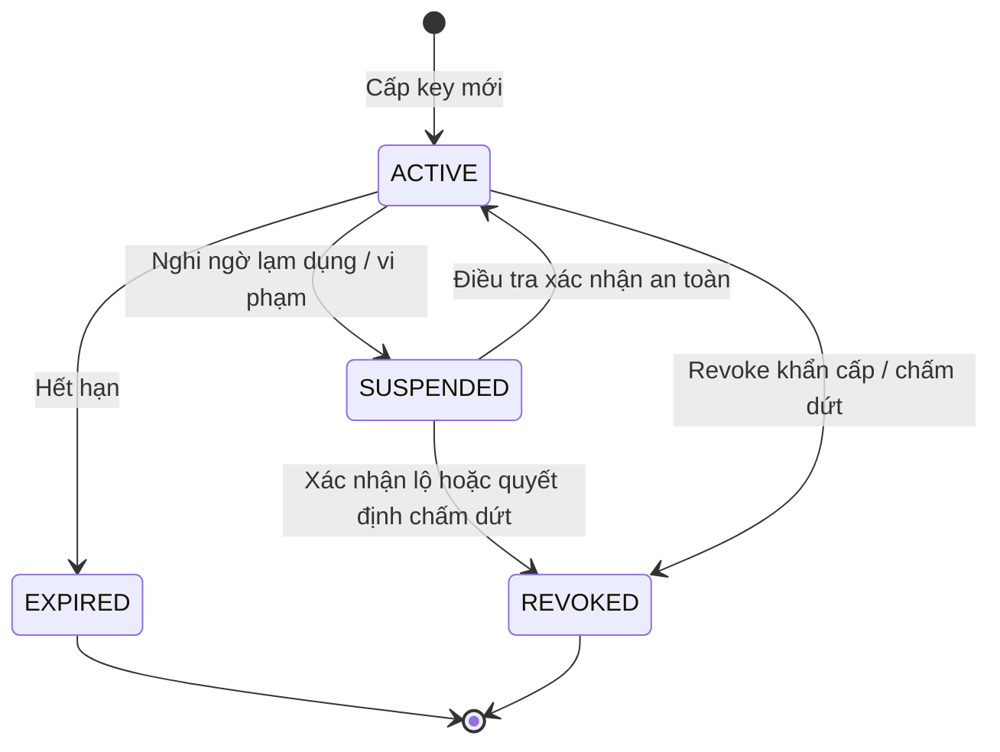
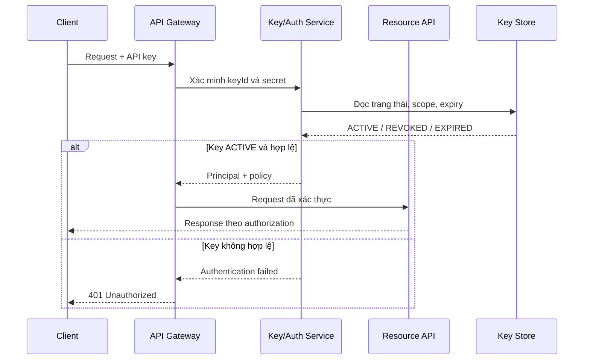

# Revoke key khi vi phạm hoặc nghi ngờ lộ

API key là một credential đại diện cho ứng dụng, đối tác hoặc workload. Khi key bị lộ, được chia sẻ sai quy định, bị dùng vượt quyền hoặc không còn được phép sử dụng, hệ thống phải có khả năng vô hiệu hóa key nhanh chóng và nhất quán. Nếu chỉ xóa key khỏi file cấu hình hoặc phát hành key mới mà key cũ vẫn được chấp nhận ở một số node, nguy cơ vẫn còn nguyên.

Thu hồi (revoke) là hành động chấm dứt quyền sử dụng của một key cụ thể. Xoay vòng (rotation) là quy trình thay key hiện tại bằng key mới. Hai việc thường đi cùng nhau nhưng có mục tiêu khác nhau: rotation có thể có giai đoạn chuyển tiếp để tránh gián đoạn; khi nghi ngờ key bị xâm phạm, cần ưu tiên containment và thu hồi key cũ theo mức độ khẩn cấp, không kéo dài thời gian chấp nhận bí mật đã lộ.

Trong bảo mật API, quy trình revoke phải gắn với danh tính client, phạm vi quyền, trạng thái key, các node xác thực, token downstream, log điều tra và quy trình khôi phục. Mục tiêu là chặn credential bị lạm dụng, giới hạn tác động tới client hợp lệ và lưu đủ bằng chứng để hiểu nguyên nhân.

## 1. Khi nào cần revoke API key?

Không cần đợi có bằng chứng chắc chắn rằng kẻ tấn công đã gọi API. Nếu có cơ sở hợp lý cho thấy bí mật đã rơi vào nơi không được phép, nên coi key có nguy cơ bị xâm phạm và đánh giá thu hồi ngay.

### 1.1. Key bị lộ hoặc có nguy cơ bị sao chép

Các tình huống cần xử lý như một sự cố credential:

- Key được commit vào repository công khai, gửi nhầm vào repository hoặc issue không giới hạn quyền.
- Key xuất hiện trong log, trace, URL, ảnh chụp màn hình, ticket hỗ trợ, chat nhóm hoặc báo cáo lỗi mà người không được phép có thể đọc.
- Key được đóng gói trong JavaScript frontend, source map, ứng dụng mobile hoặc binary phân phối rộng.
- Máy build, máy chủ, tài khoản cloud, secret manager hoặc thiết bị lưu key bị xâm nhập.
- Đối tác thông báo key đã bị lộ, mất thiết bị hoặc không còn kiểm soát được môi trường sử dụng.
- Key được chia sẻ cho nhân viên, nhà thầu hoặc hệ thống không nằm trong danh sách được phép.

Xóa nội dung rò rỉ khỏi vị trí hiện tại không làm mất các bản sao đã được tải xuống, clone, cache, backup hoặc chuyển tiếp. Vì vậy, nếu key thật đã xuất hiện ở nơi không đáng tin cậy, cần xử lý credential ở hệ thống xác thực thay vì chỉ dọn dấu vết.

### 1.2. Có dấu hiệu sử dụng bất thường

Một key vẫn có thể còn nằm trong secret manager của chủ sở hữu nhưng đã bị sao chép. Các dấu hiệu sau cần kích hoạt điều tra và có thể dẫn đến revoke:

- Lưu lượng tăng đột biến hoặc vượt xa mức sử dụng bình thường của client.
- Key gọi endpoint, phương thức HTTP hoặc nhóm tài nguyên chưa từng được sử dụng.
- Request đến từ mạng, ASN, vùng địa lý hoặc thời điểm không phù hợp với hồ sơ tích hợp.
- Một key truy cập nhiều tenant/object hoặc thử ID tuần tự.
- Có nhiều lần xác thực thất bại, thử key gần giống hoặc liên tục gọi endpoint bị từ chối.
- Key được dùng đồng thời từ nhiều môi trường hoặc nguồn không thể giải thích.
- Xuất hiện hành vi scraping, tải dữ liệu hàng loạt, sửa/xóa bất thường hoặc tiêu hao tài nguyên.

Không nên revoke chỉ dựa vào một IP lạ nếu client thường xuyên dùng NAT, proxy hoặc hạ tầng cloud thay đổi. Hãy kết hợp nhiều tín hiệu, mức nhạy cảm của dữ liệu và khả năng giải thích từ chủ sở hữu. Với key có quyền cao hoặc dấu hiệu xâm nhập rõ ràng, containment có thể cần thực hiện ngay trong lúc điều tra tiếp tục.

### 1.3. Key vi phạm chính sách hoặc không còn hợp lệ

Các lý do vận hành cũng có thể yêu cầu revoke:

- Key hết hạn hoặc tới kỳ thay thế theo chính sách.
- Đối tác chấm dứt hợp đồng, tích hợp bị ngừng hoặc chủ sở hữu không còn được ủy quyền.
- Key được dùng sai môi trường, sai tenant, sai mục đích hoặc vượt scope được cấp.
- Client cố tình chia sẻ key, bán lại quyền truy cập hoặc vi phạm điều khoản sử dụng.
- Key được tạo nhầm với quyền quá rộng hoặc gắn sai chủ sở hữu.
- Một ứng dụng/service đã bị loại bỏ và không còn lý do giữ credential.

Trong các trường hợp không khẩn cấp, có thể thông báo trước và lập lịch chuyển đổi. Nếu vi phạm gây rủi ro cho dữ liệu hoặc hệ thống, cần khóa ngay theo chính sách sự cố.

## 2. Phân biệt revoke, disable, expire và rotate

Các trạng thái nên được định nghĩa rõ trong hệ thống quản lý key để người vận hành hiểu hành động nào có thể đảo ngược và key nào còn được chấp nhận.

| Trạng thái/hành động | Ý nghĩa | Có được xác thực request mới? |
|---|---|---|
| `ACTIVE` | Key đang hoạt động, còn thời hạn và đúng policy | Có, nếu các kiểm tra khác đạt |
| `SUSPENDED` / `DISABLED` | Tạm dừng vì điều tra, vi phạm hoặc yêu cầu vận hành | Không, trong thời gian bị dừng |
| `EXPIRED` | Đã qua thời điểm hết hạn | Không |
| `REVOKED` | Đã chấm dứt vĩnh viễn quyền sử dụng key | Không; không tái kích hoạt cùng key |

`DISABLED` có thể dùng cho tạm khóa có thể mở lại sau khi điều tra. `REVOKED` nên là trạng thái kết thúc: nếu client cần truy cập lại, phát hành một key mới với định danh mới. `EXPIRED` phản ánh thời gian hiệu lực đã kết thúc, không nhất thiết là dấu hiệu key bị xâm phạm. Rotation là một quy trình chuyển đổi giữa key cũ và key mới, không phải trạng thái xác thực của một key; trong thời gian chuyển đổi, key cũ chỉ còn được chấp nhận nếu policy cho phép rõ ràng.

**Revoke** chặn một credential cụ thể. **Rotate** thay credential cũ bằng credential mới và cập nhật consumer. Có thể rotate định kỳ khi chưa có sự cố; khi có nghi ngờ lộ, cần revoke key cũ ngay hoặc sau một khoảng chuyển tiếp cực ngắn chỉ khi có lý do vận hành được đánh giá và phê duyệt theo quy trình tổ chức.

## 3. Mô hình trạng thái và vòng đời key

Một key nên có bản ghi quản lý riêng thay vì chỉ là một chuỗi trong cấu hình. Tối thiểu cần có:

- `keyId` hoặc prefix không bí mật để tra cứu key.
- `clientId`, chủ sở hữu, đối tác hoặc workload được gắn với key.
- Môi trường, mục đích, scope, tenant/resource group và quota.
- `createdAt`, `expiresAt`, `lastUsedAt`, `revokedAt`.
- Trạng thái hiện tại, lý do disable/revoke và người/hệ thống thực hiện.
- Tham chiếu ticket/sự cố hoặc quyết định phê duyệt, không chứa raw secret.

Không lưu raw API key nếu không cần thiết. Với key có entropy cao, có thể lưu hash hoặc HMAC phục vụ xác minh, kèm key ID/prefix không bí mật để tra cứu. Secret chỉ hiển thị một lần khi cấp mới và được chuyển tới client qua kênh quản lý secret. Không đưa key vào audit event hoặc lý do revoke.



Sơ đồ chỉ minh họa các trạng thái thường gặp. Trong hệ thống có yêu cầu cao, nên tách trạng thái `SUSPENDED` và `REVOKED` trong dữ liệu, API quản trị và audit log. Không chuyển một key đã revoke trở lại `ACTIVE`; phát hành key mới để có dấu vết vòng đời rõ ràng.

## 4. Quy trình revoke khi nghi ngờ key bị lộ

Một quy trình thực tế cần vừa chặn sử dụng vừa giữ khả năng điều tra. Thứ tự cụ thể có thể thay đổi theo hệ thống, nhưng không nên trì hoãn containment chỉ để hoàn tất báo cáo.

### Bước 1: Nhận diện key mà không làm lộ thêm secret

Xác định key bằng `keyId`, prefix, client ID, môi trường hoặc chủ sở hữu. Không yêu cầu người báo cáo dán raw key vào ticket, chat hoặc log. Nếu chỉ có raw key, dùng quy trình nội bộ được kiểm soát để xác định bản ghi tương ứng và tránh in giá trị ra output.

Ghi nhận:

- Thời điểm phát hiện và thời điểm ước tính bắt đầu rò rỉ.
- Nơi key xuất hiện hoặc tín hiệu bất thường được quan sát.
- Client, môi trường, scope, endpoint và tenant mà key có thể truy cập.
- Ai đã phát hiện, nguồn thông tin và mức độ tin cậy của tín hiệu.

### Bước 2: Đánh giá mức độ và quyết định containment

Đánh giá nhanh phạm vi quyền và hậu quả nếu key tiếp tục được sử dụng. Một key chỉ đọc dữ liệu công khai có thể xử lý theo quy trình thông thường; key có quyền đọc dữ liệu cá nhân, ghi giao dịch, quản trị hoặc truy cập nhiều tenant cần ưu tiên cao.

Nếu key chắc chắn đã lộ, có dấu hiệu bị lạm dụng hoặc có quyền ảnh hưởng cao, chuyển sang revoke/disable ngay. Nếu tín hiệu chưa rõ và việc dừng key có thể gây gián đoạn nghiêm trọng, có thể tạm suspend trong lúc xác minh, giảm scope hoặc áp hạn mức chặt hơn theo quy trình sự cố. Không dùng việc chờ xác minh làm lý do để tiếp tục chấp nhận một key đã công khai.

### Bước 3: Chặn key tại nguồn xác thực

Đổi trạng thái key trong kho quản lý trung tâm sang `REVOKED` hoặc `SUSPENDED`. Authentication service phải từ chối key ở mọi request mới. Nếu hệ thống có API gateway, service mesh hoặc nhiều resource server, trạng thái thu hồi phải được truyền tới tất cả điểm xác thực.

Các việc cần xác nhận:

- Bản ghi key đã đổi trạng thái và không thể được xác minh như key `ACTIVE`.
- Gateway và mọi instance ứng dụng đã nhận trạng thái mới.
- Cache key/credential metadata đã bị vô hiệu hóa hoặc hết hạn theo SLA đã định.
- Request mới dùng key cũ nhận kết quả từ chối nhất quán.
- Nếu hệ thống quản lý key không truy cập được, endpoint nhạy cảm áp dụng chính sách fail closed thay vì tự coi key chưa biết là hợp lệ.

### Bước 4: Kiểm tra token hoặc credential downstream

Một API key có thể được dùng trực tiếp ở API, hoặc được dùng để xác thực với authorization server nhằm lấy access token. Hai trường hợp cần xử lý khác nhau:

- **Key được kiểm tra trực tiếp ở mỗi request:** revoke key sẽ chặn các request mới sau khi trạng thái được truyền tới mọi node.
- **Key dùng để lấy access token:** revoke key chặn việc lấy token mới, nhưng access token đã phát hành có thể còn hiệu lực tới `exp` hoặc tới khi cơ chế thu hồi token được áp dụng. Cần đánh giá token đang tồn tại, refresh token, token family và session liên quan; thu hồi chúng nếu nguy cơ yêu cầu.
- **Key dùng để ký request hoặc ký token:** nếu private signing key bị lộ, phải chuyển sang khóa mới, loại khóa cũ khỏi tập khóa tin cậy theo quy trình, đánh giá request/token đã ký và kiểm tra khả năng giả mạo trong khoảng thời gian bị lộ.

Không giả định revoke một API key sẽ tự động thu hồi mọi access token, refresh token, session hoặc secret downstream mà key từng giúp truy cập.

### Bước 5: Điều tra hành vi trước và sau thời điểm revoke

Truy vấn audit/log bằng key ID, client ID, request ID và khoảng thời gian. Tìm:

- IP/ASN, user agent, thời điểm và tần suất khác thường.
- Endpoint, HTTP method, tenant, object ID và số lượng bản ghi được truy cập.
- Request thành công, request bị từ chối, lỗi authorization và thao tác ghi/xóa.
- Dấu hiệu tải dữ liệu hàng loạt, tạo giao dịch, đổi cấu hình hoặc nâng quyền.
- Các service downstream, database, object storage hoặc webhook bị truy cập qua key.

Giữ bằng chứng theo chính sách tổ chức. Không xóa log hoặc rewrite lịch sử trước khi xác định nhu cầu điều tra. Nếu log chứa raw key, hạn chế quyền truy cập log, đánh giá ai đã xem và xử lý bản sao log như một nguồn rò rỉ khác.

### Bước 6: Xoay vòng các bí mật liên quan và khôi phục

Nếu client cần tiếp tục hoạt động, cấp key mới với scope tối thiểu, thời hạn phù hợp và chủ sở hữu được xác minh. Chuyển secret qua secret manager hoặc kênh được kiểm soát. Xác minh client đã dùng key mới rồi mới đóng sự cố.

Nếu key cũ đã bị lộ, không mở lại key đó để “khôi phục nhanh”. Cần phát hành key mới có ID mới. Nếu secret downstream có thể bị truy cập hoặc lộ cùng lúc, rotate chúng theo mức độ ảnh hưởng. Cuối cùng, theo dõi việc thử dùng key cũ, kiểm tra cảnh báo và cập nhật nguyên nhân gốc.

## 5. Thu hồi nhất quán trong hệ thống phân tán

Một lỗi thường gặp là bản ghi key đã bị revoke ở database trung tâm nhưng một số node vẫn chấp nhận key do cache còn giữ trạng thái `ACTIVE`. Với hệ thống có nhiều gateway, region hoặc service, revoke phải được thiết kế như một luồng phân phối trạng thái bảo mật.

### 5.1. Kiểm tra trạng thái key trên mỗi request

Luồng đơn giản:



Kiểm tra trực tiếp trạng thái ở mỗi request giúp revoke có hiệu lực nhanh nhưng tạo tải lên kho key/auth service. Có thể dùng cache ngắn hạn, nhưng cần chấp nhận và đo lường độ trễ thu hồi tối đa.

### 5.2. Cache và phát tán sự kiện revoke

Nếu cache trạng thái key, cần thiết kế:

- TTL đủ ngắn để giới hạn thời gian key bị revoke vẫn được chấp nhận.
- Sự kiện revoke/invalidate được phát tới gateway và các instance đang giữ cache.
- Xử lý sự kiện lặp, đến sai thứ tự hoặc bị mất; node mới khởi động phải tải trạng thái mới nhất.
- Theo dõi thời gian từ lúc revoke ở nguồn tới lúc tất cả node từ chối key.
- Cơ chế định kỳ đối soát cache với kho dữ liệu trung tâm.

Sự kiện có thể mang `keyId`, trạng thái mới, phiên bản bản ghi và thời điểm thay đổi; tuyệt đối không mang raw key. Khi nhận sự kiện, node loại bỏ cache cũ và không ghi đè trạng thái mới hơn bằng một event cũ.

Với tài nguyên nhạy cảm, cần định nghĩa SLA thu hồi và chính sách khi không thể xác minh trạng thái. Nếu không truy cập được nguồn trạng thái hoặc không chắc cache còn mới, fail closed đối với key có rủi ro cao. Với endpoint công khai ít nhạy cảm, có thể chọn mức sẵn sàng khác nhưng phải nêu rõ giới hạn chấp nhận.

### 5.3. Request đang xử lý và request mới

Revoke thường ngăn request mới được xác thực sau khi trạng thái có hiệu lực. Request đã vượt qua bước xác thực trước thời điểm revoke có thể đang chạy. Với thao tác nhạy cảm hoặc dài, cân nhắc kiểm tra trạng thái/ủy quyền lần nữa ngay trước điểm commit, hoặc dùng transaction và policy phù hợp để ngăn thao tác hoàn tất sau khi quyền bị thu hồi.

Không phải lúc nào cũng có thể hủy an toàn một request đang thực thi. Hãy xác định ranh giới commit, idempotency và cách xử lý tác vụ bất đồng bộ. Job đã enqueue bằng credential cũ cần mang principal/authorization context đã xác minh, có thời hạn và kiểm tra lại quyền trước khi thực hiện tác động quan trọng.

## 6. Thiết kế API quản trị revoke

Chức năng revoke là thao tác bảo mật có tác động lớn, vì vậy endpoint quản trị cũng phải được bảo vệ.

Ví dụ giao diện quản trị nội bộ:

```http
POST /admin/api-keys/key_7f31/revoke HTTP/1.1
Authorization: Bearer <admin-access-token>
Content-Type: application/json
Idempotency-Key: 8d43a6d0-4d7c-4f1e-bfb0-4a1f9a9d7e02

{
  "reason": "suspected_compromise",
  "incidentId": "SEC-2026-1042"
}
```

Thiết kế endpoint cần bảo đảm:

- Chỉ role hoặc permission quản trị credential mới được revoke key; kiểm tra quyền theo client/tenant và phạm vi được quản lý.
- Yêu cầu xác thực mạnh hoặc step-up cho hành động revoke hàng loạt hay key có quyền cao.
- Ghi nhận actor, key ID, lý do chuẩn hóa, thời điểm, incident ID và kết quả; không ghi raw secret.
- Có idempotency: gọi revoke nhiều lần cho cùng key không tạo trạng thái không nhất quán.
- Revoke một key cụ thể; tránh endpoint cho phép truyền wildcard khiến vô hiệu hóa nhầm toàn bộ client.
- Nếu revoke thất bại một phần ở các node, trả trạng thái vận hành rõ ràng và tiếp tục retry/invalidate; không báo thành công hoàn toàn trước khi đạt điều kiện nhất quán đã cam kết.
- Có audit bảo vệ khỏi sửa/xóa và cảnh báo cho thao tác revoke bất thường.

Ví dụ response khi revoke thành công:

```http
HTTP/1.1 200 OK
Content-Type: application/json

{
  "keyId": "key_7f31",
  "status": "REVOKED",
  "revokedAt": "2026-11-18T10:15:00Z",
  "revocationRequestId": "rev_91a2"
}
```

Không trả lại key, hash bí mật hoặc chi tiết nội bộ của hệ thống xác thực. Nếu key không tồn tại hoặc người gọi không có quyền, phản hồi cần tránh tiết lộ thông tin nhạy cảm về key của client khác.

## 7. Xử lý lỗi xác thực sau khi revoke

Khi client tiếp tục gửi key đã revoke, API cần từ chối request. Với API key custom, có thể dùng response chung để không tiết lộ key đang sai, hết hạn hay đã bị thu hồi:

```http
HTTP/1.1 401 Unauthorized
Content-Type: application/problem+json
Cache-Control: no-store

{
  "type": "https://api.example.test/problems/invalid-credential",
  "title": "Unauthorized",
  "status": 401,
  "detail": "Credential không hợp lệ hoặc không còn hiệu lực."
}
```

Phân biệt các trường hợp:

- `401 Unauthorized`: thiếu, sai, hết hạn hoặc đã revoke credential; request chưa được xác thực.
- `403 Forbidden`: credential hợp lệ và principal đã xác thực nhưng không có quyền thực hiện hành động/tài nguyên.
- `429 Too Many Requests`: client vượt quota hoặc rate limit theo policy.
- `503 Service Unavailable`: hệ thống xác minh credential không sẵn sàng và policy yêu cầu fail closed; không được âm thầm chấp nhận key vì không kiểm tra được trạng thái.

Không dùng `403` cho key đã revoke chỉ để phân biệt trạng thái. Thông báo quá chi tiết có thể giúp kẻ tấn công dò xem key nào tồn tại hoặc đã bị thu hồi. Với client hợp lệ, cung cấp hướng dẫn khôi phục qua kênh quản trị đã xác thực, không tiết lộ trạng thái nội bộ cho mọi request.

## 8. Phân biệt revoke khẩn cấp với rotation có kế hoạch

| Tình huống | Cách xử lý | Thời gian chấp nhận key cũ |
|---|---|---|
| Rotation định kỳ, chưa có dấu hiệu lộ | Phát hành key mới, cập nhật consumer, theo dõi, rồi revoke key cũ | Có thể có cửa sổ chuyển tiếp ngắn, được giới hạn trước |
| Key sắp hết hạn | Thông báo chủ sở hữu, cấp key mới và chuyển đổi theo lịch | Chỉ tới thời điểm hết hạn hoặc hạn chót đã công bố |
| Nghi ngờ lộ ở nơi công khai | Đánh giá quyền và mức ảnh hưởng; suspend/revoke nhanh, điều tra song song | Không kéo dài nếu key có thể bị sử dụng trái phép |
| Xác nhận key bị lạm dụng | Revoke ngay, thu hồi token liên quan, điều tra và rotate downstream | Không có thời gian chồng lấp cho key bị xâm phạm |
| Vi phạm chính sách có chủ ý | Revoke theo quyết định có thẩm quyền, bảo toàn audit và bằng chứng | Theo quyết định xử lý; không tự mở lại key cũ |

Trong rotation thông thường, có thể tạm thời cho phép hai key hoạt động để consumer chuyển đổi. Trong sự cố lộ key, việc duy trì key cũ tạo cửa sổ cho kẻ tấn công tiếp tục truy cập. Nếu không thể revoke ngay vì phụ thuộc kỹ thuật, phải có biện pháp containment thay thế như chặn client ở gateway, giảm scope, giới hạn mạng/lưu lượng và thời hạn khắc phục cụ thể; ghi rõ rủi ro còn lại.

## 9. Kiểm thử quy trình revoke

Không chỉ kiểm thử endpoint quản trị trả `200`. Cần chứng minh key cũ thực sự không còn được chấp nhận ở mọi điểm xác thực và hệ thống vẫn vận hành an toàn.

| Nhóm kiểm thử | Cách kiểm tra | Kết quả mong đợi |
|---|---|---|
| Revoke đơn lẻ | Revoke một key đang active rồi gọi API bằng key đó | Request mới bị từ chối |
| Phạm vi | Revoke key A rồi gọi bằng key B cùng client hoặc tenant | Key B vẫn hoạt động nếu chưa bị revoke |
| Toàn bộ node | Gửi request key cũ qua mọi gateway/region/instance sau revoke | Không node nào chấp nhận sau SLA |
| Cache invalidation | Revoke khi node đang cache trạng thái active | Cache bị xóa/cập nhật; độ trễ nằm trong giới hạn |
| Mất kết nối auth store | Làm nguồn xác minh không sẵn sàng | Endpoint nhạy cảm fail closed theo policy |
| Event đến trễ/lặp | Gửi lại event revoke hoặc event cũ | Trạng thái cuối không bị rollback thành active |
| Token downstream | Dùng API key lấy access token rồi revoke key | Token đã phát hành được xử lý theo chính sách thu hồi/expiry riêng |
| Request đang chạy | Revoke khi thao tác nhạy cảm đang xử lý | Điểm commit kiểm tra quyền theo thiết kế; không phát sinh tác động ngoài policy |
| Idempotency | Gọi revoke nhiều lần cho cùng key | Trạng thái ổn định, audit có thể truy vết |
| Phân quyền quản trị | User thường hoặc admin ngoài phạm vi gọi revoke | Bị từ chối; không tiết lộ key khác |
| Audit/logging | Kiểm tra log và event sau revoke | Có key ID, actor, lý do, thời điểm; không có raw key |
| Rotation | Cấp key mới, chuyển consumer, revoke key cũ | Consumer mới hoạt động; key cũ không được chấp nhận |

Nên kiểm thử cả trường hợp nhiều region, cache cục bộ, queue sự kiện bị chậm và node khởi động lại. Nếu SLA revoke là 30 giây, cần đo thời gian thực tế từ lúc ghi trạng thái trung tâm tới lúc request mới bị từ chối ở node chậm nhất.

## 10. Checklist vận hành

- [ ] Mỗi key có `keyId`, chủ sở hữu, client, môi trường, scope, thời hạn và trạng thái.
- [ ] Có quy trình báo cáo key bị lộ hoặc vi phạm, không yêu cầu gửi raw key qua ticket/chat.
- [ ] Có thể suspend/revoke riêng một key mà không vô hiệu hóa nhầm các key khác.
- [ ] Revoke được truyền tới gateway, region, service và cache theo SLA xác định.
- [ ] Endpoint nhạy cảm fail closed nếu không xác minh được trạng thái key.
- [ ] Có phân biệt key bị revoke với access/refresh token đã được phát hành từ key đó.
- [ ] Có quy trình phát hành key mới, chuyển consumer và thu hồi key cũ.
- [ ] Key đã revoke không thể tái kích hoạt; cần cấp key mới nếu muốn khôi phục truy cập.
- [ ] Có audit actor, lý do, incident ID, thời điểm và kết quả mà không lưu raw secret.
- [ ] Có điều tra request trước/sau revoke và đánh giá dữ liệu/downstream bị ảnh hưởng.
- [ ] Có kiểm thử cache, event propagation, nhiều node, mất kết nối auth store và request đang xử lý.
- [ ] Có cảnh báo khi key bị dùng sau revoke hoặc có nỗ lực sử dụng credential đã bị thu hồi.

Revoke chỉ có ý nghĩa khi mọi điểm xác thực thực sự ngừng chấp nhận key và các quyền downstream liên quan được đánh giá. Một quy trình tốt nhận diện key bằng ID, chặn sử dụng nhanh, phát tán trạng thái tới toàn hệ thống, điều tra dấu hiệu lạm dụng, cấp credential mới an toàn và xác minh key cũ bị từ chối. Với key nghi ngờ bị lộ, ưu tiên giảm thời gian kẻ khác còn có thể sử dụng bí mật đó.
