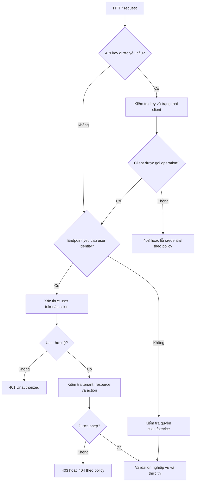

# Không dùng API key thay cho user authorization

API key thường được dùng để nhận diện một ứng dụng, project hoặc tích hợp đang gọi API. Nó có thể giúp server biết request đến từ client nào, áp dụng quota và giới hạn các endpoint mà client được sử dụng. Tuy nhiên, API key không tự chứng minh người đang thao tác là ai, người đó thuộc tenant nào hoặc có quyền đọc và sửa một đối tượng cụ thể.

Ví dụ, một ứng dụng thương mại điện tử có API key để gọi dịch vụ danh mục sản phẩm. Nếu người dùng đăng nhập vào ứng dụng rồi gửi yêu cầu xem đơn hàng, việc request có API key hợp lệ chỉ cho biết ứng dụng có credential được cấp. Server vẫn phải xác thực người dùng và kiểm tra người dùng có quyền xem đơn hàng đó hay không. Nếu chỉ dựa vào API key, bất kỳ người nào lấy được key đều có thể sử dụng quyền của ứng dụng.

Trong module `SECURITY_API_SECURITY`, bảo mật API được thiết kế theo từng endpoint, đối tượng dữ liệu và luồng nghiệp vụ. API key có thể là một phần của nhận diện client hoặc xác thực tích hợp, nhưng không thay thế xác thực người dùng, phân quyền chức năng, phân quyền đối tượng/tenant và kiểm tra trạng thái nghiệp vụ.

## Mục tiêu học tập

Sau bài này, người học có thể:

- Phân biệt danh tính ứng dụng (application/client identity) với danh tính người dùng (user identity).
- Giải thích API key chứng minh điều gì và không chứng minh điều gì.
- Thiết kế mô hình kết hợp API key, user authentication và authorization theo endpoint/đối tượng.
- Giới hạn scope, quota và quyền của từng key theo nguyên tắc least privilege.
- Quản lý vòng đời key: tạo, phân phối, lưu trữ, xoay vòng, thu hồi và điều tra khi bị lộ.
- Nhận diện rủi ro của API key trong trình duyệt, ứng dụng mobile, URL, log và mã nguồn.
- Kiểm thử truy cập chéo người dùng/tenant và bảo đảm key không biến thành quyền truy cập toàn hệ thống.

## 1. API key đại diện cho ai?

API key là một credential do hệ thống phát hành cho một ứng dụng, project, integration hoặc workload. Khi server nhận key hợp lệ, nó có thể nhận diện client đã được cấp key theo chính sách của hệ thống.

Một key thường gắn với các thông tin quản lý như:

- Chủ sở hữu hoặc tổ chức chịu trách nhiệm cho integration.
- Tên ứng dụng, môi trường và mục đích sử dụng.
- Các API, operation hoặc resource mà key được phép gọi.
- Quota, rate limit, giới hạn IP hoặc giới hạn thời gian nếu có.
- Trạng thái hoạt động, ngày tạo, ngày hết hạn và lịch sử xoay vòng.

API key không mặc nhiên chứa danh tính người dùng cuối. Nếu một key được nhúng trong ứng dụng mobile hoặc frontend web, hàng nghìn người dùng có thể cùng gửi request bằng một key. Server nhìn thấy cùng một client identity, dù mỗi request được khởi tạo bởi một người khác nhau.

### 1.1. Phân biệt các loại principal

| Principal | Đại diện cho | Ví dụ | Quyết định cần kiểm tra |
|---|---|---|---|
| User principal | Người đang đăng nhập hoặc người dùng được ủy quyền | `user-123` | Người này được đọc đơn hàng nào, sửa trường nào, thực hiện hành động nào? |
| Application/client principal | Ứng dụng hoặc project được cấp credential | `mobile-store-app` | Client này được gọi API nào, dùng quota nào, có bị thu hồi không? |
| Workload/service principal | Một service hoặc workload trong hệ thống | `order-service` | Service này được gọi service nào và được thực hiện operation nào? |
| Tenant/organization context | Phạm vi tổ chức mà request đang hoạt động | `tenant-abc` | Resource có thuộc tenant đã được xác thực và ủy quyền không? |

Một request có thể mang nhiều ngữ cảnh cùng lúc. Ví dụ, `mobile-store-app` gửi request thay mặt `user-123` trong `tenant-abc`. Server cần xác minh client credential nếu contract yêu cầu, xác thực user token, xác định tenant từ context tin cậy và kiểm tra quyền trên resource. Không gộp các danh tính này thành một giá trị `clientId` hoặc `X-User-Id` do client tự khai báo.

### 1.2. API key có phải là authentication không?

API key là một loại credential và có thể được dùng để xác thực hoặc nhận diện ứng dụng ở mức client. Khi nói “API key không thay user authorization”, ý chính là key không đủ để xác định quyền của người dùng cuối trên dữ liệu và nghiệp vụ.

Một key hợp lệ có thể cho phép client gọi một API công khai hoặc một operation tích hợp có phạm vi hẹp. Điều đó không đồng nghĩa người gửi request được phép truy cập mọi tài khoản, tenant hoặc đối tượng. Cũng không nên xem việc key hợp lệ là bằng chứng người dùng đã đăng nhập.

## 2. Rủi ro khi dùng API key thay user authorization

### 2.1. Mọi người dùng cùng chia sẻ quyền của ứng dụng

Giả sử frontend gửi `X-API-Key` giống nhau cho tất cả người dùng. Backend chỉ kiểm tra key rồi trả dữ liệu theo `orderId`:

```http
GET /api/orders/ord-9002
X-API-Key: app-key-abc123
```

Nếu server không xác thực user và không kiểm tra quan hệ giữa user với đơn hàng, người dùng có thể thay `orderId` để đọc đơn hàng của người khác. Key hợp lệ chỉ xác nhận request sử dụng credential của ứng dụng; nó không xác nhận quyền sở hữu đơn hàng.

Đây là lỗi phân quyền mức đối tượng (BOLA/IDOR). Nếu key còn được cấp quyền rộng, sự cố có thể ảnh hưởng đến toàn bộ người dùng sử dụng cùng ứng dụng.

### 2.2. Key bị lộ đồng nghĩa quyền client bị lạm dụng

API key đặt trong JavaScript bundle, ứng dụng mobile, file cấu hình công khai hoặc URL có thể bị trích xuất. Người tấn công không cần chiếm tài khoản của một user cụ thể nếu key đủ để gọi endpoint. Họ có thể dùng key từ script hoặc máy chủ khác, tiêu thụ quota, dò dữ liệu, tạo chi phí hoặc khai thác các operation mà key được cấp.

Không có cách giữ một secret thực sự bí mật trong mã client phân phối cho người dùng cuối. Obfuscation hoặc mã hóa key trong app không biến nó thành secret an toàn vì ứng dụng phải giải mã hoặc sử dụng key tại runtime.

### 2.3. Key quyền rộng biến thành tài khoản dùng chung

Một key duy nhất có thể được cấu hình quyền đọc, ghi, quản trị hoặc truy cập nhiều tenant. Khi key được dùng bởi nhiều ứng dụng và môi trường, rất khó xác định nguồn request nào chịu trách nhiệm khi xảy ra lạm dụng. Việc thu hồi key cũng có thể làm gián đoạn nhiều tích hợp cùng lúc.

Hãy xem mỗi key là một credential có phạm vi, chủ sở hữu và vòng đời riêng. Không dùng một key toàn quyền cho mọi môi trường, mọi service hoặc mọi đối tác.

### 2.4. Nhầm quota với authorization

Rate limit có thể ngăn một client gửi quá nhiều request, nhưng không quyết định client được đọc dữ liệu nào. Một request trái phép vẫn có thể thành công nếu còn quota. Ngược lại, user có quyền hợp lệ vẫn có thể bị giới hạn tốc độ khi vượt ngưỡng.

Quota và authorization giải quyết hai vấn đề khác nhau: quota giới hạn mức sử dụng tài nguyên; authorization giới hạn hành động và dữ liệu được phép truy cập.

## 3. Thiết kế mô hình kết hợp API key và user authorization

### 3.1. Xác định từng lớp kiểm tra

Với ứng dụng có người dùng đăng nhập, một luồng request thường cần các bước:

1. Nhận API key nếu contract yêu cầu nhận diện ứng dụng.
2. Kiểm tra key tồn tại, còn hiệu lực, thuộc đúng ứng dụng/môi trường và có quyền gọi operation.
3. Xác thực user bằng access token hoặc session phù hợp.
4. Xác định tenant và context từ danh tính đã xác minh hoặc cơ chế delegation tin cậy.
5. Kiểm tra user có permission thực hiện hành động trên endpoint không.
6. Kiểm tra resource thuộc phạm vi user/tenant hoặc user có quan hệ được ủy quyền với resource không.
7. Kiểm tra quyền trên từng thuộc tính và điều kiện trạng thái nghiệp vụ.
8. Thực hiện request, ghi audit và áp dụng quota/rate limit phù hợp.

Không phải mọi API đều cần cả API key lẫn user token. Một API công khai chỉ đọc dữ liệu danh mục có thể dùng client key giới hạn để quản lý quota. Một API cá nhân hóa cần user authentication và object authorization. Một service-to-service API có thể dùng workload identity hoặc OAuth client credentials. Hãy chọn principal phù hợp với mục đích, không thêm API key chỉ vì có thể.

### 3.2. Luồng quyết định truy cập



Sơ đồ là mô hình khái quát. Endpoint công khai không cần user principal vẫn phải giới hạn dữ liệu và hành động theo quyền client. Endpoint có dữ liệu riêng tư cần user context và object authorization trước khi trả dữ liệu.

### 3.3. Ví dụ: key nhận diện app, access token nhận diện user

```http
GET /api/orders/ord-9002
X-API-Key: <application-key>
Authorization: Bearer <user-access-token>
```

Trong ví dụ:

- `X-API-Key` nhận diện ứng dụng tích hợp và có thể gắn với quota hoặc allowlist operation.
- `Authorization: Bearer ...` xác thực người dùng theo cơ chế token đã thiết lập.
- Server lấy tenant từ claim đã xác minh hoặc từ context được ủy quyền.
- Order Service kiểm tra user có quyền `order:read` và đơn hàng thuộc tenant/phạm vi được phép.

Không lấy `userId` hoặc `tenantId` trong query/body làm nguồn danh tính chính. Nếu request chứa các trường này, server cần đối chiếu với principal đã xác minh hoặc bỏ qua chúng theo contract.

## 4. Phân quyền theo key và theo user

### 4.1. Giới hạn quyền của key

Mỗi key nên chỉ được cấp quyền cần thiết cho integration:

| Thuộc tính | Ví dụ chính sách |
|---|---|
| Application/client | `partner-reporting-prod` |
| Environment | Production riêng với staging/development |
| API/operation | Chỉ `catalog:read` và `inventory:read` |
| Resource scope | Chỉ một số project hoặc tenant được ủy quyền |
| Network restriction | Chỉ IP egress cố định của backend đối tác nếu phù hợp |
| Quota | Số request/phút, ngày hoặc tháng theo hợp đồng |
| Expiration | Ngày hết hạn hoặc thời hạn cần review |
| Owner | Nhóm chịu trách nhiệm và thông tin liên hệ vận hành |

Không cấp `admin:*` hoặc quyền đọc/ghi toàn hệ thống cho một key chỉ vì tích hợp cần một operation. Nếu một integration cần thêm quyền, hãy cấp quyền bổ sung có lý do, thời hạn và phê duyệt phù hợp.

### 4.2. User authorization vẫn độc lập

Key có scope `orders:read` chỉ cho biết ứng dụng được phép sử dụng operation đọc đơn hàng theo phạm vi key. Với request thay mặt user, server còn phải kiểm tra user có quyền đọc đơn hàng được yêu cầu hay không.

Ví dụ policy:

```text
allow request when:
    clientKey.isActive
    AND clientKey.allows("orders:read")
    AND user.isAuthenticated
    AND user.hasPermission("order:read")
    AND order.tenantId == user.tenantId
    AND orderPolicy.canRead(user, order)
```

Đây là biểu diễn logic, không phải cú pháp policy engine cụ thể. Một vai trò hỗ trợ có thể được phép đọc đơn hàng ngoài tenant trong phạm vi được ủy quyền; ngoại lệ đó cần được thể hiện rõ bằng policy và audit, không được suy ra chỉ từ API key.

### 4.3. Service-to-service không đồng nghĩa với user-to-service

Nếu một backend gọi API để chạy tác vụ nền do hệ thống khởi tạo, có thể dùng workload identity hoặc OAuth 2.0 Client Credentials với scope chuyên biệt. Không nên dùng API key của ứng dụng để giả làm người dùng.

Nếu service đang thực hiện request thay mặt người dùng, cần delegation/token exchange hoặc một context được ký và xác minh rõ ràng. Service nhận cần biết workload nào gọi và user nào là người khởi tạo, rồi áp dụng policy tương ứng. Không chuyển một key dùng chung thành bằng chứng user đã đồng ý hoặc có quyền.

## 5. Lưu trữ, truyền và bảo vệ API key

### 5.1. Phân phối key an toàn

Chỉ hiển thị key đầy đủ tại thời điểm tạo nếu quy trình sản phẩm cho phép; sau đó cung cấp cách xoay vòng hoặc tạo key mới thay vì cho phép xem lại secret vô thời hạn. Giao key qua kênh bảo mật và giới hạn người có thể truy cập. Không gửi key trong email/ticket không được bảo vệ, chat công khai hoặc source control.

Đối với secret dùng ở backend, lưu trong secret manager hoặc cơ chế quản lý bí mật tương đương. Giới hạn quyền đọc secret theo workload và môi trường. Không đưa key vào file cấu hình được commit, Docker image, build artifact hoặc log khởi động.

### 5.2. Lưu key ở phía server

Nếu server chỉ cần xác minh key, hãy lưu giá trị dẫn xuất thay vì plaintext. API key nên được hệ thống sinh ngẫu nhiên với entropy cao; trong trường hợp đó, có thể lưu SHA-256 của secret hoặc HMAC-SHA-256 với pepper được giữ trong secret manager. Prefix công khai giúp tìm record trước khi so sánh giá trị dẫn xuất. Nếu credential do người dùng tự chọn và có entropy thấp, cần xử lý như mật khẩu với password KDF có salt và chi phí phù hợp; tốt hơn là không cho người dùng tự đặt API key. Cần chọn cách lưu dựa trên yêu cầu tra cứu, hiệu năng và quy trình xoay vòng.

Một thiết kế key có thể gồm:

```text
ak_live_<public-prefix>_<high-entropy-secret>
```

Prefix giúp nhận diện môi trường hoặc tra cứu record, còn phần secret phải đủ ngẫu nhiên và khó đoán. Prefix không phải secret. Không dùng ID tuần tự hoặc UUID đơn thuần làm API key nếu chúng không có entropy bí mật cần thiết.

Record phía server có thể lưu prefix, hash/HMAC, owner, scope, trạng thái, createdAt, expiresAt, lastUsedAt và metadata audit. Không lưu nguyên secret chỉ để hiển thị lại sau này.

### 5.3. Đưa key vào request đúng cách

Ưu tiên truyền key qua header theo contract, ví dụ:

```http
X-API-Key: <api-key>
```

Tránh đặt key trong query string:

```http
GET /api/catalog?api_key=<api-key>
```

URL có thể xuất hiện trong browser history, reverse proxy log, analytics, monitoring, cache key và hệ thống báo lỗi. Header cũng có thể bị log nếu cấu hình sai, nên cần redaction ở gateway, application log và tracing. Không ghi raw request header chứa secret.

### 5.4. Không nhúng secret vào public client

Browser app và mobile app phân phối cho người dùng là public client. Người dùng có thể xem bundle, decompile ứng dụng, quan sát network request hoặc đọc runtime memory. Vì vậy:

- Không đặt API key có quyền bí mật hoặc quyền cao trong frontend JavaScript, mobile binary hay desktop client phân phối công khai.
- Không xem obfuscation, minification hoặc mã hóa cục bộ là giải pháp giữ secret.
- Với browser/mobile, dùng user authentication phù hợp và gọi backend-for-frontend hoặc API gateway do tổ chức kiểm soát nếu cần giữ credential của nhà cung cấp.
- Nếu một public API cần key để nhận diện ứng dụng, key đó phải được coi là public/restricted credential: scope hẹp, quota, origin/referrer restriction nếu có thể và không chứa quyền dữ liệu riêng tư.

Giới hạn origin/referrer giúp giảm một số trường hợp lạm dụng nhưng không phải xác thực mạnh. Header Origin có thể không xuất hiện với mọi client và có thể bị giả mạo ngoài trình duyệt.

## 6. Xoay vòng và thu hồi key

Key có vòng đời rõ ràng sẽ giảm thời gian một credential bị lộ có thể bị lạm dụng. Một quy trình thường gồm:

1. Tạo key mới với owner, scope, môi trường và thời hạn đã xác định.
2. Cấp key mới qua secret manager hoặc kênh phân phối bảo mật.
3. Cho phép giai đoạn overlap có thời hạn nếu cần để consumer chuyển đổi.
4. Theo dõi `lastUsedAt`, client identity và tỷ lệ request dùng key cũ/mới.
5. Xác nhận consumer đã chuyển, sau đó thu hồi key cũ.
6. Kiểm tra request bị từ chối sau thu hồi và xử lý các consumer chưa cập nhật.

Không để overlap kéo dài vô hạn. Nếu key cũ bị nghi lộ, ưu tiên thu hồi/rotate ngay theo quy trình incident thay vì chờ lịch định kỳ. Có thể cần giới hạn client hoặc operation liên quan trong khi điều tra.

### 6.1. Thu hồi phải có hiệu lực ở mọi instance

Nếu ứng dụng cache trạng thái key, cần xác định thời gian cache tối đa và cách invalidation. Key đã bị thu hồi không nên tiếp tục hoạt động vô thời hạn ở một instance chưa đồng bộ. Có thể dùng cache TTL ngắn, event invalidation hoặc kiểm tra trạng thái từ kho credential theo mức rủi ro.

### 6.2. Điều tra khi key bị lộ

Khi nghi ngờ key bị lộ:

- Xác định key, owner, scope, môi trường và thời điểm có thể bị lộ.
- Thu hồi hoặc xoay vòng key; rà soát các key khác dùng chung secret hoặc quyền.
- Tìm request theo prefix/client ID, IP, endpoint, tenant và khoảng thời gian.
- Kiểm tra dữ liệu đã đọc/xuất, record đã thay đổi, job đã tạo và chi phí/quota đã tiêu thụ.
- Thu hẹp quyền, khóa integration hoặc giới hạn egress nếu cần.
- Xác nhận consumer hợp lệ dùng key mới và cập nhật quy trình phân phối để ngăn tái diễn.

Log điều tra cần chứa metadata đủ dùng nhưng không ghi lại secret. Nếu key plaintext từng xuất hiện trong log hoặc repository, phải xem đó là credential đã lộ và xử lý theo quy trình thu hồi.

## 7. Các lựa chọn thay thế và khi nào nên dùng

API key phù hợp với một số trường hợp nhận diện client đơn giản, API công khai có quota hoặc tích hợp backend có scope hẹp. Với yêu cầu danh tính và ủy quyền phức tạp, nên chọn cơ chế phù hợp hơn:

| Nhu cầu | Cơ chế thường phù hợp | Lý do |
|---|---|---|
| Nhận diện project gọi API công khai | API key giới hạn | Dễ cấp key theo project, quota và usage |
| Người dùng đăng nhập và truy cập dữ liệu riêng | OAuth 2.0/OIDC hoặc session phù hợp | Có user identity, token/session và luồng xác thực người dùng |
| Backend gọi backend thay mặt chính nó | Workload identity hoặc OAuth 2.0 Client Credentials | Danh tính service và scope có thể được quản lý riêng |
| Service gọi thay mặt user | Token exchange/delegation hoặc context được xác minh | Giữ được user context và giới hạn audience/scope cho service đích |
| Ký request để chống sửa đổi/phát lại trong tích hợp đặc thù | HMAC hoặc chữ ký số với timestamp/nonce | Có thể xác minh tính toàn vẹn và freshness nếu thiết kế canonicalization/replay đúng |

HMAC không thay user authorization. Chữ ký hợp lệ chỉ cho biết request được tạo bởi bên giữ khóa và chưa bị sửa theo cơ chế ký; server vẫn phải kiểm tra quyền trên resource và action. OAuth cũng không tự giải quyết BOLA nếu API không kiểm tra quyền đối tượng.

## 8. Ví dụ triển khai: API key cho ứng dụng và user token cho đơn hàng

Giả sử hệ thống có một ứng dụng cửa hàng và API Order Service. Ứng dụng gửi cả API key nhận diện client và access token của người dùng:

```http
GET /api/orders/ord-9002
X-API-Key: <application-key>
Authorization: Bearer <user-access-token>
```

Pseudocode ở phía server:

```text
function getOrder(request, orderId):
    client = authenticateApiKey(request.header("X-API-Key"))
    require(client.isActive)
    require(client.allows("orders:read"))
    enforceClientQuota(client)

    user = authenticateBearerToken(request.header("Authorization"))
    require(user.isAuthenticated)
    require(user.hasPermission("order:read"))

    order = orderRepository.findVisibleToTenant(orderId, user.tenantId)
    require(order exists)
    require(orderPolicy.canRead(user, order))

    audit(client.id, user.id, "order:read", order.id)
    return responseMapper.toAllowedFields(order, user)
```

Ví dụ thể hiện các trách nhiệm riêng: key nhận diện client và giới hạn operation/quota; token xác thực user; policy kiểm tra resource; mapper lọc response. Trong thực tế, cần xử lý token format, audience, issuer, expiry, key revocation, lỗi policy và transaction theo framework đang dùng. Không ghi raw key hoặc bearer token vào audit.

### 8.1. Ví dụ endpoint chỉ dùng API key

Một endpoint lấy dữ liệu danh mục công khai có thể không cần user token:

```http
GET /api/public/catalog/items?page=1
X-API-Key: <restricted-catalog-key>
```

Server xác minh key thuộc client hoạt động, chỉ có scope `catalog:read`, áp dụng quota và trả dữ liệu công khai. Nếu endpoint bắt đầu trả giá riêng theo tài khoản, lịch sử mua hoặc dữ liệu tồn kho nhạy cảm theo tenant, cần bổ sung user/service identity và policy tương ứng. Không mở rộng quyền key công khai để phục vụ dữ liệu riêng.

## 9. Kiểm thử bảo mật cho API key và user authorization

Kiểm thử cần xác minh cả danh tính client lẫn danh tính user. Một key hợp lệ không được làm cho user không có quyền trở thành user được phép.

| Nhóm kiểm thử | Tình huống | Kết quả mong đợi |
|---|---|---|
| Key validation | Key sai, hết hạn, bị thu hồi hoặc thuộc môi trường khác | Request bị từ chối theo contract; không thực hiện side effect |
| Key scope | Key chỉ có `catalog:read` gọi endpoint refund hoặc admin | Bị từ chối |
| User authentication | Key hợp lệ nhưng thiếu user token ở endpoint riêng tư | `401` hoặc lỗi xác thực phù hợp |
| Object authorization | Key hợp lệ và user B thay ID để đọc đơn hàng của user A | Không trả dữ liệu của A |
| Tenant isolation | Client gửi `tenantId` khác trong body/header tùy ý | Server dùng tenant context đã xác minh; không truy cập chéo tenant |
| Function authorization | User có quyền đọc nhưng gọi thao tác xóa/hoàn tiền | Bị từ chối |
| Key reuse | Cùng key được dùng từ client hoặc môi trường ngoài dự kiến | Phát hiện/giới hạn theo policy; không dựa vào IP làm bằng chứng duy nhất |
| Secret exposure | Key xuất hiện trong URL, log, trace hoặc error report | Redaction; quy trình phát hiện và thu hồi hoạt động |
| Rotation | Consumer chuyển từ key cũ sang key mới trong giai đoạn overlap | Hai key hoạt động đúng trong thời hạn; key cũ bị thu hồi đúng lúc |
| Revocation | Key bị thu hồi nhưng request tới instance đang cache | Thu hồi có hiệu lực trong giới hạn thời gian đã thiết kế |
| Rate limit | Key hợp lệ gửi request vượt quota | Bị giới hạn mà không thay đổi quyết định quyền dữ liệu |
| Public client | Trích xuất key từ frontend/mobile | Key không có quyền bí mật hoặc dữ liệu nhạy cảm; backend giữ secret thật |

Với endpoint có side effect, hãy kiểm tra database, event, queue và hệ thống downstream sau request bị từ chối. Một response `403` nhưng giao dịch vẫn được tạo hoặc dữ liệu vẫn bị sửa là lỗi bảo mật.

## 10. Logging, monitoring và audit

Log nên ghi metadata giúp xác định integration và user context:

- Key ID hoặc prefix không bí mật, client/application ID và environment.
- User ID/subject đã xác thực nếu request có user principal.
- Tenant context, endpoint, action và resource ID ở mức cần thiết.
- Kết quả xác thực key, kết quả authorization và mã lý do an toàn.
- Request rate, quota, response status, latency và correlation ID.
- Thời điểm tạo, rotate, revoke và thay đổi scope của key.

Không ghi raw API key, bearer token, secret, toàn bộ header nhạy cảm hoặc payload chứa dữ liệu cá nhân không cần thiết. Cấu hình redaction đồng nhất ở gateway, application, tracing, error reporting và log tập trung.

Các tín hiệu nên theo dõi:

- Key được dùng từ IP, quốc gia, ASN hoặc môi trường khác với baseline đã biết (chỉ là tín hiệu điều tra, không phải bằng chứng duy nhất).
- Tăng đột biến request, quota hoặc chi phí của một client.
- Key gọi endpoint ngoài scope hoặc một nhóm resource bất thường.
- Nhiều user/tenant khác nhau được truy cập qua một key nhưng thiếu user token hoặc audit context.
- Tỷ lệ key sai, key bị thu hồi vẫn được thử lại hoặc key xuất hiện trong URL/log.
- Một key không hoạt động lâu ngày đột nhiên phát sinh traffic lớn.
- Một key production được dùng từ ứng dụng hoặc môi trường phát triển.

Audit cần cho phép truy vết key nào được dùng cùng user nào và tác động lên resource nào. Nếu chỉ log API key mà không log user principal, hệ thống có thể biết ứng dụng nào gửi request nhưng không biết người dùng nào đã truy cập dữ liệu.

## 11. Checklist quản lý API key an toàn

- [ ] Mỗi key có owner, mục đích, môi trường và scope cụ thể.
- [ ] Key riêng theo integration và môi trường; không dùng chung một key toàn quyền.
- [ ] Key không được xem là bằng chứng user đã đăng nhập hoặc sở hữu resource.
- [ ] Endpoint dữ liệu riêng tư xác thực user hoặc workload phù hợp và kiểm tra quyền theo endpoint/đối tượng/tenant.
- [ ] Public client không chứa secret có quyền cao; key public được giới hạn như credential có thể bị trích xuất.
- [ ] Secret được phân phối qua kênh bảo mật và lưu trong secret manager hoặc kho credential phù hợp.
- [ ] Server không lưu plaintext nếu chỉ cần xác minh; có quy trình tra cứu, hash/HMAC và rotate rõ ràng.
- [ ] Key được truyền qua header; URL, log, trace và error report được redaction.
- [ ] Có quota, rate limit, expiry, last-used tracking và cơ chế revoke hiệu lực trên mọi instance.
- [ ] Có quy trình rotate với thời gian overlap hữu hạn và kiểm tra consumer đã chuyển.
- [ ] Có kiểm thử key scope, user authentication, BOLA, tenant isolation, revocation và secret exposure.
- [ ] Audit liên kết client identity với user identity và resource/action, không ghi raw secret.

## Kết luận

API key là credential hữu ích để nhận diện ứng dụng hoặc integration, giới hạn operation và quản lý quota. Nó không xác nhận người dùng cuối là ai và không chứng minh người dùng được truy cập một đơn hàng, tài khoản hoặc tenant cụ thể. Hãy tách application identity, user identity và workload identity; cấp scope tối thiểu cho key; xác thực và phân quyền user tại service sở hữu dữ liệu; đồng thời quản lý vòng đời secret, kiểm thử truy cập chéo và giám sát việc sử dụng key.
