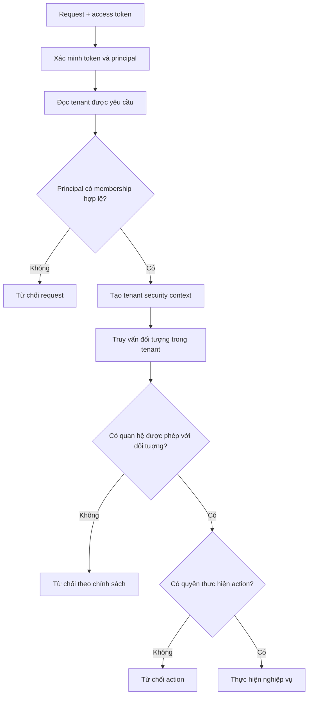

# Tenant boundary và ownership

Trong chương **Object authorization** của module `SECURITY_API_SECURITY`, tenant boundary và ownership là hai quan hệ cốt lõi để quyết định một danh tính có được truy cập một đối tượng cụ thể hay không. Xác thực cho biết ai đang gọi API; quyền chức năng cho biết người đó có thể thực hiện loại hành động nào; còn kiểm tra tenant và ownership xác định hành động ấy có được phép áp dụng lên đúng dữ liệu đang yêu cầu hay không.

Một người dùng đã đăng nhập và có quyền `project:read` vẫn không mặc nhiên được đọc mọi project. Project có thể thuộc tenant khác, thuộc một workspace mà người dùng không tham gia, hoặc chỉ được chia sẻ cho một nhóm nhất định. Vì vậy, API cần kiểm tra quan hệ giữa principal, tenant, đối tượng và hành động ở phía server trên mọi đường truy cập: đọc một bản ghi, liệt kê collection, cập nhật, xóa, tải tệp, tìm kiếm, xử lý hàng loạt hay chạy tác vụ nền.

## 1. Phân biệt tenant boundary và ownership

**Tenant** là phạm vi tổ chức hoặc khách hàng mà dữ liệu và hoạt động được quản lý độc lập. Trong một hệ thống SaaS, mỗi tenant thường có người dùng, tài nguyên, cấu hình và dữ liệu nghiệp vụ riêng. Tenant boundary là ranh giới ngăn một tenant đọc, sửa, xóa hoặc gây ảnh hưởng đến dữ liệu của tenant khác.

**Ownership** là quan hệ sở hữu hoặc kiểm soát một đối tượng cụ thể. Chủ sở hữu có thể là một user, một team, một workspace hoặc chính tenant. Một đối tượng có thể thuộc tenant A nhưng chỉ một số thành viên tenant A được truy cập. Ngược lại, một người có thể là thành viên của nhiều tenant nhưng không có quyền như nhau trong từng tenant.

Hai khái niệm này không thay thế nhau:

| Kiểm tra | Câu hỏi | Ví dụ |
|---|---|---|
| Tenant boundary | Đối tượng có nằm trong tenant mà request đang hoạt động không? | Project thuộc tenant `acme` hay `globex`? |
| Membership | Principal có phải thành viên hợp lệ của tenant đó không? | User còn là thành viên tenant `acme` và membership chưa bị thu hồi? |
| Ownership / relationship | Principal có quan hệ được phép với đối tượng không? | User là owner, thành viên workspace hoặc collaborator của project? |
| Action permission | Principal có được thực hiện hành động này không? | User được xem nhưng không được xóa project? |

Một quyết định truy cập thường cần kết hợp cả bốn câu hỏi. Chỉ so sánh `tenantId` là chưa đủ nếu tenant có nhiều nhóm và quyền theo đối tượng. Chỉ kiểm tra `ownerId` cũng chưa đủ nếu owner đã rời tenant hoặc quyền sở hữu đã được chuyển giao.

Ví dụ, một project có thể có dữ liệu như sau:

```text
Tenant: acme
  Workspace: finance
    Project: annual-budget
      owner: user-17
      collaborators: user-21, user-34

Tenant: globex
  Workspace: finance
    Project: annual-budget
      owner: user-17
```

Hai project có thể có cùng tên và cùng owner ID nếu ID được cấp trong các namespace khác nhau. Không được suy luận tenant từ tên tài nguyên hoặc chỉ từ ID. Mọi truy vấn phải gắn với tenant và quan hệ truy cập đã xác minh.

## 2. Xác định tenant context từ danh tính đã xác thực

Server cần tạo một **security context** cho mỗi request. Context này chứa principal đã xác thực, tenant đang hoạt động, membership hoặc claims cần thiết và thông tin phục vụ kiểm tra quyền. Nguồn của context phải là dữ liệu đáng tin cậy như token đã xác minh, session phía server hoặc membership được tra cứu từ hệ thống quản lý danh tính.

Không coi các giá trị sau là bằng chứng quyền truy cập chỉ vì chúng xuất hiện trong request:

- `tenantId`, `ownerId`, `userId` hoặc `role` trong JSON body.
- Header tùy ý như `X-Tenant-Id` nếu chưa được server đối chiếu với principal.
- Query parameter `?tenant=...` hoặc tenant nằm trong path.
- Cookie hoặc metadata do client có thể tự sửa mà không có cơ chế xác minh.

Client có thể cần chọn tenant khi một người tham gia nhiều tổ chức. Việc chọn tenant chỉ là yêu cầu về ngữ cảnh; server phải xác minh principal có membership còn hiệu lực trong tenant được chọn trước khi dùng tenant đó cho truy vấn dữ liệu.

Một luồng xử lý hợp lý:



Nếu token chứa `tenant_id`, cần xác định rõ claim đó biểu thị tenant duy nhất của token, tenant mặc định hay tenant đã được chọn tại thời điểm phát hành. Không dùng một claim cũ hoặc không rõ semantics để truy cập tenant khác. Nếu membership có thể bị thu hồi trong thời gian token còn hiệu lực, hệ thống phải có cơ chế phản ánh thay đổi đó theo yêu cầu bảo mật: tra cứu membership, phiên bản quyền, token ngắn hạn hoặc cơ chế thu hồi phù hợp.

Ví dụ request:

```http
GET /v1/tenants/acme/projects/prj_123
Authorization: Bearer <access_token>
```

`acme` trong path giúp định tuyến và làm rõ tài nguyên mà client muốn truy cập. Nó không tự cấp quyền cho caller. Server phải xác minh caller có thể hoạt động trong tenant `acme`, rồi kiểm tra project `prj_123` thuộc tenant đó và caller có quan hệ được phép với project.

## 3. Mô hình ownership và quan hệ truy cập

Không phải hệ thống nào cũng có một cột `owner_id` duy nhất. Trước khi triển khai authorization, cần mô tả mô hình quan hệ thực tế.

### 3.1. Các mô hình thường gặp

| Mô hình | Quan hệ | Quy tắc ví dụ |
|---|---|---|
| Tenant-owned | Đối tượng thuộc tenant | Thành viên có quyền `document:read` trong tenant có thể đọc tài liệu theo policy |
| User-owned | Đối tượng thuộc user | Chỉ owner và người được chia sẻ mới xem được hồ sơ cá nhân |
| Team / workspace-owned | Đối tượng thuộc team hoặc workspace | Thành viên workspace có quyền tương ứng được thao tác |
| Shared / delegated | Đối tượng được chia sẻ cho principal khác | Collaborator chỉ có quyền trong phạm vi và thời hạn được cấp |
| System-owned | Đối tượng do nền tảng quản lý | Chỉ service hoặc vai trò vận hành được ủy quyền mới truy cập |

Một đối tượng có thể kết hợp nhiều quan hệ. Ví dụ, báo cáo thuộc tenant, nằm trong workspace, do một user tạo và được chia sẻ cho một nhóm. Quy tắc truy cập phải xác định quan hệ nào có hiệu lực và quan hệ nào được ưu tiên khi có xung đột.

### 3.2. Owner không đồng nghĩa với creator

`created_by` ghi nhận ai tạo đối tượng; `owner_id` thể hiện ai đang sở hữu hoặc chịu trách nhiệm; `tenant_id` xác định phạm vi tổ chức. Ba giá trị này có thể khác nhau.

Ví dụ, nhân viên hỗ trợ tạo ticket thay mặt khách hàng. Nhân viên là creator, khách hàng hoặc tenant là owner theo nghiệp vụ. Nếu implementation dùng `created_by` để quyết định mọi quyền truy cập, ticket có thể bị lộ cho người tạo dù người đó không còn quyền hỗ trợ hoặc không thuộc tenant.

Đặt tên trường và semantics rõ ràng. Khi chuyển giao ownership, cần cập nhật quan hệ sở hữu theo một nghiệp vụ có kiểm soát và ghi audit; không sửa `created_by` để giả lập việc chuyển chủ sở hữu.

### 3.3. Role không mô tả hết quan hệ đối tượng

RBAC (Role-Based Access Control) gán quyền theo vai trò, chẳng hạn `TENANT_ADMIN`, `EDITOR` hoặc `VIEWER`. Role hữu ích để mô tả quyền chức năng trong một phạm vi. Tuy nhiên, hai người cùng role có thể được truy cập các đối tượng khác nhau do ownership, membership workspace hoặc chia sẻ.

Có thể kết hợp RBAC với relationship-based authorization hoặc policy theo thuộc tính:

- Role xác định loại hành động mà principal có thể thực hiện.
- Relationship xác định principal có quan hệ nào với đối tượng.
- Attributes như trạng thái, phân loại dữ liệu, tenant và thời hạn chia sẻ bổ sung điều kiện.

Ví dụ policy đọc project:

```text
ALLOW project:read WHEN
  principal is an active member of project.tenant
  AND principal has project:read in that tenant
  AND (
    principal is project.owner
    OR principal is an active workspace member
    OR principal has an explicit project share
  )
  AND project.classification is allowed for principal
```

Policy cần được diễn đạt bằng một cơ chế nhất quán trong ứng dụng. Tránh rải các điều kiện quyền khác nhau ở controller, repository và giao diện khiến mỗi endpoint có một cách diễn giải riêng.

## 4. Enforce tenant scope ngay trong truy vấn dữ liệu

Một lỗi phổ biến là tìm bản ghi bằng ID trước, sau đó mới kiểm tra tenant hoặc owner. Nếu một nhánh code quên bước kiểm tra, IDOR/BOLA có thể xảy ra. Cách an toàn hơn là đưa tenant và quan hệ cần thiết vào truy vấn lấy đối tượng.

Ví dụ SQL không an toàn:

```sql
-- Không giới hạn theo tenant hoặc quyền sở hữu.
SELECT id, tenant_id, owner_id, name
FROM projects
WHERE id = :project_id;
```

Truy vấn có tenant scope:

```sql
SELECT p.id, p.tenant_id, p.owner_id, p.name
FROM projects p
WHERE p.id = :project_id
  AND p.tenant_id = :tenant_id;
```

Nếu policy yêu cầu owner hoặc collaborator, có thể đưa điều kiện quan hệ vào truy vấn:

```sql
SELECT p.id, p.tenant_id, p.owner_id, p.name
FROM projects p
WHERE p.id = :project_id
  AND p.tenant_id = :tenant_id
  AND (
      p.owner_id = :principal_id
      OR EXISTS (
          SELECT 1
          FROM project_members pm
          WHERE pm.project_id = p.id
            AND pm.principal_id = :principal_id
            AND pm.status = 'ACTIVE'
            AND pm.can_read = TRUE
      )
  );
```

Các giá trị `tenant_id` và `principal_id` phải đến từ security context đã xác minh, không lấy trực tiếp từ body. Cần thêm điều kiện theo membership và role của tenant nếu policy yêu cầu.

### 4.1. Scope cả thao tác ghi, cập nhật và xóa

Không chỉ `SELECT` mới cần tenant scope. `UPDATE` và `DELETE` cũng phải gắn điều kiện tenant và quyền đối tượng:

```sql
UPDATE projects
SET name = :new_name,
    updated_at = CURRENT_TIMESTAMP
WHERE id = :project_id
  AND tenant_id = :tenant_id
  AND owner_id = :principal_id;
```

Ứng dụng cần kiểm tra số dòng bị ảnh hưởng. Nếu bằng 0, đối tượng có thể không tồn tại trong tenant, caller không phải owner hoặc điều kiện cập nhật không còn đúng. Trả lỗi theo chính sách không tiết lộ sự tồn tại của tài nguyên.

Đối với thao tác xóa, tránh đọc một bản ghi không giới hạn rồi gọi `deleteById(id)`. Dùng câu lệnh delete có điều kiện hoặc repository method mang tenant scope. Với thao tác nhiều bước, kiểm tra quyền và cập nhật cần nằm trong transaction phù hợp để giảm nguy cơ trạng thái thay đổi giữa hai bước.

### 4.2. Ràng buộc toàn vẹn ở database

Authorization trong ứng dụng là cần thiết, nhưng database cũng nên giúp ngăn quan hệ dữ liệu sai. Nếu `project` thuộc tenant A thì một `project_member` hoặc `task` gắn với nó không được tham chiếu tenant B.

Một hướng thiết kế là dùng khóa duy nhất kết hợp tenant và ID, rồi tạo foreign key có cùng tenant:

```sql
CREATE TABLE projects (
    tenant_id UUID NOT NULL,
    id UUID NOT NULL,
    owner_id UUID NOT NULL,
    name VARCHAR(200) NOT NULL,
    PRIMARY KEY (tenant_id, id)
);

CREATE TABLE tasks (
    tenant_id UUID NOT NULL,
    id UUID NOT NULL,
    project_id UUID NOT NULL,
    title VARCHAR(200) NOT NULL,
    PRIMARY KEY (tenant_id, id),
    FOREIGN KEY (tenant_id, project_id)
        REFERENCES projects (tenant_id, id)
);
```

Đây là ví dụ mô hình quan hệ; cú pháp và lựa chọn khóa cần điều chỉnh theo database. Composite foreign key làm cho một task không thể tham chiếu project ở tenant khác qua quan hệ này. Nó không thay thế kiểm tra quyền của người gọi.

Các ràng buộc khác cần xem xét:

- Unique constraint thường phải bao gồm `tenant_id` nếu giá trị chỉ cần duy nhất trong tenant, chẳng hạn slug project.
- Index thường cần có `tenant_id` ở đầu khi phần lớn truy vấn luôn lọc theo tenant; lựa chọn cuối cùng dựa trên workload và query plan.
- Foreign key cần giữ tenant nhất quán giữa bảng cha và bảng con.
- Với PostgreSQL, Row-Level Security (RLS) có thể là lớp phòng thủ bổ sung nếu session context được thiết lập an toàn và mọi connection được reset đúng cách.

Nếu dùng connection pool với RLS, tuyệt đối không để tenant context của request trước rò sang request tiếp theo. Thiết lập context trong transaction, dùng cơ chế local theo transaction nếu phù hợp, và kiểm thử tái sử dụng connection. RLS cấu hình sai hoặc role ứng dụng có quyền bypass policy có thể tạo cảm giác an toàn giả.

## 5. Kiểm tra quan hệ ở mọi loại endpoint

Authorization phải nhất quán giữa endpoint đọc một đối tượng và endpoint truy cập cùng đối tượng qua một đường khác.

### 5.1. Collection và pagination

Endpoint `GET /projects` phải lọc tenant và quan hệ truy cập trước khi phân trang. Không tải tất cả project rồi lọc trong bộ nhớ, vì cách đó vừa tốn tài nguyên vừa có thể làm rò rỉ số lượng, thứ tự hoặc metadata.

```sql
SELECT p.id, p.name, p.updated_at
FROM projects p
WHERE p.tenant_id = :tenant_id
  AND EXISTS (
      SELECT 1
      FROM project_members pm
      WHERE pm.project_id = p.id
        AND pm.principal_id = :principal_id
        AND pm.status = 'ACTIVE'
        AND pm.can_read = TRUE
  )
ORDER BY p.updated_at DESC, p.id DESC
LIMIT :page_size;
```

Cursor pagination cần ràng buộc cursor với query, tenant và bộ lọc quyền. Nếu client dùng cursor được tạo trong tenant A cho request tenant B, server phải từ chối hoặc tạo kết quả đúng theo context B; không để cursor bỏ qua tenant predicate.

### 5.2. Tài nguyên lồng nhau

Với route như `GET /projects/{projectId}/tasks/{taskId}`, không được chỉ kiểm tra task ID. Phải xác minh task thuộc project được chỉ định, project thuộc tenant hiện tại và caller có quyền trên project/task theo policy.

Truy vấn nên thể hiện đầy đủ quan hệ cha-con:

```sql
SELECT t.id, t.title, t.status
FROM tasks t
JOIN projects p
  ON p.tenant_id = t.tenant_id
 AND p.id = t.project_id
WHERE t.id = :task_id
  AND p.id = :project_id
  AND p.tenant_id = :tenant_id;
```

Nếu endpoint nhận cả `projectId` và `taskId`, phải xác minh chúng có quan hệ thật. Không tin việc client gửi một cặp ID hợp lệ về cú pháp.

### 5.3. Bulk operations và export

Với request chứa danh sách ID, cần xác minh quyền trên từng đối tượng. Một cách xử lý là truy vấn tập đối tượng theo tenant và policy, sau đó so sánh tập ID được phép với tập ID yêu cầu. Nếu một phần tử không được phép, contract phải nói rõ thao tác all-or-nothing hay cho phép kết quả từng phần.

Không âm thầm bỏ qua ID trái phép nếu client có thể hiểu nhầm rằng mọi thao tác đã thành công. Với thao tác nhạy cảm như xóa hàng loạt hoặc chuyển quyền sở hữu, all-or-nothing trong transaction thường dễ kiểm soát hơn. Nếu nghiệp vụ cho phép partial success, response cần liệt kê kết quả từng phần tử mà không tiết lộ dữ liệu ngoài tenant.

Export cũng là một endpoint đọc dữ liệu. Phải áp dụng cùng policy như màn hình danh sách, bao gồm tenant, membership, ownership, trường được phép xuất và giới hạn số bản ghi. Không tạo một đường export nội bộ bỏ qua authorization chỉ vì nó chạy bất đồng bộ.

### 5.4. Tìm kiếm và bộ lọc

Search index, analytics store và reporting database cũng chứa dữ liệu cần được giới hạn theo tenant. Áp dụng tenant filter ở phía server trước khi trả kết quả. Không cho client truyền một filter tenant tùy ý rồi tin rằng search engine đã áp dụng đúng.

Khi tìm kiếm trả về snippet, count, facet hoặc gợi ý autocomplete, các metadata này cũng có thể làm lộ tên tài liệu hoặc sự tồn tại của đối tượng ngoài phạm vi. Mọi dạng kết quả cần tuân thủ cùng ranh giới truy cập.

## 6. Cập nhật quyền an toàn trong môi trường đồng thời

Một kiểm tra quyền đúng tại thời điểm đầu request có thể trở nên lỗi thời trước khi thao tác ghi hoàn tất. Ví dụ, user bị gỡ khỏi workspace sau khi service kiểm tra membership nhưng trước khi cập nhật project.

Để giảm rủi ro này:

- Đặt kiểm tra quan hệ và thao tác ghi trong cùng transaction khi dữ liệu quyền và dữ liệu nghiệp vụ cùng database.
- Dùng optimistic locking hoặc version để phát hiện đối tượng thay đổi đồng thời.
- Với quyền được quản lý ở service khác, xác định semantics nhất quán: quyền được chốt tại thời điểm bắt đầu, tại thời điểm commit hay theo lease có thời hạn.
- Khi thu hồi quyền có tác động lớn, cân nhắc version hóa policy hoặc membership để request/tác vụ cũ không tiếp tục dùng quyết định đã lỗi thời.
- Không thực hiện side effect bên ngoài trước khi transaction và các điều kiện quyền được xác nhận; dùng outbox hoặc cơ chế phối hợp phù hợp nếu cần phát event sau commit.

Ví dụ, cập nhật project có thể dùng điều kiện phiên bản:

```sql
UPDATE projects p
SET name = :new_name,
    version = version + 1,
    updated_at = CURRENT_TIMESTAMP
WHERE p.id = :project_id
  AND p.tenant_id = :tenant_id
  AND p.version = :expected_version
  AND EXISTS (
      SELECT 1
      FROM project_members pm
      WHERE pm.project_id = p.id
        AND pm.principal_id = :principal_id
        AND pm.status = 'ACTIVE'
        AND pm.can_edit = TRUE
  );
```

Nếu không có dòng nào được cập nhật, ứng dụng cần phân loại theo contract: không tìm thấy/không có quyền hay xung đột phiên bản. Không truy vấn lại bằng ID toàn cục rồi trả chi tiết để phân biệt các trường hợp nếu điều đó làm lộ tài nguyên.

## 7. Giữ tenant boundary qua cache, file và tác vụ nền

Tenant isolation không kết thúc ở database chính. Dữ liệu thường đi qua cache, object storage, queue, search index, hệ thống báo cáo và log. Mỗi nơi đều có thể trở thành đường vòng vượt authorization.

### 7.1. Cache

Cache key phải bao gồm mọi yếu tố ảnh hưởng đến kết quả và quyền truy cập. Ví dụ, key chỉ là `project:prj_123` có thể khiến response đã tạo cho tenant A được trả cho request tenant B nếu ID không toàn cục hoặc cache không kiểm tra context.

Có thể dùng cấu trúc như:

```text
tenant:{tenantId}:project:{projectId}:principal:{principalId}:policy:{policyVersion}
```

Không nhất thiết mọi cache đều phải chứa `principalId`; điều đó phụ thuộc dữ liệu cache là bản ghi dùng chung trong tenant hay response đã lọc theo quyền. Nhưng key và logic invalidation phải phản ánh chính xác phạm vi dữ liệu. Khi membership hoặc share bị thu hồi, cache chứa kết quả quyền cũ cần hết hạn hoặc bị vô hiệu hóa.

### 7.2. Object storage và signed URL

Đường dẫn file nên có namespace tenant hoặc định danh opaque do server quản lý. Không cho client tự quyết định bucket/key đích. Trước khi cấp signed URL, server phải xác minh caller được đọc hoặc ghi đúng object trong tenant hiện tại.

Signed URL là bearer capability: bất kỳ ai có URL còn hiệu lực đều có thể sử dụng theo quyền mà URL cấp. Vì vậy, đặt thời hạn ngắn phù hợp, giới hạn method và object, tránh ghi URL vào log công khai, và thu hồi hoặc thay thế khi nghiệp vụ yêu cầu. Một signed URL không nên cho phép liệt kê bucket hoặc truy cập object lân cận.

### 7.3. Queue và background job

Message hoặc job cần mang theo tenant ID, actor/service identity, resource ID và mục đích xử lý ở mức cần thiết. Consumer phải xác minh message đến từ producer tin cậy và truy vấn lại tài nguyên trong tenant scope. Không coi `tenantId` trong message là đáng tin chỉ vì message nằm trong queue nội bộ.

Với job được tạo từ request người dùng, quyết định quyền cần có semantics rõ: job được phép hoàn thành theo quyền đã chốt lúc enqueue, hay phải kiểm tra lại quyền khi thực thi? Với thao tác nhạy cảm và job chạy lâu, kiểm tra lại membership, ownership và trạng thái đối tượng thường cần thiết. Nếu nghiệp vụ phải giữ quyền đã cấp tại thời điểm enqueue, lưu một authorization grant có thời hạn và phạm vi rõ ràng, không chỉ lưu một role string.

### 7.4. Search, analytics và log

Index document cần có tenant key được gán từ dữ liệu server và được bảo vệ khỏi việc client ghi đè. Search query phải thêm tenant filter và policy filter. Pipeline analytics và export cần giữ tenant context qua mọi bước transform.

Log không nên chứa toàn bộ payload hoặc dữ liệu tenant nhạy cảm. Nếu cần correlation để điều tra, ghi tenant ID, actor ID, resource ID và kết quả policy ở mức tối thiểu; bảo vệ quyền truy cập log để người dùng tenant này không thể xem sự kiện của tenant khác.

## 8. Truy cập đặc quyền và luồng cross-tenant

Một số nghiệp vụ hợp lệ cần truy cập nhiều tenant: nhân viên hỗ trợ xử lý ticket, nền tảng tổng hợp số liệu, migration dữ liệu hoặc đối tác thực hiện đối soát. Đây là quyền đặc biệt và cần được thiết kế như một policy riêng.

Không tạo một cờ chung như `isAdmin=true` để bỏ qua mọi tenant check. Hãy xác định:

- Principal/service nào được phép cross-tenant và vì mục đích nào.
- Loại đối tượng, hành động và tenant nào nằm trong phạm vi.
- Có cần ticket hỗ trợ, phê duyệt, thời hạn hoặc lý do truy cập không.
- Có cần xác nhận bổ sung (step-up authentication) cho dữ liệu nhạy cảm không.
- Sự kiện nào phải được audit và ai có quyền xem audit đó.
- Cách thu hồi quyền đặc biệt và cách phát hiện truy cập bất thường.

Ví dụ, nhân viên hỗ trợ có thể được cấp quyền `support:read-ticket` trong tenant được chỉ định cho một ticket cụ thể, có thời hạn và ghi lý do. Quyền này không tự động cho phép đọc mọi project, hồ sơ hoặc file trong tenant đó.

Với service-to-service, danh tính service cần được xác thực riêng và quyền cần giới hạn theo workload, tenant và operation. Không truyền access token của người dùng sang service khác một cách vô điều kiện. Nếu cần delegation, dùng cơ chế token exchange hoặc grant có audience, scope và subject rõ ràng; service nhận phải xác minh các thuộc tính đó.

## 9. Ví dụ triển khai trong Java/Spring

Ví dụ dưới đây minh họa cách truyền tenant context đã xác minh vào service và giới hạn truy vấn ở repository. Các kiểu `CurrentPrincipal`, `TenantMembershipService` và `ProjectRepository` là kiểu minh họa; ứng dụng thực tế cần tích hợp với cơ chế xác thực và policy hiện có.

```java
public record TenantContext(
        UUID tenantId,
        UUID principalId,
        long membershipVersion
) {}
```

Tenant context chỉ được tạo sau khi xác minh membership:

```java
@Service
public class TenantContextResolver {
    private final TenantMembershipService memberships;

    public TenantContextResolver(TenantMembershipService memberships) {
        this.memberships = memberships;
    }

    public TenantContext resolve(CurrentPrincipal principal, UUID requestedTenantId) {
        TenantMembership membership = memberships
                .findActiveMembership(principal.id(), requestedTenantId)
                .orElseThrow(() -> new AccessDeniedException("Tenant access denied"));

        return new TenantContext(
                requestedTenantId,
                principal.id(),
                membership.version()
        );
    }
}
```

Repository nhận tenant và principal làm tham số bắt buộc:

```java
public interface ProjectRepository extends JpaRepository<Project, UUID> {

    @Query("""
        select p
        from Project p
        where p.id = :projectId
          and p.tenantId = :tenantId
          and (
              p.ownerId = :principalId
              or exists (
                  select pm.id
                  from ProjectMember pm
                  where pm.project = p
                    and pm.principalId = :principalId
                    and pm.active = true
                    and pm.canRead = true
              )
          )
        """)
    Optional<Project> findReadableProject(
            UUID projectId,
            UUID tenantId,
            UUID principalId
    );
}
```

Service thực thi quyền và nghiệp vụ trong transaction:

```java
@Service
public class ProjectService {
    private final ProjectRepository projects;

    public ProjectService(ProjectRepository projects) {
        this.projects = projects;
    }

    @Transactional(readOnly = true)
    public ProjectResponse getProject(UUID projectId, TenantContext context) {
        Project project = projects.findReadableProject(
                        projectId,
                        context.tenantId(),
                        context.principalId())
                .orElseThrow(() -> new ResourceNotFoundException("Project not found"));

        return ProjectResponse.from(project);
    }
}
```

Điểm quan trọng là repository method biểu đạt rõ tenant và quan hệ đọc; service không gọi `findById(projectId)` rồi hy vọng mọi caller nhớ kiểm tra quyền. Trong ứng dụng thực tế, cần bổ sung quyền chức năng, quyền thuộc tính, trạng thái membership, phân loại dữ liệu và response filtering theo policy. `@PreAuthorize` có thể là lớp kiểm tra bổ sung cho quyền chức năng, nhưng không tự thay thế tenant-scoped query.

Nếu controller nhận tenant ID từ path hoặc header, controller chuyển giá trị đó qua `TenantContextResolver`; không truyền trực tiếp thành tham số tin cậy cho repository. Các API nội bộ cũng cần tuân theo quy tắc tương tự.

## 10. Kiểm thử tenant isolation và ownership

Kiểm thử object authorization cần tạo ít nhất hai tenant độc lập và nhiều principal với quan hệ khác nhau. Chỉ kiểm thử user có quyền truy cập tài nguyên của chính mình sẽ không phát hiện lỗi cross-tenant.

Một bộ dữ liệu mẫu:

| Principal | Tenant membership | Quan hệ với project A | Quan hệ với project B |
|---|---|---|---|
| Alice | Tenant A: active | Owner | Không có |
| Bob | Tenant A: active | Collaborator chỉ đọc | Không có |
| Carol | Tenant A: revoked | Owner cũ | Không có |
| Dan | Tenant B: active | Không có | Owner |
| Eve | Tenant A và B: active | Viewer | Editor |

Với dữ liệu này, kiểm tra các trường hợp:

1. Alice đọc và cập nhật project A theo quyền owner.
2. Bob đọc project A nhưng không được cập nhật hoặc xóa nếu chỉ có quyền đọc.
3. Carol bị từ chối sau khi membership bị thu hồi, kể cả khi còn giữ ID hoặc token cũ theo chính sách thu hồi.
4. Dan không thể đọc project A bằng cách đổi ID hoặc tenant trong URL, header hay query.
5. Eve truy cập project A và B theo quyền riêng của từng tenant; membership ở tenant B không mở rộng quyền ở tenant A.
6. Một user trong tenant A không thể dùng task ID của tenant B qua endpoint lồng nhau.
7. Collection, pagination, search, count, autocomplete và export không chứa dữ liệu ngoài phạm vi.
8. Bulk update/delete từ chối ID không được phép theo semantics all-or-nothing hoặc partial success đã công bố.
9. Cache không trả response của tenant hoặc principal khác; thu hồi share làm mất hiệu lực cache theo policy.
10. Signed URL chỉ truy cập đúng object, đúng method và trong thời hạn được cấp.
11. Background job không tiếp tục thao tác ngoài phạm vi khi membership hoặc quyền đã bị thu hồi theo semantics đã chọn.
12. Cross-tenant support access yêu cầu grant đặc biệt, có phạm vi và audit đúng.

### 10.1. Kiểm thử âm cần kiểm tra tác động phụ

Với request bị từ chối, xác minh không có dữ liệu bị đọc hoặc ghi ngoài phạm vi, không phát event, không tạo file, không gửi email và không gọi service ngoài. Một response `403` hoặc `404` không chứng minh mọi side effect đã bị ngăn.

Thử cả các biến thể ID:

- ID hợp lệ của tenant khác.
- ID không tồn tại.
- ID của đối tượng đã bị xóa hoặc chuyển tenant.
- ID của đối tượng con nhưng parent ID không khớp.
- Danh sách ID trộn lẫn giữa tenant được phép và tenant khác.
- ID có cùng giá trị ở hai tenant nếu hệ thống dùng khóa định danh theo tenant.

Kiểm tra cả đường truy cập trực tiếp và đường gián tiếp như nested endpoint, export, download, websocket, GraphQL resolver, webhook callback và job status. Authorization chỉ có hiệu lực nếu mọi đường truy cập cùng tuân thủ policy.

## 11. Lỗi thiết kế thường gặp

| Lỗi | Hệ quả | Cách phòng tránh |
|---|---|---|
| Tin `tenantId` do client gửi | Caller tự chuyển sang tenant khác | Xác minh membership và tạo tenant context phía server |
| Chỉ kiểm tra role | User cùng role đọc dữ liệu của nhau | Kết hợp tenant, ownership và relationship |
| Chỉ kiểm tra owner ID | Bỏ qua tenant boundary hoặc membership đã thu hồi | Kiểm tra tenant và trạng thái quan hệ trong policy |
| Tìm bằng ID toàn cục rồi kiểm tra ở controller | Một endpoint khác có thể quên kiểm tra | Tenant-scope ngay trong repository/query |
| Chỉ lọc endpoint detail | List, search hoặc export vẫn lộ dữ liệu | Dùng cùng policy cho mọi hình thức truy cập |
| Chỉ lọc database chính | Cache, file, queue hoặc search index rò dữ liệu | Mang tenant context qua mọi data store và pipeline |
| Dùng `created_by` thay `owner_id` | Quyền tồn tại sai sau khi chuyển giao | Phân biệt creator, owner và tenant |
| Quyền admin bỏ qua mọi kiểm tra | Tạo đường truy cập cross-tenant không giới hạn | Grant đặc biệt có scope, thời hạn và audit |
| Không xử lý thu hồi membership | Token hoặc cache cũ tiếp tục truy cập | Version, expiry, revalidation và invalidation |
| Chỉ kiểm thử happy path | Không phát hiện IDOR/BOLA | Kiểm thử ma trận nhiều tenant và nhiều quan hệ |

## 12. Checklist review trước khi phát hành

- [ ] Mỗi đối tượng có tenant hoặc phạm vi sở hữu được xác định rõ.
- [ ] Creator, owner, tenant owner và collaborator có semantics riêng.
- [ ] Tenant được chọn từ request đã được xác minh với membership còn hiệu lực.
- [ ] Tenant context được tạo phía server từ principal đã xác thực.
- [ ] Mọi truy vấn detail, list, update và delete đều có tenant scope.
- [ ] Quyền đối tượng được kiểm tra theo ownership, membership hoặc share relationship.
- [ ] Route lồng nhau xác minh quan hệ giữa object con và object cha.
- [ ] Bulk, search, pagination, count và export tuân thủ cùng policy.
- [ ] Database constraint ngăn quan hệ cha-con lệch tenant khi phù hợp.
- [ ] Cache key và invalidation phản ánh tenant và phạm vi quyền.
- [ ] File storage, signed URL, queue, background job và search index giữ tenant boundary.
- [ ] Thu hồi membership/share có hiệu lực theo semantics đã công bố.
- [ ] Cross-tenant access có grant đặc biệt, phạm vi, thời hạn và audit.
- [ ] Kiểm thử có ít nhất hai tenant và principal với quan hệ khác nhau.
- [ ] Request bị từ chối không tạo side effect hoặc làm lộ metadata ngoài phạm vi.
- [ ] Log và metric hỗ trợ điều tra mà không làm lộ dữ liệu nhạy cảm.

## Kết luận

Tenant boundary xác định phạm vi dữ liệu mà một tổ chức được phép tiếp cận; ownership và các quan hệ chia sẻ xác định principal nào được thao tác trên từng đối tượng trong phạm vi đó. API an toàn cần xác minh membership, tenant, relationship và action permission ở phía server, đồng thời áp dụng cùng chính sách cho mọi đường đọc/ghi và mọi nơi dữ liệu được lưu hoặc xử lý. Khi tenant context được tin cậy, truy vấn luôn có scope, quan hệ dữ liệu được bảo vệ và kiểm thử bao phủ truy cập chéo tenant, nguy cơ BOLA/IDOR sẽ giảm đáng kể.
