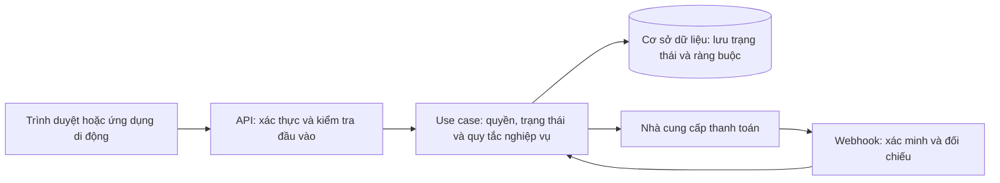
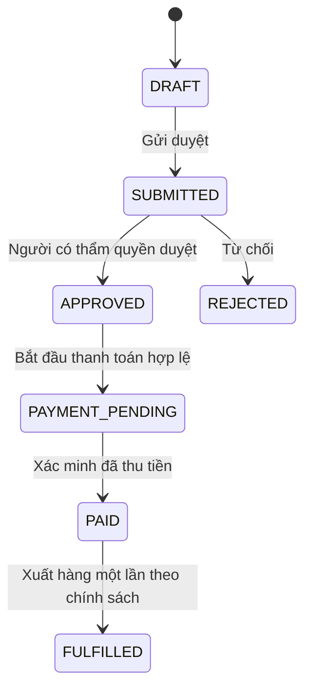

# Bảo mật logic nghiệp vụ là gì?

## 1. Mục tiêu bài học

Bảo mật logic nghiệp vụ (*business logic security*) là bảo vệ ý nghĩa và quy tắc của một quy trình kinh doanh trước việc sử dụng sai mục đích. Hệ thống phải duy trì những điều kiện mà nghiệp vụ yêu cầu, kể cả khi người dùng có tài khoản hợp lệ nhưng sửa dữ liệu, gọi API ngoài thứ tự, lặp lại thao tác hoặc gửi nhiều yêu cầu đồng thời.

Sau bài học, bạn có thể:

- Giải thích vì sao yêu cầu hợp lệ về HTTP, JSON và đăng nhập vẫn có thể tạo ra một giao dịch không hợp lệ.
- Chuyển một mô tả nghiệp vụ thành quy tắc có thể kiểm tra, bao gồm điều kiện trước, điều kiện sau và bất biến.
- Nhận diện mối liên hệ giữa quyền trên đối tượng, trạng thái quy trình, transaction và idempotency.
- Đề xuất cách kiểm tra kết quả nghiệp vụ khi có hành vi bỏ bước, sửa giá, vượt quyền hoặc gửi trùng.

Bài học thuộc chương **Business Logic Foundations** của module **SECURITY_APPLICATION_SECURITY_BUSINESS_LOGIC_SECURITY**. Trọng tâm là cách tư duy và thiết kế hàng rào bảo vệ quy tắc nghiệp vụ; các đoạn mã chỉ minh họa một phần của cơ chế đó.

## 2. Từ chức năng đúng đến quy trình an toàn

### 2.1. Logic nghiệp vụ quyết định điều gì được phép xảy ra

Trong ứng dụng mua hàng của doanh nghiệp, logic nghiệp vụ có thể quy định:

- Nhân viên được tạo đơn mua hàng cho tổ chức của mình.
- Người tạo đơn không được tự phê duyệt đơn đó.
- Người phê duyệt phải có quyền phù hợp với tổ chức và giá trị đơn.
- Đơn chỉ được thanh toán sau khi được phê duyệt.
- Số tiền thanh toán phải khớp với nội dung đã được phê duyệt.
- Một lần thanh toán thành công không được tạo ra hai lần xuất hàng.

Các quy tắc này diễn tả ý nghĩa của dữ liệu và quan hệ giữa nhiều thao tác. Chúng vượt ra ngoài việc một trường có đúng kiểu số hoặc một endpoint có yêu cầu đăng nhập hay không.

### 2.2. Lỗ hổng xuất hiện khi hệ thống cho phép kết quả trái quy tắc

Giả sử giao diện có thứ tự:

```text
Tạo đơn → Gửi duyệt → Phê duyệt → Thanh toán → Xuất hàng
```

Giao diện chỉ hiện nút “Thanh toán” sau khi đơn được duyệt. Tuy nhiên, API thanh toán chỉ kiểm tra người gọi đã đăng nhập và đơn có tồn tại. Nếu người tạo đơn gọi trực tiếp API khi đơn còn ở trạng thái nháp mà hệ thống vẫn thu tiền hoặc cho xuất hàng, quy tắc phê duyệt đã bị vượt qua.

Điểm yếu nằm ở điều kiện thực thi nghiệp vụ: backend đã mặc nhiên tin rằng người dùng đi theo giao diện. Việc ẩn nút không tạo ra điều kiện bắt buộc ở nơi xử lý giao dịch.

OWASP mô tả lỗ hổng logic nghiệp vụ theo hướng các chức năng hoặc luồng xử lý hợp lệ bị sử dụng để gây ra hậu quả không mong muốn. Muốn nhận ra vấn đề thường phải hiểu quy trình và mục tiêu kinh doanh. Xem [OWASP: Business logic vulnerability](https://community.owasp.org/vulnerabilities/Business_logic_vulnerability).

### 2.3. Một yêu cầu có thể đúng ở nhiều lớp nhưng vẫn sai về nghiệp vụ

| Lớp kiểm tra | Điều đã được xác nhận | Điều vẫn cần kiểm tra |
|---|---|---|
| Cú pháp | Body là JSON hợp lệ, `quantity` là số nguyên | Số lượng có nằm trong giới hạn mua không? |
| Xác thực | Token thuộc về một người dùng đã đăng nhập | Người đó được thao tác trên đơn nào? |
| Quyền chức năng | Người gọi có quyền `ORDER_APPROVE` | Có được duyệt đơn này, tại tổ chức này, với số tiền này không? |
| Kiểm tra trạng thái | Đơn đang `SUBMITTED` | Nội dung có thay đổi sau lúc kiểm tra không? |
| Kiểm tra tài nguyên | Một lần đọc cho thấy còn một sản phẩm | Yêu cầu khác có đang đồng thời mua sản phẩm đó không? |
| Kết quả kỹ thuật | API trả mã thành công | Có phát sinh trừ tiền, hoàn tiền hoặc xuất hàng lặp không? |

Các lớp trên bổ sung cho nhau. Một chính sách quyền theo đối tượng có thể đồng thời là một phần của kiểm soát truy cập và hàng rào bảo vệ quy trình nghiệp vụ.

Không nên gom mọi lỗi bảo mật thành lỗi logic nghiệp vụ. Chẳng hạn, truy vấn SQL không an toàn vẫn cần được nhận diện và sửa theo cơ chế SQL injection. Khi phân tích một phát hiện, hãy ghi rõ quy tắc bị vi phạm, nguyên nhân kỹ thuật và hậu quả nghiệp vụ.

## 3. Mô hình đe dọa: người gọi có thể chủ động thay đổi cách sử dụng

Khi thiết kế một chức năng, hãy giả định người gọi có thể:

- Gửi HTTP request mà không sử dụng giao diện chính thức.
- Sửa hoặc bỏ trường trong payload, kể cả trường ẩn của biểu mẫu.
- Thay `orderId`, `tenantId`, `ownerId`, giá, số lượng hoặc trạng thái đề xuất.
- Gọi một bước nhiều lần, bỏ qua bước trước hoặc quay lại bước đã hoàn tất.
- Gửi hai yêu cầu cùng lúc, dùng nhiều thiết bị hoặc nhiều kết nối.
- Thử lại sau timeout dù lần gọi trước có thể đã được xử lý thành công.

Retry cũng có thể xuất phát từ người dùng bình thường, thư viện mạng, hàng đợi hoặc nhà cung cấp thanh toán. Thiết kế an toàn phải bảo toàn quy tắc trong cả tình huống lỗi vô ý lẫn cố ý lạm dụng.

### Ranh giới tin cậy

**Ranh giới tin cậy** là nơi dữ liệu đi từ một nguồn có mức tin cậy này sang thành phần có trách nhiệm kiểm chứng nó. Ví dụ:



Các thành phần trong sơ đồ có thể nằm trong cùng một ứng dụng; đây là cách phân chia trách nhiệm, không bắt buộc phải tách thành microservice.

Client được phép nêu **ý định**, chẳng hạn mua sản phẩm nào hoặc yêu cầu hoàn bao nhiêu tiền. Backend phải kiểm tra ý định đó và xác định các dữ kiện có thẩm quyền: chủ sở hữu đơn, bảng giá áp dụng, quyền đang có hiệu lực và số tiền còn được hoàn.

Một giá trị lấy từ database cũng có thể vốn được người dùng nhập vào. Cần biết nguồn gốc, ý nghĩa và quyền sửa dữ liệu, thay vì coi mọi dữ liệu lưu trong hệ thống là đáng tin như nhau.

Với webhook, xác minh nguồn gửi là một bước riêng. Một thông báo có chữ ký hợp lệ vẫn phải được đối chiếu với đúng tài khoản nhận tiền, đơn hàng, số tiền, tiền tệ và loại sự kiện mà hệ thống chấp nhận.

## 4. Viết quy tắc đủ rõ để có thể bảo vệ

### 4.1. Bốn câu hỏi cho một thao tác

Trước khi triển khai một use case, hãy trả lời:

1. **Ai** được thực hiện và **trên đối tượng nào**?
2. Đối tượng phải đang ở **trạng thái nào**, với điều kiện gì?
3. Thao tác được phép **thay đổi những dữ liệu nào**?
4. Sau khi xử lý hoặc xử lý lặp, **điều gì bắt buộc vẫn đúng**?

Ví dụ, câu “quản lý được phê duyệt đơn” còn thiếu nhiều thông tin. Một đặc tả rõ hơn là:

> Người có quyền phê duyệt đang có hiệu lực trong tổ chức của đơn, không phải người tạo đơn, được duyệt đơn đang chờ duyệt trong hạn mức của mình. Quyết định phê duyệt phải gắn với nội dung cụ thể của đơn.

Từ đặc tả này, đội phát triển có thể xác định dữ liệu cần đọc, điều kiện từ chối và cách kiểm tra kết quả.

### 4.2. Điều kiện trước, điều kiện sau và bất biến

| Khái niệm | Ý nghĩa | Ví dụ |
|---|---|---|
| Điều kiện trước (*precondition*) | Phải đúng để thao tác được phép bắt đầu | Đơn đang chờ duyệt; người gọi có quyền phê duyệt đơn này |
| Điều kiện sau (*postcondition*) | Phải đúng khi thao tác kết thúc thành công | Có người duyệt, thời điểm duyệt và bằng chứng nội dung đã được duyệt |
| Bất biến nghiệp vụ (*business invariant*) | Điều kiện phải được duy trì trong phạm vi đã xác định | Tổng tiền hoàn thành công và tiền đang giữ chỗ để hoàn không vượt quá tiền đã thu |

Phạm vi rất quan trọng. “Đơn đã hủy không thể xuất hàng” là quy tắc về trạng thái đơn. “Mỗi khách hàng chỉ nhận một ưu đãi” đòi hỏi định nghĩa khách hàng theo tài khoản, hợp đồng, danh tính đã xác minh hay tiêu chí khác.

Nếu chỉ kiểm tra theo `userId` nhưng chính sách muốn giới hạn theo một người thực, việc tạo nhiều tài khoản có thể làm chính sách thất bại. Trước khi viết code, doanh nghiệp phải quyết định tiêu chí nhận diện và cách xử lý trường hợp chưa đủ bằng chứng.

### 4.3. Ví dụ các quy tắc có thể kiểm tra

Trong mô hình mua hàng minh họa của bài:

- **INV-01 — Cách ly tổ chức:** người dùng của tổ chức A không được đọc hoặc thay đổi đơn của tổ chức B nếu không có ủy quyền rõ ràng.
- **INV-02 — Tách trách nhiệm:** người tạo đơn không được tự phê duyệt.
- **INV-03 — Hiệu lực phê duyệt:** dữ liệu quan trọng của giao dịch thanh toán phải khớp với nội dung phê duyệt còn hiệu lực.
- **INV-04 — Xác nhận thanh toán:** chỉ ghi nhận `PAID` khi có bằng chứng thanh toán được xác minh và đối chiếu phù hợp.
- **INV-05 — Chống thực thi lặp:** xử lý lại cùng một nghiệp vụ không được tạo thêm khoản thu hoặc thêm lần xuất hàng ngoài chính sách.

Các mã INV chỉ là cách tham chiếu trong bài. Đội dự án có thể liên kết mỗi quy tắc với thiết kế, vị trí thực thi và tình huống kiểm thử tương ứng.

## 5. Ví dụ xuyên suốt: đơn mua hàng cần phê duyệt

### 5.1. Giả định nghiệp vụ

Để các ví dụ không mơ hồ, hệ thống minh họa sử dụng những chính sách sau:

- Mỗi đơn thuộc một tổ chức; người tạo đơn phải có quyền mua hàng trong tổ chức đó.
- Đơn dùng VND, không có phần lẻ và có tổng tiền lớn hơn 0.
- Mỗi đơn thanh toán toàn bộ một lần; mô hình này chưa có trả góp hoặc nhiều lần thu tiền.
- Người tạo đơn không được tự duyệt.
- Nhóm người duyệt được minh họa có hạn mức tối đa 50.000.000 VND.
- Giá, thuế, phí và ưu đãi hợp lệ do backend tính theo chính sách của hệ thống.
- Mỗi lần phê duyệt gắn với một phiên bản nội dung đơn.

Đây là lựa chọn của ví dụ. Một hệ thống có đơn miễn phí, nhiều cấp duyệt hoặc thanh toán từng phần cần quy tắc khác.

### 5.2. Dữ liệu có kiểu hợp lệ nhưng không có thẩm quyền

Giả sử tổng tiền do backend tính là 12.000.000 VND. Client gửi:

```http
POST /orders/ord-123/pay
Content-Type: application/json

{
  "amountVnd": 1,
  "approved": true,
  "ownerId": "another-user"
}
```

Số `1` là số nguyên dương. `true` là boolean hợp lệ. Các kiểm tra kiểu dữ liệu vẫn có thể đều thành công.

Nhưng client không có quyền quyết định tổng tiền phải thu, tự chứng nhận đã được phê duyệt hoặc đổi chủ sở hữu bằng request thanh toán. Nếu backend dùng các trường đó làm căn cứ thực thi, lỗi nằm ở việc trao quyền quyết định dữ liệu nghiệp vụ cho nguồn không có thẩm quyền.

Một hợp đồng API phù hợp hơn có thể là:

```http
POST /orders/ord-123/pay
Content-Type: application/json
Idempotency-Key: pay-operation-7f31

{
  "paymentMethodId": "pm-456"
}
```

Backend vẫn phải kiểm tra phương thức thanh toán có được người gọi sử dụng hay không. Việc xóa trường giá khỏi API giúp giảm bề mặt sai sót, nhưng chưa giải quyết quyền trên đơn, trạng thái, số tiền đã duyệt hoặc chống xử lý lặp.

Nếu cần client gửi giá kỳ vọng để phát hiện thay đổi, hãy coi đó là dữ liệu để **so sánh**, không phải giá có thẩm quyền. Khi giá khác nhau, hệ thống yêu cầu xác nhận lại theo chính sách đã công bố.

### 5.3. Mô hình trạng thái biểu diễn thứ tự hợp lệ



Sơ đồ chỉ thể hiện luồng chính và nhánh từ chối. Các nhánh hủy, hết hạn, thanh toán thất bại và hoàn tiền cần được mô hình hóa thêm trong ứng dụng thực tế, bao gồm xử lý sự kiện đến muộn.

Mỗi mũi tên cần điều kiện bảo vệ (*guard*). Không phải cứ biết tên trạng thái tiếp theo là được quyền chuyển sang trạng thái đó.

Ví dụ, trước khi đi từ `APPROVED` sang `PAYMENT_PENDING`, hệ thống phải kiểm tra người gọi được thanh toán đơn này, phê duyệt còn hiệu lực và chưa có nghiệp vụ thanh toán khác đang chiếm quyền thực hiện.

### 5.4. Phê duyệt phải gắn với nội dung

Một cờ `approved = true` không trả lời được câu hỏi: **ai đã duyệt nội dung nào?**

Giả sử người quản lý duyệt đơn 12.000.000 VND. Sau đó người tạo đơn đổi sản phẩm, tăng số lượng hoặc đổi bên thụ hưởng nhưng cờ phê duyệt vẫn còn. Hệ thống có thể thực hiện một giao dịch khác với giao dịch đã được duyệt.

Tùy chính sách, hệ thống có thể khóa các trường quan trọng sau khi duyệt, hoặc cho sửa nhưng hủy hiệu lực phê duyệt và đưa đơn trở lại quy trình duyệt. Nên ghi nhận phiên bản nội dung hoặc dấu vân tay của các trường quan trọng; phiên bản nội dung này cần được phân biệt với phiên bản kỹ thuật dùng để phát hiện cập nhật đồng thời.

Nguyên tắc kiểm soát thứ tự giao dịch và bảo vệ dữ liệu đã được chấp thuận được trình bày trong [OWASP Transaction Authorization Cheat Sheet](https://cheatsheetseries.owasp.org/cheatsheets/Transaction_Authorization_Cheat_Sheet.html).

## 6. Những cơ chế cùng bảo vệ một quy tắc

### 6.1. Kiểm tra giá trị theo ý nghĩa nghiệp vụ

Kiểm tra đầu vào cần bao gồm miền giá trị và quan hệ giữa các trường:

- Số lượng là số nguyên dương và không vượt giới hạn của sản phẩm hoặc khách hàng.
- Tổng giảm giá tuân theo chính sách kết hợp ưu đãi.
- Ngày kết thúc phải phù hợp với ngày bắt đầu.
- Số tiền hoàn không vượt số tiền còn được hoàn.
- Phương thức giao hàng phải áp dụng cho địa chỉ và mặt hàng đã chọn.

Với tiền trong Java, có thể dùng số nguyên theo đơn vị tiền nhỏ nhất đã quy ước hoặc `BigDecimal` kèm quy tắc làm tròn rõ ràng. Dữ liệu tiền phải gắn với tiền tệ. Cũng cần chặn giá trị quá lớn và xử lý tràn số khi nhân, cộng; chỉ đổi kiểu dữ liệu chưa bảo vệ được công thức tính.

Backend có thể dùng bảng giá hiện hành hoặc báo giá đã phát hành trước đó, tùy chính sách. Nếu chấp nhận báo giá cũ, phải kiểm tra báo giá đó được phát hành hợp lệ, còn hạn, đúng khách hàng, sản phẩm, số lượng và chưa bị vô hiệu hóa. Không nhất thiết mọi lần thanh toán đều áp dụng giá mới nhất, nhưng phải có nguồn giá có thẩm quyền.

### 6.2. Quyền theo đối tượng và ngữ cảnh

Quyền chức năng chỉ là một phần của quyết định:

```text
Cho phép =
    đúng danh tính hoặc danh tính dịch vụ
    AND có quyền thực hiện hành động
    AND thuộc phạm vi tổ chức/đối tượng được cấp
    AND thỏa điều kiện trạng thái và chính sách
```

Một người có quyền `ORDER_APPROVE` không mặc nhiên được duyệt mọi đơn trong database. Cần kiểm tra quan hệ với đơn, tổ chức, hạn mức và quy tắc không tự duyệt.

Backend lấy danh tính từ cơ chế xác thực đã được kiểm chứng, sau đó tra cứu hoặc kiểm chứng phạm vi được cấp. `tenantId` trong URL hay header có thể là lựa chọn mà client đề xuất; bản thân giá trị đó không chứng minh tư cách thành viên.

UUID khó đoán giúp giảm khả năng dò tìm nhưng không thay thế việc kiểm tra quyền. Các đường vào khác như job nền, API nội bộ và công cụ quản trị cũng cần chính sách phù hợp với danh tính và mục đích của chúng.

### 6.3. State machine bảo vệ thứ tự

State machine xác định trạng thái hiện tại, chuyển tiếp được phép và điều kiện cho mỗi chuyển tiếp.

Ví dụ:

| Thao tác | Trạng thái cần có | Điều kiện bổ sung |
|---|---|---|
| Gửi duyệt | `DRAFT` | Nội dung đầy đủ, người gọi được sửa đơn |
| Phê duyệt | `SUBMITTED` | Đúng người có thẩm quyền, không tự duyệt, trong hạn mức |
| Bắt đầu thanh toán | `APPROVED` | Phê duyệt đúng nội dung, chưa có lần thanh toán đang thực hiện |
| Ghi nhận đã thanh toán | `PAYMENT_PENDING` | Bằng chứng thu tiền hợp lệ, khớp nghiệp vụ |
| Xuất hàng | `PAID` | Chưa thực hiện xuất hàng theo định danh nghiệp vụ tương ứng |

Cách trả lời request gọi lại có thể khác nhau: từ chối chuyển tiếp, trả trạng thái hiện tại hoặc trả kết quả đã lưu. Điều bắt buộc là không thực hiện lại tác dụng phụ trái quy tắc.

### 6.4. Transaction và kiểm soát đồng thời bảo vệ thời điểm thực thi

Giả sử tồn kho chỉ còn một sản phẩm:

```text
Yêu cầu A: đọc tồn kho = 1 → thấy đủ điều kiện
Yêu cầu B: đọc tồn kho = 1 → thấy đủ điều kiện
Yêu cầu A: tạo đơn mua
Yêu cầu B: tạo đơn mua
```

Từng lần kiểm tra riêng lẻ đều đúng tại lúc đọc. Kết quả gộp lại có thể là hai cam kết bán cho một sản phẩm.

Đây là khoảng cách giữa lúc **kiểm tra** và lúc **sử dụng kết quả kiểm tra**. Cần chọn cơ chế phù hợp để việc tranh chấp tài nguyên hoặc chuyển trạng thái có quyết định nhất quán: câu lệnh cập nhật có điều kiện, khóa dòng, optimistic locking, ràng buộc duy nhất hoặc mức cô lập phù hợp.

Transaction không tự động loại bỏ mọi race condition ở mọi mức cô lập. Khóa một dòng đơn hàng cũng không tự bảo vệ tổng hạn mức trên nhiều đơn khác nhau. Cơ chế đồng thời phải bao phủ đúng tập dữ liệu và phạm vi của bất biến.

### 6.5. Idempotency bảo vệ trước retry và phát lại

Trong ngữ cảnh API nghiệp vụ, idempotency là thiết kế để việc thử lại cùng một thao tác logic không tạo thêm tác dụng phụ ngoài kết quả đã được chấp nhận.

Ví dụ: người dùng bấm thanh toán, backend đã xử lý nhưng response bị mất. Khi client gửi lại, hệ thống phải nhận ra đây là lần thử lại của thao tác cũ.

Một thiết kế cần xác định:

- Phạm vi của khóa, chẳng hạn tổ chức, người gọi, loại thao tác và `Idempotency-Key`.
- Cách gắn khóa với nội dung nghiệp vụ đã chuẩn hóa; dùng lại khóa với nội dung khác phải bị phát hiện.
- Cách chiếm quyền xử lý khóa một cách nguyên tử để hai request đồng thời không cùng thực thi.
- Trạng thái đang xử lý, đã hoàn tất, lỗi và cách trả kết quả tương ứng.
- Thời gian lưu khóa, thời hạn retry được hỗ trợ và cách giải quyết kết quả chưa rõ.
- Kiểm tra quyền khi truy xuất kết quả cũ để không làm lộ dữ liệu.

Một bản ghi trong bộ nhớ của một tiến trình không đủ bảo đảm khi có nhiều instance hoặc restart.

Idempotency key cũng không ngăn người gọi tạo một khóa mới cho cùng mục tiêu. Nếu nghiệp vụ quy định mỗi đơn chỉ có một lần thanh toán toàn bộ thành công, hệ thống còn phải bảo vệ quy tắc theo định danh đơn hoặc nghiệp vụ thanh toán, đồng thời chặn việc tạo nhiều lần thanh toán cạnh tranh.

Khi gọi hệ thống thanh toán bên ngoài, transaction database cục bộ không thể tự rollback khoản tiền đã được bên ngoài thu. Cần phối hợp định danh nghiệp vụ ổn định, cơ chế chống trùng mà nhà cung cấp hỗ trợ, xử lý sự kiện và đối soát. Nếu kết quả còn chưa rõ sau timeout, không nên coi ngay là thất bại để tạo một khoản thu mới.

### 6.6. Quan sát giúp phát hiện quy tắc bị đe dọa

Nên có dấu vết cho các thao tác quan trọng: danh tính thực hiện, tổ chức, đối tượng, hành động, trạng thái trước/sau, kết quả và mã tương quan.

Ví dụ các tín hiệu cần điều tra:

- Nhiều lần cố phê duyệt đơn không thuộc phạm vi quyền.
- Nhiều lần sửa nội dung sau khi đã được phê duyệt.
- Cùng idempotency key được dùng với nhiều nội dung khác nhau.
- Sự kiện thanh toán không khớp số tiền hoặc đơn.
- Chênh lệch giữa khoản thu ở nhà cung cấp và trạng thái nội bộ.

Không ghi token, bí mật thanh toán hoặc toàn bộ payload nhạy cảm chỉ để thuận tiện điều tra. Dữ liệu audit cần có quyền truy cập, thời hạn lưu và khả năng chống sửa phù hợp.

Log và cảnh báo hỗ trợ phát hiện, điều tra, đối soát; chúng không thay thế việc chặn thao tác sai trước khi tác dụng phụ được thực hiện.

## 7. Minh họa Java: kiểm tra điều kiện phê duyệt

Ví dụ dưới đây dùng `record` và không phụ thuộc framework. Dữ liệu `Actor` phải được tạo từ ngữ cảnh xác thực và quyền đã được backend kiểm chứng; `OrderSnapshot` được tải từ nguồn dữ liệu của hệ thống. Ví dụ giả định các trường bắt buộc đã được kiểm tra không null.

```java
import java.util.Set;
import java.util.UUID;

public final class OrderApprovalPolicy {
    private static final long APPROVAL_LIMIT_VND = 50_000_000L;

    public enum State {
        DRAFT, SUBMITTED, APPROVED, REJECTED,
        PAYMENT_PENDING, PAID, FULFILLED
    }

    public record Actor(
            UUID userId,
            UUID tenantId,
            Set<String> permissions) {

        public Actor {
            permissions = Set.copyOf(permissions);
        }
    }

    public record OrderSnapshot(
            UUID orderId,
            UUID tenantId,
            UUID creatorId,
            long totalVnd,
            State state,
            long rowVersion) {
    }

    public static void checkCanApprove(
            Actor actor,
            OrderSnapshot order) {

        if (!actor.tenantId().equals(order.tenantId())) {
            throw new SecurityException("OUTSIDE_TENANT");
        }

        if (!actor.permissions().contains("ORDER_APPROVE")) {
            throw new SecurityException("APPROVAL_NOT_ALLOWED");
        }

        if (actor.userId().equals(order.creatorId())) {
            throw new SecurityException("SELF_APPROVAL_NOT_ALLOWED");
        }

        if (order.state() != State.SUBMITTED) {
            throw new IllegalStateException("ORDER_NOT_SUBMITTED");
        }

        if (order.totalVnd() <= 0
                || order.totalVnd() > APPROVAL_LIMIT_VND) {
            throw new IllegalStateException("OUTSIDE_APPROVAL_LIMIT");
        }
    }
}
```

Các nhánh kiểm tra tương ứng với những quy tắc cụ thể: cách ly tổ chức, quyền hành động, tách trách nhiệm, trạng thái và hạn mức. Trong ví dụ, tập quyền của actor phải có hiệu lực trong đúng tổ chức được chọn; ứng dụng thực tế có thể thay hạn mức cố định bằng chính sách theo người hoặc nhóm.

Hàm này kiểm tra một **snapshot**. Nó không ghi database, không tạo transaction và chưa ngăn việc đơn bị thay đổi sau lúc kiểm tra.

### Gắn quyết định với cập nhật có điều kiện

Sau khi nạp đơn và gọi policy, một cách triển khai bước ghi là dùng cập nhật có điều kiện. SQL dưới đây minh họa named parameter của tầng truy cập dữ liệu:

```sql
UPDATE purchase_order
SET status = 'APPROVED',
    approved_by = :actorId,
    approved_content_version = content_version,
    row_version = row_version + 1
WHERE id = :orderId
  AND tenant_id = :tenantId
  AND creator_id <> :actorId
  AND status = 'SUBMITTED'
  AND total_vnd > 0
  AND total_vnd <= :approvalLimitVnd
  AND row_version = :expectedRowVersion;
```

Các tham số phải được bind, không nối chuỗi SQL. `:actorId`, phạm vi tổ chức và hạn mức lấy từ dữ liệu đã được backend xác minh. `:expectedRowVersion` là phiên bản snapshot mà policy vừa kiểm tra.

Một giao dịch phê duyệt có thể thực hiện theo trình tự:

1. Tải đơn trong phạm vi tổ chức được cấp và kiểm tra policy.
2. Chạy câu lệnh cập nhật có điều kiện.
3. Yêu cầu số dòng cập nhật đúng bằng 1; nếu bằng 0, không coi là đã phê duyệt.
4. Ghi bản ghi audit phê duyệt trong cùng transaction database.
5. Commit rồi mới công bố kết quả thành công.

Cách kiểm tra phiên bản chỉ có hiệu lực nếu mọi đường ghi liên quan đều tăng `row_version`. Khi sửa sản phẩm, số lượng hoặc giá trị quan trọng, hệ thống còn phải tăng `content_version` và xử lý hiệu lực phê duyệt theo chính sách.

Nếu có thay đổi đồng thời, hãy tải lại và đánh giá lại điều kiện thay vì chỉ cập nhật phiên bản mới rồi tiếp tục dùng quyết định cũ. Nếu yêu cầu nghiệp vụ đòi việc thu hồi quyền có hiệu lực ngay giữa một thao tác đang chạy, phải thiết kế thêm cơ chế nhất quán cho dữ liệu quyền; phiên bản của đơn không tự bảo vệ thay đổi của chính sách quyền.

Đây là một lát cắt triển khai để thấy mối nối giữa policy và persistence. Nó chưa bao gồm cơ chế thanh toán, chống gửi trùng hay toàn bộ state machine.

## 8. Phân tích một chuỗi lạm dụng

Giả sử đội phát triển nhận yêu cầu “đơn phải được quản lý duyệt trước khi thanh toán”. Bản triển khai đầu chỉ ẩn nút thanh toán khi chưa được duyệt.

| Hành vi thử trong môi trường kiểm thử | Giả định bị khai thác | Kết quả cần bảo vệ |
|---|---|---|
| Gọi API thanh toán ngay khi đơn còn `DRAFT` | Người dùng luôn đi theo giao diện | Không tạo nghiệp vụ thu tiền |
| Gửi `approved=true` trong body | Client được tự xác nhận đã qua bước duyệt | Cờ không thể cấp hiệu lực phê duyệt |
| Đổi `orderId` sang đơn của tổ chức khác | Có ID là được thao tác | Không đọc, sửa hoặc thanh toán đơn ngoài phạm vi |
| Đổi hàng hóa sau khi quản lý duyệt | Mọi phiên bản của đơn dùng chung một cờ duyệt | Nội dung mới phải được xử lý lại theo chính sách duyệt |
| Gửi hai request thanh toán cùng lúc | Kiểm tra “chưa thanh toán” một lần là đủ | Chỉ một nghiệp vụ được quyền bắt đầu thu tiền |
| Gửi lại sau khi response bị mất | Không nhận response nghĩa là chưa thực hiện | Truy xuất hoặc xác định lại kết quả cũ, tránh thu lần nữa |

Nhìn từng API riêng lẻ có thể không thấy toàn bộ vấn đề. Cần theo dõi chuỗi thao tác, dữ liệu dùng chung và tác dụng phụ ra ngoài hệ thống.

Ví dụ cuối cũng cho thấy lợi ích đối với người dùng hợp lệ: một lần mất mạng không được biến thành hai lần trừ tiền. Bảo mật logic nghiệp vụ và độ tin cậy của hệ thống gặp nhau ở yêu cầu giữ đúng kết quả khi có retry, cạnh tranh và lỗi giữa chừng.

## 9. Kiểm thử quy tắc thay vì chỉ kiểm tra mã phản hồi

### 9.1. Mỗi quy tắc cần cả trường hợp được phép và bị từ chối

Với quy tắc không tự duyệt, cần kiểm tra người quản lý hợp lệ duyệt được đơn của người khác, đồng thời người tạo đơn bị chặn dù cũng có quyền phê duyệt.

Với quy tắc trạng thái, cần kiểm tra luồng đúng hoạt động, đồng thời kiểm tra bỏ bước, đảo bước và gọi lại bước đã hoàn tất.

Một ma trận khởi đầu cho hệ thống minh họa:

| Tình huống | Kỳ vọng nghiệp vụ |
|---|---|
| Người duyệt đúng tổ chức, đúng quyền, khác người tạo, đơn chờ duyệt trong hạn mức | Đơn được duyệt một lần; lưu nội dung và người phê duyệt |
| Người tạo đơn tự duyệt | Không đổi trạng thái, không có bản ghi phê duyệt thành công |
| Người duyệt của tổ chức A dùng ID đơn tổ chức B | Không lộ dữ liệu đơn, không có thay đổi |
| Đơn đúng 50.000.000 VND và người duyệt thỏa các điều kiện khác | Được duyệt theo hạn mức đã nêu |
| Đơn 50.000.001 VND với cùng người duyệt | Bị từ chối theo hạn mức |
| Gửi `approved=true` hoặc giá tùy ý vào API thanh toán | Không ảnh hưởng đến dữ liệu có thẩm quyền |
| Thanh toán đơn chưa được duyệt | Không có nghiệp vụ thu tiền được chấp nhận |
| Sửa nội dung quan trọng sau khi duyệt | Phê duyệt cũ không cho phép thực thi nội dung mới |
| Hai yêu cầu phê duyệt cùng snapshot | Chỉ một chuyển trạng thái thành công; không có hai kết quả thành công độc lập |
| Hai yêu cầu cùng idempotency key và cùng nội dung | Không phát sinh thêm tác dụng phụ; kết quả phản ánh cùng nghiệp vụ |
| Cùng khóa nhưng nội dung nghiệp vụ khác | Phát hiện xung đột, không thực thi nội dung thứ hai như lần thử lại |
| Hai khóa khác nhau cùng yêu cầu thanh toán toàn bộ một đơn | Bất biến theo đơn vẫn được giữ |
| Webhook hợp lệ về chữ ký nhưng sai số tiền hoặc tiền tệ | Không dùng sự kiện đó để đánh dấu đơn đã thanh toán |
| Webhook hoặc thông điệp xuất hàng được gửi lại | Không tạo thêm lần xuất hàng trái chính sách |

Các kỳ vọng trên bám theo giả định của bài. Không thể áp dụng máy móc quy tắc “một lần thanh toán” cho hệ thống cho phép thanh toán từng phần.

### 9.2. Quan sát trạng thái và tác dụng phụ

Một response lỗi không chứng minh hệ thống không gây tác dụng phụ. Có thể việc thu tiền đã diễn ra rồi ứng dụng mới gặp lỗi khi ghi response.

Khi kiểm thử, cần quan sát những bằng chứng phù hợp:

- Trạng thái và phiên bản đối tượng trong database.
- Số bản ghi phê duyệt, thanh toán, giữ chỗ hoặc hoàn tiền.
- Số nghiệp vụ logic được hệ thống thanh toán giả lập chấp nhận.
- Sự kiện phát ra và kết quả xử lý ở nơi nhận.
- Dấu vết audit về chấp nhận, từ chối và xử lý lặp.

Phân biệt **số lần gọi kỹ thuật** với **số tác dụng nghiệp vụ**. Một cuộc gọi mạng có thể được thử lại nhiều lần trong khi nhà cung cấp vẫn ghi nhận một khoản thu nhờ cùng định danh idempotency.

### 9.3. Kiểm thử đồng thời cần tạo được cạnh tranh

Gửi hai request tuần tự thường không tái hiện được lỗi “cùng đọc trạng thái cũ”. Bài kiểm thử đồng thời cần phối hợp điểm bắt đầu hoặc dùng cơ chế đồng bộ trong môi trường test để các thao tác thực sự chồng lấn.

Khi kiểm tra câu lệnh điều kiện, khóa hoặc mức cô lập, nên dùng cơ sở dữ liệu có hành vi tương ứng với môi trường triển khai. Mock repository thường không mô phỏng được cạnh tranh của transaction.

Có thể chia việc kiểm tra theo trách nhiệm:

- Unit test cho policy về quyền, trạng thái và hạn mức.
- Integration test cho ràng buộc database, cập nhật có điều kiện và xử lý cạnh tranh.
- Kiểm thử luồng với cổng thanh toán giả lập hoặc môi trường thử nghiệm để quan sát retry, timeout và sự kiện lặp.

Việc tìm ra kịch bản đòi hỏi hiểu nghiệp vụ, nhưng các quy tắc đã xác định có thể được tự động hóa thành kiểm thử hồi quy. Hướng tiếp cận phân tích luồng và xây dựng tình huống sử dụng sai được trình bày trong [OWASP WSTG v4.2: Introduction to Business Logic](https://github.com/OWASP/wstg/blob/v4.2/document/4-Web_Application_Security_Testing/10-Business_Logic_Testing/00-Introduction_to_Business_Logic.md).

## 10. Đặt hàng rào ở đâu trong ứng dụng?

| Vị trí | Vai trò phù hợp |
|---|---|
| UI | Hướng dẫn người dùng, giảm thao tác nhầm, phản ánh trạng thái |
| Controller/API adapter | Xác thực đầu vào theo hợp đồng, lấy ngữ cảnh đã xác thực, gọi use case |
| Application service/use case | Điều phối quyền, tải đối tượng, transaction, idempotency và tác dụng phụ |
| Domain model/policy | Biểu diễn bất biến và điều kiện chuyển trạng thái |
| Repository/database | Cập nhật có điều kiện, kiểm soát cạnh tranh, ràng buộc dữ liệu |
| Tầng tích hợp | Xác minh sự kiện, giữ định danh nghiệp vụ, phối hợp retry và đối soát |
| Giám sát/audit | Theo dõi quyết định, phát hiện bất thường và hỗ trợ điều tra |

Cách chia lớp có thể khác nhau giữa các dự án Java. Điều cần giữ là mọi đường thực hiện một thao tác phải đi qua hàng rào phù hợp, kể cả API cũ, chức năng quản trị và consumer của hàng đợi.

Các quy tắc quyết định trước thao tác không nên chỉ tồn tại trong UI. Các ràng buộc database cũng nên được dùng khi biểu diễn được quy tắc, nhưng database thường không tự biết đầy đủ ngữ cảnh người gọi hay chính sách phê duyệt.

OWASP tổng hợp các hướng phòng vệ như tái xác định dữ liệu quan trọng ở server, kiểm soát workflow, cạnh tranh và quyền trong [Business Logic Security Cheat Sheet](https://cheatsheetseries.owasp.org/cheatsheets/Business_Logic_Security_Cheat_Sheet.html). Áp dụng vào dự án cần bắt đầu từ quy tắc và tác dụng phụ cụ thể.

## 11. Những cách hiểu dễ dẫn đến hàng rào thiếu

| Cách hiểu | Điểm cần sửa |
|---|---|
| “Đã đăng nhập thì được thao tác với mọi ID.” | Xác thực danh tính chưa xác định quyền trên từng đối tượng |
| “Ẩn nút và khóa trường trên form là đủ.” | Backend phải kiểm tra điều kiện độc lập với giao diện |
| “Payload đúng schema thì dữ liệu đáng tin.” | Còn phải kiểm tra thẩm quyền, miền giá trị và quan hệ nghiệp vụ |
| “Có annotation transaction thì không thể bị race.” | Cần cơ chế cạnh tranh và mức cô lập phù hợp với bất biến |
| “Dùng `synchronized` là chặn được thanh toán trùng.” | Khóa trong một JVM không điều phối các instance khác hay hệ thống bên ngoài |
| “Có idempotency key thì người gọi không thể lạm dụng.” | Còn quyền, trạng thái, khóa mới và giới hạn theo đối tượng nghiệp vụ |
| “Webhook có chữ ký đúng thì chắc chắn đơn đã được trả đủ.” | Cần đối chiếu loại sự kiện, đơn, bên nhận, số tiền và tiền tệ |
| “Thêm rate limit là bảo vệ được mọi quy tắc.” | Rate limit giới hạn tốc độ; một request duy nhất vẫn có thể vượt bước duyệt |
| “Scanner không báo thì quy trình an toàn.” | Công cụ cần ngữ cảnh hoặc kiểm thử được xây từ quy tắc nghiệp vụ |

Một lỗi logic cũng không nhất thiết bắt đầu từ payload sai. Chuỗi thao tác hợp lệ như nhận thưởng rồi hủy giao dịch gốc có thể tạo ra lợi ích trái chính sách nếu hệ thống không xử lý quan hệ giữa hai hành động.

## 12. Cách bắt đầu khi thiết kế một chức năng mới

Chọn một luồng có tác dụng rõ ràng, chẳng hạn phê duyệt đơn hoặc hoàn tiền, rồi tạo một đặc tả ngắn gồm:

1. **Tài sản cần bảo vệ:** tiền, hàng, quyền truy cập, hạn mức hoặc tài nguyên.
2. **Tác nhân và phạm vi:** ai được thực hiện, trên đối tượng và tổ chức nào.
3. **Trạng thái và dữ liệu có thẩm quyền:** dữ liệu đến từ đâu, khi nào còn hiệu lực.
4. **Quy tắc và ranh giới nguyên tử:** điều kiện nào phải giữ khi nhiều yêu cầu cạnh tranh.
5. **Xử lý lặp và lỗi:** retry nghĩa là gì, định danh nghiệp vụ nào giữ ổn định, làm sao biết kết quả khi timeout.
6. **Bằng chứng kiểm tra:** trạng thái, bản ghi và tác dụng phụ chứng minh quy tắc được duy trì.

Ví dụ đặc tả rút gọn cho phê duyệt:

```text
Tài sản: quyết định cho phép mua hàng bằng ngân sách tổ chức.

Được phép:
- Người duyệt trong đúng tổ chức, có quyền và hạn mức.
- Người duyệt khác người tạo.
- Đơn đang SUBMITTED.

Kết quả:
- Lưu người duyệt và phiên bản nội dung được duyệt.
- Chỉ một chuyển trạng thái thắng khi có cạnh tranh.

Khi bị từ chối:
- Không cập nhật thành APPROVED.
- Không phát ra sự kiện phê duyệt thành công.

Khi gọi lại:
- Không tạo quyết định phê duyệt thành công thứ hai.
- Trả kết quả theo hợp đồng xử lý lặp của API.
```

Từ đặc tả này mới lựa chọn cách tổ chức Java service, policy, transaction và dữ liệu lưu trữ. Framework hỗ trợ triển khai cơ chế; đội phát triển và người phụ trách nghiệp vụ vẫn phải xác định quy tắc nào cần được bảo vệ.

## 13. Thuật ngữ và tài liệu đọc thêm

| Thuật ngữ | Cách hiểu trong bài |
|---|---|
| Business logic | Quy tắc quyết định ý nghĩa và cách thực hiện hoạt động nghiệp vụ |
| Business logic security | Bảo vệ các quy tắc đó trước hành vi sử dụng sai hoặc lạm dụng |
| Business invariant | Điều kiện bắt buộc được duy trì trong phạm vi nghiệp vụ xác định |
| Abuse case | Tình huống cố sử dụng chức năng để tạo kết quả trái chính sách |
| Object-level authorization | Quyết định quyền trên một đối tượng cụ thể |
| State machine | Mô hình trạng thái, chuyển tiếp và điều kiện chuyển tiếp |
| Race condition | Kết quả phụ thuộc vào sự xen kẽ của các thao tác đồng thời |
| Idempotency | Xử lý lặp cùng thao tác logic mà không nhân thêm tác dụng phụ |
| Reconciliation/đối soát | So sánh bằng chứng giữa các hệ thống để phát hiện và xử lý chênh lệch |

Tài liệu tham khảo chính:

- [OWASP: Business logic vulnerability](https://community.owasp.org/vulnerabilities/Business_logic_vulnerability) — khái niệm và sự phụ thuộc vào hiểu biết nghiệp vụ.
- [OWASP Business Logic Security Cheat Sheet](https://cheatsheetseries.owasp.org/cheatsheets/Business_Logic_Security_Cheat_Sheet.html) — các nhóm cơ chế phòng vệ khi triển khai.
- [OWASP Transaction Authorization Cheat Sheet](https://cheatsheetseries.owasp.org/cheatsheets/Transaction_Authorization_Cheat_Sheet.html) — kiểm soát trình tự và nội dung của giao dịch cần chấp thuận.
- [OWASP WSTG v4.2: Introduction to Business Logic](https://github.com/OWASP/wstg/blob/v4.2/document/4-Web_Application_Security_Testing/10-Business_Logic_Testing/00-Introduction_to_Business_Logic.md) — tư duy kiểm thử dựa trên quy trình và hành vi sử dụng sai.

Ví dụ đơn mua hàng, hạn mức, API và mã Java trong bài là mô hình minh họa. Khi áp dụng, cần thay các giả định bằng chính sách đã được xác nhận của hệ thống cụ thể.
