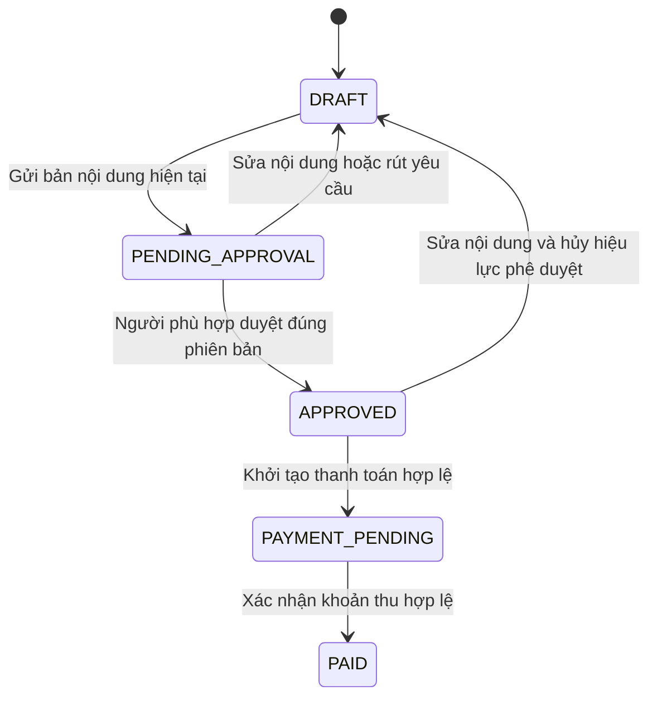

# Security versus functional correctness — Đúng chức năng và an toàn nghiệp vụ

Một hệ thống có thể tính đúng tổng tiền, lưu đúng đơn hàng và trả đúng mã HTTP cho những luồng sử dụng đã được thiết kế, nhưng vẫn cho phép người dùng mua hàng với giá tự sửa, tự phê duyệt yêu cầu của mình hoặc nhận tiền hoàn hai lần. Các hàm riêng lẻ có thể chạy đúng theo phần đặc tả mà nhóm đã viết; phần đặc tả ấy vẫn có thể thiếu những điều kiện bảo vệ nghiệp vụ.

Trong chương **Business Logic Foundations**, bài học này phân biệt **functional correctness** — tính đúng đắn chức năng — với **security**, cụ thể là an toàn của logic nghiệp vụ. Mục tiêu là biết phát biểu điều gì phải luôn đúng, xác định ai được thực hiện hành động nào trên đối tượng nào, và kiểm tra điều đó khi người dùng chủ động đổi dữ liệu, đổi thứ tự thao tác, gửi lại hoặc gửi đồng thời yêu cầu.

Trọng tâm là bảo vệ các quy tắc liên quan đến giá, phê duyệt, quyền trên đối tượng và tác động tài chính. Các kỹ thuật như state machine, transaction và idempotency được đặt vào đúng vai trò: chúng giúp duy trì những quy tắc cụ thể, chứ bản thân việc sử dụng chúng chưa chứng minh hệ thống an toàn.

## 1. Tính đúng đắn chức năng thực sự có nghĩa gì?

Một chương trình đúng đắn chức năng khi hành vi của nó phù hợp với đặc tả trong các điều kiện mà đặc tả quy định. Đặc tả có thể bao gồm kết quả trả về, thay đổi dữ liệu, lỗi, thời gian hiệu lực và hành vi khi có nhiều yêu cầu cùng chạy.

Ví dụ với thao tác tạo đơn hàng, đặc tả có thể quy định:

- Số lượng mỗi dòng hàng phải là số nguyên dương.
- Tổng tiền bằng tổng các thành tiền sau khi áp dụng chính sách giảm giá và làm tròn đã thống nhất.
- Nếu lưu đơn hàng thất bại thì không được để lại các dòng hàng mồ côi.
- Người dùng phải nhìn thấy mã đơn của đơn hàng vừa tạo.

Kiểm thử chức năng tốt có thể bao gồm trường hợp biên, dữ liệu sai, lỗi hệ thống và chạy đồng thời. Vì vậy, không nên đồng nhất kiểm thử chức năng với việc chỉ kiểm tra luồng thuận lợi.

Tuy nhiên, chất lượng của kết luận “đúng” phụ thuộc vào phạm vi đặc tả. Nếu đặc tả chỉ nói “lưu tổng tiền được gửi lên” thì việc lưu chính xác `total=1000` có thể đáp ứng câu đó, dù đơn hàng đáng lẽ có giá 1.000.000 đồng. Lỗi ở đây nằm trong việc xác định nguồn có quyền quyết định giá và trong việc thực thi quy tắc nghiệp vụ.

Một khi đặc tả đã ghi “chỉ người có quyền mới được phê duyệt”, việc cho người không có quyền phê duyệt vừa là lỗi chức năng theo đặc tả, vừa là lỗi bảo mật. Hai khái niệm có phần giao nhau rất lớn.

> Phân biệt hữu ích nằm ở góc nhìn và mức độ bao phủ: hệ thống có đáp ứng yêu cầu đã mô tả, và những yêu cầu ấy có giữ được ý nghĩa khi một tác nhân chủ động tìm cách lạm dụng hay không?

## 2. An toàn nghiệp vụ bổ sung những câu hỏi nào?

An toàn nghiệp vụ xét khả năng bảo vệ tài sản và quy tắc của hệ thống trước những hành vi mà người triển khai không mong muốn, kể cả khi hành vi đó sử dụng API hợp lệ và dữ liệu đúng định dạng.

Tài sản ở đây không chỉ là dữ liệu bí mật. Chúng còn có thể là tiền, hạn mức, hàng tồn kho, quyền được nhận ưu đãi, giá đã được duyệt, trạng thái xử lý và tính tin cậy của quyết định phê duyệt.

| Khía cạnh | Góc nhìn đúng đắn chức năng | Góc nhìn an toàn nghiệp vụ |
| --- | --- | --- |
| Đặc tả | Kết quả và trạng thái có phù hợp hợp đồng không? | Hợp đồng có bảo vệ tài sản khi bị chủ động lạm dụng không? |
| Chủ thể | Người dùng nào thực hiện chức năng? | Chủ thể đã được xác thực nào có quyền với đúng đối tượng này? |
| Dữ liệu | Dữ liệu có đúng kiểu, miền giá trị và công thức không? | Ai có thẩm quyền quyết định giá trị và dữ liệu có bị thay đổi sau kiểm tra không? |
| Thứ tự | Các bước của quy trình có hoạt động đúng không? | Có thể gọi thẳng bước sau, quay lại bước cũ hoặc tái sử dụng kết quả cũ không? |
| Lặp lại | Gửi lại có trả được kết quả dự kiến không? | Gửi lại có tạo thêm tiền, quyền lợi hoặc thay đổi trạng thái trái phép không? |
| Đồng thời | Các thao tác song song có nhất quán không? | Có thể tận dụng khoảng thời gian giữa kiểm tra và cập nhật để vượt giới hạn không? |
| Kết quả quan sát | Response và dữ liệu đầu ra có đúng không? | Có phát sinh tác động trái phép dù response trả lỗi hoặc bị mất không? |

Không phải mọi lỗi chức năng đều là lỗ hổng bảo mật. Một nhãn hiển thị sai có thể chỉ là lỗi giao diện; nếu nhãn đó làm người duyệt hiểu sai số tiền sẽ được phê duyệt thì tác động có thể khác. Đánh giá cần dựa vào khả năng khai thác, điều kiện thực hiện và quy tắc hoặc tài sản bị ảnh hưởng.

Ngược lại, một lỗi bảo mật không nhất thiết cần cú pháp lạ hoặc payload phức tạp. Thay `orderId` bằng mã đơn của người khác, gọi một endpoint sớm hơn dự kiến hoặc gửi hai yêu cầu hợp lệ cùng lúc có thể đủ để bộc lộ lỗi logic.

## 3. Ví dụ xuyên suốt: đơn hàng cần phê duyệt trước khi thanh toán

Giả sử một nền tảng bán hàng cho doanh nghiệp có quy trình sau:

1. Người mua tạo đơn trong tổ chức của mình.
2. Máy chủ tính tổng tiền từ dữ liệu giá và chính sách mà hệ thống quản lý.
3. Người mua gửi đơn để phê duyệt.
4. Người có quyền phê duyệt trong cùng tổ chức duyệt nội dung cụ thể của đơn.
5. Người có quyền thanh toán tiến hành thanh toán đơn đã được duyệt.

Trong ví dụ này, tổ chức áp dụng chính sách người tạo đơn không được tự phê duyệt đơn của mình. Đây là chính sách cụ thể của tình huống, không phải quy tắc bắt buộc cho mọi hệ thống.

Một luồng sử dụng bình thường có thể hoàn toàn chính xác:

```text
Người mua tạo đơn 1.000.000 đồng
→ người duyệt phù hợp phê duyệt
→ người thanh toán phù hợp thanh toán 1.000.000 đồng
→ đơn được ghi nhận đã thanh toán
```

Nhưng cần xét thêm các chuỗi hành động sau:

```text
Chuỗi A: Tạo đơn → gọi thẳng API thanh toán khi chưa được duyệt.
Chuỗi B: Gửi đơn → dùng tài khoản người tạo để tự phê duyệt.
Chuỗi C: Được duyệt → thay sản phẩm hoặc số lượng → dùng lại phê duyệt cũ.
Chuỗi D: Thanh toán thành công → mất response → gửi lại cùng thao tác.
Chuỗi E: Hai yêu cầu cùng thấy đơn chưa thanh toán → cùng tạo tác động thu tiền.
Chuỗi F: Người của tổ chức A → dùng mã đơn của tổ chức B để gọi API.
```

Mỗi request trong các chuỗi trên có thể là JSON hợp lệ, dùng phương thức HTTP đúng và được gửi từ một tài khoản đã đăng nhập. Điều cần bảo vệ nằm ở mối quan hệ giữa người dùng, đối tượng, nội dung, trạng thái và lịch sử thao tác.

## 4. Viết business invariant trước khi chọn biện pháp bảo vệ

**Business invariant** là điều kiện nghiệp vụ phải được duy trì ở những thời điểm hoặc ranh giới quan sát đã xác định. Với các thao tác cập nhật, ranh giới thường là thời điểm transaction commit; với hệ thống có xử lý bất đồng bộ, phải mô tả rõ trạng thái trung gian nào được phép tồn tại và trong bao lâu.

Một câu như “không được thanh toán sai” quá rộng để triển khai hoặc kiểm thử. Hãy tách thành các điều kiện cụ thể.

| Mã | Invariant trong ví dụ | Dấu hiệu vi phạm |
| --- | --- | --- |
| I1 | Giá và tổng tiền dùng để duyệt, thu tiền phải do máy chủ xác định theo chính sách của đơn | Client gửi giá thấp hơn và hệ thống dùng trực tiếp để thu tiền |
| I2 | Mỗi thao tác phải được cho phép đối với đúng đơn hàng và tổ chức liên quan | Có vai trò phù hợp nhưng thao tác được trên đơn ngoài phạm vi |
| I3 | Người duyệt phải có quyền và không phải người tạo đơn theo chính sách đã chọn | Người tạo tự duyệt qua API dù giao diện giấu nút |
| I4 | Phê duyệt gắn với đúng phiên bản nội dung của đơn | Đổi số lượng sau duyệt mà vẫn được thanh toán theo phê duyệt cũ |
| I5 | Chỉ các chuyển trạng thái được cho phép mới được commit | Đơn nháp chuyển thẳng sang đã thanh toán |
| I6 | Trong mô hình mỗi đơn có một nghĩa vụ thanh toán toàn bộ, nghĩa vụ đó chỉ được ghi nhận thanh toán thành công một lần | Gửi lại hoặc đổi khóa request làm phát sinh hai khoản thu cho cùng nghĩa vụ |
| I7 | Hạn mức và các giới hạn tổng hợp được duy trì kể cả khi có nhiều thao tác đồng thời | Hai yêu cầu đều vượt qua kiểm tra riêng rồi tổng cộng vượt hạn mức |

I6 cố ý nêu rõ mô hình. Nếu hệ thống hỗ trợ trả góp, thanh toán một phần hoặc nhiều lần thử thanh toán, cần nhận diện riêng nghĩa vụ thanh toán, lần thử và khoản thu thực tế. Không thể áp dụng máy móc ràng buộc “mỗi đơn chỉ có một bản ghi thanh toán”.

### 4.1. Trạng thái hợp lệ chưa đủ, chuyển trạng thái cũng phải hợp lệ

Giả sử cơ sở dữ liệu chỉ cho phép các giá trị trạng thái thuộc tập:

```text
DRAFT, PENDING_APPROVAL, APPROVED, PAYMENT_PENDING, PAID
```

Ràng buộc đó ngăn được giá trị như `UNKNOWN`, nhưng vẫn có thể cho phép chuyển trực tiếp từ `DRAFT` sang `PAID`. Mỗi giá trị đều đúng kiểu và thuộc danh sách; chuỗi hành động vẫn sai.

Có thể diễn đạt một lần chuyển hợp lệ như sau:

```text
Được phép chuyển trạng thái
= đúng trạng thái nguồn
  + đúng hành động
  + đúng chủ thể và phạm vi đối tượng
  + đúng phiên bản dữ liệu
  + thỏa các điều kiện nghiệp vụ còn lại.
```

Đây là phép liệt kê các điều kiện cùng phải thỏa, không phải công thức tính điểm cho phép bỏ qua điều kiện này bằng điều kiện khác.

### 4.2. Một số thuộc tính chỉ nhìn thấy được qua nhiều request

“Tổng tiền không âm” có thể kiểm tra trên một bản ghi. “Không hoàn tiền vượt số tiền đã thu” cần xét nhiều giao dịch. “Đã được duyệt trước khi thanh toán” cần liên kết thời điểm, nội dung được duyệt và lần thanh toán.

Vì vậy, kiểm tra từng request một cách độc lập thường không đủ cho an toàn nghiệp vụ. Đơn vị cần phân tích có thể là cả một chuỗi thao tác, thậm chí nhiều chuỗi chạy đồng thời.

## 5. State machine: bảo vệ ý nghĩa của quy trình

Với ví dụ đang xét, một phần state machine có thể được mô tả như sau:



Sơ đồ chỉ minh họa phần quy trình cần cho bài học. Các nhánh từ chối, hủy, hết hạn hoặc đối soát thanh toán chưa được mô hình hóa ở đây; khi triển khai phải xác định chúng theo nghiệp vụ thực tế.

Mỗi mũi tên cần có **guard**, tức điều kiện bảo vệ, ở phía máy chủ. Ví dụ:

| Hành động | Một số guard cần có |
| --- | --- |
| Gửi duyệt | Người thao tác được sửa đơn; đơn đang ở `DRAFT`; nội dung và giá đã hợp lệ |
| Phê duyệt | Đơn đang chờ duyệt; người duyệt thuộc phạm vi được phép; không tự duyệt; số tiền trong hạn mức; phiên bản khớp |
| Khởi tạo thanh toán | Chủ thể có quyền; đơn được duyệt; nội dung hiện tại khớp bản được duyệt; nghĩa vụ chưa được thanh toán hoặc xử lý trùng |
| Ghi nhận đã thanh toán | Xác nhận đến từ nguồn tin cậy; giao dịch liên kết đúng đơn, số tiền và tiền tệ; việc xử lý không tạo tác động lần hai |

Ẩn nút thanh toán chỉ giúp giao diện hướng dẫn người dùng. Người dùng có thể gọi API trực tiếp, dùng phiên bản ứng dụng cũ hoặc gửi lại request đã lưu. Kiểm tra có giá trị bảo vệ phải nằm trên đường thực thi phía máy chủ.

Cũng không nên cho phép client cập nhật tự do trường `status` qua một API sửa đối tượng tổng quát. Các lệnh có ý nghĩa như `submitForApproval`, `approve` và `startPayment` giúp xác định rõ hành động và điều kiện cần kiểm tra. Tên endpoint riêng không tự bảo đảm an toàn; các điều kiện vẫn phải được thực thi.

## 6. Quyền theo đối tượng: đăng nhập và vai trò chưa đủ

Xác thực trả lời chủ thể là ai. Kiểm tra vai trò trả lời chủ thể có nhóm quyền tổng quát nào. Quyền theo đối tượng còn phải trả lời chủ thể có được thực hiện hành động này trên **đơn cụ thể này**, trong **ngữ cảnh hiện tại này**, hay không.

Một điều kiện phân quyền có thể phụ thuộc đồng thời vào:

```text
authorize(chủ thể, hành động, đối tượng, ngữ cảnh)
```

Trong ví dụ phê duyệt:

- Chủ thể có quyền duyệt đơn trong tổ chức đang xét.
- Đơn thuộc phạm vi tổ chức hoặc bộ phận mà chủ thể được phụ trách.
- Chủ thể không phải người tạo đơn theo chính sách tách trách nhiệm.
- Số tiền không vượt hạn mức phê duyệt của chủ thể.
- Trạng thái và nội dung đơn vẫn phù hợp để duyệt.

Một tài khoản có vai trò `APPROVER` chưa đủ cơ sở để duyệt mọi đơn hàng. Tương tự, UUID khó đoán có thể làm việc đoán mã khó hơn nhưng không thay thế việc kiểm tra quyền.

### 6.1. Không lấy danh tính có thẩm quyền từ request body

Nếu request chứa `approvedBy`, `tenantId` hoặc `ownerId`, máy chủ phải xem đó là dữ liệu do client gửi. Các trường này không tự chứng minh danh tính hoặc quyền của người gọi.

Danh tính người phê duyệt nên lấy từ ngữ cảnh đã xác thực phía máy chủ. Nếu ứng dụng cho người dùng chọn tổ chức đang làm việc, việc lựa chọn ấy vẫn phải được kiểm tra với phạm vi mà tài khoản được phép truy cập.

### 6.2. Kiểm tra quyền cần bao phủ mọi đường ghi

Một endpoint duyệt có kiểm tra đầy đủ vẫn chưa đủ nếu API cập nhật hàng loạt, chức năng quản trị hoặc tác vụ nền có thể sửa cùng dữ liệu mà bỏ qua điều kiện nghiệp vụ.

Tác vụ nội bộ có thể sử dụng chủ thể dịch vụ thay cho người dùng cuối, nhưng vẫn cần phạm vi quyền và quy tắc rõ ràng. Nhãn “internal” không tự làm cho dữ liệu đầu vào hoặc thay đổi trạng thái trở nên hợp lệ.

## 7. Giá trị hợp lệ khác với giá trị có nguồn đáng tin

Giả sử request tạo đơn có nội dung:

```json
{
  "productId": "SKU-001",
  "quantity": 1,
  "unitPrice": 1000,
  "total": 1000
}
```

Cả `unitPrice` và `total` đều là số dương. Công thức `quantity × unitPrice = total` cũng đúng. Nhưng nếu giá bán áp dụng là 1.000.000 đồng, request vẫn vi phạm quy tắc về thẩm quyền quyết định giá.

Ba lớp kiểm tra cần được phân biệt:

1. **Định dạng:** số lượng là số nguyên, mã sản phẩm có cấu trúc hợp lệ.
2. **Quan hệ nghiệp vụ:** sản phẩm được bán trong phạm vi này, số lượng đáp ứng giới hạn, mã giảm giá áp dụng được.
3. **Thẩm quyền dữ liệu:** giá, tỷ lệ giảm và số tiền được thu phải xuất phát từ dữ liệu hoặc quyết định mà máy chủ tin cậy theo chính sách.

Tùy nghiệp vụ, hệ thống có thể tính lại giá tại thời điểm gửi duyệt hoặc khóa giá theo một báo giá có thời hạn. Không có quy tắc chung rằng luôn lấy giá mới nhất. Điều phải rõ là phiên bản giá nào có hiệu lực, ai được quyết định giá và điều gì xảy ra khi giá thay đổi.

| Dữ liệu | Client có thể đề xuất | Quyết định cần được thực hiện ở máy chủ |
| --- | --- | --- |
| Sản phẩm, số lượng | Có | Sản phẩm khả dụng, giới hạn số lượng và phạm vi mua |
| Mã giảm giá | Có | Điều kiện áp dụng, hạn dùng, số lượt và mức giảm |
| Đơn giá, tổng tiền | Có thể gửi để hiển thị hoặc phát hiện lệch giá | Chọn giá có hiệu lực và xác định số tiền có thẩm quyền |
| Người phê duyệt | Có thể đề xuất trong quy trình cho phép | Xác định người thật sự thực hiện và kiểm tra quyền |
| Trạng thái thanh toán | Có thể gửi yêu cầu truy vấn hoặc thao tác | Xác minh bằng bản ghi và nguồn thanh toán đáng tin |
| Phiên bản nội dung kỳ vọng | Có | So sánh với phiên bản hiện tại; giá trị client gửi không tự tạo quyền |

Với tiền, tính toán bằng `BigDecimal` trong Java và quy tắc làm tròn, tiền tệ rõ ràng giúp tránh sai số. Tuy nhiên, dùng kiểu số chính xác vẫn không ngăn được việc lấy nhầm nguồn giá hoặc cho sai người sửa giá.

## 8. Kiểm tra đúng vẫn có thể thất bại khi dữ liệu thay đổi

Một cách triển khai dễ gặp là:

```text
Đọc đơn và xác nhận đang chờ duyệt
→ kiểm tra người gọi được duyệt
→ cập nhật thành đã duyệt.
```

Vấn đề xuất hiện nếu nội dung bị sửa giữa lần kiểm tra và lần cập nhật:

```text
T1: Người duyệt đọc nội dung phiên bản 7, tổng 1.000.000 đồng.
T2: Người mua sửa số lượng, tạo nội dung phiên bản 8, tổng 5.000.000 đồng.
T1: Lệnh duyệt không kiểm tra phiên bản, ghi trạng thái APPROVED cho bản hiện tại.
```

Người duyệt chỉ xem bản 7, nhưng hệ thống có thể coi bản 8 là đã được duyệt. Đây là dạng sai lệch giữa lúc kiểm tra và lúc sử dụng, thường được gọi là **TOCTOU** — time of check to time of use.

Có hai vấn đề khác nhau cần xử lý:

- **Gắn quyết định với nội dung:** lệnh duyệt mang phiên bản kỳ vọng và phê duyệt phải liên kết với bản nội dung tương ứng.
- **Bảo vệ thao tác đọc–kiểm tra–ghi:** việc thay đổi đồng thời không được làm mất hiệu lực các điều kiện vừa kiểm tra.

### 8.1. Minh họa service Java với transaction và khóa bản ghi

Đoạn dưới là mã minh họa ở mức service. `Actor` đến từ ngữ cảnh xác thực phía máy chủ; repository phải thực sự thực hiện truy vấn có khóa trong transaction; các lỗi nghiệp vụ phải làm transaction rollback theo cấu hình ứng dụng.

```java
@Transactional
public ApprovalResult approve(
        Actor actor,
        UUID orderId,
        long expectedContentRevision) {

    Order order = orders.findForUpdate(actor.tenantId(), orderId)
            .orElseThrow(OrderNotVisibleException::new);

    policy.requireCanApprove(actor, order);

    if (order.status() != OrderStatus.PENDING_APPROVAL) {
        throw new InvalidOrderTransitionException();
    }
    if (actor.userId().equals(order.createdBy())) {
        throw new SelfApprovalDeniedException();
    }
    if (order.contentRevision() != expectedContentRevision) {
        throw new OrderContentChangedException();
    }

    policy.requireWithinApprovalLimit(actor, order.total());

    order.approveCurrentContent(actor.userId(), clock.instant());
    orders.save(order);
    return ApprovalResult.from(order);
}
```

`approveCurrentContent` phải ghi nhận được bản nội dung được duyệt, gồm phiên bản và những dữ liệu quyết định ý nghĩa phê duyệt. Có thể tham chiếu một revision bất biến hoặc lưu snapshot phù hợp; chỉ ghi `approved=true` thường không diễn đạt đủ điều này.

Cần phân biệt **phiên bản nội dung** với **phiên bản kỹ thuật của bản ghi**. Việc lưu dấu vết phê duyệt có thể làm tăng phiên bản bản ghi nhưng không nhất thiết làm thay đổi nội dung mà người duyệt đã xem. Mô hình dữ liệu phải thể hiện được quan hệ đó.

Khóa bản ghi chỉ hữu ích khi những đường sửa cùng đơn tuân thủ cơ chế phối hợp tương thích. Mọi thay đổi nội dung cần đồng thời tăng revision và làm mất hiệu lực phê duyệt cũ hoặc bị từ chối theo chính sách. Khóa một bảng đơn hàng cũng không tự bảo vệ hạn mức dùng chung nằm ở một bảng khác.

Nếu điều kiện phân quyền hoặc hạn mức có thể bị cập nhật đồng thời và nghiệp vụ yêu cầu hiệu lực tức thì, cần bảo vệ cả dữ liệu quyết định điều kiện đó bằng cơ chế khóa, phiên bản hoặc giao thức phù hợp.

### 8.2. Transaction không tự cung cấp mọi bảo đảm

Transaction giúp nhóm thay đổi dữ liệu thành một đơn vị commit hoặc rollback. Việc chống vượt hạn mức, ghi trùng hay cập nhật dựa trên dữ liệu cũ còn phụ thuộc vào mức cô lập, phạm vi khóa, điều kiện cập nhật và ràng buộc cơ sở dữ liệu.

Các lựa chọn thường gặp gồm:

- Khóa bản ghi liên quan trước khi kiểm tra rồi cập nhật trong cùng transaction.
- Optimistic locking với phiên bản và xử lý xung đột rõ ràng.
- Cập nhật có điều kiện ngay trong câu lệnh ghi và kiểm tra số dòng bị ảnh hưởng.
- Unique constraint để chặn việc tạo hai bản ghi cho cùng một sự kiện nghiệp vụ đã xác định.

Không có lựa chọn nào tự phù hợp với mọi invariant. Ví dụ, khóa từng đơn hàng không ngăn hai đơn khác nhau cùng tiêu hết một hạn mức tổ chức nếu cả hai không phối hợp trên dữ liệu hạn mức chung.

Một transaction cơ sở dữ liệu cục bộ cũng không tự rollback được khoản tiền mà nhà cung cấp thanh toán bên ngoài đã thu. Với tác động bên ngoài, cần mô hình trạng thái trung gian, cơ chế chống xử lý trùng, xử lý kết quả chưa rõ và đối soát tương ứng.

## 9. Idempotency: gửi lại không được nhân đôi tác động

Một thao tác có tính idempotent khi thực hiện lặp lại cùng thao tác theo hợp đồng không tạo thêm tác động nghiệp vụ ngoài tác động đã có. Trong API có `Idempotency-Key`, phải xác định rõ khóa nhận diện lần thao tác nào và phạm vi hiệu lực của nó.

Tình huống thường gặp:

```text
Client gửi yêu cầu thanh toán.
Server xử lý thành công nhưng response bị mất.
Client không biết kết quả nên gửi lại.
```

Hành vi gửi lại này có thể hoàn toàn bình thường. Kẻ lạm dụng cũng có thể cố tình khai thác cùng cơ chế. Thiết kế an toàn phải xử lý được cả hai.

Một hợp đồng idempotency rõ ràng cần giải quyết:

- **Phạm vi khóa:** khóa gắn với tổ chức hoặc chủ thể đã xác thực và loại thao tác phù hợp.
- **Ràng buộc nội dung:** cùng khóa nhưng khác đơn, số tiền hoặc tham số có ý nghĩa phải bị phát hiện; không coi đó là cùng thao tác một cách mù quáng.
- **Xử lý đồng thời:** hai request cùng khóa không được cùng tạo tác động đầu tiên; cần cơ chế chiếm quyền xử lý nguyên tử hoặc ràng buộc tương đương.
- **Kết quả:** request lặp được liên kết với kết quả đã xác lập hoặc trạng thái đang xử lý theo hợp đồng.
- **Thời hạn:** việc hết hạn bản ghi idempotency không được tự cho phép thực hiện lại nghĩa vụ nghiệp vụ đã hoàn tất.
- **Quyền truy cập:** khóa không trở thành bí mật thay thế xác thực; việc trả lại kết quả cũ vẫn phải tuân thủ chính sách truy cập hiện tại.

Idempotency theo khóa chỉ chống xử lý lặp **cùng khóa trong phạm vi đã định nghĩa**. Nếu kẻ lạm dụng gửi cùng một nghĩa vụ thanh toán với nhiều khóa khác nhau, invariant nghiệp vụ và ràng buộc lưu trữ vẫn phải ngăn khoản thu trùng.

Tương tự, vô hiệu hóa nút sau khi bấm, giới hạn tốc độ hoặc dùng phương thức HTTP được coi là idempotent không đủ để bảo đảm thao tác tài chính được cài đặt đúng. Hai request vẫn có thể chạy đồng thời, xuất phát từ hai thiết bị hoặc đi qua hai đường thực thi khác nhau.

Với nhà cung cấp thanh toán bên ngoài, cần liên kết định danh thao tác ở hệ thống của mình với định danh và cơ chế chống trùng của nhà cung cấp nếu có. Khi gặp timeout, trạng thái có thể là “chưa rõ kết quả”; không nên mặc định rằng chưa thu tiền rồi tạo một lần thu mới độc lập.

## 10. Chuyển từ yêu cầu chức năng sang hợp đồng có thể kiểm thử

Câu “người duyệt có thể duyệt đơn” chưa nói rõ nhiều điều kiện quan trọng. Có thể viết lại thành hợp đồng của lệnh `approve` như sau.

**Đầu vào có thẩm quyền:** danh tính đã xác thực và phạm vi tổ chức đã được máy chủ xác minh. `orderId` và phiên bản nội dung kỳ vọng do client gửi chỉ là tham số để xác định và đối chiếu.

**Tiền điều kiện:** đơn tồn tại trong phạm vi nhìn thấy; chủ thể được duyệt đơn đó; không vi phạm chính sách tự duyệt; đơn đang chờ duyệt; số tiền trong hạn mức; phiên bản nội dung còn khớp.

**Hậu điều kiện khi thành công:** đúng bản nội dung được đánh dấu đã duyệt; lưu được chủ thể và thời điểm; trạng thái chuyển hợp lệ; các invariant liên quan vẫn được giữ tại commit.

**Khi thất bại:** không tạo phê duyệt có hiệu lực hoặc tác động nghiệp vụ dở dang. Việc ghi nhật ký lần thử có thể vẫn diễn ra theo chính sách riêng. Response cần nhất quán với chính sách hiển thị tài nguyên và không làm lộ đối tượng ngoài phạm vi.

**Khi gửi lại hoặc có xung đột:** hợp đồng phải xác định trả kết quả cũ, từ chối do đã xử lý hay báo xung đột. Dù chọn cách phản hồi nào, không được tạo một quyết định mới với ý nghĩa khác hoặc duyệt nhầm nội dung.

Không nên đặt tiền điều kiện thành một giả định về sự trung thực của client. Nếu một API có thể bị người gọi không đủ quyền tiếp cận, “người gọi đã có quyền” phải là điều được hệ thống kiểm tra ở ranh giới tin cậy phù hợp.

## 11. Kiểm thử hành vi đối kháng, kiểm tra cả tác động sau request

Bắt đầu từ mỗi invariant rồi thay đổi một chiều của tình huống: chủ thể, đối tượng, dữ liệu, thứ tự, số lần gọi hoặc mức độ đồng thời. Cách này giúp tạo ca kiểm thử từ quy tắc cụ thể thay vì chỉ gom payload bất thường.

| Nhóm ca kiểm thử | Thao tác | Kết quả cần quan sát |
| --- | --- | --- |
| Chức năng được phép | Người phù hợp duyệt đúng đơn đang chờ duyệt | Thành công; bản nội dung được duyệt chính xác |
| Thiếu xác thực | Gọi duyệt không có ngữ cảnh xác thực hợp lệ | Không có quyết định phê duyệt được tạo |
| Sai vai trò | Người mua không có quyền gọi duyệt | Bị từ chối; trạng thái và bản phê duyệt không đổi |
| Sai đối tượng | Người có vai trò duyệt dùng mã đơn ngoài phạm vi | Không đọc hoặc cập nhật được dữ liệu trái phép |
| Tự phê duyệt | Người tạo đồng thời có vai trò duyệt tự duyệt đơn | Bị từ chối theo chính sách của ví dụ |
| Sửa giá | Gửi tổng tiền dương nhưng thấp hơn giá có thẩm quyền | Máy chủ từ chối hoặc tính theo nguồn đúng; không dùng giá giả để thu tiền |
| Bỏ qua bước | Gọi thanh toán khi đơn còn nháp hoặc chờ duyệt | Không khởi tạo tác động thanh toán trái phép |
| Phê duyệt lỗi thời | Gửi lệnh duyệt cho revision cũ | Báo xung đột hoặc kết quả tương đương; không duyệt bản mới ngoài ý định |
| Sửa sau duyệt | Đổi sản phẩm hoặc số lượng rồi thanh toán | Phê duyệt cũ mất hiệu lực hoặc sửa đổi bị chặn theo chính sách |
| Lặp cùng khóa | Gửi lại cùng một yêu cầu có khóa idempotency | Một tác động nghiệp vụ; kết quả nhất quán theo hợp đồng |
| Tái dùng khóa sai | Cùng khóa nhưng đổi tham số có ý nghĩa | Phát hiện khác biệt; không thực hiện âm thầm thao tác khác |
| Lặp khác khóa | Gửi nhiều yêu cầu cho cùng nghĩa vụ đã hoàn tất | Không tạo khoản thu thứ hai cho nghĩa vụ đó |
| Đồng thời | Hai yêu cầu cùng tranh một trạng thái hoặc hạn mức | Tổng tác động vẫn nằm trong invariant; xung đột được xử lý |
| Kết quả chưa rõ | Nhà cung cấp đã xử lý nhưng hệ thống bị timeout | Có đường truy vấn hoặc đối soát; không tự tạo tác động mới trái phép |

### 11.1. Mã HTTP chỉ là một phần của kết quả

Một test chỉ xác nhận `403` hoặc `409` có thể bỏ sót tác động đã xảy ra trước lúc trả lỗi. Tùy tình huống, cần kiểm tra thêm:

- Trạng thái cuối của đơn và phiên bản nội dung.
- Bản ghi phê duyệt và nội dung mà nó tham chiếu.
- Số lượng và tổng giá trị các khoản thu hoặc hoàn tiền.
- Việc cập nhật hạn mức hay tài nguyên dùng chung.
- Lời gọi tới hệ thống bên ngoài và định danh thao tác tương ứng.

Ví dụ, endpoint thanh toán trả lỗi vì ghi response thất bại nhưng trước đó đã gọi thu tiền hai lần. Response không thành công không đồng nghĩa với việc không có thiệt hại.

Mã lỗi cụ thể tùy hợp đồng API và chính sách tiết lộ tài nguyên. Có hệ thống trả `404` để không tiết lộ một đơn ngoài phạm vi; có hệ thống dùng `403` khi việc tiết lộ sự tồn tại được cho phép. Invariant cần được kiểm tra độc lập với lựa chọn mã phản hồi đó.

### 11.2. Kiểm thử đồng thời phải tạo được sự cạnh tranh thực sự

Gọi cùng thao tác hai lần theo thứ tự chỉ chứng minh hành vi tuần tự. Để kiểm tra race condition, cần phối hợp hai luồng sao cho chúng có cơ hội tranh cùng một điều kiện trước khi một luồng hoàn tất cập nhật.

Một kịch bản kiểm thử có thể là:

```text
Chuẩn bị: một nghĩa vụ thanh toán chưa hoàn tất.
Cho hai request bắt đầu gần cùng thời điểm bằng cơ chế đồng bộ của test.
Chờ cả hai kết thúc và chờ tác vụ liên quan hoàn tất theo mô hình hệ thống.
Kiểm tra: số tác động thanh toán thành công = 1.
Kiểm tra: tổng số tiền được ghi nhận đúng bằng nghĩa vụ cần thanh toán.
Kiểm tra: các trạng thái và kết quả xung đột phù hợp hợp đồng.
```

Các kiểm thử về khóa, isolation và unique constraint nên có mức tích hợp với cơ sở dữ liệu tương ứng. Mock repository thường không tái hiện được những bảo đảm hoặc lỗi cạnh tranh đó. Nếu có nhà cung cấp bên ngoài, cần môi trường giả lập hoặc môi trường thử nghiệm có thể quan sát được số lần tạo tác động.

### 11.3. Không có một tầng kiểm thử duy nhất là đủ

Unit test phù hợp cho công thức, quy tắc phân quyền thuần và điều kiện chuyển trạng thái. Integration test cần kiểm tra transaction và ràng buộc lưu trữ. Test ở ranh giới API giúp phát hiện sai lệch trong cách lấy danh tính, ánh xạ trường đầu vào và gọi service. Những luồng liên quan tác động bên ngoài cần kiểm tra thêm retry, timeout và xác nhận lặp.

Các tầng này cung cấp bằng chứng cho những thuộc tính khác nhau. Một bộ test chạy xanh chỉ chứng minh các tình huống đã được kiểm tra dưới những điều kiện đã dựng; nó không chứng minh mọi chuỗi hành động đều an toàn.

## 12. Những suy luận thường dẫn đến kết luận sai

| Suy luận | Điều còn thiếu |
| --- | --- |
| “API chạy đúng luồng demo nên nghiệp vụ đã an toàn” | Chưa xét chủ thể khác, đối tượng khác, thứ tự khác, lặp và đồng thời |
| “Có JWT nên người gọi được phép thao tác” | Token hợp lệ chưa quyết định quyền với từng đối tượng và từng trạng thái |
| “Giá là số dương và công thức đúng nên không sửa giá được” | Chưa xác định ai có quyền quyết định giá |
| “Giao diện không hiện nút duyệt” | API vẫn có thể được gọi trực tiếp |
| “Đã có `@Transactional` nên không thể có race condition” | Chưa xác định phạm vi khóa, isolation và invariant cần bảo vệ |
| “Có idempotency key nên không thu trùng” | Chưa xét khác khóa, khác payload, khóa hết hạn và tác động bên ngoài |
| “Đã trả lỗi nên không có gì bị thay đổi” | Tác động có thể đã xảy ra hoặc nằm ngoài transaction cục bộ |
| “Có audit log nên đã ngăn được lạm dụng” | Nhật ký hỗ trợ điều tra và phát hiện; tự nó không chặn vi phạm |
| “Có rate limit nên logic không bị khai thác” | Một hoặc hai yêu cầu cũng có thể đủ để vi phạm invariant |
| “Chức năng nội bộ không cần kiểm tra quy tắc” | Tác vụ nội bộ vẫn có thể nhận dữ liệu sai hoặc thao tác ngoài phạm vi |

Các công cụ kiểm tra lỗi kỹ thuật phổ biến vẫn có giá trị, nhưng thường không thể tự suy ra chính sách riêng như “người tạo không được tự duyệt” hoặc “phê duyệt chỉ có hiệu lực với revision này”. Những điều đó cần được mô hình hóa từ nghiệp vụ và chuyển thành điều kiện thực thi, dữ liệu chứng minh và kiểm thử phù hợp.

## 13. Cách áp dụng khi thiết kế hoặc đọc một chức năng

Với một chức năng nhạy cảm, có thể đi theo trình tự sau:

1. **Xác định tài sản và thiệt hại:** tiền, quyền lợi, hàng tồn, quyền truy cập hoặc độ tin cậy của quyết định nào có thể bị ảnh hưởng?
2. **Viết invariant có phạm vi rõ:** điều gì phải giữ đúng, với đối tượng nào và ở ranh giới thời gian nào?
3. **Xác định nguồn có thẩm quyền:** danh tính, giá, trạng thái, revision và hạn mức đến từ đâu?
4. **Mô hình hóa hành động được phép:** ai được chuyển trạng thái nào, trên đối tượng nào và với điều kiện gì?
5. **Tìm cách thay đổi ngữ cảnh:** thay người gọi, mã đối tượng, nội dung, thứ tự, số lần gửi và thời điểm cạnh tranh.
6. **Chọn cơ chế thực thi:** kiểm tra quyền theo đối tượng, state machine, transaction, điều kiện cập nhật, ràng buộc dữ liệu và idempotency theo đúng invariant.
7. **Định nghĩa bằng chứng kiểm thử:** ngoài response, cần quan sát bản ghi, tổng tiền, trạng thái hay tác động bên ngoài nào để chứng minh quy tắc vẫn được giữ?

Đầu ra hữu ích của quá trình này là một hợp đồng có thể thực thi và kiểm thử. Ví dụ: “Chỉ chủ thể có quyền trong cùng tổ chức, khác người tạo và đủ hạn mức mới được duyệt bản nội dung còn khớp; quyết định được ghi nguyên tử và không còn hiệu lực nếu nội dung thay đổi.”

**Đúng chức năng** đánh giá sự phù hợp với đặc tả. **An toàn nghiệp vụ** đòi hỏi đặc tả và cách thực thi bảo vệ được tài sản trước hành vi lạm dụng, kể cả qua các chuỗi request hợp lệ. Khi những yêu cầu bảo vệ ấy được diễn đạt đầy đủ, chúng trở thành một phần của tính đúng đắn mà hệ thống phải duy trì.
