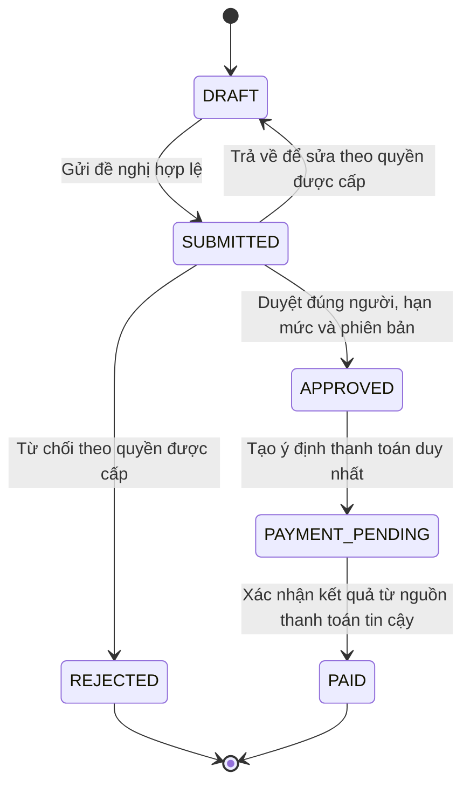
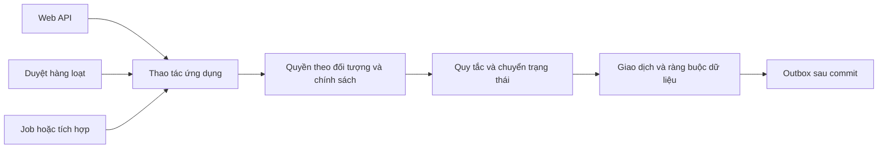

# Business rules as controls — Biến quy tắc nghiệp vụ thành cơ chế kiểm soát

## 1. Mục tiêu và bối cảnh

Trong chương **Business Logic Foundations**, bài học này giải thích cách dùng quy tắc nghiệp vụ để bảo vệ giá trị mà ứng dụng quản lý: tiền, hàng hóa, quyền truy cập, hạn mức và quyết định phê duyệt. Trọng tâm của Business Logic Security là giữ các quy tắc đó đúng ngay cả khi người dùng gọi API trực tiếp, sửa dữ liệu gửi lên, thực hiện các bước sai thứ tự hoặc gửi nhiều yêu cầu cùng lúc.

Sau bài học, bạn có thể:

- Chuyển một yêu cầu nghiệp vụ thành điều kiện có thể thực thi và kiểm thử.
- Phân biệt kiểm tra định dạng, xác thực danh tính, phân quyền và bảo vệ bất biến nghiệp vụ.
- Xác định dữ liệu đáng tin, điểm thực thi kiểm soát và ranh giới giao dịch.
- Kết hợp quyền theo đối tượng, máy trạng thái, transaction và idempotency để chống lạm dụng.
- Thiết kế tình huống kiểm thử chứng minh rằng thao tác bị cấm không tạo ra tác dụng phụ.

Bạn nên biết Java cơ bản, HTTP API, thao tác đọc/ghi cơ sở dữ liệu và ý nghĩa của commit/rollback. Các đoạn Java và SQL trong bài là ví dụ thiết kế; những thành phần hạ tầng chưa được triển khai đầy đủ đều được chỉ rõ.

## 2. Khi nào một business rule trở thành security control?

**Business rule** là quy tắc mô tả điều tổ chức cho phép hoặc yêu cầu. **Security control** là cơ chế thực thi, phát hiện hoặc khắc phục nhằm bảo vệ một mục tiêu an toàn cụ thể.

Ví dụ, “người tạo đề nghị mua hàng không được tự phê duyệt” là một quy tắc nghiệp vụ. Nó trở thành kiểm soát phòng ngừa khi mọi đường thực hiện phê duyệt đều kiểm tra danh tính người duyệt với người tạo trên dữ liệu máy chủ và từ chối trước khi thay đổi trạng thái.

Nếu quy tắc chỉ xuất hiện trong tài liệu hoặc trong điều kiện ẩn nút trên giao diện, hệ thống chưa bảo đảm thực thi quy tắc đó.

| Phát biểu | Cách triển khai | Giá trị kiểm soát |
| --- | --- | --- |
| Người tạo không được tự duyệt | Giao diện ẩn nút duyệt | Giúp người dùng thao tác đúng; API vẫn cần kiểm soát |
| Người tạo không được tự duyệt | Dịch vụ kiểm tra quan hệ người tạo–người duyệt trước khi ghi | Ngăn quyết định trái chính sách tại điểm thực thi |
| Phải nhận biết hành vi tự duyệt | Ghi nhận và cảnh báo các lần bị từ chối | Hỗ trợ phát hiện lạm dụng |
| Cần xử lý sai sót sau khi đã duyệt | Quy trình thu hồi quyết định và đối soát tác động | Hỗ trợ khắc phục theo chính sách đã định nghĩa |

Không phải mọi quy tắc nghiệp vụ đều có cùng mức rủi ro. Việc gợi ý thứ tự sản phẩm trên màn hình có thể chỉ là lựa chọn trải nghiệm. Việc xác định tổng tiền phải trả hoặc ai được chuyển trạng thái đơn hàng trực tiếp ảnh hưởng đến tài sản và quyền hạn, nên cần được xem như một phần của thiết kế bảo mật.

OWASP nhấn mạnh rằng lạm dụng logic có thể xuất hiện qua thứ tự bước, dữ liệu do máy khách kiểm soát và các thao tác cạnh tranh; quy trình nghiệp vụ phải được xem xét cùng với mã xử lý. Bài này cụ thể hóa vấn đề bằng một quy trình mua hàng giả định. [Tham khảo OWASP Business Logic Security](https://cheatsheetseries.owasp.org/cheatsheets/Business_Logic_Security_Cheat_Sheet.html).

### 2.1. Dữ liệu hợp lệ vẫn có thể tạo ra hành vi trái phép

Xét yêu cầu sau:

```http
POST /purchase-requests/PR-104/approve
Content-Type: application/json

{
  "expectedContentVersion": 7
}
```

Đường dẫn có cấu trúc đúng và phiên bản là số nguyên hợp lệ. Tuy nhiên, máy chủ vẫn phải xác định:

- Người gọi có thuộc tổ chức sở hữu `PR-104` không?
- Người đó có quyền duyệt cho phòng ban của đề nghị không?
- Người đó có phải chính người tạo đề nghị không?
- Đề nghị có đang ở bước được phép phê duyệt không?
- Tổng tiền có nằm trong hạn mức của người duyệt không?
- Phiên bản người duyệt đã xem có còn là phiên bản hiện tại không?

Kiểm tra từng trường dữ liệu không trả lời được toàn bộ những câu hỏi này.

### 2.2. Các lớp kiểm tra bổ sung cho nhau

| Lớp | Câu hỏi chính | Ví dụ |
| --- | --- | --- |
| Kiểm tra đầu vào | Dữ liệu có đúng kiểu và miền giá trị không? | Số lượng là số nguyên từ 1 đến giới hạn cho phép |
| Xác thực | Người gọi là ai? | Danh tính được lấy từ phiên hoặc token đã được xác minh |
| Phân quyền | Người này được làm gì với đối tượng này? | Chỉ quản lý phụ trách phòng ban mới được duyệt |
| Quy tắc nghiệp vụ | Thao tác có hợp lệ trong tình huống hiện tại không? | Chỉ duyệt đề nghị đã gửi và chưa bị thay đổi nội dung |
| Kiểm soát nhất quán | Điều kiện còn đúng khi nhiều thao tác chạy cùng lúc không? | Hai lượt duyệt cạnh tranh không tạo hai quyết định được chấp nhận |

Một quy tắc có thể thuộc nhiều lớp. Điều kiện “người tạo không tự duyệt” vừa là quan hệ phân quyền, vừa là nguyên tắc tách biệt trách nhiệm của nghiệp vụ.

## 3. Ví dụ xuyên suốt: đề nghị mua hàng trong một tổ chức

Giả sử hệ thống phục vụ nhiều tổ chức, phân tách bằng `tenantId`. Mỗi đề nghị có người tạo, phòng ban, các dòng hàng, tổng tiền và trạng thái. Trong ví dụ, tiền được biểu diễn bằng số nguyên VND; không áp dụng ngầm cách biểu diễn này cho mọi loại tiền tệ.

Chính sách giả định của bài học:

1. Người tạo chỉ được sửa đề nghị ở trạng thái `DRAFT`.
2. Tổng tiền được máy chủ tính từ số lượng hợp lệ và giá đã được hệ thống chấp nhận, theo chính sách báo giá.
3. Người duyệt phải thuộc cùng tổ chức, được phụ trách phòng ban và có hạn mức phù hợp.
4. Người tạo không được tự duyệt, kể cả khi có vai trò quản lý.
5. Chỉ đề nghị `SUBMITTED` mới được phê duyệt.
6. Quyết định duyệt phải gắn với chính nội dung đã được xem xét.
7. Trong mô hình đơn giản này, một đề nghị chỉ có một ý định thanh toán; không hỗ trợ thanh toán từng phần.
8. Retry hoặc xử lý trùng sự kiện không được tạo thêm lần thanh toán cho cùng đề nghị.

Các chính sách trên là giả định để học thiết kế, không phải quy định chung cho mọi hệ thống mua hàng. Nếu sản phẩm cho phép nhiều cấp duyệt, thanh toán từng phần hoặc ngoại lệ, mô hình cần biểu diễn rõ những khả năng đó.

### 3.1. Đừng để một tính từ che giấu nhiều điều kiện

Câu “chỉ người có thẩm quyền được duyệt” còn mơ hồ. Có thể cụ thể hóa thành:

```text
canApprove(actor, request, authority, context) =
    actor.tenantId = request.tenantId
    AND authority cho phép actor duyệt phòng ban của request
    AND actor.userId != request.requesterId
    AND request.state = SUBMITTED
    AND request.totalVnd <= authority.limitVnd
    AND context.expectedContentVersion = request.contentVersion
```

`authority` phải do máy chủ tải từ nguồn chính sách và phân quyền đáng tin. Đưa `isManager: true` hoặc `approvalLimit: 100000000` từ JSON vào biểu thức trên sẽ làm mất ý nghĩa kiểm soát.

### 3.2. Tách precondition, invariant và postcondition

- **Precondition — tiền điều kiện:** điều phải đúng trước một thao tác, chẳng hạn đề nghị đang `SUBMITTED` trước khi duyệt.
- **Invariant — bất biến:** điều phải đúng ở mọi trạng thái ổn định có thể quan sát theo mô hình, chẳng hạn quyết định duyệt hiện hành không thuộc về người tạo.
- **Postcondition — hậu điều kiện:** điều phải đúng sau một thao tác thành công, chẳng hạn trạng thái trở thành `APPROVED` và bằng chứng duyệt được lưu.

Với thao tác phê duyệt:

```text
Trước:
  actor có thẩm quyền với đối tượng hiện tại
  state = SUBMITTED
  contentVersion = phiên bản actor đã xem

Sau khi commit thành công:
  state = APPROVED
  approvedBy = actor.userId
  approvedContentVersion = contentVersion
  có bản ghi quyết định chứa thời điểm và phiên bản chính sách

Nếu không thỏa điều kiện:
  không đổi trạng thái
  không tạo quyết định duyệt thành công
  không phát yêu cầu thanh toán
```

Điều kiện “không tạo tác dụng phụ khi bị từ chối” cũng là một phần của hợp đồng nghiệp vụ, cần được thiết kế và kiểm thử.

## 4. Chuyển quy tắc thành một đặc tả kiểm soát

Mỗi quy tắc có ý nghĩa bảo mật cần trả lời được ít nhất sáu câu hỏi:

1. **Bảo vệ gì?** Giá trị hoặc quyết định nào bị ảnh hưởng nếu quy tắc sai?
2. **Cấm điều gì?** Diễn đạt điều kiện sao cho có thể đưa ra kết quả cho phép hoặc từ chối.
3. **Tin dữ liệu nào?** Nguồn của danh tính, chủ sở hữu, trạng thái, giá và hạn mức.
4. **Thực thi ở đâu?** Điểm chặn bắt buộc trước khi thay đổi dữ liệu hoặc gọi hệ thống ngoài.
5. **Giữ điều kiện bằng cách nào?** Transaction, khóa, cập nhật có điều kiện hoặc ràng buộc dữ liệu.
6. **Chứng minh ra sao?** Trạng thái sau xử lý, bằng chứng kiểm toán và kiểm thử vi phạm.

Ví dụ một đặc tả kiểm soát:

| Thành phần | Nội dung cho quy tắc cấm tự duyệt |
| --- | --- |
| Mục tiêu | Giữ sự độc lập giữa người yêu cầu và người phê duyệt |
| Điều kiện | `actor.userId != request.requesterId` |
| Dữ liệu đáng tin | Danh tính từ ngữ cảnh xác thực; người tạo từ bản ghi được tải đúng tổ chức |
| Điểm thực thi | Thao tác nghiệp vụ `approve`, dùng chung cho các đường gọi |
| Ranh giới nhất quán | Cùng giao dịch với việc ghi trạng thái và quyết định duyệt |
| Bằng chứng | Người thao tác, đối tượng, kết quả, mã lý do, phiên bản nội dung và chính sách |
| Kiểm thử phản ví dụ | Người tạo có cả vai trò quản lý vẫn bị từ chối khi gọi API trực tiếp |

Đặc tả này giúp cả người viết mã và người kiểm thử biết điều gì mới được coi là đã triển khai xong. Một annotation kiểm tra vai trò ở controller chưa đủ để chứng minh quy tắc cấm tự duyệt đã được bảo vệ.

## 5. Chọn đúng nguồn dữ liệu và ranh giới tin cậy

### 5.1. Máy khách gửi ý định; máy chủ quyết định hiệu lực

Một lệnh tạo đề nghị có thể chấp nhận mã sản phẩm và số lượng. Những trường như người tạo thực tế, tổ chức đang được phép thao tác, tổng tiền chính thức, người duyệt và trạng thái duyệt do hệ thống xác lập.

```json
{
  "items": [
    { "productId": "P-17", "quantity": 2 }
  ],
  "note": "Mua thiết bị cho nhóm"
}
```

Nếu API cần nhận tổ chức hoặc phòng ban do người dùng chọn, các giá trị đó vẫn là đầu vào cần kiểm tra quyền. Chúng không tự trở thành ngữ cảnh tin cậy chỉ vì được đặt trong header hoặc đường dẫn.

Tránh gán tự động toàn bộ JSON vào entity lưu trữ. Các trường `state`, `approvedBy`, `totalVnd` và `tenantId` cần chính sách ghi riêng; không để khả năng sửa entity quyết định ngầm quyền của người gọi.

### 5.2. Giá do máy chủ quản lý vẫn cần chính sách thời điểm

Giả sử máy chủ tính đơn giá 2.000.000 VND cho mỗi sản phẩm, số lượng là 2, tổng tiền là 4.000.000 VND. Trước khi thanh toán, bảng giá thay đổi. Có hai cách thiết kế hợp lệ tùy sản phẩm:

- Giữ giá trong một báo giá bất biến còn hiệu lực, rồi gắn đề nghị và quyết định duyệt với báo giá đó.
- Tính lại giá ở một bước quy định; nếu tổng tiền hoặc điều kiện trọng yếu đổi thì tạo phiên bản nội dung mới và yêu cầu duyệt lại.

Không được duyệt 4.000.000 VND rồi âm thầm thực hiện 6.000.000 VND dưới cùng một bằng chứng duyệt. “Tính ở server” chưa giải quyết được câu hỏi **giá nào đã được phê duyệt**.

Khi tính bằng `long` trong Java, cần giới hạn số dòng, số lượng, đơn giá và xử lý tràn số. Có thể dùng `Math.multiplyExact` và `Math.addExact` để phát hiện tràn, sau đó chuyển lỗi thành kết quả từ chối hợp lệ trước khi lưu. Với tiền có phần lẻ, cần kiểu tiền tệ, độ chính xác và quy tắc làm tròn rõ ràng.

### 5.3. Danh tính đúng chưa đủ; quyền với đối tượng phải đúng

Người có vai trò quản lý ở tổ chức A không vì thế được duyệt đề nghị của tổ chức B. Người quản lý phòng kỹ thuật cũng không mặc nhiên được duyệt đề nghị của phòng nhân sự.

Khi tải đối tượng, nên ràng buộc cả mã đối tượng và tổ chức được phép thao tác. Sau đó vẫn phải kiểm tra hành động, quan hệ người dùng–đối tượng và trạng thái nghiệp vụ. Một mã đối tượng khó đoán giúp giảm khả năng dò tìm nhưng không thay cho kiểm tra quyền.

Đối với kết quả đọc lại từ bộ nhớ idempotency hoặc cache, quyền truy cập vẫn cần được kiểm tra theo chính sách hiện hành. [OWASP Authorization Cheat Sheet](https://cheatsheetseries.owasp.org/cheatsheets/Authorization_Cheat_Sheet.html) khuyến nghị từ chối mặc định và kiểm tra quyền trên từng yêu cầu.

## 6. Máy trạng thái biến thứ tự công việc thành điều kiện bắt buộc

Với mô hình mua hàng đang xét, có thể biểu diễn luồng chính như sau:



Sơ đồ chỉ mô tả phạm vi bài học. Trạng thái chờ thanh toán chưa đồng nghĩa với đã trả tiền. Nếu kết quả bên ngoài chưa rõ hoặc có lỗi, hệ thống phải giữ đủ dữ liệu để xử lý tiếp; không tự gán `PAID`. Nhánh hủy, hoàn tiền và nhiều cấp duyệt cần thiết kế riêng nếu sản phẩm hỗ trợ.

| Thao tác | Trạng thái xuất phát | Điều kiện bổ sung | Kết quả hợp lệ |
| --- | --- | --- | --- |
| Sửa dòng hàng | `DRAFT` | Đúng chủ thể có quyền sửa; dữ liệu hợp lệ | Nội dung mới, tăng `contentVersion` |
| Gửi duyệt | `DRAFT` | Có dòng hàng; giá/báo giá hợp lệ; tổng tiền hợp lệ | `SUBMITTED` |
| Trả về sửa | `SUBMITTED` | Người xử lý có quyền; chưa bắt đầu thanh toán | `DRAFT` |
| Duyệt | `SUBMITTED` | Đúng tổ chức, phòng ban, hạn mức; không tự duyệt; đúng phiên bản | `APPROVED` |
| Yêu cầu thanh toán | `APPROVED` | Bằng chứng duyệt khớp nội dung; chưa có ý định thanh toán | `PAYMENT_PENDING` |
| Xác nhận trả tiền | `PAYMENT_PENDING` | Kết quả đã được xác minh; khớp ý định, số tiền và loại tiền | `PAID` |

Mỗi đường chuyển cần có điều kiện tường minh. Việc biểu diễn `state` bằng enum chỉ giới hạn tên trạng thái; nó không tự ngăn `DRAFT` chuyển thẳng thành `PAID` qua một hàm cập nhật chung.

Trong mô hình này, nội dung đã duyệt không được chỉnh sửa trực tiếp. Nếu doanh nghiệp muốn cho phép sửa, phải bổ sung luồng thu hồi hoặc vô hiệu hóa phê duyệt, kiểm soát việc thanh toán đã bắt đầu hay chưa và yêu cầu duyệt lại khi cần.

### 6.1. Phê duyệt phải gắn với nội dung, không chỉ với mã đối tượng

Hai biến phiên bản có mục đích khác nhau:

- `contentVersion`: tăng khi nội dung có ý nghĩa với quyết định duyệt thay đổi, như dòng hàng, tổng tiền hoặc đối tượng thụ hưởng.
- `rowVersion`: tăng theo các lần ghi bản ghi để phát hiện xung đột kỹ thuật khi dùng optimistic locking.

Chuyển từ `SUBMITTED` sang `APPROVED` có thể tăng `rowVersion` nhưng không làm thay đổi `contentVersion`. Bằng chứng duyệt giữ `approvedContentVersion = contentVersion` tại thời điểm duyệt.

Trường `expectedContentVersion` trong lệnh duyệt cho biết phiên bản mà người duyệt đã xem. Máy chủ so sánh với dữ liệu hiện hành; không dùng nó để thay thế phiên bản trong cơ sở dữ liệu. Nếu nội dung đổi, người duyệt phải xem và xác nhận lại thay vì ứng dụng tự động lấy phiên bản mới để thử lại lệnh cũ.

Nguyên tắc gắn xác nhận với dữ liệu trọng yếu của giao dịch cũng xuất hiện trong [OWASP Transaction Authorization Cheat Sheet](https://cheatsheetseries.owasp.org/cheatsheets/Transaction_Authorization_Cheat_Sheet.html). Với đề nghị mua hàng này, dữ liệu trọng yếu bao gồm nội dung mua, tổng tiền, loại tiền và phiên bản nội dung.

## 7. Ví dụ Java: gom điều kiện vào thao tác nghiệp vụ

Đoạn sau tập trung vào quyết định duyệt. Đây là phần trích của mô hình, chưa bao gồm constructor, truy vấn dữ liệu, transaction, ánh xạ HTTP hoặc cơ chế xác thực.

Các import cần dùng là `java.time.Instant` và `java.util.UUID`. Constructor của `PurchaseRequest` được giả định đã bảo đảm tổng tiền dương, phiên bản hợp lệ và các định danh bắt buộc không rỗng. `ApprovalAuthority` chỉ được tạo từ dữ liệu phân quyền do máy chủ quản lý.

```java
record Actor(UUID userId, UUID tenantId) {}

record ApprovalAuthority(
        boolean mayApprove,
        UUID departmentId,
        long limitVnd,
        long policyVersion) {}

record ApprovalEvidence(
        UUID approverId,
        Instant approvedAt,
        long contentVersion,
        long policyVersion) {}

enum PurchaseState {
    DRAFT, SUBMITTED, APPROVED, REJECTED, PAYMENT_PENDING, PAID
}

final class RuleViolation extends RuntimeException {
    RuleViolation(String code) {
        super(code);
    }
}

final class PurchaseRequest {
    private UUID tenantId;
    private UUID requesterId;
    private UUID departmentId;
    private long totalVnd;
    private long contentVersion;
    private PurchaseState state;
    private ApprovalEvidence approval;

    // Constructor và các thao tác khác được lược bỏ.
    ApprovalEvidence approve(
            Actor actor,
            ApprovalAuthority authority,
            long expectedContentVersion,
            Instant now) {

        if (!tenantId.equals(actor.tenantId())) {
            throw new RuleViolation("FORBIDDEN");
        }
        if (!authority.mayApprove()
                || !departmentId.equals(authority.departmentId())) {
            throw new RuleViolation("FORBIDDEN");
        }
        if (requesterId.equals(actor.userId())) {
            throw new RuleViolation("SELF_APPROVAL_FORBIDDEN");
        }
        if (state != PurchaseState.SUBMITTED) {
            throw new RuleViolation("INVALID_STATE");
        }
        if (contentVersion != expectedContentVersion) {
            throw new RuleViolation("CONTENT_CHANGED");
        }
        if (totalVnd > authority.limitVnd()) {
            throw new RuleViolation("APPROVAL_LIMIT_EXCEEDED");
        }

        ApprovalEvidence evidence = new ApprovalEvidence(
                actor.userId(), now, contentVersion,
                authority.policyVersion());

        approval = evidence;
        state = PurchaseState.APPROVED;
        return evidence;
    }
}
```

Điểm cần quan sát:

1. Tất cả điều kiện được kiểm tra trước khi thay đổi trạng thái.
2. Lệnh duyệt không nhận `approvedBy`, tổng tiền hoặc hạn mức do máy khách tự khai.
3. Bằng chứng gắn người duyệt, thời điểm, phiên bản nội dung và phiên bản chính sách.
4. Không có hàm công khai `setState(APPROVED)` để các đường gọi khác bỏ qua điều kiện.
5. Các mã lý do được dùng để xử lý và kiểm thử; lớp API quyết định chi tiết nào được trả cho người gọi để tránh lộ thông tin đối tượng ngoài quyền.

Đối tượng `Actor` đơn thuần không chứng minh người dùng đã xác thực. Lớp tiếp nhận yêu cầu phải dựng nó từ ngữ cảnh đã xác minh, đồng thời xác nhận người dùng được thao tác trong tổ chức tương ứng. Tương tự, lớp điều phối phải bảo đảm bản ghi thẩm quyền thuộc đúng người gọi và tổ chức, không ghép nhầm kết quả của người khác.

Quan trọng hơn, đoạn Java trên **chưa giải quyết cạnh tranh giữa hai tiến trình**. Hai bản sao trong bộ nhớ có thể cùng thấy `SUBMITTED`. Việc thực thi kiểm soát chỉ hoàn chỉnh khi gắn quyết định với cách ghi nhất quán ở cơ sở dữ liệu.

## 8. Kiểm tra và thay đổi phải thuộc cùng ranh giới nhất quán

### 8.1. Vì sao kiểm tra đúng vẫn có thể cho kết quả sai?

Giả sử hai yêu cầu A và B cùng đọc một đề nghị ở trạng thái `SUBMITTED`:

```text
A: đọc SUBMITTED
B: đọc SUBMITTED
A: kiểm tra quyền và hạn mức → đạt
B: kiểm tra quyền và hạn mức → đạt
A: ghi APPROVED và một quyết định duyệt
B: ghi APPROVED và một quyết định duyệt khác
```

Trạng thái cuối vẫn có thể là `APPROVED`, nhưng hệ thống đã chấp nhận hai quyết định, phát hai sự kiện hoặc kích hoạt hai tác vụ. Chỉ kiểm tra trạng thái cuối sẽ bỏ sót sai phạm này.

Một transaction giúp nhóm các thay đổi thành một đơn vị commit/rollback. Khả năng ngăn lịch chạy trên còn phụ thuộc mức cô lập, truy vấn, khóa, kiểm tra phiên bản và ràng buộc được sử dụng. Không nên coi việc “đã đặt transaction” là bằng chứng đủ cho mọi bất biến.

### 8.2. Cách 1: khóa bản ghi rồi quyết định trong transaction

Luồng điều phối khái niệm:

```text
BEGIN TRANSACTION
  1. Tải đề nghị theo (tenant_id, id) và khóa ghi bản ghi cha.
  2. Tải dữ liệu cần thiết và thẩm quyền đúng người, đúng tổ chức.
  3. Kiểm tra tính hiệu lực của chính sách theo yêu cầu của sản phẩm.
  4. Gọi request.approve(...).
  5. Lưu trạng thái và bằng chứng duyệt.
  6. Lưu sự kiện nghiệp vụ/outbox nếu cần thông báo sau commit.
COMMIT
```

Đây là giao ước giữa các đường ghi: mọi thao tác thay đổi cùng đề nghị, bao gồm dòng hàng, phải tôn trọng cùng chiến lược khóa hoặc phiên bản. Khóa bản ghi cha không tự ngăn một câu lệnh khác sửa trực tiếp dòng hàng nếu đường ghi đó không phối hợp.

Nếu chính sách yêu cầu việc thu hồi quyền có hiệu lực trước mọi quyết định chưa commit, cần đồng bộ cả việc thay đổi thẩm quyền, chẳng hạn bằng khóa hoặc cơ chế phiên bản và kiểm tra xung đột phù hợp. Chỉ đọc hạn mức vào một biến trong transaction không tự khóa được chính sách ở một hệ thống khác.

### 8.3. Cách 2: cập nhật có điều kiện và kiểm tra số dòng

SQL minh họa dưới đây là một phần của thao tác duyệt. Các tham số `actor_id`, tổ chức, phòng ban được phép duyệt, hạn mức và phiên bản chính sách phải được lấy từ ngữ cảnh và dữ liệu đáng tin, sau khi kiểm tra thẩm quyền.

```sql
UPDATE purchase_request
SET state = 'APPROVED',
    approved_by = :actor_id,
    approved_content_version = content_version,
    approved_policy_version = :policy_version,
    row_version = row_version + 1
WHERE id = :request_id
  AND tenant_id = :tenant_id
  AND department_id = :authorized_department_id
  AND requester_id <> :actor_id
  AND state = 'SUBMITTED'
  AND content_version = :expected_content_version
  AND row_version = :expected_row_version
  AND total_vnd <= :approval_limit_vnd;
```

Quy ước xử lý:

- `affectedRows = 1`: việc chuyển trạng thái đạt điều kiện; tiếp tục lưu bằng chứng và các thay đổi liên quan trong cùng transaction.
- `affectedRows = 0`: không được báo duyệt thành công; có thể do không có đối tượng phù hợp, sai quyền, sai trạng thái, vượt hạn mức hoặc xung đột.
- Nếu ghi bằng chứng thất bại, rollback cả chuyển trạng thái.

Không nhất thiết trả cho người gọi mọi nguyên nhân phân biệt được trong nội bộ. Cũng không được bắt lỗi xung đột rồi ghi lại bằng một câu `UPDATE` không điều kiện.

Câu SQL bảo vệ những điều kiện nằm trong nó; tính mới và tính đúng của thẩm quyền vẫn cần được giải quyết ở lớp điều phối. Khóa bản ghi, optimistic locking và cập nhật có điều kiện là những công cụ có thể kết hợp theo bất biến cần bảo vệ, không phải một công thức duy nhất cho mọi thao tác.

### 8.4. Ràng buộc dữ liệu bổ sung một lớp phòng vệ

Với mô hình trong bài, một số ràng buộc có thể biểu diễn tại cơ sở dữ liệu:

```sql
-- Giả định requester_id, content_version và state đều NOT NULL.
ALTER TABLE purchase_request
ADD CONSTRAINT ck_positive_total CHECK (total_vnd > 0);

ALTER TABLE purchase_request
ADD CONSTRAINT ck_no_self_approval CHECK (
    approved_by IS NULL OR approved_by <> requester_id
);

ALTER TABLE purchase_request
ADD CONSTRAINT ck_approval_matches_content CHECK (
    state NOT IN ('APPROVED', 'PAYMENT_PENDING', 'PAID')
    OR (
        approved_by IS NOT NULL
        AND approved_content_version IS NOT NULL
        AND approved_content_version = content_version
    )
);

-- Giả định các cột trong khóa bên dưới đều NOT NULL.
ALTER TABLE payment_intent
ADD CONSTRAINT uq_one_payment_intent_per_request
UNIQUE (tenant_id, purchase_request_id);
```

`total_vnd` cũng phải có `NOT NULL`; kiểm tra `> 0` không thay thế kiểm tra bắt buộc có dữ liệu. Khi triển khai thực tế, phải bảo đảm dữ liệu hiện có đáp ứng ràng buộc trước khi thêm chúng.

Các ràng buộc trên chưa thể hiện đầy đủ quyền theo phòng ban, lịch sử chuyển trạng thái hoặc tổng các dòng hàng. Một dòng dữ liệu có hình dạng hợp lệ vẫn có thể được tạo ra qua một bước chuyển trái phép. Vì vậy, ràng buộc cơ sở dữ liệu bổ sung cho thao tác nghiệp vụ, không thay thế toàn bộ thao tác đó.

## 9. Idempotency bảo vệ cùng một ý định trước retry

Máy khách có thể không nhận được phản hồi dù máy chủ đã commit. Khi người dùng bấm lại hoặc thư viện tự gửi lại, hệ thống phải phân biệt **gửi lại cùng một ý định** với **tạo một ý định mới**.

Trong bài này, idempotency có nghĩa là việc xử lý lại cùng một yêu cầu đã được định danh không tạo thêm tác dụng nghiệp vụ. Phản hồi HTTP giữa các lần gọi không bắt buộc giống hệt từng byte; điều cần giữ là hợp đồng đã công bố và kết quả nghiệp vụ.

### 9.1. Hai loại định danh giải quyết hai vấn đề khác nhau

| Cơ chế | Xác định điều gì? | Ví dụ |
| --- | --- | --- |
| Idempotency key | Những lần gọi nào là retry của cùng một ý định | Gửi lại lệnh tạo thanh toán với cùng khóa và cùng tham số |
| Khóa nghiệp vụ duy nhất | Kết quả nào chỉ được tồn tại một lần theo chính sách | Chỉ một `payment_intent` cho mỗi đề nghị trong mô hình này |

Hai người có thể gửi hai khóa idempotency khác nhau cho cùng một đề nghị. Chỉ kiểm tra khóa HTTP sẽ không ngăn được việc tạo hai ý định thanh toán. Ràng buộc `(tenant_id, purchase_request_id)` và kiểm soát trạng thái mới bảo vệ điều kiện một ý định cho một đề nghị.

Ngược lại, chỉ có ràng buộc nghiệp vụ mà không có hợp đồng retry có thể khiến máy khách không biết lần gọi trước đã thành công hay chưa. Hai cơ chế nên được thiết kế cùng nhau.

### 9.2. Một bản ghi idempotency cần đủ ngữ cảnh

Có thể dùng định danh lưu trữ:

```text
(tenant_id, actor_id, operation, idempotency_key)
```

với ràng buộc duy nhất trên bộ giá trị đó. Bản ghi chứa thêm:

- Dấu vân tay của yêu cầu, bao gồm đối tượng đích và các tham số có ý nghĩa nghiệp vụ.
- Trạng thái xử lý như `IN_PROGRESS` hoặc `COMPLETED`.
- Mã thao tác nghiệp vụ hoặc mã kết quả đã được lưu bền vững.
- Thời điểm tạo và chính sách lưu giữ phục vụ retry, phục hồi, đối soát.

Dấu vân tay cần được tính từ biểu diễn có quy ước rõ ràng; không nên để việc đổi thứ tự thuộc tính JSON vô tình biến cùng một ý định thành yêu cầu khác. Đồng thời, không được bỏ sót những trường như mã đề nghị, số tiền, loại tiền hoặc phiên bản có ảnh hưởng đến ý nghĩa thao tác.

### 9.3. Hợp đồng xử lý

```text
1. Xác thực người gọi và kiểm tra quyền truy cập đối tượng đích.
2. Chiếm bản ghi idempotency bằng cơ chế nguyên tử có khóa duy nhất.
3. Nếu khóa đã có nhưng dấu vân tay khác: từ chối tái sử dụng sai.
4. Nếu khóa đã hoàn tất: trả kết quả phù hợp sau kiểm tra quyền.
5. Nếu một lượt khác đang xử lý: trả trạng thái chờ/xung đột theo hợp đồng;
   không chạy thêm một bản sao độc lập.
6. Nếu lượt này sở hữu thao tác: kiểm tra quy tắc và thực hiện thay đổi.
7. Lưu kết quả và trạng thái idempotency nhất quán với thay đổi nội bộ.
```

Với thao tác chỉ ghi một cơ sở dữ liệu, có thể đưa việc nhận khóa, thay đổi nghiệp vụ và lưu kết quả vào cùng transaction. Nếu chủ động lưu `IN_PROGRESS` trước trong một transaction riêng, phải có quy trình phục hồi trường hợp tiến trình dừng giữa chừng; không được mặc định một bản ghi cũ nghĩa là thao tác chưa xảy ra.

Sở hữu khóa idempotency không tạo ra quyền truy cập. Không trả kết quả lưu sẵn cho người chưa được phép xem đối tượng. Nếu quyền của người gọi thay đổi, chính sách đọc kết quả phải xử lý thay đổi đó.

Thời hạn giữ khóa phải phù hợp cửa sổ retry. Khi bản ghi hết hạn, khóa nghiệp vụ và lịch sử thao tác vẫn cần bảo vệ quy tắc không thanh toán trùng; xóa khóa HTTP không được mở lại quyền tạo thanh toán cho cùng đề nghị.

## 10. Khi tác dụng phụ đi ra ngoài transaction

Giả sử máy chủ vừa gọi cổng thanh toán, sau đó mất kết nối trước khi lưu kết quả. Có hai khả năng mà ứng dụng chưa phân biệt được: cổng chưa nhận yêu cầu, hoặc đã xử lý nhưng phản hồi bị mất.

Một transaction ở cơ sở dữ liệu ứng dụng không thể tự rollback khoản tiền đã được hệ thống ngoài xử lý. Giữ khóa cơ sở dữ liệu trong lúc gọi mạng cũng không giải quyết được khoảng trống này.

Thiết kế có thể tách thành các bước:

1. Trong một transaction nội bộ, kiểm tra đề nghị đã duyệt đúng phiên bản, tạo `payment_intent` duy nhất, chuyển sang `PAYMENT_PENDING` và lưu outbox.
2. Sau commit, worker đọc outbox và gọi hệ thống thanh toán bằng định danh ổn định cho cùng ý định. Khi nhà cung cấp hỗ trợ idempotency, tuân theo phạm vi, thời hạn và quy tắc retry của họ.
3. Lưu kết quả đã xác minh. Chỉ chuyển sang `PAID` khi khớp đúng ý định, đối tượng, số tiền, loại tiền và điều kiện nghiệp vụ.
4. Nếu kết quả chưa rõ, thực hiện truy vấn hoặc đối soát bằng định danh đã lưu. Không tạo một ý định mới chỉ vì timeout.
5. Xử lý callback hoặc sự kiện lặp mà không lặp lại hiệu ứng; kiểm tra nguồn gửi và sự liên kết giữa sự kiện với thao tác đang chờ.

Outbox giúp giữ nhất quán giữa thay đổi dữ liệu nội bộ và ý định phát sự kiện. Nó không tự bảo đảm bên nhận chỉ xử lý một lần. Worker có thể gửi lại sau lỗi; phía nhận hoặc cơ chế đối soát phải có cách chống hiệu ứng trùng.

Với sự kiện đến sai thứ tự, áp dụng quy tắc chuyển trạng thái và phiên bản tương ứng. Một thông báo cũ không được kéo `PAID` về `PAYMENT_PENDING`. Thông báo thất bại đến muộn cũng không được tự ý xóa bằng chứng của một thanh toán đã được xác nhận.

## 11. Một quy tắc phải được bảo vệ trên mọi đường thực hiện

Thao tác duyệt có thể được kích hoạt bởi:

- API cho giao diện web và ứng dụng di động.
- Công cụ quản trị hoặc chức năng duyệt hàng loạt.
- Job nền, bộ tiếp nhận sự kiện hoặc tích hợp nội bộ.
- Tác vụ vận hành được cấp quyền đặc biệt.

Nếu chỉ controller của giao diện web gọi `approve(...)`, còn job nền ghi trực tiếp `state = APPROVED`, kiểm soát có đường bị bỏ qua. Cần xác định tất cả đường có thể gây ra cùng thay đổi nghiệp vụ và đưa chúng qua một điểm quyết định chung hoặc các cơ chế thực thi có tính tương đương được chứng minh.



Job nền cần danh tính dịch vụ và quyền rõ ràng; “chạy nội bộ” không tự có nghĩa được bỏ mọi quy tắc. Với thao tác được thực hiện thay người dùng, phải phân biệt chủ thể kỹ thuật đang chạy với người được đại diện để quyết định quyền và ghi bằng chứng chính xác.

### 11.1. Ngoại lệ phải có mô hình riêng

Nếu doanh nghiệp cần quyền xử lý khẩn cấp, hãy xác định rõ ai được dùng, trong trường hợp nào, điều kiện bổ sung, lý do bắt buộc và cách kiểm tra sau đó. Không để một cờ `skipValidation` từ request mở rộng quyền ngầm.

Một ngoại lệ hợp lệ là thay đổi có chủ đích trong chính sách. Nó vẫn cần kiểm soát, audit và kiểm thử riêng. Tách biệt trách nhiệm cũng cần được xem xét với người quản trị, thay vì mặc định vai trò quản trị hợp thức hóa mọi thao tác.

### 11.2. Quy tắc động cũng là một phần của bề mặt bảo vệ

Hạn mức, phòng ban được phụ trách và thời hạn báo giá có thể thay đổi. Với mỗi dữ liệu động, cần xác định:

- Ai được thay đổi chính sách đó và thay đổi có cần duyệt không?
- Quyết định đang xử lý sẽ dùng phiên bản chính sách nào?
- Quyền bị thu hồi có hiệu lực đến đâu đối với thao tác đang chạy?
- Nếu nguồn quyền không khả dụng hoặc cache đã quá hạn thì xử lý thế nào?

Với thao tác nhạy cảm, thiếu dữ liệu để chứng minh được phép thường phải dẫn đến từ chối hoặc trì hoãn có kiểm soát. Không lấy “không tải được quyền” làm lý do cho phép mặc định. Việc lưu `policyVersion` giúp giải thích quyết định đã được đưa ra theo chính sách nào, nhưng không tự chứng minh dữ liệu chính sách đã đủ mới.

## 12. Phạm vi của quy tắc quyết định điều nó thực sự ngăn chặn

Giả sử một quản lý có hạn mức duyệt 5.000.000 VND cho mỗi đề nghị. Quy tắc này ngăn người đó duyệt **một** đề nghị 6.000.000 VND. Nó không tự ngăn ba đề nghị 2.000.000 VND cùng phục vụ một lần mua.

Cần hỏi chủ sở hữu nghiệp vụ xem mục tiêu thật là:

- Giới hạn trên mỗi đề nghị.
- Giới hạn trên một đợt mua hoặc một hợp đồng.
- Giới hạn tổng chi trong một khoảng thời gian.
- Hay yêu cầu chuyển cấp khi có dấu hiệu cố ý chia nhỏ giao dịch.

Chọn sai phạm vi sẽ khiến từng yêu cầu đều tuân thủ điều kiện cục bộ nhưng kết quả tổng thể trái mục tiêu. Nếu bổ sung hạn mức tổng, cần định nghĩa khóa tổng hợp, khoảng thời gian, các trạng thái được tính vào hạn mức và cách giải phóng phần đã giữ khi hủy.

Kiểm tra `SUM(...)` rồi thêm một đề nghị mới trong hai transaction cạnh tranh có thể cùng thấy ngân sách còn đủ. Bất biến tổng cần cơ chế đồng bộ trên cùng ngân sách hoặc mức cô lập và chiến lược retry phù hợp; khóa từng đề nghị riêng lẻ không tự bảo vệ tổng chung.

Rate limit giúp hạn chế tốc độ gọi và chi phí xử lý. Nó không chứng minh người dùng có quyền, không thay cho khóa nghiệp vụ và không sửa được phạm vi chính sách chưa đúng. Người dùng gửi chậm vẫn có thể vi phạm quy tắc nếu điểm thực thi cho phép hành vi sai.

## 13. Bằng chứng kiểm toán cần giải thích được quyết định

Với một lần duyệt thành công, nên truy vết được:

```text
correlationId, operationId
actorId, tenantId, requestId
action, outcome, reasonCode
stateBefore, stateAfter
contentVersion, approvedContentVersion
totalVnd, policyVersion
occurredAt
```

Chỉ ghi những trường cần thiết và phù hợp chính sách dữ liệu. Không đưa token xác thực, bí mật thanh toán hoặc toàn bộ payload nhạy cảm vào log. Quyền đọc và sửa bằng chứng cần được bảo vệ; người có quyền duyệt không mặc nhiên được quyền sửa lịch sử duyệt.

Phân biệt hai loại ghi nhận:

- **Bằng chứng thay đổi đã commit:** lưu bản ghi quyết định hoặc audit/outbox cùng transaction để không có duyệt thành công mà mất bằng chứng bắt buộc.
- **Dấu vết lần thử bị từ chối:** dùng cơ chế ghi nhận vẫn tồn tại khi transaction nghiệp vụ rollback; đồng thời không ghi như thể thao tác đã thành công.

Có thể giám sát tần suất tự duyệt bị chặn, lỗi phiên bản liên tục, yêu cầu ngoài tổ chức, khóa idempotency bị tái dùng với tham số khác hoặc các thao tác sát hạn mức. Những tín hiệu này hỗ trợ điều tra. Bản thân việc có log không ngăn được một lần phê duyệt trái phép nếu kiểm soát phòng ngừa còn thiếu.

## 14. Kiểm thử theo điều bị cấm và tác dụng phụ

Mỗi bất biến cần ít nhất một tình huống cố làm nó sai. Không chỉ kiểm tra mã phản hồi; hãy kiểm tra dữ liệu, số quyết định được ghi, sự kiện và số lần tác động ra ngoài.

### 14.1. Ma trận kiểm thử cho ví dụ mua hàng

| Tình huống | Điều đang thử vượt qua | Kết quả nghiệp vụ phải quan sát |
| --- | --- | --- |
| Người tạo có vai trò quản lý gọi API duyệt chính đề nghị của mình | Tách biệt trách nhiệm | Bị từ chối; không có quyết định duyệt thành công |
| Quản lý tổ chức A thay mã đối tượng bằng đề nghị thuộc tổ chức B | Quyền theo tổ chức | Không truy cập hoặc thay đổi được đối tượng ngoài quyền |
| Quản lý đúng tổ chức nhưng sai phòng ban gọi duyệt | Quyền theo quan hệ đối tượng | Bị từ chối; trạng thái giữ nguyên |
| Gọi duyệt trực tiếp khi đề nghị còn `DRAFT` | Trình tự bắt buộc | Không chuyển sang `APPROVED` |
| Tổng tiền lớn hơn hạn mức một đơn vị tiền | Biên hạn mức | Bị từ chối; tại đúng hạn mức được phép nếu các điều kiện khác đạt |
| Gửi `expectedContentVersion = 7` trong khi hiện tại là 8 | Nội dung được duyệt | Bị từ chối và cần xem lại nội dung |
| Chèn `approvedBy` hoặc `state` vào JSON của API sửa bản nháp | Khả năng gán trường trái phép | Không ghi được trường hệ thống; từ chối hoặc bỏ qua theo hợp đồng API |
| Hai transaction cùng duyệt một đề nghị | Tính nguyên tử của chuyển trạng thái | Tối đa một quyết định mới được chấp nhận; không có hai sự kiện duyệt mới |
| Retry cùng khóa và cùng tham số sau khi mất phản hồi | Gửi lại cùng ý định | Truy xuất được kết quả theo hợp đồng; không có thêm tác dụng nghiệp vụ |
| Tái dùng cùng khóa nhưng đổi mã đề nghị hoặc tham số quan trọng | Ràng buộc khóa với nội dung | Bị từ chối do xung đột ý nghĩa yêu cầu |
| Dùng hai khóa khác nhau để thanh toán cùng một đề nghị | Tính duy nhất theo nghiệp vụ | Chỉ có một ý định thanh toán theo mô hình |
| Gửi lại callback thanh toán đã xử lý | Chống hiệu ứng sự kiện trùng | Không ghi nhận thêm một lần trả tiền hoặc phát hàng trùng |
| Tiến trình dừng sau khi bên ngoài xử lý nhưng trước khi lưu kết quả | Phục hồi trạng thái chưa rõ | Tra cứu/đối soát cùng ý định; không tự tạo lần thanh toán mới |
| Nguồn phân quyền không cung cấp được dữ liệu cần thiết | Cách xử lý khi thiếu căn cứ cho phép | Từ chối hoặc trì hoãn theo hợp đồng; không duyệt mặc định |

Đối với mọi trường hợp bị từ chối trước thay đổi, xác minh thêm rằng tổng tiền, người duyệt và trạng thái chưa bị ghi dở. Nếu có log từ chối, log phải ghi đúng kết quả và không tạo sự kiện thành công giả.

### 14.2. Chọn đúng tầng kiểm thử

**Kiểm thử đơn vị** phù hợp cho bảng quyết định và quy tắc trong `approve(...)`: tự duyệt, sai trạng thái, vượt hạn mức, sai phiên bản. Có thể truyền thời gian cố định và dữ liệu chính sách rõ ràng để kết quả tái lập được.

**Kiểm thử tích hợp với cơ sở dữ liệu** xác minh khóa, ràng buộc duy nhất, rollback và cập nhật có điều kiện. Hai yêu cầu cạnh tranh cần dùng transaction hoặc kết nối độc lập và điểm đồng bộ có chủ đích. Mock repository hoặc chèn một khoảng `sleep` không chứng minh được hành vi cạnh tranh của cơ sở dữ liệu thật.

**Kiểm thử API** xác minh danh tính được dựng từ ngữ cảnh xác thực, phạm vi tổ chức được kiểm tra, trường hệ thống không bị gán từ JSON và mọi endpoint đều đi qua kiểm soát.

**Kiểm thử phục hồi và tích hợp ngoài** mô phỏng mất phản hồi, sự kiện trùng, sự kiện sai thứ tự và tiến trình dừng tại các khoảng trống quan trọng. Kết quả cần được đối chiếu với số ý định và tác dụng nghiệp vụ thực tế, không chỉ số phản hồi thành công.

### 14.3. Kiểm tra chuỗi hành động

Một quy tắc có thể chỉ bị phá sau nhiều hành động. Có thể sinh hoặc liệt kê các chuỗi như gửi duyệt, trả về, sửa, gửi lại, duyệt, retry và thanh toán, rồi kiểm tra các thuộc tính:

```text
Với mọi đề nghị có phê duyệt hiện hành:
  người duyệt khác người tạo
  phiên bản được duyệt bằng phiên bản nội dung hiện tại

Với mọi đề nghị PAID:
  tồn tại bằng chứng duyệt khớp nội dung
  tồn tại kết quả thanh toán đã xác minh cho đúng ý định

Với mỗi đề nghị trong mô hình không thanh toán từng phần:
  số payment_intent không vượt quá 1
```

Các thuộc tính trên là tiêu chí quan sát cho mô hình đang học. Nếu bổ sung sửa đổi sau duyệt, nhiều cấp duyệt hoặc nhiều lần thanh toán, phải cập nhật thuộc tính và trạng thái tương ứng, thay vì tiếp tục dùng kiểm tra cũ đã không còn đúng nghĩa.

## 15. Những cách triển khai dễ tạo cảm giác đã an toàn

| Cách làm | Khoảng trống còn lại | Cách hoàn thiện |
| --- | --- | --- |
| Ẩn nút duyệt trên UI | Gọi API trực tiếp vẫn được | Thực thi điều kiện trong thao tác phía máy chủ |
| Kiểm tra `ROLE_MANAGER` | Chưa biết đúng tổ chức, phòng ban hay quan hệ người tạo | Kết hợp quyền với đối tượng và trạng thái cụ thể |
| Chỉ kiểm tra số lượng và mã sản phẩm | Giá, tổng tiền hoặc phiên bản có thể sai ý nghĩa | Tính và ràng buộc dữ liệu giá trị từ nguồn được chấp nhận |
| Dùng enum cho trạng thái | Vẫn có thể nhảy bước bằng setter hoặc SQL trực tiếp | Giới hạn thao tác và kiểm tra từng chuyển trạng thái |
| Chỉ kiểm tra rồi ghi bằng hai thao tác rời | Hai yêu cầu có thể cùng vượt qua kiểm tra | Chọn transaction và cơ chế đồng bộ đúng bất biến |
| Khóa trong một đối tượng Java | Tiến trình hoặc máy chủ khác không chịu khóa đó | Dùng cơ chế điều phối chia sẻ phù hợp, thường ở nơi lưu dữ liệu |
| Chỉ dùng idempotency key | Khóa mới có thể tạo cùng kết quả trái phép | Thêm điều kiện duy nhất theo nghiệp vụ và kiểm soát trạng thái |
| Chỉ thêm audit log | Vi phạm có thể đã xảy ra | Đặt kiểm soát phòng ngừa trước tác dụng phụ |
| Cho API nội bộ bỏ qua điều kiện | Đường gọi nội bộ trở thành đường lách | Gắn quyền và quy tắc vào cùng thao tác nghiệp vụ |
| Tự thử lại mọi lỗi bằng dữ liệu mới nhất | Có thể thực hiện nội dung người dùng chưa xác nhận | Phân biệt lỗi kỹ thuật có thể retry với thay đổi ý nghĩa cần xác nhận lại |

## 16. Mẫu áp dụng khi thiết kế một thao tác mới

Trước khi triển khai một thao tác làm thay đổi giá trị hoặc quyền hạn, hãy ghi một đặc tả ngắn theo mẫu sau:

```text
Thao tác:
  Ai muốn thực hiện điều gì trên đối tượng nào?

Giá trị cần bảo vệ:
  Tiền / quyền / hàng hóa / hạn mức / quyết định / tài nguyên nào?

Điều kiện bắt buộc:
  Chủ thể, quan hệ đối tượng, tổ chức, trạng thái, phiên bản,
  số lượng, số tiền, thời gian và các giới hạn liên quan.

Nguồn sự thật:
  Danh tính, dữ liệu đối tượng và chính sách được lấy từ đâu?

Điểm thực thi:
  Những đường gọi nào có thể gây ra thao tác này?
  Điều kiện được áp dụng chung ở đâu?

Tính nhất quán:
  Kiểm tra và ghi có được bảo vệ trước cạnh tranh không?
  Bất biến nằm trên một đối tượng hay nhiều đối tượng?

Gửi lại và phục hồi:
  Khóa nào nhận diện cùng ý định?
  Khóa nghiệp vụ nào chặn kết quả trùng?
  Làm gì khi chưa biết tác dụng bên ngoài đã xảy ra hay chưa?

Bằng chứng và kiểm thử:
  Thành công phải để lại dữ liệu gì?
  Thất bại không được làm thay đổi gì?
  Những chuỗi hành động nào có thể thử phá quy tắc?
```

Một quy tắc được triển khai như kiểm soát cần nối liền được bốn điều: **điều kiện có ý nghĩa nghiệp vụ, dữ liệu đáng tin, điểm thực thi bắt buộc và bằng chứng kiểm chứng được**. Transaction, state machine, phân quyền theo đối tượng và idempotency là các công cụ để giữ mối liên kết đó trước hành vi lạm dụng và các tình huống lỗi thực tế.
