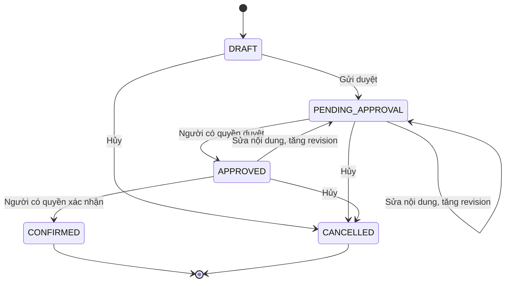

# Business invariants as guarantees — Bất biến nghiệp vụ như những bảo đảm

## 1. Từ một quy tắc được mô tả đến một điều hệ thống bảo đảm

Trong chương **Business Logic Foundations** của module **Business Logic Security** (`SECURITY_APPLICATION_SECURITY_BUSINESS_LOGIC_SECURITY`), một câu hỏi cốt lõi là: hệ thống có giữ đúng quy tắc nghiệp vụ khi người dùng gửi yêu cầu ngoài dự kiến hay không?

Một ứng dụng có thể kiểm tra đầy đủ kiểu dữ liệu, sử dụng truy vấn có tham số và yêu cầu đăng nhập nhưng vẫn cho phép:

- Người tạo đơn tự phê duyệt đơn của mình.
- Sửa giá trị đơn sau khi đã được duyệt rồi dùng lại kết quả phê duyệt cũ.
- Gửi hai yêu cầu đồng thời để sử dụng hai lần cùng một quyền lợi.
- Gọi thẳng API xác nhận để bỏ qua bước phê duyệt.
- Truy cập một đơn hợp lệ về định dạng nhưng thuộc đối tượng khác.

Đó là các tình huống mà từng yêu cầu có vẻ hợp lệ, nhưng kết quả chung vi phạm ý nghĩa nghiệp vụ.

**Business invariant**, hay **bất biến nghiệp vụ**, là một mệnh đề mà hệ thống phải duy trì tại những ranh giới được xác định, chẳng hạn sau mỗi transaction đã commit của một aggregate. Aggregate là một nhóm dữ liệu được quản lý như một đơn vị nhất quán, ví dụ đơn hàng cùng những thông tin quyết định việc đơn đó có được xác nhận hay không.

Ví dụ:

> Mọi đơn đã xác nhận đều phải có bằng chứng phê duyệt hợp lệ cho đúng phiên bản nội dung đang được xác nhận.

Gọi bất biến là một **bảo đảm** có nghĩa là chuyển từ mong muốn sang một cam kết có thể kiểm tra:

1. Mệnh đề đúng được phát biểu rõ ràng.
2. Các đường ghi dữ liệu đều phải duy trì mệnh đề đó.
3. Cơ chế thực thi vẫn đúng khi có retry, thao tác đồng thời và lỗi giữa chừng.
4. Có kiểm thử hoặc bằng chứng quan sát được rằng cơ chế thực sự giữ cam kết.

Một câu trong tài liệu, một nút bị ẩn trên giao diện hoặc một nhánh `if` trong controller chưa đủ tạo thành bảo đảm.

## 2. Học xong cần làm được gì?

Sau bài này, bạn cần có khả năng:

- Phát biểu bất biến bằng dữ liệu, chủ thể và phạm vi cụ thể.
- Phân biệt kiểm tra đầu vào với điều kiện nghiệp vụ phải giữ sau khi xử lý.
- Xác định ranh giới nhất quán và nơi thực thi bất biến.
- Giải thích vì sao state machine, quyền theo đối tượng, transaction và idempotency bổ sung cho nhau.
- Chuyển một bất biến thành các tình huống kiểm thử lạm dụng logic.

Bài học dùng xuyên suốt một luồng đơn mua hàng có phê duyệt. Các ví dụ Java và SQL minh họa cơ chế thiết kế; tên trường và chính sách là giả định được nêu rõ để có thể suy luận, không phải quy tắc bắt buộc của mọi hệ thống.

## 3. Phát biểu bất biến sao cho có thể kiểm chứng

### 3.1. Mệnh đề mơ hồ không tạo được bảo đảm

So sánh các cách diễn đạt sau:

| Mô tả ban đầu | Phát biểu có thể kiểm chứng |
| --- | --- |
| Giá đơn phải đúng | Tổng đơn bằng tổng giá từng dòng được máy chủ chấp nhận tại phiên bản nội dung hiện hành, cộng phí và trừ giảm giá theo chính sách đã áp dụng. |
| Phải có phê duyệt | Khi đơn chuyển sang `CONFIRMED`, phải tồn tại phê duyệt của người được phép duyệt, cho đúng `contentRevision` hiện tại. |
| Không cho tự duyệt | `approvedBy` phải khác `createdBy` đối với loại đơn áp dụng nguyên tắc tách người tạo và người duyệt. |
| Không được tạo trùng thanh toán | Một nghĩa vụ thanh toán chỉ được gắn với một ý định thu tiền đang có hiệu lực theo mô hình trạng thái đã định nghĩa. |
| Phải đúng quyền | Người thực hiện phải được phép thao tác trên đúng đơn, đúng tenant và đúng trạng thái tại thời điểm ra quyết định. |

Các từ “đúng”, “hợp lệ”, “được phép” cần được phân rã tiếp. Chẳng hạn, “người được phép duyệt” có thể có nghĩa là cùng tenant, có phạm vi phòng ban phù hợp, có hạn mức đủ lớn và khác người tạo đơn.

### 3.2. Dùng biểu thức để làm rõ quan hệ

Giả sử đơn hàng `o` có:

- `tenantId`: tổ chức sở hữu đơn.
- `createdBy`: người tạo.
- `contentRevision`: phiên bản các dữ liệu có ảnh hưởng đến quyết định duyệt.
- `approval`: bằng chứng phê duyệt, gồm người duyệt và phiên bản được duyệt.
- `status`: trạng thái nghiệp vụ.
- `total`: tổng giá trị đơn do máy chủ tính.

Có thể phát biểu một số bất biến như sau:

```text
I1 — Nội dung được duyệt:
o.status ∈ {APPROVED, CONFIRMED}
⇒ o.approval tồn tại
   ∧ o.approval.revision = o.contentRevision

I2 — Tách người tạo và người duyệt:
o.approval tồn tại và còn hiệu lực
⇒ o.approval.actorId ≠ o.createdBy

I3 — Tính đúng tổng:
o.total = tổng các dòng + phí - giảm giá
          theo cùng tiền tệ và quy tắc làm tròn đã định nghĩa

I4 — Xác nhận một lần trong mô hình đơn giản:
Số lần tạo kết quả xác nhận nghiệp vụ cho cùng orderId ≤ 1
```

Quyền thao tác còn có tính chất của một **ràng buộc trên hành động**:

```text
Nếu command xác nhận đơn được chấp nhận:
actor được phép xác nhận đúng orderId
trong tenant của đơn tại thời điểm quyết định.
```

Đây không chỉ là một quan hệ giữa các cột trong bản ghi. Muốn kiểm chứng sau sự kiện, cần lưu thêm ngữ cảnh quyết định, chẳng hạn actor, hành động, đối tượng, thời điểm và phiên bản chính sách nếu phù hợp.

### 3.3. Phân biệt bất biến trạng thái và bất biến chuyển trạng thái

**Bất biến trạng thái** mô tả một trạng thái hợp lệ:

```text
availableStock >= 0
approvedRevision = contentRevision khi status = APPROVED
```

**Ràng buộc chuyển trạng thái** mô tả hành động nào được phép đưa hệ thống từ trạng thái trước sang trạng thái sau:

```text
CONFIRM chỉ được chấp nhận từ APPROVED.
Người duyệt không được là người tạo.
Một lần đổi giá trị đơn phải làm mất hiệu lực phê duyệt hiện tại.
```

Một bản ghi có `status = CONFIRMED` và các trường phê duyệt trông hợp lệ chưa chứng minh rằng người gọi API đã có quyền xác nhận. Vì vậy cần kiểm soát cả trạng thái lưu trữ lẫn đường đi tạo ra trạng thái đó.

### 3.4. Mẫu mô tả một bảo đảm

Với mỗi quy tắc quan trọng, hãy ghi rõ:

| Thành phần | Câu hỏi cần trả lời |
| --- | --- |
| Mệnh đề | Điều gì luôn phải đúng? |
| Phạm vi | Trên một đơn, một tài khoản, một tenant hay toàn hệ thống? |
| Ranh giới | Sau commit, trước khi trả thành công hay sau khi hoàn tất một quy trình bất đồng bộ? |
| Tác nhân phá vỡ | API nào, job nào, thao tác đồng thời nào có thể làm sai? |
| Cơ chế | Domain method, constraint, khóa, kiểm soát phiên bản hay cơ chế phối hợp nào giữ quy tắc? |
| Khi vi phạm | Từ chối, rollback, chuyển sang trạng thái chờ hay bù trừ? |
| Bằng chứng | Kiểm thử và dữ liệu quan sát nào cho thấy quy tắc được giữ? |

Nếu không xác định được ranh giới, hai người có thể hiểu cùng một câu theo hai mức bảo đảm khác nhau.

## 4. Phân biệt validation, tiền điều kiện và bất biến

Ba loại kiểm tra này liên quan với nhau nhưng giải quyết những vấn đề khác nhau.

| Loại | Ví dụ | Điều được bảo vệ |
| --- | --- | --- |
| Validation đầu vào | `quantity` là số nguyên dương và không vượt giới hạn nhập | Hình dạng, miền giá trị của yêu cầu |
| Tiền điều kiện của command | Đơn đang `APPROVED` khi nhận lệnh xác nhận | Tính hợp lệ của hành động tại thời điểm thực thi |
| Hậu điều kiện | Sau lệnh thành công, đơn có trạng thái `CONFIRMED` | Kết quả của một thao tác |
| Bất biến | Đơn `CONFIRMED` luôn tham chiếu phê duyệt cho đúng phiên bản nội dung | Tính đúng của trạng thái qua mọi thao tác liên quan |

Một yêu cầu `quantity = 2` có thể hợp lệ về dữ liệu nhưng vẫn không được chấp nhận vì đơn đã xác nhận hoặc tồn kho chỉ còn một sản phẩm.

Tương tự, số tiền `1000` có thể nằm trong miền giá trị cho phép nhưng không phải giá mà khách hàng được quyền quyết định. Máy chủ cần lấy giá hoặc xác thực báo giá từ nguồn tin cậy rồi tính lại tổng theo quy tắc nghiệp vụ.

**Quy tắc thực hành:** kiểm tra tại API giúp trả lỗi sớm; kiểm tra tại nơi thay đổi trạng thái mới quyết định bảo đảm có giữ được hay không. Cơ sở dữ liệu tiếp tục bảo vệ những quan hệ có thể biểu diễn bằng constraint.

## 5. Xây dựng mô hình ví dụ: đơn mua hàng có phê duyệt

### 5.1. Chọn chính sách rõ ràng

Để tránh nhập nhằng, ví dụ này dùng các chính sách sau:

1. Mọi đơn trong luồng đều phải được phê duyệt trước khi xác nhận.
2. Người tạo không được tự duyệt.
3. Sửa nội dung ảnh hưởng quyết định duyệt sẽ tăng `contentRevision` và hủy hiệu lực phê duyệt hiện hành.
4. Giá từng dòng được chốt từ báo giá mà máy chủ chấp nhận. Thay đổi giá danh mục về sau không tự sửa các đơn đã chốt giá.
5. Một đơn chỉ được xác nhận một lần; nghiệp vụ sửa đơn sau xác nhận nằm ngoài mô hình này.
6. Người thao tác phải có quyền trên đơn cụ thể trong tenant tương ứng.

Chính sách số 4 đặc biệt quan trọng: bất biến “giá đúng” không đồng nghĩa “luôn bằng giá danh mục mới nhất”. Bảo đảm phải khớp chính sách chốt giá thực tế.

### 5.2. Biểu diễn đường đi hợp lệ



Sơ đồ thể hiện các cạnh hợp lệ, nhưng điều kiện trên cạnh vẫn phải được cài đặt. Cạnh `PENDING_APPROVAL → APPROVED` cần đồng thời kiểm tra quyền trên đơn, tách người tạo và người duyệt, cùng phiên bản nội dung đang duyệt.

Nếu cho phép cập nhật trực tiếp `status` từ JSON request, người gọi có thể bỏ qua toàn bộ ý nghĩa của cạnh chuyển trạng thái. API nên thể hiện ý định như `submit`, `approve`, `confirm`, còn máy chủ quyết định trạng thái mới.

### 5.3. Buộc bằng chứng phê duyệt vào nội dung

Một trường `approved = true` không trả lời được câu hỏi “đã duyệt cái gì?”.

Giả sử trình tự xảy ra:

```text
1. Đơn phiên bản 7 có tổng 2.000.000 VND.
2. Người duyệt chấp thuận phiên bản 7.
3. Người tạo thay nội dung làm tổng thành 20.000.000 VND, tạo phiên bản 8.
4. Yêu cầu xác nhận dùng lại cờ approved = true.
```

Nếu hệ thống chỉ giữ cờ boolean, việc phê duyệt đã mất liên hệ với quyết định thực tế.

Cách thiết kế chặt chẽ hơn:

```text
approval.approvedRevision = 7
order.contentRevision = 8

approvedRevision ≠ contentRevision
⇒ không được xác nhận
```

Revision phải bao phủ mọi trường có ảnh hưởng đến quyết định: dòng hàng, số lượng, giá, giảm giá, tài khoản nhận tiền hoặc địa chỉ giao nhận nếu chính sách duyệt xét những thông tin đó. Nếu một đường cập nhật quên tăng revision, cơ chế này mất tác dụng.

Có thể lưu snapshot nội dung được duyệt hoặc dấu vân tay của biểu diễn chuẩn hóa để phục vụ đối soát. Tuy nhiên, hash do client tự gửi không chứng minh nội dung đã được duyệt; máy chủ vẫn phải tạo và ràng buộc bằng chứng với quyết định hợp lệ.

## 6. Đặt cơ chế bảo vệ tại đúng nơi

### 6.1. Giao diện và API là những cửa vào

Giao diện có thể ẩn nút “Xác nhận” để hướng dẫn người dùng. API có thể kiểm tra cấu trúc request, danh tính đăng nhập và dữ liệu bắt buộc. Những lớp đó cần thiết nhưng không phải nơi duy nhất được phép bảo vệ quy tắc.

Cùng một đơn có thể bị sửa bởi REST API, tác vụ nền, luồng nhập dữ liệu, công cụ quản trị hoặc consumer xử lý sự kiện. Nếu mỗi đường tự gán trạng thái và tự diễn giải quy tắc, bảo đảm phụ thuộc vào việc tất cả cùng nhớ đúng.

Nên tập trung thao tác nghiệp vụ qua các command hoặc domain method có ý nghĩa, đồng thời hạn chế quyền ghi dữ liệu trực tiếp. Các công cụ vận hành cần đi qua cơ chế tương đương hoặc có quy trình khôi phục bất biến rõ ràng.

### 6.2. Ví dụ Java: chặn chuyển trạng thái trái quy tắc

Đoạn mã dưới tập trung vào một phần của aggregate đơn hàng. `AuthorizedApproval` đại diện cho kết quả kiểm tra quyền do tầng ứng dụng tin cậy tạo ra, không phải DTO mà client được gửi trực tiếp. Lệnh xác nhận cũng phải được kiểm tra quyền theo đối tượng trước khi gọi `confirm`.

```java
import java.util.Objects;

final class PurchaseOrder {
    enum Status {
        DRAFT, PENDING_APPROVAL, APPROVED, CONFIRMED, CANCELLED
    }

    record Approval(String actorId, long approvedRevision) {}

    // Minh họa ngữ cảnh đã được kiểm tra quyền.
    // Trong ứng dụng, chỉ thành phần tin cậy được tạo giá trị này.
    record AuthorizedApproval(
            String tenantId,
            String orderId,
            String actorId) {
        AuthorizedApproval {
            Objects.requireNonNull(tenantId);
            Objects.requireNonNull(orderId);
            Objects.requireNonNull(actorId);
        }
    }

    private final String id;
    private final String tenantId;
    private final String createdBy;

    private Status status = Status.DRAFT;
    private long contentRevision = 1;
    private long totalMinor;
    private Approval approval;

    PurchaseOrder(
            String id,
            String tenantId,
            String createdBy,
            long serverCalculatedTotalMinor) {
        this.id = Objects.requireNonNull(id);
        this.tenantId = Objects.requireNonNull(tenantId);
        this.createdBy = Objects.requireNonNull(createdBy);
        if (serverCalculatedTotalMinor < 0) {
            throw new IllegalArgumentException("NEGATIVE_TOTAL");
        }
        this.totalMinor = serverCalculatedTotalMinor;
    }

    void submit() {
        requireStatus(Status.DRAFT);
        status = Status.PENDING_APPROVAL;
    }

    void replaceTotalFromTrustedCalculation(long newTotalMinor) {
        if (status != Status.DRAFT
                && status != Status.PENDING_APPROVAL
                && status != Status.APPROVED) {
            throw new IllegalStateException("CONTENT_NOT_EDITABLE");
        }
        if (newTotalMinor < 0) {
            throw new IllegalArgumentException("NEGATIVE_TOTAL");
        }

        // Tính trước để lỗi tràn số không để lại thay đổi dở dang.
        long nextRevision = Math.incrementExact(contentRevision);

        totalMinor = newTotalMinor;
        contentRevision = nextRevision;
        approval = null;
        if (status == Status.APPROVED) {
            status = Status.PENDING_APPROVAL;
        }
    }

    void approve(
            AuthorizedApproval authorization,
            long expectedContentRevision) {
        requireStatus(Status.PENDING_APPROVAL);
        Objects.requireNonNull(authorization);

        if (!tenantId.equals(authorization.tenantId())
                || !id.equals(authorization.orderId())) {
            throw new IllegalArgumentException("WRONG_APPROVAL_SCOPE");
        }
        if (createdBy.equals(authorization.actorId())) {
            throw new IllegalStateException("SELF_APPROVAL_FORBIDDEN");
        }
        if (contentRevision != expectedContentRevision) {
            throw new IllegalStateException("CONTENT_CHANGED");
        }

        approval = new Approval(
                authorization.actorId(), contentRevision);
        status = Status.APPROVED;
    }

    void confirm() {
        requireStatus(Status.APPROVED);
        if (approval == null
                || approval.approvedRevision() != contentRevision
                || createdBy.equals(approval.actorId())) {
            throw new IllegalStateException("INVALID_APPROVAL");
        }
        status = Status.CONFIRMED;
    }

    private void requireStatus(Status required) {
        if (status != required) {
            throw new IllegalStateException("INVALID_TRANSITION");
        }
    }
}
```

Một số giới hạn cần hiểu đúng:

- `totalMinor` dùng đơn vị nhỏ nhất đã được quy ước cho tiền tệ của đơn; ví dụ VND có thể dùng đồng. Mô hình đầy đủ phải lưu cả tiền tệ và kiểm soát phép cộng, nhân, làm tròn.
- `replaceTotalFromTrustedCalculation` chỉ minh họa tác động lên revision. Ứng dụng thực phải tính lại từ các dòng hàng và chính sách ở máy chủ, cập nhật chúng cùng tổng trong một transaction.
- `expectedContentRevision` giúp người duyệt không vô tình duyệt nội dung khác với nội dung họ đã xem. Nó phải được đối chiếu với trạng thái hiện hành.
- Object Java có thể giữ quy tắc trong một lần thực thi, nhưng không tự giải quyết việc hai tiến trình cùng tải một bản ghi rồi ghi đè lẫn nhau.
- Một record có tên `AuthorizedApproval` không tự tạo ra bảo mật. Nếu client có thể tạo hoặc điền tùy ý ngữ cảnh này qua binding, ranh giới tin cậy đã bị phá vỡ.

Đây là ví dụ về việc **đưa quy tắc vào đường thay đổi trạng thái**. Bảo đảm ở cấp hệ thống còn cần transaction và kiểm soát cạnh tranh.

### 6.3. Phân công trách nhiệm giữa các lớp

| Lớp | Trách nhiệm điển hình |
| --- | --- |
| API | Xác thực danh tính, validation hình dạng, tạo command từ dữ liệu cho phép |
| Application service | Mở transaction, tải đối tượng trong đúng tenant, kiểm tra quyền, điều phối domain và lưu kết quả |
| Domain model | Kiểm tra chuyển trạng thái, ràng buộc nội dung với phê duyệt, duy trì quan hệ nghiệp vụ |
| Cơ sở dữ liệu | `NOT NULL`, `CHECK`, khóa ngoại, tính duy nhất và cơ chế cạnh tranh phù hợp |
| Tích hợp bên ngoài | Khử trùng, đối soát, quản lý trạng thái chưa biết kết quả, bù trừ khi cần |

Không có yêu cầu rằng mỗi quy tắc chỉ được xuất hiện ở một lớp. Chẳng hạn, domain từ chối tổng âm để trả lỗi có nghĩa, còn `CHECK` tiếp tục ngăn dữ liệu sai từ các đường ghi khác.

## 7. Bảo đảm phải chịu được thao tác đồng thời

### 7.1. Kiểm tra rồi cập nhật có thể tạo khoảng trống

Xét hai transaction:

| Thời điểm | Transaction A: xác nhận | Transaction B: sửa đơn |
| --- | --- | --- |
| 1 | Đọc đơn `APPROVED`, revision 7 | |
| 2 | Kiểm tra phê duyệt revision 7, đạt | |
| 3 | | Sửa nội dung thành revision 8 |
| 4 | | Hủy phê duyệt, chuyển về chờ duyệt và commit |
| 5 | Ghi `status = CONFIRMED` từ kết quả kiểm tra cũ | |

Nếu A chỉ cập nhật trạng thái mà không kiểm soát thay đổi cạnh tranh, đơn có thể thành `CONFIRMED` trên nội dung chưa được duyệt.

Đây là khoảng cách giữa **thời điểm kiểm tra** và **thời điểm sử dụng kết quả kiểm tra**, thường gọi là TOCTOU. Đặt hai câu lệnh trong một transaction chưa tự động loại bỏ vấn đề; hiệu quả còn phụ thuộc mức cô lập và cách đọc, khóa, cập nhật.

### 7.2. Lựa chọn 1: khóa bản ghi gốc trong transaction

Luồng minh họa:

```text
BEGIN

1. Tải đơn theo (tenantId, orderId) và khóa bản ghi đơn.
2. Đánh giá quyền thao tác trên chính đơn vừa tải.
3. Kiểm tra trạng thái và phê duyệt của contentRevision hiện hành.
4. Thực hiện command xác nhận.
5. Lưu trạng thái và bản ghi outbox nếu cần phát sự kiện.

COMMIT
```

Nếu dùng cơ sở dữ liệu hỗ trợ, bước 1 có thể là `SELECT ... FOR UPDATE`. Điều kiện để lập luận này đúng là **mọi đường thay đổi nội dung hoặc phê duyệt của đơn đều phải tuân theo cùng quy ước khóa**.

Chỉ khóa bản ghi đơn không ngăn một transaction khác sửa trực tiếp dòng hàng mà bỏ qua khóa đơn. Tương tự, nếu hạn mức duyệt nằm ở một bảng khác và phải nhất quán ngay lập tức, cần đưa dữ liệu đó vào cơ chế phối hợp thích hợp.

Khi thao tác trên nhiều đối tượng, cần chọn thứ tự khóa ổn định và xử lý lỗi deadlock theo chính sách retry có giới hạn.

### 7.3. Lựa chọn 2: cập nhật có điều kiện hoặc kiểm soát phiên bản

Một lệnh cập nhật có thể gộp điều kiện cốt lõi vào thao tác ghi:

```sql
UPDATE purchase_order
SET status = 'CONFIRMED',
    row_version = row_version + 1
WHERE tenant_id = :tenant_id
  AND id = :order_id
  AND row_version = :expected_row_version
  AND status = 'APPROVED'
  AND approved_revision = content_revision
  AND approved_by IS NOT NULL
  AND approved_by <> created_by;
```

Ứng dụng chỉ coi thao tác thành công khi số dòng bị ảnh hưởng bằng 1. Kết quả 0 có nghĩa là điều kiện không còn đúng hoặc đối tượng không khớp; cần xử lý xung đột theo hợp đồng API.

Ví dụ này vẫn đòi hỏi:

- Quyền theo đối tượng đã được đánh giá theo chính sách nhất quán phù hợp.
- Mọi cập nhật liên quan đều tăng `row_version` hoặc tham gia cơ chế cạnh tranh đã chọn.
- Những dữ liệu ngoài bản ghi đơn có ảnh hưởng đến quyết định được xử lý trong cùng lập luận về tính nhất quán.
- Ứng dụng không bỏ qua kết quả kiểm tra số dòng cập nhật.

Trong ORM, version column có thể hỗ trợ optimistic locking, nhưng chỉ bật cấu hình là chưa đủ. Cần biết quan hệ con nào làm thay đổi version của bản ghi gốc và câu lệnh nào bỏ qua cơ chế đó.

### 7.4. Không nhầm hai loại phiên bản

`contentRevision` và `rowVersion` phục vụ hai mục đích khác nhau:

| Trường | Câu hỏi được trả lời |
| --- | --- |
| `contentRevision` | Nội dung nghiệp vụ nào đã được phê duyệt? |
| `rowVersion` | Bản ghi có bị một transaction khác thay đổi từ lúc tôi đọc không? |

Một lần cập nhật ghi chú vận hành có thể cần tăng `rowVersion` nhưng không làm mất phê duyệt. Một lần thay tài khoản nhận tiền có thể phải tăng cả hai. Cách tách này giúp chính sách rõ ràng; một hệ thống đơn giản có thể dùng chung version nếu chấp nhận mọi thay đổi đều làm hết hiệu lực phê duyệt.

### 7.5. Bất biến trên nhiều bản ghi cần điểm phối hợp chung

Giả sử một tenant chỉ được dùng tổng hạn mức 100 triệu, nhưng mỗi đơn có một bản ghi riêng. Khóa riêng từng đơn không ngăn hai transaction cùng đọc số dư 80 triệu rồi mỗi bên tiêu thêm 15 triệu.

Những lựa chọn thường gặp là:

- Duy trì một bản ghi ngân sách chung và cập nhật có điều kiện khi giữ chỗ hạn mức.
- Khóa điểm phối hợp chung trước khi tạo các cam kết mới.
- Dùng mức cô lập có khả năng phát hiện lịch thực thi không tuần tự hóa được, đồng thời xử lý retry.
- Phân bổ hạn mức thành các phần độc lập nếu mô hình nghiệp vụ cho phép.

Tính đúng phải được lập luận trên **tập dữ liệu mà bất biến phụ thuộc**. Thêm khóa vào một bản ghi không liên quan đến phần dùng chung không tạo ra bảo đảm mong muốn.

## 8. Dùng constraint cho những gì cơ sở dữ liệu có thể giữ

Ví dụ dưới đây minh họa các constraint khi tạo bảng. Các kiểu và cú pháp dùng phong cách PostgreSQL.

```sql
CREATE TABLE purchase_order (
    tenant_id          VARCHAR(64) NOT NULL,
    id                 VARCHAR(64) NOT NULL,
    created_by         VARCHAR(64) NOT NULL,
    status             VARCHAR(32) NOT NULL,
    content_revision   BIGINT NOT NULL,
    approved_revision  BIGINT,
    approved_by        VARCHAR(64),
    total_minor        BIGINT NOT NULL,
    row_version        BIGINT NOT NULL,

    PRIMARY KEY (tenant_id, id),

    CHECK (status IN (
        'DRAFT', 'PENDING_APPROVAL', 'APPROVED',
        'CONFIRMED', 'CANCELLED'
    )),
    CHECK (content_revision > 0),
    CHECK (row_version >= 0),
    CHECK (total_minor >= 0),

    CHECK (
        (approved_revision IS NULL AND approved_by IS NULL)
        OR
        (
            approved_revision IS NOT NULL
            AND approved_by IS NOT NULL
            AND approved_revision = content_revision
            AND approved_by <> created_by
        )
    ),

    CHECK (
        status NOT IN ('APPROVED', 'CONFIRMED')
        OR
        (
            approved_revision IS NOT NULL
            AND approved_by IS NOT NULL
            AND approved_revision = content_revision
            AND approved_by <> created_by
        )
    )
);
```

Các kiểm tra `IS NOT NULL` trong biểu thức là có chủ đích. Với SQL, một `CHECK` không nhất thiết từ chối biểu thức cho kết quả `UNKNOWN`; vì vậy chỉ viết phép so sánh giữa các cột nullable có thể không chặn trường hợp thiếu dữ liệu.

Bảng này bảo vệ được quan hệ giữa các cột của cùng một bản ghi. Nó chưa bảo đảm rằng:

- Người duyệt thực sự có quyền trên đơn.
- Tổng đơn khớp mọi dòng hàng.
- Người dùng không gọi một lệnh trái quyền.
- Cùng một sự kiện không bị xử lý nhiều lần.
- Một lần chuyển trạng thái đã đi qua đúng quy trình.

Các điều kiện phụ thuộc nhiều dòng hoặc bảng thường cần thiết kế transaction, khóa, trigger hay cấu trúc dữ liệu phù hợp. Không nên giả định một `CHECK` trên bảng đơn tự kiểm soát được mọi thay đổi ở bảng dòng hàng.

Nếu lưu approval lịch sử riêng, có thể giữ nhiều lần phê duyệt phục vụ audit. Khi đó cần phân biệt lịch sử với phê duyệt hiện hành; quy tắc trên chỉ mô tả bằng chứng hiện hành được gắn vào đơn.

## 9. Quyền theo đối tượng là một phần của bảo đảm

Kiểm tra `hasRole("APPROVER")` chưa đủ nếu vai trò chỉ cho biết một khả năng chung. Một người có thể được duyệt đơn phòng ban A nhưng không được duyệt đơn phòng ban B, hoặc chỉ có hạn mức 10 triệu.

Một quyết định quyền thường phụ thuộc vào:

```text
canApprove(actor, order, context)
= cùng tenant
  ∧ có chức năng duyệt
  ∧ nằm trong phạm vi đối tượng được giao
  ∧ đủ hạn mức cho nội dung hiện tại
  ∧ không phải người tạo
  ∧ trạng thái cho phép duyệt
```

`tenantId` dùng để tải dữ liệu phải đến từ ngữ cảnh danh tính đã xác thực hoặc từ một lựa chọn tenant đã được kiểm tra quyền. Không thể tin một trường tenant tùy ý trong request chỉ vì nó có định dạng đúng.

Ví dụ một đường xử lý:

```text
actor = danh tính đã xác thực
tenant = phạm vi tenant đã được kiểm tra

order = repository.loadForUpdate(tenant.id, orderId)
authorization = policy.authorizeApproval(actor, order)
order.approve(authorization, expectedContentRevision)
repository.save(order)
```

Kiểm tra quyền cần sử dụng nội dung đang tham gia quyết định. Nếu kiểm tra hạn mức trên tổng cũ rồi duyệt tổng mới, hệ thống vẫn sai dù có cả policy service lẫn domain model.

Cũng phải định nghĩa chính sách khi quyền người duyệt thay đổi về sau:

- Một lần phê duyệt hợp lệ tại thời điểm duyệt có tiếp tục có hiệu lực không?
- Hay trước khi xác nhận phải đánh giá lại quyền hiện tại của người đã duyệt?
- Thu hồi quyền có hủy các phê duyệt chưa được sử dụng không?

Không có câu trả lời chung cho mọi nghiệp vụ. Bảo đảm cần nói rõ yếu tố thời gian. Trong mô hình đơn giản của bài, quyền được kiểm tra khi phê duyệt; bước xác nhận kiểm tra quyền của người xác nhận và hiệu lực bằng chứng theo chính sách đã chọn. Nếu cần thu hồi tức thời, phải bổ sung dữ liệu và cơ chế phối hợp cho chính sách đó.

## 10. Idempotency giữ bảo đảm khi có retry

### 10.1. Retry không đồng nghĩa người dùng cố tình thao tác hai lần

Client có thể gửi yêu cầu xác nhận, máy chủ commit thành công nhưng phản hồi bị mất. Client không biết kết quả nên gửi lại.

Nếu mỗi lần gửi đều tạo một tác động mới, thao tác mạng bình thường đã đủ gây vi phạm nghiệp vụ. Vì vậy cần xác định:

> Với cùng một command logic được nhận diện bằng khóa idempotency trong phạm vi đã định nghĩa, các lần gửi lại không được tạo thêm tác động nghiệp vụ.

Khóa không nên được xem là một chuỗi duy nhất toàn cục mà thiếu ngữ cảnh. Ví dụ phạm vi lưu có thể là:

```text
(tenantId, actorId, operation, idempotencyKey)
```

Dấu vân tay nội dung command cần bao gồm định danh đối tượng và các tham số có ý nghĩa, chẳng hạn `orderId`, phiên bản dự kiến và dữ liệu thay đổi. Cùng khóa nhưng khác nội dung phải bị từ chối theo hợp đồng API.

### 10.2. Một luồng xử lý trong cùng cơ sở dữ liệu

Với command chỉ thay đổi dữ liệu nội bộ, một thiết kế có thể là:

1. Xác thực danh tính và xác định phạm vi đối tượng.
2. Mở transaction; thử giành quyền xử lý khóa bằng ràng buộc duy nhất trong bảng idempotency.
3. Nếu khóa đã có, phối hợp với lần đang xử lý; khi đã có kết quả commit, so sánh dấu vân tay và kiểm tra quyền xem kết quả trước khi trả lại.
4. Nếu là lần xử lý mới, tải đối tượng và kiểm tra quyền, trạng thái, phiên bản trong cơ chế cạnh tranh phù hợp.
5. Thực hiện thay đổi nghiệp vụ, lưu kết quả idempotency và outbox cần thiết trong cùng transaction.
6. Commit rồi trả kết quả.

Chi tiết phối hợp ở bước 3 phụ thuộc cơ sở dữ liệu và cách cài đặt. Không thể đọc “chưa có khóa” rồi chèn mà thiếu cơ chế xử lý hai request cùng đến. Ràng buộc duy nhất và cách chờ, đọc lại hoặc trả trạng thái đang xử lý phải được thiết kế rõ.

Nếu transaction rollback, quyền sở hữu khóa và thay đổi nghiệp vụ cũng phải được xử lý nhất quán để lần retry có thể tiếp tục đúng. Một bản ghi `PROCESSING` đã commit riêng đòi hỏi thêm cơ chế hết hạn, phục hồi và xác định ai còn quyền hoàn tất; nó không tự an toàn chỉ nhờ có một cột trạng thái.

### 10.3. Idempotency không thay thế bất biến nghiệp vụ

Kẻ lạm dụng có thể tạo khóa mới cho mỗi request. Vì thế:

- State machine vẫn phải ngăn xác nhận lại một đơn đã `CONFIRMED`.
- Ràng buộc duy nhất theo nghiệp vụ vẫn cần thiết nếu mỗi đơn chỉ được có một bản ghi xác nhận.
- Việc tạo ý định thu tiền phải dựa trên định danh nghĩa vụ nghiệp vụ phù hợp, không chỉ khóa ngẫu nhiên từ client.
- Kiểm tra quyền vẫn phải diễn ra; biết khóa không tạo ra quyền đọc kết quả của người khác.

Thời gian lưu khóa cũng thuộc hợp đồng. Nếu xóa khóa sau một khoảng thời gian, bảo đảm khử trùng theo khóa chỉ có hiệu lực trong khoảng đó. Các bất biến tồn tại lâu hơn cần trạng thái hoặc tính duy nhất nghiệp vụ giữ chúng.

### 10.4. Phân biệt yêu cầu lặp và yêu cầu xung đột

| Tình huống | Hành vi mong đợi |
| --- | --- |
| Cùng phạm vi, cùng khóa, cùng command đã thành công | Trả lại kết quả đã ghi nhận sau khi kiểm tra quyền phù hợp |
| Cùng phạm vi, cùng khóa, command khác nội dung | Từ chối vì sử dụng khóa không nhất quán |
| Khác khóa, cùng xác nhận một đơn đã xác nhận | State machine hoặc tính duy nhất nghiệp vụ ngăn tác động lần hai |
| Retry sau xung đột phiên bản | Đọc lại và đánh giá lại; không tự sử dụng quyết định duyệt dựa trên nội dung cũ |
| Khóa của người dùng khác | Không được dùng để lấy phản hồi hay vượt qua quyền theo đối tượng |

## 11. Khi bảo đảm vượt ra ngoài một transaction

### 11.1. Gọi dịch vụ ngoài tạo thêm ranh giới lỗi

Giả sử sau xác nhận đơn, ứng dụng cần gửi lệnh thu tiền tới một dịch vụ khác. Transaction cơ sở dữ liệu nội bộ không thể mặc nhiên rollback một lệnh HTTP đã thành công.

Trình tự sau có thể tạo trạng thái không rõ kết quả:

```text
1. Dịch vụ ngoài nhận lệnh và thực hiện tác động.
2. Kết nối bị ngắt trước khi ứng dụng nhận phản hồi.
3. Ứng dụng không biết tác động đã xảy ra hay chưa.
4. Retry không có định danh ổn định tạo thêm tác động.
```

Vì vậy, “không nhận được phản hồi” không tương đương “chưa thực hiện”. Không nên tự động thử lại bằng một định danh nghiệp vụ mới.

### 11.2. Tách bảo đảm cục bộ và tiến trình liên dịch vụ

Có thể thiết kế:

- Trong một transaction, lưu thay đổi trạng thái đơn và bản ghi **outbox** chứa ý định phát sự kiện.
- Worker đọc outbox và gửi với định danh sự kiện hoặc ý định ổn định.
- Consumer dùng **inbox**, khóa duy nhất hoặc cơ chế khử trùng tương đương; việc ghi nhận đã xử lý và tác động cục bộ cần nhất quán.
- Nếu gọi bên ngoài, dùng khả năng idempotency và tra cứu kết quả của bên đó theo hợp đồng tích hợp.
- Có tiến trình thử lại, đối soát hoặc xử lý thủ công cho kết quả chưa xác định.

Outbox giải quyết khoảng trống giữa commit dữ liệu nội bộ và ghi nhận ý định gửi. Nó không tự khiến việc giao nhận thành “đúng một lần”, và không tự bảo đảm một dịch vụ bên ngoài sẽ không tạo tác động trùng.

Nếu quy trình cần bù trừ, hãy mô hình hóa trạng thái như `PAYMENT_PENDING`, `PAYMENT_UNKNOWN`, `PAID` hoặc `COMPENSATION_REQUIRED` theo nhu cầu. Một thao tác bù trừ là hành động nghiệp vụ mới, có thể thất bại và cần theo dõi, không phải nút hoàn tác tức thời cho toàn hệ thống.

### 11.3. Không đánh đồng an toàn và hoàn tất

Hai loại cam kết cần phân biệt:

| Loại | Ví dụ |
| --- | --- |
| An toàn: điều sai không xảy ra | Không xác nhận đơn bằng phê duyệt của revision cũ. |
| Tiến triển: việc cần làm cuối cùng được xử lý | Sự kiện trong outbox cuối cùng được gửi hoặc đưa vào luồng xử lý sự cố. |

Outbox chưa được gửi không nhất thiết vi phạm bất biến an toàn của đơn, nhưng có thể vi phạm cam kết về thời gian xử lý. Muốn nói “cuối cùng”, cần nêu giả định như worker tiếp tục hoạt động, lỗi tạm thời được khắc phục và có cơ chế xử lý lỗi vĩnh viễn.

Một bảo đảm hữu ích phải thể hiện đúng giới hạn của cơ chế đang có.

## 12. Biến bất biến thành kiểm thử tình huống lạm dụng

Kiểm thử không chỉ xác nhận đường đi thuận lợi. Hãy lấy từng mệnh đề và chủ động tìm cách làm nó sai.

| Bất biến hoặc ràng buộc | Tình huống cần thử | Kết quả cần quan sát |
| --- | --- | --- |
| Không bỏ qua phê duyệt | Gọi `confirm` khi đơn còn `DRAFT` hoặc `PENDING_APPROVAL` | Không có đơn được xác nhận hay sự kiện xác nhận phát sinh |
| Phê duyệt đúng nội dung | Duyệt revision 7, sửa sang 8 rồi xác nhận | Đơn chưa được xác nhận; phê duyệt cũ không còn hiệu lực |
| Người duyệt xem đúng phiên bản | Đổi nội dung sau khi người duyệt mở màn hình nhưng trước khi họ gửi lệnh | Lệnh dùng revision cũ bị từ chối |
| Không tự duyệt | Người tạo có vai trò duyệt gọi API approve | Không tạo bằng chứng phê duyệt hợp lệ |
| Quyền theo đối tượng | Người duyệt tenant A gửi orderId thuộc tenant B | Không thay đổi đối tượng và không lộ dữ liệu ngoài phạm vi |
| Giá do máy chủ quyết định | Sửa giá, tổng hoặc giảm giá trong request | Giá trị không được phép bị bỏ qua hoặc từ chối; tổng được tính từ nguồn tin cậy |
| Chịu được cạnh tranh | Cho sửa nội dung và xác nhận chạy đồng thời | Mọi kết quả commit đều giữ quan hệ giữa nội dung và phê duyệt |
| Khử trùng command | Gửi cùng khóa và cùng nội dung, kể cả đồng thời | Chỉ một tác động nghiệp vụ được commit |
| Ngăn lạm dụng khóa | Dùng lại khóa với orderId hoặc payload khác | Không thực hiện command mới dưới kết quả của command cũ |
| Không phụ thuộc khóa client | Gửi hai khóa khác nhau để xác nhận cùng đơn | Không tạo hai kết quả xác nhận |
| Nhất quán khi lỗi | Gây lỗi sau ghi trạng thái nhưng trước commit | Không để lại thay đổi nghiệp vụ hoặc outbox dở dang |
| Phục hồi tích hợp | Giả lập timeout sau khi bên ngoài đã nhận lệnh | Hệ thống dùng định danh ổn định và tiến trình đối soát theo thiết kế |

### 12.1. Kiểm tra trạng thái, không chỉ mã HTTP

Một phản hồi lỗi không chứng minh transaction đã rollback. Một request có thể trả lỗi sau khi tác động đã commit.

Mỗi kiểm thử phù hợp nên xem thêm:

- Trạng thái đơn và revision hiện hành.
- Phê duyệt đang có hiệu lực.
- Số bản ghi xác nhận hoặc ý định thu tiền.
- Bản ghi idempotency.
- Sự kiện outbox hoặc tác động có thể quan sát được.

Đối với hai request đồng thời, không bắt buộc cố định request nào thắng. Điều cần chứng minh là **mọi kết quả được commit đều thỏa bất biến**, và phía thua nhận kết quả đúng hợp đồng, chẳng hạn xung đột phiên bản hoặc kết quả idempotency đã lưu.

### 12.2. Chọn cấp kiểm thử phù hợp

**Unit test domain** phù hợp với cạnh chuyển trạng thái, tự duyệt, phê duyệt hết hiệu lực và xử lý phiên bản nội dung.

**Integration test với cơ sở dữ liệu thực được sử dụng** cần thiết cho constraint, transaction, khóa, optimistic locking và cạnh tranh của khóa idempotency. Mock repository không mô phỏng được những tính chất này.

**Kiểm thử API** xác nhận rằng danh tính, tenant, dữ liệu từ client và lỗi được nối đúng vào cơ chế nghiệp vụ.

Với kiểm thử cạnh tranh, dùng barrier hoặc latch để chủ động đưa các transaction vào lịch xen kẽ cần kiểm chứng; chỉ chèn `sleep` dễ tạo kết quả thiếu ổn định và không chứng minh được tình huống đã xảy ra.

Có thể bổ sung kiểm thử theo mô hình: sinh nhiều chuỗi `submit → approve → edit → confirm → retry`, kể cả các thứ tự không hợp lệ, rồi kiểm tra bất biến sau mỗi bước đã commit. Cách này đặc biệt hữu ích khi nhiều command cùng tác động lên một trạng thái.

## 13. Những ngộ nhận thường làm bảo đảm bị yếu đi

| Ngộ nhận | Vì sao chưa đủ | Cách củng cố |
| --- | --- | --- |
| Đã kiểm tra ở frontend | Có thể gọi API trực tiếp hoặc gửi lại request cũ | Thực thi quy tắc trong command ở máy chủ |
| Có đăng nhập là được thao tác | Danh tính không xác định quyền trên đối tượng | Kiểm tra tenant, phạm vi đối tượng, hành động và trạng thái |
| Có `@Transactional` là hết race condition | Transaction vẫn có thể đọc trạng thái cũ hoặc cùng vượt qua một điều kiện | Chọn mức cô lập, khóa hoặc cập nhật có điều kiện đúng với bất biến |
| Có version nên phê duyệt luôn đúng | Version có thể không bao phủ dữ liệu ảnh hưởng quyết định | Xác định rõ content revision và mọi đường thay đổi nó |
| Có idempotency key nên không thể bị làm trùng | Người gọi có thể đổi khóa hoặc gửi cùng khóa đồng thời | Kết hợp tính duy nhất theo nghiệp vụ và xử lý tranh chấp khóa |
| Có outbox nên tác động bên ngoài đúng một lần | Việc phát lại vẫn có thể xảy ra | Consumer và tích hợp cần cơ chế khử trùng, tra cứu và đối soát |
| Có audit log nên quy tắc đã được bảo vệ | Log chủ yếu cung cấp bằng chứng sau sự kiện | Dùng cơ chế từ chối hoặc điều phối trước commit, kết hợp audit để điều tra |

## 14. Hồ sơ bảo đảm cho luồng xác nhận đơn

Một cách kết thúc thiết kế là viết một hồ sơ ngắn cho bất biến quan trọng nhất:

> **Bảo đảm:** sau mỗi transaction xác nhận thành công, đơn ở trạng thái `CONFIRMED` có bằng chứng phê duyệt cho đúng nội dung hiện hành, theo chính sách tách người tạo và người duyệt.

**Phạm vi và giả định:** dữ liệu quyết định phê duyệt nằm trong ranh giới nhất quán đã chọn; mọi đường sửa nội dung đều tăng `contentRevision`, vô hiệu hóa phê duyệt và tham gia cùng cơ chế cạnh tranh. Các đường ghi trực tiếp không được bỏ qua quy ước này.

**Cơ chế thực thi:** kiểm tra quyền theo đối tượng; domain method kiểm soát chuyển trạng thái; transaction sử dụng khóa hoặc kiểm soát phiên bản; constraint bảo vệ quan hệ giữa các cột. Nếu xác nhận tạo kết quả ở bảng riêng, thêm ràng buộc duy nhất theo đơn phù hợp với mô hình.

**Hành vi khi có xung đột:** từ chối hoặc đọc lại và đánh giá lại command. Không mang kết quả kiểm tra cũ sang nội dung mới, không tự tạo một lần phê duyệt thay người dùng.

**Hành vi khi retry:** dùng idempotency để trả kết quả của cùng command; state machine và tính duy nhất nghiệp vụ tiếp tục ngăn tác động lặp khi người gọi dùng khóa khác.

**Bằng chứng cần có:** kiểm thử bỏ bước, sửa sau duyệt, tự duyệt, sai tenant, hai request đồng thời, lỗi trước commit và phản hồi bị mất sau commit.

Từ hồ sơ này, câu “đơn đã được phê duyệt” có ý nghĩa cụ thể: ai duyệt, duyệt nội dung nào, vào thời điểm nào, bằng quyền nào và cơ chế nào giữ quyết định đó đúng khi hệ thống bị gọi theo thứ tự bất lợi.
