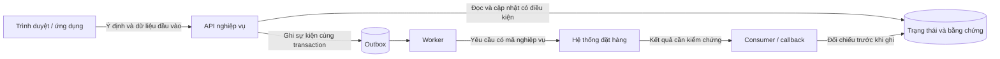
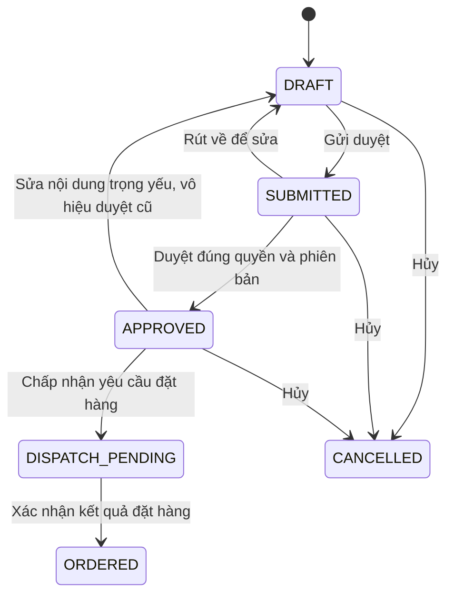

# Niềm tin trong quy trình nghiệp vụ — Trust in business workflows

## 1. Vì sao một yêu cầu hợp lệ vẫn có thể nguy hiểm?

Một nhân viên đăng nhập đúng tài khoản, gửi JSON đúng cấu trúc và gọi đúng API vẫn có thể vi phạm quy tắc nghiệp vụ. Người đó có thể gửi yêu cầu đặt hàng trước khi được phê duyệt, dùng lại kết quả duyệt của một phiên bản cũ hoặc thay mã đối tượng để thao tác trên đề nghị của phòng ban khác.

Những yêu cầu này không nhất thiết chứa SQL injection hay mã độc. Rủi ro nằm ở việc hệ thống **tin một khẳng định mà chưa có đủ căn cứ nghiệp vụ**.

Trong chương Business Logic Foundations của nội dung bảo vệ logic nghiệp vụ, “trust” cần được hiểu là quyết định có điều kiện:

> Một thành phần được phép dựa vào dữ liệu hoặc kết quả xử lý nào, do nguồn nào cung cấp, cho hành động nào, trên đối tượng và phiên bản nào, trong khoảng thời gian nào?

“Người dùng đã đăng nhập” chỉ là một phần của câu trả lời. Hệ thống còn cần biết họ được thao tác trên đối tượng nào, trạng thái hiện tại cho phép điều gì, dữ liệu nào có nguồn có thẩm quyền và bằng chứng trước đó còn hiệu lực hay không.

Sau bài này, bạn cần có khả năng:

- Nhận diện các khẳng định cần kiểm chứng trong một workflow.
- Xác định nguồn dữ liệu có thẩm quyền và ranh giới tin cậy.
- Viết quy tắc nghiệp vụ dưới dạng bất biến và điều kiện chuyển trạng thái.
- Gắn phê duyệt với đúng đối tượng, phiên bản nội dung và chính sách.
- Phân tích ảnh hưởng của đồng thời, gửi lại yêu cầu và tác vụ bất đồng bộ.
- Thiết kế tình huống kiểm thử khiến hệ thống phải chứng minh rằng nó không tin sai.

## 2. Phân biệt danh tính, quyền và sự thật nghiệp vụ

Ba câu hỏi sau liên quan với nhau nhưng không thay thế nhau:

| Câu hỏi | Ví dụ | Điều chưa thể kết luận |
| --- | --- | --- |
| Xác thực: ai đang gọi? | Phiên đăng nhập thuộc nhân viên A. | A được phép duyệt mọi đề nghị. |
| Phân quyền: được làm gì trên đối tượng này? | A có quyền duyệt đề nghị của đơn vị X trong tenant T. | Đề nghị hiện tại đủ điều kiện được duyệt. |
| Hợp lệ về nghiệp vụ: hành động có đúng lúc và đúng dữ liệu không? | Đề nghị đã gửi, nội dung còn đúng phiên bản, người duyệt đủ hạn mức. | Một yêu cầu đặt hàng tiếp theo luôn được chấp nhận, dù nội dung đã thay đổi. |

Xác thực không biến toàn bộ request thành dữ liệu đáng tin. Một access token hợp lệ cũng không làm cho các trường `tenantId`, `approvedBy`, `totalAmount` hay `status` trong request trở thành sự thật.

Có thể mô hình hóa điều kiện cho phép một hành động như sau:

```text
allow(action) =
    authenticated(actor)
    AND authorized(actor, action, object, tenant)
    AND validTransition(currentState, action)
    AND businessConditionsHold(authoritativeData)
    AND evidenceMatches(object, businessVersion, scope)
    AND evidenceStillAcceptable(now, currentPolicy)
```

Đây là mô hình phân tích, không phải công thức bắt buộc phải được triển khai thành một hàm duy nhất. Mỗi thành phần có thể có nhiều điều kiện cụ thể.

## 3. Khẳng định, bằng chứng và nguồn có thẩm quyền

Một request thường chứa cả ý định hợp lệ lẫn khẳng định không nên được chấp nhận trực tiếp.

```http
POST /purchase-requests/pr-471/approve
Content-Type: application/json

{
  "tenantId": "tenant-other",
  "approvedBy": "director-01",
  "status": "APPROVED",
  "totalAmount": "9000000",
  "businessVersion": 7
}
```

Ý định của caller là “tôi muốn duyệt đề nghị `pr-471`”. Các trường còn lại cần được xử lý theo nguồn của chúng:

- `approvedBy` phải được lấy từ danh tính đã xác thực, không lấy từ body.
- Tenant đang thao tác phải được xác lập từ ngữ cảnh mà server kiểm chứng; server vẫn phải đối chiếu tenant của đối tượng và membership hiện hành. Với người dùng đa tenant, lựa chọn tenant từ client chỉ là đầu vào cần kiểm tra.
- `status` phải do thao tác nghiệp vụ trên server quyết định.
- Số tiền để xét hạn mức phải lấy từ dữ liệu được server kiểm soát, không lấy từ body của lệnh duyệt.
- `businessVersion` từ client có thể thể hiện phiên bản người dùng đã xem, nhưng server phải so sánh nó với phiên bản hiện tại.

Bảng sau là một bản đồ nguồn có thẩm quyền cho ví dụ mua hàng:

| Dữ kiện cần biết | Nguồn có thẩm quyền | Dữ liệu client có thể cung cấp |
| --- | --- | --- |
| Người đang thao tác | Cơ chế xác thực được server kiểm chứng | Thông tin đăng nhập hoặc token để kiểm chứng |
| Tenant và quyền trên đề nghị | Membership, quan hệ tổ chức, ACL hoặc chính sách phía server | Mã tenant/đề nghị được yêu cầu |
| Giá và điều kiện báo giá | Báo giá đã xác nhận, hợp đồng hoặc dịch vụ giá theo chính sách | Mã hàng, số lượng, mã báo giá |
| Tổng tiền xét duyệt | Tổng được tính từ các thành phần đã kiểm chứng | Giá trị hiển thị để đối chiếu, nếu cần |
| Trạng thái hiện tại | Kho lưu trạng thái nghiệp vụ có thẩm quyền | Hành động mong muốn |
| Kết quả duyệt | Bản ghi duyệt do server tạo | Phiên bản mà người dùng xác nhận đã xem |
| Kết quả đặt hàng bên ngoài | Phản hồi/sự kiện của bên có thẩm quyền, được kiểm chứng và đối chiếu | Yêu cầu bắt đầu đặt hàng |

Nguồn có thẩm quyền không nhất thiết là một cơ sở dữ liệu duy nhất. Giá có thể thuộc dịch vụ giá; trạng thái mua hàng thuộc dịch vụ mua hàng. Điều quan trọng là chỉ rõ thành phần nào được quyền khẳng định dữ kiện nào.

**Dữ liệu được lưu trong database vẫn có thể bắt nguồn từ client.** Nếu hệ thống từng lưu trực tiếp `approved=true` do client gửi, việc đọc lại trường đó từ database không làm nó trở thành bằng chứng phê duyệt hợp lệ. Phải xem cả nguồn gốc lẫn đường ghi dữ liệu.

## 4. Ranh giới tin cậy xuất hiện ở đâu?

Ranh giới tin cậy là nơi dữ liệu hoặc yêu cầu chuyển sang thành phần có mức thẩm quyền hay giả định bảo vệ khác. Nó không chỉ nằm giữa Internet và backend.



Mỗi mũi tên cần một hợp đồng tin cậy cụ thể:

1. **Client → API:** kiểm chứng danh tính, dữ liệu đầu vào, quyền trên đối tượng và điều kiện nghiệp vụ.
2. **API → database:** bảo toàn bất biến khi có nhiều request đồng thời; không cho các đường ghi khác bỏ qua quy tắc.
3. **API → outbox → worker:** truyền đúng mã nghiệp vụ, tenant và phiên bản; dự liệu sự kiện trùng, chậm hoặc sai thứ tự.
4. **Worker → hệ thống ngoài:** gắn tác động với một thao tác nghiệp vụ ổn định; xử lý timeout khi chưa biết kết quả.
5. **Hệ thống ngoài → consumer:** kiểm chứng nguồn gửi và đối chiếu nội dung với thao tác đang chờ.

“Mạng nội bộ” hay “service gọi service” không phải là giấy phép tin mọi payload. Xác thực giữa các service trả lời ai gửi; consumer vẫn cần quyết định service đó có thẩm quyền khẳng định điều gì.

Ví dụ, chữ ký webhook hợp lệ chứng minh thông điệp phù hợp với cơ chế xác thực đã cấu hình. Nó không tự chứng minh rằng mã đề nghị, số tiền, tenant và phiên bản trong thông điệp khớp với giao dịch mà hệ thống đang chờ.

## 5. Một workflow mẫu: đề nghị mua hàng cần phê duyệt

Các quy tắc trong phần này là **giả định minh họa của một tổ chức**, không phải chuẩn chung cho mọi quy trình mua hàng:

- Mọi đề nghị đều phải được duyệt trước khi gửi đặt hàng.
- Người lập không được duyệt đề nghị của chính mình.
- Người duyệt phải có quyền trên đơn vị sở hữu đề nghị và đủ hạn mức cho tổng tiền của đúng loại tiền tệ đó.
- Thay đổi nhà cung cấp, mặt hàng, số lượng, giá hoặc loại tiền làm mất hiệu lực phê duyệt cũ.
- Mỗi phiên bản nghiệp vụ chỉ được tạo tối đa một thao tác gửi đặt hàng đang có hiệu lực.
- Đề nghị đã hủy không được gửi đặt hàng.

Một state machine tối giản:



Trong mô hình này, `CANCELLED` và `ORDERED` là trạng thái kết thúc. `DISPATCH_PENDING` chỉ cho biết hệ thống đã nhận trách nhiệm xử lý yêu cầu đặt hàng, chưa có nghĩa bên ngoài đã tạo đơn. Không cho sửa hoặc hủy trực tiếp trong trạng thái này; nếu nghiệp vụ cần hủy sau khi gửi, phải có quy trình hủy/bù trừ riêng và xử lý khả năng lệnh đặt hàng đã tới đối tác.

State machine giúp trả lời “được đi từ đâu đến đâu”. Nó chưa đủ để trả lời “ai được chuyển”, “dựa vào số tiền nào” và “bản duyệt thuộc phiên bản nào”. Vì vậy, mỗi cạnh cần điều kiện bảo vệ.

| Hành động | Điều kiện trạng thái | Điều kiện tin cậy bổ sung |
| --- | --- | --- |
| Gửi duyệt | `DRAFT` | Người có quyền sửa đề nghị; dữ liệu bắt buộc đầy đủ; tổng tiền được xác lập theo chính sách |
| Phê duyệt | `SUBMITTED` | Đúng tenant và phạm vi quyền; khác người lập; đủ hạn mức; xác nhận đúng phiên bản |
| Sửa nội dung trọng yếu | `DRAFT`, hoặc chuyển hợp lệ từ `APPROVED` về `DRAFT` | Có quyền sửa; tăng phiên bản nghiệp vụ; vô hiệu hiệu lực duyệt cũ trong cùng thao tác |
| Gửi đặt hàng | `APPROVED` | Phê duyệt còn được chấp nhận cho đúng phiên bản và chính sách; chưa có thao tác gửi tương ứng |
| Ghi nhận đã đặt hàng | `DISPATCH_PENDING` | Kết quả từ hệ thống có thẩm quyền, khớp mã thao tác, tenant và dữ liệu cần đối chiếu |

### 5.1. Diễn đạt thành bất biến

Bất biến là điều phải luôn đúng trong phạm vi trạng thái mà quy tắc áp dụng, kể cả khi request bị gửi lại hoặc chạy đồng thời.

```text
I1. Mọi thao tác đều thuộc đúng tenant và phạm vi đối tượng của actor.

I2. Phê duyệt chỉ được tạo bởi actor đủ quyền,
    khác người lập và đủ hạn mức tại thời điểm duyệt.

I3. Khi chấp nhận gửi đặt hàng:
    approval.requestId == request.id
    approval.businessVersion == request.businessVersion
    approval còn hiệu lực theo chính sách đang áp dụng.

I4. Thay đổi nội dung trọng yếu làm tăng businessVersion
    và khiến phê duyệt của phiên bản trước không còn dùng được.

I5. Mỗi (tenantId, requestId, businessVersion, operationType)
    có tối đa một bản ghi thao tác gửi đặt hàng.
```

I5 nói về bản ghi nghiệp vụ trong hệ thống. Để tác động bên ngoài không bị nhân đôi, còn cần đối tác hỗ trợ khử trùng theo mã thao tác hoặc một giao thức đối soát phù hợp. Một unique constraint trong database nội bộ không tự bảo đảm tác động bên ngoài chỉ xảy ra một lần.

### 5.2. Phân biệt hai loại phiên bản

- `businessVersion`: tăng khi nội dung mà người duyệt phải chịu trách nhiệm thay đổi.
- `rowVersion`: tăng khi cập nhật bản ghi để phát hiện xung đột ghi, kể cả cập nhật trạng thái.

Ví dụ, duyệt đề nghị có thể làm `rowVersion` tăng từ 12 lên 13 nhưng giữ `businessVersion = 7`, vì nội dung được duyệt không đổi. Khi đổi số lượng hàng, `businessVersion` tăng lên 8 và bản duyệt của phiên bản 7 không còn đủ căn cứ.

Có thể dùng một cơ chế phiên bản khác nếu định nghĩa rõ. Điểm bắt buộc là hệ thống phải phân biệt được nội dung đã duyệt với nội dung đang được thực thi.

## 6. Độ tin cậy phụ thuộc vào phạm vi và thời gian

Một bản ghi “A đã duyệt” quá mơ hồ để dùng làm căn cứ thực thi. Bằng chứng cần gắn với những dữ kiện đủ phân biệt:

```text
approvalId
requestId
 tenantId
businessVersion
approvedBy
approvedAt
policyVersion
approvedAmount
currency
```

Trong mô hình thực tế, không phải mọi field đều cần lưu lặp lại; một snapshot bất biến có thể cung cấp cùng bằng chứng. `approvedAt` phải do server xác lập. Nếu dùng hash của nội dung, cần định nghĩa cách chuẩn hóa dữ liệu; hash không thay thế việc kiểm chứng nguồn tạo bản duyệt.

Các câu hỏi quan trọng gồm:

- Bằng chứng này áp dụng cho đối tượng nào và tenant nào?
- Nó chứng minh nội dung của phiên bản nào?
- Người tạo có quyền tại thời điểm tạo không?
- Nó còn được chấp nhận sau khi chính sách, quyền hoặc dữ liệu thay đổi không?
- Có điều kiện hết hạn như thời hạn báo giá hoặc thời hạn duyệt không?

Việc người duyệt bị thu hồi quyền sau đó có làm mất hiệu lực một bản duyệt cũ hay không là **quyết định nghiệp vụ phải được viết rõ**. Một hệ thống giữ hiệu lực của quyết định đã được duyệt đúng lúc; hệ thống khác yêu cầu người duyệt vẫn còn đủ quyền khi thực thi. Không nên để quy tắc này được quyết định ngẫu nhiên bởi cache hay cách viết truy vấn.

Tương tự, nếu chính sách ngưỡng duyệt thay đổi giữa lúc gửi và lúc duyệt, hệ thống cần xác định phiên bản chính sách nào áp dụng. Nếu giữ chính sách đã chốt khi gửi, phải lưu được căn cứ đó; nếu áp dụng chính sách hiện hành, phải đọc và kiểm tra chính sách hiện hành ở thời điểm thích hợp.

### Ví dụ một bản duyệt cũ bị dùng sai

1. Nhân viên tạo đề nghị phiên bản 7, tổng tiền 9 triệu VND.
2. Người có hạn mức 10 triệu VND duyệt phiên bản 7.
3. Nhân viên tăng số lượng; tổng tiền thành 90 triệu VND, phiên bản 8.
4. Endpoint đặt hàng chỉ kiểm tra `approved = true` nên chấp nhận.

Sai sót là dùng một cờ toàn cục để biểu diễn bằng chứng có phạm vi. Cách xử lý đúng phải buộc phiên bản 8 được duyệt theo quy tắc tương ứng trước khi gửi đặt hàng.

## 7. Thiết kế API để thể hiện ý định nghiệp vụ

Một API cập nhật chung có thể vô tình trao quyền sửa trực tiếp các sự thật mà server phải quản lý:

```http
PATCH /purchase-requests/pr-471

{
  "status": "APPROVED",
  "approvedBy": "director-01",
  "totalAmount": "1"
}
```

Nếu entity được bind trực tiếp từ JSON rồi lưu, client có thể tác động vào các trường ngoài dự kiến. Đây là một đường phổ biến dẫn tới lạm dụng logic qua cập nhật thuộc tính quá rộng.

Có thể tách các hành động thành lệnh có ý nghĩa:

```http
POST /purchase-requests/pr-471/submit
POST /purchase-requests/pr-471/approve
POST /purchase-requests/pr-471/dispatch
```

Ví dụ body tối thiểu cho phê duyệt:

```json
{
  "expectedBusinessVersion": 7,
  "comment": "Đồng ý theo báo giá đã xác nhận"
}
```

Server chọn người duyệt từ ngữ cảnh xác thực, tải đề nghị và tính điều kiện đủ. Tên endpoint chỉ làm ý định rõ hơn; nó không tự tạo bảo đảm bảo mật.

Một bản phác thảo Java ở tầng ứng dụng:

```java
// Mã minh họa kiến trúc; các repository/policy là abstraction của ứng dụng.
record ApproveCommand(long expectedBusinessVersion, String comment) {}

ApprovalResult approve(Actor actor, UUID requestId, ApproveCommand command) {
    return transaction.required(() -> {
        PurchaseRequest request = requests.loadForUpdate(requestId)
            .orElseThrow(NotFound::new);

        access.requireCanApprove(actor, request);
        request.requireState(State.SUBMITTED);
        request.requireBusinessVersion(command.expectedBusinessVersion());

        ApprovalPolicy policy = policies.applicableTo(request);
        policy.requireDifferentCreator(actor, request);
        policy.requireWithinLimit(actor, request.total(), request.currency());

        Approval approval = Approval.issue(
            request.id(),
            request.tenantId(),
            request.businessVersion(),
            actor.id(),
            policy.version(),
            clock.instant()
        );

        approvals.insert(approval);
        request.markApproved(approval.id());
        requests.save(request);
        audit.appendApproved(actor, request, approval);
        return ApprovalResult.from(approval);
    });
}
```

Các điều kiện của ví dụ:

- `Actor` được dựng từ danh tính đã kiểm chứng, không phải deserialize từ body.
- `loadForUpdate` thực sự khóa bản ghi trong transaction đang chạy; mọi đường sửa nội dung phải phối hợp với cùng cơ chế bảo vệ.
- `access.requireCanApprove` kiểm tra tenant, quyền thao tác và phạm vi đối tượng. Một role `MANAGER` đơn lẻ chưa đủ.
- `request.total()` dùng dữ liệu giá/thuế/phí đã được xác lập theo chính sách của workflow; mã duyệt không tin tổng tiền do caller truyền vào. Với Java, biểu diễn tiền cần xử lý độ chính xác và quy tắc làm tròn rõ ràng, chẳng hạn bằng `BigDecimal` hoặc đơn vị tiền nhỏ nhất phù hợp.
- Bản ghi duyệt, trạng thái đề nghị và audit trong ví dụ được lưu cùng transaction cơ sở dữ liệu. Nếu audit đi sang hệ thống ngoài, có thể cần outbox để không mất sự kiện khi commit.

Đoạn mã không có nghĩa chỉ cần thêm transaction là mọi dữ liệu liên quan đều được bảo vệ. Nếu quyền, hạn mức hoặc chính sách có thể bị sửa đồng thời, phải quyết định cách đồng bộ chúng. Khóa một hàng đề nghị không khóa bảng quyền hay trạng thái của một dịch vụ khác.

Đặc biệt, khi quyền được quản lý ở service riêng, một transaction database cục bộ không thể tự biến quyết định phân quyền từ xa thành bảo đảm nguyên tử với thay đổi quyền ở service đó. Hệ thống cần một hợp đồng rõ về hiệu lực của quyết định, phiên bản quyền hoặc bước tái kiểm tra theo mức bảo đảm nghiệp vụ yêu cầu.

## 8. Đồng thời: đúng lúc kiểm tra chưa chắc đúng lúc ghi

Giả sử hai request cùng đọc thấy `state = APPROVED`:

```text
T1: kiểm tra đã được duyệt → đạt
T2: kiểm tra đã được duyệt → đạt
T1: tạo thao tác gửi đặt hàng
T2: tạo thêm thao tác gửi đặt hàng
```

Nếu kiểm tra và cập nhật tách rời, cả hai có thể vượt qua. Vấn đề này là khoảng cách giữa lúc kiểm tra và lúc sử dụng kết quả kiểm tra, thường gọi là TOCTOU.

Một cách bảo vệ là dùng chuyển trạng thái có điều kiện. SQL dưới đây minh họa cú pháp kiểu PostgreSQL và giả định quyền, chính sách cùng hiệu lực phê duyệt đã được kiểm tra theo chiến lược đồng thời của ứng dụng:

```sql
UPDATE purchase_request
SET state = 'DISPATCH_PENDING',
    row_version = row_version + 1
WHERE id = :request_id
  AND tenant_id = :tenant_id
  AND state = 'APPROVED'
  AND business_version = :expected_business_version
  AND approved_business_version = business_version
  AND row_version = :expected_row_version;
```

Điều kiện quan trọng:

- Ứng dụng phải kiểm tra số dòng cập nhật bằng đúng `1`.
- Nếu bằng `0`, không được tiếp tục tạo tác động như thể lệnh đã thành công.
- Thao tác tạo bản ghi gửi đặt hàng và ghi outbox phải nằm cùng transaction với chuyển trạng thái.
- Nếu bất kỳ bước nào thất bại, transaction phải rollback.
- `approved_business_version` phải do server quản lý và được giữ nhất quán với bản ghi duyệt. So sánh hai số phiên bản không tự chứng minh người duyệt hợp lệ hoặc bản duyệt chưa bị thu hồi.

Một ràng buộc bổ sung cho sổ thao tác:

```sql
ALTER TABLE dispatch_operation
ADD CONSTRAINT uq_dispatch_business_operation
UNIQUE (tenant_id, request_id, business_version, operation_type);
```

Các cột trong khóa nghiệp vụ này cần được khai báo `NOT NULL`. Ràng buộc giúp mọi đường ghi cùng chịu quy tắc duy nhất, kể cả khi lỗi ứng dụng làm lọt một request cạnh tranh.

Có thể dùng khóa bi quan, cập nhật lạc quan, mức cô lập phù hợp hoặc phối hợp nhiều cách. Chọn cơ chế dựa trên bất biến cần giữ và hành vi thực tế của database. “Có transaction” không đồng nghĩa với “mọi lần đọc đều được tuần tự hóa”.

## 9. Retry, idempotency và niềm tin vào tác động bên ngoài

Một timeout không cho biết chắc thao tác đã thất bại. Client có thể gửi lại vì mất phản hồi; worker có thể chạy lại sau khi đã gọi thành công hệ thống ngoài nhưng chưa ghi được kết quả về database.

Một thiết kế phù hợp thường kết hợp ba lớp:

| Lớp | Mục đích | Giới hạn |
| --- | --- | --- |
| Idempotency của API | Gắn lần gửi lại của cùng yêu cầu với một kết quả/thao tác | Caller có thể đổi key; vẫn cần bất biến nghiệp vụ |
| Khóa duy nhất của thao tác nghiệp vụ | Ngăn tạo hai thao tác cho cùng đề nghị và phiên bản | Không tự ngăn hai lần gọi tạo tác động ở đối tác |
| Idempotency/đối soát ở đối tác | Nhận diện cùng một thao tác khi giao tiếp bị lặp | Phụ thuộc hợp đồng, phạm vi và thời hạn giữ key của đối tác |

Khi dùng `Idempotency-Key` cho API:

1. Xác định phạm vi key, chẳng hạn tenant, chủ thể gọi và loại thao tác. Key không phải thông tin cấp quyền.
2. Lưu dấu vân tay của payload nghiệp vụ để phát hiện cùng key nhưng nội dung khác.
3. Gắn key với một bản ghi thao tác ổn định; xử lý cả trạng thái đang chạy và đã hoàn tất.
4. Xác thực và kiểm tra quyền phù hợp trước khi trả kết quả đã lưu, tránh để cơ chế replay làm lộ dữ liệu.
5. Định nghĩa thời hạn lưu và hành vi sau khi hết hạn. Bất biến nghiệp vụ vẫn phải ngăn tác động không hợp lệ dù key đã bị dọn.

### Luồng bất đồng bộ có outbox

```text
Transaction cục bộ:
  Kiểm tra quyền + trạng thái + phiên bản + bằng chứng duyệt
  Chuyển APPROVED → DISPATCH_PENDING
  Tạo dispatch_operation với operationId ổn định
  Ghi outbox chứa operationId và định danh cần thiết
  Commit

Worker:
  Đọc outbox; chấp nhận khả năng sự kiện được giao lại
  Gọi đối tác bằng cùng operationId cho cùng thao tác
  Ghi kết quả nếu xác định được
  Retry hoặc đối soát nếu kết quả chưa rõ
```

Outbox giúp ghi nhận ý định gửi cùng transaction với trạng thái nghiệp vụ. Nó không tự bảo đảm đối tác chỉ thực hiện một lần.

Nếu đối tác đã tạo đơn nhưng worker timeout, tự tạo `operationId` mới để retry có thể tạo đơn thứ hai. Worker nên giữ mã thao tác và dùng cơ chế idempotency hoặc truy vấn kết quả của đối tác. Khi đối tác không cung cấp đủ khả năng đó, có thể cần đối soát hoặc xử lý thủ công; không nên báo thất bại chắc chắn rồi tự do tạo lại thao tác.

Consumer nhận kết quả phải kiểm tra mã thao tác, tenant, đối tượng, trạng thái chờ và những dữ kiện mà hợp đồng yêu cầu, như số tiền và loại tiền. Sự kiện hợp lệ của đề nghị khác không được phép hoàn tất đề nghị hiện tại.

## 10. Các cách đặt niềm tin sai thường gặp

### 10.1. Tin vào giao diện

Ẩn nút “Duyệt” chỉ cải thiện trải nghiệm. Caller vẫn có thể gửi HTTP trực tiếp. Điều kiện hiện/ẩn trên frontend nên phản ánh quy tắc server; server phải tự kiểm tra lại khi nhận lệnh.

### 10.2. Tin vào một role quá rộng

Điều kiện `hasRole("MANAGER")` có thể bỏ qua tenant, phòng ban, hạn mức và việc người duyệt chính là người lập. Quyền nghiệp vụ thường phụ thuộc quan hệ giữa actor với đối tượng, không chỉ tên role.

### 10.3. Tin vào dữ liệu đã kiểm tra ở bước trước

Bước gửi duyệt đã kiểm tra tổng tiền không có nghĩa bước đặt hàng có thể dùng bất kỳ tổng tiền nào hiện tại. Phải bảo đảm dữ liệu không đổi hoặc có cơ chế phiên bản và duyệt lại.

### 10.4. Tin vào cache như một quyết định luôn mới

Cache quyền, trạng thái hoặc hạn mức có thể có độ trễ. Hệ thống phải xác định độ trễ chấp nhận được và điểm nào cần dữ liệu có thẩm quyền. Một chính sách yêu cầu thu hồi quyền tức thời không tương thích với việc tiếp tục tin cache cũ mà không có cơ chế hỗ trợ.

### 10.5. Tin vào mọi caller nội bộ

Endpoint phục vụ quản trị, import dữ liệu, batch job và consumer đều có thể làm thay đổi cùng bất biến. Một endpoint công khai chặt chẽ vẫn không bảo vệ được workflow nếu job nội bộ được phép đặt `status = APPROVED` tùy ý.

Các đường vào nên gọi cùng thao tác nghiệp vụ hoặc chịu các bảo đảm tương đương. Nếu có quyền ngoại lệ, phải biểu diễn rõ hành động ngoại lệ, phạm vi sử dụng và dấu vết kiểm toán.

### 10.6. Tin rằng audit sẽ ngăn được vi phạm

Audit hỗ trợ giải thích và phát hiện. Nó không thay thế kiểm tra quyền, chuyển trạng thái có điều kiện hay ràng buộc dữ liệu. “Có log” không làm một lần đặt hàng trái phép trở nên chấp nhận được.

## 11. Kiểm thử bằng cách thách thức từng giả định

Kiểm thử logic cần chứng minh bất biến vẫn đúng, không chỉ xác nhận endpoint trả mã lỗi. Nếu request bị từ chối, phải kiểm tra rằng trạng thái không đổi, không có bản duyệt mới và không phát sinh tác động đặt hàng.

| Tình huống | Cách thực hiện | Kết quả phải quan sát |
| --- | --- | --- |
| Bỏ qua gửi duyệt | Gọi duyệt khi còn `DRAFT` | Từ chối; không tạo bản duyệt |
| Bỏ qua phê duyệt | Gọi gửi đặt hàng khi `SUBMITTED` | Không tạo operation hoặc outbox gửi đặt hàng |
| Giả người duyệt | Gửi `approvedBy` của giám đốc trong body | Không thể thay đổi actor thực; hợp đồng API từ chối hoặc bỏ qua field ngoài quyền |
| Truy cập chéo tenant | Actor tenant A dùng ID đề nghị tenant B | Không đọc/sửa được đề nghị hoặc suy ra dữ liệu nhạy cảm |
| Tự duyệt | Người lập gọi lệnh duyệt của chính mình | Bị từ chối theo quy tắc tách nhiệm vụ |
| Vượt hạn mức | Người có hạn mức thấp duyệt đề nghị lớn | Bị từ chối dựa trên số tiền và loại tiền có thẩm quyền |
| Dùng phiên bản đã xem cũ | Client xác nhận phiên bản 7 khi hiện tại là 8 | Không tạo bản duyệt cho phiên bản 8 |
| Thay dữ liệu sau duyệt | Đổi số lượng/nhà cung cấp sau khi duyệt | Phê duyệt cũ mất hiệu lực; không được gửi đặt hàng bằng bản duyệt đó |
| Hai lệnh đồng thời | Đồng bộ thời điểm hai request gửi đặt hàng | Chỉ một operation nghiệp vụ được tạo |
| Cùng key, cùng dữ liệu | Gửi lại khi response trước bị mất | Trả kết quả hoặc trạng thái của cùng operation; không tạo operation mới |
| Cùng key, khác dữ liệu | Đổi payload nhưng giữ key | Từ chối xung đột; không thực hiện nội dung mới |
| Khác key, cùng nghiệp vụ | Gửi cùng đề nghị/phiên bản bằng key mới | Bất biến trạng thái và khóa nghiệp vụ vẫn ngăn tạo operation thứ hai |
| Sự kiện trùng | Giao cùng kết quả đặt hàng nhiều lần | Không lặp tác động hoặc làm sai trạng thái |
| Sự kiện không khớp | Kết quả có mã thao tác đúng định dạng nhưng thuộc đề nghị khác | Không hoàn tất đề nghị hiện tại; có dấu vết để điều tra |
| Đối tác thành công, cục bộ timeout | Mô phỏng mất phản hồi sau tác động ngoài | Retry/đối soát theo cùng operation; không tùy tiện tạo đơn mới |
| Thu hồi quyền giữa các bước | Thay đổi membership trước khi thực thi | Hành vi khớp chính sách hiệu lực quyền đã công bố |

Các kiểm thử về constraint, khóa và transaction nên chạy ở mức tích hợp với database phù hợp. Mock repository không chứng minh được hai transaction cạnh tranh sẽ bảo toàn bất biến.

Để tái hiện cạnh tranh, dùng điểm đồng bộ trong bộ kiểm thử cho hai lời gọi cùng tới giai đoạn cần kiểm tra, sau đó quan sát kết quả commit và dữ liệu cuối cùng. Chỉ gửi hai request liên tiếp rất nhanh chưa chắc đã kiểm tra được lỗi đồng thời.

Mã HTTP nên nhất quán với hợp đồng API, nhưng không phải bằng chứng duy nhất. Một response `409 Conflict` vẫn là lỗi bảo vệ nếu hệ thống đã gọi đối tác trước khi phát hiện xung đột.

## 12. Ghi nhận đủ bằng chứng để giải thích quyết định

Khi cần điều tra, câu hỏi thường không chỉ là “ai gọi endpoint”, mà là “vì sao hệ thống cho phép hành động đó”.

Một sự kiện kiểm toán nghiệp vụ hữu ích có thể chứa:

- Actor và ngữ cảnh tenant đã được xác lập.
- Hành động, mã đối tượng và mã thao tác nghiệp vụ.
- Trạng thái trước/sau và `businessVersion` liên quan.
- Mã bản duyệt, phiên bản chính sách hoặc căn cứ quyết định.
- Kết quả cho phép/từ chối và mã lý do phù hợp.
- Thời điểm phía server và correlation ID để nối các bước.

Phân biệt correlation ID với idempotency key: correlation ID hỗ trợ truy vết một chuỗi xử lý; idempotency key giúp nhận diện lần gửi lại của cùng yêu cầu theo một phạm vi đã định nghĩa. Không nên giả định hai giá trị có cùng mục đích.

Không cần ghi token truy cập hoặc toàn bộ payload nhạy cảm để có bằng chứng tốt. Log cũng cần được bảo vệ quyền ghi/đọc và khả năng phát hiện sửa đổi theo yêu cầu hệ thống. Bằng chứng đáng tin phụ thuộc cả vào cách tạo lẫn cách lưu giữ.

## 13. Bài tập áp dụng

Một ứng dụng có các endpoint:

```text
POST  /purchase-requests
PATCH /purchase-requests/{id}
POST  /purchase-requests/{id}/approve
POST  /purchase-requests/{id}/dispatch
```

Dữ liệu hiện tại có `createdBy`, `tenantId`, `total`, `currency`, `status` và `approvedBy`. Sau khi được duyệt, người lập vẫn có thể sửa số lượng. Worker retry gửi đặt hàng bằng một UUID mới mỗi lần chạy lại.

Hãy thực hiện các bước sau trên giấy hoặc trong thiết kế của bạn:

1. Liệt kê các field client được đề xuất và các field chỉ server được xác lập.
2. Viết điều kiện cấp quyền cho lệnh duyệt theo tenant, quan hệ với đề nghị và hạn mức.
3. Bổ sung cách gắn bản duyệt với nội dung được duyệt.
4. Xác định thao tác nguyên tử cần có khi chuyển sang gửi đặt hàng.
5. Định nghĩa khóa nghiệp vụ của thao tác gửi và cách giữ mã đó qua các lần retry.
6. Viết một kiểm thử dùng bản duyệt cũ sau khi sửa số lượng và một kiểm thử hai lệnh gửi đồng thời.

Gợi ý tự đánh giá:

- Thiết kế không coi `approvedBy` hoặc `status` trong body là căn cứ cấp quyền.
- Sửa nội dung trọng yếu làm mất hiệu lực duyệt cũ theo một quy tắc nhất quán.
- Quyết định gửi đặt hàng được gắn với đúng phiên bản và một operation ổn định.
- Cơ chế idempotency vẫn chịu kiểm tra quyền và không thay thế bất biến nghiệp vụ.
- Hành vi khi timeout được mô tả theo khả năng “kết quả chưa rõ”, có đường retry/đối soát cụ thể.

## 14. Những điểm cần ghi nhớ

Niềm tin trong workflow phải có nguồn, phạm vi và thời hạn. Đăng nhập hợp lệ, dữ liệu nằm trong database hoặc thông điệp đến từ mạng nội bộ đều chưa đủ để kết luận một hành động nghiệp vụ được phép.

Một quy trình được bảo vệ tốt nối được ba điều: **quy tắc cần giữ**, **bằng chứng cho quyết định hiện tại** và **cơ chế thực thi giữ đúng quy tắc khi có cạnh tranh hoặc gửi lại**. State machine xác định đường đi; phân quyền theo đối tượng xác định ai được đi; phiên bản, transaction, ràng buộc dữ liệu và idempotency giúp quyết định đó tiếp tục đúng trong quá trình thực thi.