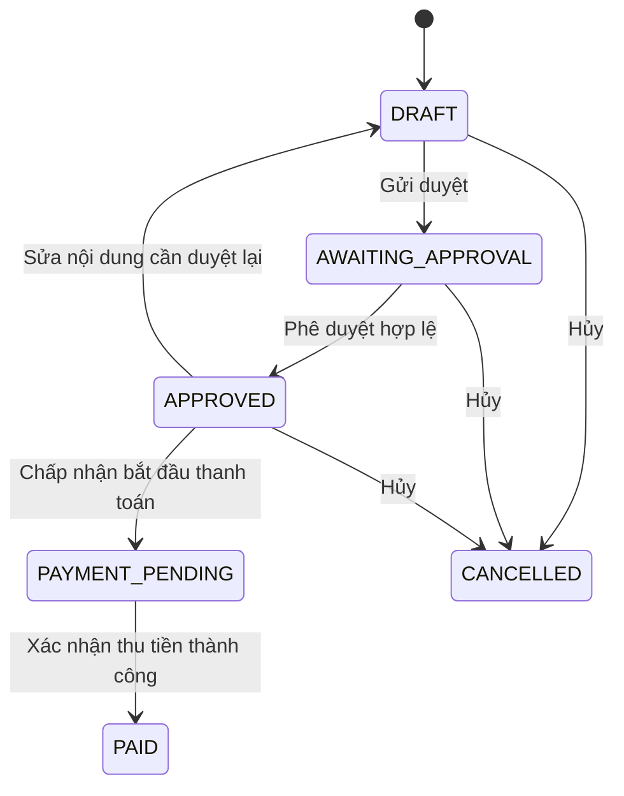

# Thuật ngữ bảo mật logic nghiệp vụ — Business logic security vocabulary

## 1. Mục tiêu và cách đọc

Một nhóm có thể cùng nói “request hợp lệ” nhưng hiểu khác nhau: người viết API đang nói đến JSON đúng kiểu, người kiểm thử đang nói đến quyền truy cập, còn người phụ trách nghiệp vụ đang nói đến đơn hàng đủ điều kiện thanh toán. Nếu không thống nhất thuật ngữ, một kiểm tra cú pháp rất dễ bị hiểu nhầm là đã bảo vệ đầy đủ quy trình.

Bài này thuộc chương **Business Logic Foundations**, cung cấp vốn từ để mô tả và bảo vệ quy tắc nghiệp vụ trước những cách lạm dụng như bỏ qua phê duyệt, sửa giá, thao tác trên đối tượng không thuộc phạm vi quyền hoặc gửi yêu cầu nhiều lần.

Với mỗi thuật ngữ, cần trả lời ba câu hỏi:

1. Khái niệm đó mô tả điều gì?
2. Nó khác khái niệm gần nghĩa nào?
3. Khi thiết kế hoặc kiểm thử, ta cần quan sát bằng chứng gì?

Các từ tiếng Anh được giữ lại để thuận tiện đọc tài liệu và trao đổi kỹ thuật. Các quy tắc trong ví dụ là giả định minh họa của một cửa hàng, không phải yêu cầu chung cho mọi hệ thống thương mại.

### Bối cảnh xuyên suốt

Cửa hàng cho phép nhân viên tạo đơn hàng. Giá được xác lập ở phía server. Mức giảm trên 10% cần một người đủ thẩm quyền khác phê duyệt. Chỉ đơn được phê duyệt theo chính sách mới được bắt đầu thanh toán. Sau khi thu tiền thành công, hệ thống có thể hoàn tiền theo điều kiện đã công bố.

Bốn yêu cầu xuyên suốt:

- Người dùng chỉ được thao tác trên đơn trong phạm vi được cấp quyền.
- Phê duyệt phải gắn với đúng nội dung đơn hàng.
- Mỗi thao tác thanh toán phải có định danh nghiệp vụ ổn định qua các lần gửi lại.
- Tổng tiền hoàn thành công cộng với tiền đã giữ chỗ cho các yêu cầu hoàn đang xử lý không được vượt số tiền đã thu đủ điều kiện hoàn.

## 2. Logic nghiệp vụ, quy tắc và bất biến

| Thuật ngữ | Ý nghĩa | Ví dụ |
| --- | --- | --- |
| **Business logic — logic nghiệp vụ** | Cách hệ thống thực hiện các quy tắc của miền nghiệp vụ. | Tính giá, xét điều kiện giảm giá, xin duyệt và chấp nhận thanh toán. |
| **Business rule — quy tắc nghiệp vụ** | Một phát biểu về điều được phép, bắt buộc hoặc bị cấm trong nghiệp vụ. | Giảm giá trên 10% cần người khác phê duyệt. |
| **Business invariant — bất biến nghiệp vụ** | Điều kiện phải được giữ ở những thời điểm hoặc trạng thái được xác định, kể cả khi có lỗi và xử lý đồng thời. | Tổng tiền đã hoàn và đang giữ chỗ để hoàn không vượt số tiền đủ điều kiện hoàn. |
| **Constraint — ràng buộc** | Điều kiện giới hạn dữ liệu hoặc hành vi; có thể được thực thi ở ứng dụng, database hoặc nhiều nơi. | Khóa duy nhất cho mã thao tác thanh toán trong một tenant. |
| **Policy — chính sách** | Tập quy tắc dùng để ra quyết định theo ngữ cảnh. | Chính sách xác định ai được duyệt giảm giá, theo đơn vị và hạn mức. |

Một quy tắc có thể được diễn đạt thành bất biến, nhưng hai từ không hoàn toàn đồng nghĩa. “Khách VIP được giảm 5%” là một quy tắc tính giá. “Mức giảm áp dụng không vượt mức mà chính sách cho phép” là một bất biến mà quá trình tính và sửa đơn cần giữ.

Ràng buộc database là một công cụ thực thi. Nó không tự diễn đạt được mọi chính sách, như “người duyệt không được là người tạo” khi các quan hệ và quyền được quản lý ở nhiều hệ thống.

### 2.1. Viết một bất biến đủ rõ

Với hoàn tiền, một mô tả hữu ích là:

```text
refundedAmount >= 0
reservedRefundAmount >= 0

refundedAmount + reservedRefundAmount
    <= refundableCapturedAmount
```

Trong đó:

- `refundedAmount`: tổng tiền của các lần hoàn đã xác nhận thành công.
- `reservedRefundAmount`: tiền đã dành cho những lần hoàn đang xử lý, chưa tính là thành công.
- `refundableCapturedAmount`: số tiền đã thu được phép dùng làm căn cứ hoàn theo chính sách hiện tại.
- Các giá trị được so sánh trên cùng một phạm vi đơn/thanh toán và cùng loại tiền.

Nếu chỉ kiểm tra `refundAmount <= paidAmount` cho từng request riêng lẻ, hai lần hoàn hợp lệ khi đứng riêng vẫn có thể cộng lại thành vượt mức.

Bất biến cần có **phạm vi**. “Số dư không âm” cần nói rõ số dư tài khoản nào, loại tiền nào và tại thời điểm commit hay ở trạng thái hiển thị nào. Thiếu phạm vi khiến nhóm khó xác định khi nào quy tắc thực sự bị vi phạm.

### 2.2. Tiền điều kiện và hậu điều kiện

| Khái niệm | Câu hỏi | Ví dụ cho lệnh bắt đầu thanh toán |
| --- | --- | --- |
| **Precondition — tiền điều kiện** | Điều gì phải đúng trước khi chấp nhận hành động? | Đơn đang được duyệt, bản duyệt còn hiệu lực, caller có quyền thanh toán đơn đó. |
| **Postcondition — hậu điều kiện** | Sau khi hành động thành công, điều gì phải đúng? | Đơn ở trạng thái chờ thanh toán và có đúng một bản ghi thao tác thanh toán tương ứng. |
| **Invariant — bất biến** | Điều gì phải tiếp tục được giữ trong phạm vi đã định nghĩa? | Không có hai thao tác thanh toán đang có hiệu lực cho cùng đơn và phiên bản nội dung. |

Hậu điều kiện “đã tạo thao tác thanh toán” không đồng nghĩa “đối tác đã thu tiền”. Cần gọi đúng tên kết quả mà hệ thống thực sự biết.

## 3. Bảo mật logic nghiệp vụ và hành vi lạm dụng

**Business logic security — bảo mật logic nghiệp vụ** là việc bảo đảm các hành động vẫn tuân theo quyền, trình tự và điều kiện nghiệp vụ khi caller cố tình chọn đầu vào, thứ tự gọi hoặc thời điểm có lợi cho họ.

**Business logic vulnerability — lỗ hổng logic nghiệp vụ** là điểm yếu cho phép phá các quy tắc đó. Một endpoint không cần có lỗi cú pháp hay injection để có lỗ hổng logic.

**Abuse case — tình huống lạm dụng** mô tả cách sử dụng chức năng thật nhằm đạt một kết quả trái quy tắc. Ví dụ: tạo giảm giá đúng ngưỡng được miễn duyệt, sau đó sửa giá trị đơn theo một đường cập nhật khác để hưởng mức giảm vượt ngưỡng.

**Misuse case — tình huống sử dụng sai** cũng được dùng để mô tả các cách dùng ngoài ý định hoặc gây hại. Cách phân biệt “abuse” và “misuse” có thể khác giữa các nhóm; nên thống nhất cách dùng thay vì giả định đây là hai phân loại kỹ thuật luôn tách biệt.

**Business impact — tác động nghiệp vụ** là hậu quả cần đo: thất thoát tiền, cấp quyền lợi sai, đặt hàng trái phép, hoàn tiền vượt mức hoặc mất khả năng đối soát. Tác động giúp ưu tiên xử lý thay vì chỉ đếm số endpoint có lỗi.

Phân biệt ba nhận định:

- “Có thể gửi cùng request hai lần” là một quan sát về cách giao tiếp.
- “Hai request tạo hai giao dịch thu tiền cho cùng nghĩa vụ thanh toán” là hành vi có vấn đề.
- “Khách bị thu tiền hai lần” là tác động nghiệp vụ.

Không phải mọi lỗi nghiệp vụ đều là lỗ hổng có thể lạm dụng. Tuy nhiên, nếu caller có thể chủ động kích hoạt hoặc khai thác kết quả sai để vượt quy tắc, cần xem xét nó trong phân tích bảo mật.

### Các thành phần của một tình huống đe dọa

| Thuật ngữ | Ý nghĩa trong ví dụ |
| --- | --- |
| **Asset — tài sản cần bảo vệ** | Tiền đã thu, ngân sách giảm giá, hàng tồn, quyết định phê duyệt. |
| **Actor — tác nhân** | Người dùng, nhân viên, service, job hoặc caller khác thực hiện hành động. |
| **Threat actor — tác nhân đe dọa** | Tác nhân có mục tiêu gây hại hoặc lạm dụng chức năng; có thể là người dùng hợp lệ. |
| **Attack surface — bề mặt tấn công** | Các đường vào có thể ảnh hưởng nghiệp vụ: API, import, trang quản trị, consumer, job. |
| **Attack path — đường tấn công** | Chuỗi bước tạo đơn → xin duyệt → sửa nội dung → thanh toán bằng bản duyệt cũ. |
| **Threat modeling — mô hình hóa đe dọa** | Phân tích tài sản, tác nhân, đường đi và giả định tin cậy để tìm cách quy tắc có thể bị phá. |

Một tài khoản nhân viên hợp lệ vẫn có thể là tác nhân đe dọa. Không nên giới hạn mô hình đe dọa ở người chưa đăng nhập.

## 4. Danh tính, quyền và phạm vi đối tượng

### 4.1. Authentication và authorization

**Authentication — xác thực** kiểm chứng danh tính hoặc thông tin xác thực của caller. Kết quả giúp hệ thống biết request đang được gắn với chủ thể nào theo cơ chế xác thực.

**Authorization — phân quyền** quyết định chủ thể đó có được thực hiện hành động cụ thể trên tài nguyên cụ thể trong ngữ cảnh hiện tại hay không.

Một quyết định phân quyền có thể được biểu diễn như:

```text
authorize(subject, action, resource, context)
```

| Thành phần | Nghĩa | Ví dụ |
| --- | --- | --- |
| **Subject / principal — chủ thể** | Danh tính mà hệ thống dùng để đánh giá quyền. | Nhân viên `staff-28` hoặc service thanh toán. |
| **Action — hành động** | Thao tác cần quyết định cho phép hay từ chối. | Xem đơn, duyệt giảm giá, bắt đầu thanh toán. |
| **Resource / object — tài nguyên, đối tượng** | Thực thể chịu tác động. | Đơn `order-913`. |
| **Context — ngữ cảnh** | Dữ kiện bổ sung ảnh hưởng quyết định. | Tenant, đơn vị, quan hệ với đơn, hạn mức, thời điểm. |
| **Permission — quyền** | Sự cho phép được định nghĩa theo phạm vi nhất định. | Được duyệt giảm giá của phòng bán hàng A. |
| **Ownership — quan hệ sở hữu** | Một quan hệ giữa chủ thể và đối tượng. | Khách tạo đơn hoặc nhân viên phụ trách hồ sơ. |

Sở hữu là một dữ kiện dùng để xét quyền, không phải quyền vô hạn. Người tạo đơn có thể được sửa bản nháp nhưng không được tự xác nhận đã thanh toán.

### 4.2. Role, thuộc tính và quan hệ

- **RBAC — Role-Based Access Control:** cấp quyền dựa trên vai trò, ví dụ nhân viên, quản lý, kiểm toán viên.
- **ABAC — Attribute-Based Access Control:** đánh giá quyền dựa trên thuộc tính của chủ thể, đối tượng, hành động và ngữ cảnh, như đơn vị hoặc hạn mức.
- **ReBAC — Relationship-Based Access Control:** dùng quan hệ giữa các thực thể, như người dùng là người quản lý của đơn vị sở hữu đơn hàng.

Các cách tiếp cận có thể được kết hợp. Có role `MANAGER` chưa chứng minh người đó được duyệt mọi đơn trong mọi đơn vị và mọi hạn mức.

**Tenant** là miền phân tách khách hàng hoặc tổ chức trong một hệ thống phục vụ nhiều tenant. Một người có thể tham gia nhiều tenant. Chọn tenant trên giao diện không tự chứng minh membership hoặc quyền trên đối tượng được yêu cầu.

**Least privilege — đặc quyền tối thiểu** là chỉ cấp các quyền cần cho nhiệm vụ, trong phạm vi phù hợp.

**Separation of duties — phân tách nhiệm vụ** yêu cầu những hành động có rủi ro không do cùng một chủ thể tự hoàn tất theo cách bị cấm. Ví dụ, người lập đề nghị giảm giá không được duyệt đề nghị đó. Hai tài khoản cùng do một người điều khiển vẫn có thể là một vấn đề nghiệp vụ nếu chính sách yêu cầu hai người độc lập.

### 4.3. Phân quyền sai ở các cấp khác nhau

| Thuật ngữ | Sai sót điển hình | Điều phải kiểm chứng |
| --- | --- | --- |
| **BOLA — Broken Object Level Authorization** | Đổi mã đơn trong URL để thao tác trên đơn ngoài phạm vi quyền. | Caller có quyền với chính đối tượng được yêu cầu hay không. |
| **BFLA — Broken Function Level Authorization** | Nhân viên thường gọi được chức năng chỉ dành cho người duyệt. | Caller được gọi loại chức năng đó hay không. |
| **Property-level authorization — phân quyền ở mức thuộc tính** | Caller được sửa ghi chú nhưng sửa được cả `approvedBy` hoặc `price`. | Những field nào caller được đọc hoặc sửa. |
| **Mass assignment — gán thuộc tính hàng loạt** | Bind trực tiếp body vào entity, khiến field nhạy cảm cũng được ghi. | Chỉ những field được cho phép mới đi vào thao tác cập nhật. |

**IDOR — Insecure Direct Object Reference** thường được dùng cho trường hợp tham chiếu trực tiếp một đối tượng bị khai thác vì thiếu kiểm tra quyền. Thuật ngữ này có liên hệ với BOLA, nhưng không cần ép hai nhãn luôn có cùng phạm vi trong mọi hệ phân loại.

Mã định danh khó đoán, kể cả UUID, không thay thế kiểm tra quyền. Caller có thể biết ID qua lịch sử, liên kết chia sẻ hoặc một chức năng khác.

## 5. Validation, trust boundary và dữ liệu có thẩm quyền

**Validation — kiểm tra tính hợp lệ** cần được nói rõ đang kiểm tra lớp nào:

| Lớp kiểm tra | Ví dụ đạt | Điều vẫn chưa được chứng minh |
| --- | --- | --- |
| Cú pháp và kiểu | `quantity` là số nguyên; `amount` có định dạng tiền. | Số lượng đó có được phép mua không. |
| Miền giá trị | Số lượng dương, mã tiền tệ được hỗ trợ. | Caller có quyền đặt đơn này không. |
| Quan hệ dữ liệu | Mặt hàng thuộc báo giá được tham chiếu. | Báo giá còn hiệu lực ở thời điểm chốt không. |
| Ngữ nghĩa nghiệp vụ | Hoàn tiền không vượt phần còn được hoàn. | Bất biến vẫn đúng khi hai request chạy đồng thời, nếu cách thực thi chưa bảo vệ cạnh tranh. |

**Trust boundary — ranh giới tin cậy** là điểm dữ liệu hoặc yêu cầu đi giữa các thành phần có thẩm quyền hay giả định bảo vệ khác nhau: client → API, API → worker, service → service hoặc đối tác → webhook consumer.

**Untrusted input — đầu vào chưa được tin cậy** không có nghĩa chắc chắn là giả. Nó có nghĩa chưa có đủ căn cứ để dùng khẳng định đó cho quyết định đang xét.

**Authoritative source — nguồn có thẩm quyền** là nơi được xác định có quyền cung cấp một loại sự thật. Ví dụ, danh mục giá đã xác nhận cung cấp giá bán; hệ thống đơn hàng cung cấp trạng thái đơn; đối tác thanh toán cung cấp kết quả giao dịch bên ngoài theo hợp đồng tích hợp.

**Source of truth — nguồn sự thật** thường được dùng với nghĩa gần nguồn có thẩm quyền. Khi dùng từ này, cần chỉ rõ sự thật nào. Một service không mặc nhiên có thẩm quyền đối với mọi field trong payload của nó.

**Canonical data — dữ liệu chuẩn hóa/chuẩn dùng để xử lý** là biểu diễn được thống nhất để so sánh, tính toán hoặc định danh. Chuẩn hóa định dạng không tự làm dữ liệu đúng nguồn hoặc đủ quyền.

Ví dụ:

```json
{
  "orderId": "order-913",
  "totalAmount": "1000",
  "approved": true,
  "approvedBy": "manager-01"
}
```

Server có thể nhận `orderId` để biết đối tượng caller muốn thao tác. Nó không được coi ba field còn lại là bằng chứng rằng đơn đã được duyệt với giá 1.000. Người duyệt, quyết định và tổng tiền có thẩm quyền phải được xác lập qua các đường ghi được kiểm soát.

Một giá trị đọc từ database vẫn có thể bắt nguồn từ client. Việc lưu rồi đọc lại không tự nâng cấp độ tin cậy của nó.

## 6. Workflow, trạng thái và chuyển trạng thái

**Workflow — quy trình nghiệp vụ** là chuỗi hoặc mạng lưới hành động có quan hệ với nhau để đạt kết quả nghiệp vụ. Workflow có thể chạy qua nhiều request, nhiều người và nhiều service.

**State — trạng thái** mô tả tình huống nghiệp vụ hiện tại của một đối tượng, như `DRAFT`, `APPROVED` hoặc `PAID`.

**State machine — máy trạng thái** mô tả các trạng thái cùng các chuyển đổi hợp lệ giữa chúng.

**Transition — chuyển trạng thái** là việc đưa đối tượng từ trạng thái này sang trạng thái khác do một hành động hoặc sự kiện hợp lệ.

**Guard — điều kiện bảo vệ chuyển trạng thái** là điều kiện phải đúng trước khi chấp nhận một transition.

Một sơ đồ minh họa cho đơn cần phê duyệt:



Sơ đồ chỉ trình bày một phần workflow. Thất bại thanh toán, kết quả chưa rõ, đối soát và hủy sau khi bắt đầu thanh toán cần các trạng thái hoặc luồng xử lý riêng. Không được tự suy ra rằng từ `PAYMENT_PENDING` có thể trở lại bản nháp hoặc hủy an toàn trong mọi trường hợp.

Điều kiện của `APPROVED → PAYMENT_PENDING` có thể gồm:

```text
caller có quyền thanh toán đơn hiện tại
AND bản duyệt thuộc đúng phiên bản nội dung hiện tại
AND bản duyệt còn hiệu lực theo chính sách
AND không có thao tác thanh toán đang có hiệu lực
```

**Workflow bypass — bỏ qua quy trình** xảy ra khi caller đạt một trạng thái hoặc tác động mà không thỏa những bước hay điều kiện bắt buộc. Ví dụ: gọi thẳng lệnh bắt đầu thanh toán khi đơn còn chờ duyệt.

Tên endpoint không bảo đảm thứ tự nghiệp vụ. Hai endpoint `/approve` và `/pay` vẫn có thể cho phép bypass nếu `/pay` không kiểm tra trạng thái cùng bằng chứng duyệt.

**Terminal state — trạng thái kết thúc** là trạng thái không còn transition tiếp theo trong mô hình đang xét. “Kết thúc” phụ thuộc phạm vi: đơn `PAID` có thể kết thúc luồng thu tiền nhưng vẫn khởi đầu một quy trình hoàn tiền riêng.

## 7. Phiên bản, snapshot và bằng chứng phê duyệt

**Version — phiên bản** nhận diện một thế hệ dữ liệu hoặc một lần thay đổi. Phải nói rõ phiên bản của nội dung, của hàng database hay của chính sách.

| Thuật ngữ | Mục đích | Ví dụ |
| --- | --- | --- |
| **Business version — phiên bản nội dung nghiệp vụ** | Phân biệt nội dung có ý nghĩa đối với một quyết định. | Đổi số lượng làm đơn từ phiên bản 5 thành 6. |
| **Row version — phiên bản bản ghi** | Phát hiện thay đổi/xung đột ghi trên một bản ghi. | Một lần cập nhật trạng thái cũng tăng phiên bản hàng. |
| **Policy version — phiên bản chính sách** | Xác định tập quy tắc đã áp dụng cho quyết định. | Quyết định duyệt theo hạn mức của chính sách `discount-policy-v3`. |
| **Snapshot — ảnh chụp dữ liệu** | Lưu một biểu diễn của dữ liệu tại thời điểm hoặc phiên bản nhất định. | Các dòng hàng, mức giá và loại tiền mà người duyệt đã xem. |
| **Stale data — dữ liệu cũ** | Dữ liệu không còn phản ánh phiên bản hoặc trạng thái mà quyết định hiện tại cần. | Người dùng duyệt phiên bản 5 khi đơn đã thành phiên bản 6. |

Một snapshot chỉ hữu ích làm bằng chứng nếu nguồn tạo và tính toàn vẹn của nó được kiểm soát. Snapshot không đồng nghĩa với một dạng khóa ngăn dữ liệu hiện tại thay đổi.

**Approval binding — gắn phê duyệt với nội dung** trong bài này chỉ việc liên kết bản duyệt với đúng đối tượng, tenant và phiên bản/snapshot đã được xét. Đây là cách gọi mô tả thiết kế, không phải tên một cơ chế chuẩn duy nhất.

```text
approval.orderId == order.id
approval.tenantId == order.tenantId
approval.businessVersion == order.businessVersion
```

Các phép so sánh đó là điều kiện cần trong mô hình minh họa, chưa đủ để chứng minh người duyệt có quyền hoặc bản duyệt chưa hết hiệu lực.

Nếu đơn được duyệt ở giá trị 2 triệu rồi sửa thành 20 triệu, một cờ `approved = true` không đủ mô tả hiệu lực. Thiết kế phải vô hiệu bản duyệt cũ hoặc buộc nội dung mới được duyệt theo quy tắc tương ứng.

**Expiry — hết hạn** nói về giới hạn hiệu lực theo thời gian, ví dụ báo giá có hiệu lực đến một thời điểm do server kiểm tra.

**Revocation — thu hồi** nói về việc chủ động chấm dứt hiệu lực của quyền hoặc bằng chứng. Thu hồi quyền của người duyệt có làm mất hiệu lực bản duyệt trước đó hay không là quyết định nghiệp vụ cần được xác định. Không có một câu trả lời mặc định đúng cho mọi hệ thống.

## 8. Đồng thời, race condition và TOCTOU

**Concurrency — xử lý đồng thời** xảy ra khi nhiều luồng xử lý có thời gian thực hiện chồng lấn. Chúng có thể cùng tác động lên một bất biến dù chạy ở những service hoặc máy khác nhau.

**Race condition — lỗi tranh chấp phụ thuộc thứ tự thực thi** xuất hiện khi tính đúng của kết quả phụ thuộc vào cách các thao tác xen kẽ, nhưng thiết kế không kiểm soát đầy đủ các cách xen kẽ đó.

Ví dụ đơn đã thu 1 triệu VND, chưa hoàn và chưa có khoản giữ chỗ:

```text
R1 đọc phần còn được hoàn: 1.000.000
R2 đọc phần còn được hoàn: 1.000.000

R1 xin hoàn 700.000 → kiểm tra riêng lẻ đạt
R2 xin hoàn 700.000 → kiểm tra riêng lẻ đạt

Nếu cả hai được chấp nhận:
  tổng nghĩa vụ hoàn = 1.400.000 > 1.000.000
```

**TOCTOU — Time Of Check To Time Of Use** là vấn đề điều kiện có thể thay đổi giữa lúc kiểm tra và lúc dựa vào nó để hành động. Trong ví dụ trên, phần còn được hoàn mà R1 và R2 đã đọc không còn là căn cứ an toàn nếu việc giữ chỗ không gắn nguyên tử với kiểm tra.

Một cách mô tả cập nhật có điều kiện:

```sql
-- Mã minh họa; kiểu tiền và cú pháp cụ thể tùy database.
UPDATE refund_budget
SET reserved_amount = reserved_amount + :amount,
    version = version + 1
WHERE tenant_id = :tenant_id
  AND payment_id = :payment_id
  AND currency = :currency
  AND :amount > 0
  AND refunded_amount + reserved_amount + :amount
      <= refundable_captured_amount;
```

Ứng dụng phải kiểm tra số dòng được cập nhật bằng đúng một. Bảng phải có khóa xác định duy nhất phạm vi ngân sách, các trường số tiền không được `NULL`, và thao tác tạo yêu cầu hoàn phải nằm trong cùng transaction với giữ chỗ. Cập nhật ngân sách còn phải phối hợp với kiểm tra quyền và trạng thái nghiệp vụ.

SQL này minh họa khái niệm, không phải toàn bộ quy trình hoàn tiền. Khi đối tác xác nhận hoàn thành công, hệ thống chuyển khoản đã giữ chỗ sang khoản đã hoàn. Khi chắc chắn thao tác không tạo tác động, nó mới giải phóng phần giữ chỗ theo quy tắc đã định.

**Double spending — chi tiêu một nguồn lực nhiều lần** mô tả việc cùng một khả năng chi trả/quyền lợi bị dùng vượt mức cho phép. Trong ví dụ nghiệp vụ, đó có thể là dùng một số dư, hạn mức hoàn hoặc coupon hữu hạn cho nhiều tác động cạnh tranh.

Race condition là một nguyên nhân có thể gây double spending. Double spending là mô tả kết quả đối với nguồn lực; hai thuật ngữ không đồng nghĩa.

## 9. Transaction, tính nguyên tử và kiểm soát cạnh tranh

| Thuật ngữ | Ý nghĩa | Điều dễ hiểu sai |
| --- | --- | --- |
| **Transaction — giao dịch dữ liệu** | Nhóm thao tác được thực hiện theo các bảo đảm của hệ quản trị dữ liệu. | Không tự bao trùm cuộc gọi HTTP tới đối tác. |
| **Atomicity — tính nguyên tử** | Các thay đổi thuộc transaction được commit cùng nhau hoặc rollback theo bảo đảm của hệ thống. | Không có nghĩa mọi tài nguyên trong toàn bộ kiến trúc đều được cập nhật cùng lúc. |
| **Consistency — tính nhất quán** | Cần nêu rõ đang nói đến quy tắc dữ liệu, tính đúng nghiệp vụ hay sự đồng bộ giữa các bản sao. | Database không tự biết toàn bộ quy tắc nghiệp vụ nếu ứng dụng không biểu diễn chúng. |
| **Isolation — mức cô lập** | Quy định cách các transaction đồng thời được quan sát và ảnh hưởng lẫn nhau. | Mức mặc định không nhất thiết loại bỏ mọi lỗi cạnh tranh. |
| **Durability — tính bền vững** | Thay đổi đã commit được bảo toàn theo bảo đảm lưu trữ của hệ thống. | Không biến dữ liệu commit sai thành đúng về nghiệp vụ. |

Trong cụm ACID, các từ trên được dùng trong ngữ cảnh bảo đảm transaction. Khi nói “dữ liệu nhất quán”, cần bổ sung bất biến hoặc loại nhất quán đang xét để tránh nhập nhằng.

### 9.1. Hai cách kiểm soát xung đột phổ biến

**Pessimistic locking — khóa bi quan** giữ khóa cần thiết trước hoặc trong khi đọc/sửa dữ liệu, nhằm buộc các thao tác cạnh tranh phối hợp. Ví dụ: khóa hàng ngân sách hoàn trong transaction trước khi xét và giữ chỗ.

Khóa phải bao phủ đúng dữ liệu dùng giữ bất biến. Khóa hàng đơn hàng không tự khóa bản ghi hạn mức trong bảng khác. Một đường ghi không tuân theo giao thức khóa có thể làm thiết kế không còn bảo đảm như mong muốn.

**Optimistic concurrency control — kiểm soát đồng thời lạc quan** phát hiện việc dữ liệu đã đổi trước khi chấp nhận ghi, thường bằng cột phiên bản hoặc một cập nhật có điều kiện.

```sql
UPDATE orders
SET state = 'PAYMENT_PENDING',
    row_version = row_version + 1
WHERE id = :order_id
  AND tenant_id = :tenant_id
  AND state = 'APPROVED'
  AND row_version = :expected_row_version;
```

Nếu số dòng cập nhật bằng không, caller không được coi thao tác đã thành công. Cần tải lại, báo xung đột hoặc retry theo chính sách; các điều kiện nghiệp vụ liên quan phải được đánh giá lại trên dữ liệu phù hợp.

Hai cách trên đều cần thiết kế phạm vi transaction và bất biến đúng. Tên gọi “lạc quan” không có nghĩa bỏ kiểm tra; “bi quan” không có nghĩa khóa mọi thứ.

### 9.2. Unique constraint và kiểm tra trước khi ghi

**Unique constraint — ràng buộc duy nhất** bắt database từ chối các bản ghi trùng theo một khóa.

Ví dụ khóa:

```text
(tenantId, orderId, businessVersion, operationType)
```

có thể diễn đạt “một bản ghi thao tác cho mỗi loại thao tác trên phiên bản đơn này”. Nếu nghiệp vụ cho phép nhiều lần thử thanh toán, cần phân biệt **thao tác nghiệp vụ** với **lần thử giao tiếp**; không tùy tiện tạo nghĩa vụ thu tiền mới cho mỗi lần retry.

Các cột tạo khóa cần có quy tắc `NULL` phù hợp, thường là `NOT NULL` với định danh nghiệp vụ. Quy tắc khóa phải cho phép các trường hợp hợp lệ mà nghiệp vụ thực sự cần.

`SELECT` thấy chưa tồn tại rồi `INSERT` không thay thế unique constraint trong môi trường đồng thời. Hai transaction có thể cùng thấy chưa tồn tại.

## 10. Retry, replay, idempotency và deduplication

Đây là nhóm từ đặc biệt dễ bị dùng thay nhau.

| Thuật ngữ | Ý nghĩa | Ví dụ |
| --- | --- | --- |
| **Retry — thử lại** | Thực hiện lại một yêu cầu hoặc lần giao tiếp vì lần trước thất bại hoặc chưa biết kết quả. | Client gửi lại sau timeout. |
| **Replay — phát lại** | Gửi lại một thông điệp/yêu cầu đã có trước đó; có thể là hành vi bình thường hoặc có chủ đích lạm dụng. | Dùng lại yêu cầu hoàn tiền đã từng được chấp nhận. |
| **Duplicate request — yêu cầu trùng** | Nhiều lần nhận được nội dung/yêu cầu được xác định là cùng một yêu cầu theo tiêu chí của hệ thống. | Hai request mang cùng key trong cùng phạm vi. |
| **Idempotency — tính lũy đẳng** | Áp dụng lặp lại cùng thao tác, trong phạm vi và điều kiện đã định, không tạo thêm tác động nghiệp vụ ngoài tác động của một lần áp dụng. | Gửi lại lệnh bắt đầu thanh toán vẫn gắn với cùng operation. |
| **Deduplication — khử trùng** | Nhận diện và loại bỏ/gộp những lần xử lý được coi là trùng theo một tiêu chí. | Consumer ghi nhận `eventId` đã xử lý để tránh áp dụng lại. |

Idempotency nói về tác động, không bắt buộc mọi response byte đều giống nhau. Lần đầu có thể trả “đang xử lý”, lần sau trả “đã thành công” cho cùng operation mà vẫn giữ đúng tác động nghiệp vụ.

### 10.1. Idempotency key

**Idempotency key** là định danh do caller hoặc hệ thống cung cấp để liên kết các lần gửi được coi là cùng một thao tác trong phạm vi xác định.

```http
POST /orders/order-913/payment-operations
Idempotency-Key: pay-order-913-version-6
Content-Type: application/json

{
  "expectedBusinessVersion": 6
}
```

Một hợp đồng idempotency cần nói rõ:

1. Key có phạm vi theo tenant, caller, endpoint hay loại thao tác nào.
2. Cùng key nhưng payload nghiệp vụ khác sẽ bị xử lý thế nào.
3. Hai request cùng key đang chạy đồng thời được phối hợp ra sao.
4. Kết quả và trạng thái được lưu trong bao lâu.
5. Caller phải có quyền gì trước khi lấy lại kết quả đã lưu.

Một key hợp lệ không cấp quyền thanh toán. Caller cũng có thể gửi cùng nghiệp vụ bằng hai key khác nhau; vì vậy bất biến trạng thái và khóa nghiệp vụ vẫn cần tồn tại độc lập.

**Payload fingerprint — dấu vân tay nội dung yêu cầu** giúp phát hiện cùng key nhưng nội dung khác. Phải định nghĩa nội dung nào có ý nghĩa nghiệp vụ và cách chuẩn hóa nó. Hash nội dung không phải bằng chứng caller được cấp quyền.

### 10.2. Khử trùng sự kiện không luôn đủ để khử trùng nghiệp vụ

Hai sự kiện có `eventId` khác nhau vẫn có thể yêu cầu thực hiện cùng một nghĩa vụ thanh toán. Khử trùng chỉ theo `eventId` sẽ không phát hiện được nếu producer tạo sự kiện mới cho cùng nghiệp vụ.

Ngược lại, chỉ so sánh payload giống nhau có thể gộp nhầm hai thao tác hợp lệ có giá trị bằng nhau. Cần một định danh nghiệp vụ ổn định như `paymentOperationId`, không chỉ so sánh số tiền hoặc chuỗi JSON.

**Exactly-once — đúng một lần** chỉ có ý nghĩa khi nêu rõ phạm vi và bảo đảm của cơ chế đang nói tới. Một cơ chế giao nhận message hoặc một bản ghi unique nội bộ không tự chứng minh đối tác bên ngoài chỉ thu tiền một lần.

## 11. Side effect, outbox và nhất quán giữa nhiều hệ thống

**Side effect — tác động bên ngoài phép tính** là thay đổi có thể quan sát được, như ghi dữ liệu, trừ số dư, tạo đơn ở đối tác hoặc gửi thông báo. Trong ngữ cảnh tích hợp, cần phân biệt thay đổi database cục bộ với tác động ở một hệ thống ngoài.

**Command — lệnh** thể hiện ý định yêu cầu một hành động: “hãy bắt đầu thanh toán đơn này”. Lệnh có thể bị từ chối.

**Event — sự kiện** biểu diễn điều đã xảy ra theo thẩm quyền của bên phát: “thao tác thanh toán đã được tạo” hoặc “đối tác đã xác nhận thu tiền”. Consumer vẫn phải kiểm chứng nguồn, schema, phạm vi và quan hệ với dữ liệu của mình.

Đặt tên event `PaymentSucceeded` không đủ chứng minh tiền đã được thu. Cần biết ai có quyền phát thông điệp đó và họ dựa trên kết quả nào.

### 11.1. Transactional outbox

**Transactional outbox** là mẫu ghi thay đổi nghiệp vụ và một bản ghi cần phát đi trong cùng transaction cục bộ. Một tiến trình khác đọc bản ghi đó để gửi message hoặc gọi hệ thống ngoài.

```text
Trong cùng transaction:
  chuyển đơn sang PAYMENT_PENDING
  tạo payment_operation
  ghi outbox tương ứng
  commit

Sau commit:
  worker gửi yêu cầu theo payment_operation
  retry có kiểm soát nếu chưa biết kết quả
```

Outbox giúp tránh tình huống trạng thái đã commit nhưng ý định phát thông điệp bị mất giữa hai bước ghi độc lập. Nó không tự loại bỏ việc gửi trùng. Consumer hoặc đối tác vẫn cần cơ chế xử lý lặp phù hợp.

### 11.2. At-least-once và eventual consistency

**At-least-once delivery — giao ít nhất một lần** nghĩa là một thông điệp có thể được giao lặp trong phạm vi bảo đảm của cơ chế giao nhận. Thiết kế consumer phải dự liệu điều đó; không nên hiểu là “mỗi thông điệp chỉ đến một lần”.

**Eventual consistency — nhất quán cuối cùng** mô tả việc các bản sao hoặc thành phần có thể tạm thời khác nhau và sẽ hội tụ theo các giả định của hệ thống khi cập nhật được truyền và xử lý đầy đủ.

Ví dụ, trang đơn hàng có thể còn hiển thị “đang thanh toán” một thời gian ngắn sau khi đối tác đã thu tiền. Sự chậm trễ hiển thị không có nghĩa hệ thống được phép tạo thêm một lần thu.

Một bất biến tiền tệ cần được giữ tại nơi có thẩm quyền ra quyết định, thay vì chỉ trông chờ mọi thành phần cuối cùng sẽ đồng bộ.

### 11.3. Compensation, rollback và reconciliation

| Thuật ngữ | Nghĩa | Ví dụ |
| --- | --- | --- |
| **Rollback** | Hủy các thay đổi chưa commit thuộc transaction theo cơ chế dữ liệu. | Hủy cập nhật giữ chỗ nếu tạo refund operation thất bại trong cùng transaction. |
| **Compensation — hành động bù trừ** | Một hành động nghiệp vụ mới nhằm xử lý hoặc giảm tác động của hành động đã xảy ra. | Tạo hoàn tiền sau khi đã thu tiền nhưng không thể giao hàng. |
| **Reconciliation — đối soát** | So sánh dữ liệu giữa các nguồn để xác định và xử lý chênh lệch/kết quả chưa rõ. | Tra cứu đối tác bằng mã giao dịch khi lần gọi trước timeout. |
| **Saga** | Cách tổ chức nhiều bước giao dịch cục bộ trong một quy trình phân tán, kèm phối hợp và các bước bù trừ khi thích hợp. | Giữ hàng, thu tiền, tạo vận chuyển; khi một bước thất bại thì thực hiện hành động xử lý tương ứng. |

Bù trừ không luôn khôi phục mọi thứ về trạng thái chưa từng xảy ra. Gửi email không thể thu hồi khỏi trí nhớ người nhận; hoàn tiền có thể phát sinh thời gian xử lý hoặc phí.

**Unknown outcome — kết quả chưa rõ** là trạng thái tri thức: hệ thống chưa biết thao tác bên ngoài đã thành công hay chưa. Timeout chỉ cho biết chưa nhận được kết quả trong thời hạn, không chứng minh đối tác chưa thực hiện.

Khi gặp kết quả chưa rõ, cần giữ định danh thao tác, dùng hợp đồng idempotency/tra cứu của đối tác và đối soát khi cần. Tạo mã mới rồi thử như một giao dịch độc lập có thể nhân đôi tác động.

## 12. Audit, observability và cách xử lý khi không đủ căn cứ

**Audit trail — dấu vết kiểm toán** ghi bằng chứng về hành động và quyết định: ai làm gì, trên đối tượng nào, theo phiên bản/chính sách nào, vào lúc nào và với kết quả gì.

**Observability — khả năng quan sát** giúp suy ra trạng thái và hành vi của hệ thống từ tín hiệu như log, metric và trace. Nó hỗ trợ vận hành, phát hiện bất thường và điều tra.

**Correlation ID** liên kết các bước xử lý để truy vết. **Operation ID** nhận diện một thao tác nghiệp vụ. **Idempotency key** nhận diện các lần gửi được coi là cùng yêu cầu theo hợp đồng. Chúng có thể liên hệ với nhau, nhưng mục đích không đồng nhất.

Một dấu vết quyết định duyệt có thể chứa:

```text
actorId, tenantId, orderId, approvalId
action, businessVersion, policyVersion
previousState, nextState
decision, reasonCode, serverTimestamp, correlationId
```

Log đầy đủ không thay thế việc từ chối thao tác trái phép. Chính dấu vết kiểm toán cũng cần kiểm soát quyền ghi/đọc và tính toàn vẹn phù hợp; không ghi token hay dữ liệu nhạy cảm không cần thiết.

**Fail-open — cho đi tiếp khi cơ chế kiểm tra không hoạt động** và **fail-closed — không cho phép hành động cần kiểm chứng khi thiếu căn cứ** mô tả lựa chọn khi thành phần bảo vệ gặp lỗi.

Ví dụ, service phân quyền timeout mà API vẫn cho phép hoàn tiền là một dạng fail-open. Hệ thống có thể từ chối hoặc giữ yêu cầu ở trạng thái chờ quyết định thay vì thực thi tác động tiền tệ.

Fail-closed không có nghĩa tự gắn kết quả “thất bại” cho một giao dịch bên ngoài đang chưa rõ. Cần phân biệt “chưa đủ căn cứ để cho phép thao tác mới” với “chưa biết kết quả của thao tác đã gửi”.

**Rate limiting — giới hạn tốc độ** kiểm soát tần suất hoặc lượng yêu cầu trong một phạm vi. Nó giảm khả năng lạm dụng theo khối lượng, nhưng không thay thế quyền và bất biến. Một lần hoàn tiền trái phép vẫn sai dù caller chỉ gửi một request mỗi ngày.

## 13. Kiểm thử các thuật ngữ bằng kết quả quan sát được

**Negative test — kiểm thử tình huống không hợp lệ** xác nhận hệ thống từ chối trường hợp không đáp ứng điều kiện.

**Security regression test — kiểm thử hồi quy bảo mật** giữ lại một tình huống từng có vấn đề hoặc một yêu cầu bảo vệ để phát hiện khi thay đổi sau này làm nó tái xuất hiện.

**Concurrency test — kiểm thử đồng thời** chủ động tạo các luồng xử lý chồng lấn để đánh giá cơ chế giữ bất biến. Gửi hai request liên tiếp nhanh chưa chắc đã tạo ra sự cạnh tranh cần kiểm tra.

**Property-based testing — kiểm thử dựa trên thuộc tính** kiểm tra một tính chất trên nhiều đầu vào được sinh theo miền dữ liệu. Ví dụ, với nhiều chuỗi thao tác giữ chỗ/hoàn tiền hợp lệ, các đại lượng tiền vẫn không âm và tổng không vượt hạn mức.

**Model-based testing — kiểm thử dựa trên mô hình** dùng mô hình hành vi, chẳng hạn state machine, để tạo hoặc đánh giá chuỗi hành động. Có thể kiểm tra mọi lệnh thanh toán từ trạng thái không cho phép đều bị từ chối.

Hai cách kiểm thử sau có thể kết hợp, nhưng không đồng nghĩa. Cả hai đều cần mô hình hoặc thuộc tính đúng; sinh nhiều trường hợp không bù được việc định nghĩa sai quy tắc.

| Thuật ngữ cần chứng minh | Tình huống kiểm thử | Bằng chứng cần quan sát |
| --- | --- | --- |
| Object authorization | Nhân viên tenant A dùng ID đơn tenant B. | Không đọc/sửa được dữ liệu; không phát sinh tác động. |
| Guard của transition | Thanh toán khi chưa có duyệt hợp lệ. | Không tạo operation thu tiền, trạng thái không bị chuyển sai. |
| Approval binding | Duyệt phiên bản 5, sửa thành 6 rồi thanh toán. | Không dùng được bản duyệt của phiên bản 5. |
| Atomicity | Gây lỗi sau giữ chỗ, trước khi tạo operation hoàn. | Cả hai thay đổi cùng không được commit. |
| Concurrency control | Hai request cùng xin hoàn phần ngân sách không đủ cho cả hai. | Tổng đã hoàn và giữ chỗ không vượt mức cho phép. |
| Idempotency | Gửi lại cùng yêu cầu sau khi mất response. | Vẫn liên kết cùng operation, không có tác động nghiệp vụ bổ sung. |
| Deduplication | Giao lặp cùng sự kiện thành công. | Không cộng tiền đã thu/đã hoàn thêm một lần. |
| Reconciliation | Đối tác thành công nhưng response bị mất. | Xác định lại kết quả theo operation cũ, không tùy tiện tạo nghĩa vụ mới. |

Kiểm tra mã HTTP là cần thiết cho hợp đồng API nhưng chưa đủ. Một response từ chối vẫn không bảo vệ được hệ thống nếu tiền đã bị chuyển hoặc outbox đã chứa lệnh trái phép.

Các kiểm thử về khóa, constraint và isolation cần được thực hiện ở mức phù hợp với database thật hoặc môi trường tích hợp tương đương. Mock repository không chứng minh được các bảo đảm cạnh tranh của database.

## 14. Dùng từ vựng để viết một báo cáo lỗi rõ ràng

Báo cáo mơ hồ:

> API thanh toán không an toàn, có thể gửi nhiều lần.

Báo cáo có căn cứ:

> Khi đơn ở trạng thái APPROVED, hai request bắt đầu thanh toán chạy đồng thời đều tạo operation riêng cho cùng đơn và phiên bản nội dung. Kiểm tra trạng thái và tạo operation không được bảo vệ bằng chuyển trạng thái nguyên tử hoặc khóa nghiệp vụ phù hợp. Bất biến “tối đa một operation thanh toán đang có hiệu lực cho phiên bản này” bị phá, dẫn tới khả năng thu tiền hai lần nếu cả hai operation được đối tác xử lý.

Một báo cáo tốt nối được:

```text
Tiền điều kiện và quyền của actor
    → chuỗi hành động / cách xen kẽ
    → kiểm tra hoặc cơ chế bị thiếu
    → bất biến bị vi phạm
    → dữ liệu và tác động quan sát được
```

Không nên gắn nhãn BOLA cho mọi lỗi workflow hoặc gọi mọi retry là replay attack. Nhãn giúp tìm và trao đổi; cơ chế vi phạm cụ thể mới giúp thiết kế bản sửa.

## 15. Bài tập tự kiểm tra từ vựng

### Tình huống A: đã đăng nhập nhưng xem được đơn người khác

Một khách hàng đăng nhập hợp lệ rồi thay `orderId` để đọc đơn của khách khác.

- Authentication có thể vẫn hoạt động đúng.
- Điều cần điều tra là authorization trên đối tượng, thường được mô tả bằng BOLA hoặc IDOR tùy ngữ cảnh.
- Đổi mã số tăng dần sang UUID không giải quyết căn nguyên thiếu kiểm tra quyền.

### Tình huống B: duyệt xong mới sửa giá

Nhân viên xin duyệt một đơn, sửa số lượng rồi bắt đầu thanh toán. Hệ thống chỉ kiểm tra `approved = true`.

- Các từ cần dùng: business version, snapshot, approval binding, stale approval và guard.
- Bất biến bị thiếu là nội dung được thực thi phải có bằng chứng duyệt còn hiệu lực cho đúng phiên bản.
- Kiểm tra JSON hợp lệ hoặc kiểm tra người gọi có role nhân viên không giải quyết được việc dùng nhầm bản duyệt.

### Tình huống C: cùng key nhưng đổi nội dung

Caller dùng lại idempotency key, đổi số tiền và mong hệ thống thực hiện yêu cầu mới.

- Cần một hợp đồng xử lý xung đột giữa key và payload fingerprint.
- Key không phải quyền thực hiện và không cho phép bỏ kiểm tra nghiệp vụ.
- Nếu caller đổi sang key mới, bất biến cùng định danh nghiệp vụ vẫn phải ngăn tác động không được phép.

### Tình huống D: hai yêu cầu hoàn đều đúng khi xét riêng

Mỗi yêu cầu hoàn 700.000 VND, trong khi phần còn được hoàn chỉ là 1.000.000 VND.

- Các từ cần dùng: concurrency, race condition, TOCTOU, reservation và atomicity.
- Chỉ giới hạn từng request dưới 1.000.000 VND chưa giữ được bất biến tổng.
- Khi đối tác chưa trả kết quả chắc chắn, không tự giải phóng khoản giữ chỗ như thể thao tác đã thất bại.

### Tình huống E: đối tác đã thu tiền nhưng worker timeout

Worker chưa ghi được kết quả nên chạy lại.

- Các từ cần dùng: unknown outcome, retry, operation ID, idempotency và reconciliation.
- Rollback database cục bộ không tự hoàn tác khoản tiền đối tác đã thu.
- Outbox hỗ trợ không mất ý định gửi; tác động không nhân đôi còn phụ thuộc cơ chế xử lý lặp và hợp đồng với đối tác.

## 16. Bảng tra nhanh các cặp dễ nhầm

| Cặp thuật ngữ | Điểm phân biệt cần nhớ |
| --- | --- |
| Authentication / authorization | Biết danh tính / quyết định quyền trong phạm vi cụ thể. |
| Business rule / invariant | Quy tắc nghiệp vụ / điều kiện phải được giữ ở phạm vi và thời điểm đã xác định. |
| Validation / authorization | Đầu vào đáp ứng điều kiện nào / caller có được làm việc đó với đối tượng này không. |
| State machine / guard | Các đường chuyển trạng thái / điều kiện để được đi trên từng đường. |
| Business version / row version | Nội dung mà quyết định dựa vào / cơ chế phát hiện bản ghi đã thay đổi. |
| Race condition / double spending | Cách xen kẽ gây sai / nguồn lực bị sử dụng vượt khả năng cho phép. |
| Retry / idempotency | Thực hiện lại / bảo đảm về tác động khi thực hiện lại trong phạm vi đã định. |
| Deduplication / authorization | Nhận diện trùng / kiểm tra quyền; không thay thế nhau. |
| Transaction / workflow | Phạm vi giao dịch dữ liệu / quy trình có thể kéo dài qua nhiều giao dịch và hệ thống. |
| Rollback / compensation | Hủy thay đổi trong transaction / thực hiện hành động nghiệp vụ mới để xử lý tác động đã xảy ra. |
| Timeout / business failure | Chưa nhận kết quả đúng hạn / có căn cứ nghiệp vụ xác định thất bại. |
| Correlation ID / operation ID | Liên kết để truy vết / nhận diện thao tác nghiệp vụ. |
| Audit / enforcement | Lưu bằng chứng / trực tiếp chặn hoặc giới hạn hành vi. |
| Rate limiting / business eligibility | Kiểm soát khối lượng / kiểm tra đủ điều kiện nghiệp vụ. |

Khi trao đổi về một biện pháp bảo vệ, hãy gọi tên **bất biến**, **phạm vi quyền**, **trạng thái/phiên bản** và **tác động**. Khi trao đổi về retry hoặc xử lý phân tán, bổ sung **định danh thao tác** cùng **điều hệ thống thực sự biết về kết quả**. Các chi tiết đó giúp biến một nhận định chung chung thành điều kiện có thể thực thi và kiểm thử.
