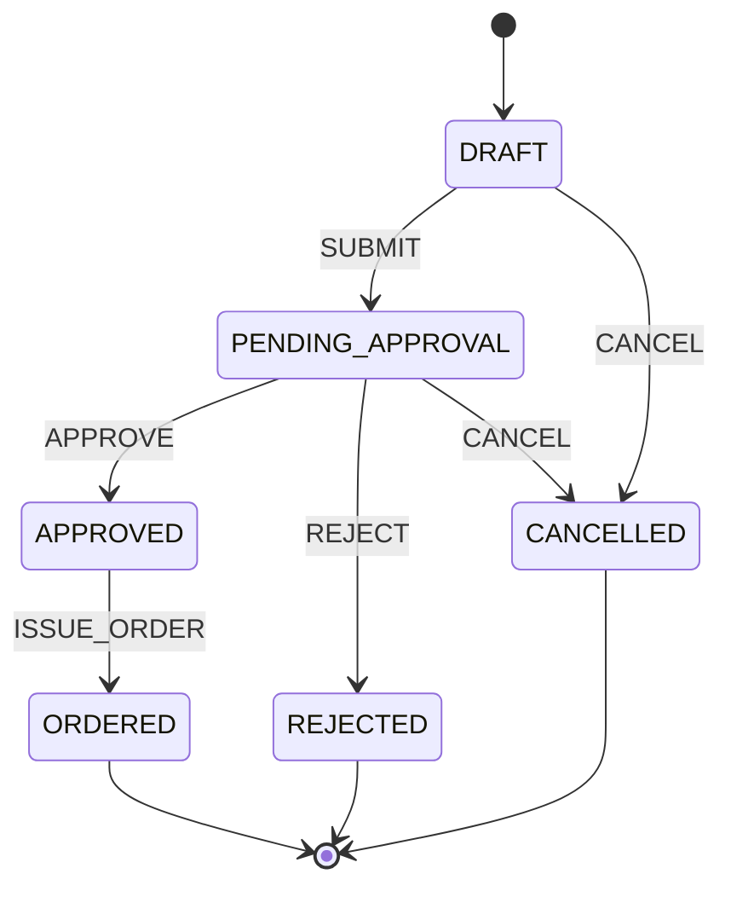

# Allowed transition map: bản đồ chuyển trạng thái hợp lệ

Trong chương **State Transitions** của module bảo vệ logic nghiệp vụ, allowed transition map là bản đồ quy định một đối tượng được chuyển từ trạng thái nào sang trạng thái nào, thông qua hành động nào. Đây là nền tảng để ngăn bỏ qua bước phê duyệt, thực hiện sai thứ tự và lợi dụng các API khác nhau để đưa dữ liệu vào trạng thái trái quy tắc.

Một bản đồ đúng chỉ giải quyết phần cấu trúc của luồng nghiệp vụ. Để bảo vệ toàn bộ thao tác, ứng dụng còn phải kiểm tra quyền trên đúng đối tượng, điều kiện nghiệp vụ, tính nhất quán khi có yêu cầu đồng thời và cách xử lý yêu cầu lặp. Bài học kết nối những yếu tố đó bằng một ví dụ đề nghị mua hàng.

Sau bài này, bạn có thể:

- Chuyển mô tả quy trình thành tập trạng thái, hành động và cạnh được phép.
- Phân biệt cạnh hợp lệ với quyền thực hiện và điều kiện cho phép cạnh đó xảy ra.
- Thiết kế API theo hành động, để máy chủ quyết định trạng thái đích.
- Dùng transaction, kiểm tra phiên bản và idempotency để bảo vệ việc chuyển trạng thái.
- Xây dựng các ca kiểm thử cố tình đi sai luồng.

## 1. Vì sao một trường `status` có thể trở thành lỗ hổng?

Giả sử ứng dụng cho phép người dùng gửi yêu cầu:

```http
PATCH /purchase-requests/pr-123
Content-Type: application/json

{
  "status": "APPROVED",
  "approvedBy": "manager-7",
  "amount": 1000
}
```

Nếu máy chủ ánh xạ trực tiếp các trường này vào đối tượng rồi lưu, người tạo đề nghị có thể tự đánh dấu đã được duyệt. Việc giao diện chỉ hiển thị nút “Gửi duyệt” không ngăn được người dùng gọi API bằng một công cụ khác.

Ngay cả cách sửa “chỉ người có vai trò quản lý mới được đặt `APPROVED`” vẫn chưa đủ. Người quản lý có thể đang duyệt đề nghị thuộc đơn vị khác, tự duyệt đề nghị của mình hoặc duyệt một bản nháp chưa hoàn tất dữ liệu. Một API khác cũng có thể sửa số tiền sau khi phê duyệt.

Câu hỏi cần trả lời là:

> Với đối tượng cụ thể này, ở trạng thái và phiên bản hiện tại, chủ thể này có được thực hiện hành động này để tạo ra kết quả đó hay không?

Trạng thái là dữ liệu do máy chủ quản lý. Client thể hiện ý định bằng hành động; client không được tự ghi bằng chứng rằng ý định đã hoàn tất.

## 2. Mô hình: trạng thái, hành động, cạnh và điều kiện

Gọi:

- `S`: tập trạng thái đã biết.
- `A`: tập hành động đã biết.
- `T`: tập cạnh được cho phép, với `T ⊆ S × A × S`.

Một cạnh có dạng:

```text
(trạng thái nguồn, hành động, trạng thái đích)

(PENDING_APPROVAL, APPROVE, APPROVED)
```

Trong bài này, mỗi cặp `(trạng thái nguồn, hành động)` có tối đa một trạng thái đích. Nếu một hành động có nhiều kết quả nghiệp vụ, cần mô hình hóa rõ điều kiện lựa chọn kết quả hoặc tách thành các sự kiện riêng; không để thứ tự các câu `if` vô tình quyết định.

Điều kiện chấp nhận một thao tác có thể diễn đạt như sau:

```text
accept(actor, object, action, context) khi và chỉ khi:
  tồn tại cạnh tương ứng trong bản đồ
  AND actor được phép thực hiện action trên chính object
  AND các guard của cạnh đều đúng
  AND trạng thái sau thao tác thỏa business invariants
  AND việc kiểm tra và ghi nhận không bị một cập nhật đồng thời làm mất hiệu lực
```

**Guard** là điều kiện phải đúng để đi qua một cạnh, chẳng hạn đề nghị còn trong hạn duyệt. **Business invariant** là quy tắc phải luôn đúng ở các trạng thái liên quan, chẳng hạn đề nghị đã duyệt phải có bằng chứng duyệt gắn với đúng nội dung đã duyệt.

Một cách phân chia thực dụng:

| Thành phần | Câu hỏi cần trả lời | Ví dụ |
| --- | --- | --- |
| Bản đồ chuyển trạng thái | Luồng có cạnh này không? | `DRAFT` không có cạnh `APPROVE` |
| Quyền theo đối tượng | Ai được đi cạnh này trên đối tượng này? | Người duyệt phải có phạm vi quyền với đơn vị của đề nghị |
| Guard | Những điều kiện nào phải đúng ngay lúc thực hiện? | Số tiền nằm trong hạn mức duyệt của chủ thể |
| Invariant | Sau thao tác, điều gì vẫn phải đúng? | Nội dung đã duyệt không bị thay đổi âm thầm |
| Cơ chế nhất quán | Kết luận còn đúng khi có yêu cầu đồng thời không? | Chỉ một cập nhật từ cùng phiên bản được commit |

Không nên nhét tất cả điều kiện này vào một ma trận vai trò rồi coi ma trận là toàn bộ cơ chế bảo vệ.

## 3. Ví dụ xuyên suốt: đề nghị mua hàng

Xét một quy trình **một cấp duyệt** với các quy tắc được xác định trước:

- Người tạo soạn đề nghị và gửi duyệt trong tổ chức của mình.
- Người duyệt phải có quyền trên đơn vị của đề nghị, đủ hạn mức và khác người tạo.
- Khi gửi duyệt, nội dung được chốt thành một bản dữ liệu dùng để phê duyệt. Số tiền được máy chủ tính từ dữ liệu giá và các quy tắc áp dụng, không tin một trường tổng tiền do client khai báo.
- Sau phê duyệt, nhân sự mua hàng được phát hành một đơn mua hàng nội bộ từ đúng nội dung đã duyệt.
- Trong phạm vi ví dụ, đề nghị đã bị từ chối, bị hủy hoặc đã phát hành đơn không được mở lại. Muốn chỉnh sửa sau khi gửi duyệt, người dùng thực hiện quy trình tạo đề nghị mới hoặc quy trình sửa đổi được thiết kế riêng.

Các trạng thái:

| Trạng thái | Ý nghĩa | Trạng thái kết thúc trong mô hình này? |
| --- | --- | --- |
| `DRAFT` | Bản nháp đang được chuẩn bị | Không |
| `PENDING_APPROVAL` | Nội dung đã chốt và đang chờ duyệt | Không |
| `APPROVED` | Đã được phê duyệt, chưa phát hành đơn | Không |
| `REJECTED` | Bị người có thẩm quyền từ chối | Có |
| `CANCELLED` | Bị người tạo hủy ở giai đoạn cho phép | Có |
| `ORDERED` | Đơn mua hàng nội bộ đã được tạo thành công | Có |

“Kết thúc” là thuộc tính của quy trình đang mô hình hóa, không phải quy luật chung cho mọi doanh nghiệp. Nếu doanh nghiệp cho phép thu hồi phê duyệt, hủy đơn hay mở lại đề nghị, phải bổ sung hành động, quyền, guard và hiệu ứng tương ứng.

Trong ví dụ này, `ORDERED` chỉ khẳng định đã tạo đơn trong cơ sở dữ liệu nội bộ. Nó không khẳng định nhà cung cấp bên ngoài đã nhận đơn hoặc đã giao hàng.

## 4. Viết bảng cạnh được phép trước khi viết endpoint

| Nguồn | Hành động | Đích | Chủ thể và phạm vi quyền | Guard và hiệu ứng chính |
| --- | --- | --- | --- | --- |
| `DRAFT` | `SUBMIT` | `PENDING_APPROVAL` | Người tạo, đúng tổ chức | Đủ dữ liệu; tổng tiền hợp lệ do máy chủ tính; chốt nội dung gửi duyệt |
| `DRAFT` | `CANCEL` | `CANCELLED` | Người tạo, đúng tổ chức | Ghi người hủy và thời điểm hủy |
| `PENDING_APPROVAL` | `APPROVE` | `APPROVED` | Người có quyền duyệt đối tượng này | Không tự duyệt; trong hạn mức; còn hạn duyệt; ghi bằng chứng duyệt cho nội dung đã chốt |
| `PENDING_APPROVAL` | `REJECT` | `REJECTED` | Người có quyền duyệt đối tượng này | Không tự xử lý với tư cách người duyệt; có lý do từ chối |
| `PENDING_APPROVAL` | `CANCEL` | `CANCELLED` | Người tạo, đúng tổ chức | Việc hủy thắng được cập nhật cạnh tranh trước khi một cạnh khác commit |
| `APPROVED` | `ISSUE_ORDER` | `ORDERED` | Nhân sự có quyền phát hành đơn cho đối tượng này | Bằng chứng duyệt khớp nội dung; tạo duy nhất một đơn nội bộ từ đề nghị |

Mọi cặp nguồn–hành động không xuất hiện trong bảng đều bị từ chối. Ví dụ:

- `DRAFT + APPROVE`: bỏ qua gửi duyệt.
- `PENDING_APPROVAL + ISSUE_ORDER`: bỏ qua phê duyệt.
- `REJECTED + APPROVE`: phục hồi trái phép đề nghị đã bị từ chối.
- `ORDERED + ISSUE_ORDER`: tạo thêm đơn bằng một lần thực thi mới.
- `APPROVED + CANCEL`: chưa có quy trình hủy sau duyệt trong mô hình này.

Không có quy tắc “nếu đang ở trạng thái nào đó thì được chuyển tới mọi trạng thái có tên hợp lệ”. Trạng thái đích tồn tại trong enum không có nghĩa cạnh dẫn tới nó được phép.



Các mũi tên tới hoặc từ `[*]` chỉ biểu diễn điểm bắt đầu và kết thúc của sơ đồ. Chúng không tự tạo API “đặt lại trạng thái”. Sơ đồ giúp nhìn luồng; bảng cạnh cung cấp các điều kiện mà hình vẽ không thể hiện hết.

## 5. Thiết kế API theo hành động

Thay cho API cập nhật tùy ý `status`, có thể cung cấp các endpoint:

```http
POST /purchase-requests/pr-123/submit
POST /purchase-requests/pr-123/approve
POST /purchase-requests/pr-123/reject
POST /purchase-requests/pr-123/cancel
POST /purchase-requests/pr-123/issue-order
```

Ví dụ yêu cầu duyệt:

```http
POST /purchase-requests/pr-123/approve
Idempotency-Key: 8b12b1ed-example-key
Content-Type: application/json

{
  "expectedVersion": 7,
  "comment": "Đồng ý theo đề nghị đã gửi"
}
```

Endpoint quyết định hành động là `APPROVE`. Máy chủ lấy danh tính người duyệt từ ngữ cảnh đã xác thực; tải đối tượng trong phạm vi tổ chức được phép; đọc trạng thái và phiên bản từ dữ liệu lưu trữ; rồi suy ra trạng thái đích từ bản đồ.

DTO đầu vào chỉ chứa các trường mà người dùng được quyền đề xuất. Những trường như `approvedBy`, `approvedAt`, `tenantId`, `approvalSnapshotId`, `orderId` và `status` không phải dữ liệu cập nhật tự do. Nếu có chọn tổ chức làm việc, máy chủ vẫn phải xác minh tư cách thành viên và phạm vi quyền cho lựa chọn đó.

Client gửi `expectedVersion` để nói rằng người dùng đang thao tác trên bản đã xem. Giá trị này là điều kiện cần kiểm tra, không phải phiên bản mới để máy chủ ghi vào cơ sở dữ liệu.

Một endpoint chung nhận `action` cũng có thể an toàn, nếu chỉ chấp nhận tập hành động xác định trước và gọi cùng cơ chế bảo vệ. Tên endpoint riêng không tự làm cho luồng an toàn.

## 6. Biểu diễn bản đồ trong Java

Đoạn mã sau chỉ biểu diễn quan hệ nguồn–hành động–đích. Nó dùng enum, record và map bất biến; các record yêu cầu Java 16 trở lên.

```java
import java.util.Map;
import java.util.Objects;

enum RequestState {
    DRAFT,
    PENDING_APPROVAL,
    APPROVED,
    REJECTED,
    CANCELLED,
    ORDERED
}

enum RequestAction {
    SUBMIT,
    APPROVE,
    REJECT,
    CANCEL,
    ISSUE_ORDER
}

record Edge(RequestState source, RequestAction action) {
    Edge {
        Objects.requireNonNull(source, "source");
        Objects.requireNonNull(action, "action");
    }
}

final class AllowedTransitions {
    private static final Map<Edge, RequestState> TARGETS = Map.ofEntries(
        Map.entry(
            new Edge(RequestState.DRAFT, RequestAction.SUBMIT),
            RequestState.PENDING_APPROVAL),
        Map.entry(
            new Edge(RequestState.DRAFT, RequestAction.CANCEL),
            RequestState.CANCELLED),
        Map.entry(
            new Edge(RequestState.PENDING_APPROVAL, RequestAction.APPROVE),
            RequestState.APPROVED),
        Map.entry(
            new Edge(RequestState.PENDING_APPROVAL, RequestAction.REJECT),
            RequestState.REJECTED),
        Map.entry(
            new Edge(RequestState.PENDING_APPROVAL, RequestAction.CANCEL),
            RequestState.CANCELLED),
        Map.entry(
            new Edge(RequestState.APPROVED, RequestAction.ISSUE_ORDER),
            RequestState.ORDERED)
    );

    private AllowedTransitions() {
    }

    static RequestState targetFor(
            RequestState current, RequestAction action) {
        RequestState target = TARGETS.get(new Edge(current, action));
        if (target == null) {
            throw new IllegalStateException("Transition is not allowed");
        }
        return target;
    }
}
```

`targetFor()` không xác nhận quyền và không thay đổi đối tượng. Không được gọi hàm này rồi coi kết quả là giấy phép lưu dữ liệu. Trong ứng dụng thực tế, nên dùng lỗi miền có mã ổn định thay cho ngoại lệ chung và ánh xạ lỗi sang hợp đồng API của hệ thống.

Không dùng `ordinal()` của enum để cho phép “chỉ tiến lên”. Luồng có nhánh hủy, từ chối và có thể có bước khôi phục; vị trí khai báo enum không biểu diễn quy tắc nghiệp vụ. Cũng không nên mặc định cho phép chuyển từ một trạng thái về chính nó: một lần thực thi như vậy vẫn có thể tạo thêm đơn, trừ tiền hoặc phát sự kiện lần nữa.

## 7. Quyền và guard phải gắn với đối tượng đang xử lý

Với hành động `APPROVE`, các kiểm tra không thể chỉ dừng ở `hasRole("APPROVER")`:

```text
authorizeApproval(actor, request):
  actor thuộc tổ chức đang xử lý request
  actor có quyền duyệt trong phạm vi đơn vị của request
  actor.id khác request.createdBy
  hạn mức của actor đủ cho số tiền và loại tiền của request

checkApprovalGuards(request, now):
  request đang ở PENDING_APPROVAL
  request có bản nội dung gửi duyệt hợp lệ
  request chưa quá hạn duyệt
  nội dung hiện tại khớp bản được gửi duyệt
```

Đây là giả mã; cách biểu diễn vai trò, phạm vi đơn vị, hạn mức và tỷ giá phụ thuộc mô hình nghiệp vụ. Nếu so sánh hạn mức khác loại tiền, hệ thống phải có quy tắc chuyển đổi và thời điểm lấy tỷ giá rõ ràng. Không so sánh trực tiếp hai con số mà bỏ qua đơn vị tiền.

Kiểm tra “không tự duyệt” vẫn cần thiết khi một người đồng thời có vai trò người tạo và người duyệt. Việc có nhiều vai trò không tự xóa quy tắc phân tách trách nhiệm.

Đối tượng dùng để kiểm tra phải là đối tượng mà máy chủ vừa tải và sẽ cập nhật. Đừng kiểm tra quyền trên `departmentId` trong request body rồi cập nhật một bản ghi được chọn bằng ID khác.

Với hệ thống nhiều tổ chức, một cách truy vấn là dùng đồng thời ID đối tượng và tổ chức đã được xác minh:

```sql
SELECT id, tenant_id, created_by, state, version,
       approval_snapshot_id, amount, currency
FROM purchase_request
WHERE id = :request_id
  AND tenant_id = :authorized_tenant_id
FOR UPDATE;
```

Điều kiện tổ chức hạn chế phạm vi truy cập; các chính sách chi tiết theo đối tượng vẫn phải được đánh giá. Việc ẩn đối tượng ngoài phạm vi bằng `404` hoặc trả `403` cần nhất quán với hợp đồng API và chính sách tiết lộ sự tồn tại của tài nguyên.

## 8. Invariant phải bao phủ cả nội dung được phê duyệt

Giả sử người duyệt chấp nhận đề nghị 1 triệu đồng. Sau đó một endpoint sửa chi tiết cho phép thay tổng tiền thành 100 triệu đồng nhưng giữ nguyên `APPROVED`. Không cạnh trạng thái nào bị vi phạm, nhưng ý nghĩa của việc phê duyệt đã bị phá vỡ.

Vì vậy, cần xác định rõ các invariant:

1. Khi `PENDING_APPROVAL`, đề nghị có bản nội dung đã chốt, gồm mặt hàng, số lượng, đơn giá, loại tiền và các dữ liệu ảnh hưởng quyết định duyệt.
2. Khi `APPROVED` hoặc `ORDERED`, phải có bằng chứng duyệt trỏ tới đúng bản nội dung đó; người duyệt khác người tạo theo chính sách ví dụ.
3. Nội dung làm căn cứ duyệt không được sửa qua endpoint thông thường sau khi gửi duyệt.
4. Khi `ORDERED`, tồn tại đúng một đơn nội bộ được tạo từ đề nghị và đúng bản nội dung được duyệt.
5. Các bản ghi đề nghị, bằng chứng duyệt và đơn thuộc cùng phạm vi tổ chức hợp lệ.

Có thể dùng bản nội dung bất biến với ID riêng, hoặc một cơ chế phiên bản nội dung tương đương. Nếu dùng hash để đối chiếu, dữ liệu đầu vào cho hash phải được chuẩn hóa và lưu từ nguồn đáng tin cậy; một hash client tự gửi không chứng minh nội dung đã được duyệt.

Phân biệt **phiên bản nội dung được duyệt** với **phiên bản khóa lạc quan của bản ghi**. Phiên bản khóa tăng mỗi lần cập nhật bản ghi; việc tăng nó không có nghĩa nội dung đã được phê duyệt lại.

Nếu nghiệp vụ thực sự cho phép sửa sau duyệt, cần một quy trình sửa đổi rõ ràng: làm mất hiệu lực phê duyệt cũ khi thích hợp, tạo bản nội dung mới và đi qua các bước duyệt bắt buộc. Thêm cạnh quay lại mà giữ nguyên mọi bằng chứng cũ có thể mở đường bỏ qua duyệt.

## 9. Kiểm tra và ghi nhận trong cùng ranh giới nhất quán

Mẫu sau dễ gặp lỗi kiểm tra trước, sử dụng sau:

```text
đọc state = PENDING_APPROVAL
kiểm tra được phép duyệt
                 yêu cầu khác hủy đề nghị và commit
ghi state = APPROVED mà không kiểm tra bản vừa đọc còn hiện hành
```

Mỗi yêu cầu riêng lẻ trông có vẻ đi qua một cạnh hợp lệ. Kết quả kết hợp lại có thể ghi đè quyết định đã commit của yêu cầu khác.

Hai cách tiếp cận thường dùng:

### 9.1. Khóa bản ghi trong transaction

Trong một transaction, tải bản ghi với khóa cập nhật phù hợp cơ sở dữ liệu, kiểm tra phiên bản người dùng đã xem, đánh giá cạnh, quyền và guard, rồi lưu trạng thái cùng các dữ liệu liên quan trước khi commit.

Khóa trên hàng đề nghị chỉ bảo vệ các thao tác cạnh tranh biết tuân thủ cùng giao thức và dữ liệu nằm trong phạm vi khóa đó. Nếu guard phụ thuộc ngân sách dùng chung, tồn kho hoặc một bảng quyền có thể thay đổi đồng thời, phải xác định cơ chế nhất quán cho những dữ liệu đó nữa. Khóa một hàng không tự bảo vệ toàn bộ hệ thống.

Không giữ transaction cơ sở dữ liệu mở trong lúc chờ người dùng duyệt hoặc chờ một API bên ngoài phản hồi. Mỗi hành động là một transaction ngắn; trạng thái được lưu giữa các hành động.

### 9.2. Cập nhật có điều kiện bằng phiên bản

Một mẫu SQL cho thao tác duyệt:

```sql
UPDATE purchase_request
SET state = 'APPROVED',
    approved_by = :authenticated_actor_id,
    approved_at = :server_time,
    approved_snapshot_id = :verified_snapshot_id,
    version = version + 1
WHERE id = :request_id
  AND tenant_id = :authorized_tenant_id
  AND state = 'PENDING_APPROVAL'
  AND version = :expected_version;
```

Trước câu lệnh này, quyền và guard phải được đánh giá trên dữ liệu tin cậy tương ứng. Điều kiện `state` và `version` không thay thế những kiểm tra đó. Mọi thao tác sửa bản ghi liên quan phải tuân thủ quy tắc tăng phiên bản; nếu một đường ghi bỏ qua quy tắc, cơ chế sẽ có lỗ hổng.

- Cập nhật đúng một hàng: tiếp tục các thay đổi liên quan trong cùng transaction rồi commit.
- Không cập nhật hàng nào: không được kết luận duyệt thành công. Đối tượng có thể đã đổi phiên bản, đổi trạng thái hoặc không còn nằm trong phạm vi truy cập.
- Nếu một bước tiếp theo như ghi bằng chứng duyệt hay audit thất bại và được xem là bắt buộc, rollback toàn bộ transaction.

Không tự đọc phiên bản mới rồi âm thầm thực hiện lại một quyết định duyệt trên nội dung khác. Người dùng có thể cần xem lại bản mới trước khi gửi ý định mới.

Khóa bi quan, khóa lạc quan hoặc kết hợp chúng đều cần thiết kế nhất quán với cơ sở dữ liệu và các đường ghi thực tế. Chỉ đặt tên hàm là `approveInTransaction()` không tạo ra transaction.

## 10. Một luồng xử lý chuyển trạng thái hoàn chỉnh

Giả mã dưới đây ghép các trách nhiệm lại với nhau. Đây là thiết kế luồng, không phải đoạn mã tích hợp có thể chạy nguyên trạng:

```text
handleCommand(authenticatedActor, requestId, action, command, key):
  xác thực cấu trúc dữ liệu và tập hành động được hỗ trợ
  xác định tổ chức và danh tính từ ngữ cảnh đã được xác minh
  kiểm tra quyền gọi loại hành động này

  BEGIN TRANSACTION
    nhận quyền xử lý key trong phạm vi tổ chức + chủ thể + loại thao tác
    nếu key đã có kết quả hoàn tất:
      kiểm tra dấu vân tay yêu cầu có khớp không
      kiểm tra chủ thể hiện vẫn được quyền xem kết quả tương ứng
      trả kết quả đã lưu, không thực thi lại hành động

    tải và bảo vệ bản ghi requestId trong phạm vi truy cập
    kiểm tra quyền theo đối tượng
    kiểm tra expectedVersion
    suy ra target từ bản đồ bằng state hiện tại và action
    kiểm tra guard và bản nội dung nghiệp vụ
    tạo các dữ liệu nghiệp vụ bắt buộc của cạnh
    cập nhật state và tăng version bằng cơ chế chống cạnh tranh
    kiểm tra/thi hành các invariant bắt buộc
    ghi audit thành công
    ghi outbox nếu cần gửi sự kiện ra ngoài
    lưu kết quả idempotency của thao tác
  COMMIT

  trả kết quả đã commit
```

Nếu dùng khóa lạc quan, bước “bảo vệ bản ghi” có thể là đọc phiên bản rồi dùng cập nhật có điều kiện, thay vì `FOR UPDATE`. Điều cần giữ là các quyết định dựa trên dữ liệu có hiệu lực và mọi thay đổi bắt buộc được commit nguyên tử trong phạm vi transaction đã chọn.

Nhánh trả kết quả idempotency cũng phải kết thúc transaction đúng cách, thông qua cơ chế quản lý transaction của ứng dụng. Nếu có lỗi, rollback và xử lý theo chính sách retry; không để lại một bản ghi “đã thành công” cho thao tác chưa commit.

Với `ISSUE_ORDER`, việc tạo đơn, đổi trạng thái sang `ORDERED`, ghi audit và hoàn tất kết quả idempotency nằm trong cùng transaction nếu cùng cơ sở dữ liệu. Ràng buộc duy nhất trên quan hệ đề nghị–đơn giúp chặn tạo đơn trùng ngay cả khi mã ứng dụng có lỗi cạnh tranh.

## 11. Yêu cầu lặp khác với cạnh tự chuyển trạng thái

Giả sử lần đầu `APPROVE` thành công, nhưng kết nối bị đứt trước khi client nhận phản hồi. Client gửi lại cùng yêu cầu.

Bản đồ không có cạnh `APPROVED + APPROVE`. Nếu chỉ kiểm tra trạng thái, máy chủ sẽ trả lỗi dù ý định ban đầu đã được thực hiện. Nhưng nếu thêm cạnh tự chuyển rồi chạy lại toàn bộ hiệu ứng, máy chủ có thể tạo audit thành công, thông báo hoặc sự kiện lần nữa.

Idempotency giải quyết việc nhận diện lại cùng một ý định:

| Tình huống | Cách xử lý mong muốn |
| --- | --- |
| Cùng key, cùng yêu cầu, lần trước đã commit | Trả kết quả đã lưu; không đi qua cạnh và không tạo hiệu ứng lần nữa |
| Cùng key nhưng đổi ID đối tượng, hành động hoặc payload có ý nghĩa | Từ chối vì tái sử dụng key cho yêu cầu khác |
| Hai yêu cầu cùng key đến đồng thời | Một yêu cầu nhận quyền thực thi; yêu cầu còn lại chờ hoặc nhận phản hồi đang xử lý theo hợp đồng API |
| Key khác nhưng cùng cố tạo đơn cho một đề nghị | Bản đồ, kiểm soát phiên bản và ràng buộc duy nhất vẫn phải chặn thực thi trùng |
| Lần trước rollback trước khi commit | Cho phép xử lý lại theo chính sách; không trả thành công giả |

Một phạm vi khóa có thể là `(tenantId, actorId, operation, key)`. Dấu vân tay đi kèm phải bao gồm ID đối tượng, hành động và các dữ liệu có ý nghĩa như `expectedVersion`; cách chuẩn hóa dữ liệu phải được xác định rõ. Cơ sở dữ liệu cần ràng buộc duy nhất để bảo vệ việc nhận quyền xử lý key, không chỉ kiểm tra “chưa thấy key” rồi insert ở hai yêu cầu khác nhau.

Máy chủ vẫn xác thực lại và kiểm tra quyền truy cập kết quả khi trả bản ghi cũ. Idempotency key không phải token cấp quyền.

Thời gian lưu key cần phù hợp thời gian client có thể retry. Sau khi bản ghi key hết hạn, quy tắc trạng thái và các ràng buộc nghiệp vụ lâu dài vẫn phải ngăn tạo đơn trùng. Không dựa duy nhất vào bộ nhớ đệm key có thời hạn để bảo vệ một invariant vĩnh viễn.

## 12. Hiệu ứng bên ngoài cần có trạng thái và bằng chứng riêng

Nếu phát hành đơn còn phải gửi sang nhà cung cấp, một transaction cục bộ không thể tự rollback tác dụng đã xảy ra ở hệ thống ngoài. Tránh thiết kế “gọi nhà cung cấp xong mới ghi trạng thái” rồi kỳ vọng mọi lỗi kết nối đều có thể xử lý bằng cách gọi lại.

Có thể tách rõ các sự kiện:

```text
APPROVED
  --REQUEST_DISPATCH--> DISPATCH_PENDING
  --x không chuyển thẳng sang xác nhận nếu chưa có bằng chứng

DISPATCH_PENDING
  --DISPATCH_CONFIRMED--> DISPATCHED
  --DISPATCH_FAILED_DEFINITIVELY--> DISPATCH_FAILED
```

Ví dụ này mở rộng mô hình ban đầu; các tên trạng thái chỉ minh họa và phải được đưa vào bản đồ chính thức nếu triển khai. `REQUEST_DISPATCH` có thể ghi một thông điệp outbox cùng transaction cục bộ. Worker gửi thông điệp với định danh thao tác ổn định; hệ thống nhận cần cơ chế chống lặp tương ứng hoặc ứng dụng phải có cách đối soát.

Timeout chỉ nói rằng chưa biết kết quả. Nó không chứng minh phía ngoài chưa thực hiện. Khi chưa biết, nên giữ trạng thái đang chờ/không rõ kết quả theo mô hình và đối soát, thay vì lập tức đánh dấu thất bại cuối cùng rồi cho tạo một thao tác mới.

Các sự kiện nội bộ như `DISPATCH_CONFIRMED` cũng có chủ thể và phạm vi quyền riêng. Không mở API công khai cho người dùng tự gửi “đã xác nhận”. Callback cần được xác thực, đối chiếu đúng đối tượng và thao tác, kiểm tra chống lặp, rồi mới đi qua bản đồ chuyển trạng thái.

Outbox giúp gắn việc phát sinh ý định gửi với commit dữ liệu cục bộ. Nó không tự bảo đảm một hiệu ứng bên ngoài chỉ xảy ra đúng một lần.

## 13. Bao phủ mọi đường có thể sửa trạng thái hoặc dữ liệu liên quan

Bảo vệ endpoint `/approve` là chưa đủ nếu vẫn có các đường ghi khác:

- API cập nhật tổng quát nhận `status` hoặc bằng chứng phê duyệt.
- Chức năng xử lý hàng loạt trực tiếp cập nhật trạng thái.
- Công cụ quản trị có nút “sửa trạng thái” không theo quy trình.
- Worker nền, consumer sự kiện, callback hoặc tác vụ đồng bộ bỏ qua guard.
- API sửa chi tiết thay số tiền sau khi duyệt nhưng giữ nguyên bằng chứng duyệt.

Các đường ghi hợp lệ nên dùng chung cơ chế thực thi quy tắc miền. Chủ thể là dịch vụ hay quản trị viên vẫn phải được biểu diễn rõ; quyền sửa ngoại lệ, nếu doanh nghiệp cần, phải là một quy trình được cấp quyền, có điều kiện và có audit riêng.

Ràng buộc cơ sở dữ liệu bổ sung lớp bảo vệ:

| Ràng buộc | Điều nó giúp bảo vệ | Điều nó không tự bảo vệ |
| --- | --- | --- |
| Giá trị trạng thái thuộc tập xác định | Không lưu trạng thái không được mô hình hóa | Không biết cạnh trước đó có hợp lệ không |
| `version` và cập nhật có điều kiện | Phát hiện cập nhật dựa trên phiên bản cũ | Không tự kiểm tra quyền của chủ thể |
| Duy nhất một đơn cho mỗi đề nghị | Chặn tạo nhiều đơn từ cùng đề nghị | Không tự chứng minh đề nghị đã được duyệt đúng |
| Khóa ngoại và quan hệ có tổ chức phù hợp | Giữ liên kết dữ liệu và phạm vi tổ chức khi được mô hình hóa đúng | Không tự quyết định hạn mức duyệt |
| Ràng buộc dữ liệu duyệt ở trạng thái cần duyệt | Chặn một số tổ hợp dữ liệu thiếu nhất quán | Không thay thế kiểm chứng nguồn gốc bằng chứng duyệt |

Một `CHECK` thông thường trên hàng hiện tại không tự biết trạng thái trước đó. Nếu cần thực thi cạnh ở tầng cơ sở dữ liệu, phải có thiết kế như thủ tục hoặc trigger kiểm tra giá trị cũ–mới và kiểm soát quyền ghi; không suy rằng enum hay `CHECK` đã làm việc đó.

## 14. Audit để giải thích được ai đã đi qua cạnh nào

Một bản ghi audit chuyển trạng thái nên đủ để trả lời:

```text
đối tượng nào, thuộc tổ chức nào
trạng thái nguồn, hành động, trạng thái đích
chủ thể thực hiện và loại chủ thể
phiên bản trước và sau
bản nội dung làm căn cứ quyết định
thời gian máy chủ, mã tương quan và định danh thao tác
lý do nghiệp vụ nếu hành động yêu cầu
```

Audit thành công cần gắn với commit của thay đổi nghiệp vụ, bằng cùng transaction hoặc cơ chế bền vững phù hợp. Nếu ghi audit rồi transaction rollback, không được để bản ghi đó bị hiểu thành bằng chứng thao tác đã thành công.

Các lần cố gắng đi cạnh bị cấm có thể được ghi vào nhật ký an ninh với kết quả từ chối, tách nghĩa rõ với audit thành công. Đừng ghi token, bí mật hoặc toàn bộ payload có dữ liệu nhạy cảm chỉ để theo dõi một lần chuyển trạng thái.

Có thể theo dõi số lần gọi `APPROVE` trên `DRAFT`, số lần truy cập khác tổ chức và xung đột phiên bản bất thường. Những tín hiệu này hỗ trợ điều tra, không thay thế cơ chế từ chối ở thời điểm xử lý.

## 15. Kiểm thử các đường đi được phép và bị cấm

### 15.1. Kiểm tra bản đồ một cách có hệ thống

Với sáu trạng thái và năm hành động của ví dụ, có `6 × 5 = 30` cặp nguồn–hành động. Chỉ sáu cặp trong bảng được phép; 24 cặp còn lại phải bị từ chối khi gọi cơ chế xác định cạnh.

Kiểm thử nên dựa trên bảng nghiệp vụ đã được rà soát độc lập. Nếu chỉ lấy chính map trong mã rồi lặp lại từng phần tử để khẳng định nó tồn tại, một cạnh bị thêm nhầm vẫn có thể khiến toàn bộ kiểm thử xanh.

### 15.2. Kiểm tra quyền, guard và hiệu ứng

| Ca kiểm thử | Kết quả bắt buộc |
| --- | --- |
| Người duyệt hợp lệ duyệt đề nghị đang chờ và đúng phiên bản | `APPROVED`, tăng phiên bản một lần, bằng chứng duyệt khớp nội dung |
| Người tạo có cả vai trò duyệt tự duyệt đề nghị của mình | Từ chối; trạng thái và bằng chứng duyệt không đổi |
| Người có vai trò duyệt thao tác trên đề nghị ngoài tổ chức | Từ chối truy cập; không thay đổi dữ liệu |
| Người duyệt đúng tổ chức nhưng ngoài phạm vi đơn vị | Từ chối theo quyền đối tượng |
| Số tiền vượt hạn mức hoặc sai quy tắc loại tiền | Từ chối; không hạ số tiền tạm thời để vượt guard |
| Gửi `status`, `approvedBy` hoặc `tenantId` giả trong payload | Không trường nào làm thay đổi dữ liệu do máy chủ quản lý |
| Sửa chi tiết sau gửi duyệt qua API cập nhật chung | Bị chặn hoặc đi đúng quy trình sửa đổi đã định nghĩa |
| Phát hành đơn khi chưa duyệt | Từ chối; không có đơn, sự kiện hoặc audit thành công phát sinh |
| Ghi đơn thất bại sau khi đã chuẩn bị đổi trạng thái | Transaction rollback; không còn trạng thái `ORDERED` mồ côi |
| Cùng key nhưng đổi đối tượng hoặc nội dung | Từ chối tái sử dụng key; không thực thi yêu cầu mới |

Khi một thao tác bị từ chối, kiểm tra cả dữ liệu phụ: đơn mua hàng, bằng chứng duyệt, outbox và audit thành công. Chỉ kiểm tra HTTP trả lỗi có thể bỏ sót hiệu ứng đã xảy ra trước đó.

### 15.3. Kiểm tra cạnh tranh và retry

**Duyệt đồng thời với hủy:** chuẩn bị hai yêu cầu cùng dựa trên một phiên bản `PENDING_APPROVAL`. Chỉ một yêu cầu được commit việc rời phiên bản đó. Yêu cầu còn lại nhận xung đột hoặc thấy cạnh không còn hợp lệ; không tồn tại cả bằng chứng hủy và hiệu ứng duyệt được coi là thành công cho hai nhánh loại trừ nhau.

**Phát hành đơn đồng thời:** gửi hai yêu cầu với key khác nhau trên cùng đề nghị `APPROVED`. Kết quả cuối cùng chỉ có một đơn liên kết với đề nghị, một lần chuyển sang `ORDERED` và các hiệu ứng bắt buộc tương ứng.

**Mất phản hồi sau commit:** cho thao tác thành công rồi mô phỏng mất phản hồi. Gửi lại cùng key và cùng payload; nhận kết quả đã lưu mà không tăng phiên bản hoặc tạo hiệu ứng thêm lần nữa.

**Sự kiện trễ:** nhận callback thuộc một thao tác cũ sau khi đối tượng đã được xử lý theo quy trình mới. Hệ thống đối chiếu định danh thao tác và bản nội dung, không chỉ nhìn thấy tên sự kiện hợp lệ rồi cập nhật trạng thái.

Các ca transaction và cạnh tranh cần kiểm chứng ở tầng tích hợp với cơ sở dữ liệu phù hợp. Mock trả về một hàng cập nhật không chứng minh khóa, ràng buộc duy nhất hoặc rollback hoạt động đúng.

## 16. Những lỗi thiết kế dễ bỏ qua

| Cách làm | Vấn đề | Hướng sửa |
| --- | --- | --- |
| Chỉ ẩn nút trên giao diện | Người dùng vẫn gọi API trực tiếp | Thực thi cạnh và quyền ở phía máy chủ |
| Có enum trạng thái nên cho cập nhật tùy ý | Enum giới hạn giá trị, không giới hạn đường đi | Dùng tập cạnh cho phép, mặc định từ chối |
| Chỉ kiểm tra vai trò người duyệt | Bỏ sót chủ sở hữu, tổ chức, đơn vị và tự duyệt | Kiểm tra quyền trên đối tượng và phân tách trách nhiệm |
| Chỉ bảo vệ trường `status` | Nội dung đã duyệt vẫn có thể bị sửa | Bảo vệ cả bản nội dung và bằng chứng phê duyệt |
| Đọc rồi ghi trạng thái không kiểm tra cạnh tranh | Hai quyết định dựa trên cùng dữ liệu cũ có thể cùng thành công | Khóa hoặc cập nhật có điều kiện trong transaction |
| Thêm cạnh tự chuyển để hỗ trợ retry | Hiệu ứng có thể chạy lại | Nhận diện ý định bằng idempotency và lưu kết quả |
| Gắn mọi sự kiện có tên đúng vào đối tượng | Callback cũ hoặc giả có thể hoàn tất sai thao tác | Xác thực nguồn và khớp định danh thao tác, phiên bản nội dung |
| Cho quản trị viên sửa thẳng trạng thái | Có đường vòng bỏ qua invariant | Quy trình ngoại lệ có quyền, guard và audit rõ ràng |

## 17. Tự thiết kế một bản đồ cho quy trình của bạn

Chọn một đối tượng như đơn hàng, yêu cầu hoàn tiền hoặc hồ sơ cấp quyền, rồi thực hiện theo thứ tự:

1. Liệt kê các trạng thái có ý nghĩa nghiệp vụ, điều kiện bắt đầu và các trạng thái kết thúc.
2. Viết từng cạnh dưới dạng `nguồn + hành động → đích`; chỉ thêm cạnh khi có yêu cầu nghiệp vụ rõ ràng.
3. Với mỗi cạnh, ghi chủ thể, phạm vi đối tượng, guard, dữ liệu thay đổi và hiệu ứng phải xảy ra nguyên tử.
4. Xác định nội dung nào trở thành bất biến sau một quyết định như duyệt, thanh toán hoặc phát hành.
5. Chọn cách xử lý cạnh tranh và quy định rõ phản hồi cho dữ liệu cũ.
6. Thiết kế retry, phạm vi idempotency key, dấu vân tay và ràng buộc chống trùng lâu dài.
7. Liệt kê mọi đường ghi, kể cả worker, quản trị, xử lý hàng loạt và callback; bảo đảm chúng thực thi cùng quy tắc.
8. Viết ca kiểm thử đi tắt, đi ngược, gọi lặp, sai quyền và chạy đồng thời; xác nhận cả trạng thái lẫn các hiệu ứng liên quan.

Một allowed transition map có giá trị khi nó trở thành hợp đồng được thực thi trên mọi đường thay đổi nghiệp vụ. Sơ đồ mô tả đường đi; quyền, guard, invariant và ranh giới commit làm cho từng bước trên đường đi đó đáng tin cậy.
