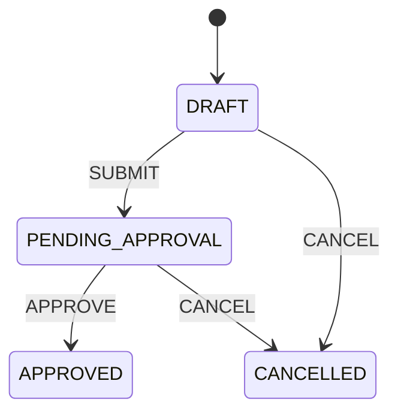

# Xử lý chuyển trạng thái bị cấm (Forbidden transition handling)

Trong một quy trình phê duyệt, biết danh sách trạng thái hợp lệ chưa đủ để bảo vệ nghiệp vụ. Hệ thống còn phải xác định ai được thực hiện hành động nào, từ trạng thái nào, với dữ liệu và bằng chứng gì; sau đó từ chối mọi đường đi không đáp ứng quy tắc đó.

Một yêu cầu HTTP có thể đúng cú pháp, người gửi đã đăng nhập và mã hồ sơ có tồn tại nhưng hành động vẫn phải bị chặn. Ví dụ, người dùng gọi thẳng API phê duyệt khi hồ sơ còn là bản nháp, tự phê duyệt yêu cầu của mình, dùng lại quyết định duyệt sau khi sửa số tiền hoặc gửi đồng thời lệnh hủy và lệnh duyệt.

Bài học thuộc chủ đề **State Transitions** trong bảo mật logic nghiệp vụ. Trọng tâm là xử lý một chuyển trạng thái không được phép sao cho không làm thay đổi dữ liệu nghiệp vụ, không tạo tác dụng phụ trái phép và vẫn cho phép người dùng khôi phục luồng thao tác hợp lệ.

## 1. Mục tiêu học tập

Sau bài học, bạn có thể:

- Phân biệt cạnh chuyển trạng thái không tồn tại, người gọi không đủ quyền, điều kiện nghiệp vụ chưa đạt và xung đột do dữ liệu cũ.
- Thiết kế điểm kiểm soát chuyển trạng thái phía máy chủ theo nguyên tắc mặc định từ chối.
- Giữ việc kiểm tra, cập nhật trạng thái và ghi nhận sự kiện trong một ranh giới transaction phù hợp.
- Xử lý retry, yêu cầu trùng và cạnh tranh mà không mở thêm đường bỏ qua phê duyệt.
- Chuyển quy tắc từ chối thành các tình huống kiểm thử có thể kiểm chứng.

## 2. Khi nào một chuyển trạng thái được phép?

Xét một hồ sơ đề nghị mua hàng với các trạng thái:

| Trạng thái | Ý nghĩa trong ví dụ |
|---|---|
| `DRAFT` | Người tạo đang soạn hồ sơ, chưa gửi xét duyệt |
| `PENDING_APPROVAL` | Nội dung đã được chốt để người có thẩm quyền xét duyệt |
| `APPROVED` | Một phiên bản nội dung cụ thể đã được phê duyệt |
| `CANCELLED` | Hồ sơ đã bị hủy theo quy tắc của quy trình này |

Quy trình minh họa cho phép:



Không có cạnh `DRAFT → APPROVED`. Trong ví dụ này cũng không có thao tác hủy trực tiếp sau khi duyệt; nếu nghiệp vụ cần thu hồi quyết định, phải thiết kế một quy trình thu hồi riêng. Trạng thái kết thúc hay khả năng mở lại luôn là quyết định của từng nghiệp vụ, không phải một quy tắc chung cho mọi ứng dụng.

Có thể mô tả quyết định cho phép bằng biểu thức:

```text
allow(actor, object, command, input) =
    object_is_in_actor_scope
    AND command_is_defined_for_current_state
    AND actor_can_perform_command_on_this_object
    AND business_guards_hold
    AND evidence_matches_current_content
    AND concurrent_update_is_controlled
```

Đây là các điều kiện phải cùng đúng; thứ tự đánh giá thực tế cần tránh tiết lộ thông tin trái phép và bảo đảm tính nhất quán. Trạng thái hiện tại, phạm vi tenant, danh tính và bằng chứng phê duyệt phải lấy từ các nguồn mà máy chủ tin cậy. Trường `status`, `role`, `approvedBy` hoặc `tenantId` trong request không tự trở thành bằng chứng hợp lệ.

### 2.1. Bất biến cần bảo vệ

Một số bất biến của ví dụ:

1. Hồ sơ chỉ được phê duyệt từ `PENDING_APPROVAL`.
2. Người tạo không được tự phê duyệt hồ sơ của mình.
3. Người phê duyệt phải có quyền với đúng hồ sơ và đủ hạn mức cho giá trị hồ sơ.
4. Quyết định phê duyệt gắn với phiên bản nội dung đã được xét duyệt.
5. Một lần duyệt hợp lệ chỉ tạo một thay đổi trạng thái và một sự kiện nghiệp vụ tương ứng.
6. Yêu cầu bị từ chối không làm thay đổi trạng thái, số tiền, quyết định duyệt hoặc hàng đợi thực thi nghiệp vụ.

Bất biến thứ sáu vẫn cho phép ghi log bảo mật về lần thử bị chặn. Log từ chối là dấu vết vận hành, không phải một sự kiện phê duyệt thành công.

## 3. Phân loại nguyên nhân từ chối

Không nên gộp mọi trường hợp thành thông báo “không thể cập nhật”. Các nguyên nhân khác nhau cần cách khắc phục và cách giám sát khác nhau.

| Tình huống | Bản chất | Hành vi mong muốn |
|---|---|---|
| Gửi `APPROVE` khi đang `DRAFT` | Cạnh chuyển không tồn tại | Từ chối, giữ nguyên hồ sơ |
| Người tạo tự duyệt hồ sơ đang chờ | Vi phạm phân tách trách nhiệm | Từ chối dù cạnh chuyển tồn tại |
| Người duyệt thuộc tenant khác | Ngoài phạm vi truy cập đối tượng | Chặn trước khi tiết lộ trạng thái hồ sơ |
| Hồ sơ đang chờ nhưng vượt hạn mức người duyệt | Guard nghiệp vụ hoặc chính sách quyền không đạt | Từ chối hoặc chuyển vào luồng leo thang đã được định nghĩa |
| Màn hình đang hiển thị phiên bản 8 nhưng dữ liệu đã là 9 | Dữ liệu cũ hoặc cạnh tranh | Báo xung đột, yêu cầu tải lại và đánh giá lại hành động |
| Retry đúng yêu cầu đã xử lý thành công | Phát lại cùng một lệnh | Trả kết quả đã lưu nếu cơ chế idempotency xác nhận khớp |
| Lệnh duyệt mới nhắm vào hồ sơ đã duyệt | Lệnh mới không có cạnh hợp lệ | Áp dụng hợp đồng đã định nghĩa; ví dụ này từ chối |
| Dữ liệu chứa trạng thái lạ chưa được ứng dụng hiểu | Vi phạm tính toàn vẹn hoặc tương thích | Chặn thao tác, cảnh báo vận hành, không tự suy đoán trạng thái |

Một tài khoản có vai trò quản trị không mặc nhiên được bỏ qua mọi quy tắc vòng đời. Nếu thật sự cần ngoại lệ, hệ thống phải mô hình hóa ngoại lệ thành lệnh riêng có điều kiện, thẩm quyền và dấu vết rõ ràng.

## 4. Thiết kế lệnh nghiệp vụ thay cho cập nhật trạng thái tùy ý

Một API dạng sau rất dễ làm mất ý nghĩa quy trình:

```http
PATCH /purchase-requests/PR-240
Content-Type: application/json

{
  "status": "APPROVED",
  "approvedBy": "reviewer-7"
}
```

Nếu tầng cập nhật chỉ kiểm tra `APPROVED` có thuộc enum hay không rồi lưu đối tượng, người gọi có thể đi thẳng từ bản nháp tới đã duyệt. Enum xác nhận giá trị có tồn tại, không xác nhận đường đi có hợp lệ.

Nên thể hiện ý định bằng lệnh:

```http
POST /purchase-requests/PR-240/approve
Idempotency-Key: 6bf2b3bc-approval-attempt-01
Content-Type: application/json

{
  "expectedVersion": 8,
  "comment": "Đã kiểm tra nội dung đề nghị"
}
```

Máy chủ tự xác định trạng thái đích, người phê duyệt và thời điểm quyết định. `expectedVersion` là điều kiện phát hiện dữ liệu cũ, không phải nguồn chân lý về phiên bản hiện tại.

Nếu một API chung vẫn nhận `status`, máy chủ vẫn phải ánh xạ thay đổi đó thành lệnh được kiểm soát và chạy đủ quy tắc. Đổi tên endpoint chỉ giúp hợp đồng rõ hơn; nó không tự tạo ra bảo mật.

### 4.1. Một điểm thực thi chung

Kiểm soát chuyển trạng thái cần nằm tại ranh giới ứng dụng hoặc miền mà mọi đường ghi dữ liệu phải đi qua:

```text
HTTP controller ─────┐
Message consumer ────┼──> Command handler / domain policy ──> Transaction ──> Database
Admin action ────────┤
Scheduled job ───────┘
```

Giao diện có thể ẩn nút duyệt để hướng dẫn người dùng, nhưng handler vẫn phải kiểm tra khi nhận lệnh. Tương tự, một consumer hoặc công cụ quản trị gọi thẳng repository để sửa trạng thái có thể tạo đường vòng qua quy tắc.

Các cơ chế sửa dữ liệu đặc biệt cũng phải có phạm vi và thẩm quyền rõ ràng. Tránh phát tán các hàm kiểu `setStatus()` hoặc `saveAnyState()` thành API công khai dùng tùy ý trong ứng dụng.

## 5. Luồng xử lý khi nhận lệnh

Một luồng xử lý điển hình:

1. Xác thực người gọi, kiểm tra cấu trúc lệnh và các trường được phép nhận.
2. Mở transaction cho phần dữ liệu cần kiểm tra và thay đổi nguyên tử.
3. Tải hồ sơ trong phạm vi đối tượng được phép truy cập; khóa hoặc thiết lập cơ chế kiểm soát cạnh tranh phù hợp.
4. Kiểm tra quyền thực hiện loại hành động trên hồ sơ, tránh để lỗi trạng thái tiết lộ thông tin cho người không có quyền.
5. Nếu dùng idempotency, xác định lệnh có phải bản phát lại khớp với một kết quả đã lưu hay không.
6. Với lệnh mới, kiểm tra phiên bản, cạnh chuyển, guard, quyền phụ thuộc nội dung và bằng chứng liên quan.
7. Cập nhật trạng thái và các dữ liệu đi kèm; ghi audit thành công và bản ghi outbox trong cùng transaction nếu áp dụng.
8. Commit rồi mới trả kết quả thành công. Thành phần khác đọc outbox để thực thi tác dụng phụ.

Một lần từ chối ở các bước kiểm tra phải kết thúc mà không để lại cập nhật nghiệp vụ dở dang. Lệnh sai trạng thái không được “cố sửa” hồ sơ thành trạng thái nguồn cần thiết rồi tiếp tục.

Thứ tự khóa hồ sơ và nhận quyền xử lý idempotency có thể khác giữa các thiết kế. Hệ thống phải chọn thứ tự nhất quán để hạn chế deadlock và bảo đảm chỉ một lần thực thi thắng. Không nên ghép các đoạn kiểm tra rời rạc rồi mặc định rằng chúng tạo thành một transaction đúng.

## 6. Ví dụ Java: từ chối rõ ràng trước khi thay đổi

Đoạn mã dưới đây minh họa chính sách miền. Đây là mã khung để giải thích ranh giới kiểm soát, chưa bao gồm cấu hình framework, repository hay cơ chế idempotency đầy đủ.

```java
enum RequestState {
    DRAFT, PENDING_APPROVAL, APPROVED, CANCELLED
}

enum BusinessError {
    STALE_VERSION,
    TRANSITION_NOT_ALLOWED,
    SELF_APPROVAL_NOT_ALLOWED,
    APPROVAL_LIMIT_EXCEEDED,
    APPROVAL_EVIDENCE_OUTDATED
}

final class BusinessRuleViolation extends RuntimeException {
    private final BusinessError code;

    BusinessRuleViolation(BusinessError code) {
        super(code.name());
        this.code = code;
    }

    BusinessError code() {
        return code;
    }
}

record ActorContext(String tenantId, String userId) {}

record ApprovalAuthority(
        long limitMinorUnits,
        String currency) {}

record PurchaseRequest(
        String id,
        String tenantId,
        String creatorId,
        RequestState state,
        long version,
        long contentRevision,
        long submittedContentRevision,
        long amountMinorUnits,
        String currency) {}

final class ApprovalPolicy {
    void check(
            PurchaseRequest request,
            ActorContext actor,
            ApprovalAuthority authority,
            long expectedVersion) {

        if (request.version() != expectedVersion) {
            throw new BusinessRuleViolation(BusinessError.STALE_VERSION);
        }
        if (request.state() != RequestState.PENDING_APPROVAL) {
            throw new BusinessRuleViolation(
                    BusinessError.TRANSITION_NOT_ALLOWED);
        }
        if (request.creatorId().equals(actor.userId())) {
            throw new BusinessRuleViolation(
                    BusinessError.SELF_APPROVAL_NOT_ALLOWED);
        }
        if (!request.currency().equals(authority.currency())
                || request.amountMinorUnits() > authority.limitMinorUnits()) {
            throw new BusinessRuleViolation(
                    BusinessError.APPROVAL_LIMIT_EXCEEDED);
        }
        if (request.contentRevision() != request.submittedContentRevision()) {
            throw new BusinessRuleViolation(
                    BusinessError.APPROVAL_EVIDENCE_OUTDATED);
        }
    }
}
```

Các giả định của ví dụ:

- `ActorContext` được tạo từ ngữ cảnh xác thực đáng tin cậy, không lấy danh tính từ body do client tự khai.
- Handler đã tải đúng tenant và kiểm tra quyền đối tượng trước khi gọi policy. Policy này không tự thay thế tầng phân quyền đó.
- `ApprovalAuthority` do máy chủ cấp sau khi kiểm tra quyền với chính hồ sơ đang xử lý. Số tiền và hạn mức dùng cùng đơn vị tiền tệ; ví dụ dùng số nguyên theo đơn vị tiền nhỏ nhất.
- Tính hợp lệ của số tiền, mã tiền tệ, các trường bắt buộc và revision đã được bảo vệ ở ranh giới tạo hoặc sửa dữ liệu.
- `version` tăng mỗi lần ghi được bảo vệ bằng cơ chế kiểm soát cạnh tranh. `contentRevision` chỉ đại diện cho thay đổi nội dung cần xét duyệt; `submittedContentRevision` là phiên bản nội dung đã chốt lúc gửi.

Policy không sửa đối tượng, gửi email hoặc gọi dịch vụ thanh toán. Khi một điều kiện không đạt, nó chỉ ném lỗi miền xác định được nguyên nhân. Mọi thay đổi diễn ra sau khi các kiểm tra cần thiết đã thành công.

### 6.1. Đặt policy trong handler có transaction

Ví dụ mã giả Java ở tầng ứng dụng:

```java
ApprovalResult approve(ApproveCommand command, ActorContext actor) {
    return transactions.required(() -> {
        // Truy vấn theo cả tenant và id; khóa hàng cho đến hết transaction.
        PurchaseRequest request = repository
                .findForUpdate(actor.tenantId(), command.requestId())
                .orElseThrow(ResourceNotFound::new);

        // Kiểm tra quyền hiện tại trước khi trả cả kết quả replay.
        authorizer.requireApprovalAccess(actor, request);

        // Khóa idempotency được phân vùng theo tenant, actor và loại lệnh.
        // claimOrReplay dùng ràng buộc duy nhất trong kho lưu bền vững.
        CommandClaim claim = commandLog.claimOrReplay(
                actor, "APPROVE", command.idempotencyKey(),
                fingerprintOf(command));

        if (claim.isCompletedReplay()) {
            return claim.savedApprovalResult();
        }

        ApprovalAuthority authority =
                authorizer.requireApprovalAuthority(actor, request);
        approvalPolicy.check(request, actor, authority,
                command.expectedVersion());

        int changed = repository.approveIfPending(
                request.tenantId(), request.id(), request.version(),
                actor.userId(), clock.instant());

        if (changed != 1) {
            throw new ConcurrentChange();
        }

        audit.appendApproval(request.id(), actor.userId(),
                request.contentRevision());
        outbox.appendApprovalGranted(request.id(), request.version() + 1,
                request.contentRevision());

        ApprovalResult result = new ApprovalResult(
                request.id(), RequestState.APPROVED, request.version() + 1);
        commandLog.complete(claim, result);
        return result;
    });
}
```

Các tên như `transactions`, `commandLog` và `repository` là các cổng trừu tượng. Hợp đồng cần có của phần triển khai:

- `transactions.required` chỉ trả kết quả ra ngoài sau khi commit thành công. Lỗi miền và lỗi ghi dữ liệu phải dẫn đến rollback các thay đổi trong transaction này.
- Khóa hàng, cập nhật hồ sơ, ghi audit thành công, outbox và kết quả idempotency dùng cùng transaction cơ sở dữ liệu trong thiết kế minh họa.
- `fingerprintOf(command)` bao phủ định danh đối tượng và mọi trường ảnh hưởng ngữ nghĩa, gồm phiên bản kỳ vọng; không chỉ băm một phần body rồi bỏ qua đường dẫn.
- `claimOrReplay` từ chối cùng khóa nhưng khác fingerprint, đồng thời xử lý tranh chấp khóa bằng tính duy nhất của cơ sở dữ liệu. Một bản ghi đang xử lý không được coi là đã hoàn tất.
- `requireApprovalAccess` kiểm tra quyền xem và thực hiện loại lệnh ở thời điểm gọi. Các guard chỉ dành cho một lần duyệt mới, như trạng thái đang chờ hay hạn mức ra quyết định mới, được đánh giá sau nhánh replay.
- Nếu quyền hoặc hạn mức nằm trong một nguồn dữ liệu có thể thay đổi đồng thời, cần xác định cơ chế khóa, phiên bản chính sách hoặc bảo đảm nhất quán tương ứng. Khóa riêng hàng hồ sơ không tự khóa mọi dữ liệu phân quyền liên quan.

Trong thiết kế này, khi lỗi nghiệp vụ làm transaction rollback thì bản ghi claim mới cũng rollback; lỗi bị từ chối không được lưu như một lần phê duyệt thành công. Nếu muốn ghi nhớ cả kết quả thất bại cho idempotency, cần thiết kế riêng hợp đồng và transaction của kết quả đó.

## 7. Chặn cuộc đua giữa kiểm tra và cập nhật

Đoạn kiểm tra sau có thể đúng khi chạy tuần tự nhưng vẫn sai khi có hai request đồng thời:

```java
// Dễ có race condition nếu không có cơ chế bảo vệ khác.
PurchaseRequest request = repository.findById(id);
if (request.state() == RequestState.PENDING_APPROVAL) {
    repository.setState(id, RequestState.APPROVED);
}
```

Giữa lần đọc và lần ghi, một request khác có thể đã hủy hồ sơ. Lệnh duyệt vẫn ghi đè `CANCELLED` thành `APPROVED`. Cạnh chuyển bị cấm xuất hiện qua cạnh tranh dù từng nhánh mã đều có `if`.

### 7.1. Hai cách kiểm soát thường gặp

| Cách tiếp cận | Cách bảo vệ | Điều phải chú ý |
|---|---|---|
| Khóa bi quan | Đọc hàng bằng khóa ghi, kiểm tra và sửa trong cùng transaction | Mọi đường ghi liên quan phải tuân thủ; cần thứ tự khóa và thời gian transaction hợp lý |
| Cập nhật có điều kiện với version | Chỉ ghi nếu trạng thái và version vẫn như khi đã kiểm tra | Phải kiểm tra số hàng bị cập nhật và rollback mọi thay đổi liên quan khi thất bại |

Một câu lệnh cập nhật có điều kiện có thể có dạng:

```sql
UPDATE purchase_request
SET state = 'APPROVED',
    approved_by = :actor_id,
    approved_at = :approved_at,
    approved_content_revision = content_revision,
    version = version + 1
WHERE tenant_id = :tenant_id
  AND id = :request_id
  AND state = 'PENDING_APPROVAL'
  AND version = :expected_version
  AND content_revision = submitted_content_revision;
```

Cú pháp placeholder ở đây là minh họa cho tham số bind. Câu lệnh chỉ củng cố một số điều kiện dữ liệu; nó không thay thế việc xác thực người gọi, phân quyền đối tượng hay kiểm tra hạn mức.

- **Một hàng được cập nhật:** thao tác vượt qua điều kiện của câu lệnh; transaction vẫn phải commit thành công trước khi công bố kết quả.
- **Không hàng nào được cập nhật:** thao tác không giành được quyền thay đổi dữ liệu theo điều kiện hiện tại. Có thể do version cũ, trạng thái đã đổi, revision không còn khớp hoặc không tìm thấy đối tượng trong phạm vi cho phép.
- **Nhiều hơn một hàng được cập nhật:** vi phạm giả định định danh hoặc lỗi câu truy vấn; rollback và điều tra.

Không suy ra “không đủ quyền” chỉ từ số hàng bằng 0. Cũng không chạy một truy vấn không giới hạn tenant để tìm nguyên nhân rồi trả lại trạng thái thật cho người gọi không có quyền.

### 7.2. Transaction chưa đủ nếu kiểm tra sai phạm vi

Đặt hai câu lệnh trong transaction không tự bảo đảm mọi bất biến trước cạnh tranh. Cơ chế khóa, điều kiện ghi và mức cô lập phải phù hợp với dữ liệu đang bảo vệ.

Ví dụ, quy tắc “mỗi người duyệt chỉ được cam kết tối đa một tổng hạn mức trong ngày” liên quan nhiều hồ sơ. Hai transaction khóa hai hồ sơ khác nhau vẫn có thể cùng đọc một tổng cũ và cùng vượt hạn mức. Khi đó cần bảo vệ thêm tài nguyên tổng hợp, ràng buộc dữ liệu phù hợp hoặc chiến lược cô lập có xử lý retry tương ứng.

Nếu phải retry do xung đột cơ sở dữ liệu, phải đọc và kiểm tra lại toàn bộ điều kiện trên dữ liệu mới. Không tái sử dụng kết quả kiểm tra từ transaction đã thất bại.

## 8. Gắn phê duyệt với đúng nội dung

Giả sử hồ sơ trị giá 10 đơn vị được gửi duyệt. Sau đó một đường cập nhật khác sửa thành 1.000 đơn vị nhưng để nguyên trạng thái `PENDING_APPROVAL`. Nếu người duyệt chỉ kiểm tra trạng thái, quyết định có thể được gắn với nội dung họ chưa xem.

Có hai chính sách thường dùng:

| Chính sách | Hành vi khi muốn sửa nội dung đang chờ |
|---|---|
| Đóng băng nội dung | Từ chối sửa; yêu cầu rút hồ sơ về bước soạn thảo bằng lệnh được phép |
| Cho sửa nhưng vô hiệu hóa lần gửi trước | Tăng revision, xóa bằng chứng không còn hợp lệ và buộc gửi lại theo cạnh đã định nghĩa |

Dù chọn cách nào, phải xác định những trường nào ảnh hưởng quyết định: mặt hàng, số lượng, đơn giá, tổng tiền, người thụ hưởng, tài khoản nhận tiền hoặc điều kiện giao dịch. Chỉ khóa trường `amount` trong khi vẫn cho đổi người nhận có thể chưa bảo vệ được ý nghĩa phê duyệt.

`contentRevision` hữu ích khi mọi đường sửa nội dung liên quan đều làm tăng nó trong transaction. Nếu một tác vụ nhập dữ liệu bỏ qua revision, phép so sánh revision không còn bảo đảm như thiết kế. Một hash nội dung cũng chỉ có ý nghĩa khi cách chuẩn hóa, tập trường và nguồn tạo hash được kiểm soát.

## 9. Phân biệt lệnh bị cấm với retry hợp lệ

Sau khi máy chủ commit thành công, kết nối có thể đứt trước khi client nhận phản hồi. Client gửi lại đúng lệnh duyệt, trong khi hồ sơ đã là `APPROVED`.

Nếu chỉ nhìn trạng thái hiện tại, ứng dụng có thể báo lỗi chuyển trạng thái. Nếu chỉ thấy `APPROVED` rồi trả thành công cho mọi lệnh, ứng dụng lại có thể che giấu một yêu cầu khác người gọi, khác nội dung hoặc khác lần thực thi.

Cần phân biệt:

| Yêu cầu đến sau | Cách xử lý trong ví dụ |
|---|---|
| Cùng scope, cùng idempotency key, cùng fingerprint, đã có kết quả hoàn tất | Kiểm tra quyền hiện tại rồi trả kết quả đã lưu; không tạo chuyển trạng thái mới |
| Cùng key nhưng khác đối tượng, nội dung hoặc phiên bản kỳ vọng | Từ chối việc dùng lại khóa cho lệnh khác |
| Cùng key nhưng lần đầu còn đang thực thi | Chờ có giới hạn hoặc trả trạng thái đang xử lý theo hợp đồng; không cho thực thi độc lập lần hai |
| Key mới, hồ sơ đã `APPROVED` | Đánh giá như lệnh mới; ví dụ này không có cạnh `APPROVED → APPROVED` |
| Khóa đã hết thời gian lưu | Áp dụng chính sách đã công bố; dữ liệu miền vẫn phải ngăn việc duyệt và tạo tác dụng phụ trái quy tắc |

Idempotency key không phải thông tin xác thực. Người có khóa nhưng không còn quyền không được nhận kết quả nhạy cảm chỉ nhờ biết khóa.

Việc tra cứu bản replay hoàn tất diễn ra trước các guard của một lần thực thi mới, sau các kiểm soát truy cập cần thiết. Nếu kiểm tra version cũ trước khi nhận diện replay, một retry hợp lệ có thể bị từ chối vì lần thành công đầu tiên đã tăng version.

## 10. Không để tác dụng phụ xảy ra trước quyết định cuối cùng

Một lỗi phổ biến là gửi sự kiện trước khi biết transaction có thành công hay không:

```text
gửi thông báo "đã duyệt"
    → thử cập nhật trạng thái
    → phát hiện version đã cũ
    → rollback cơ sở dữ liệu
```

Thông báo hoặc yêu cầu xử lý bên ngoài đã gửi đi không tự biến mất khi cơ sở dữ liệu rollback. Điều này có thể dẫn đến giao hàng, cấp quyền hoặc thanh toán dựa trên một chuyển trạng thái thực tế đã bị từ chối.

Một thiết kế dùng transactional outbox ghi đồng thời:

```text
Transaction:
    cập nhật PENDING_APPROVAL → APPROVED
    ghi audit thành công
    ghi outbox ApprovalGranted
    lưu kết quả idempotency
Commit
    ↓
Worker đọc outbox và phát sự kiện
```

Nếu kiểm tra thất bại hoặc transaction rollback, không có outbox thành công tương ứng. Worker có thể phát lại sự kiện khi retry, nên bên nhận vẫn cần khử trùng lặp bằng định danh sự kiện hoặc khóa nghiệp vụ phù hợp. Outbox không tự tạo ra bảo đảm “chỉ một lần” trên toàn hệ thống.

Sau khi hồ sơ đã `APPROVED`, lỗi gửi thông báo là lỗi của tác dụng phụ cần retry riêng. Không tự lùi hồ sơ về `PENDING_APPROVAL` chỉ vì email thất bại. Nếu nghiệp vụ cần bù trừ, phải mô hình hóa hành động bù trừ với quy tắc và quyền tương ứng.

## 11. Phản hồi lỗi mà không mở đường dò dữ liệu

Lỗi cần đủ rõ để người được phép sửa thao tác, đồng thời không tiết lộ thông tin đối tượng cho người không có quyền.

Một hợp đồng HTTP có thể lựa chọn:

| Trường hợp | Mã phản hồi có thể dùng | Lưu ý |
|---|---|---|
| Chưa xác thực | `401` | Xử lý theo cơ chế xác thực của API |
| Đã xác thực nhưng không đủ quyền hành động | `403` | Chỉ cung cấp chi tiết phù hợp phạm vi người gọi được biết |
| Đối tượng không tồn tại hoặc chính sách che giấu đối tượng ngoài scope | `404` | Không dùng nội dung lỗi khác nhau để vô tình tiết lộ sự tồn tại |
| Xung đột với trạng thái hoặc version hiện tại | `409` | Có thể hướng dẫn tải lại dữ liệu đối với người có quyền |
| Điều kiện qua `If-Match` không còn khớp | `412` | Áp dụng khi API thực sự dùng cơ chế điều kiện HTTP đó |
| Nội dung đúng cấu trúc nhưng vi phạm một guard nghiệp vụ | `422` hoặc mã khác theo hợp đồng | Giữ ngữ nghĩa nhất quán giữa các endpoint |

Đây là các lựa chọn thiết kế, không phải ánh xạ cứng cho mọi hệ thống. Mã lỗi miền ổn định thường hữu ích hơn việc để client phân tích chuỗi thông báo.

Ví dụ phản hồi cho người đã có quyền truy cập và thực hiện loại hành động:

```json
{
  "code": "TRANSITION_NOT_ALLOWED",
  "message": "Không thể phê duyệt hồ sơ ở trạng thái hiện tại.",
  "correlationId": "corr-7e12"
}
```

Với xung đột phiên bản, giao diện có thể yêu cầu tải lại hồ sơ và xác nhận lại quyết định. Không tự tải dữ liệu mới rồi gửi lại lệnh duyệt thay người dùng nếu nội dung cần xét duyệt đã đổi.

Nếu cung cấp `allowedActions`, hãy tính theo quyền và dữ liệu hiện tại của đúng người gọi. Danh sách này hướng dẫn giao diện; máy chủ vẫn phải kiểm tra lại khi nhận lệnh vì dữ liệu và quyền có thể đã thay đổi.

## 12. Audit và quan sát các lần bị chặn

Một bản ghi từ chối có thể gồm:

```json
{
  "eventType": "BUSINESS_TRANSITION_REJECTED",
  "tenantId": "tenant-A",
  "actorId": "user-12",
  "objectType": "PURCHASE_REQUEST",
  "objectId": "PR-240",
  "command": "APPROVE",
  "reasonCode": "SELF_APPROVAL_NOT_ALLOWED",
  "correlationId": "corr-7e12"
}
```

Các trường định danh và lý do phải được kiểm soát truy cập theo chính sách log. Không ghi nguyên token, khóa bí mật hoặc toàn bộ payload chứa dữ liệu nhạy cảm chỉ để phục vụ điều tra.

Cần phân biệt ba luồng:

- **Audit thành công:** đi cùng transaction của thay đổi nghiệp vụ để không ghi “đã duyệt” khi dữ liệu rollback.
- **Log từ chối:** có đường ghi phù hợp để còn dấu vết sau rollback, chẳng hạn telemetry sau khi transaction kết thúc. Việc lưu log cũng cần chính sách về độ bền và lỗi ghi log.
- **Sự kiện nghiệp vụ:** chỉ mô tả kết quả đã được chấp nhận; không phát `ApprovalGranted` cho một lần thử bị chặn.

Nhiều lỗi version từ một màn hình cũ có thể là vấn đề trải nghiệm. Nhiều lệnh `APPROVE` vào hồ sơ bản nháp, tự duyệt hoặc truy cập nhiều đối tượng ngoài scope có thể là tín hiệu lạm dụng. Phân tích theo tỷ lệ, chuỗi hành động và ngữ cảnh thay vì coi mọi lỗi đơn lẻ là một cuộc tấn công.

## 13. Kiểm thử các đường đi bị cấm

Kiểm thử happy path không chứng minh rằng những cạnh còn lại bị chặn. Cần đưa trạng thái, người gọi, dữ liệu và cạnh tranh vào cùng ma trận.

### 13.1. Ma trận tối thiểu cho lệnh duyệt

| Trạng thái ban đầu | Điều kiện bổ sung | Kết quả cần kiểm chứng |
|---|---|---|
| `DRAFT` | Người gọi có vai trò người duyệt | Từ chối; không nhảy qua bước gửi |
| `PENDING_APPROVAL` | Người gọi là người tạo | Từ chối tự duyệt |
| `PENDING_APPROVAL` | Người gọi thuộc tenant khác | Không truy cập được đối tượng; không lộ trạng thái |
| `PENDING_APPROVAL` | Không đủ hạn mức | Từ chối; không có outbox phê duyệt |
| `PENDING_APPROVAL` | Revision nội dung khác revision lúc gửi | Từ chối; yêu cầu đi lại luồng xét duyệt hợp lệ |
| `PENDING_APPROVAL` | Client dùng version cũ | Báo xung đột; giữ nguyên dữ liệu |
| `PENDING_APPROVAL` | Mọi điều kiện đạt | Duyệt đúng một lần; tăng version và ghi đúng revision được duyệt |
| `APPROVED` | Lệnh mới với key mới | Từ chối theo hợp đồng ví dụ |
| `APPROVED` | Replay đúng lệnh đã hoàn tất | Trả kết quả cũ; không thêm audit thành công hoặc outbox |
| `CANCELLED` | Gọi API duyệt trực tiếp | Từ chối; không khôi phục hồ sơ ngầm |

### 13.2. Luôn kiểm tra sự vắng mặt của thay đổi

Khi một lệnh bị từ chối, ngoài mã lỗi còn cần kiểm tra:

```text
state sau = state trước
version sau = version trước
amount và contentRevision không bị lệnh từ chối sửa
approvedBy, approvedAt và approvedContentRevision không đổi
không thêm audit phê duyệt thành công
không thêm outbox ApprovalGranted
không gọi tác dụng phụ bên ngoài
có log từ chối theo chính sách quan sát đã chọn
```

Một bài test chỉ xác nhận HTTP `409` vẫn có thể bỏ sót việc ứng dụng đã ghi dữ liệu trước khi trả lỗi.

### 13.3. Kiểm thử cạnh tranh có đồng bộ

Chạy đồng thời lệnh `APPROVE` và `CANCEL` trên cùng hồ sơ `PENDING_APPROVAL` với cùng version, dùng điểm đồng bộ để buộc hai luồng cạnh tranh thật sự.

Kỳ vọng trong quy trình ví dụ:

1. Chỉ một lệnh được commit từ version ban đầu.
2. Lệnh còn lại nhận xung đột hoặc lỗi trạng thái phù hợp sau khi đánh giá dữ liệu hiện tại.
3. Không xảy ra cạnh bị cấm `CANCELLED → APPROVED` hay `APPROVED → CANCELLED`.
4. Chỉ có audit thành công và outbox tương ứng với lệnh thắng.

Dùng cơ sở dữ liệu có đặc tính khóa và cô lập tương ứng môi trường triển khai khi kiểm thử tích hợp. Test chỉ dùng mock repository thường không phát hiện được cuộc đua giữa đọc và ghi.

### 13.4. Kiểm thử lỗi giữa transaction và phản hồi

Các điểm chèn lỗi đáng kiểm tra:

- Sau cập nhật hồ sơ nhưng trước khi ghi outbox: rollback cả thay đổi hồ sơ.
- Sau ghi outbox nhưng trước commit: không được có sự kiện thành công khả kiến cho worker như một giao dịch đã commit.
- Commit thành công nhưng mất phản hồi: retry đúng key trả lại kết quả đã lưu.
- Worker gửi sự kiện thành công rồi lỗi trước khi đánh dấu đã gửi: lần phát lại không làm bên nhận thực thi tác dụng nghiệp vụ hai lần.
- Cùng key nhưng thay `requestId`, comment có ý nghĩa nghiệp vụ hoặc `expectedVersion`: không được phát lại nhầm kết quả của lệnh khác.

Ngoài từng cặp trạng thái, có thể kiểm thử theo chuỗi lệnh như `SUBMIT → CANCEL → APPROVE` hoặc `SUBMIT → sửa nội dung → APPROVE`. Bất biến phải giữ sau từng bước, kể cả khi một bước bị từ chối.

## 14. Những cách xử lý dễ tạo lỗ hổng

| Cách làm | Vì sao nguy hiểm | Hướng xử lý |
|---|---|---|
| Chỉ ẩn nút trên giao diện | Người dùng vẫn gọi API trực tiếp được | Kiểm tra lại lệnh tại máy chủ |
| Chấp nhận mọi giá trị thuộc enum | Không kiểm soát trạng thái nguồn và ý nghĩa hành động | Dùng bảng cạnh cùng guard và quyền đối tượng |
| Chỉ kiểm tra vai trò `APPROVER` | Bỏ qua tenant, chủ thể, hạn mức và phân tách trách nhiệm | Đánh giá quyền trên đúng hồ sơ và nội dung |
| Kiểm tra rồi ghi không khóa hoặc không có điều kiện | Dữ liệu có thể đổi giữa hai thao tác | Chọn chiến lược kiểm soát cạnh tranh phù hợp |
| Bắt lỗi miền rồi vẫn lưu trong khối `finally` | Lệnh đã từ chối vẫn có thể làm đổi dữ liệu | Giữ transaction và luồng lỗi rõ ràng |
| Tự chuyển hồ sơ sang trạng thái trung gian cho “đủ bước” | Biến bước phê duyệt thành thủ tục giả | Yêu cầu các hành động thật và bằng chứng tương ứng |
| Gọi hệ thống ngoài trước commit | Rollback không thu hồi được tác dụng phụ | Outbox và cơ chế khử trùng lặp phía nhận |
| Thấy đã duyệt thì coi mọi request sau là thành công | Không phân biệt replay và lệnh mới | Dùng định danh lệnh, fingerprint và hợp đồng rõ ràng |
| Cho quản trị viên sửa trạng thái không dấu vết | Tạo đường vòng thường trực qua bất biến | Thiết kế lệnh ngoại lệ có kiểm soát |
| Trả chi tiết trạng thái trước phân quyền | Cho phép dò hồ sơ và quy trình nội bộ | Kiểm tra scope, quyền và chính sách tiết lộ trước |

## 15. Bài tập áp dụng

Thiết kế xử lý lệnh `APPROVE` cho hồ sơ mua hàng với yêu cầu người tạo không được tự duyệt và mỗi người duyệt có hạn mức riêng.

1. Viết bảng cạnh cho `SUBMIT`, `APPROVE`, `CANCEL`, bao gồm rõ các trạng thái kết thúc.
2. Xác định trường nào cấu thành nội dung được duyệt và cách vô hiệu hóa quyết định cũ khi những trường đó thay đổi.
3. Chọn cơ chế kiểm soát cạnh tranh; chỉ ra thao tác nào bảo đảm chỉ một lệnh thắng khi duyệt và hủy đồng thời.
4. Định nghĩa mã lỗi miền cho sai trạng thái, sai quyền, vượt hạn mức và version cũ, cùng mức thông tin được trả cho người gọi.
5. Mô tả scope và fingerprint của idempotency key, cách xử lý khi lần đầu thành công nhưng mất phản hồi.
6. Liệt kê dữ liệu phải giữ nguyên và sự kiện không được xuất hiện sau mỗi lần từ chối.

Một thiết kế đạt yêu cầu phải giải thích được vì sao gọi thẳng API, đổi thứ tự bước, thay nội dung, phát lại yêu cầu hoặc gửi đồng thời đều không tạo ra một chuyển trạng thái trái quy tắc. Việc trả lỗi là kết quả nhìn thấy được; điều cần bảo đảm là bất biến vẫn đúng trong dữ liệu và trong mọi tác dụng nghiệp vụ liên quan.
