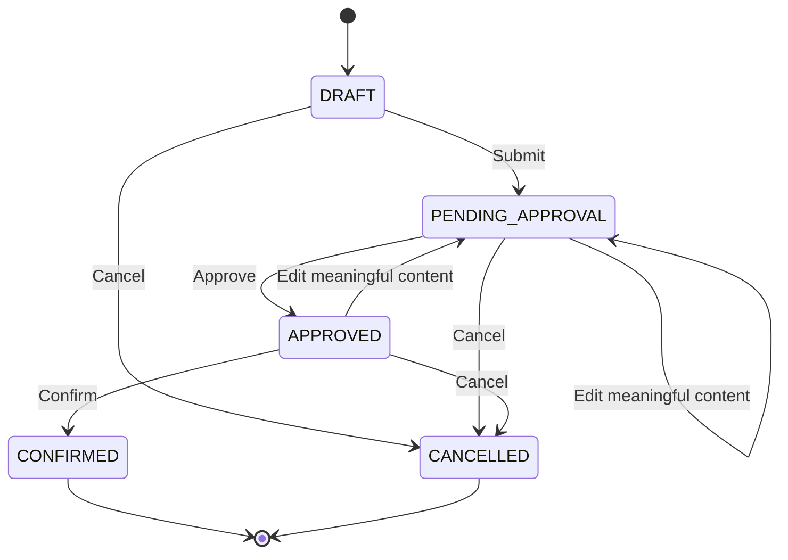

# Transition preconditions — Điều kiện trước khi chuyển trạng thái

## 1. Vì sao đúng trạng thái vẫn chưa đủ?

Trong chương **State Transitions** của module **Business Logic Security** (`SECURITY_APPLICATION_SECURITY_BUSINESS_LOGIC_SECURITY`), một trạng thái như `APPROVED` chỉ mô tả một phần sự thật. Nó chưa cho biết ai được sử dụng kết quả phê duyệt, nội dung được duyệt là phiên bản nào và quyết định đó còn hiệu lực hay không.

Giả sử quy trình mua hàng có các bước:

```text
DRAFT → PENDING_APPROVAL → APPROVED → CONFIRMED
```

Người dùng mở màn hình khi đơn đang `APPROVED`. Trước khi họ nhấn xác nhận, một người khác sửa số lượng và làm mất hiệu lực phê duyệt. Nếu máy chủ tin trạng thái đã hiển thị trên giao diện hoặc một kết quả kiểm tra cũ, đơn có thể được xác nhận trên nội dung chưa được duyệt.

Các tình huống tương tự còn xuất hiện khi:

- Người gọi có vai trò phù hợp nhưng đơn thuộc tenant hoặc phòng ban khác.
- Báo giá đã hết hạn dù đơn vẫn đang `APPROVED`.
- Người tạo đơn cố gọi thẳng API phê duyệt để tự duyệt.
- Hai yêu cầu cùng thấy một trạng thái nguồn rồi cùng tạo tác động.
- Client gửi lại một command cũ sau khi dữ liệu liên quan đã thay đổi.

**Transition precondition**, hay **điều kiện trước khi chuyển trạng thái**, là điều kiện phải đúng để một command được phép thực hiện cạnh chuyển trạng thái cụ thể. Nó thường là sự kết hợp của trạng thái nguồn, quyền trên đối tượng, nội dung nghiệp vụ, phiên bản, thời gian và dữ liệu phụ thuộc.

Mục tiêu của bài là giúp bạn viết những điều kiện đó thành một hợp đồng rõ ràng và thực thi chúng tại thời điểm quyết định có hiệu lực.

## 2. Một mô hình đơn giản để suy luận

Gọi:

- `S`: trạng thái và dữ liệu hiện hành của đối tượng.
- `C`: command, ví dụ `ApproveOrder` hoặc `ConfirmOrder`.
- `A`: chủ thể đã được xác thực cùng phạm vi quyền liên quan.
- `D`: dữ liệu phụ thuộc như hạn mức, giữ chỗ tồn kho hoặc chính sách.
- `t`: thời điểm máy chủ dùng để đánh giá hiệu lực.

Ta mô tả một bước xử lý như sau:

```text
Nếu G(S, C, A, D, t) đúng:
    tạo trạng thái mới S' và những tác động được phép
Ngược lại:
    không áp dụng chuyển trạng thái đó
```

`G` là **guard**, tức biểu thức điều kiện bảo vệ cạnh chuyển trạng thái.

Ví dụ:

```text
canConfirm(order, command, actor, decisionTime)
=
    actor có quyền xác nhận đúng order
    ∧ order.status = APPROVED
    ∧ command.expectedContentRevision = order.contentRevision
    ∧ order.approval tồn tại
    ∧ order.approvedRevision = order.contentRevision
    ∧ người duyệt khác người tạo
    ∧ decisionTime < order.quoteExpiresAt
```

Biểu thức này dựa trên một chính sách ví dụ: mọi đơn đều cần phê duyệt, không tự duyệt và phải còn hiệu lực báo giá khi chấp nhận xác nhận. Một hệ thống không sử dụng báo giá hết hạn không cần thêm điều kiện thời gian đó.

Hai câu hỏi quan trọng luôn đi cùng guard:

1. Những dữ liệu nào được sử dụng để kết luận guard đúng?
2. Điều gì ngăn các dữ liệu đó thay đổi theo cách làm quyết định mất hiệu lực trước khi cập nhật được áp dụng?

Chỉ trả lời câu thứ nhất chưa tạo được bảo đảm trước thao tác đồng thời.

## 3. Phân biệt các loại điều kiện

| Khái niệm | Ví dụ | Thời điểm có ý nghĩa |
| --- | --- | --- |
| Validation đầu vào | `orderId` không rỗng, số lượng là số nguyên dương | Khi tiếp nhận và diễn giải request |
| Điều kiện chuyển trạng thái | Đơn đang chờ duyệt và actor được duyệt đúng đơn đó | Khi quyết định chấp nhận command |
| Bất biến nghiệp vụ | Đơn đã xác nhận luôn gắn với phê duyệt đúng phiên bản nội dung | Tại các ranh giới nhất quán đã định nghĩa |
| Hậu điều kiện | Sau khi xác nhận thành công, đơn ở `CONFIRMED` và có đúng một kết quả xác nhận | Sau thao tác thành công |
| Điều kiện tiến triển | Command đã được chấp nhận cuối cùng được xử lý hoặc đưa vào luồng xử lý sự cố | Trong quá trình vận hành sau đó |

Một số quy tắc tham gia nhiều vai trò. Chẳng hạn, kiểm tra `approvedRevision = contentRevision` là guard của lệnh xác nhận; duy trì quan hệ đó trên mọi đơn đã xác nhận là một bất biến.

Không nên đưa mọi quy tắc vào một hàm validation đầu vào. Dữ liệu có thể đúng khi request đến nhưng đã khác lúc transaction thực thi, đặc biệt khi request phải chờ khóa hoặc đi qua hàng đợi.

Ngược lại, domain guard cũng không thay thế validation. Một command thiếu định danh đối tượng hoặc dữ liệu có kiểu không hợp lệ cần bị chặn trước khi được diễn giải thành hành động nghiệp vụ.

## 4. Xác định cạnh chuyển trạng thái trước khi viết điều kiện

### 4.1. Ví dụ quy trình

Bài học sử dụng một đơn mua hàng với các chính sách:

- Người tạo không được tự phê duyệt.
- Phê duyệt gắn với phiên bản nội dung hiện hành.
- Sửa nội dung ảnh hưởng quyết định duyệt sẽ tăng phiên bản và hủy hiệu lực phê duyệt.
- Xác nhận chỉ được thực hiện khi báo giá còn hiệu lực tại thời điểm chấp nhận command.
- Đơn đã xác nhận không được sửa hoặc hủy qua các command minh họa dưới đây.



Sơ đồ giúp nhìn thấy các cạnh nhưng không diễn tả đầy đủ guard. Cạnh `APPROVED → CONFIRMED` không có nghĩa là bất kỳ ai cũng được xác nhận mọi đơn có nhãn `APPROVED`.

### 4.2. Lập bảng command, guard và tác động

| Command | Trạng thái nguồn | Điều kiện bổ sung tiêu biểu | Tác động khi chấp nhận |
| --- | --- | --- | --- |
| `Submit` | `DRAFT` | Actor có quyền gửi; dữ liệu bắt buộc đã đủ; giá do máy chủ tính hợp lệ | Chuyển sang chờ duyệt |
| `Approve` | `PENDING_APPROVAL` | Actor có phạm vi và hạn mức duyệt; khác người tạo; revision được xem khớp revision hiện hành | Lưu người duyệt, revision được duyệt và chuyển sang `APPROVED` |
| `EditContent` | `DRAFT`, `PENDING_APPROVAL`, `APPROVED` | Actor có quyền sửa; nội dung mới hợp lệ | Tăng revision; xóa hiệu lực duyệt; nếu đang approved thì về chờ duyệt |
| `Confirm` | `APPROVED` | Actor có quyền xác nhận; phê duyệt đúng revision; báo giá còn hiệu lực | Chuyển sang `CONFIRMED`; ghi kết quả nghiệp vụ và outbox nếu cần |
| `Cancel` | `DRAFT`, `PENDING_APPROVAL`, `APPROVED` | Actor có quyền hủy; chưa phát sinh nghĩa vụ không thể hủy theo chính sách | Chuyển sang `CANCELLED` và xử lý dữ liệu liên quan theo thiết kế |

Một command có thể đi từ một trạng thái về chính nó nhưng vẫn thay đổi nghiệp vụ. Ví dụ sửa đơn đang chờ duyệt không đổi nhãn trạng thái, nhưng bắt buộc tăng revision. Vì vậy chỉ kiểm soát sự thay đổi của cột `status` là chưa đủ.

Không nên cung cấp API tổng quát cho client đặt `status` tùy ý rồi hy vọng client chọn đúng đường đi. Các command có tên nghiệp vụ giúp máy chủ kiểm soát điều kiện và tác động của từng cạnh.

## 5. Các nhóm điều kiện thường phải xem xét

### 5.1. Danh tính, tenant và quyền trên đối tượng

Một vai trò như `APPROVER` thường chỉ cho biết khả năng tổng quát. Quyền duyệt một đơn cụ thể còn có thể phụ thuộc vào tenant, phòng ban, chủ sở hữu, hạn mức và quan hệ giữa actor với đơn.

```text
actor có vai trò duyệt
≠
actor được duyệt orderId đang được yêu cầu
```

Lấy tenant từ ngữ cảnh đã được xác thực và kiểm tra quyền. Nếu cho phép người dùng lựa chọn tenant, việc lựa chọn đó cũng phải được xác thực; không được tin trực tiếp `tenantId` trong body.

Nên tải đối tượng theo phạm vi, ví dụ `(tenantId, orderId)`, rồi đánh giá quyền trên dữ liệu vừa tải. Không được nhận một cờ `authorized = true` từ client để thay thế bước này.

### 5.2. Trạng thái nguồn

Cần xác định tập trạng thái được phép cho từng command, không chỉ các trạng thái bị cấm.

```text
Được phép: Confirm khi status = APPROVED

Dễ thiếu sót: Confirm khi status khác CANCELLED
```

Điều kiện thứ hai có thể vô tình cho phép `DRAFT`, `PENDING_APPROVAL` hoặc một trạng thái mới được thêm sau này.

### 5.3. Nội dung và bằng chứng nghiệp vụ

Tùy command, guard có thể cần kiểm tra:

- Dữ liệu bắt buộc đã đầy đủ.
- Giá và tổng được tính từ nguồn mà máy chủ chấp nhận.
- Phê duyệt thuộc đúng đơn và phiên bản nội dung.
- Định danh người nhận, tài khoản hoặc địa chỉ quan trọng chưa thay đổi sau duyệt.
- Không tồn tại nghĩa vụ nghiệp vụ khiến thao tác bị cấm.

Đừng chỉ kiểm tra `approval != null`. Bằng chứng tồn tại nhưng gắn với phiên bản cũ không cho phép chuyển trạng thái.

### 5.4. Phiên bản và ý định của người dùng

`expectedContentRevision` cho biết người dùng đang thao tác trên nội dung nào. Khi dữ liệu đã thay đổi, hệ thống cần từ chối hoặc yêu cầu đọc lại theo hợp đồng.

Phiên bản do client gửi là một **điều kiện mong đợi**, không phải giá trị có thẩm quyền để thay thế phiên bản hiện hành. Máy chủ phải so sánh với dữ liệu được lưu và bảo vệ phép so sánh đó trước cạnh tranh.

Cũng cần phân biệt:

| Phiên bản | Mục đích |
| --- | --- |
| `contentRevision` | Ràng buộc quyết định nghiệp vụ với nội dung đã xem hoặc đã duyệt |
| `rowVersion` | Phát hiện một bản ghi đã bị cập nhật kể từ lần đọc |

Nếu chỉ sửa ghi chú nội bộ, nghiệp vụ có thể tăng `rowVersion` nhưng giữ `contentRevision`. Nếu sửa giá trị đơn, thường cần tăng cả hai theo thiết kế.

### 5.5. Thời gian và hiệu lực

Một guard thời gian phải trả lời được “trước thời điểm nào?” và “đồng hồ nào quyết định?”.

Ví dụ chính sách của bài:

```text
decisionTime < quoteExpiresAt
```

Tại đúng `quoteExpiresAt`, báo giá không còn hợp lệ. `decisionTime` do máy chủ tin cậy xác định, không lấy từ timestamp tùy ý của client.

Phải phân biệt thời điểm request đến, thời điểm lấy được khóa, thời điểm quyết định được chấp nhận và thời điểm commit. Nếu hệ thống cho phép chấp nhận trước hạn rồi commit sau hạn, tài liệu cần nói rõ điều đó. Nếu yêu cầu khác, cơ chế thực thi cũng phải khác.

Trong một số cơ sở dữ liệu, hàm lấy thời gian có thể cố định theo đầu transaction hoặc đầu statement. Không nên mặc nhiên dùng một giá trị được lấy trước khi chờ khóa dài để chứng minh rằng báo giá còn hiệu lực sau khi chờ. Hãy chọn ngữ nghĩa thời gian phù hợp và kiểm thử tình huống sát hạn.

### 5.6. Dữ liệu phụ thuộc

Nếu xác nhận đơn cần giữ được hạn mức, điều kiện “đang còn hạn mức” chỉ là một phần. Thao tác xác nhận phải chiếm hoặc giữ chỗ phần hạn mức tương ứng bằng một cơ chế nhất quán.

```text
Kiểm tra còn 10 đơn vị hạn mức
→ hai request cùng vượt qua
→ mỗi request sử dụng 8
→ tổng sử dụng vượt hạn mức
```

Guard phụ thuộc nhiều đối tượng cần một điểm phối hợp phù hợp: bản ghi ngân sách chung, reservation, cập nhật có điều kiện, mức cô lập thích hợp hoặc một quy trình bất đồng bộ được mô hình hóa rõ.

## 6. Viết guard rõ ràng trong Java

Đoạn mã sau tách phần đánh giá điều kiện của `Confirm` để dễ đọc. Nó không ghi cơ sở dữ liệu và không tự tạo transaction.

`AuthorizedConfirmation` là ngữ cảnh do thành phần tin cậy tạo **sau khi đã kiểm tra quyền theo đối tượng**. Client không được gửi một object như vậy để tự khai quyền.

```java
import java.time.Instant;
import java.util.Objects;

final class ConfirmationGuard {
    enum Status {
        DRAFT, PENDING_APPROVAL, APPROVED, CONFIRMED, CANCELLED
    }

    record OrderSnapshot(
            String tenantId,
            String orderId,
            String createdBy,
            Status status,
            long contentRevision,
            Long approvedRevision,
            String approvedBy,
            Instant quoteExpiresAt) {
        OrderSnapshot {
            Objects.requireNonNull(tenantId);
            Objects.requireNonNull(orderId);
            Objects.requireNonNull(createdBy);
            Objects.requireNonNull(status);
            Objects.requireNonNull(quoteExpiresAt);
            if (contentRevision <= 0) {
                throw new IllegalArgumentException("INVALID_REVISION");
            }
        }
    }

    record ConfirmCommand(long expectedContentRevision) {}

    // Chỉ tạo từ kết quả authorization ở phía máy chủ.
    record AuthorizedConfirmation(
            String tenantId,
            String orderId,
            String actorId,
            Instant decisionTime) {
        AuthorizedConfirmation {
            Objects.requireNonNull(tenantId);
            Objects.requireNonNull(orderId);
            Objects.requireNonNull(actorId);
            Objects.requireNonNull(decisionTime);
        }
    }

    static void requireAllowed(
            OrderSnapshot order,
            ConfirmCommand command,
            AuthorizedConfirmation authorization) {
        Objects.requireNonNull(order);
        Objects.requireNonNull(command);
        Objects.requireNonNull(authorization);

        if (!order.tenantId().equals(authorization.tenantId())
                || !order.orderId().equals(authorization.orderId())) {
            throw new IllegalStateException("WRONG_AUTHORIZATION_SCOPE");
        }
        if (order.status() != Status.APPROVED) {
            throw new IllegalStateException("INVALID_SOURCE_STATE");
        }
        if (command.expectedContentRevision()
                != order.contentRevision()) {
            throw new IllegalStateException("CONTENT_CHANGED");
        }
        if (order.approvedRevision() == null
                || order.approvedRevision().longValue()
                    != order.contentRevision()
                || order.approvedBy() == null) {
            throw new IllegalStateException("APPROVAL_NOT_CURRENT");
        }
        if (order.createdBy().equals(order.approvedBy())) {
            throw new IllegalStateException("SELF_APPROVAL_FORBIDDEN");
        }
        if (!authorization.decisionTime()
                .isBefore(order.quoteExpiresAt())) {
            throw new IllegalStateException("QUOTE_EXPIRED");
        }
    }
}
```

Các lựa chọn trong ví dụ có chủ đích:

- Kiểm tra scope của kết quả authorization trước khi sử dụng nó cho đối tượng.
- `approvedRevision` có thể thiếu; phải kiểm tra null trước khi so sánh giá trị.
- So sánh giá trị revision, không dựa vào đồng nhất tham chiếu của object `Long`.
- Thời điểm hết hạn được xử lý rõ bằng `isBefore`; trường hợp bằng nhau bị từ chối.
- Không lấy giá, trạng thái mới hoặc bằng chứng duyệt từ command của client.

Tuy nhiên, kiểu dữ liệu có tên “Authorized” không tự thực thi phân quyền. Nếu tầng API có thể bind nó từ request, hoặc tầng ứng dụng tạo nó mà không gọi policy thích hợp, guard sẽ tin một tiền đề sai.

Tương tự, snapshot chỉ phản ánh thời điểm được đọc. Gọi `requireAllowed` rồi ghi trạng thái sau đó bằng một câu `UPDATE` không có khóa hoặc điều kiện phiên bản vẫn có thể tạo lỗi cạnh tranh.

Trong ứng dụng hoàn chỉnh, có thể đặt guard ngay trong domain method thực hiện chuyển trạng thái để giảm nguy cơ quên gọi. Dù tổ chức code thế nào, mọi đường ghi đều cần cùng bảo đảm.

## 7. Gắn kiểm tra và thay đổi trạng thái thành một quyết định nhất quán

### 7.1. Mẫu sai: kiểm tra xong mới bắt đầu bảo vệ

```text
order = load(orderId)
requireAllowed(order)

BEGIN
    update status = CONFIRMED
COMMIT
```

Transaction chỉ bao quanh lệnh ghi. Một thao tác khác có thể thay đổi dữ liệu giữa lần đọc và lần ghi.

Ngay cả khi chuyển lần đọc vào transaction, mức cô lập thông thường cũng không mặc nhiên ngăn mọi lịch xen kẽ. Cần chọn cơ chế cụ thể theo dữ liệu mà guard phụ thuộc.

### 7.2. Lịch xen kẽ làm guard trở thành lỗi thời

| Thời điểm | A: xác nhận | B: sửa nội dung |
| --- | --- | --- |
| 1 | Đọc trạng thái approved, revision 4 | |
| 2 | Guard đạt trên revision 4 | |
| 3 | | Sửa nội dung, tăng revision lên 5 |
| 4 | | Hủy hiệu lực duyệt và commit |
| 5 | Ghi status confirmed mà không kiểm tra lại | |

Tại bước 5, kết quả kiểm tra ở bước 2 không còn áp dụng được. Đây là lỗi **time of check to time of use**, thường viết tắt là **TOCTOU**.

Cách sửa phải bảo vệ dữ liệu từ lúc đánh giá đến lúc áp dụng hoặc phát hiện chắc chắn rằng dữ liệu đã đổi và từ chối ghi.

### 7.3. Cách tiếp cận A: khóa và kiểm tra trong transaction

Một luồng minh họa:

```text
BEGIN

1. Tải đơn theo (tenantId, orderId), khóa bản ghi gốc.
2. Đọc các dữ liệu phụ thuộc theo cơ chế nhất quán đã chọn.
3. Kiểm tra quyền trên đối tượng và nội dung hiện hành.
4. Lấy decisionTime theo chính sách thời gian.
5. Đánh giá guard.
6. Chuyển trạng thái, ghi kết quả nghiệp vụ và outbox nếu cần.

COMMIT
```

Trong cơ sở dữ liệu hỗ trợ, bước 1 có thể sử dụng `SELECT ... FOR UPDATE`. Điểm quan trọng là **tất cả đường sửa nội dung hoặc phê duyệt phải tuân theo cùng giao thức phối hợp**.

Nếu transaction B được phép sửa dòng hàng trực tiếp mà không khóa bản ghi đơn, việc A khóa bản ghi đơn chưa đủ. Nếu quyền duyệt hoặc hạn mức có thể đổi độc lập, cũng cần đưa chúng vào lập luận về ranh giới nhất quán.

Không giữ transaction mở trong lúc chờ người dùng bấm nút hoặc chờ một thao tác mạng dài. Người dùng gửi command cùng phiên bản họ đã xem; máy chủ mở transaction ngắn để đọc lại, kiểm tra và áp dụng.

### 7.4. Cách tiếp cận B: cập nhật có điều kiện và kiểm soát phiên bản

Nếu dữ liệu quan trọng được biểu diễn trên bản ghi đơn, có thể đưa một phần guard vào chính câu lệnh ghi:

```sql
UPDATE purchase_order
SET status = 'CONFIRMED',
    confirmed_by = :actor_id,
    confirmed_at = :decision_time,
    row_version = row_version + 1
WHERE tenant_id = :tenant_id
  AND id = :order_id
  AND row_version = :expected_row_version
  AND content_revision = :expected_content_revision
  AND status = 'APPROVED'
  AND approved_revision = content_revision
  AND approved_by IS NOT NULL
  AND approved_by <> created_by
  AND quote_expires_at > :decision_time;
```

Các tham số danh tính, tenant và `decision_time` phải được lấy hoặc xác thực tại máy chủ. Lệnh SQL minh họa phần điều kiện trên bản ghi; quyền theo đối tượng vẫn cần được thực thi bằng cơ chế authorization phù hợp.

Kết quả được xử lý như sau:

- **Một dòng được cập nhật:** phần guard được mã hóa trong câu lệnh đã đạt tại thời điểm áp dụng theo cơ chế của cơ sở dữ liệu.
- **Không dòng nào được cập nhật:** không được trả thành công như thể chuyển trạng thái đã xảy ra.

Kết quả 0 có thể do sai scope, không tồn tại đối tượng, hết hạn, trạng thái không phù hợp hoặc xung đột phiên bản. Không nên suy ra một nguyên nhân duy nhất chỉ từ số dòng.

Nếu cần phân loại lỗi, có thể đọc lại trong phạm vi quyền được phép để tạo phản hồi phù hợp. Lần đọc giải thích lỗi không được biến thành một lệnh cập nhật vô điều kiện tiếp theo.

Cần bảo đảm mọi đường cập nhật liên quan đều tham gia cơ chế version, và dữ liệu ngoài bản ghi đơn không bị bỏ qua. Với optimistic locking, retry phải đọc lại dữ liệu và đánh giá lại guard.

### 7.5. Không bỏ qua guard để làm retry thành công

Giả sử lệnh approve dùng revision 4 bị xung đột vì đơn đã sang revision 5. Hệ thống không được tự đổi expected revision thành 5 rồi duyệt tiếp thay người dùng.

Người duyệt đã bày tỏ ý định đối với nội dung revision 4. Tự động chuyển ý định sang nội dung khác có thể biến xử lý xung đột thành lỗ hổng nghiệp vụ.

Có thể tự động retry những lỗi kỹ thuật mà vẫn giữ nguyên ý nghĩa command, nhưng sau khi đọc lại, mọi điều kiện nghiệp vụ phải còn đúng. Nếu thay đổi làm mất ý nghĩa quyết định ban đầu, cần trả xung đột và yêu cầu người dùng xem lại.

## 8. Guard phụ thuộc quyền và dữ liệu bên ngoài

### 8.1. Quyền thay đổi khi command đang chờ

Xét người dùng còn quyền lúc gửi request nhưng bị thu hồi trước khi worker xử lý.

Cần chọn một chính sách:

| Chính sách | Điều cần thực thi |
| --- | --- |
| Quyền phải còn hiệu lực khi thực thi | Worker kiểm tra lại quyền trên dữ liệu hiện hành trước khi áp dụng |
| Quyền tại thời điểm chấp nhận tạo ra một ủy quyền có hiệu lực riêng | Bằng chứng ủy quyền phải được máy chủ tạo, giới hạn scope và thời hạn; quy tắc thu hồi phải được định nghĩa |

Không được vô tình chọn chính sách thứ hai chỉ vì đã kiểm tra quyền ở API rồi đưa request vào queue.

Nếu yêu cầu “thu hồi quyền ngăn mọi quyết định xảy ra sau đó” là nghiêm ngặt, việc đọc quyền từ cache hoặc từ một dịch vụ khác có độ trễ cần được đánh giá. Có thể cần version chính sách, cơ chế khóa hoặc giao thức ủy quyền; khóa bản ghi đơn không tự khóa được trạng thái quyền trong hệ thống khác.

### 8.2. Kiểm tra còn tài nguyên khác với giữ được tài nguyên

Giả sử guard của confirm yêu cầu đủ hàng và đủ hạn mức. Việc gọi API tồn kho trả về `available = 1` không làm một đơn vị đó thuộc về đơn đang xác nhận.

Một thiết kế phù hợp có thể là:

```text
APPROVED
    → CONFIRMATION_PENDING
    → yêu cầu giữ chỗ bằng định danh ổn định
    → nhận kết quả giữ chỗ hợp lệ
    → CONFIRMED

Nếu không giữ được:
    → CONFIRMATION_REJECTED hoặc trạng thái nghiệp vụ phù hợp
```

Tên trạng thái cần phản ánh sự thật mà hệ thống đã biết. Nếu chưa có bảo đảm về tài nguyên, không nên dùng `CONFIRMED` với ý nghĩa “đã chắc chắn có tài nguyên”.

Guard của bước cuối phải kiểm tra bằng chứng giữ chỗ thuộc đúng đơn, đúng phiên bản hoặc nội dung cần thiết, đủ số lượng và còn hiệu lực theo hợp đồng.

### 8.3. Timeout không chứng minh điều kiện đã thất bại

Nếu một dịch vụ giữ chỗ bị timeout, có thể yêu cầu đã được thực hiện nhưng phản hồi bị mất. Gửi lại với một định danh mới có thể giữ chỗ hai lần.

Cần kết hợp định danh nghiệp vụ ổn định, idempotency của bên tích hợp nếu có, tra cứu kết quả và đối soát. Nếu phải bù trừ, thao tác bù trừ cũng cần điều kiện chuyển trạng thái và khả năng xử lý lặp.

Outbox giúp ghi nhận ý định phát lệnh cùng transaction nội bộ. Nó không tự làm cho điều kiện trên tài nguyên từ xa trở thành một phần nguyên tử của transaction đó.

## 9. Retry và idempotency cần đi cùng guard

### 9.1. Hai vấn đề khác nhau

Guard trả lời:

> Command này có được phép tạo ra chuyển trạng thái mới trong ngữ cảnh hiện hành không?

Idempotency trả lời:

> Lần gửi này có phải cùng một command logic đã được xử lý trước đó không?

Hai cơ chế không thay thế nhau.

- Nếu client dùng khóa mới để xác nhận một đơn đã xác nhận, guard và tính duy nhất nghiệp vụ phải ngăn tác động lần hai.
- Nếu client dùng lại đúng khóa sau một lần thành công nhưng mất phản hồi, hệ thống nên xử lý theo hợp đồng idempotency thay vì chạy lại command.
- Nếu cùng khóa nhưng payload khác, đó là xung đột sử dụng khóa, không phải yêu cầu replay hợp lệ.

### 9.2. Không đánh giá replay như một lần chuyển trạng thái mới

Ví dụ:

```text
Request 1:
    idempotencyKey = K
    APPROVED → CONFIRMED
    commit thành công
    phản hồi bị mất

Request 2:
    cùng K, cùng command
    trạng thái hiện tại đã là CONFIRMED
```

Nếu luôn chạy guard “nguồn phải là APPROVED” trước khi nhận diện kết quả đã hoàn thành của K, request thứ hai sẽ bị từ chối dù nó chỉ đang hỏi lại kết quả command đầu tiên.

Một thứ tự xử lý hợp lý là:

1. Xác thực danh tính và xác định scope tin cậy.
2. Tìm hoặc giành quyền xử lý khóa trong phạm vi đã định nghĩa, có cơ chế chống hai request cùng sở hữu khóa.
3. Nếu đã có kết quả commit của cùng command, kiểm tra quyền xem kết quả và trả lại theo hợp đồng.
4. Nếu là command mới, tải dữ liệu được bảo vệ, kiểm tra quyền thực thi và đánh giá guard.
5. Lưu tác động nghiệp vụ và kết quả idempotency nhất quán trong transaction phù hợp.

Không được trả kết quả chỉ vì người gọi biết một khóa. Phạm vi có thể bao gồm tenant, actor và loại thao tác; dấu vân tay command phải bao gồm orderId và các tham số có ý nghĩa.

Với hai request cùng khóa chạy đồng thời, tính duy nhất của khóa và cơ chế chờ hoặc xử lý trạng thái đang chạy phải rõ ràng. Một lần `SELECT` không thấy khóa không đủ chứng minh request được độc quyền thực thi.

### 9.3. Lặp trạng thái không có nghĩa tác động idempotent

Một handler có thể luôn gán `status = CONFIRMED`, nhưng mỗi lần gán lại gửi thêm email, tạo thêm bản ghi nghiệp vụ hoặc phát thêm yêu cầu ra ngoài.

Vì vậy:

```text
Gán cùng một giá trị trạng thái nhiều lần
≠
Toàn bộ thao tác có thể lặp mà không tạo tác động mới
```

Hãy xác định tính duy nhất theo nghiệp vụ, chẳng hạn một kết quả xác nhận trên mỗi đơn trong mô hình chỉ xác nhận một lần. Nếu có bảng confirmation riêng, ràng buộc duy nhất theo `(tenant_id, order_id)` có thể là một phần cơ chế.

Các sự kiện phát ra cũng cần định danh ổn định và consumer cần xử lý lặp phù hợp. Chỉ kiểm tra trạng thái cuối mà không kiểm tra những tác động liên quan dễ bỏ sót vi phạm.

## 10. Command qua hàng đợi phải được kiểm tra lại khi thực thi

Một command đi qua queue có thể chờ lâu. Trong thời gian đó:

- Đơn bị hủy.
- Nội dung thay đổi.
- Người gửi bị thu hồi quyền.
- Báo giá hoặc reservation hết hạn.
- Một command khác đã hoàn thành cùng nghiệp vụ.

Kiểm tra tại API có thể hữu ích để từ chối sớm, nhưng worker vẫn cần đánh giá các điều kiện thực thi theo chính sách đã chọn.

Một message command nên mang những dữ liệu như:

```text
commandId
tenantId đã được xác thực ở nguồn
targetId
actorId hoặc bằng chứng ủy quyền theo thiết kế
expectedContentRevision
payload nghiệp vụ được phép
```

Định danh tenant và actor trong message phải được bảo vệ bởi ranh giới tin cậy của hệ thống phát, nhận và vận chuyển message. Sự hiện diện của các trường này không tự chứng minh chúng đúng.

Cũng cần phân biệt **command** với **event**:

- Command là yêu cầu thực hiện; nó có thể bị từ chối vì guard không đạt.
- Event mô tả một sự kiện đã xảy ra trong hệ thống nguồn. Consumer cần kiểm tra tính hợp lệ của message, thứ tự hoặc phiên bản cần thiết, cùng quy tắc cập nhật mô hình cục bộ; không tùy tiện phủ nhận sự kiện lịch sử chỉ vì quyền hiện tại của actor đã thay đổi.

Nếu sự kiện đến khiến consumer phát sinh một hành động nghiệp vụ mới, hành động mới đó vẫn có guard riêng. Ví dụ nhận `OrderApproved` không có nghĩa là được gửi tiền ngay nếu bước thực hiện còn phụ thuộc hiệu lực reservation hoặc một trạng thái khác.

## 11. Trả lỗi và quan sát việc từ chối

### 11.1. Phân loại lỗi theo điều gì cần làm tiếp

| Nhóm | Ví dụ | Hành vi xử lý phù hợp |
| --- | --- | --- |
| Dữ liệu request không hợp lệ | Thiếu revision, số lượng ngoài miền cho phép | Sửa request |
| Không đủ quyền hoặc ngoài scope | Actor không được thao tác trên đơn | Không thực hiện; phản hồi theo chính sách tránh lộ dữ liệu |
| Trạng thái nguồn không phù hợp | Confirm khi đang chờ duyệt | Đọc lại quy trình và trạng thái hiện hành nếu được phép |
| Nội dung đã đổi | Expected revision khác hiện hành | Đọc lại nội dung trước khi quyết định |
| Điều kiện hết hiệu lực | Báo giá đã hết hạn | Lấy báo giá mới và chạy lại quy trình cần thiết |
| Xung đột kỹ thuật | Deadlock hoặc tranh chấp phiên bản | Retry có giới hạn khi vẫn giữ nguyên ý nghĩa command |
| Kết quả tích hợp chưa xác định | Timeout sau khi gửi lệnh ra ngoài | Tra cứu hoặc đối soát theo định danh ổn định |

Mã HTTP và cấu trúc lỗi là hợp đồng API cần thiết kế riêng. Không nên trả mọi lỗi thành “thử lại”, vì client có thể lặp một hành động không còn hợp lệ.

Phân biệt lỗi nội bộ chi tiết với thông tin được phép trả cho người gọi. Nếu actor không có quyền biết một đơn tồn tại, phản hồi không nên tiết lộ trạng thái, người duyệt hoặc giá trị của đơn đó.

### 11.2. Khi guard không đạt, điều gì được phép thay đổi?

Thông thường, không áp dụng chuyển trạng thái và không tạo tác động nghiệp vụ của command bị từ chối. Tuy nhiên, hệ thống vẫn có thể ghi audit hoặc metric về lần thử.

Nếu nghiệp vụ muốn chuyển một đơn hết hạn sang trạng thái `EXPIRED`, hãy xác định đó là hành động nào và điều kiện của nó. Không nên để một hàm guard tưởng như chỉ kiểm tra lại âm thầm thực hiện cập nhật một phần.

Với lỗi phát sinh sau khi một số câu lệnh đã chạy nhưng trước commit, transaction phải rollback những thay đổi thuộc cùng quyết định. Audit hoặc hệ thống ngoài nằm ở ranh giới khác cần được thiết kế riêng.

### 11.3. Dữ liệu quan sát hữu ích

Theo phạm vi thông tin được phép lưu, có thể ghi:

- Command và đối tượng mục tiêu.
- Tenant, actor và correlation ID.
- Trạng thái, revision dùng để quyết định.
- Mã điều kiện bị từ chối.
- Phiên bản chính sách nếu cần tái dựng quyết định.
- Định danh command hoặc khóa liên quan ở dạng phù hợp với yêu cầu bảo vệ dữ liệu.

Không ghi token, bí mật hoặc toàn bộ payload nhạy cảm chỉ để phục vụ debug. Audit là bằng chứng hỗ trợ điều tra; nó không thay thế cơ chế ngăn chuyển trạng thái sai.

## 12. Kiểm thử guard theo cả giá trị và lịch thực thi

### 12.1. Ma trận kiểm thử tối thiểu cho ví dụ

| Tình huống | Kết quả cần chứng minh |
| --- | --- |
| Đúng quyền, approved, đúng revision, còn hạn | Xác nhận thành công và tạo đúng tác động |
| Trạng thái draft hoặc pending | Không bỏ qua phê duyệt |
| Actor thuộc tenant khác | Không thay đổi đơn và không lộ dữ liệu ngoài quyền |
| Actor có vai trò nhưng ngoài phạm vi đối tượng | Bị từ chối dù role phù hợp |
| Người tạo cố tự duyệt | Không tạo phê duyệt hợp lệ |
| Thiếu approval hoặc approved revision cũ | Không xác nhận |
| Expected revision cũ | Không tự động chấp nhận nội dung mới |
| Đổi giá, dòng hàng hoặc dữ liệu quan trọng sau duyệt | Tăng revision, hủy hiệu lực duyệt và chặn xác nhận cũ |
| Thời điểm quyết định trước hạn | Được qua điều kiện thời gian nếu các điều kiện khác đạt |
| Thời điểm đúng bằng hạn hoặc sau hạn | Bị chặn theo chính sách của bài |
| Hai command xác nhận cùng chạy | Không tạo hai kết quả nghiệp vụ |
| Sửa nội dung chạy đồng thời với xác nhận | Không commit một đơn confirmed gắn với phê duyệt sai revision |
| Mất phản hồi sau commit rồi retry cùng khóa | Trả kết quả theo hợp đồng idempotency, không tạo tác động mới |
| Cùng khóa nhưng khác orderId hoặc payload | Từ chối việc sử dụng khóa không nhất quán |
| Khác khóa nhưng cùng xác nhận một đơn | State machine và tính duy nhất vẫn ngăn lặp |
| Command chờ trong queue đến khi bị hủy hoặc hết hạn | Worker không dùng lại kết quả kiểm tra lỗi thời ở API |
| Đã ghi một phần rồi gặp lỗi trước commit | Không để lại kết quả chuyển trạng thái dở dang |

### 12.2. Kiểm thử từng điều kiện độc lập

Tạo một mẫu dữ liệu thỏa toàn bộ guard, sau đó lần lượt làm sai từng điều kiện:

```text
Mẫu hợp lệ
    → đổi tenant
    → đổi trạng thái nguồn
    → bỏ approval
    → đổi approvedRevision
    → đổi expectedContentRevision
    → đặt người duyệt bằng người tạo
    → đặt decisionTime bằng thời điểm hết hạn
```

Các trường hợp phải xuất phát độc lập từ mẫu hợp lệ, tránh để một lỗi xảy ra sớm che mất điều kiện đang muốn kiểm tra. Khi cần kiểm tra thứ tự phân quyền và tránh lộ dữ liệu, có thể tạo thêm trường hợp nhiều điều kiện cùng sai.

Đối với thời gian, truyền một thời điểm hoặc clock kiểm soát được thay vì phụ thuộc đồng hồ thực của máy chạy test. Cần có kiểm thử riêng cho chính sách lấy thời gian sau thời gian chờ khóa nếu đây là ranh giới quan trọng.

### 12.3. Kiểm thử cạnh tranh trên cơ sở dữ liệu phù hợp

Unit test guard không chứng minh được transaction đúng. Mock repository thường không mô phỏng cách khóa hoặc xung đột version của cơ sở dữ liệu thật.

Kiểm thử tích hợp nên chủ động điều khiển lịch bằng barrier hoặc latch:

```text
1. Chuẩn bị đơn approved ở revision 4.
2. Cho luồng A và B vào các điểm đồng bộ đã định.
3. A xác nhận; B sửa nội dung hoặc cùng xác nhận.
4. Cho phép chúng tiếp tục theo lịch cần kiểm chứng.
5. Chờ transaction kết thúc.
6. Đọc lại trạng thái và các tác động đã commit.
```

Kết quả hợp lệ có thể khác nhau tùy luồng nào giành quyền trước. Điều cần kiểm tra là mọi trạng thái đã commit đều giữ bất biến, và luồng không được chấp nhận không tạo thêm tác động.

Với mô hình của bài, nếu xác nhận thắng trước, thao tác sửa sau đó phải bị từ chối vì đơn đã confirmed. Nếu sửa thắng trước, xác nhận dùng phê duyệt cũ phải bị chặn.

Đừng chỉ kiểm tra response. Hãy đọc lại trạng thái, revision, bằng chứng duyệt, số kết quả xác nhận và outbox liên quan. Một handler trả lỗi sau khi commit có thể vẫn tạo tác động; một handler trả thành công nhưng cập nhật 0 dòng có thể chưa thực hiện gì.

## 13. Những cách cài đặt dễ làm guard mất tác dụng

| Cách làm | Vấn đề |
| --- | --- |
| Ẩn nút trên UI nhưng API không kiểm tra | Người gọi có thể đi thẳng đến API |
| Nhận `newStatus`, `approvedBy` hoặc `authorized` từ client | Client tự quyết định kết quả mà máy chủ phải kiểm soát |
| Chỉ kiểm tra “không cancelled” | Các trạng thái chưa được xét cũng có thể đi qua |
| Chỉ kiểm tra role | Bỏ qua tenant, đối tượng, hạn mức và quan hệ actor |
| Đọc guard từ cache rồi ghi dữ liệu hiện hành vô điều kiện | Quyết định dựa trên dữ liệu có thể đã lỗi thời |
| Có transaction nhưng thiếu cơ chế phối hợp đúng | Hai transaction vẫn có thể cùng vượt qua guard |
| Dùng khóa trên bản ghi đơn nhưng cho phép sửa dòng hàng ngoài quy ước | Dữ liệu dùng để duyệt thay đổi dù bản ghi gốc đang bị khóa |
| Bỏ qua số dòng cập nhật hoặc lỗi optimistic locking | Báo thành công khi điều kiện không đạt hoặc ghi không được áp dụng |
| Retry bằng cách thay expected revision thành giá trị mới | Tự đổi nội dung mà người dùng đã đồng ý |
| Kiểm tra ở API rồi worker luôn thực hiện | Bỏ qua thay đổi trạng thái, quyền và thời gian trong queue |
| Gọi dịch vụ ngoài trước khi quyết định guard cuối cùng | Tạo tác động không thể rollback dù command bị từ chối |
| Dùng audit để thay cho chặn chuyển trạng thái | Chỉ phát hiện sau khi vi phạm đã xảy ra |

## 14. Mẫu đặc tả có thể áp dụng cho một command mới

Khi thêm một command, hãy mô tả đủ các mục sau trước khi nối vào API hoặc worker:

| Mục | Ví dụ cho Confirm |
| --- | --- |
| Ý định | Chốt đơn đã được duyệt để bắt đầu nghĩa vụ tiếp theo |
| Trạng thái nguồn | Chỉ `APPROVED` |
| Scope | Đúng tenant và orderId |
| Quyền | Actor được xác nhận đúng đơn theo chính sách hiện hành |
| Nội dung | Revision người dùng kỳ vọng bằng revision hiện tại |
| Bằng chứng | Phê duyệt hiện hành, đúng revision, người duyệt khác người tạo |
| Thời gian | Chấp nhận trước thời điểm hết hạn báo giá theo đồng hồ và ranh giới đã chọn |
| Phụ thuộc | Những tài nguyên bắt buộc đã được giữ chỗ hoặc được bảo vệ bởi cơ chế phù hợp |
| Cơ chế nguyên tử | Khóa hoặc cập nhật có điều kiện, kèm transaction cho các ghi cục bộ liên quan |
| Hậu điều kiện | Đơn confirmed và các bản ghi nghiệp vụ cục bộ nhất quán |
| Retry | Có nhận diện command cũ; không phát sinh tác động mới cho replay hợp lệ |
| Khi từ chối | Không áp dụng tác động của command; trả lỗi và ghi nhận theo chính sách |
| Bằng chứng kiểm thử | Từng guard sai, sát hạn, sai quyền, xung đột revision và lịch chạy đồng thời |

Một guard tốt không chỉ là danh sách `if`. Nó là phần có thể kiểm chứng của hợp đồng chuyển trạng thái: dữ liệu nào được tin, điều kiện nào phải đúng, tại thời điểm nào và cơ chế nào giữ cho kết luận đó còn giá trị khi thay đổi được commit.
