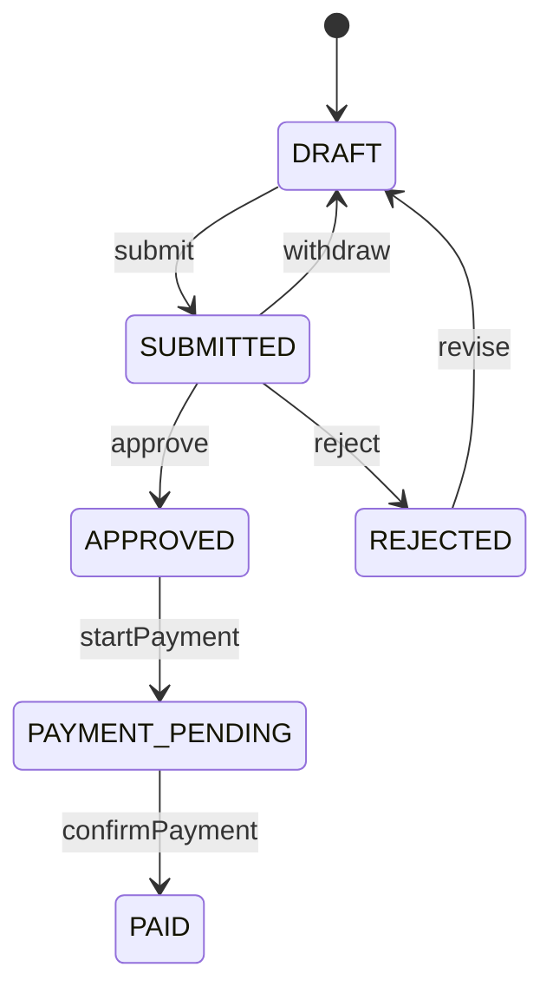

# Transition authorization: phân quyền cho từng chuyển trạng thái

## 1. Vấn đề cần giải quyết

Một yêu cầu hoàn ứng đang ở trạng thái `SUBMITTED`. Người tạo yêu cầu được xem hồ sơ, người quản lý được duyệt trong phạm vi phụ trách, còn bộ phận tài chính được khởi tạo chi trả sau khi hồ sơ đã được duyệt. Cả ba có thể truy cập cùng một đối tượng nhưng không có quyền thực hiện cùng một hành động.

Nếu API chỉ kiểm tra “đã đăng nhập”, “có quyền sửa hồ sơ” hoặc “trạng thái đích hợp lệ”, người tạo có thể tự đưa yêu cầu sang `APPROVED`, người quản lý có thể duyệt yêu cầu ngoài phạm vi, hoặc nhân viên tài chính có thể bỏ qua bước duyệt để chi trả.

**Transition authorization** là việc quyết định một chủ thể có được thực hiện một hành động làm thay đổi trạng thái của một đối tượng cụ thể, từ trạng thái hiện tại, trong ngữ cảnh hiện tại hay không. Quyết định này phải được thực thi ở phía máy chủ, trên dữ liệu có thẩm quyền và gắn với thao tác cập nhật.

Trong phạm vi bảo vệ logic nghiệp vụ, mục tiêu không dừng ở việc chặn một endpoint. Mục tiêu là giữ các bất biến như “không tự duyệt”, “chỉ người phụ trách được duyệt”, “số tiền được chi phải là số tiền đã được duyệt” và “một hồ sơ không được thanh toán hai lần”, bất kể người dùng gọi API theo thứ tự nào hoặc gửi bao nhiêu yêu cầu đồng thời.

Sau bài này, bạn có thể:

- Phân biệt cạnh hợp lệ của state machine với quyền đi qua cạnh đó.
- Thiết kế chính sách theo chủ thể, hành động, đối tượng, trạng thái và ngữ cảnh.
- Đặt kiểm tra quyền và cập nhật trạng thái trong một cơ chế nhất quán.
- Xử lý việc sửa dữ liệu sau duyệt, quyền bị thu hồi, gửi lại yêu cầu và callback hệ thống.
- Xây dựng các tình huống kiểm thử tấn công vào luồng chuyển trạng thái.

## 2. State machine hợp lệ chưa có nghĩa là được phép

Giả sử state machine cho phép:

```text
SUBMITTED --approve--> APPROVED
```

Quy tắc này chỉ nói rằng hành động `approve` có thể đưa một yêu cầu đã gửi sang trạng thái đã duyệt. Nó chưa trả lời ai được duyệt yêu cầu nào.

Một quyết định đầy đủ có thể được mô tả như sau:

```text
cho phép thực hiện lệnh mới =
    danh tính hợp lệ
    AND quyền trong tenant còn hiệu lực
    AND có năng lực thực hiện hành động
    AND đối tượng thuộc phạm vi được phép
    AND đáp ứng quy tắc phân tách nhiệm vụ
    AND trạng thái hiện tại cho phép hành động
    AND các điều kiện nghiệp vụ được thỏa mãn
    AND phiên bản dữ liệu phù hợp
```

Đây là mô hình lập luận, không phải yêu cầu phải gom mọi biểu thức vào một hàm. Các kiểm tra có thể nằm trong lớp xác thực, chính sách phân quyền, aggregate nghiệp vụ và câu lệnh cập nhật. Điều bắt buộc là không có đường ghi nào bỏ qua các điều kiện cần thiết.

### 2.1. Ba câu hỏi khác nhau

| Câu hỏi | Ví dụ | Thành phần thường chịu trách nhiệm |
|---|---|---|
| Có tồn tại chuyển trạng thái này không? | Có được đi từ `DRAFT` thẳng đến `PAID` không? | State machine hoặc mô hình miền |
| Chủ thể này được thực hiện nó trên đối tượng này không? | Người quản lý A có được duyệt yêu cầu thuộc phòng B không? | Chính sách phân quyền theo đối tượng và hành động |
| Lúc này có đủ điều kiện thực hiện không? | Chứng từ đã được xác minh và phiên bản đang xem còn mới không? | Business guards, kiểm soát phiên bản và transaction |

Chỉ kiểm tra câu hỏi thứ nhất sẽ tạo một workflow đúng về hình dạng nhưng dễ bị lạm dụng về quyền.

### 2.2. Quyền xem, sửa và chuyển trạng thái cần tách rõ

Các quyền sau không tự suy ra lẫn nhau:

```text
viewExpense
editDraftExpense
submitExpense
approveExpense
startExpensePayment
confirmExpensePayment
```

Người tạo có thể sửa bản nháp nhưng không được sửa số tiền sau khi đã gửi. Người quản lý có thể duyệt nhưng không được thay tài khoản nhận tiền. Worker thanh toán có thể ghi nhận kết quả của một giao dịch đã liên kết nhưng không được duyệt hồ sơ.

Một quyền tổng quát như `expense:write` thường quá rộng nếu được dùng làm điều kiện duy nhất cho tất cả các hành động trên.

## 3. Xây chính sách theo từng hành động

Một chính sách chuyển trạng thái thường cần ít nhất năm nhóm dữ liệu:

| Thành phần | Nội dung cần biết | Nguồn tin cậy |
|---|---|---|
| Chủ thể | Người dùng hoặc service identity, trạng thái tài khoản, tenant đang hoạt động | Ngữ cảnh xác thực đã được máy chủ xác minh |
| Hành động | `submit`, `approve`, `reject`, `startPayment` | Lệnh nghiệp vụ do máy chủ định nghĩa |
| Đối tượng | Tenant, người tạo, phòng ban, số tiền, tiền tệ, phiên bản | Bản ghi có thẩm quyền trong cơ sở dữ liệu |
| Trạng thái | Trạng thái nguồn, dữ liệu đã được duyệt, phiên bản của dữ liệu đó | State machine và snapshot hiện tại |
| Ngữ cảnh | Phạm vi phụ trách, hạn mức, ủy quyền, thời hạn hoặc mức xác thực cần thiết | Chính sách và dữ liệu quyền do máy chủ quản lý |

Không lấy `actorId`, `tenantId`, `role`, `approvedBy` hoặc `fromState` trong request body làm bằng chứng về quyền. Một tenant được chọn qua URL hoặc header vẫn phải được đối chiếu với membership của người gọi; việc nó xuất hiện trong request không làm nó đáng tin.

RBAC có thể cung cấp quyền nền như `EXPENSE_APPROVER`. Quyết định cuối cùng còn cần quan hệ với đối tượng và các thuộc tính liên quan: phòng ban phụ trách, hạn mức theo loại tiền, thời hạn ủy quyền và việc người duyệt có phải người tạo hay không.

### 3.1. Quyền là quyền trên một cạnh có ngữ cảnh

Hãy diễn đạt yêu cầu thành câu cụ thể:

> Người có quyền duyệt đang hiệu lực trong tenant của hồ sơ, được phân công quản lý phòng ban của hồ sơ, không phải người tạo và có hạn mức phù hợp, được thực hiện `approve` khi hồ sơ đang ở `SUBMITTED`.

Câu này hữu ích hơn “manager được sửa expense”, vì có thể chuyển từng mệnh đề thành điều kiện thực thi và tình huống kiểm thử.

Nếu cần phân quyền khác nhau cho hai hành động cùng đi tới một trạng thái, hãy giữ chúng thành hai lệnh riêng. Chẳng hạn, `withdraw` và `returnForCorrection` có thể đều đưa hồ sơ về `DRAFT`, nhưng chủ thể được phép, lý do và hệ quả của chúng khác nhau. Phân quyền chỉ theo trạng thái đích sẽ làm mất thông tin đó.

### 3.2. Mặc định từ chối và giới hạn quyền ngoại lệ

Một hành động chưa có chính sách phải bị từ chối. Khi không tải được dữ liệu quyền, hệ thống không được tự cho phép để “giữ luồng chạy tiếp”.

Không mặc định rằng vai trò quản trị được bỏ qua mọi bất biến. Nếu có nhu cầu xử lý ngoại lệ, hãy thiết kế một lệnh riêng, với phạm vi, lý do, cấp duyệt và dấu vết kiểm toán rõ ràng. Quyền quản trị giao diện không tự tạo quyền tự duyệt hoặc chi trả trùng.

## 4. Ví dụ: luồng duyệt yêu cầu hoàn ứng

Ví dụ dưới đây dùng một cấp duyệt để tập trung vào cơ chế phân quyền. Hệ thống thực tế có thể cần nhiều cấp duyệt và các chính sách khác.



Sơ đồ chỉ liệt kê cạnh hợp lệ. Ma trận dưới đây bổ sung quyền và điều kiện đi qua từng cạnh:

| Hành động | Chuyển trạng thái | Chủ thể | Phạm vi và điều kiện chính |
|---|---|---|---|
| `submit` | `DRAFT → SUBMITTED` | Người tạo | Cùng tenant; hồ sơ đầy đủ; tổng tiền được máy chủ xác định; ghi nhận phiên bản gửi duyệt |
| `withdraw` | `SUBMITTED → DRAFT` | Người tạo | Chưa có quyết định có hiệu lực; tăng phiên bản; hủy các yêu cầu duyệt đang chờ theo chính sách |
| `approve` | `SUBMITTED → APPROVED` | Người duyệt được phân công | Không tự duyệt; đúng phòng ban; trong hạn mức và loại tiền; gắn quyết định với dữ liệu được duyệt |
| `reject` | `SUBMITTED → REJECTED` | Người duyệt được phân công | Không tự xử lý hồ sơ của mình; đúng phạm vi; có lý do hợp lệ |
| `revise` | `REJECTED → DRAFT` | Người tạo | Tạo vòng chỉnh sửa mới; quyết định cũ được giữ trong lịch sử, không coi là duyệt cho dữ liệu mới |
| `startPayment` | `APPROVED → PAYMENT_PENDING` | Nhân sự tài chính có quyền | Đúng phạm vi chi trả; dữ liệu thanh toán khớp dữ liệu đã duyệt; chưa có lần chi trả xung đột |
| `confirmPayment` | `PAYMENT_PENDING → PAID` | Bộ xử lý kết quả thanh toán | Nguồn kết quả được xác thực; đúng payment attempt, tenant, số tiền và loại tiền; chống xử lý trùng |

Các vai trò trong bảng là ví dụ chính sách, không phải quy tắc phổ quát của mọi tổ chức. Tuy nhiên, một khi đã chọn chính sách, mọi đường thực thi phải giữ cùng các bất biến đó.

### 4.1. Những bất biến cần giữ

```text
Không tự duyệt:
    approverId != requesterId

Không duyệt vượt phạm vi:
    expense.departmentId thuộc phạm vi hiện tại của approver

Không dùng duyệt cũ cho dữ liệu mới:
    approvedBasisRevision == currentBasisRevision
    tại thời điểm khởi tạo chi trả

Không khởi tạo chi trả khi chưa được duyệt:
    startPayment chỉ nhận trạng thái nguồn APPROVED

Không ghi nhận thành công tùy ý:
    payment result phải khớp một attempt đã được máy chủ tạo
```

Đừng dùng `version` tổng quát thay thế thiếu suy xét cho phiên bản dữ liệu được duyệt. Một bình luận mới có thể làm tăng phiên bản bản ghi mà không thay đổi căn cứ duyệt; ngược lại, một dòng chi phí bị sửa mà không tăng phiên bản cha có thể làm thay đổi số tiền nhưng không bị phát hiện.

Một thiết kế rõ ràng có thể dùng:

- `version`: phát hiện các cập nhật cạnh tranh trên aggregate.
- `basisRevision`: tăng khi dữ liệu ảnh hưởng đến quyết định duyệt thay đổi, như dòng chi phí, tổng tiền, loại tiền hoặc người nhận.
- `approvedBasisRevision`: phiên bản căn cứ đã được người có quyền duyệt.

Cũng có thể dùng snapshot bất biến hoặc một cách ràng buộc tương đương. Điều quan trọng là xác định đầy đủ dữ liệu thuộc căn cứ duyệt và buộc mọi đường sửa dữ liệu đó tham gia cơ chế kiểm soát.

### 4.2. Chỉnh sửa sau khi đã duyệt

Nếu cho sửa số tiền từ 1 triệu lên 100 triệu nhưng giữ `APPROVED`, hệ thống đã cho phép người sửa sử dụng quyền duyệt của người khác cho một nội dung chưa từng được duyệt.

Có hai hướng thiết kế thường gặp:

1. Khóa các trường thuộc căn cứ duyệt sau khi gửi hoặc sau khi duyệt; muốn sửa phải đi qua lệnh rút lại hoặc mở vòng sửa đổi được cấp quyền.
2. Cho sửa qua lệnh riêng, tăng `basisRevision`, vô hiệu hóa hiệu lực duyệt và đưa hồ sơ vào quy trình duyệt lại theo chính sách.

Không chỉ reset một cờ `approved = false` rồi để trạng thái và dữ liệu thanh toán tiếp tục biểu thị đã duyệt. Các biểu diễn phải nhất quán, và kiểm tra trước chi trả vẫn phải đối chiếu căn cứ duyệt.

Nếu có nhiều cấp duyệt, mỗi quyết định cần gắn với vòng duyệt và căn cứ cụ thể. Không cộng các phiếu duyệt của hai phiên bản khác nhau; không đếm hai lần cùng một người nếu yêu cầu là hai người duyệt độc lập.

## 5. Thiết kế API theo lệnh nghiệp vụ

Một API nguy hiểm thường có dạng:

```http
PATCH /expense-requests/7f3...
Content-Type: application/json

{
  "status": "APPROVED",
  "approvedBy": "another-user",
  "amount": 1
}
```

Nếu ứng dụng bind trực tiếp body vào entity rồi lưu, người gọi có thể sửa trường nội bộ, giả mạo người duyệt hoặc kết hợp đổi giá trị và duyệt trong một request.

Nên biểu diễn ý định bằng một lệnh có đầu vào hẹp:

```http
POST /expense-requests/7f3.../approve
Content-Type: application/json
Idempotency-Key: 9c4...

{
  "expectedVersion": 12,
  "note": "Chứng từ phù hợp"
}
```

Máy chủ tự xác định:

- Người thực hiện từ danh tính đã xác thực.
- Tenant được phép và hồ sơ tương ứng từ dữ liệu phía máy chủ.
- Trạng thái nguồn, tổng tiền, phòng ban và căn cứ duyệt từ bản ghi hiện tại.
- Trạng thái đích, `approvedBy`, thời điểm duyệt và phiên bản mới từ logic của lệnh.

`expectedVersion` biểu thị phiên bản mà người gọi muốn thao tác. Nó là điều kiện đồng thời, không phải bằng chứng rằng người gọi được phép duyệt.

Đường dẫn theo lệnh giúp biểu đạt chính sách rõ hơn nhưng tự nó không bảo vệ hệ thống. Một endpoint `/approve` không kiểm tra quyền theo đối tượng vẫn có thể bị lạm dụng. Nếu dùng API tổng quát nhận `action`, máy chủ phải ánh xạ action vào danh sách lệnh cho phép và chạy đầy đủ cùng chính sách; không chấp nhận một `toState` tùy ý rồi chỉ kiểm tra enum.

### 5.1. Giới hạn trường dữ liệu

DTO của lệnh duyệt không cần chứa `status`, `requesterId`, `approvedBy`, `departmentId`, `amount` hoặc `tenantId` do người gọi tự khai để quyết định quyền.

Đối với các trường đặc quyền được gửi trái phép, một lựa chọn rõ ràng là từ chối request và ghi nhận lý do phù hợp. Nếu framework được cấu hình bỏ qua trường không biết, phải bảo đảm chúng không thể đi qua một lớp ánh xạ khác để tác động entity. Dù chọn cách xử lý nào, server không được áp dụng chúng ngoài hợp đồng của lệnh.

## 6. Luồng xử lý phía máy chủ

Với một lệnh duyệt mới, trình tự hợp lý là:

1. Xác thực chủ thể và kiểm tra cấu trúc đầu vào.
2. Bắt đầu transaction cho quyết định và cập nhật nghiệp vụ.
3. Nạp hồ sơ trong phạm vi tenant được phép, cùng cơ chế kiểm soát cạnh tranh đã chọn.
4. Nạp dữ liệu quyền hiện hành cần thiết; kiểm tra quyền hành động và quan hệ với đối tượng.
5. Kiểm tra phiên bản, trạng thái nguồn và các điều kiện nghiệp vụ trên snapshot được bảo vệ.
6. Cập nhật trạng thái với điều kiện phù hợp; ghi quyết định và dữ liệu duyệt do server xác định.
7. Ghi audit thành công và sự kiện outbox trong cùng transaction nếu hệ thống dùng các cơ chế này.
8. Commit, sau đó trả kết quả hoặc để worker xử lý tác động bên ngoài.

Nếu áp dụng idempotency, bổ sung nhánh nhận lại kết quả đã xử lý theo phần 9. Không thực hiện lại mọi lệnh chỉ vì client bị timeout.

### 6.1. Minh họa Java ở lớp ứng dụng

Đoạn dưới minh họa phần xử lý **lệnh mới** sau khi tầng idempotency đã xác định đây không phải bản gửi lại có kết quả hoàn tất. Đây là mã minh họa các hợp đồng tích hợp, không phải một ứng dụng hoàn chỉnh: `transactions`, `expenses`, `authorities`, `approvalPolicy`, `audit` và `outbox` là các dependency của service.

```java
record ApproveExpenseCommand(long expectedVersion, String note) {}

record ApprovalReceipt(
        UUID expenseId,
        String state,
        long version) {}

ApprovalReceipt approve(UUID expenseId, ApproveExpenseCommand command) {
    Actor actor = identity.requireAuthenticatedActor();
    validateInput(command); // Kiểm tra version, độ dài note, cấu trúc dữ liệu.

    return transactions.required(() -> {
        Expense expense = expenses
                .lockByTenantAndId(actor.tenantId(), expenseId)
                .orElseThrow(NotFound::new);

        ApprovalAuthority authority = authorities.loadCurrent(actor);

        // Kiểm tra quyền trước khi trả các chi tiết trạng thái cho người gọi.
        approvalPolicy.requireAllowed(actor, authority, expense);

        if (expense.version() != command.expectedVersion()) {
            throw new Conflict("STALE_VERSION");
        }
        if (expense.state() != ExpenseState.SUBMITTED) {
            throw new Conflict("INVALID_SOURCE_STATE");
        }
        if (expense.amount().signum() <= 0
                || !expense.supportingDocumentsVerified()) {
            throw new RuleViolation("APPROVAL_REQUIREMENTS_NOT_MET");
        }

        int changed = expenses.markApproved(
                actor.tenantId(),
                expense.id(),
                expense.version(),
                expense.basisRevision(),
                actor.userId(),
                command.note());

        if (changed != 1) {
            throw new Conflict("CONCURRENT_MODIFICATION");
        }

        long newVersion = expense.version() + 1;
        audit.appendApproval(
                expense.id(), actor, expense.version(), newVersion,
                expense.basisRevision());
        outbox.appendExpenseApproved(
                actor.tenantId(), expense.id(), newVersion,
                expense.basisRevision());

        return new ApprovalReceipt(
                expense.id(), "APPROVED", newVersion);
    });
}
```

Các tên hàm thể hiện những hợp đồng cần triển khai rõ:

- `actor.tenantId()` chỉ có giá trị sau khi ngữ cảnh tenant và quyền membership đã được xác minh theo thiết kế.
- `lockByTenantAndId` lấy hồ sơ theo cả tenant và ID, đồng thời khóa bản ghi trong transaction hiện tại. Không được lấy khóa ở transaction riêng rồi thả trước khi kiểm tra.
- `loadCurrent` không đơn giản lấy role do body gửi lên. Mức độ đồng bộ với thu hồi quyền được bàn ở phần 8.
- `markApproved` kiểm tra trạng thái nguồn, phiên bản và căn cứ duyệt; tự ghi người duyệt, thời gian phía server và phiên bản mới.
- Các repository của hồ sơ, audit thành công và outbox phải tham gia cùng transaction nếu muốn có tính nguyên tử như mô tả.
- Các lỗi trong transaction phải dẫn tới rollback theo hợp đồng của transaction manager; không bắt lỗi rồi commit phần cập nhật đã thực hiện.

Ví dụ policy cho bước `requireAllowed`:

```java
void requireAllowed(
        Actor actor,
        ApprovalAuthority authority,
        Expense expense) {

    if (!actor.tenantId().equals(expense.tenantId())) {
        throw new Forbidden("OUT_OF_SCOPE");
    }
    if (!authority.active() || !authority.canApproveExpense()) {
        throw new Forbidden("APPROVAL_NOT_GRANTED");
    }
    if (!authority.departmentIds().contains(expense.departmentId())) {
        throw new Forbidden("OUT_OF_SCOPE");
    }
    if (actor.userId().equals(expense.requesterId())) {
        throw new Forbidden("SELF_APPROVAL_NOT_ALLOWED");
    }
    if (!authority.currency().equals(expense.currency())
            || expense.amount().compareTo(authority.limit()) > 0) {
        throw new Forbidden("APPROVAL_LIMIT_EXCEEDED");
    }
}
```

Policy minh họa giả định authority có một hạn mức cho một loại tiền. Nếu hỗ trợ nhiều loại tiền, cần hạn mức tương ứng hoặc quy tắc quy đổi có nguồn, thời điểm và cách làm tròn được định nghĩa rõ; không so sánh hai số tiền khác loại tiền như cùng đơn vị.

Thông báo chi tiết có thể chỉ ghi vào log nội bộ. Response cho client cần tuân theo chính sách tiết lộ thông tin của ứng dụng.

### 6.2. Minh họa cập nhật có điều kiện bằng SQL

Sau khi đã kiểm tra quyền trên snapshot được bảo vệ, thao tác `markApproved` có thể có dạng:

```sql
UPDATE expense_request
SET state = 'APPROVED',
    approved_by = :server_actor_id,
    approved_at = CURRENT_TIMESTAMP,
    approved_basis_revision = basis_revision,
    approval_note = :validated_note,
    version = version + 1
WHERE tenant_id = :authorized_tenant_id
  AND id = :expense_id
  AND state = 'SUBMITTED'
  AND version = :expected_version
  AND basis_revision = :checked_basis_revision;
```

Phải kiểm tra số dòng bị ảnh hưởng. Kết quả `0` không phải thành công; nó cho biết các điều kiện cập nhật không còn thỏa mãn hoặc không tìm thấy bản ghi trong phạm vi truy vấn.

Câu SQL này **không tự kiểm tra toàn bộ quyền duyệt**: các điều kiện về phòng ban, membership và hạn mức vẫn phải được thực thi bằng policy hoặc được đưa vào điều kiện cập nhật theo thiết kế. Có `tenant_id` trong SQL là cần thiết cho phạm vi tenant, nhưng chưa đủ cho quyền theo đối tượng trong cùng tenant.

## 7. Tránh khoảng hở giữa kiểm tra và sử dụng

Một lỗi điển hình xảy ra khi kiểm tra đúng nhưng trên dữ liệu đã cũ:

```text
T1: Đọc hồ sơ, số tiền 1 triệu, trạng thái SUBMITTED.
T1: Kiểm tra người duyệt có hạn mức 5 triệu → đạt.
T2: Sửa căn cứ hồ sơ thành 100 triệu và lưu.
T1: UPDATE state = APPROVED chỉ theo id → thành công.
```

Người duyệt đã được cấp quyền cho một snapshot, nhưng cập nhật lại áp dụng cho snapshot khác. Đây là khoảng hở TOCTOU: thời điểm kiểm tra và thời điểm sử dụng dữ liệu không được ràng buộc với nhau.

### 7.1. Hai cách kiểm soát phổ biến

| Cách làm | Cơ chế | Điều phải bảo đảm |
|---|---|---|
| Khóa bi quan | Khóa hàng hồ sơ khi đọc, chẳng hạn `SELECT ... FOR UPDATE`, rồi kiểm tra và cập nhật trong cùng transaction | Các đường sửa dữ liệu liên quan tuân theo cùng giao thức khóa; hiểu tác động của isolation và thứ tự khóa |
| Kiểm soát lạc quan | Đọc snapshot có version, kiểm tra, rồi cập nhật với `WHERE version = :expected` và trạng thái nguồn | Mọi thay đổi ảnh hưởng quyết định đều tăng version được kiểm tra hoặc có điều kiện đồng thời tương đương |

Không có yêu cầu mọi hệ thống phải dùng cả hai. Ví dụ Java dùng khóa hồ sơ và vẫn kiểm tra version để phát hiện ý định thao tác trên dữ liệu cũ từ phía client, đồng thời bảo vệ điều kiện cập nhật.

Đặt code trong transaction nhưng dùng cách đọc không khóa và cập nhật chỉ theo ID chưa chắc đã loại bỏ cạnh tranh ở isolation đang dùng. Cần biết chính xác transaction bảo vệ điều gì.

### 7.2. Dữ liệu liên quan cũng phải được bảo vệ

Khóa một hàng `expense_request` không tự khóa mọi dòng chi phí, bản ghi phân công hoặc bảng hạn mức có liên quan.

Nếu tổng tiền nằm ở bảng con, hãy quy định mọi thao tác thay đổi dòng chi phí phải khóa aggregate cha và tăng phiên bản/căn cứ phù hợp, hoặc sử dụng một cơ chế nhất quán khác. Nếu không, việc khóa hàng cha chỉ tạo cảm giác đã bảo vệ toàn bộ hồ sơ.

Với nhiều bảng hoặc nhiều aggregate cùng tham gia bất biến, có thể cần thứ tự khóa thống nhất, isolation phù hợp, điều kiện cập nhật hoặc một thiết kế dữ liệu khác. Constraint cơ sở dữ liệu nên bảo vệ các điều kiện mà nó biểu diễn được, chẳng hạn tính duy nhất của một lần ghi quyết định hay một payment attempt, bên cạnh kiểm tra ở ứng dụng.

### 7.3. Xử lý xung đột

Khi `approve` và `withdraw` chạy đồng thời trên cùng phiên bản, chỉ một lệnh được thắng. Lệnh còn lại phải quan sát trạng thái mới hoặc nhận lỗi xung đột; không được ghi đè làm mất quyết định đã commit.

Không tự động đọc lại phiên bản mới rồi duyệt thay người dùng trong mọi trường hợp. Nếu căn cứ duyệt đã đổi, người duyệt có thể cần xem lại. Retry một transaction vì deadlock và tự chấp nhận dữ liệu nghiệp vụ mới là hai quyết định khác nhau.

## 8. Quyền thay đổi trong khi yêu cầu đang chạy

Token còn hạn không luôn có nghĩa quyền nghiệp vụ vẫn còn hiệu lực. Người dùng có thể vừa bị chuyển phòng, bị thu hồi ủy quyền hoặc bị giảm hạn mức sau khi token được cấp.

Đối với chuyển trạng thái nhạy cảm, cần xác định mức độ mới của dữ liệu quyền:

- Nếu đọc role và hạn mức từ token dài hạn, quyền có thể cũ trong phần thời gian còn lại của token.
- Nếu dùng cache, phải biết thời gian trễ thu hồi tối đa và cơ chế invalidation.
- Nếu đọc authority hiện hành khi xử lý, giảm được việc dùng quyền cũ nhưng vẫn phải xét cạnh tranh với chính thao tác thu hồi quyền.

Đặc biệt, **đọc authority bên trong transaction không tự bảo đảm thu hồi quyền và duyệt được tuần tự hóa với nhau**. Nếu yêu cầu là “sau khi giao dịch thu hồi quyền commit, không giao dịch duyệt nào được commit dựa trên quyền cũ”, cần một giao thức bảo vệ authority tương ứng: khóa các bản ghi quyền liên quan theo cùng quy ước ở cả đường thu hồi và đường duyệt, hoặc kiểm tra phiên bản quyền bằng một cơ chế đồng bộ/điều kiện cập nhật đủ mạnh.

Việc kiểm tra thêm một lần ở ứng dụng rồi mới cập nhật vẫn có thể để lại khoảng hở nếu quyền được sửa giữa hai thao tác. Khi kho quyền nằm ngoài cơ sở dữ liệu của nghiệp vụ, phải định nghĩa rõ mức nhất quán đạt được; không mặc định transaction cục bộ bao trùm hệ thống bên ngoài.

Quyền ủy quyền cũng cần có phạm vi: ai ủy quyền, cho ai, loại hành động, phòng ban hoặc hồ sơ, hạn mức, thời hạn và trạng thái thu hồi. Audit nên giữ cả danh tính người thực hiện thực tế và căn cứ ủy quyền, thay vì chỉ ghi tên người được đại diện.

## 9. Idempotency không thay thế phân quyền

Sau khi duyệt thành công, client có thể không nhận được response và gửi lại cùng request. Nếu chỉ dựa vào trạng thái nguồn, lần gọi lại thấy `APPROVED` và nhận lỗi dù lần đầu đã thành công. Idempotency giúp nhận diện cùng một ý định và trả lại kết quả đã ghi nhận.

Tuy nhiên, `Idempotency-Key` là dữ liệu do client cung cấp. Biết một key không tạo ra quyền duyệt hoặc quyền xem kết quả của người khác.

Một thiết kế cần làm rõ:

1. Phạm vi key bao gồm tenant, chủ thể, hành động và đối tượng, hoặc một phạm vi tương đương bảo đảm không trả nhầm kết quả giữa các ngữ cảnh.
2. Lưu fingerprint của nội dung lệnh đã chuẩn hóa, bao gồm các trường có ý nghĩa nghiệp vụ. Cùng key nhưng khác fingerprint phải bị từ chối theo hợp đồng API.
3. Dùng ràng buộc duy nhất và transaction để hai request đồng thời không cùng thực hiện một ý định.
4. Với lệnh mới, kiểm tra đầy đủ quyền transition, trạng thái, version và guards trước khi commit thay đổi.
5. Ghi kết quả idempotency cùng thay đổi nghiệp vụ trong một transaction nếu các dữ liệu nằm trong cùng cơ sở dữ liệu. Nếu không, cần cơ chế nhất quán riêng và xử lý trạng thái chưa rõ kết quả.
6. Trước khi trả lại kết quả đã lưu, kiểm tra danh tính, phạm vi đối tượng và quyền hiện tại để nhận kết quả theo chính sách đã chọn. Không trả response chỉ vì tìm thấy key.
7. Định nghĩa hành vi khi request đang xử lý, khi thất bại và khi key hết hạn.

Nhánh replay có khác biệt quan trọng: một kết quả duyệt thành công cũ có thể được trả lại cho người còn được phép nhận kết quả dù trạng thái nguồn không còn là `SUBMITTED`. Nó không thực hiện lại transition, nên không chạy lại điều kiện trạng thái nguồn như thể đây là một lệnh mới. Đồng thời, replay không được bỏ qua kiểm tra quyền truy cập hiện tại cần thiết cho việc tiết lộ kết quả.

Nếu chính sách yêu cầu người nhận replay vẫn phải còn quyền duyệt, hãy kiểm tra quyền đó. Nếu cho phép người đã mất quyền duyệt nhưng còn quyền xem nhận biên nhận cũ, cần quy định rõ phạm vi dữ liệu được trả. Đây là quyết định chính sách cần thể hiện thành kiểm thử.

Idempotency key cũng không bảo đảm chống lặp nghiệp vụ khi người gọi dùng một key mới mỗi lần. Trạng thái nguồn, tính duy nhất của giao dịch nghiệp vụ và ràng buộc ở tầng lưu trữ vẫn phải ngăn duyệt hoặc chi trả trùng theo đúng yêu cầu.

## 10. Transition do hệ thống và tác động bên ngoài

Không phải mọi transition đều do người dùng cuối gọi. Worker, scheduler, webhook và công cụ vận hành cũng là các chủ thể phải được cấp quyền giới hạn.

Ví dụ, xử lý kết quả thanh toán không nên nhận body có `expenseId` và `status = PAID` rồi tin rằng bên gửi được phép đánh dấu bất kỳ hồ sơ nào là đã trả tiền.

Luồng an toàn cần ràng buộc:

```text
nguồn sự kiện được xác thực
    → sự kiện thuộc đúng tài khoản tích hợp
    → payment attempt do hệ thống đã tạo
    → hồ sơ và tenant đã liên kết ở phía server
    → số tiền, loại tiền, trạng thái kết quả phù hợp
    → transition được phép ở trạng thái hiện tại
    → ghi nhận và chống trùng một cách nguyên tử
```

Xác thực chữ ký hoặc credential của webhook chỉ xác nhận nguồn gửi theo giao thức. Nó không thay thế kiểm tra payment attempt, phạm vi và các thuộc tính nghiệp vụ của sự kiện.

### 10.1. Không gộp giao dịch cơ sở dữ liệu với lời gọi thanh toán

Một transaction cục bộ không rollback được tiền đã chuyển ở hệ thống ngoài. Nếu gọi cổng thanh toán trước khi commit, có thể chuyển tiền thành công nhưng hồ sơ rollback. Nếu commit trạng thái `PAID` trước khi gọi, có thể báo đã trả dù lệnh chuyển tiền thất bại.

Một thiết kế thường dùng:

1. `startPayment` kiểm tra quyền và căn cứ duyệt, chuyển sang `PAYMENT_PENDING`, tạo payment attempt cùng sự kiện outbox trong một transaction.
2. Worker đọc outbox, gửi lệnh với định danh idempotency ổn định cho attempt đó nếu bên nhận hỗ trợ.
3. Bộ xử lý kết quả được cấp quyền hẹp kiểm tra kết quả và chuyển sang `PAID` khi có bằng chứng thành công phù hợp.
4. Có cơ chế đối soát cho timeout hoặc trạng thái chưa rõ; không tạo attempt mới tùy tiện khi chưa biết attempt cũ có chuyển tiền hay chưa.

Outbox giúp không làm mất ý định phát sự kiện sau commit; tự nó không bảo đảm tác động bên ngoài chỉ xảy ra đúng một lần. Phía xử lý và phía nhận vẫn cần cơ chế chống trùng hoặc đối soát phù hợp.

Ví dụ này cũng cho thấy vì sao quyền `startPayment` và `confirmPayment` nên tách biệt. Người khởi tạo chi trả không tự cung cấp bằng chứng rằng hệ thống ngoài đã trả tiền thành công.

## 11. Các cách triển khai dễ bị lạm dụng

| Cách làm | Người tấn công có thể làm gì? | Cách sửa trọng tâm |
|---|---|---|
| Chỉ ẩn nút duyệt trên UI | Gọi API duyệt trực tiếp | Kiểm tra quyền ở máy chủ trên mọi đường thực thi |
| Chỉ kiểm tra role `MANAGER` | Duyệt hồ sơ phòng khác hoặc tenant khác | Kiểm tra quan hệ và phạm vi đối tượng |
| Dùng quyền `write` chung | Tận dụng quyền sửa bản nháp để duyệt hoặc chi trả | Phân quyền theo lệnh nghiệp vụ |
| Tin `fromState` do client gửi | Khai đang ở `SUBMITTED` dù thực tế là `DRAFT` | Đọc trạng thái nguồn có thẩm quyền |
| Bind body trực tiếp vào entity | Gán `approvedBy`, `status` hoặc số tiền nội bộ | DTO giới hạn trường và cập nhật do domain kiểm soát |
| Kiểm tra rồi cập nhật chỉ theo ID | Tận dụng dữ liệu đổi giữa hai thao tác | Khóa hoặc cập nhật có điều kiện trên snapshot đã kiểm tra |
| Giữ duyệt cũ sau khi sửa căn cứ | Chi số tiền chưa được duyệt | Snapshot hoặc revision ràng buộc với quyết định duyệt |
| Trả response idempotency trước khi kiểm tra quyền | Dò hoặc sử dụng kết quả thuộc ngữ cảnh khác | Ràng buộc key và kiểm tra quyền nhận kết quả |
| Cho service account quyền chuyển mọi trạng thái | Lạm dụng worker để bỏ qua quy trình người dùng | Cấp quyền theo loại transition và tài nguyên cần xử lý |
| Có đường admin hoặc import sửa trực tiếp `state` | Vượt policy của API chính | Dùng cùng lệnh/domain service hoặc quy trình ngoại lệ được kiểm soát |

Một predicate như `canEdit(expense)` rất dễ bị tái sử dụng quá rộng. Tên policy nên phản ánh hành động thực sự: `canApprove(actor, expense, context)` hoặc một cấu trúc quyết định tương đương.

## 12. Kiểm thử theo tình huống tấn công

Không chỉ kiểm thử “người quản lý duyệt thành công”. Hãy tạo ma trận âm cho từng hành động, từng quan hệ với đối tượng và từng trạng thái nguồn.

### 12.1. Các tình huống tối thiểu

| Tình huống | Kỳ vọng |
|---|---|
| Người tạo đồng thời có role duyệt, tự duyệt hồ sơ của mình | Bị từ chối theo quy tắc không tự duyệt; không có thay đổi nghiệp vụ |
| Người duyệt đúng role nhưng ngoài phòng ban phụ trách | Bị từ chối; không tiết lộ thông tin vượt quyền |
| Người duyệt tenant A dùng ID hồ sơ tenant B | Không truy cập hoặc thay đổi được hồ sơ tenant B |
| Người duyệt hợp lệ gọi `approve` trên `DRAFT`, `REJECTED` hoặc `PAID` | Không thực hiện transition |
| Số tiền vượt hạn mức hoặc khác loại tiền được cấp | Bị từ chối theo policy hạn mức |
| Body thêm `approvedBy`, `amount` hoặc `status` | Không trường đặc quyền nào được áp dụng trái hợp đồng |
| Phiên bản client đã cũ do căn cứ hồ sơ bị sửa | Xung đột; không tự duyệt phiên bản mới |
| `approve` chạy đồng thời với `withdraw` | Chỉ một chuyển trạng thái phù hợp được commit |
| Hai request duyệt cùng phiên bản | Một quyết định nghiệp vụ; request còn lại nhận replay hợp lệ hoặc xung đột theo hợp đồng |
| Cùng key, khác nội dung lệnh | Bị từ chối; không dùng kết quả của payload cũ cho payload mới |
| Hai chủ thể hoặc tenant dùng cùng một chuỗi key | Không trả nhầm kết quả hoặc dùng nhầm quyền |
| Gửi lại request sau khi mất quyền truy cập hồ sơ | Không lộ kết quả vượt quyền hiện tại |
| Sửa dòng chi phí đồng thời với duyệt | Không duyệt nhầm căn cứ; cơ chế khóa/version bảo vệ cả bảng con |
| Giữ approval cũ rồi thay tài khoản nhận tiền | Không khởi tạo chi trả bằng căn cứ chưa được duyệt |
| Token còn hạn nhưng membership đã bị thu hồi | Hành vi đúng cam kết về độ trễ và thứ tự thu hồi quyền |
| Callback hợp lệ về chữ ký nhưng sai attempt, số tiền hoặc tenant | Không đưa hồ sơ sang `PAID` |
| Callback thành công bị gửi lại nhiều lần | Không tạo thêm tác động hoặc bản ghi thành công nghiệp vụ trùng |
| Audit hoặc outbox bắt buộc ghi thất bại | Transaction thành công nghiệp vụ không được commit một phần |

Các kiểm thử cạnh tranh nên điều khiển thời điểm hai transaction đi qua bước đọc, kiểm tra và cập nhật, thay vì chỉ chạy nhiều request rồi hy vọng tạo ra va chạm. Với khóa, version và isolation, integration test trên loại cơ sở dữ liệu triển khai có giá trị hơn mock repository thuần túy.

### 12.2. Kiểm tra cả trạng thái và tác động

Một response lỗi chưa chứng minh lệnh đã bị chặn đầy đủ. Sau tình huống bị từ chối, cần xác nhận:

- Trạng thái, số tiền, người duyệt và revision nghiệp vụ không bị thay đổi.
- Không có payment attempt, sự kiện outbox thành công hoặc quyết định duyệt mới ngoài ý muốn.
- Không lộ dữ liệu hồ sơ hoặc kết quả idempotency vượt phạm vi.
- Có ghi nhận từ chối theo yêu cầu quan sát và kiểm toán của hệ thống.

Đối với lệnh thành công, kiểm tra người thực hiện lấy từ ngữ cảnh server, căn cứ duyệt đúng snapshot và sự kiện phát ra tham chiếu đúng phiên bản. Với lỗi transaction, kiểm tra rollback của cả dữ liệu chính lẫn các bản ghi cần nguyên tử.

### 12.3. Sinh chuỗi lệnh để kiểm tra bất biến

Ngoài ví dụ cụ thể, có thể sinh chuỗi như:

```text
create → submit → withdraw → edit → submit → approve
approve → approve
submit → editBasis → approve
approve → changePayee → startPayment
startPayment → duplicateCallback → confirmPayment
```

Không phải mọi lệnh trong chuỗi đều phải được chấp nhận. Sau mỗi bước, kiểm tra các bất biến: không tự duyệt, không chi khi thiếu approval hợp lệ, không chi theo căn cứ khác và không vượt phạm vi tenant. Cách này giúp phát hiện lỗi chỉ xuất hiện khi kết hợp nhiều endpoint mà kiểm thử từng endpoint riêng lẻ dễ bỏ sót.

## 13. Audit và phản hồi lỗi

Một bản ghi transition thành công nên cho phép trả lời:

- Ai thực hiện, là người dùng hay service identity, trong tenant nào?
- Thực hiện hành động nào trên đối tượng nào, từ trạng thái nào sang trạng thái nào?
- Version trước/sau và căn cứ duyệt là gì?
- Quyết định dựa trên phân công, ủy quyền hoặc phiên bản policy nào nếu cần truy vết?
- Request, correlation ID hoặc payment attempt nào liên quan?

Không ghi token, secret hoặc toàn bộ chứng từ nhạy cảm chỉ để phục vụ audit. Các mã định danh và căn cứ tối thiểu thường hữu ích hơn một bản sao body không được kiểm soát.

Audit thành công có thể được ghi trong cùng transaction với thay đổi. Audit từ chối cần được xử lý khác: nếu chỉ chèn nó vào transaction rồi rollback vì `Forbidden`, bản ghi từ chối cũng mất. Hãy dùng cơ chế ghi nhận phù hợp, và không biến sự cố log thành lý do cho phép transition.

Quy ước lỗi API có thể là:

| Nhóm lỗi | Mã HTTP thường dùng | Lưu ý |
|---|---|---|
| Chưa xác thực hoặc credential không hợp lệ | `401` | Không coi đây là lỗi phiên bản |
| Đã xác thực nhưng thiếu quyền | `403`, hoặc `404` theo chính sách che giấu sự tồn tại | Giữ nhất quán giữa các endpoint |
| Sai phiên bản hoặc trạng thái nguồn không phù hợp | `409` | Chỉ trả chi tiết sau khi đã kiểm tra quyền nhận thông tin |
| Đầu vào sai cấu trúc hoặc không đáp ứng quy tắc dữ liệu | `400` hoặc `422` theo hợp đồng API | Không đưa lỗi nội bộ hay dữ liệu ngoài quyền vào response |

Mã HTTP không phải cơ chế bảo vệ chính; điều quan trọng là không có tác động nghiệp vụ trái phép và không làm lộ dữ liệu qua nội dung lỗi.

## 14. Tự rà soát thiết kế

Khi thêm một hành động chuyển trạng thái, hãy viết được câu trả lời cụ thể cho các điểm sau:

1. Hành động là gì, nhận trạng thái nguồn nào và tạo trạng thái đích nào?
2. Chủ thể nào được thực hiện, trong tenant và phạm vi đối tượng nào?
3. Có cấm tự xử lý, yêu cầu nhiều người độc lập, hạn mức hoặc điều kiện ủy quyền không?
4. Dữ liệu nào là căn cứ quyết định, lấy từ đâu và được bảo vệ khỏi thay đổi cạnh tranh ra sao?
5. Nếu căn cứ thay đổi sau duyệt, hiệu lực của quyết định cũ được xử lý thế nào?
6. Quyền bị thu hồi có hiệu lực với request đang chạy và replay theo cam kết nào?
7. Retry, hai request đồng thời và callback trùng có tạo thêm tác động không?
8. API, worker, batch, import và đường quản trị có cùng giữ các bất biến không?
9. Có thể truy vết thành công và từ chối mà không lộ dữ liệu nhạy cảm không?

Một thiết kế vững cho transition authorization gắn quyền với **chủ thể, hành động, đối tượng, trạng thái và căn cứ nghiệp vụ đang có hiệu lực**, rồi bảo vệ quyết định đó tới lúc cập nhật được commit. State machine định nghĩa đường đi; chính sách và cơ chế nhất quán quyết định ai thực sự được đi qua từng đường.
