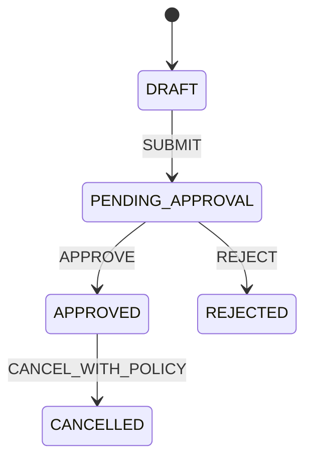
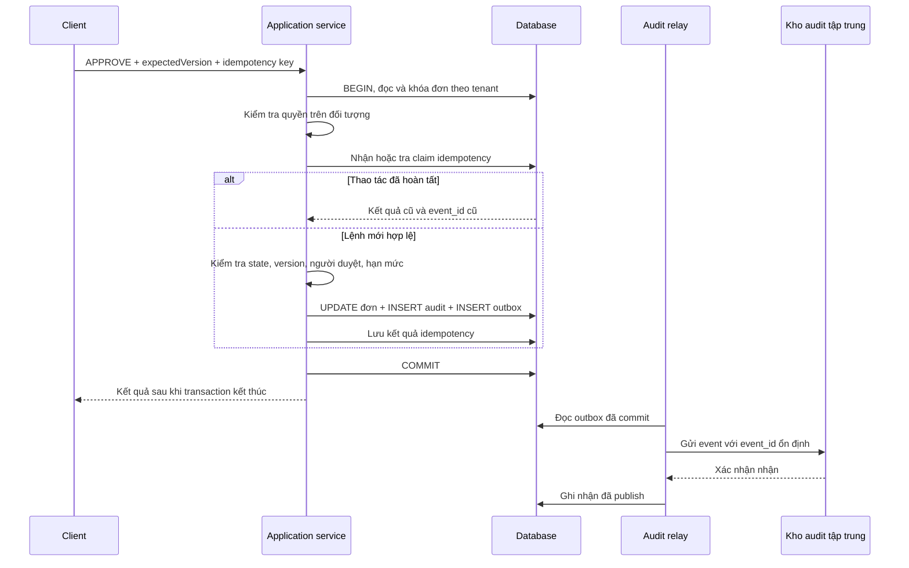

# Transition audit event — Dấu vết kiểm toán cho chuyển trạng thái

## 1. Audit một chuyển trạng thái để trả lời điều gì?

Trong một quy trình nghiệp vụ, trường `status` chỉ cho biết đối tượng đang ở đâu. Nó không giải thích ai đã đưa đối tượng đến đó, dựa trên quyền nào, với dữ liệu nào và có bỏ qua bước bắt buộc hay không.

**Transition audit event** là bản ghi có cấu trúc về một chuyển trạng thái của đối tượng nghiệp vụ, kèm danh tính thực hiện, trạng thái trước/sau và ngữ cảnh ra quyết định. Trong bài này, tên `TRANSITION_COMMITTED` chỉ sự kiện về một chuyển trạng thái đã được lưu thành công cùng transaction nghiệp vụ. Yêu cầu bị từ chối và lỗi kỹ thuật có loại sự kiện riêng.

Bài thuộc chương **State Transitions** của module `SECURITY_APPLICATION_SECURITY_BUSINESS_LOGIC_SECURITY`. Trọng tâm là bảo vệ quy tắc nghiệp vụ trước việc bỏ qua phê duyệt, sửa giá, thao tác sai quyền và gửi yêu cầu trùng; audit hỗ trợ phát hiện, điều tra và đối soát những hành vi đó.

Ví dụ xuyên suốt là quy trình phê duyệt đơn mua hàng:



Các quy tắc được giả định cho ví dụ:

- Chỉ đơn `PENDING_APPROVAL` mới được phê duyệt.
- Người phê duyệt phải có quyền trên đúng đơn và đúng tenant, tức phạm vi tổ chức sở hữu dữ liệu.
- Người tạo đơn không được tự phê duyệt.
- Tổng tiền do server tính và lưu phải nằm trong hạn mức được phép của người phê duyệt.
- Mọi thay đổi ảnh hưởng quyết định phê duyệt phải tăng version của đơn. Sau khi gửi duyệt, sửa giá phải đi qua quy trình chỉnh sửa và phê duyệt lại được định nghĩa rõ.
- Một lần phê duyệt có hiệu lực phải có đúng một audit event chuẩn; việc gửi lại HTTP request hoặc gửi lại message không được tạo thêm lần phê duyệt.

Audit không thay thế các kiểm tra trên. Nếu backend cho phép `DRAFT → APPROVED` trái quy tắc, một dòng log mô tả đầy đủ vẫn không ngăn được sai phạm.

Sau bài học, người học cần thiết kế được hợp đồng sự kiện, đặt việc ghi audit đúng transaction, xử lý retry và phân biệt bằng chứng chuyển trạng thái với bằng chứng về nỗ lực tấn công.

## 2. Phân biệt ý định, quyết định và sự kiện đã xảy ra

Một request có thể đi qua nhiều mốc. Không nên gom tất cả thành một sự kiện mơ hồ tên `APPROVE_SUCCESS`.

| Mốc | Ý nghĩa | Có chứng minh trạng thái đã đổi không? |
| --- | --- | --- |
| `TRANSITION_ATTEMPTED` | Hệ thống nhận được ý định thực hiện action | Không |
| `TRANSITION_DENIED` | Quyền hoặc quy tắc nghiệp vụ không cho phép | Không; trạng thái phải giữ nguyên |
| `TRANSITION_FAILED` | Xử lý gặp lỗi kỹ thuật và đã xác định chưa commit | Không |
| `TRANSITION_COMMITTED` | Transaction chứa thay đổi trạng thái và audit đã commit | Có, trong phạm vi bảo đảm của nơi lưu chuẩn |
| `IDEMPOTENT_REPLAY` | Request đang nhận lại kết quả của thao tác đã hoàn tất | Không phải một chuyển trạng thái mới |

Nếu mất kết nối đúng lúc commit, ứng dụng có thể **chưa biết kết quả**. Không kết luận ngay rằng thao tác đã thất bại rồi thực hiện lại với khóa mới; cần tra cứu hoặc retry cùng idempotency key để xác định kết quả đã lưu.

Với chuyển trạng thái bị từ chối, dùng các trường như `requested_action`, `requested_to_state`, `observed_state` và `reason_code`. Không đặt `to_state = APPROVED` theo cách khiến công cụ điều tra hiểu nhầm rằng đơn đã được duyệt. Chỉ ghi `observed_state` khi hệ thống thực sự đọc được đối tượng trong phạm vi được phép.

HTTP access log trả lời request nào đã tới endpoint. Technical log giải thích lỗi thực thi. Transition audit giải thích sự thay đổi nghiệp vụ. Domain event phục vụ các thành phần nghiệp vụ khác. Các loại bản ghi có thể dùng chung `correlation_id`, nhưng không mặc nhiên có cùng dữ liệu, quyền đọc hoặc thời hạn lưu.

Một domain event như `PurchaseApproved` cũng có thể đóng vai trò audit nếu hợp đồng của nó đáp ứng đủ yêu cầu kiểm toán và được lưu bền vững đúng cách. Ngược lại, việc có audit history không biến hệ thống thành event sourcing: chưa chắc có đủ sự kiện và quy tắc để dựng lại toàn bộ trạng thái từ đầu.

## 3. Bốn thuộc tính cốt lõi của audit đáng tin cậy

### 3.1. Gắn với sự thật đã commit

Trong thiết kế dùng một cơ sở dữ liệu quan hệ cho ví dụ này, đặt hai invariant:

```text
Thay đổi trạng thái được commit
    => audit event tương ứng được commit trong cùng transaction.

Transaction rollback
    => không có audit event TRANSITION_COMMITTED của thao tác đó.
```

Đối với một chuyển trạng thái của một đối tượng tại một version mới:

```text
Số audit event chuẩn cho (tenant, loại đối tượng, id đối tượng, version mới) = 1.
```

Invariant này nói về bản ghi chuẩn, không nói message chỉ được giao đúng một lần.

### 3.2. Lấy danh tính và trạng thái từ nguồn có thẩm quyền

Backend lấy actor từ ngữ cảnh xác thực đã kiểm chứng; lấy tenant từ phạm vi truy cập đã xác minh; lấy trạng thái trước và dữ liệu tính tiền từ dữ liệu server đã đọc trong transaction. Request không được tự quyết định `actor_id`, `from_state`, `policy_version` hoặc kết quả `ALLOW`.

Với tác vụ nền, ghi danh tính service và tác nhân khởi phát nếu có bằng chứng ủy quyền. Không biến header do client tự đặt thành bằng chứng một người quản trị đã hành động. `correlation_id` hỗ trợ tra cứu, không có giá trị cấp quyền.

### 3.3. Giải thích được quyết định trong quá khứ

Một event chỉ chứa `actor_id` và `to_state` sẽ khó giải thích vì quyền, hạn mức và chính sách có thể thay đổi sau đó. Cần lưu version chính sách cùng những dữ kiện quyết định đã được chọn lọc, ví dụ tổng tiền và hạn mức áp dụng lúc duyệt.

Ảnh chụp ngữ cảnh này phục vụ điều tra; nó không thay thế việc thực sự kiểm tra quyền. Một trường `decision = ALLOW` do ứng dụng ghi không tự chứng minh cơ chế phân quyền đã đúng.

### 3.4. Có khả năng phát hiện sửa đổi và thiếu hụt

Audit phải có quyền ghi/đọc được kiểm soát, khả năng đối soát và cơ chế bảo vệ phù hợp với mối đe dọa. Bảng mà tài khoản ứng dụng được tùy ý sửa hoặc xóa chưa phải bằng chứng độc lập trước kẻ đã chiếm quyền ứng dụng.

Audit trong cùng database bảo vệ tính nhất quán transaction. Muốn chống việc quản trị viên đặc quyền hoặc ứng dụng bị xâm nhập sửa bằng chứng, cần thêm lớp lưu trữ và kiểm soát độc lập được trình bày ở phần sau.

## 4. Thiết kế hợp đồng transition audit event

### 4.1. Những nhóm trường cần có

| Nhóm | Trường gợi ý | Mục đích |
| --- | --- | --- |
| Danh tính sự kiện | `event_id`, `event_type`, `schema_version` | Nhận diện, chống xử lý lặp và tiến hóa cấu trúc |
| Đối tượng | `tenant_id`, `aggregate_type`, `aggregate_id` | Chỉ rõ đối tượng nghiệp vụ được thay đổi |
| Chuyển trạng thái | `action`, `from_state`, `to_state` | Phân biệt lệnh nghiệp vụ với trạng thái đích |
| Thứ tự | `from_version`, `to_version` | Gắn event với version dữ liệu thực sự bị thay đổi |
| Chủ thể | `actor_id`, `actor_type`, `executor_id` | Phân biệt người/service chịu trách nhiệm và thành phần thực thi |
| Quyết định | `policy_version`, `reason_code`, `decision_context` | Giải thích căn cứ cho phép thao tác |
| Liên kết | `command_id`, `correlation_id` | Nối thao tác với request, retry và các bước liên quan |
| Thời gian | `occurred_at`, `recorded_at` | Phân biệt thời điểm server tạo sự kiện và thời điểm ghi nhận |

`aggregate` ở đây là đối tượng nghiệp vụ được quản lý nhất quán như một đơn mua hàng. `aggregate_id` là khóa ổn định; mã hiển thị như `PO-2026-0042` có thể được bổ sung nhưng không nên thay thế khóa đó.

Một event minh họa:

```json
{
  "event_id": "58b5cc72-6125-41c0-8992-0d70730ae130",
  "event_type": "TRANSITION_COMMITTED",
  "schema_version": 1,
  "tenant_id": "fe05ae07-c146-484f-837a-52638ad5ada1",
  "aggregate_type": "PURCHASE_ORDER",
  "aggregate_id": "8b950f3e-d810-4db6-b7b3-8b18c730f910",
  "action": "APPROVE",
  "from_state": "PENDING_APPROVAL",
  "to_state": "APPROVED",
  "from_version": 7,
  "to_version": 8,
  "actor_id": "bb7004c9-d62c-46af-aa41-e99c45c23476",
  "actor_type": "USER",
  "executor_id": "procurement-api",
  "command_id": "218d5ed3-fc87-4861-85ac-c777027cfde2",
  "correlation_id": "req-77c818",
  "policy_version": "purchase-approval-v3",
  "reason_code": "APPROVAL_RULES_SATISFIED",
  "decision_context": {
    "amount_minor_units": 275000000,
    "currency": "VND",
    "approver_limit_minor_units": 500000000,
    "independent_approver": true
  },
  "occurred_at": "2026-11-22T03:15:12.305Z",
  "recorded_at": "2026-11-22T03:15:12.309Z"
}
```

Các mã định danh và thời gian trên là dữ liệu ví dụ. `decision_context` sử dụng số nguyên theo đơn vị tiền nhỏ nhất của đồng tiền đã chọn, tránh sai số số thực và mơ hồ đơn vị. Chỉ đưa dữ kiện cần thiết vào ngữ cảnh, không serialize toàn bộ entity hay request.

`reason_code` là mã ổn định do server chọn. Ghi chú tự do của người dùng, nếu cần, là trường riêng được giới hạn độ dài và xử lý như dữ liệu không đáng tin cậy.

### 4.2. Không đánh đồng các loại ID

| ID | Vòng đời |
| --- | --- |
| `event_id` | Một sự kiện đã lưu; giữ nguyên khi publish lại |
| `command_id` | Một thao tác logic được hệ thống nhận diện; retry hợp lệ tra về thao tác đó |
| Idempotency key | Khóa client gửi, được server ràng buộc với danh tính, action và nội dung lệnh |
| Request/interaction ID | Một lượt gọi; mỗi retry có thể có ID mới |
| `correlation_id` | Nhóm nhiều lượt xử lý thuộc cùng luồng tra cứu |
| `causation_id` nếu có | Sự kiện hoặc lệnh trực tiếp gây ra sự kiện hiện tại |

Một lần phê duyệt có thể có một `command_id`, một `event_id`, ba request retry và hai lần message được giao. Không được tính bảy lần phê duyệt từ các con số đó.

Không bắt buộc lưu nguyên idempotency key trong audit. Có thể liên kết qua `command_id` trong kho idempotency; cách này tránh phổ biến một khóa do client kiểm soát sang nhiều hệ thống.

### 4.3. Version và thời gian có nhiệm vụ khác nhau

Trong ví dụ, mỗi lần thay đổi dữ liệu của đơn tăng `version` một đơn vị. Transition event ghi version ngay trước và sau lần đổi trạng thái. Nếu chỉnh sửa một thuộc tính mà không đổi trạng thái cũng tăng version, lịch sử transition có thể có khoảng trống version hợp lệ. Không kết luận mất audit chỉ vì thấy version 8 rồi 10.

Nếu cần kiểm chứng số thứ tự liên tục riêng cho chuyển trạng thái, thiết kế thêm `transition_sequence` tăng trong cùng transaction và có mốc đối soát. Mỗi aggregate có thứ tự riêng; version của hai đơn khác nhau không tạo ra thứ tự toàn cục.

Timestamp hỗ trợ điều tra theo thời gian, không thay thế version. Đồng hồ giữa các máy có thể lệch; thời điểm tạo event cũng không nhất thiết là thời điểm commit. Trong PostgreSQL, `CURRENT_TIMESTAMP` lấy mốc bắt đầu transaction, còn `clock_timestamp()` lấy thời gian tại lúc gọi. Cả hai đều không mặc nhiên là timestamp commit. [Tài liệu PostgreSQL về thời gian](https://www.postgresql.org/docs/current/functions-datetime.html#FUNCTIONS-DATETIME-CURRENT).

Khi trao đổi sự kiện, dùng biểu diễn thời gian có múi giờ rõ ràng, ví dụ UTC với hậu tố `Z`. Nếu bổ sung thời điểm collector nhận message, đặt tên riêng như `ingested_at` để không ghi đè thời gian gốc.

## 5. Ghi trạng thái và audit trong cùng transaction

### 5.1. Hai cách ghi dễ tạo bằng chứng sai hoặc thiếu

```java
// Sai về ranh giới bền vững nếu đây là hai thao tác độc lập.
purchaseRepository.approveAndCommit(id);
remoteAuditClient.send(approvedEvent);
```

Nếu tiến trình chết sau dòng đầu, đơn đã duyệt nhưng audit từ xa chưa nhận được. Đảo thứ tự cũng có vấn đề: audit báo đã duyệt trong khi database có thể rollback. `try/catch` và retry trong bộ nhớ không loại bỏ cửa sổ tiến trình bị dừng.

Chỉ thêm callback `afterCommit` cũng chưa đủ bảo đảm giao bền vững: tiến trình có thể dừng sau commit nhưng trước hoặc trong callback. Callback có thể đánh thức relay, còn dữ liệu cần gửi phải tồn tại bền vững.

### 5.2. Bảng audit chuẩn và outbox

Schema PostgreSQL dưới đây dành riêng cho chuyển trạng thái thành công. Không dùng bảng này để nhét sự kiện bị từ chối bằng những trạng thái trước/sau giả định.

```sql
CREATE TABLE transition_audit_event (
    event_id          uuid PRIMARY KEY,
    schema_version    integer NOT NULL CHECK (schema_version > 0),
    tenant_id         uuid NOT NULL,
    aggregate_type    varchar(64) NOT NULL,
    aggregate_id      uuid NOT NULL,
    action            varchar(64) NOT NULL,
    from_state        varchar(64) NOT NULL,
    to_state          varchar(64) NOT NULL,
    from_version      bigint NOT NULL CHECK (from_version >= 0),
    to_version        bigint NOT NULL,
    actor_id          uuid NOT NULL,
    actor_type        varchar(16) NOT NULL,
    executor_id       varchar(128) NOT NULL,
    command_id        uuid NOT NULL,
    correlation_id    varchar(128) NOT NULL,
    policy_version    varchar(128) NOT NULL,
    reason_code       varchar(64) NOT NULL,
    decision_context  jsonb NOT NULL,
    occurred_at       timestamptz NOT NULL,
    recorded_at       timestamptz NOT NULL DEFAULT clock_timestamp(),
    CHECK (from_state <> to_state),
    CHECK (to_version = from_version + 1),
    UNIQUE (tenant_id, aggregate_type, aggregate_id, to_version)
);

CREATE TABLE audit_delivery_outbox (
    event_id      uuid PRIMARY KEY
                  REFERENCES transition_audit_event(event_id),
    published_at  timestamptz
);
```

Hợp đồng serialize quy định event từ bảng đầu có `event_type = TRANSITION_COMMITTED`. Outbox ở đây lưu tham chiếu đến bản ghi chuẩn bất biến; relay đọc event đó để tạo payload gửi đi. Vì thế không có hai bản payload độc lập dễ lệch nhau. Nếu chọn lưu sẵn payload trong outbox, phải tạo nó từ cùng event và giữ payload đã chốt ổn định khi retry.

Unique constraint ngăn hai audit event cho cùng version đích trong mô hình này. Nó không tự kiểm tra người duyệt có đúng quyền, cũng không bắt database từ chối một lệnh cập nhật trạng thái hoàn toàn bỏ qua bảng audit. Mọi đường ghi, gồm batch, quản trị và sửa dữ liệu vận hành, cần đi qua cơ chế được kiểm soát tương ứng.

Với dữ liệu đã tồn tại trước khi triển khai audit, xác định mốc bắt đầu hoặc baseline được phê chuẩn. Không tạo lại lịch sử giả với actor và thời điểm không có bằng chứng.

### 5.3. Luồng transaction đề xuất



Đây là ứng dụng của transactional outbox: dữ liệu nghiệp vụ và ý định gửi sự kiện được ghi nguyên tử tại một nơi; relay gửi sau commit. Relay vẫn có thể gửi trùng nếu đã gửi nhưng chưa lưu được xác nhận. Consumer cần khử trùng theo event ID. [AWS Prescriptive Guidance: Transactional outbox](https://docs.aws.amazon.com/prescriptive-guidance/latest/cloud-design-patterns/transactional-outbox.html).

Không gọi broker hay dịch vụ audit từ xa trong lúc giữ khóa đơn nếu việc đó không thuộc một giao thức transaction được thiết kế riêng. Một transaction database thông thường không tự bao trùm HTTP hoặc broker.

## 6. Ví dụ Java: phê duyệt có audit

Đoạn sau là khung application service dùng `TransactionTemplate` của Spring; các repository và policy là hợp đồng minh họa, không phải mã hoàn chỉnh có thể chép vào chạy ngay.

Giả định `TrustedActor` được dựng từ xác thực đã kiểm chứng. Tất cả repository trong callback dùng cùng database và cùng transaction manager. `PurchaseOrder` được đọc với khóa hàng; kết quả kiểm tra policy chứa version chính sách và dữ kiện được chọn lọc.

```java
public ApprovalResult approve(ApproveCommand cmd, TrustedActor actor) {
    return transactions.execute(tx -> {
        // SELECT ... WHERE tenant_id = ? AND id = ? FOR UPDATE
        PurchaseOrder order = purchases.lockByTenant(
            actor.tenantId(), cmd.orderId());

        // Quyền hiện tại trên đối tượng; chưa kiểm tra trạng thái nguồn.
        authorization.requireApprovalScope(actor, order);

        String fingerprint = fingerprints.forApproval(
            cmd.orderId(), cmd.expectedVersion());

        IdempotencyClaim claim = idempotency.claim(
            actor.tenantId(),
            actor.subjectId(),
            "APPROVE_PURCHASE",
            cmd.idempotencyKey(),
            fingerprint);

        if (claim.isCompleted()) {
            return claim.originalResult();
        }

        if (order.version() != cmd.expectedVersion()) {
            throw new StaleVersionException();
        }
        if (order.state() != PurchaseState.PENDING_APPROVAL) {
            throw new InvalidTransitionException();
        }

        // Kiểm tra người tạo khác người duyệt và hạn mức tiền server đã lưu.
        ApprovalDecision decision = approvalPolicy.requireAllowed(actor, order);

        long fromVersion = order.version();
        long toVersion = Math.addExact(fromVersion, 1);
        UUID eventId = UUID.randomUUID();
        Instant occurredAt = clock.instant();

        int changed = purchases.approveWhereVersionMatches(
            actor.tenantId(), order.id(), fromVersion,
            actor.subjectId(), occurredAt);

        if (changed != 1) {
            throw new ConcurrentTransitionException();
        }

        TransitionAuditEvent event = TransitionAuditEvent.approved(
            eventId,
            actor,
            order.id(),
            order.state(),
            fromVersion,
            toVersion,
            claim.commandId(),
            cmd.correlationId(),
            decision,
            occurredAt);

        auditEvents.insert(event);
        auditOutbox.enqueue(eventId);

        ApprovalResult result = new ApprovalResult(
            order.id(), PurchaseState.APPROVED, toVersion, eventId);

        idempotency.complete(claim, result);
        return result;
    });
}
```

Những hợp đồng quan trọng phía sau ví dụ:

1. `lockByTenant` truy vấn theo cả tenant và ID, không tải đơn tenant khác rồi mới lọc ở giao diện. Không tìm thấy hoặc không có quyền phải được ánh xạ sang phản hồi không làm lộ dữ liệu đối tượng.
2. `requireApprovalScope` kiểm tra quyền thao tác trên đơn ở thời điểm gọi, kể cả khi trả lại kết quả cũ. Kiểm tra trạng thái nguồn đặt sau nhánh replay để một retry hợp lệ không bị từ chối chỉ vì thao tác trước đã chuyển đơn sang `APPROVED`.
3. `claim` ràng buộc khóa với tenant, chủ thể, loại lệnh và fingerprint của toàn bộ nội dung có ý nghĩa nghiệp vụ. Nó có unique constraint, xử lý cạnh tranh giữa các transaction và từ chối cùng khóa nhưng khác fingerprint. Đây không phải phép `get` rồi `put` trong bộ nhớ.
4. Khi mở rộng lệnh thêm trường có ý nghĩa như lý do ngoại lệ, fingerprint phải bao gồm trường đó. Không đưa correlation ID thay đổi theo request vào fingerprint nghiệp vụ.
5. `approveWhereVersionMatches` tăng version một lần, cập nhật người/thời điểm duyệt và chỉ thành công nếu trạng thái, tenant, ID và version đều khớp. Phải kiểm tra số hàng cập nhật.
6. `TransitionAuditEvent.approved` lấy actor từ `TrustedActor`, chốt đích `APPROVED` và action `APPROVE`, lấy policy/context từ `ApprovalDecision`. Nó không dùng `from_state` hoặc `actor_id` do request cung cấp. `order` trong ví dụ là snapshot trước cập nhật SQL.
7. Lỗi update, ghi audit, ghi outbox hoặc hoàn tất idempotency phải làm rollback toàn bộ. Các exception trong ví dụ là runtime exception và không bị nuốt trong callback. `execute` chỉ trả kết quả ra ngoài sau khi hoàn tất transaction.

SQL cập nhật tương ứng có thể có dạng:

```sql
UPDATE purchase_order
SET state = 'APPROVED',
    version = version + 1,
    approved_by = :actor_id,
    approved_at = :occurred_at
WHERE tenant_id = :tenant_id
  AND id = :order_id
  AND state = 'PENDING_APPROVAL'
  AND version = :expected_version;
```

Khóa hàng tuần tự hóa xử lý trên cùng đơn; điều kiện version còn phát hiện client đang duyệt một bản đã cũ. Không giữ transaction trong khi chờ người dùng thao tác trên màn hình.

Khóa đơn không tự khóa hạn mức hoặc quyền nằm trong bảng khác. Ví dụ giả định policy được đánh giá từ ngữ cảnh quyền đã xác minh theo quy tắc nhất quán mà hệ thống chấp nhận. Nếu invariant yêu cầu hạn mức dùng chung, quota hoặc việc thu hồi quyền phải có hiệu lực nguyên tử với lần duyệt, cần khóa/cập nhật có điều kiện trên nguồn dữ liệu đó hoặc thiết kế giao thức tương ứng. Ghi một policy version vào audit không giải quyết cuộc đua dữ liệu.

## 7. Audit cho yêu cầu bị từ chối và transaction rollback

Giả sử người tạo đơn cố tự phê duyệt. Backend phát hiện vi phạm và ném exception. Nếu `TRANSITION_DENIED` được insert trong cùng transaction rồi rollback, bằng chứng về lần thử cũng biến mất.

Thiết kế hai đường bền vững có mục đích khác nhau:

- **Đường thành công:** trạng thái, audit chuẩn, outbox và kết quả idempotency cùng transaction nghiệp vụ.
- **Đường bị từ chối:** sau khi transaction nghiệp vụ đã kết thúc rollback, thành phần bao ngoài ghi security attempt qua transaction ngắn riêng hoặc kênh thu thập bền vững được thiết kế trước.

Sự kiện bị từ chối có thể chứa:

```json
{
  "event_type": "TRANSITION_DENIED",
  "requested_action": "APPROVE",
  "requested_to_state": "APPROVED",
  "observed_state": "PENDING_APPROVAL",
  "reason_code": "SELF_APPROVAL_FORBIDDEN",
  "correlation_id": "req-denied-01"
}
```

Đây chỉ là phần minh họa nội dung từ chối; envelope thực tế vẫn cần event ID, danh tính đã biết, phạm vi đối tượng an toàn và thời gian. Khi người gọi không có quyền trên đối tượng, không tự bổ sung trạng thái hoặc dữ liệu tenant khác vào log mà người gọi hay hệ thống cấp thấp hơn đọc được.

Không dùng transaction độc lập cho `TRANSITION_COMMITTED` trước khi transaction nghiệp vụ commit: bản ghi đó có thể tồn tại dù thay đổi bị hủy. Transaction riêng phù hợp cho bằng chứng về lần thử thất bại, vì sự thật cần ghi là **đã có lần thử**, không phải **đã đổi trạng thái**.

Nếu kênh ghi sự kiện từ chối cũng lỗi, cần cảnh báo và xử lý theo chính sách khả dụng đã chọn. Trong mọi trường hợp, yêu cầu đã bị từ chối không được chuyển thành được phép chỉ vì logging hỏng. Phản hồi cho client cũng không được lộ stack trace hoặc lỗi chứa bí mật của hệ thống thu thập.

## 8. Retry, cạnh tranh và giao message trùng

### 8.1. Ba lớp chống lặp khác nhau

| Lớp | Vấn đề cần giải quyết | Cơ chế |
| --- | --- | --- |
| HTTP/command | Client không nhận được response rồi gửi lại | Idempotency key có phạm vi và fingerprint; trả kết quả cũ |
| Aggregate/database | Hai lệnh khác nhau cùng tác động lên một version | Khóa hoặc optimistic concurrency; kiểm tra state/version khi ghi |
| Message/consumer | Relay hoặc broker giao lại cùng event | Giữ `event_id`; consumer deduplicate bền vững |

Một unique constraint trên `event_id` không ngăn được hai lần phê duyệt nếu mỗi lần code sinh một ID mới. Ngược lại, HTTP idempotency không ngăn message được giao lại sau khi nghiệp vụ đã hoàn tất.

### 8.2. Hai người đồng thời phê duyệt

Giả sử A và B đều gửi lệnh với `expectedVersion = 7`, mỗi người dùng một key khác nhau:

1. A khóa đơn, vượt qua kiểm tra, lưu version 8 và audit event E1, rồi commit.
2. B chờ khóa. Khi đọc tiếp, B thấy version 8 thay vì 7 và nhận conflict.
3. Chỉ E1 mô tả chuyển trạng thái có hiệu lực. Lần thử của B có thể có sự kiện xung đột riêng.

Không lấy `from_state` từ bản đọc cũ ngoài transaction rồi ghi audit sau cập nhật. Nếu làm vậy, audit có thể kể một chuỗi trạng thái chưa từng tồn tại.

### 8.3. Retry sau khi commit nhưng mất response

Server đã lưu version 8, E1 và kết quả idempotency, nhưng response bị mất. Client retry cùng key và cùng nội dung. Server kiểm tra quyền hiện tại phù hợp, đọc kết quả đã lưu và trả E1. Không tạo E2, không tăng version lên 9 chỉ để phục vụ retry.

Nếu key được dùng lại với order hoặc nội dung khác, từ chối xung đột. Thời hạn giữ key và kết quả phải phù hợp cửa sổ retry/replay của nghiệp vụ; hết hạn key không làm mất nghĩa vụ kiểm tra state và version.

### 8.4. Relay chết sau khi gửi event

Relay gửi E1 đến kho audit, kho đã nhận, nhưng relay chết trước khi đánh dấu `published_at`. Lần chạy sau relay gửi lại E1. Kho đích phải nhận diện cùng event ID thay vì đếm thêm một lần phê duyệt.

Nếu consumer vừa cập nhật projection vừa ghi dấu đã xử lý, đặt hai thao tác đó trong cùng transaction ở consumer. Đánh dấu xong rồi mới cập nhật có thể mất hiệu ứng; cập nhật xong rồi đánh dấu riêng có thể lặp hiệu ứng. Với tác dụng phụ ở hệ thống khác, cần thêm idempotency hoặc giao thức phù hợp tại hệ thống nhận.

Thứ tự publish cũng cần thiết kế: nhiều relay có thể gửi version 9 trước version 8. Có thể phân vùng theo aggregate để giữ thứ tự hoặc để consumer phát hiện, đệm và phục hồi sự kiện đến lệch thứ tự. Không dựa riêng vào timestamp để kết luận thứ tự nhân quả.

Outbox giải quyết nguyên tử giữa ghi dữ liệu và ghi ý định gửi tại nguồn; nó không tự đem lại hiệu ứng “exactly once” xuyên mọi database, broker và dịch vụ.

## 9. Bảo vệ audit khỏi bị sửa và khỏi làm lộ dữ liệu

### 9.1. Phân quyền theo vai trò lưu trữ

Thiết kế quyền theo chức năng cụ thể:

- Tài khoản chạy nghiệp vụ có quyền thêm event cần thiết, không có quyền tùy ý sửa/xóa lịch sử. Tài khoản đó không làm owner bảng và không thừa hưởng quyền đặc quyền qua role khác.
- Relay chỉ đọc event và cập nhật trạng thái giao trong outbox; không chỉnh sửa nội dung audit chuẩn.
- Người xem audit bị giới hạn theo tenant, phạm vi nghiệp vụ và mục đích điều tra. Khả năng phê duyệt đơn không mặc nhiên cho phép xuất toàn bộ audit của tổ chức.
- Thao tác quản trị, xuất dữ liệu, thay đổi cấu hình thu thập và truy cập audit nhạy cảm có dấu vết giám sát riêng.

Giới hạn `UPDATE/DELETE` hỗ trợ mô hình append-only đối với tài khoản thông thường. Nó không ngăn được owner, superuser hoặc kẻ kiểm soát tầng lưu trữ. Với rủi ro cao, gửi bản sao đến kho do miền quản trị độc lập kiểm soát, có lưu giữ bất biến hoặc write-once theo chính sách đã phê chuẩn.

Nếu phát hiện một event ghi nhầm nghiệp vụ, bổ sung bản ghi đính chính tham chiếu event cũ và lý do, thay vì âm thầm viết lại lịch sử. Việc hủy một phê duyệt là action mới với kiểm tra quyền và audit mới; không xóa dấu vết lần phê duyệt ban đầu.

### 9.2. Giới hạn bảo vệ của hash và chữ ký

Có thể dùng chuỗi hash, ví dụ về mặt ý tưởng:

```text
h[i] = SHA-256(h[i-1] || canonical_event_bytes[i])
```

Muốn triển khai cần quy định serialization chuẩn, vị trí trong chuỗi và cách phối hợp các writer. Nếu kẻ tấn công sửa được toàn bộ chuỗi và tính lại hash, chuỗi không còn là bằng chứng độc lập. Xóa phần cuối chuỗi cũng có thể khó phát hiện nếu không có checkpoint nằm ngoài phạm vi bị kiểm soát.

Chữ ký hoặc MAC cần quản lý khóa độc lập và quy trình xoay khóa. Chúng hỗ trợ phát hiện sửa nội dung theo mô hình đe dọa đã chọn, không chứng minh rằng dữ liệu đầu vào ban đầu là thật hoặc tất cả sự kiện đều đã được ghi.

### 9.3. Giảm dữ liệu nhạy cảm và chống log injection

Áp dụng allowlist cho payload; loại bỏ token, mật khẩu và bí mật. Giới hạn kích thước dữ liệu do người dùng nhập, dùng serializer có escape đúng định dạng và kiểm soát quyền đọc, sửa, xóa log. Đây là các nguyên tắc được nêu trong [OWASP Logging Cheat Sheet](https://cheatsheetseries.owasp.org/cheatsheets/Logging_Cheat_Sheet.html).

Trong ví dụ đơn mua hàng, chỉ lưu số tiền khi nó cần để giải thích quyết định và kho audit đủ quyền bảo vệ dữ liệu đó. Ghi chú chứa ký tự xuống dòng không được biến thành một dòng log giả. Giao diện xem audit cũng phải encode dữ liệu trước khi hiển thị để ghi chú không trở thành nội dung thực thi.

Đặt thời hạn lưu, cơ chế hết hạn, quyền xuất dữ liệu và quy trình xử lý dữ liệu cá nhân theo yêu cầu cụ thể của hệ thống. Lịch sử audit không phải lý do để giữ mọi dữ liệu mãi mãi.

## 10. Khi kênh audit gặp sự cố

Phân biệt mất bằng chứng chuẩn với chậm gửi bản sao:

| Sự cố | Cách xử lý trong thiết kế của bài |
| --- | --- |
| Insert audit chuẩn thất bại | Rollback thay đổi trạng thái; không báo phê duyệt thành công |
| Insert outbox thất bại | Rollback vì thiếu ý định giao bền vững |
| Broker hoặc kho audit tập trung tạm ngừng | Transaction đã commit vẫn có audit và outbox cục bộ; relay retry |
| Outbox tồn đọng vượt ngưỡng | Cảnh báo, điều tra và áp dụng chính sách dung lượng/backpressure đã định nghĩa |
| Client không biết commit thành công hay không | Tra kết quả với cùng idempotency key; không đoán rồi tạo lệnh mới |
| Phát hiện bản ghi audit bị sửa hoặc thiếu | Bảo toàn bản sao, đối soát và xử lý sự cố; không tự “lấp” bằng dữ kiện bịa đặt |

Việc rollback khi không ghi được audit chuẩn là lựa chọn xuất phát từ invariant của quy trình phê duyệt này. Không nên suy rộng thành yêu cầu mọi debug log đều phải chặn nghiệp vụ khi logger lỗi.

Outbox chỉ hỗ trợ phục hồi nếu dữ liệu vẫn còn bền vững, relay thực sự được vận hành và các lỗi gửi không bị bỏ qua. Theo dõi ít nhất tuổi của bản ghi chưa gửi lâu nhất, số lượng tồn đọng, số lần retry và lỗi serialize. Với sự kiện chuyển trạng thái quan trọng, không lấy mẫu làm mất event chuẩn; có thể điều chỉnh sampling của telemetry phụ trợ theo chính sách riêng.

Với quy trình qua nhiều service, mỗi service ghi chuyển trạng thái của aggregate do mình quản lý trong transaction cục bộ. Dùng correlation/causation ID để nối luồng. Không giả định một transaction database tại service phê duyệt bao trùm cả việc thanh toán ở service khác; bước bù trừ cũng là hành động có audit riêng.

## 11. Đối soát và phát hiện lạm dụng logic

### 11.1. Những tín hiệu audit có thể cung cấp

- Cùng một chủ thể liên tục thử phê duyệt đơn do mình tạo.
- Nhiều yêu cầu nhảy từ `DRAFT` sang `APPROVED`, đặc biệt sau khi bị từ chối ở bước trước.
- Một người thử action trên nhiều đối tượng hoặc tenant ngoài phạm vi được cấp.
- Giá trị bị chỉnh sửa sau khi gửi duyệt nhưng phê duyệt không gắn với version mới.
- Tỷ lệ conflict tăng mạnh hoặc nhiều key khác nhau cùng nhắm một đơn đã duyệt.
- Có thay đổi trạng thái chuẩn nhưng thiếu audit trong khoảng dữ liệu đáng lẽ phải được bao phủ.

Mỗi lần conflict có thể chỉ là thao tác hợp lệ của hai nhân viên. Cần kết hợp tần suất, actor, đối tượng và chuỗi hành vi để đánh giá thay vì coi một tín hiệu đơn lẻ là bằng chứng chắc chắn của tấn công.

### 11.2. Truy vấn lịch sử một đối tượng

```sql
SELECT to_version, action, from_state, to_state,
       actor_id, policy_version, event_id, occurred_at
FROM transition_audit_event
WHERE tenant_id = :tenant_id
  AND aggregate_type = 'PURCHASE_ORDER'
  AND aggregate_id = :order_id
ORDER BY to_version;
```

Endpoint cung cấp truy vấn này vẫn cần kiểm tra quyền trên đối tượng và tenant. Có `tenant_id` trong bảng không tự tạo ra cách ly dữ liệu nếu câu truy vấn hoặc API bỏ qua nó.

Có thể kiểm tra sự nối tiếp của trạng thái đã ghi:

```sql
WITH history AS (
    SELECT event_id, aggregate_id, from_state, to_state, to_version,
           lag(to_state) OVER (
               PARTITION BY tenant_id, aggregate_type, aggregate_id
               ORDER BY to_version
           ) AS previous_to_state
    FROM transition_audit_event
    WHERE tenant_id = :tenant_id
      AND aggregate_type = 'PURCHASE_ORDER'
)
SELECT event_id, aggregate_id, previous_to_state, from_state, to_version
FROM history
WHERE previous_to_state IS NOT NULL
  AND previous_to_state <> from_state;
```

Truy vấn phát hiện một số chuỗi mâu thuẫn, không chứng minh lịch sử đầy đủ. Nó có thể không phát hiện xóa event đầu/cuối hoặc xóa cả một vòng chuyển trạng thái quay về điểm ban đầu. Cần đối chiếu thêm state hiện tại, transition sequence nếu có, baseline, dữ liệu thay đổi độc lập hoặc checkpoint.

Khi so sánh nhiều bảng, dùng snapshot nhất quán hoặc cơ chế checkpoint để tránh báo động do đọc hai thời điểm khác nhau. Khi đối chiếu kho tập trung với database nguồn, tính đến độ trễ giao và khoảng thời gian còn lưu dữ liệu.

## 12. Các tình huống kiểm thử cần thiết kế

Kiểm thử cần quan sát cả state, version, audit và outbox sau khi transaction hoàn tất. Chỉ xác nhận một mock logger đã được gọi không chứng minh dữ liệu đã commit nguyên tử.

| Tình huống | Kết quả nghiệp vụ | Kết quả audit mong đợi |
| --- | --- | --- |
| Duyệt hợp lệ version 7 | Sang `APPROVED`, version 8 | Một event chuẩn và một bản ghi outbox cùng event ID |
| Người tạo tự duyệt | Giữ nguyên | Không có committed event; có bằng chứng từ chối theo thiết kế |
| Duyệt trực tiếp từ `DRAFT` | Giữ nguyên | Từ chối `INVALID_SOURCE_STATE`; không ghi đã duyệt |
| Giả `actor_id` hoặc `from_state` trong request | Không dùng giá trị giả làm căn cứ | Actor/trạng thái trong audit đến từ ngữ cảnh server |
| Gửi ID đơn của tenant khác | Không truy cập hoặc thay đổi đơn đó | Không rò trạng thái, số tiền hoặc nội dung đơn qua phản hồi/log được lộ |
| Gửi giá thấp hơn trong body khi duyệt | Không làm thay đổi giá có thẩm quyền | Policy đánh giá số tiền server đang lưu; audit phản ánh số đó |
| Cùng key, cùng nội dung sau commit | Trả kết quả cũ | Giữ event ID cũ, không tăng version hoặc thêm transition event |
| Cùng key, khác nội dung nghiệp vụ | Từ chối xung đột | Không có chuyển trạng thái mới |
| Hai lệnh cùng expected version | Chỉ một lệnh có hiệu lực | Một committed event; lệnh thua không ghi thành công |
| Lỗi insert audit hoặc outbox | Rollback | Không có trạng thái mới hay event thành công sót lại |
| Lỗi trước commit sau khi insert audit | Rollback toàn bộ | Audit và outbox chưa commit không xuất hiện như sự thật đã hoàn tất |
| Mất response sau commit | Retry tra kết quả đã lưu | Không tạo sự kiện nghiệp vụ mới |
| Relay dừng sau khi gửi nhưng trước đánh dấu | Có thể giao lại | Consumer chỉ tạo một hiệu ứng cho cùng event ID |
| Thu hồi quyền trước lúc retry | Áp dụng chính sách quyền hiện tại đã định nghĩa | Không trả dữ liệu nhạy cảm chỉ vì có key cũ |
| Ghi chú chứa xuống dòng hoặc markup | Không phá pipeline và giao diện | Payload được giới hạn, escape và hiển thị an toàn |
| Tài khoản ứng dụng thử sửa/xóa lịch sử | Bị quyền database ngăn chặn | Có thể phát hiện thao tác quản trị trái chính sách ở kênh độc lập |

Với concurrency, dùng hai kết nối/transaction thật cùng tranh chấp một hàng; không chỉ gọi hai lần tuần tự rồi coi là kiểm thử race condition. Với độ bền, chèn lỗi tại ranh giới update, insert audit, insert outbox và commit, rồi đọc lại dữ liệu đã commit bằng kết nối khác.

Đây là các tình huống để xây dựng kiểm thử cho hệ thống thực tế. Bài học không khẳng định khung Java minh họa đã được chạy hoặc các bảo đảm này tự có chỉ nhờ annotation transaction.

## 13. Bài tập áp dụng

Thiết kế audit cho action `CANCEL_WITH_POLICY` từ `APPROVED` sang `CANCELLED`:

1. Xác định người nào có quyền hủy, điều kiện thời gian và ảnh hưởng của việc đã thanh toán.
2. Chọn dữ kiện quyết định cần lưu; chỉ rõ nguồn server có thẩm quyền cho từng dữ kiện.
3. Viết event thành công và event bị từ chối; giữ rõ ý nghĩa `to_state` đã xảy ra so với trạng thái đích được yêu cầu.
4. Chỉ ra cách trả kết quả khi client retry cùng key sau khi hủy thành công.
5. Mô tả cuộc đua giữa hủy đơn và xử lý bước tiếp theo. Nêu cơ chế bảo vệ invariant, không chỉ cách ghi log cuộc đua.
6. Nếu hủy kéo theo hoàn tiền ở service khác, tách audit của việc yêu cầu hoàn tiền và việc hoàn tiền thực sự hoàn tất; liên kết chúng bằng ID nhân quả phù hợp.

Một thiết kế đạt yêu cầu phải giải thích được vì sao hành động được phép tại thời điểm đó, vì sao không thể commit trạng thái mà mất audit chuẩn, và vì sao retry không tạo thêm tác dụng nghiệp vụ.

Transition audit event có giá trị khi nó kể lại đúng sự thay đổi đã được bảo vệ bởi state machine, quyền trên đối tượng và transaction. Version xác định bản dữ liệu, idempotency xác định thao tác logic, còn kiểm soát lưu trữ và đối soát giúp giữ bằng chứng có thể sử dụng lâu dài.
